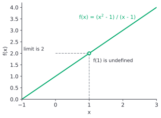
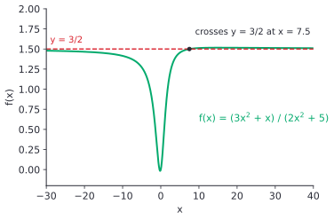
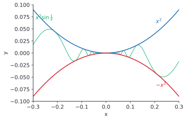

# Limits, intuition and limit laws

After this lesson you can estimate a limit from a table or a graph, decide when a limit does not exist, and evaluate limits with the limit laws, algebra, the squeeze theorem and the limit $\lim_{x \to 0} \frac{\sin x}{x} = 1$, including limits at infinity.

Before this: [reading function graphs](../../03-high-school/03-functions/02-reading-function-graphs.md), [rational functions and asymptotes](../../03-high-school/06-rational-expressions-and-equations/02-rational-functions-and-asymptotes.md) and [radians and the unit circle](../../03-high-school/09-trigonometry/02-radians-and-the-unit-circle.md).

## Quick check

Try these first. If you get all three right, skip to [Practice](#practice).

1. Find $\lim_{x \to 2} \dfrac{x^2 - 4}{x - 2}$.
2. Find $\lim_{x \to 0} \dfrac{\sqrt{x + 9} - 3}{x}$.
3. Find $\lim_{x \to \infty} \dfrac{3x^2 + x}{2x^2 + 5}$.

<details class="solution" markdown>
<summary>Answers</summary>

1. Substituting gives $\frac{0}{0}$, so factor: $\frac{(x - 2)(x + 2)}{x - 2} = x + 2$ for $x \ne 2$, and $x + 2$ gets close to 4. The limit is 4.
2. Substituting gives $\frac{0}{0}$. Multiply the top and bottom by $\sqrt{x + 9} + 3$ to get $\frac{x}{x(\sqrt{x + 9} + 3)} = \frac{1}{\sqrt{x + 9} + 3}$, which gets close to $\frac{1}{6}$. The limit is $\frac{1}{6}$.
3. Divide the top and bottom by $x^2$: $\frac{3 + 1/x}{2 + 5/x^2}$. The fractions with $x$ below them get close to 0, so the limit is $\frac{3}{2}$.

</details>

## The idea

Take $f(x) = \dfrac{x^2 - 1}{x - 1}$. You can't evaluate it at $x = 1$, because that makes the denominator 0. But you can ask what the function does near 1, by trying inputs on both sides:

| $x$ | $0.9$ | $0.99$ | $0.999$ | $1.001$ | $1.01$ | $1.1$ |
|---|---|---|---|---|---|---|
| $f(x)$ | $1.9$ | $1.99$ | $1.999$ | $2.001$ | $2.01$ | $2.1$ |

The outputs crowd in on 2 from both sides. The reason is algebra: for $x \ne 1$, $\frac{x^2 - 1}{x - 1} = \frac{(x - 1)(x + 1)}{x - 1} = x + 1$, so the graph is the line $y = x + 1$ with one point removed.



We say that the **limit** of $f(x)$ as $x$ approaches 1 is 2. The important part is that the limit says nothing about $f(1)$ itself. It describes the trend of the values near 1, and that trend can be perfectly clear even when the value at the point is missing, or is a different number.

Limits are the base of the rest of calculus. A derivative is a limit of slopes of secant lines, and an integral is a limit of sums. This lesson builds the picture and the working skills: tables and graphs, the ways a limit can fail, the limit laws, and a toolbox of tricks for the stubborn $\frac{0}{0}$ cases. The next lesson, [the epsilon-delta definition](02-epsilon-delta-definition.md), turns "gets close" into a precise statement and proves the laws from it.

## Definitions

Here is the working definition. Let $f$ be a function defined on an interval around the number $a$, except possibly at $a$ itself. We write

$$
\lim_{x \to a} f(x) = L
$$

and say the **limit** of $f(x)$ as $x$ approaches $a$ is $L$, when $f(x)$ can be made as close to $L$ as we like by taking $x$ close enough to $a$, with $x \ne a$. In plain words: whatever accuracy you ask for, there is a window around $a$ so that every input in the window (other than $a$) gives an output that accurate. The symbol $\to$ reads "approaches" or "goes to". If no such number $L$ exists, the limit does not exist.

This is a working definition, because "as close as we like" and "close enough" are left to the reader's judgment. The next lesson makes both exact, and the exact version is what every proof in calculus uses.

The **left-hand limit** $\lim_{x \to a^-} f(x) = L$ uses only inputs with $x < a$, and the **right-hand limit** $\lim_{x \to a^+} f(x) = L$ uses only inputs with $x > a$. Together they are the **one-sided limits**. The two-sided limit exists exactly when both one-sided limits exist and are equal:

$$
\lim_{x \to a} f(x) = L \quad \text{if and only if} \quad \lim_{x \to a^-} f(x) = L \text{ and } \lim_{x \to a^+} f(x) = L.
$$

In plain words, the values must head for the same number from the left and from the right.
The limit may fail to exist in three ways, shown in the figure below.


- A jump: the one-sided limits exist but differ, as in the left panel. There is no single number the outputs head for.
- A blow-up: the outputs grow in size without bound, as for $\frac{1}{x^2}$ near 0.
- An oscillation: the outputs keep swinging and never settle, as for $\sin\frac{1}{x}$ near 0.

The blow-up has special notation. We write $\lim_{x \to a} f(x) = \infty$ (an **infinite limit**) when $f(x)$ becomes larger than any number you name as $x$ gets close to $a$, and $\lim_{x \to a} f(x) = -\infty$ when it falls below any number you name. Here $\infty$ is not a real number, and an infinite limit is a way of describing how the limit fails to exist. The line $x = a$ is then a **vertical asymptote**, as defined in [rational functions and asymptotes](../../03-high-school/06-rational-expressions-and-equations/02-rational-functions-and-asymptotes.md#definitions).

The limit can also be taken as $x$ moves far out along the axis. We write $\lim_{x \to \infty} f(x) = L$ (a **limit at infinity**) when $f(x)$ can be made as close to $L$ as we like by taking $x$ large enough, and $\lim_{x \to -\infty} f(x) = L$ when $x$ is very negative instead. If either limit is a real number $L$, the line $y = L$ is a **horizontal asymptote**. In plain words, the graph settles down to a level far to the right (or far to the left).

The tool that makes most limits routine is a list of rules.

*Theorem 1 (limit laws).* Let $c$ be a constant, and suppose $\lim_{x \to a} f(x) = L$ and $\lim_{x \to a} g(x) = M$ both exist as real numbers. Then

| Law | Statement |
|---|---|
| sum and difference | $\lim_{x \to a} \bigl(f(x) \pm g(x)\bigr) = L \pm M$ |
| constant multiple | $\lim_{x \to a} c\,f(x) = cL$ |
| product | $\lim_{x \to a} f(x)\,g(x) = LM$ |
| quotient | $\lim_{x \to a} \dfrac{f(x)}{g(x)} = \dfrac{L}{M}$, provided $M \ne 0$ |
| power | $\lim_{x \to a} \bigl(f(x)\bigr)^n = L^n$ for each positive integer $n$ |
| root | $\lim_{x \to a} \sqrt[n]{f(x)} = \sqrt[n]{L}$, provided $L > 0$ when $n$ is even |

The same laws hold for one-sided limits and for limits at infinity. In plain words, a limit of a sum is the sum of the limits, and so on, as long as every limit you combine exists and, for a quotient, the bottom limit is not 0. The next lesson proves the sum law from the exact definition; the others have the same shape.

Two basic limits complete the list: $\lim_{x \to a} c = c$ for a constant $c$, and $\lim_{x \to a} x = a$.

*Theorem 2 (direct substitution).* If $p$ is a polynomial, then $\lim_{x \to a} p(x) = p(a)$. If $r = \frac{p}{q}$ is a rational function and $q(a) \ne 0$, then $\lim_{x \to a} r(x) = r(a)$.

We know the limit laws and the two basic limits. We want to show that the limit of a polynomial is its value. The plan is to build a polynomial from $x$ and constants using products and sums, and apply the laws one operation at a time.

*Proof.* Let $p(x) = c_n x^n + \dots + c_1 x + c_0$. By the power law, $\lim_{x \to a} x^k = a^k$ for each $k \ge 1$, since $\lim_{x \to a} x = a$. By the constant multiple law, $\lim_{x \to a} c_k x^k = c_k a^k$. The sum law, applied one term at a time, gives $\lim_{x \to a} p(x) = c_n a^n + \dots + c_1 a + c_0 = p(a)$. For $r = \frac{p}{q}$, the polynomials $p$ and $q$ have limits $p(a)$ and $q(a)$, and $q(a) \ne 0$, so the quotient law gives $\frac{p(a)}{q(a)} = r(a)$. $\blacksquare$

Look back: the proof only used the laws, and it used the condition $q(a) \ne 0$ exactly once, in the quotient law. When $q(a) = 0$, the theorem says nothing, and the rest of this lesson is about those cases.

One more fact explains why cancelling is allowed. If $f(x) = g(x)$ for every $x \ne a$ near $a$, then $f$ and $g$ have the same limit at $a$ (or both have none), because the limit only looks at inputs other than $a$. The proof is a one-line check against the exact definition in the next lesson.

The last two tools are the squeeze theorem and one special limit.

*Theorem 3 (squeeze theorem).* Suppose $g(x) \le f(x) \le h(x)$ for every $x$ near $a$ except possibly $x = a$, and suppose $\lim_{x \to a} g(x) = \lim_{x \to a} h(x) = L$. Then $\lim_{x \to a} f(x) = L$.

In plain words, if $f$ is trapped between two functions that both close in on $L$, then $f$ has no room to go anywhere else. Practice problem 7 of the next lesson proves it from the exact definition. The same statement holds as $x \to \pm\infty$.

*Theorem 4.* $\displaystyle \lim_{x \to 0} \frac{\sin x}{x} = 1$, where $x$ is in radians.

The proof is below, in the next section.

## How to do it

### Finding a limit

1. Look at the picture or a table first. Try values on both sides of $a$, and sketch the graph if you can. This gives a number to aim at, and a way to check the final answer.
2. Try direct substitution (Theorem 2). If $a$ is in the domain of a polynomial or rational function, you are done. Square roots work too, by the root law, when the expression under the root stays positive.
3. If substitution gives $\frac{c}{0}$ with $c \ne 0$, the limit is infinite or does not exist. Work out the sign on each side of $a$ to decide between $\infty$, $-\infty$ and "the sides disagree".
4. If substitution gives $\frac{0}{0}$, the expression is a **0/0 form**, which carries no information by itself, and you must change the formula without changing the values near $a$. Three standard moves:
    - factor the top and bottom and cancel the common factor,
    - multiply the top and bottom by a conjugate when a square root is involved,
    - combine fractions over a common denominator when the top is a difference of fractions.
5. If the expression has a sine or cosine, try to reach $\frac{\sin x}{x}$ with the same thing in the sine and below it. If the expression is trapped between simpler ones, use the squeeze theorem.
6. For a limit at infinity, divide the top and the bottom by the highest power of $x$ in the denominator. Every term of the form $\frac{c}{x^k}$ with $k > 0$ then goes to 0.
7. Check the answer against the table or graph from Step 1.

Cancelling in Step 4 changes the formula, but only at the input $a$ itself, which the limit never uses. That is why the move is legal. Write "for $x \ne a$" when you do it, so the reader knows you haven't forgotten.

### Why $\frac{\sin x}{x}$ approaches 1

The table in [radians and the unit circle](../../03-high-school/09-trigonometry/02-radians-and-the-unit-circle.md#why-calculus-and-code-use-radians) suggested the answer. Here is the proof, using areas in the unit circle.


*Proof of Theorem 4.* We know the area of a triangle is half of base times height, and the area of a sector of the unit circle with angle $x$ radians is $\frac{x}{2}$ ([arc length and sector area](../../03-high-school/09-trigonometry/02-radians-and-the-unit-circle.md#arc-length-and-sector-area)). We want the limit of $\frac{\sin x}{x}$ as $x \to 0$. The plan is to trap the area of the sector between the areas of two triangles, turn that into inequalities for $\frac{\sin x}{x}$, and squeeze.

Take $0 < x < \frac{\pi}{2}$, and use the figure. The triangle $OAP$ has base $OA = 1$ and height $\sin x$, so its area is $\frac{\sin x}{2}$. The triangle $OAT$ has base $OA = 1$ and height $AT = \tan x$, so its area is $\frac{\tan x}{2}$. The sector $OAP$ has area $\frac{x}{2}$. The triangle $OAP$ sits inside the sector, and the sector sits inside the triangle $OAT$, so

$$
\frac{\sin x}{2} < \frac{x}{2} < \frac{\tan x}{2}.
$$

Multiply by 2 to get $\sin x < x < \tan x$. Divide by $\sin x$, which is positive, and use $\tan x = \frac{\sin x}{\cos x}$:

$$
1 < \frac{x}{\sin x} < \frac{1}{\cos x}.
$$

All three parts are positive, so taking reciprocals reverses the inequalities:

$$
\cos x < \frac{\sin x}{x} < 1.
$$

Now $\frac{\sin(-x)}{-x} = \frac{\sin x}{x}$ and $\cos(-x) = \cos x$, so this also holds for $-\frac{\pi}{2} < x < 0$. It holds for every $x \ne 0$ near 0.

The squeeze theorem needs $\lim_{x \to 0} \cos x = 1$. From $\sin x < x$ we get $\lvert \sin x \rvert \le \lvert x \rvert$ for $\lvert x \rvert < \frac{\pi}{2}$, so $-\lvert x \rvert \le \sin x \le \lvert x \rvert$, and the squeeze theorem gives $\lim_{x \to 0} \sin x = 0$. For $\lvert x \rvert < \frac{\pi}{2}$ we have $\cos x > 0$, so $\cos x = \sqrt{1 - \sin^2 x}$, and the limit laws give $\lim_{x \to 0} \cos x = \sqrt{1 - 0} = 1$.

So $\frac{\sin x}{x}$ is trapped between $\cos x$ and the constant 1, both of which have limit 1. By the squeeze theorem, $\lim_{x \to 0} \frac{\sin x}{x} = 1$. $\blacksquare$

Look back: the inequality $\sin x < x < \tan x$ is the heart of it. The sector area $\frac{x}{2}$ is correct only when $x$ is in radians, which is why the answer is 1 and not $\frac{\pi}{180}$. A fully rigorous course defines sine through its power series instead of areas, because the area of a sector is itself defined using calculus; the argument here is the standard one for a first course.

Three limits follow quickly and come up again and again:

$$
\lim_{x \to 0} \frac{\sin ax}{ax} = 1, \qquad \lim_{x \to 0} \frac{\tan x}{x} = 1, \qquad \lim_{x \to 0} \frac{1 - \cos x}{x} = 0.
$$

The first holds for each nonzero constant $a$, because $ax \to 0$ when $x \to 0$. The second is $\frac{\sin x}{x} \cdot \frac{1}{\cos x}$. The third is worked out in Example 4.

### Limits at infinity and infinite limits

For a rational function, "divide by the highest power of $x$ in the denominator" gives the answer in one pass, and it matches the degree rules for horizontal asymptotes in [rational functions and asymptotes](../../03-high-school/06-rational-expressions-and-equations/02-rational-functions-and-asymptotes.md#where-the-asymptotes-are). The basic fact behind it is

$$
\lim_{x \to \infty} \frac{1}{x^k} = 0 \quad \text{and} \quad \lim_{x \to -\infty} \frac{1}{x^k} = 0 \quad \text{for each } k > 0,
$$

which the next lesson proves. The picture below shows the function from the Quick check settling toward its horizontal asymptote $y = \frac{3}{2}$ at both ends.



An infinite limit is different in kind: the outputs don't settle, they run away. With a fraction whose top has a nonzero limit $c$ and whose bottom goes to 0, the size of the fraction grows without bound, and the signs of the top and bottom on each side of $a$ decide the direction. For example $\lim_{x \to 0^+} \frac{1}{x} = \infty$ and $\lim_{x \to 0^-} \frac{1}{x} = -\infty$, so $\lim_{x \to 0} \frac{1}{x}$ does not exist. But $\lim_{x \to 0} \frac{1}{x^2} = \infty$, because $x^2$ is positive on both sides.

## Worked examples

<div class="example" markdown>

### Example 1: factoring a 0/0 form

Find $\displaystyle \lim_{x \to 3} \frac{x^2 - 9}{x^2 - 2x - 3}$.

Step 1: make a table. At $x = 2.9$ the value is $\frac{-0.59}{-0.39} \approx 1.5128$, and at $x = 3.1$ it is $\frac{0.61}{0.41} \approx 1.4878$. The values look headed for about 1.5, so that is the number to aim at.

Step 2: substitute $x = 3$. The top is $9 - 9 = 0$ and the bottom is $9 - 6 - 3 = 0$, so this is a $\frac{0}{0}$ form and substitution tells us nothing.

Step 4 (factoring): factor both parts. The top is a difference of squares and the bottom factors as a trinomial:

$$
\frac{x^2 - 9}{x^2 - 2x - 3} = \frac{(x - 3)(x + 3)}{(x - 3)(x + 1)}.
$$

For $x \ne 3$ the common factor $x - 3$ cancels, so the expression equals $\frac{x + 3}{x + 1}$ at every input except $x = 3$. The limit ignores $x = 3$, and the new function is a rational function whose denominator is not 0 at 3, so Theorem 2 applies:

$$
\lim_{x \to 3} \frac{x^2 - 9}{x^2 - 2x - 3} = \lim_{x \to 3} \frac{x + 3}{x + 1} = \frac{3 + 3}{3 + 1} = \frac{3}{2}.
$$

Step 7: check against a table. At $x = 2.99$ the original is $\frac{-0.0599}{-0.0399} \approx 1.5013$, and at $x = 3.01$ it is $\frac{0.0601}{0.0401} \approx 1.4988$. Both are close to $\frac{3}{2}$, and closer than the values in Step 1.

</div>

<div class="example" markdown>

### Example 2: a conjugate and a common denominator

(a) Find $\displaystyle \lim_{x \to 0} \frac{\sqrt{x + 9} - 3}{x}$.

Substituting gives $\frac{0}{0}$. The square root suggests the conjugate $\sqrt{x + 9} + 3$. Multiply the top and the bottom by it, and use $(u - v)(u + v) = u^2 - v^2$ on the top:

$$
\frac{\sqrt{x + 9} - 3}{x} \cdot \frac{\sqrt{x + 9} + 3}{\sqrt{x + 9} + 3} = \frac{(x + 9) - 9}{x\bigl(\sqrt{x + 9} + 3\bigr)} = \frac{1}{\sqrt{x + 9} + 3} \quad (x \ne 0).
$$

Now substitute: the root law gives $\sqrt{x + 9} \to 3$, so the limit is $\frac{1}{3 + 3} = \frac{1}{6}$.

Check: at $x = 0.01$ the original is $0.166620\ldots$, and at $x = -0.01$ it is $0.166713\ldots$. Both are close to $\frac{1}{6} = 0.1666\ldots$.

(b) Find $\displaystyle \lim_{h \to 0} \frac{\frac{1}{2 + h} - \frac{1}{2}}{h}$.

Substituting gives $\frac{0}{0}$. The top is a difference of fractions, so put it over a common denominator:

$$
\frac{1}{2 + h} - \frac{1}{2} = \frac{2 - (2 + h)}{2(2 + h)} = \frac{-h}{2(2 + h)}.
$$

Dividing by $h$ cancels the $h$ (for $h \ne 0$) and leaves $\frac{-1}{2(2 + h)}$, whose limit as $h \to 0$ is $\frac{-1}{4}$.

Check: at $h = 0.001$ the original is $-0.24988\ldots$, close to $-0.25$.

This is the exact shape of the limit that defines a derivative: the slope of the graph of $\frac{1}{x}$ at $x = 2$ is $-\frac{1}{4}$ ([the derivative definition](../02-derivatives/01-the-derivative-definition.md)).

</div>

<div class="example" markdown>

### Example 3: one-sided limits, and a limit that does not exist

Let $f(x) = \dfrac{\lvert x \rvert}{x}$ for $x \ne 0$. Find the one-sided limits at 0 and decide whether $\lim_{x \to 0} f(x)$ exists. Then do the same for $g(x) = \dfrac{x}{x - 3}$ at 3.

For $x > 0$ we have $\lvert x \rvert = x$, so $f(x) = 1$, and $\lim_{x \to 0^+} f(x) = 1$. For $x < 0$ we have $\lvert x \rvert = -x$, so $f(x) = -1$, and $\lim_{x \to 0^-} f(x) = -1$. The one-sided limits differ, so $\lim_{x \to 0} f(x)$ does not exist. This is a jump, and the outputs head for $-1$ from the left and $1$ from the right.

For $g$, substituting $x = 3$ gives $\frac{3}{0}$, so there is an infinite limit or none. Near 3 the top is close to 3, which is positive. For $x$ a little bigger than 3, the bottom $x - 3$ is a small positive number, so $g(x)$ is large and positive. For $x$ a little smaller than 3, the bottom is a small negative number, so $g(x)$ is large and negative:

$$
\lim_{x \to 3^+} \frac{x}{x - 3} = \infty, \qquad \lim_{x \to 3^-} \frac{x}{x - 3} = -\infty.
$$

The sides disagree, so $\lim_{x \to 3} g(x)$ does not exist, and $x = 3$ is a vertical asymptote.

Check: $g(3.01) = \frac{3.01}{0.01} = 301$ and $g(2.99) = \frac{2.99}{-0.01} = -299$.

</div>

<div class="example" markdown>

### Example 4: the squeeze theorem and the sine limit

(a) Show that $\lim_{x \to 0} x^2 \sin\frac{1}{x} = 0$.

The sine of anything is between $-1$ and $1$, so for $x \ne 0$,

$$
-x^2 \le x^2 \sin\frac{1}{x} \le x^2.
$$

Multiplying by $x^2$, which is positive, keeps the inequalities. Both $-x^2$ and $x^2$ have limit 0 at 0 (Theorem 2), so the squeeze theorem gives limit 0.



Compare this with $\sin\frac{1}{x}$ alone, which has no limit at 0. The factor $x^2$ is what damps the oscillation.

(b) Find $\displaystyle \lim_{x \to 0} \frac{1 - \cos x}{x}$.

Substituting gives $\frac{0}{0}$. Multiply by the conjugate $1 + \cos x$, and use $1 - \cos^2 x = \sin^2 x$:

$$
\frac{1 - \cos x}{x} \cdot \frac{1 + \cos x}{1 + \cos x} = \frac{\sin^2 x}{x(1 + \cos x)} = \frac{\sin x}{x} \cdot \frac{\sin x}{1 + \cos x}.
$$

The first factor has limit 1 (Theorem 4). The second has limit $\frac{0}{1 + 1} = 0$ by the quotient law, so the product law gives $1 \cdot 0 = 0$.

(c) Find $\displaystyle \lim_{x \to 0} \frac{\sin 3x}{5x}$.

Write $\frac{\sin 3x}{5x} = \frac{3}{5} \cdot \frac{\sin 3x}{3x}$. As $x \to 0$ the quantity $3x$ also goes to 0, so $\frac{\sin 3x}{3x} \to 1$, and the limit is $\frac{3}{5}$.

Check: at $x = 0.01$, $\frac{\sin 0.03}{0.05} = 0.59991\ldots$, close to 0.6.

</div>

<div class="example" markdown>

### Example 5: a limit at infinity (finish it yourself)

Find $\displaystyle \lim_{x \to \infty} \frac{5x^3 - 2x}{4x^3 + x^2 + 1}$.

Step 6: the highest power of $x$ in the denominator is $x^3$. Divide the top and the bottom by $x^3$:

$$
\frac{5x^3 - 2x}{4x^3 + x^2 + 1} = \frac{5 - \frac{2}{x^2}}{4 + \frac{1}{x} + \frac{1}{x^3}}.
$$

Now take the limit of the top and the bottom separately, and check your answer.

<details class="solution" markdown>
<summary>Finish</summary>

Each of $\frac{2}{x^2}$, $\frac{1}{x}$ and $\frac{1}{x^3}$ goes to 0, so the top goes to 5 and the bottom goes to 4. The bottom's limit is not 0, so the quotient law gives $\frac{5}{4}$.

Check: the leading terms are $5x^3$ and $4x^3$, whose ratio is $\frac{5}{4}$. At $x = 1000$ the original is $\frac{4.99999998 \times 10^9}{4.001000001 \times 10^9} \approx 1.2497$.

</details>

</div>

## Edge cases and common mistakes

<div class="warning" markdown>

Watch out: the limit is not the value at the point. For $f(x) = \frac{x^2 - 1}{x - 1}$ the limit at 1 is 2 and $f(1)$ is undefined. You can even change the value: if $f(1)$ were defined to be 7, the limit would still be 2, because the limit never looks at $x = 1$. Limit and value agree only for the well-behaved functions of the next lesson.

</div>

<div class="warning" markdown>

Watch out: $\frac{0}{0}$ is not 0, not 1 and not "undefined, so no limit". It is a signal that the formula needs work. The limits of $\frac{x^2}{x}$, $\frac{x}{x^2}$ and $\frac{3x}{x}$ at 0 are all $\frac{0}{0}$ forms, and they come out as 0, no limit (the sides disagree, $\pm\infty$) and 3. Only the cancellation tells you which. Compare $\frac{c}{0}$ with $c \ne 0$, which is not an indeterminate form: it always means a blow-up or a failed limit.

</div>

<div class="warning" markdown>

Watch out: the limit laws need the limits of the pieces to exist. The sum $\sin\frac{1}{x} + \bigl(-\sin\frac{1}{x}\bigr)$ is 0 for every $x \ne 0$, so its limit at 0 is 0, but the sum law can't be used to show that, because neither piece has a limit. Likewise $x \cdot \frac{1}{x} = 1$ has limit 1 at 0, but the product law doesn't apply to it: $\frac{1}{x}$ has no limit. The laws are one-way: if the pieces have limits, the combination follows the formula. They don't say that a combination without piece limits has no limit.

</div>

<div class="warning" markdown>

Watch out for tables on an oscillating function. The values of $\sin\frac{1}{x}$ at $x = \frac{1}{n\pi}$ are all 0, since $\sin(n\pi) = 0$, so a table built from those inputs suggests the limit is 0. At $x = \frac{1}{2n\pi + \pi/2}$ the values are all 1. Two sequences of inputs closing in on 0 give two different answers, which is a proof that the limit does not exist. A table can support a guess but never proves one.

</div>

<div class="warning" markdown>

Watch out: $\infty$ is not a number, so it doesn't obey arithmetic. A limit of "$\infty - \infty$" or "$0 \cdot \infty$" has no answer until you rewrite the expression. For example $x^2 - x$ goes to $\infty$ as $x \to \infty$, but you can't see that from "$\infty - \infty$". Factor it as $x(x - 1)$, which is a product of two large positive numbers, and the answer is plain. The safe cases are $\infty + \infty = \infty$, $\infty \cdot \infty = \infty$ and a constant divided by something huge, which goes to 0.

</div>

<div class="warning" markdown>

Watch out at $-\infty$ with square roots. For $x < 0$, $\sqrt{x^2} = \lvert x \rvert = -x$, not $x$. So $\lim_{x \to \infty} \frac{\sqrt{x^2 + 1}}{x} = 1$, but $\lim_{x \to -\infty} \frac{\sqrt{x^2 + 1}}{x} = -1$: dividing the root by $x$ means dividing by $\lvert x \rvert$ and then by a minus sign. This function has two different horizontal asymptotes, $y = 1$ on the right and $y = -1$ on the left.

</div>

<div class="warning" markdown>

Watch out: $\lim_{x \to 0} \frac{\sin x}{x} = 1$ needs radians. A calculator in degree mode gives $\frac{\sin 1^\circ}{1} \approx 0.01745$ for the same table. Every limit in this chapter uses radians.

</div>

## Tricks and shortcuts

For a limit at infinity of a rational function, you can read the answer off the leading terms: $\frac{5x^3 - 2x}{4x^3 + x^2 + 1}$ behaves like $\frac{5x^3}{4x^3}$ when $x$ is huge. If the degrees match, the limit is the ratio of leading coefficients. If the top has the lower degree, the limit is 0. If the top has the higher degree, the limit is $\pm\infty$. Write out the division only when you need to show your work.

For a difference of square roots, or a root minus a polynomial, as in $\sqrt{x^2 + x} - x$, multiply by the conjugate. It turns the subtraction (which is an $\infty - \infty$ form at infinity) into a fraction you can divide by $x$:

$$
\sqrt{x^2 + x} - x = \frac{(x^2 + x) - x^2}{\sqrt{x^2 + x} + x} = \frac{x}{\sqrt{x^2 + x} + x} = \frac{1}{\sqrt{1 + 1/x} + 1} \longrightarrow \frac{1}{2} \quad (x \to \infty).
$$

For sine limits, make the thing inside the sine appear below it. In $\frac{\sin 7x}{\sin 3x}$, write $\frac{\sin 7x}{7x} \cdot \frac{3x}{\sin 3x} \cdot \frac{7}{3}$, and the limit is $\frac{7}{3}$.

To catch a mistake in a limit, substitute a number close to $a$, such as $a \pm 0.001$, into the original expression and compare with your answer. The In code section does this, and shows the one way it can go wrong.

## In code

A table of values is how a computer estimates a limit, but a computer's numbers are not real numbers. The expression $\frac{1 - \cos x}{x^2}$ has limit $\frac{1}{2}$ at 0, and the code shows what happens when $x$ gets very small.

<details class="code" markdown>
<summary>In code</summary>

```python
import math

def f(x):
    return (1 - math.cos(x)) / x**2          # direct formula

def g(x):
    return 2 * math.sin(x / 2) ** 2 / x**2   # same function, rewritten

for k in range(1, 10):
    x = 10.0 ** -k
    print(f"{x:.0e}  {f(x):.10f}  {g(x):.10f}")
# 1e-01  0.4995834722  0.4995834722
# 1e-02  0.4999958333  0.4999958333
# 1e-03  0.4999999583  0.4999999583
# 1e-04  0.4999999970  0.4999999996
# 1e-05  0.5000000414  0.5000000000
# 1e-06  0.5000444503  0.5000000000
# 1e-07  0.4996003611  0.5000000000
# 1e-08  0.0000000000  0.5000000000
# 1e-09  0.0000000000  0.5000000000
```

Both columns head for 0.5 at first. Then the first column goes wrong: for tiny $x$, `math.cos(x)` is so close to 1 that it rounds to exactly 1.0, the subtraction gives 0, and the result is 0.0. This is cancellation, the same effect as in floating-point basics<!-- link: ../../06-cs-math/01-number-representation/04-floating-point-basics.md -->. The second column uses $1 - \cos x = 2\sin^2\frac{x}{2}$, which avoids subtracting two nearly equal numbers. The math says the limit exists and equals $\frac{1}{2}$; the machine's table, taken further than it can support, says 0. Algebra is the cure, which is also why Step 4 of the method is worth doing even when a calculator is at hand.

</details>

## FAQ

### Why does the limit ignore what happens at $a$ itself?

Because the question is about the trend near $a$. In the main uses, the point itself is the one place you can't look: a derivative is a slope $\frac{f(x + h) - f(x)}{h}$ at $h = 0$, which is $\frac{0}{0}$, and the limit as $h \to 0$ is the way to ask what it should be. If limits included the value at $a$, they couldn't describe a missing point at all.

### Does "gets close to $L$" mean the values never equal $L$?

No. For the constant function $f(x) = 5$, every output is 5 and the limit is 5. A function can also equal $L$ at some inputs near $a$, or even at infinitely many. The definition only asks that the outputs be within any tolerance of $L$, and a value that equals $L$ is within every tolerance.

### Why can't I just substitute?

You can, whenever substitution gives a number, for polynomials and rational functions (Theorem 2). Substitution fails exactly when the formula doesn't define a value at $a$, which is when the limit is interesting. The tricks in Step 4 rewrite the formula so that it does define a value, without changing the function anywhere except at $a$.

### If an infinite limit means the limit doesn't exist, why write $\lim = \infty$?

It is a more informative way of saying "does not exist". The notation records that the outputs grow beyond every bound, which a jump or an oscillation does not do, and it tells you there is a vertical asymptote. It doesn't mean $\infty$ is a number you can substitute into an equation.

## Practice

### Warm-up

1\. Use the limit laws and direct substitution to find (a) $\lim_{x \to -2} (x^3 - 4x + 1)$, (b) $\lim_{x \to 1} \dfrac{x^2 + 3}{x + 1}$ and (c) $\lim_{x \to 4} \sqrt{x}\,(x - 1)$.

<details class="solution" markdown>
<summary>Solution</summary>

Each function is a polynomial, a rational function with a nonzero denominator, or a root of a positive number, so substitution works.

- (a) $(-2)^3 - 4(-2) + 1 = -8 + 8 + 1 = 1$.
- (b) The denominator is $1 + 1 = 2 \ne 0$, so the limit is $\frac{1 + 3}{2} = 2$.
- (c) The root law gives $\sqrt{4} = 2$, and $x - 1 \to 3$, so the product law gives $2 \cdot 3 = 6$.

Check (b) with a nearby value: at $x = 1.001$, $\frac{4.002001}{2.001} \approx 2.0000$.

</details>

2\. Let $f(x) = x + 3$ for $x < 2$, $f(2) = 1$, and $f(x) = x^2 - 1$ for $x > 2$. Find $\lim_{x \to 2^-} f(x)$, $\lim_{x \to 2^+} f(x)$, $\lim_{x \to 2} f(x)$ (if it exists) and $f(2)$.

<details class="solution" markdown>
<summary>Solution</summary>

The left-hand limit uses the formula for $x < 2$: $\lim_{x \to 2^-} (x + 3) = 5$. The right-hand limit uses the formula for $x > 2$: $\lim_{x \to 2^+} (x^2 - 1) = 3$. The one-sided limits differ, so $\lim_{x \to 2} f(x)$ does not exist. The value is $f(2) = 1$, which agrees with neither side and played no part in the limits.

Check: at $x = 1.999$ the value is $4.999$, and at $x = 2.001$ it is $3.004$. They head for 5 and 3.

</details>

3\. Find (a) $\lim_{x \to \infty} \dfrac{4x - 1}{2x + 7}$, (b) $\lim_{x \to \infty} \dfrac{x^2 + 1}{x^3 - x}$ and (c) $\lim_{x \to \infty} \dfrac{x^3}{x^2 + 1}$.

<details class="solution" markdown>
<summary>Solution</summary>

- (a) Divide by $x$: $\frac{4 - 1/x}{2 + 7/x} \to \frac{4}{2} = 2$.
- (b) Divide by $x^3$: $\frac{1/x + 1/x^3}{1 - 1/x^2} \to \frac{0}{1} = 0$.
- (c) Divide by $x^2$: $\frac{x}{1 + 1/x^2}$. The top grows without bound and the bottom goes to 1, so the quotient grows without bound: the limit is $\infty$ (a limit that does not exist as a number).

Check with $x = 1000$: (a) $\frac{3999}{2007} \approx 1.99$, (b) about $0.001$, (c) about $1000$, which keeps growing as $x$ does.

</details>

### Standard

4\. Find (a) $\lim_{x \to -3} \dfrac{x^2 + 2x - 3}{x^2 - 9}$, (b) $\lim_{x \to 0} \dfrac{\sqrt{4 + x} - 2}{x}$ and (c) $\lim_{x \to 1} \dfrac{\frac{1}{x} - 1}{x - 1}$.

<details class="solution" markdown>
<summary>Solution</summary>

All three are $\frac{0}{0}$ forms.

(a) Factor: $\frac{(x + 3)(x - 1)}{(x - 3)(x + 3)}$. For $x \ne -3$ this is $\frac{x - 1}{x - 3}$, and the limit is $\frac{-4}{-6} = \frac{2}{3}$.

(b) Multiply by the conjugate $\sqrt{4 + x} + 2$: the top becomes $(4 + x) - 4 = x$, so the expression is $\frac{1}{\sqrt{4 + x} + 2}$ for $x \ne 0$, with limit $\frac{1}{4}$.

(c) Combine over a common denominator: $\frac{1}{x} - 1 = \frac{1 - x}{x}$. Then $\frac{(1 - x)/x}{x - 1} = \frac{-(x - 1)}{x(x - 1)} = -\frac{1}{x}$ for $x \ne 1$, and the limit is $-1$.

Check numerically: (a) at $x = -3.001$ the value is $0.66672\ldots$ (about $\frac{2}{3}$); (b) at $x = 0.001$ it is $0.24998\ldots$; (c) at $x = 1.001$ it is $-0.99900\ldots$.

</details>

5\. Find (a) $\lim_{x \to 0} \dfrac{\sin 7x}{\sin 3x}$, (b) $\lim_{x \to 0} \dfrac{1 - \cos 2x}{x^2}$ and (c) $\lim_{x \to 0} x \cos\dfrac{1}{x}$.

<details class="solution" markdown>
<summary>Solution</summary>

(a) Write it as $\frac{\sin 7x}{7x} \cdot \frac{3x}{\sin 3x} \cdot \frac{7}{3}$. The first factor goes to 1, the second goes to $\frac{1}{1} = 1$, so the limit is $\frac{7}{3}$.

(b) Use $1 - \cos 2x = 2\sin^2 x$ (a double-angle identity from [trig identities](../../03-high-school/09-trigonometry/04-trig-identities-and-inverse-trig.md)). Then $\frac{1 - \cos 2x}{x^2} = 2\left(\frac{\sin x}{x}\right)^2 \to 2 \cdot 1^2 = 2$.

(c) For $x \ne 0$, $-1 \le \cos\frac{1}{x} \le 1$, so $-\lvert x \rvert \le x\cos\frac{1}{x} \le \lvert x \rvert$. Both bounds go to 0, so by the squeeze theorem the limit is 0.

Check: at $x = 0.001$, (a) $\frac{\sin 0.007}{\sin 0.003} = 2.3333$ (about $\frac{7}{3}$), (b) $\frac{1 - \cos 0.002}{0.000001} = 2.0000$, and (c) $0.001 \cos 1000$ has size at most $0.001$.

</details>

6\. Find each limit, using $\infty$ or $-\infty$ where it applies, or say it does not exist: (a) $\lim_{x \to 2^+} \dfrac{x + 1}{x - 2}$, (b) $\lim_{x \to 2^-} \dfrac{x + 1}{x - 2}$, (c) $\lim_{x \to 0} \dfrac{x^2 - x}{x^3}$.

<details class="solution" markdown>
<summary>Solution</summary>

(a) Near 2 the top is close to 3 (positive). For $x > 2$ the bottom is a small positive number, so the quotient is large and positive: $\infty$.

(b) For $x < 2$ the bottom is a small negative number, so the quotient is large and negative: $-\infty$. By (a) and (b), the two-sided limit at 2 does not exist.

(c) Factor: $\frac{x(x - 1)}{x^3} = \frac{x - 1}{x^2}$ for $x \ne 0$. The top is close to $-1$ and the bottom $x^2$ is a small positive number on both sides, so the quotient is large and negative on both sides: the limit is $-\infty$.

Check: $\frac{3.001}{0.001} = 3001$, $\frac{2.999}{-0.001} = -2999$ and $\frac{0.001 - 1}{0.000001} \approx -999000$.

</details>

### Challenge

7\. Find (a) $\lim_{x \to \infty} \left(\sqrt{x^2 + 3x} - x\right)$ and (b) $\lim_{x \to -\infty} \left(\sqrt{x^2 + 3x} + x\right)$.

<details class="solution" markdown>
<summary>Solution</summary>

(a) Multiply by the conjugate: $\sqrt{x^2 + 3x} - x = \frac{3x}{\sqrt{x^2 + 3x} + x}$. For $x > 0$, divide the top and the bottom by $x$, and use $\sqrt{x^2} = x$: this is $\frac{3}{\sqrt{1 + 3/x} + 1}$, which goes to $\frac{3}{1 + 1} = \frac{3}{2}$.

(b) Multiply by the conjugate $\sqrt{x^2 + 3x} - x$: $\sqrt{x^2 + 3x} + x = \frac{3x}{\sqrt{x^2 + 3x} - x}$. Now $x < 0$, so $\sqrt{x^2 + 3x} = \lvert x \rvert\sqrt{1 + 3/x} = -x\sqrt{1 + 3/x}$. Divide the top and the bottom by $x$. The bottom becomes $\frac{-x\sqrt{1 + 3/x} - x}{x} = -\sqrt{1 + 3/x} - 1$, so the expression is $\frac{3}{-\sqrt{1 + 3/x} - 1}$, which goes to $\frac{3}{-2} = -\frac{3}{2}$.

Check: at $x = 10^6$, part (a) is $1.49999\ldots$; at $x = -10^6$, part (b) is $-1.50000\ldots$. The signs differ because the root is $\lvert x \rvert$, not $x$.

</details>

8\. (Reviews [rational functions and asymptotes](../../03-high-school/06-rational-expressions-and-equations/02-rational-functions-and-asymptotes.md).) Let $F(x) = \dfrac{2x^2 - 2}{x^2 + x - 2}$. Use limits to find the height of its hole, both one-sided limits at its vertical asymptote, and its horizontal asymptote.

<details class="solution" markdown>
<summary>Solution</summary>

Factor: $F(x) = \frac{2(x - 1)(x + 1)}{(x + 2)(x - 1)}$. For $x \ne 1$ this is $\frac{2(x + 1)}{x + 2}$.

At $x = 1$ the factor $x - 1$ cancels, so the limit is $\frac{2 \cdot 2}{3} = \frac{4}{3}$: a hole at $\left(1, \frac{4}{3}\right)$.

At $x = -2$ the top of the reduced form is $2(-2 + 1) = -2$, which is negative, and the bottom $x + 2$ is a small positive number for $x > -2$ and a small negative number for $x < -2$. So $\lim_{x \to -2^+} F(x) = -\infty$ and $\lim_{x \to -2^-} F(x) = \infty$.

At infinity, divide the top and the bottom by $x^2$: $\frac{2 - 2/x^2}{1 + 1/x - 2/x^2} \to 2$ as $x \to \infty$ and as $x \to -\infty$. The horizontal asymptote is $y = 2$.

Check with values: $F(1.001) \approx 1.3336$, $F(-1.999) \approx -1998$, $F(-2.001) \approx 2002$ and $F(10^6) \approx 2.000$.

</details>

## Where this shows up

- The next lesson, [the epsilon-delta definition](02-epsilon-delta-definition.md), makes "close enough" exact and proves the sum law. After it, [continuity, asymptotes and the IVT](03-continuity-asymptotes-and-ivt.md) uses limits to say when a graph has no gaps, and [the derivative definition](../02-derivatives/01-the-derivative-definition.md) is the limit from Example 2(b) in general.
- In computer science, the growth rate of an algorithm is a limit at infinity. If $\lim_{n \to \infty} \frac{f(n)}{g(n)} = 0$, then $f$ grows more slowly than $g$, which is the idea behind [asymptotic notation](../../06-cs-math/04-sums-recurrences-and-algorithms/04-asymptotic-notation.md). The cancellation seen in the In code section is a limit that a computer evaluates badly, which matters in numerical code.
- In economics, average cost per unit with a fixed cost has a horizontal asymptote at the marginal cost, as in the first example of [rational functions and asymptotes](../../03-high-school/06-rational-expressions-and-equations/02-rational-functions-and-asymptotes.md#the-idea). Marginal analysis with derivatives<!-- link: ../../07-economics-math/03-firms-and-consumers/01-marginal-analysis-with-derivatives.md --> is built on the limit in Example 2(b).
