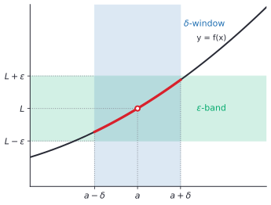
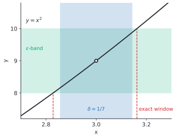
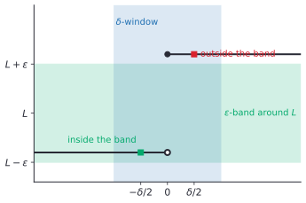

# The epsilon-delta definition

After this lesson you can read the epsilon-delta definition of a limit, find a $\delta$ for a given $\varepsilon$, write a complete proof that a limit has a stated value, and prove that a limit does not exist by negating the definition.

Before this: [limits, intuition and limit laws](01-limits-intuition-and-limit-laws.md), [quantifiers](../../04-proofs-and-logic/02-logic-and-sets/04-quantifiers.md), [negation and translating English](../../04-proofs-and-logic/02-logic-and-sets/05-negation-and-translating-english.md) and [direct proof](../../04-proofs-and-logic/03-core-proof-methods/01-direct-proof.md). Absolute value inequalities from [absolute value equations and inequalities](../../03-high-school/01-algebra-foundations/04-absolute-value-equations-and-inequalities.md) are used on every line.

## Quick check

Try these first. If you get all three right, skip to [Practice](#practice).

1. For $f(x) = 3x - 1$, $a = 2$ and $L = 5$, find a number $\delta > 0$ such that $0 < \lvert x - 2 \rvert < \delta$ guarantees $\lvert f(x) - 5 \rvert < 0.6$.
2. Write the negation of "$\lim_{x \to a} f(x) = L$" using quantifiers.
3. True or false: if a number $\delta$ works for a given $\varepsilon$, then $\frac{\delta}{2}$ also works for that $\varepsilon$.

<details class="solution" markdown>
<summary>Answers</summary>

1. We have $\lvert f(x) - 5 \rvert = \lvert 3x - 6 \rvert = 3\lvert x - 2 \rvert$, and this is below 0.6 exactly when $\lvert x - 2 \rvert < 0.2$. So $\delta = 0.2$ works, and so does every smaller positive number.
2. There is some $\varepsilon > 0$ such that for every $\delta > 0$ there is an $x$ with $0 < \lvert x - a \rvert < \delta$ and $\lvert f(x) - L \rvert \ge \varepsilon$. Every quantifier flips, the order stays, and the implication becomes an "and" with the conclusion negated.
3. True. The window of half-width $\frac{\delta}{2}$ is inside the window of half-width $\delta$, so every $x$ in it was already covered.

</details>

## The idea

A tile maker cuts square tiles whose side is meant to be 3 cm, so the area should be 9 cm$^2$. The customer accepts an area that is off by less than 0.1 cm$^2$. How accurate must the cutting be? The area is $x^2$ for a side $x$, and we need $\lvert x^2 - 9 \rvert < 0.1$, which means $8.9 < x^2 < 9.1$, so $2.9833 < x < 3.0166$ (rounded). A side within 0.0166 cm of 3 is good enough.

Now the customer asks for an error below 0.001 cm$^2$. The same calculation gives a side within about 0.000167 cm of 3. A tighter demand needs a tighter cut, but for every demand there is a cut that meets it. That is exactly what "$x^2$ gets close to 9 as $x$ gets close to 3" means. The demand is a tolerance on the output, and the answer is a tolerance on the input.

Mathematicians call the output tolerance $\varepsilon$ (epsilon) and the input tolerance $\delta$ (delta). The phrase "as close as we like" from the last lesson becomes "for every $\varepsilon > 0$", and "close enough" becomes "there is a $\delta > 0$". This lesson reads that definition slowly, then uses it to prove limits, using the proof format from the proofs chapters.

## Definitions

Let $f$ be a function defined on an interval around $a$, except possibly at $a$ itself. The statement $\lim_{x \to a} f(x) = L$ means

$$
\forall \varepsilon > 0\ \exists \delta > 0\ \forall x\ \bigl(0 < \lvert x - a \rvert < \delta \Rightarrow \lvert f(x) - L \rvert < \varepsilon\bigr).
$$

In words: for every $\varepsilon > 0$ there is a $\delta > 0$ such that for every $x$, if $x$ is within $\delta$ of $a$ and is not $a$, then $f(x)$ is within $\varepsilon$ of $L$. This is the **epsilon-delta definition** of a limit. It is the statement about limits that was previewed in [negation and translating English](../../04-proofs-and-logic/02-logic-and-sets/05-negation-and-translating-english.md#example-2-negating-a-limit-statement).

Each piece does a separate job.

| Piece | Meaning |
|---|---|
| $\forall \varepsilon > 0$ | A tolerance on the output, any positive number, however small. A smaller $\varepsilon$ is a harder demand. |
| $\exists \delta > 0$ | A tolerance on the input that answers the demand. It is allowed to depend on $\varepsilon$ (and on $f$ and $a$), and it is the thing you must find. |
| $\forall x$ | Every input, with no exceptions inside the window. One bad $x$ breaks the claim. |
| $0 < \lvert x - a \rvert < \delta$ | The input is in the window $(a - \delta, a + \delta)$ but is not $a$ itself. The "$0 <$" is what makes the limit ignore the value at $a$. |
| $\lvert f(x) - L \rvert < \varepsilon$ | The output is in the band $(L - \varepsilon, L + \varepsilon)$. |

The picture shows both tolerances at once. The shaded horizontal strip is the $\varepsilon$-band around $L$, and the shaded vertical strip is the $\delta$-window around $a$. The definition holds for this $\varepsilon$ and $\delta$ when the part of the graph over the window (the thick curve, with the point at $a$ left out) stays inside the band.



A good way to hold the definition is as a game between you and a challenger. The challenger picks a tolerance $\varepsilon$. You answer with a window size $\delta$. The challenger then picks any $x$ in the window, other than $a$. You win the round if $f(x)$ is within $\varepsilon$ of $L$. The statement $\lim_{x \to a} f(x) = L$ says that you have a winning answer for every $\varepsilon$ the challenger can pick. To prove it, you give a rule that turns each $\varepsilon$ into a working $\delta$, and show that the rule always wins. To disprove it, you find one $\varepsilon$ that you can't answer: whatever $\delta$ is offered, the challenger finds an $x$ that breaks it.

The order of the quantifiers is the whole content. Because $\delta$ comes after $\varepsilon$, it may depend on $\varepsilon$. If the order were swapped to "there is a $\delta$ that works for every $\varepsilon$", then a single window would keep $f(x)$ within every positive distance of $L$, so $f(x) = L$ for all $x$ in the window, and only constant functions would qualify. And $x$ comes last, so $\delta$ can't depend on $x$.

Three variants appear in the same pattern.

- For a one-sided limit, replace the window by a half-window: $a < x < a + \delta$ for the right-hand limit and $a - \delta < x < a$ for the left-hand limit.
- For a limit at infinity, $\lim_{x \to \infty} f(x) = L$ means that for every $\varepsilon > 0$ there is a number $M$ such that $x > M$ implies $\lvert f(x) - L \rvert < \varepsilon$. The window is replaced by a half-line.
- For an infinite limit, $\lim_{x \to a} f(x) = \infty$ means that for every number $M$ there is a $\delta > 0$ such that $0 < \lvert x - a \rvert < \delta$ implies $f(x) > M$. The band is replaced by "above any height".

The limit at infinity has a quick proof that was promised in the last lesson: $\lim_{x \to \infty} \frac{1}{x^k} = 0$ for each $k > 0$. Given $\varepsilon > 0$, take $M = \varepsilon^{-1/k}$, which is positive. If $x > M$, then $x^k > M^k = \frac{1}{\varepsilon}$, so $\left\lvert \frac{1}{x^k} - 0 \right\rvert = \frac{1}{x^k} < \varepsilon$. The case $x \to -\infty$ is the same with $\lvert x \rvert$.

The following proposition is the justification promised in the last lesson for "cancel and then take the limit".

*Proposition.* Suppose $f(x) = g(x)$ whenever $0 < \lvert x - a \rvert < r$, for some $r > 0$. If $\lim_{x \to a} g(x) = L$, then $\lim_{x \to a} f(x) = L$.

We know the definition for $g$. We want it for $f$, using the same $\varepsilon$. The plan is to take the $\delta$ that works for $g$ and shrink it, if needed, to fit inside $r$.

*Proof.* Let $\varepsilon > 0$. Since $g$ has limit $L$, there is a $\delta_1 > 0$ with $\lvert g(x) - L \rvert < \varepsilon$ whenever $0 < \lvert x - a \rvert < \delta_1$. Let $\delta = \min(\delta_1, r)$. If $0 < \lvert x - a \rvert < \delta$, then $f(x) = g(x)$ because $\lvert x - a \rvert < r$, and $\lvert g(x) - L \rvert < \varepsilon$ because $\lvert x - a \rvert < \delta_1$. So $\lvert f(x) - L \rvert < \varepsilon$. $\blacksquare$

Look back: the proof used the "$0 <$" in the definition, since the hypothesis says nothing about $x = a$. That is why a limit does not care about $f(a)$.

## How to do it

### Finding $\delta$ and writing the proof

A limit proof has two parts: a search for $\delta$, done on scratch paper, and a clean proof that is written forwards. The proof doesn't show the search.

1. State what you must prove, for this $f$, $a$ and $L$: for every $\varepsilon > 0$ there is a $\delta > 0$ such that $0 < \lvert x - a \rvert < \delta$ implies $\lvert f(x) - L \rvert < \varepsilon$.
2. Scratch work: start from the goal $\lvert f(x) - L \rvert < \varepsilon$ and simplify $\lvert f(x) - L \rvert$ until a factor $\lvert x - a \rvert$ appears. For a polynomial, $f(x) - L$ is divisible by $x - a$.
3. If the other factor is not a constant, bound it. First promise $\delta \le 1$ (any fixed number works). Then $\lvert x - a \rvert < 1$ puts $x$ in a known interval, and on that interval the other factor is smaller than some number $K$.
4. Choose $\delta$ as the smallest of all the promises: $\delta = \min(1, \frac{\varepsilon}{K})$ in the usual case, and $\delta = \frac{\varepsilon}{K}$ when the other factor was already a constant $K$.
5. Write the proof forwards: "Let $\varepsilon > 0$. Take $\delta = \dots$. Suppose $0 < \lvert x - a \rvert < \delta$. Then $\lvert f(x) - L \rvert = \dots < \varepsilon$."
6. Check with numbers: pick one $\varepsilon$, compute $\delta$, and test points just inside the window.

The scratch work in Steps 2 and 3 runs backwards, from the goal toward a condition on $x$. The proof in Step 5 runs forwards from the condition on $x$ to the goal. Never copy the scratch work as the proof, because it assumes what it should show. The proofs below follow Steps 1 to 6 in the proofs-chapter format (what we know, what we want, the plan, the proof, a look back).

### A linear function

*Theorem 1.* For constants $m$ and $b$, $\displaystyle \lim_{x \to a} (mx + b) = ma + b$.

We know the definition, and that $\lvert mx + b - (ma + b) \rvert = \lvert m \rvert\,\lvert x - a \rvert$. We want a $\delta$ for each $\varepsilon$. The plan is to solve $\lvert m \rvert\,\lvert x - a \rvert < \varepsilon$ for $\lvert x - a \rvert$ (this is the scratch work, Step 2) and use the answer as $\delta$.

*Proof.* First suppose $m \ne 0$. Let $\varepsilon > 0$ and take $\delta = \frac{\varepsilon}{\lvert m \rvert}$, which is positive. Suppose $0 < \lvert x - a \rvert < \delta$. Then

$$
\lvert (mx + b) - (ma + b) \rvert = \lvert m \rvert\,\lvert x - a \rvert < \lvert m \rvert \cdot \frac{\varepsilon}{\lvert m \rvert} = \varepsilon.
$$

If $m = 0$ the function is the constant $b$, and $\lvert b - b \rvert = 0 < \varepsilon$ for every $x$, so any $\delta$ works, such as $\delta = 1$. $\blacksquare$

Look back: for a line, the best $\delta$ is $\frac{\varepsilon}{\lvert m \rvert}$, since the output tolerance divided by the slope is the input tolerance. A steeper line needs a narrower window. Practice problem 7 of [absolute value equations and inequalities](../../03-high-school/01-algebra-foundations/04-absolute-value-equations-and-inequalities.md) was this proof with $m = 3$.

### A curve: $x^2$ near 3

*Theorem 2.* $\displaystyle \lim_{x \to 3} x^2 = 9$.

We know the definition, and the factoring $x^2 - 9 = (x - 3)(x + 3)$. We want a $\delta$ for each $\varepsilon$. The plan: the factor $\lvert x - 3 \rvert$ is what $\delta$ controls, but the other factor $\lvert x + 3 \rvert$ is not a constant, so we first restrict to $\lvert x - 3 \rvert < 1$ to bound it.

*Scratch work.* We need $\lvert x - 3 \rvert\,\lvert x + 3 \rvert < \varepsilon$. If $\lvert x - 3 \rvert < 1$ then $2 < x < 4$, so $5 < x + 3 < 7$, and $\lvert x + 3 \rvert < 7$. Then $\lvert x - 3 \rvert \cdot \lvert x + 3 \rvert < 7\lvert x - 3 \rvert$, and $7\lvert x - 3 \rvert \le \varepsilon$ if $\lvert x - 3 \rvert \le \frac{\varepsilon}{7}$. So $\delta$ must satisfy two promises: $\delta \le 1$ and $\delta \le \frac{\varepsilon}{7}$.

*Proof.* Let $\varepsilon > 0$ and take $\delta = \min\left(1, \frac{\varepsilon}{7}\right)$, which is positive. Suppose $0 < \lvert x - 3 \rvert < \delta$. Since $\delta \le 1$, we have $\lvert x - 3 \rvert < 1$, so $2 < x < 4$ and $\lvert x + 3 \rvert < 7$. Since $\delta \le \frac{\varepsilon}{7}$, we have $\lvert x - 3 \rvert < \frac{\varepsilon}{7}$. Therefore

$$
\lvert x^2 - 9 \rvert = \lvert x - 3 \rvert\,\lvert x + 3 \rvert < \frac{\varepsilon}{7} \cdot 7 = \varepsilon. \qquad \blacksquare
$$

Look back: the notation $\min(1, \frac{\varepsilon}{7})$ means "the smaller of the two numbers", so $\delta$ satisfies both promises at once. The first promise is the same trick whenever a factor in $f(x) - L$ depends on $x$: pin $x$ near $a$ first, bound the factor, then spend the rest of $\delta$ on $\lvert x - a \rvert$. Each promise is used once in the proof, and a $\delta$ with only one of them would not work. Try $\delta = \frac{\varepsilon}{7}$ alone with $\varepsilon = 70$, so $\delta = 10$: the point $x = 12.9$ is in the window, but $\lvert 12.9^2 - 9 \rvert = 157.41 > 70$. Without $\delta \le 1$, the factor $\lvert x + 3 \rvert$ is not bounded by 7.

The picture for $\varepsilon = 1$ shows the proof in action. The formula gives $\delta = \min(1, \frac{1}{7}) = \frac{1}{7} \approx 0.1429$, and the exact window, where $x^2$ stays between 8 and 10, is $(\sqrt{8}, \sqrt{10}) = (2.8284, 3.1623)$. The formula's window sits inside the exact one. The proof only has to find some working $\delta$, and it usually finds a smaller one than necessary.



### The sum law

The next lesson's results rest on the limit laws, so here is a proof of one of them from the definition. The others have the same structure.

*Theorem 3 (sum law).* If $\lim_{x \to a} f(x) = L$ and $\lim_{x \to a} g(x) = M$, then $\lim_{x \to a} \bigl(f(x) + g(x)\bigr) = L + M$.

We know the definition for $f$ and for $g$, and the triangle inequality $\lvert u + v \rvert \le \lvert u \rvert + \lvert v \rvert$ ([absolute value](../../03-high-school/01-algebra-foundations/04-absolute-value-equations-and-inequalities.md#edge-cases-and-common-mistakes)). We want, for each $\varepsilon$, a $\delta$ that keeps $f + g$ within $\varepsilon$ of $L + M$. The plan is to demand accuracy $\frac{\varepsilon}{2}$ from each of $f$ and $g$, so the two errors add up to at most $\varepsilon$, and to use the smaller of the two windows.

*Proof.* Let $\varepsilon > 0$. Since $\frac{\varepsilon}{2} > 0$, the definition for $f$ gives a $\delta_1 > 0$ such that $0 < \lvert x - a \rvert < \delta_1$ implies $\lvert f(x) - L \rvert < \frac{\varepsilon}{2}$. The definition for $g$ gives a $\delta_2 > 0$ such that $0 < \lvert x - a \rvert < \delta_2$ implies $\lvert g(x) - M \rvert < \frac{\varepsilon}{2}$. Take $\delta = \min(\delta_1, \delta_2)$. Suppose $0 < \lvert x - a \rvert < \delta$. Then both implications apply, and

$$
\lvert (f(x) + g(x)) - (L + M) \rvert = \lvert (f(x) - L) + (g(x) - M) \rvert \le \lvert f(x) - L \rvert + \lvert g(x) - M \rvert < \frac{\varepsilon}{2} + \frac{\varepsilon}{2} = \varepsilon. \qquad \blacksquare
$$

Look back: the proof used the definition as a tool, in the direction "for every $\varepsilon$, here is a $\delta$", and applied it to $\frac{\varepsilon}{2}$, which is allowed because the definition holds for every positive number. Splitting the budget $\varepsilon$ into two halves is the standard move, and the product law uses the same idea with a more careful split.

### Proving that a limit does not exist

To show that $\lim_{x \to a} f(x) = L$ is false, negate the definition (the rules are in [negation and translating English](../../04-proofs-and-logic/02-logic-and-sets/05-negation-and-translating-english.md#the-negation-rules)):

$$
\exists \varepsilon > 0\ \forall \delta > 0\ \exists x\ \bigl(0 < \lvert x - a \rvert < \delta \wedge \lvert f(x) - L \rvert \ge \varepsilon\bigr).
$$

In the game, you name one $\varepsilon$ the challenger will never be able to meet, and for every $\delta$ you name an $x$ in the window that breaks it. To show that no limit exists at all, you must do this for every candidate $L$.

*Theorem 4.* Let $H(x) = 0$ for $x < 0$ and $H(x) = 1$ for $x \ge 0$. Then $\lim_{x \to 0} H(x)$ does not exist: for every real number $L$, the statement $\lim_{x \to 0} H(x) = L$ is false.

We know the negated definition above, with $a = 0$. We want to prove it for an arbitrary $L$. The plan is to use $\varepsilon = \frac{1}{2}$, half the size of the jump, and then, for each $\delta$, to look at one point on each side of 0. Both of them can't be close to $L$, because they are 1 apart. This part of the proof uses contradiction.

*Proof.* Let $L$ be any real number, and take $\varepsilon = \frac{1}{2}$. Let $\delta > 0$ be arbitrary. Consider the points $x_1 = \frac{\delta}{2}$ and $x_2 = -\frac{\delta}{2}$. Both satisfy $0 < \lvert x \rvert < \delta$, with $H(x_1) = 1$ and $H(x_2) = 0$. Suppose, for contradiction, that both $\lvert H(x_1) - L \rvert < \frac{1}{2}$ and $\lvert H(x_2) - L \rvert < \frac{1}{2}$. By the triangle inequality,

$$
1 = \lvert H(x_1) - H(x_2) \rvert \le \lvert H(x_1) - L \rvert + \lvert L - H(x_2) \rvert < \frac{1}{2} + \frac{1}{2} = 1,
$$

which says $1 < 1$, a contradiction. So at least one of $x_1$ and $x_2$ has $\lvert H(x) - L \rvert \ge \frac{1}{2}$. Since $\delta$ was arbitrary, this is the negated definition. $\blacksquare$



Look back: in the picture, a band of half-width $\frac{1}{2}$ has total width 1, so it can contain the height 0 or the height 1 but not both. This is the proof in a sentence. The same argument works for any jump: take $\varepsilon$ to be half the size of the jump. For a blow-up such as $\frac{1}{x}$, take $\varepsilon = 1$ and choose $x$ so close to 0 that $\frac{1}{x}$ is far from $L$ (Practice problem 6).

### The sequence version, as a preview

A sequence is a list $a_1, a_2, a_3, \dots$, and it **converges** to $L$ when the terms eventually stay as close to $L$ as you like. Precisely, $a_n \to L$ means

$$
\forall \varepsilon > 0\ \exists N\ \forall n \ge N\ \bigl(\lvert a_n - L \rvert < \varepsilon\bigr).
$$

This has the same shape as the limit of a function. The input is now the index $n$, "close to the target" is "large enough", and the window size $\delta$ is replaced by the cutoff index $N$. For example, $\frac{1}{n} \to 0$. Given $\varepsilon > 0$, choose an integer $N > \frac{1}{\varepsilon}$. If $n \ge N$, then $\frac{1}{n} \le \frac{1}{N} < \varepsilon$, so $\left\lvert \frac{1}{n} - 0 \right\rvert < \varepsilon$. The [sequences chapter](../05-sequences-and-series/01-sequences-and-their-limits.md) develops this.

The two ideas connect through a useful fact, which this chapter states without proof: $\lim_{x \to a} f(x) = L$ exactly when, for every sequence of inputs $x_n$ with $x_n \ne a$ and $x_n \to a$, the outputs satisfy $f(x_n) \to L$. In particular, if two sequences of inputs closing in on $a$ give outputs with different limits, then $\lim_{x \to a} f(x)$ does not exist. That is how to prove, as Example 4 does, that $\sin\frac{1}{x}$ has no limit at 0.

## Worked examples

<div class="example" markdown>

### Example 1: a quadratic with a linear term

Prove that $\displaystyle \lim_{x \to 1} (x^2 + x) = 2$.

Step 1: we must show that for every $\varepsilon > 0$ there is a $\delta > 0$ such that $0 < \lvert x - 1 \rvert < \delta$ implies $\lvert (x^2 + x) - 2 \rvert < \varepsilon$.

Step 2 (scratch work): factor $x^2 + x - 2 = (x - 1)(x + 2)$. So $\lvert (x^2 + x) - 2 \rvert = \lvert x - 1 \rvert\,\lvert x + 2 \rvert$, and the factor $\lvert x + 2 \rvert$ depends on $x$.

Step 3: promise $\delta \le 1$. Then $\lvert x - 1 \rvert < 1$ gives $0 < x < 2$, so $2 < x + 2 < 4$ and $\lvert x + 2 \rvert < 4$. So $K = 4$.

Step 4: take $\delta = \min\left(1, \frac{\varepsilon}{4}\right)$.

Step 5 (the proof): let $\varepsilon > 0$ and $\delta = \min\left(1, \frac{\varepsilon}{4}\right)$. Suppose $0 < \lvert x - 1 \rvert < \delta$. Then $\lvert x - 1 \rvert < 1$, so $\lvert x + 2 \rvert < 4$, and $\lvert x - 1 \rvert < \frac{\varepsilon}{4}$. So

$$
\lvert (x^2 + x) - 2 \rvert = \lvert x - 1 \rvert\,\lvert x + 2 \rvert < \frac{\varepsilon}{4} \cdot 4 = \varepsilon. \qquad \blacksquare
$$

Step 6 (check): with $\varepsilon = 0.1$ the rule gives $\delta = \min(1, 0.025) = 0.025$. At $x = 1.024$ the value is $1.024^2 + 1.024 = 2.072576$, which is $0.0726$ from 2. At $x = 0.976$ it is $1.928576$, which is $0.0714$ from 2. Both are below 0.1. The exact largest window is a little bigger, about 0.03297, and the proof is allowed to be less than sharp.

</div>

<div class="example" markdown>

### Example 2: a square root

Prove that $\displaystyle \lim_{x \to 4} \sqrt{x} = 2$.

Scratch work: $\lvert \sqrt{x} - 2 \rvert$ has no factor $x - 4$ in sight, so multiply by the conjugate: $\sqrt{x} - 2 = \frac{x - 4}{\sqrt{x} + 2}$. For $x \ge 0$ the denominator is at least 2, so $\lvert \sqrt{x} - 2 \rvert \le \frac{\lvert x - 4 \rvert}{2}$. We also need $x \ge 0$ so that $\sqrt{x}$ exists; the promise $\delta \le 4$ gives $x > 0$.

*Proof.* Let $\varepsilon > 0$ and take $\delta = \min(4, 2\varepsilon)$. Suppose $0 < \lvert x - 4 \rvert < \delta$. Since $\delta \le 4$, we get $x > 0$, so $\sqrt{x}$ is defined and $\sqrt{x} + 2 > 2$. Therefore

$$
\lvert \sqrt{x} - 2 \rvert = \frac{\lvert x - 4 \rvert}{\sqrt{x} + 2} < \frac{\lvert x - 4 \rvert}{2} < \frac{2\varepsilon}{2} = \varepsilon. \qquad \blacksquare
$$

Check: with $\varepsilon = 0.1$, $\delta = 0.2$. At $x = 4.19$, $\sqrt{x} = 2.0469$, which is $0.047$ from 2. At $x = 3.81$, $\sqrt{x} = 1.9519$, which is $0.048$ from 2.

</div>

<div class="example" markdown>

### Example 3: a reciprocal

Prove that $\displaystyle \lim_{x \to 2} \frac{1}{x} = \frac{1}{2}$.

Scratch work: $\left\lvert \frac{1}{x} - \frac{1}{2} \right\rvert = \frac{\lvert 2 - x \rvert}{2\lvert x \rvert} = \frac{\lvert x - 2 \rvert}{2\lvert x \rvert}$. The factor $\frac{1}{2\lvert x \rvert}$ gets large if $x$ is near 0, so keep $x$ away from 0 with the promise $\delta \le 1$: then $1 < x < 3$, so $\frac{1}{2\lvert x \rvert} < \frac{1}{2}$.

*Proof.* Let $\varepsilon > 0$ and take $\delta = \min(1, 2\varepsilon)$. Suppose $0 < \lvert x - 2 \rvert < \delta$. Since $\delta \le 1$, we have $x > 1$, so $\frac{1}{2\lvert x \rvert} < \frac{1}{2}$. Therefore

$$
\left\lvert \frac{1}{x} - \frac{1}{2} \right\rvert = \frac{\lvert x - 2 \rvert}{2\lvert x \rvert} < \frac{1}{2} \cdot \lvert x - 2 \rvert < \frac{1}{2} \cdot 2\varepsilon = \varepsilon. \qquad \blacksquare
$$

Check: with $\varepsilon = 0.1$, $\delta = 0.2$. At $x = 2.19$, $\frac{1}{x} = 0.4566$, which is $0.043$ from $0.5$. At $x = 1.81$, $\frac{1}{x} = 0.5525$, which is $0.052$ from $0.5$.

Whenever $f$ has $x$ in a denominator, the promise to stay away from the value that makes the denominator 0 is the move that makes the proof work.

</div>

<div class="example" markdown>

### Example 4: $\sin\frac{1}{x}$ has no limit at 0

Show that $\displaystyle \lim_{x \to 0} \sin\frac{1}{x}$ does not exist, using the sequence criterion.

Take the inputs $x_n = \frac{1}{n\pi}$. They close in on 0 and are never 0, and $\sin\frac{1}{x_n} = \sin(n\pi) = 0$ for every $n$, so the outputs are the constant 0 and have limit 0. Now take $y_n = \frac{1}{2n\pi + \pi/2}$. They also close in on 0 and are never 0, and $\sin\frac{1}{y_n} = \sin\left(2n\pi + \frac{\pi}{2}\right) = 1$ for every $n$, so the outputs have limit 1. If $\lim_{x \to 0} \sin\frac{1}{x} = L$ existed, both output sequences would have to converge to $L$, but one converges to 0 and the other to 1. So there is no such $L$.

Check: $x_1 = 0.3183$ gives $\sin(3.1416) \approx 0$, and $y_1 = \frac{1}{7.854} = 0.1273$ gives $\sin(7.854) = 1$. Both inputs are already small, and the outputs differ.

</div>

<div class="example" markdown>

### Example 5: a cube (finish it yourself)

Prove that $\displaystyle \lim_{x \to 2} x^3 = 8$.

Step 1: for every $\varepsilon > 0$ we need a $\delta > 0$ such that $0 < \lvert x - 2 \rvert < \delta$ implies $\lvert x^3 - 8 \rvert < \varepsilon$.

Step 2 (scratch work): factor $x^3 - 8 = (x - 2)(x^2 + 2x + 4)$.

Step 3: promise $\delta \le 1$. Then $1 < x < 3$, so $x^2 + 2x + 4 < 9 + 6 + 4 = 19$ (the expression is increasing for $x > 0$, so its largest value on the interval is at $x = 3$).

Now do Step 4, write the proof, and check your $\delta$ with $\varepsilon = 0.19$.

<details class="solution" markdown>
<summary>Finish</summary>

Step 4: $\delta = \min\left(1, \frac{\varepsilon}{19}\right)$.

Step 5: let $\varepsilon > 0$ and suppose $0 < \lvert x - 2 \rvert < \delta$. Then $\lvert x - 2 \rvert < 1$, so $1 < x < 3$ and $x^2 + 2x + 4 < 19$, and $\lvert x - 2 \rvert < \frac{\varepsilon}{19}$. So $\lvert x^3 - 8 \rvert = \lvert x - 2 \rvert\,(x^2 + 2x + 4) < \frac{\varepsilon}{19} \cdot 19 = \varepsilon$. $\blacksquare$

Check: with $\varepsilon = 0.19$ the rule gives $\delta = \min(1, 0.01) = 0.01$. At $x = 2.01$, $x^3 = 8.120601$, which is $0.1206$ from 8, below 0.19.

</details>

</div>

## Edge cases and common mistakes

<div class="warning" markdown>

Watch out: the proof must work for every $\varepsilon$, not for one. Checking that $\delta = 0.025$ works for $\varepsilon = 0.1$ is a check, and a good one, but it is not a proof. The proof gives a formula for $\delta$ in terms of a general $\varepsilon$.

</div>

<div class="warning" markdown>

Watch out: $\delta$ may depend on $\varepsilon$, but not on $x$. A "proof" that takes $\delta = \frac{\varepsilon}{\lvert x + 3 \rvert}$ for the limit of $x^2$ is circular: $\delta$ is chosen before $x$, and $x$ is picked afterwards by the challenger, so a formula with $x$ in it names a window that depends on a point not yet chosen. Bounding the factor on a fixed window, as in Theorem 2, is the repair.

</div>

<div class="warning" markdown>

Watch out: don't start the written proof from the conclusion. The scratch work goes backwards ("we need $\lvert x - 3 \rvert\,\lvert x + 3 \rvert < \varepsilon$"). In the proof, start from "Suppose $0 < \lvert x - 3 \rvert < \delta$" and finish at "$< \varepsilon$". Writing the scratch work as the proof assumes what you are trying to show.

</div>

<div class="warning" markdown>

Watch out: the value at $a$ is irrelevant. Let $f(x) = 2x$ for $x \ne 1$ and $f(1) = 5$. The proof that $\lim_{x \to 1} f(x) = 2$ is the proof for $2x$ (Theorem 1), because the definition only tests $x$ with $0 < \lvert x - 1 \rvert$. The value $f(1) = 5$ is never tested. If you test $x = a$ in your check, you are not checking the definition.

</div>

<div class="warning" markdown>

Watch out: a smaller $\delta$ always works if a bigger one does, but a smaller $\varepsilon$ may need a smaller $\delta$. When a proof leaves you with two or three conditions on $\delta$, the minimum of them all is safe. If you ever find yourself writing "$\delta$ = the larger of", the argument has gone wrong.

</div>

<div class="warning" markdown>

Watch out when negating. The negation of "for every $\delta$ there is an $x$ that works" is "there is a $\delta$ for which every $x$ fails", and the negation of the whole definition keeps the order $\exists \varepsilon\ \forall \delta\ \exists x$. If you pick $\delta$ before $\varepsilon$ in a disproof, you have proved a statement with the quantifiers in the wrong order.

</div>

## Tricks and shortcuts

For a polynomial, divide $f(x) - L$ by $x - a$ (polynomial division, or the factor theorem from [polynomial division and the remainder theorem](../../03-high-school/04-radicals-and-polynomials/04-polynomial-division-and-remainder-theorem.md)). The quotient is the factor to bound. A degree-2 polynomial gives a degree-1 factor, which on $\lvert x - a \rvert < 1$ is bounded by its values at the two ends of the interval.

For a fraction, put $f(x) - L$ over a common denominator, and bound the denominator away from 0 on the promised window, as in Example 3. For a square root, multiply by the conjugate, as in Example 2.

You can find a good $\delta$ for a particular $\varepsilon$ by solving the inequality $\lvert f(x) - L \rvert < \varepsilon$ exactly, as in the first section of this lesson. That gives the sharpest $\delta$. But the formula is usually messy, and a proof with a safe, simple $\delta$ such as $\min(1, \frac{\varepsilon}{7})$ is shorter and easier to check.

Always test your final $\delta$ with a number. Choose a concrete $\varepsilon$, compute $\delta$, and try the two edge points $a \pm \delta$ (they should land just on or inside the band) and a couple of points inside.

## In code

A computer can't check every $\varepsilon$, but it can test a proposed $\delta$ rule on many values and find the sharpest window with bisection. The code tests the rule $\delta = \min(1, \frac{\varepsilon}{7})$ from Theorem 2 against the exact windows.

<details class="code" markdown>
<summary>In code</summary>

```python
import math

def delta_rule(eps):
    return min(1, eps / 7)

def exact_delta(eps):
    # the largest delta with |x^2 - 9| < eps for all 0 < |x - 3| < delta
    right = math.sqrt(9 + eps) - 3
    left = 3 - math.sqrt(9 - eps) if eps < 9 else math.inf
    return min(left, right)

for eps in [10, 1, 0.1, 0.001]:
    print(eps, delta_rule(eps), round(exact_delta(eps), 6))
# 10 1 1.358899
# 1 0.14285714285714285 0.162278
# 0.1 0.014285714285714287 0.016621
# 0.001 0.00014285714285714287 0.000167

# test the rule on a grid of x just inside the window
for eps in [10, 1, 0.1, 0.001]:
    d = delta_rule(eps)
    xs = [3 + d * t / 1000 for t in range(-999, 1000) if t != 0]
    assert all(abs(x * x - 9) < eps for x in xs)
print("rule passed on every test point")
# rule passed on every test point
```

The rule's $\delta$ is always smaller than the exact one, as the proof says it should be. A pass on a grid is not a proof, since a grid has finitely many points, but a failure on a grid would show an error in the proof right away.

</details>

## FAQ

### Why do we need all this when the limit laws already compute limits?

The limit laws are proved from this definition, so something has to come first. The definition also decides cases the laws can't, such as the limit of an unusual function, or whether a limit exists at all. And in later courses, the same pattern defines continuity, the derivative, the integral, convergence of series and many other ideas, so learning it once pays off many times.

### Why $\varepsilon$ and $\delta$ and not just "small numbers"?

Those letters are a convention, like $x$ for an unknown, and they let a reader see the role of each number at a glance: $\varepsilon$ is a tolerance on outputs and $\delta$ is a tolerance on inputs. In a proof you can use other letters, but a reader of any analysis book will expect these ones.

### Does $\delta$ have to be the best possible one?

No. Any $\delta$ that works is enough, and every smaller positive number works too. Finding the best $\delta$ is a harder problem and usually has an ugly answer, as the square roots in the first section showed. The proof only has to show that a working $\delta$ exists, which a simple safe choice does.

### Why is $x = a$ left out of the definition?

Because many important limits are at points where the formula gives $\frac{0}{0}$. The derivative is the main example: $\frac{f(a + h) - f(a)}{h}$ can't be evaluated at $h = 0$, but its limit as $h \to 0$ is the slope. Leaving out the point $x = a$ makes the limit a statement about the nearby points only. When $f$ is defined at $a$ and the limit equals $f(a)$, you get continuity, the subject of [the next lesson](03-continuity-asymptotes-and-ivt.md).

## Practice

### Warm-up

1\. Let $f(x) = 4x + 1$, with $a = -1$ and $L = -3$. (a) Find the largest $\delta$ such that $0 < \lvert x + 1 \rvert < \delta$ guarantees $\lvert f(x) - L \rvert < 0.2$. (b) Give a formula for $\delta$ in terms of a general $\varepsilon$.

<details class="solution" markdown>
<summary>Solution</summary>

(a) We have $f(x) - L = 4x + 1 + 3 = 4x + 4 = 4(x + 1)$. So $\lvert f(x) - L \rvert = 4\lvert x + 1 \rvert$, and $4\lvert x + 1 \rvert < 0.2$ exactly when $\lvert x + 1 \rvert < 0.05$. The largest $\delta$ is 0.05.

(b) The same steps with $\varepsilon$ give $4\lvert x + 1 \rvert < \varepsilon$ exactly when $\lvert x + 1 \rvert < \frac{\varepsilon}{4}$. Take $\delta = \frac{\varepsilon}{4}$, which is Theorem 1 with $m = 4$.

Check: $x = -1.04$ is 0.04 from $-1$, and $f(-1.04) = -3.16$, which is 0.16 from $-3$, below 0.2. The point $x = -1.06$ is outside the window, and $f(-1.06) = -3.24$ is 0.24 from $-3$, above 0.2.

</details>

2\. Suppose $\delta = 0.1$ works for $\varepsilon = 0.5$ for a function $f$ at $a$ with limit $L$. For each statement, say whether it must be true, and explain: (a) $\delta = 0.1$ works for $\varepsilon = 0.7$, (b) $\delta = 0.05$ works for $\varepsilon = 0.5$, (c) $\delta = 0.1$ works for $\varepsilon = 0.3$.

<details class="solution" markdown>
<summary>Solution</summary>

(a) Must be true. If $\lvert f(x) - L \rvert < 0.5$ then also $\lvert f(x) - L \rvert < 0.7$, so the same window works for a more generous tolerance.

(b) Must be true. The window of half-width 0.05 is inside the window of half-width 0.1, so every $x$ it contains was already covered.

(c) Not necessarily. Take $f(x) = 4x$, $a = 0$ and $L = 0$. Then $\lvert f(x) \rvert < 0.5$ exactly when $\lvert x \rvert < 0.125$, so $\delta = 0.1$ works for $\varepsilon = 0.5$. But $\lvert f(x) \rvert < 0.3$ needs $\lvert x \rvert < 0.075$, and the point $x = 0.09$ is inside the window of half-width 0.1 with $f(0.09) = 0.36 > 0.3$. So $\delta = 0.1$ fails for $\varepsilon = 0.3$.

Check: a smaller $\varepsilon$ is a harder demand, and may need a smaller $\delta$. That is why the proof gives a rule for $\delta$ in terms of $\varepsilon$, as in Theorem 1, where $\delta = \frac{\varepsilon}{4}$ is 0.125 for $\varepsilon = 0.5$ and 0.075 for $\varepsilon = 0.3$.

</details>

3\. A student writes: "To prove $\lim_{x \to 3} x^2 = 9$, let $\varepsilon > 0$ and take $\delta = \frac{\varepsilon}{x + 3}$. If $0 < \lvert x - 3 \rvert < \delta$ then $\lvert x^2 - 9 \rvert = \lvert x - 3 \rvert\,\lvert x + 3 \rvert < \delta \lvert x + 3 \rvert = \varepsilon$." What is wrong, and how is it fixed?

<details class="solution" markdown>
<summary>Solution</summary>

The $\delta$ in the proof depends on $x$. In the definition, $\delta$ is chosen first, from $\varepsilon$ alone, and the $x$ in the window is chosen afterwards. A $\delta$ with $x$ in it is not a number that can be named before $x$ is known.

The fix is Theorem 2: bound $\lvert x + 3 \rvert$ on a fixed window ($\lvert x + 3 \rvert < 7$ when $\lvert x - 3 \rvert < 1$), and take $\delta = \min\left(1, \frac{\varepsilon}{7}\right)$, which depends on $\varepsilon$ only.

Check: with $\varepsilon = 1$, the student's "$\delta$" would be $\frac{1}{x + 3}$, which is about $0.167$ near $x = 3$, but it changes with $x$, so it is not a single window. The repaired $\delta = \frac{1}{7} \approx 0.143$ is one number.

</details>

### Standard

4\. Prove that $\displaystyle \lim_{x \to 2} (x^2 - 3x) = -2$.

<details class="solution" markdown>
<summary>Solution</summary>

Scratch work: $x^2 - 3x - (-2) = x^2 - 3x + 2 = (x - 1)(x - 2)$, so we must bound $\lvert x - 1 \rvert$. If $\lvert x - 2 \rvert < 1$ then $1 < x < 3$, so $0 < x - 1 < 2$ and $\lvert x - 1 \rvert < 2$.

*Proof.* Let $\varepsilon > 0$ and take $\delta = \min\left(1, \frac{\varepsilon}{2}\right)$. Suppose $0 < \lvert x - 2 \rvert < \delta$. Then $\lvert x - 2 \rvert < 1$, so $\lvert x - 1 \rvert < 2$, and $\lvert x - 2 \rvert < \frac{\varepsilon}{2}$. So

$$
\lvert (x^2 - 3x) - (-2) \rvert = \lvert x - 1 \rvert\,\lvert x - 2 \rvert < 2 \cdot \frac{\varepsilon}{2} = \varepsilon. \qquad \blacksquare
$$

Check: with $\varepsilon = 0.1$, $\delta = 0.05$. At $x = 2.05$, $x^2 - 3x = 4.2025 - 6.15 = -1.9475$, which is $0.0525$ from $-2$. At $x = 1.95$ it is $3.8025 - 5.85 = -2.0475$, which is $0.0475$ from $-2$. Both are below 0.1.

</details>

5\. Prove that $\displaystyle \lim_{x \to 1} \frac{x}{x + 1} = \frac{1}{2}$.

<details class="solution" markdown>
<summary>Solution</summary>

Scratch work: $\frac{x}{x + 1} - \frac{1}{2} = \frac{2x - (x + 1)}{2(x + 1)} = \frac{x - 1}{2(x + 1)}$. We must keep $x + 1$ away from 0. If $\lvert x - 1 \rvert < 1$ then $0 < x < 2$, so $x + 1 > 1$ and $\frac{1}{2(x + 1)} < \frac{1}{2}$.

*Proof.* Let $\varepsilon > 0$ and take $\delta = \min(1, 2\varepsilon)$. Suppose $0 < \lvert x - 1 \rvert < \delta$. Then $x > 0$, so $\frac{1}{2(x + 1)} < \frac{1}{2}$, and $\lvert x - 1 \rvert < 2\varepsilon$. So

$$
\left\lvert \frac{x}{x + 1} - \frac{1}{2} \right\rvert = \frac{\lvert x - 1 \rvert}{2(x + 1)} < \frac{1}{2} \cdot 2\varepsilon = \varepsilon. \qquad \blacksquare
$$

Check: with $\varepsilon = 0.1$, $\delta = 0.2$. At $x = 1.19$, $\frac{x}{x + 1} = \frac{1.19}{2.19} = 0.54338$, which is $0.0434$ from $0.5$. At $x = 0.81$, $\frac{0.81}{1.81} = 0.44751$, which is $0.0525$ from $0.5$.

</details>

6\. Prove that $\frac{1}{x}$ has no limit at 0: for every real number $L$, the statement $\lim_{x \to 0} \frac{1}{x} = L$ is false.

<details class="solution" markdown>
<summary>Solution</summary>

The negation we need is $\exists \varepsilon > 0\ \forall \delta > 0\ \exists x\ \bigl(0 < \lvert x \rvert < \delta \wedge \lvert \tfrac{1}{x} - L \rvert \ge \varepsilon\bigr)$.

*Proof.* Let $L$ be any real number and take $\varepsilon = 1$. Let $\delta > 0$ be arbitrary. Choose $x = \min\left(\frac{\delta}{2}, \frac{1}{\lvert L \rvert + 2}\right)$. This $x$ is positive and smaller than $\delta$, so $0 < \lvert x \rvert < \delta$. Since $x \le \frac{1}{\lvert L \rvert + 2}$, we have $\frac{1}{x} \ge \lvert L \rvert + 2$. Then

$$
\left\lvert \frac{1}{x} - L \right\rvert \ge \frac{1}{x} - \lvert L \rvert \ge 2 \ge 1 = \varepsilon.
$$

(The first inequality is the triangle inequality in the form $\lvert u - v \rvert \ge \lvert u \rvert - \lvert v \rvert$.) Since $\delta$ was arbitrary, this is the negation. $\blacksquare$

Check with numbers: for $L = 5$ and $\delta = 0.01$, the formula gives $x = \min(0.005, \frac{1}{7}) = 0.005$, and $\frac{1}{x} = 200$, which is 195 from 5, more than 1.

</details>

### Challenge

7\. Prove the squeeze theorem: suppose there is an $r > 0$ such that $g(x) \le f(x) \le h(x)$ whenever $0 < \lvert x - a \rvert < r$, and suppose $\lim_{x \to a} g(x) = L$ and $\lim_{x \to a} h(x) = L$. Then $\lim_{x \to a} f(x) = L$.

<details class="solution" markdown>
<summary>Solution</summary>

We know the definitions for $g$ and $h$. We want, for each $\varepsilon$, a $\delta$ that traps $f(x)$ in $(L - \varepsilon, L + \varepsilon)$. The plan is to use the lower bound from $g$ and the upper bound from $h$, with the smallest of the three windows.

*Proof.* Let $\varepsilon > 0$. Since $\lim g = L$, there is a $\delta_1 > 0$ with $L - \varepsilon < g(x) < L + \varepsilon$ whenever $0 < \lvert x - a \rvert < \delta_1$. Since $\lim h = L$, there is a $\delta_2 > 0$ with $L - \varepsilon < h(x) < L + \varepsilon$ whenever $0 < \lvert x - a \rvert < \delta_2$. Take $\delta = \min(\delta_1, \delta_2, r)$. Suppose $0 < \lvert x - a \rvert < \delta$. Then all three conditions hold, and

$$
L - \varepsilon < g(x) \le f(x) \le h(x) < L + \varepsilon,
$$

so $\lvert f(x) - L \rvert < \varepsilon$. $\blacksquare$

Look back: only the left half of the inequality for $g$ and the right half for $h$ were used. This theorem is what proved $\lim_{x \to 0} \frac{\sin x}{x} = 1$ and $\lim_{x \to 0} x^2\sin\frac{1}{x} = 0$ in the last lesson.

Check with the second limit: $g(x) = -x^2$ and $h(x) = x^2$ squeeze $f(x) = x^2\sin\frac{1}{x}$ for every $x$, and both have limit 0, with $\delta_1 = \delta_2 = \sqrt{\varepsilon}$. So $\lvert f(x) \rvert < \varepsilon$ whenever $0 < \lvert x \rvert < \sqrt{\varepsilon}$. For $\varepsilon = 0.01$ that is $\lvert x \rvert < 0.1$, and indeed $\lvert x^2\sin\frac{1}{x} \rvert \le x^2 < 0.01$ there.

</details>

8\. (Reviews [absolute value equations and inequalities](../../03-high-school/01-algebra-foundations/04-absolute-value-equations-and-inequalities.md).) For $\lim_{x \to 3} x^2 = 9$ and $0 < \varepsilon < 9$, solve $\lvert x^2 - 9 \rvert < \varepsilon$ for $x > 0$ to find the exact largest $\delta$ in terms of $\varepsilon$. Then compare it with $\min\left(1, \frac{\varepsilon}{7}\right)$ for $\varepsilon = 0.01$.

<details class="solution" markdown>
<summary>Solution</summary>

The inequality $\lvert x^2 - 9 \rvert < \varepsilon$ means $-\varepsilon < x^2 - 9 < \varepsilon$, that is, $9 - \varepsilon < x^2 < 9 + \varepsilon$. For $x > 0$ and $\varepsilon < 9$, take square roots: $\sqrt{9 - \varepsilon} < x < \sqrt{9 + \varepsilon}$. The solution set is an interval around 3, and its distances from 3 are $3 - \sqrt{9 - \varepsilon}$ on the left and $\sqrt{9 + \varepsilon} - 3$ on the right. The window $(3 - \delta, 3 + \delta)$ fits inside it when $\delta$ is at most the smaller of the two distances. The right distance is the smaller one, because the square root function bends downward, so the largest $\delta$ is $\sqrt{9 + \varepsilon} - 3$.

For $\varepsilon = 0.01$: $\sqrt{9.01} - 3 = 0.0016662\ldots$, while the formula gives $\min(1, \frac{0.01}{7}) = 0.0014286\ldots$. The formula's $\delta$ is smaller than the exact one, as it must be. It is about 86% of the exact value.

Check: the left distance is $3 - \sqrt{8.99} = 0.0016672\ldots$, which is slightly bigger than the right one. At $x = 3.0016$ (inside the exact window), $x^2 - 9 = 0.00960\ldots < 0.01$, and at $x = 3.0017$ (outside), $x^2 - 9 = 0.01020\ldots > 0.01$.

</details>

## Where this shows up

- The next lesson, [continuity, asymptotes and the IVT](03-continuity-asymptotes-and-ivt.md), is this definition with $L = f(a)$ and no "$0 <$". [The derivative definition](../02-derivatives/01-the-derivative-definition.md) and the [Riemann integral](../04-integrals/01-riemann-sums-and-the-definite-integral.md) are limits too, so every proof about them starts from the pattern $\forall \varepsilon\ \exists \delta$.
- A real analysis course (for example one based on Abbott's *Understanding Analysis*) spends its first weeks on this definition and on the sequence version. In computer science, the formal definition of Big-O notation ([asymptotic notation](../../06-cs-math/04-sums-recurrences-and-algorithms/04-asymptotic-notation.md)) has the same shape: there exist constants such that for all large enough $n$, a bound holds.
- Numerical code uses $\varepsilon$ and $\delta$ as the names of an error tolerance and a step size: an algorithm that promises "result within $\varepsilon$" has to say how small a step size or how many iterations it needs, and that rule is exactly a function from $\varepsilon$ to $\delta$.
