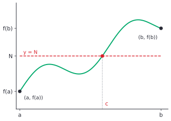

# Continuity, asymptotes and the IVT

After this lesson you can test a function for continuity at a point, classify its discontinuities, read asymptotes as limits, and use the intermediate value theorem to show that an equation has a solution and to find it by bisection.

Before this: [limits, intuition and limit laws](01-limits-intuition-and-limit-laws.md) and [the epsilon-delta definition](02-epsilon-delta-definition.md). The lesson also uses [rational functions and asymptotes](../../03-high-school/06-rational-expressions-and-equations/02-rational-functions-and-asymptotes.md) and [polynomial functions and graphs](../../03-high-school/04-radicals-and-polynomials/05-polynomial-functions-and-graphs.md).

## Quick check

Try these first. If you get all three right, skip to [Practice](#practice).

1. Let $f(x) = \dfrac{x^2 - 4}{x - 2}$ for $x \ne 2$ and $f(2) = 3$. Is $f$ continuous at 2? If not, how can you repair it?
2. Find and classify the discontinuities of $g(x) = \dfrac{x^2 - x - 6}{x^2 - 9}$.
3. Show that $x^3 + x - 1 = 0$ has a solution between 0 and 1.

<details class="solution" markdown>
<summary>Answers</summary>

1. No. For $x \ne 2$, $f(x) = x + 2$, so $\lim_{x \to 2} f(x) = 4$, but $f(2) = 3$. The limit and the value disagree. Redefining $f(2) = 4$ repairs it.
2. Factor: $g(x) = \frac{(x - 3)(x + 2)}{(x - 3)(x + 3)}$. At $x = 3$ the factor cancels and the limit is $\frac{5}{6}$, a removable discontinuity. At $x = -3$ the factor $x + 3$ stays, and $g$ blows up, an infinite discontinuity (a vertical asymptote).
3. Let $h(x) = x^3 + x - 1$, a polynomial, so it is continuous. Then $h(0) = -1 < 0$ and $h(1) = 1 > 0$. By the intermediate value theorem, $h$ has a zero between 0 and 1.

</details>

## The idea

A parking garage charges \$4 for each hour or part of an hour. The cost of parking is a step function of the time: it is \$4 up to 1 hour, then jumps to \$8 the moment the hour is over. A cup of coffee left on a desk cools differently. Its temperature falls smoothly, and in between 80 degrees and 60 degrees it must pass through 70 degrees. The cost function has no such guarantee: it never costs \$6.

The first function has a jump, and the second does not. Continuity is the mathematical name for "no jumps, holes or blow-ups". The rough test is that you can draw the graph without lifting your pencil. That test is a good picture and a poor definition, because it doesn't say what happens at a single point, and it can't be used in a proof. The precise definition uses the limits from the last two lessons: the value of the function at a point agrees with the limit there.

Continuity matters because it connects the two things you do with a function, evaluating it and taking its limit. For a continuous function the two agree, so limits become substitution. And it gives a guarantee: a continuous function that starts below a level and ends above it must cross the level. That is the intermediate value theorem, and it is how you can know a solution exists before you find it. This lesson also puts the asymptotes of [rational functions and asymptotes](../../03-high-school/06-rational-expressions-and-equations/02-rational-functions-and-asymptotes.md) on a limit footing.

## Definitions

A function $f$ is **continuous at** a number $a$ when three conditions hold:

1. $f(a)$ is defined,
2. $\lim_{x \to a} f(x)$ exists,
3. $\lim_{x \to a} f(x) = f(a)$.

In plain words, the value at $a$ exists, the nearby values head for a number, and that number is the value. In epsilon-delta form, with $f$ defined on an interval around $a$ (including $a$), this says

$$
\forall \varepsilon > 0\ \exists \delta > 0\ \forall x\ \bigl(\lvert x - a \rvert < \delta \Rightarrow \lvert f(x) - f(a) \rvert < \varepsilon\bigr).
$$

The condition has no "$0 <$" in front of $\lvert x - a \rvert$. The case $x = a$ is allowed, and it is harmless, because it only says $\lvert f(a) - f(a) \rvert = 0 < \varepsilon$. So this formal statement is the same as conditions 1 to 3. Compare it with [negation and translating English](../../04-proofs-and-logic/02-logic-and-sets/05-negation-and-translating-english.md), where Practice problem 7 negated this statement for a step function.

If $f$ fails to be continuous at $a$, it is **discontinuous** there, and the failure comes in one of a few kinds. The discontinuity is **removable** when $\lim_{x \to a} f(x)$ exists as a real number but $f(a)$ is undefined or differs from the limit, so the graph has a hole or a single stray point. It is a **jump** when both one-sided limits exist as real numbers but are different. It is **infinite** when at least one of the one-sided limits is $\infty$ or $-\infty$, and then the line $x = a$ is a vertical asymptote. Anything else, such as the wild oscillation of $\sin\frac{1}{x}$ at 0, where the one-sided limits neither exist nor are infinite, is sometimes called an essential discontinuity.


A function is **right-continuous** at $a$ when $\lim_{x \to a^+} f(x) = f(a)$, and **left-continuous** when $\lim_{x \to a^-} f(x) = f(a)$. It is continuous at $a$ exactly when it is both. A function is continuous on an open interval $(a, b)$ when it is continuous at every point of the interval. It is continuous on a closed interval $[a, b]$ when it is continuous on $(a, b)$, right-continuous at $a$ and left-continuous at $b$. A function is continuous on its domain when it is continuous at every point where it is defined. In plain words, an endpoint can only be approached from one side, so the endpoint test only looks at that side.

The function $\frac{1}{x}$ is continuous on its domain, which is every nonzero number, even though its graph has two separate pieces. The point $x = 0$ is not in the domain, so it can't be a point of discontinuity in the strict sense, though people say it has an infinite discontinuity at 0. This fine print rarely matters; what matters is whether the discontinuity can be repaired (Example 1).

Continuity is preserved by the usual operations, and the usual functions are continuous.

*Theorem 1 (combinations).* If $f$ and $g$ are continuous at $a$ and $c$ is a constant, then $f + g$, $f - g$, $cf$ and $fg$ are continuous at $a$, and $\frac{f}{g}$ is continuous at $a$ if $g(a) \ne 0$.

*Theorem 2 (composition).* If $g$ is continuous at $a$ and $f$ is continuous at $g(a)$, then $f \circ g$ is continuous at $a$.

*Theorem 3 (the basic functions).* Each of these is continuous at every point of its domain: polynomials, rational functions, $\sqrt[n]{x}$, $\lvert x \rvert$, exponentials $b^x$, logarithms $\log_b x$, and the trigonometric functions $\sin$, $\cos$, $\tan$ and their reciprocals.

In plain words, anything built from the basic functions by arithmetic and composition is continuous wherever it is defined. That is why most limits in a calculus course are just substitution. Proofs of the first two theorems, and part of the third, are below. For exponentials and logarithms the proofs depend on how those functions are defined, and they are taken as known here.

Two big theorems are about continuous functions on a closed interval.

*Theorem 4 (intermediate value theorem, IVT).* Let $f$ be continuous on $[a, b]$, and let $N$ be a number strictly between $f(a)$ and $f(b)$. Then there is a number $c$ in $(a, b)$ with $f(c) = N$.

*Theorem 5 (extreme value theorem, EVT).* Let $f$ be continuous on $[a, b]$. Then $f$ has a maximum and a minimum on $[a, b]$: there are numbers $c$ and $d$ in $[a, b]$ with $f(c) \le f(x) \le f(d)$ for every $x$ in $[a, b]$.

In plain words, a continuous function can't skip a value between two of its values (IVT), and on a closed interval it reaches a highest and a lowest value (EVT). The pictures are in the sections below. The proofs of both rest on the completeness axiom from [real numbers, axioms and set notation](../../03-high-school/01-algebra-foundations/01-real-numbers-axioms-and-set-notation.md#the-completeness-axiom), and a real analysis course proves them. This lesson states them, explains the IVT's proof idea, and uses them.

## How to do it

### Checking continuity at a point

1. Check that $f(a)$ is defined. If it isn't, stop: $f$ is not continuous at $a$.
2. Find $\lim_{x \to a} f(x)$ with the methods of the first lesson. For a piecewise function with a break at $a$, find the two one-sided limits.
3. Compare. If the limit exists and equals $f(a)$, $f$ is continuous at $a$.
4. If not, classify the discontinuity: a finite limit that disagrees with the value (removable), two different finite one-sided limits (jump), or an infinite limit (infinite).

Most functions you meet are formulas, and Theorems 1 to 3 settle them without any work: a formula built from the basic functions is continuous at every point where it is defined. Only a piecewise function needs Steps 1 to 4, and only at the points where the pieces meet.

### Where the theorems come from

*Proof of Theorem 1.* We know the limit laws and that $\lim_{x \to a} f(x) = f(a)$ and $\lim_{x \to a} g(x) = g(a)$. We want the same for the combinations. The plan is to apply the limit laws and recognise the result as the value.

For the sum, $\lim_{x \to a} (f + g)(x) = f(a) + g(a) = (f + g)(a)$ by the sum law. The other cases are identical, using the difference, constant multiple, product and quotient laws. For the quotient, the condition $g(a) \ne 0$ is what the quotient law needs. $\blacksquare$

*Proof of Theorem 2.* We know $g$ is continuous at $a$ and $f$ is continuous at $b = g(a)$. We want a $\delta$ for each $\varepsilon$. The plan is to chain the two definitions, working backwards from the output of $f \circ g$ to the input.

Let $\varepsilon > 0$. Since $f$ is continuous at $b$, there is an $\eta > 0$ such that $\lvert y - b \rvert < \eta$ implies $\lvert f(y) - f(b) \rvert < \varepsilon$. Since $g$ is continuous at $a$, applied to the tolerance $\eta$, there is a $\delta > 0$ such that $\lvert x - a \rvert < \delta$ implies $\lvert g(x) - b \rvert < \eta$. Now suppose $\lvert x - a \rvert < \delta$. Then $\lvert g(x) - b \rvert < \eta$, so, taking $y = g(x)$, $\lvert f(g(x)) - f(b) \rvert < \varepsilon$. That is the definition of continuity of $f \circ g$ at $a$. $\blacksquare$

Look back: the proof is the game played twice. The challenger's $\varepsilon$ for $f \circ g$ is answered with $\eta$ for $f$, and that $\eta$ is treated as a challenge for $g$ and answered with $\delta$. The same argument, with $0 < \lvert x - a \rvert$ kept, shows that if $\lim_{x \to a} g(x) = b$ and $f$ is continuous at $b$, then $\lim_{x \to a} f(g(x)) = f(b)$. This lets you move a limit inside a continuous function, as in Practice problem 3.

Polynomials and rational functions are continuous by the direct substitution theorem of the first lesson, which says $\lim_{x \to a} r(x) = r(a)$ whenever $r$ is defined at $a$. Roots follow from the root law, and $\lvert x \rvert$ follows from $\bigl\lvert \lvert x \rvert - \lvert a \rvert \bigr\rvert \le \lvert x - a \rvert$ with $\delta = \varepsilon$. Sine and cosine need an argument, which uses the limits from the first lesson.

*Proof that sine and cosine are continuous.* We know $\lim_{h \to 0} \sin h = 0$ and $\lim_{h \to 0} \cos h = 1$ (proved in the first lesson, inside the proof that $\frac{\sin x}{x} \to 1$), and the addition formulas. We want $\lim_{x \to a} \sin x = \sin a$. The plan is to write $x = a + h$, so that $x \to a$ means $h \to 0$, and to expand with the addition formula.

For each $a$, $\sin(a + h) = \sin a \cos h + \cos a \sin h$. As $h \to 0$, the limit laws give $\sin a \cdot 1 + \cos a \cdot 0 = \sin a$. So $\lim_{x \to a} \sin x = \sin a$. For cosine, $\cos(a + h) = \cos a \cos h - \sin a \sin h \to \cos a$ in the same way. $\blacksquare$

The other trigonometric functions are quotients of sine and cosine, so Theorem 1 makes them continuous wherever the denominator is not 0. For example $\tan x = \frac{\sin x}{\cos x}$ is continuous except at $x = \frac{\pi}{2} + k\pi$, where it has infinite discontinuities.

### Asymptotes as limits

The three kinds of asymptote from [rational functions and asymptotes](../../03-high-school/06-rational-expressions-and-equations/02-rational-functions-and-asymptotes.md#definitions) are now exact statements about limits.

- The line $x = a$ is a vertical asymptote of $f$ when at least one of $\lim_{x \to a^-} f(x)$ and $\lim_{x \to a^+} f(x)$ is $\infty$ or $-\infty$.
- The line $y = L$ is a horizontal asymptote when $\lim_{x \to \infty} f(x) = L$ or $\lim_{x \to -\infty} f(x) = L$.
- The line $y = mx + b$ with $m \ne 0$ is a slant asymptote when $\lim_{x \to \infty} \bigl(f(x) - (mx + b)\bigr) = 0$ (or the same with $x \to -\infty$).

For a rational function $\frac{p}{q}$ in lowest terms, the vertical asymptotes are exactly the zeros of $q$, and a factor that cancels leaves a removable discontinuity (a hole) instead. Functions that aren't rational follow the same pattern: $\ln x$ has the vertical asymptote $x = 0$ because $\lim_{x \to 0^+} \ln x = -\infty$, $e^x$ has the horizontal asymptote $y = 0$ on the left because $\lim_{x \to -\infty} e^x = 0$, and $\arctan x$ has two horizontal asymptotes, $y = \pm\frac{\pi}{2}$, one at each end.

For a slant asymptote you can find $m$ and $b$ directly from limits. Suppose $f(x) - (mx + b) \to 0$ as $x \to \infty$. Dividing by $x$, $\frac{f(x)}{x} - m - \frac{b}{x} \to 0$, and since $\frac{b}{x} \to 0$, we get

$$
m = \lim_{x \to \infty} \frac{f(x)}{x}, \qquad b = \lim_{x \to \infty} \bigl(f(x) - mx\bigr).
$$

Compute $m$ first, then $b$. For $f(x) = \frac{2x^2 + 3x - 1}{x + 1}$ from the asymptotes lesson, $\frac{f(x)}{x} = \frac{2x^2 + 3x - 1}{x^2 + x} \to 2$, and $f(x) - 2x = \frac{2x^2 + 3x - 1 - 2x(x + 1)}{x + 1} = \frac{x - 1}{x + 1} \to 1$. So the slant asymptote is $y = 2x + 1$, as polynomial division found.

An asymptote describes where a graph is going, not a wall it can't cross. The function in the last lesson's [figure](01-limits-intuition-and-limit-laws.md#limits-at-infinity-and-infinite-limits), $f(x) = \frac{3x^2 + x}{2x^2 + 5}$, has the horizontal asymptote $y = \frac{3}{2}$ and crosses it once, at $x = 7.5$, where $f(7.5) = \frac{176.25}{117.5} = 1.5$. A graph can cross a horizontal or slant asymptote, even infinitely often (as $\frac{\sin x}{x}$ crosses $y = 0$). It can't cross a vertical asymptote, because the function isn't defined there.

### The intermediate value theorem

Here is the picture. The graph is continuous on $[a, b]$ and starts below the level $N$ and ends above it. To get from one side of the line $y = N$ to the other without a jump, the graph has to meet the line.



The theorem says the meeting point exists, not that it is the only one: the graph may cross $y = N$ several times. It also doesn't say how to find $c$. And it needs continuity on the whole interval, because one jump can skip the level: $f(x) = \frac{1}{x}$ on $[-1, 1]$ has $f(-1) = -1 < 0 < 1 = f(1)$, but never equals 0. The function is not continuous at 0 (it isn't even defined there).

The IVT is the main use of continuity, and the main use of the IVT is to show that a root exists.

*Corollary (root existence).* If $f$ is continuous on $[a, b]$ and $f(a)$ and $f(b)$ have opposite signs, then $f$ has a zero in $(a, b)$.

This is the IVT with $N = 0$. It is the rigorous statement behind the sign-change idea from [polynomial functions and graphs](../../03-high-school/04-radicals-and-polynomials/05-polynomial-functions-and-graphs.md#what-the-graph-must-do).

*Theorem 6.* Every polynomial of odd degree has a real zero.

We know the IVT and that a polynomial is continuous. We want a point where the polynomial is negative and a point where it is positive. The plan is to use the leading term, which decides the sign for large $\lvert x \rvert$, to find those points.

*Proof.* Let $p(x) = c_n x^n + \dots + c_0$ with $n$ odd and $c_n > 0$ (otherwise replace $p$ by $-p$, which has the same zeros). Divide by $c_n x^n$: $\frac{p(x)}{c_n x^n} = 1 + \frac{c_{n-1}}{c_n x} + \dots + \frac{c_0}{c_n x^n}$. Every term after the 1 goes to 0 as $\lvert x \rvert \to \infty$, so the quotient has limit 1 at both ends. In particular there is a number $M > 0$ with $\frac{p(x)}{c_n x^n} > \frac{1}{2}$ whenever $\lvert x \rvert \ge M$. Since $c_n x^n$ has the same sign as $x$ (because $n$ is odd), $p(M) > 0$ and $p(-M) < 0$. The polynomial $p$ is continuous on $[-M, M]$ and changes sign, so the root-existence corollary gives a zero in $(-M, M)$. $\blacksquare$

Look back: oddness was used once, to make $x^n$ negative on the left. For even $n$ the two ends have the same sign, and the polynomial $x^2 + 1$ has no real zero.

Why can't the IVT be proved by algebra alone? The statement is false over the rational numbers. Take $f(x) = x^2 - 2$ on the rationals in $[0, 2]$. It is continuous, $f(0) = -2 < 0$, $f(2) = 2 > 0$, but there is no rational number $c$ with $c^2 = 2$ ([the proof that $\sqrt{2}$ is irrational](../../04-proofs-and-logic/03-core-proof-methods/06-proof-by-contradiction.md#example-1-the-square-root-of-2-is-irrational)). The rational line has a hole where $\sqrt{2}$ should be. The real numbers have no such holes, and the property that rules them out is the completeness axiom.

The proof idea uses completeness directly. Suppose $f(a) < N < f(b)$ and let $S$ be the set of $x$ in $[a, b]$ with $f(x) < N$. It is not empty ($a$ is in it) and it is bounded above (by $b$), so completeness gives a least upper bound $c$. If $f(c) < N$, continuity would keep $f$ below $N$ a little to the right of $c$, so some larger number would be in $S$, contradicting that $c$ is an upper bound. If $f(c) > N$, continuity would keep $f$ above $N$ a little to the left of $c$, so a smaller number would still be an upper bound of $S$, contradicting that $c$ is the least one. That leaves $f(c) = N$. This is a sketch, since it leaves out the work of showing $c$ is strictly between $a$ and $b$ and of turning "a little to the right" into a $\delta$, but it shows where completeness enters.

### Finding the root by bisection

The IVT says that a root exists, and its proof idea gives a method to find it, which is the bisection method from [polynomial functions and graphs](../../03-high-school/04-radicals-and-polynomials/05-polynomial-functions-and-graphs.md#finding-a-zero-by-bisection). Start with $f(a)$ and $f(b)$ of opposite signs. Find the midpoint $m$ and keep the half in which $f$ still changes sign. The IVT guarantees a root in the half you keep, because $f$ is continuous on it and changes sign across it. After $k$ steps the interval has width $\frac{b - a}{2^k}$, so the number of steps needed to pin the root down to a width of $w$ is the smallest $k$ with $\frac{b - a}{2^k} \le w$, that is, $k = \left\lceil \log_2 \frac{b - a}{w} \right\rceil$. Each step gains one binary digit of the answer.

The picture shows six steps for $x^3 + x - 1$ on $[0, 1]$. Each bar is the interval that is kept.


### The extreme value theorem

The EVT says that the graph of a continuous function on $[a, b]$ has a highest and a lowest point. Both conditions matter. The function $\frac{1}{x}$ is continuous on $(0, 1]$ but has no maximum there, because it grows without bound as $x \to 0^+$; the interval isn't closed. The function $f(x) = x$ is continuous on $[0, 1)$ and has no maximum, because the value 1 is not reached; the interval isn't closed. The function $f(x) = x$ for $0 \le x < 1$ together with $f(1) = 0$ is defined on $[0, 1]$ and has no maximum, because $f$ is not continuous at 1. The theorem is what guarantees that the "find the largest" problems in [optimization](../03-applications-of-derivatives/05-optimization.md) have an answer to look for.

## Worked examples

<div class="example" markdown>

### Example 1: classify the discontinuities

Find where $f(x) = \dfrac{x^2 - x - 6}{x^2 - 9}$ is discontinuous, classify each discontinuity, and say which can be repaired.

Step 1: $f$ is a rational function, so by Theorem 3 it is continuous wherever it is defined. It is undefined where the denominator is 0, that is, $x^2 = 9$, so $x = 3$ and $x = -3$. Those are the candidates.

Step 2: find the limits by factoring: $f(x) = \frac{(x - 3)(x + 2)}{(x - 3)(x + 3)}$.

At $x = 3$ the factor $x - 3$ cancels, and for $x \ne 3$ we have $f(x) = \frac{x + 2}{x + 3}$. So $\lim_{x \to 3} f(x) = \frac{5}{6}$.

At $x = -3$ the factor $x + 3$ stays. The top of the reduced form is $x + 2 \to -1$, which is negative. For $x$ a little bigger than $-3$ the bottom is a small positive number, so $f(x) \to -\infty$. For $x$ a little smaller than $-3$ the bottom is a small negative number, so $f(x) \to \infty$.

Step 3 and 4: at $x = 3$ the limit is finite and $f(3)$ is undefined, so this is a removable discontinuity. At $x = -3$ the one-sided limits are infinite, so it is an infinite discontinuity, with the vertical asymptote $x = -3$.

The removable one can be repaired by defining $f(3) = \frac{5}{6}$, which gives a function continuous at 3. The infinite one can't be repaired by any value.

Check: $f(3.001) = \frac{5.001}{6.001} = 0.8334$, close to $\frac{5}{6} = 0.8333$. And $f(-2.999) = \frac{-0.999}{0.001} = -999$, while $f(-3.001) = \frac{-1.001}{-0.001} = 1001$.

</div>

<div class="example" markdown>

### Example 2: choosing constants to make a function continuous

Find the numbers $a$ and $b$ that make

$$
f(x) = \begin{cases} 2x - 1 & \text{if } x < 1, \\ ax + b & \text{if } 1 \le x < 3, \\ x^2 - 5 & \text{if } x \ge 3 \end{cases}
$$

continuous at every $x$.

Each piece is a polynomial, so $f$ is continuous inside each piece. Only the breaks at $x = 1$ and $x = 3$ need checking, and at each one the two sides must meet at the value.

At $x = 1$: the left limit is $2(1) - 1 = 1$, and the value and right limit are $a + b$. So $a + b = 1$.

At $x = 3$: the left limit is $3a + b$, and the value and right limit are $3^2 - 5 = 4$. So $3a + b = 4$.

Subtract the first equation from the second: $2a = 3$, so $a = \frac{3}{2}$, and then $b = 1 - \frac{3}{2} = -\frac{1}{2}$. The numbers are fractions, and that is fine.

Check: $f(x) = \frac{3}{2}x - \frac{1}{2}$ on $[1, 3)$ gives $f(1) = 1$, matching the left piece, and approaches $\frac{9}{2} - \frac{1}{2} = 4$ at $x = 3$, matching $3^2 - 5 = 4$.

</div>

<div class="example" markdown>

### Example 3: a root by the IVT and bisection

Show that $x^3 + x - 1 = 0$ has a solution in $[0, 1]$, and find it to within $0.001$.

The function $h(x) = x^3 + x - 1$ is a polynomial, so it is continuous. We have $h(0) = -1 < 0$ and $h(1) = 1 > 0$, so by the root-existence corollary there is a zero in $(0, 1)$.

To find it, bisect. The number of steps needed for a width of 0.001 is $k = \lceil \log_2 \frac{1}{0.001} \rceil = \lceil 9.97 \rceil = 10$.

| Step | Midpoint $m$ | $h(m)$ | Keep |
|---|---|---|---|
| 1 | $0.5$ | $-0.375$ | $[0.5, 1]$ |
| 2 | $0.75$ | $0.171875$ | $[0.5, 0.75]$ |
| 3 | $0.625$ | $-0.130859$ | $[0.625, 0.75]$ |
| 4 | $0.6875$ | $0.012451$ | $[0.625, 0.6875]$ |
| 5 | $0.65625$ | $-0.061127$ | $[0.65625, 0.6875]$ |
| 6 | $0.671875$ | $-0.024830$ | $[0.671875, 0.6875]$ |
| 7 | $0.6796875$ | $-0.006314$ | $[0.6796875, 0.6875]$ |
| 8 | $0.68359375$ | $0.003037$ | $[0.6796875, 0.68359375]$ |
| 9 | $0.681640625$ | $-0.001646$ | $[0.681640625, 0.68359375]$ |
| 10 | $0.6826171875$ | $0.000694$ | $[0.681640625, 0.6826171875]$ |

After 10 steps the root is in an interval of width $\frac{1}{1024} \approx 0.00098 < 0.001$. So the root is about 0.682, to within 0.001. The rule "keep the half whose ends have opposite signs" is what lets the IVT promise a root inside the kept half at every step.

Check: $h(0.682) = 0.317214\ldots + 0.682 - 1 = -0.000786\ldots$, small and negative, and $h(0.683) = 0.318611\ldots + 0.683 - 1 = 0.001611\ldots$, small and positive. The root is between 0.682 and 0.683, as the table says (the exact value is $0.6823278\ldots$).

</div>

<div class="example" markdown>

### Example 4: where does $\cos x = x$? (finish it yourself)

Show that the equation $\cos x = x$ has a solution in $[0, 1]$.

Rewrite it as a root problem: let $g(x) = \cos x - x$. Then $g$ is continuous, because $\cos x$ and $x$ are continuous and Theorem 1 covers the difference. Now compute $g(0)$ and $g(1)$, and use the root-existence corollary. Then say why this equation is hard to solve by algebra.

<details class="solution" markdown>
<summary>Finish</summary>

We have $g(0) = \cos 0 - 0 = 1 > 0$, and $g(1) = \cos 1 - 1 \approx 0.5403 - 1 = -0.4597 < 0$. Here $1$ is in radians, and the values have opposite signs, so the root-existence corollary gives a number $c$ in $(0, 1)$ with $g(c) = 0$, that is, $\cos c = c$.

The equation mixes a trigonometric function and a polynomial, and no algebra isolates $x$. Bisection or a calculator gives $c \approx 0.7390851$.

Check: $\cos(0.739085) = 0.739085\ldots$. The two sides agree to the digits shown.

</details>

</div>

## Edge cases and common mistakes

<div class="warning" markdown>

Watch out: a limit that exists is not enough. The function $f(x) = \frac{x^2 - 4}{x - 2}$ has the limit 4 at 2, but it isn't continuous there, since $f(2)$ is undefined. Condition 1 (the value exists) and condition 3 (the value equals the limit) must both be checked. A function with a hole is discontinuous at the hole, even when the hole can be filled.

</div>

<div class="warning" markdown>

Watch out: the intermediate value theorem needs a closed interval and continuity on all of it. The function $f(x) = \frac{1}{x}$ changes sign between $-1$ and 1 and never equals 0, because of the break at 0. The function $f(x) = \lfloor x \rfloor$ goes from 0 to 1 on $[0.5, 1.5]$ and never equals $\frac{1}{2}$. A sign change on its own is not a guarantee of a zero.

</div>

<div class="warning" markdown>

Watch out: the converse of the IVT is false. A function that takes every value between $f(a)$ and $f(b)$ need not be continuous. Let $f(x) = \sin\frac{1}{x}$ for $x \ne 0$ and $f(0) = 0$. On $[-1, 1]$ it takes every value in $[-1, 1]$ (many times, near 0), yet it is discontinuous at 0. The IVT says continuity implies no skipped values, not the other way round.

</div>

<div class="warning" markdown>

Watch out: don't decide continuity by looking for a hole you happened to notice. Check the pieces. A piecewise function must have its pieces match at every break, and matching means the left limit, the right limit and the value are all equal. In Example 2 it isn't enough that the left side and the value agree; the right limit must agree too.

</div>

<div class="warning" markdown>

Watch out: Theorem 1 runs in one direction only. Let $H(x) = 0$ for $x < 0$ and $H(x) = 1$ for $x \ge 0$. Both $H(x)$ and $1 - H(x)$ are discontinuous at 0, yet their sum is the constant function 1, which is continuous everywhere. So a combination can be continuous when its parts aren't. The theorem says that continuous parts give a continuous combination; when the parts are not continuous, it says nothing.

</div>

<div class="warning" markdown>

Watch out: a "removable" discontinuity is only removable if you are allowed to change the function. The repaired function is a different function (it agrees everywhere except at $a$). If a problem gives you $f$ with $f(2) = 3$, then $f$ is discontinuous at 2, and the answer "it is removable" describes what you could do, not what is true of $f$.

</div>

## Tricks and shortcuts

To show an equation $f(x) = h(x)$ has a solution, move everything to one side and apply the root-existence corollary to $g = f - h$, as in Example 4. Two continuous graphs that start in one order and end in the other must cross.

Pick the test points for the IVT by trying easy numbers: $0$, $\pm 1$, $\pm 2$. The first sign change gives the interval. If $p(0)$ and $p(1)$ have the same sign, try $p(2)$, and then $p(-1)$.

To decide whether an expression is continuous, look for the places where it is not defined: zeros of denominators, negative numbers under an even root, non-positive inputs of a logarithm, and odd multiples of $\frac{\pi}{2}$ for tangent. Everywhere else the theorems give continuity at once.

For a piecewise function, check only the break points. Each piece is continuous on its own interval when it is a formula in the basic functions.

Starting from an interval of width 1, bisection needs about 3.3 steps per decimal digit, since $2^{3.3} \approx 10$. Ten steps give about three digits, as in Example 3.

## In code

Bisection is a short loop. The code also shows two things about real programs: a computer's numbers are finite, so the loop must stop; and binary search on a sorted condition is the integer version of the IVT.

<details class="code" markdown>
<summary>In code</summary>

```python
import math

def bisect(f, a, b, tol=1e-10):
    # f(a) and f(b) must have opposite signs
    steps = 0
    while b - a > tol:
        m = (a + b) / 2
        if f(a) * f(m) <= 0:   # the sign change is in [a, m]
            b = m
        else:                  # the sign change is in [m, b]
            a = m
        steps += 1
    return (a + b) / 2, steps

root, steps = bisect(lambda x: x**3 + x - 1, 0, 1)
print(f"{root:.10f}", steps)        # 0.6823278038 34
root, steps = bisect(lambda x: math.cos(x) - x, 0, 1)
print(f"{root:.10f}", steps)        # 0.7390851332 34
print(math.ceil(math.log2(1 / 1e-10)))   # 34, the predicted number of steps

# bisect until floats run out of room
a, b, n = 1.0, 2.0, 0
while True:
    m = (a + b) / 2
    if m == a or m == b:
        break
    if (a * a - 2) * (m * m - 2) <= 0:
        b = m
    else:
        a = m
    n += 1
print(n, a, b)              # 52 1.414213562373095 1.4142135623730951
print(a * a - 2, b * b - 2) # -4.440892098500626e-16 4.440892098500626e-16

# binary search on a monotone condition: the floor of the square root
def isqrt_floor(n):
    lo, hi = 0, n + 1            # invariant: lo*lo <= n < hi*hi
    while hi - lo > 1:
        mid = (lo + hi) // 2
        if mid * mid <= n:
            lo = mid
        else:
            hi = mid
    return lo

print(isqrt_floor(10**12 - 1), math.isqrt(10**12 - 1))   # 999999 999999
```

The tolerance $10^{-10}$ needs 34 steps, as the formula says. The second loop keeps halving until the midpoint equals one of the ends, which happens after 52 steps, since the floats between 1 and 2 have 52 binary digits after the point. The two final numbers are neighbouring floats, and $x^2 - 2$ is slightly negative at one and slightly positive at the other: no float is an exact root, so a computer's version of the IVT only promises a sign change between neighbours. The last function is the same method on whole numbers, where there is no gap to worry about. The predicate "$m^2 \le n$" is true up to some point and false after it, and binary search finds the switch.

</details>

## FAQ

### Why is $\frac{1}{x}$ called continuous when its graph has a break?

Continuity is tested at points of the domain, and 0 is not in the domain of $\frac{1}{x}$. At every point where $\frac{1}{x}$ is defined, the limit equals the value. So $\frac{1}{x}$ is continuous on its domain, which is two separate intervals. The break at 0 is a real feature of the graph (an infinite discontinuity, with a vertical asymptote), but it is outside the domain, not a failure of continuity inside it. This is why the IVT, which needs an interval, can't be applied across 0.

### Does the IVT say there is exactly one solution?

No. It says at least one. Take $f(x) = x^3 - 3x + 1$ on $[-2, 2]$. It has $f(-2) = -1$ and $f(2) = 3$, so $N = 0$ is between them, and in fact there are three roots in the interval, at about $-1.879$, $0.347$ and $1.532$. The IVT guarantees one. To count roots you need more tools, such as derivatives, which tell you where a function rises and falls.

### Why does the IVT fail for rational numbers?

Because the rationals have gaps. A continuous function on rational inputs can jump over a gap without any visible jump, as $x^2 - 2$ does at $\sqrt{2}$. The real numbers have no gaps, by the completeness axiom, and the proof of the IVT uses exactly that.

### Is bisection fast?

It is reliable and slow. It gains one binary digit per step, which is about 3.3 steps per decimal digit, and it needs only a sign change, with no formula for a derivative. Methods that use the slope, such as Newton's method, roughly double the number of correct digits at each step once they are close to a simple root, but they can fail to converge where bisection can't.

## Practice

### Warm-up

1\. Classify each discontinuity: (a) $f(x) = \dfrac{x^2 - 1}{x - 1}$ at $x = 1$, (b) $g(x) = \dfrac{\lvert x \rvert}{x}$ at $x = 0$, (c) $h(x) = \dfrac{1}{(x + 2)^2}$ at $x = -2$.

<details class="solution" markdown>
<summary>Solution</summary>

(a) For $x \ne 1$, $f(x) = x + 1$, so $\lim_{x \to 1} f(x) = 2$, a finite limit, while $f(1)$ is undefined. This is removable; defining $f(1) = 2$ repairs it.

(b) The one-sided limits are $\lim_{x \to 0^-} g(x) = -1$ and $\lim_{x \to 0^+} g(x) = 1$. Both are finite and different: a jump discontinuity. No value at 0 can repair it.

(c) Near $-2$ the denominator $(x + 2)^2$ is a small positive number on both sides, so $h(x) \to \infty$ from both sides. This is an infinite discontinuity, with the vertical asymptote $x = -2$.

Check: $f(1.001) = 2.001$, $g(\pm 0.001) = \pm 1$ and $h(-2.001) = 10^6$.

</details>

2\. Find the number $k$ that makes $f$ continuous at 2, where $f(x) = kx + 1$ for $x \le 2$ and $f(x) = x^2 - k$ for $x > 2$.

<details class="solution" markdown>
<summary>Solution</summary>

Each piece is a polynomial, so only $x = 2$ matters. The left limit and the value are $2k + 1$. The right limit is $4 - k$. Continuity needs $2k + 1 = 4 - k$, so $3k = 3$ and $k = 1$.

Check: with $k = 1$, $f(2) = 3$, and the right piece gives $2^2 - 1 = 3$. At $x = 1.999$, $f = 2.999$, and at $x = 2.001$, $f = 3.004$, both close to 3.

</details>

3\. Evaluate by moving the limit inside a continuous function (Theorem 2 and the remark after it): (a) $\lim_{x \to 0} \cos(3x + \pi)$, (b) $\lim_{x \to 2} \ln(x^2 + 1)$, (c) $\lim_{x \to 1} e^{(x^2 - 1)/(x - 1)}$.

<details class="solution" markdown>
<summary>Solution</summary>

(a) The inside, $3x + \pi$, is continuous with limit $\pi$ at 0, and cosine is continuous, so the limit is $\cos \pi = -1$.

(b) The inside $x^2 + 1 \to 5$, which is positive, and $\ln$ is continuous at 5, so the limit is $\ln 5 \approx 1.609$.

(c) The inside is $\frac{x^2 - 1}{x - 1} = x + 1$ for $x \ne 1$, with limit 2. The exponential function is continuous at 2, so the limit is $e^2 \approx 7.389$.

Check (c): at $x = 1.001$ the inside is $2.001$ and $e^{2.001} = 7.396$, close to $7.389$.

</details>

### Standard

4\. Show that $e^x + x = 0$ has a solution in $[-1, 0]$, and use three steps of bisection to trap it in an interval of width $\frac{1}{8}$.

<details class="solution" markdown>
<summary>Solution</summary>

Let $g(x) = e^x + x$, continuous as a sum of continuous functions. Then $g(-1) = e^{-1} - 1 \approx -0.632 < 0$ and $g(0) = 1 > 0$, so by the root-existence corollary there is a zero in $(-1, 0)$.

Bisection:

- Midpoint $-0.5$: $g(-0.5) = 0.6065 - 0.5 = 0.1065 > 0$. The sign change is in $[-1, -0.5]$.
- Midpoint $-0.75$: $g(-0.75) = 0.4724 - 0.75 = -0.2776 < 0$. The sign change is in $[-0.75, -0.5]$.
- Midpoint $-0.625$: $g(-0.625) = 0.5353 - 0.625 = -0.0897 < 0$. The sign change is in $[-0.625, -0.5]$.

The width is $0.125 = \frac{1}{8}$, after three steps ($\frac{1}{2^3}$).

Check: the true root is $-0.5671\ldots$, which is in $[-0.625, -0.5]$.

</details>

5\. Let $f(x) = \dfrac{2x^2 - x + 3}{x - 1}$. Find its vertical asymptote with both one-sided limits, and its slant asymptote using $m = \lim \frac{f(x)}{x}$ and $b = \lim (f(x) - mx)$.

<details class="solution" markdown>
<summary>Solution</summary>

Vertical: the denominator is 0 at $x = 1$, and the numerator there is $2 - 1 + 3 = 4 \ne 0$, so $x = 1$ is a vertical asymptote. For $x$ a little above 1 the bottom is a small positive number, so $f(x) \to \infty$. For $x$ a little below 1 the bottom is a small negative number, so $f(x) \to -\infty$.

Slant: $\frac{f(x)}{x} = \frac{2x^2 - x + 3}{x^2 - x} \to 2$, so $m = 2$. Then $f(x) - 2x = \frac{2x^2 - x + 3 - 2x(x - 1)}{x - 1} = \frac{x + 3}{x - 1} \to 1$, so $b = 1$. The slant asymptote is $y = 2x + 1$.

Check by division: $2x^2 - x + 3 = (x - 1)(2x + 1) + 4$, so $f(x) = 2x + 1 + \frac{4}{x - 1}$, and the leftover $\frac{4}{x - 1} \to 0$. At $x = 1000$, $f(x) = 2001.004\ldots$, close to $2(1000) + 1$.

</details>

6\. Let $f(x) = x\sin\frac{1}{x}$ and $g(x) = \sin\frac{1}{x}$ for $x \ne 0$, with $f(0) = g(0) = 0$. Show that $f$ is continuous at 0 and $g$ is not.

<details class="solution" markdown>
<summary>Solution</summary>

For $f$: $-\lvert x \rvert \le x\sin\frac{1}{x} \le \lvert x \rvert$ for $x \ne 0$, and both bounds go to 0. By the squeeze theorem $\lim_{x \to 0} f(x) = 0 = f(0)$. All three conditions hold, so $f$ is continuous at 0.

For $g$: take the inputs $x_n = \frac{1}{n\pi} \to 0$ with $g(x_n) = 0$ and $y_n = \frac{1}{2n\pi + \pi/2} \to 0$ with $g(y_n) = 1$. The two output sequences have different limits, so $\lim_{x \to 0} g(x)$ does not exist (the sequence criterion from the second lesson), and $g$ is not continuous at 0, whatever value is given to $g(0)$.

Check: $f(0.001) = 0.001 \sin 1000 = -0.00083$, within $0.001$ of 0. And $g\left(\frac{1}{\pi}\right) = \sin \pi \approx 0$ while $g\left(\frac{1}{2.5\pi}\right) = \sin 2.5\pi = 1$.

</details>

### Challenge

7\. (Fixed point theorem.) Let $f$ be continuous on $[0, 1]$ with $f(x)$ in $[0, 1]$ for every $x$. Prove that there is a number $c$ in $[0, 1]$ with $f(c) = c$. Then give an example where $f$ is not continuous and there is no fixed point.

<details class="solution" markdown>
<summary>Solution</summary>

We know the IVT. We want a solution of $f(c) = c$. The plan is to move everything to one side: let $g(x) = f(x) - x$, and look for a zero of $g$.

*Proof.* The function $g$ is continuous on $[0, 1]$. We have $g(0) = f(0) - 0 \ge 0$ because $f(0) \ge 0$, and $g(1) = f(1) - 1 \le 0$ because $f(1) \le 1$. If $g(0) = 0$, then $c = 0$ works. If $g(1) = 0$, then $c = 1$ works. Otherwise $g(0) > 0 > g(1)$, and by the root-existence corollary there is a $c$ in $(0, 1)$ with $g(c) = 0$, that is, $f(c) = c$. $\blacksquare$

Look back: the proof splits into the easy cases, where an endpoint is a fixed point, and the case where the IVT applies. The graph of $f$ stays in the unit square, and the proof says it must meet the diagonal.

A counterexample without continuity: let $f(x) = 1$ for $x \le \frac{1}{2}$ and $f(x) = 0$ for $x > \frac{1}{2}$. This $f$ maps $[0, 1]$ into $\{0, 1\}$. If $c \le \frac{1}{2}$ were a fixed point, then $c = f(c) = 1$, which is not at most $\frac{1}{2}$. If $c > \frac{1}{2}$ were a fixed point, then $c = f(c) = 0$, which is not above $\frac{1}{2}$. So there is none: the graph jumps over the diagonal.

Check with $f(x) = \cos x$ on $[0, 1]$: it maps $[0, 1]$ into $[0.54, 1]$, and the fixed point is the solution $0.7390851\ldots$ of Example 4.

</details>

8\. (Reviews [polynomial functions and graphs](../../03-high-school/04-radicals-and-polynomials/05-polynomial-functions-and-graphs.md).) Use the IVT to show that $p(x) = x^5 - 5x + 3$ has at least three real zeros. Then find how many bisection steps would locate the zero in $(1, 2)$ to within $10^{-6}$.

<details class="solution" markdown>
<summary>Solution</summary>

Evaluate at easy points: $p(-2) = -32 + 10 + 3 = -19$, $p(-1) = -1 + 5 + 3 = 7$, $p(1) = 1 - 5 + 3 = -1$ and $p(2) = 32 - 10 + 3 = 25$.

The polynomial is continuous. The signs are $-, +, -, +$ at $-2, -1, 1, 2$, so the sign changes give a zero in each of the intervals $(-2, -1)$, $(-1, 1)$ and $(1, 2)$. These intervals don't overlap, so the zeros are different, and $p$ has at least three real zeros. A polynomial of degree 5 has at most 5, so there are three, four or five of them (and an odd number, by Theorem 6's argument).

For the zero in $(1, 2)$, the width is 1, and the number of steps is the smallest $k$ with $\frac{1}{2^k} \le 10^{-6}$, that is, $k = \lceil \log_2 10^6 \rceil = \lceil 19.93 \rceil = 20$. Check: $2^{20} = 1{,}048{,}576 > 10^6$, and $2^{19} = 524{,}288 < 10^6$.

Check the signs once more with a graph from the polynomial lesson: a quintic with positive leading coefficient starts low on the left and ends high on the right, as $-19$ and $25$ show.

</details>

## Where this shows up

- [The derivative definition](../02-derivatives/01-the-derivative-definition.md) starts with a limit, and a function that has a derivative at a point must be continuous there, so continuity is the first filter for differentiability. The extreme value theorem is what gives optimization problems an answer, and the intermediate value theorem is used again in the [mean value theorem](../03-applications-of-derivatives/03-mean-value-theorem-and-extrema.md).
- In computer science, bisection is binary search on a continuous function, and binary search on a monotone condition is its discrete twin: finding the first commit that breaks a test (`git bisect`), the smallest input that fails, or the smallest capacity that meets a deadline. [Floating-point basics](../../06-cs-math/01-number-representation/04-floating-point-basics.md) explains why computed functions have gaps even when the math function has none.
- In economics, a continuous demand or utility function lets you say that if one option is worth less than a target and another more, some mix of them hits the target exactly. Many existence results in economics, such as fixed points of a price-adjustment map, rest on the fixed point argument of Practice problem 7 and its higher-dimensional versions.
