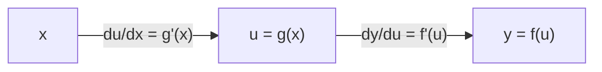
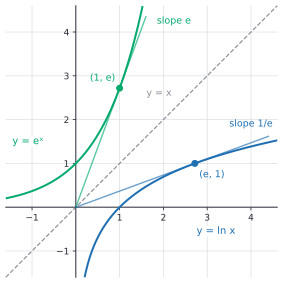

# Chain rule, implicit and inverse derivatives

After this lesson you can differentiate a composition of functions with the chain rule, find a slope on a curve defined by an equation in $x$ and $y$, differentiate an inverse function, and use these to get the derivatives of $\ln x$, $b^x$, $\log_b x$ and the inverse trig functions.

Before this: [differentiation rules](02-differentiation-rules.md), [composition and inverse functions](../../03-high-school/03-functions/05-composition-and-inverse-functions.md), [logarithms](../../03-high-school/07-exponentials-and-logarithms/02-logarithms.md) and [trig identities and inverse trig](../../03-high-school/09-trigonometry/04-trig-identities-and-inverse-trig.md).

## Quick check

Try these first. If you get all three right, skip to [Practice](#practice).

1. Differentiate $f(x) = \sin(x^2)$.
2. Find the slope of the circle $x^2 + y^2 = 25$ at the point $(3, 4)$.
3. Differentiate $g(x) = \ln(3x)$, using $\frac{d}{dx}\ln x = \frac{1}{x}$.

<details class="solution" markdown>
<summary>Answers</summary>

1. The outer function is $\sin$ and the inner function is $x^2$. Differentiate the outer one, leaving the inner one alone, and multiply by the derivative of the inner one: $f'(x) = \cos(x^2) \cdot 2x$.
2. Differentiate both sides with respect to $x$, remembering that $y$ depends on $x$: $2x + 2y\frac{dy}{dx} = 0$, so $\frac{dy}{dx} = -\frac{x}{y} = -\frac{3}{4}$ at $(3, 4)$.
3. Outer function $\ln$, inner function $3x$: $g'(x) = \frac{1}{3x} \cdot 3 = \frac{1}{x}$.

</details>

## The idea

A car uses 0.08 litres of fuel per kilometre, and it is driving at 90 kilometres per hour. How fast is it using fuel, in litres per hour? Multiply the two rates:

$$
0.08\ \frac{\text{L}}{\text{km}} \times 90\ \frac{\text{km}}{\text{h}} = 7.2\ \frac{\text{L}}{\text{h}}.
$$

The units cancel like fractions, and the answer is a rate of change of fuel with respect to time, built from two chained rates. Fuel depends on distance, and distance depends on time. This is the chain rule in a physical example: when one quantity depends on a second, and the second depends on a third, the rate for the whole chain is the product of the rates for the links.

The same thing works with pure numbers. If $u$ changes 2 units for every unit change in $x$, and $y$ changes 3 units for every unit change in $u$, then $y$ changes $3 \times 2 = 6$ units for every unit change in $x$. In Leibniz notation, with $y$ a function of $u$ and $u$ a function of $x$,

$$
\frac{dy}{dx} = \frac{dy}{du} \cdot \frac{du}{dx}.
$$



Each arrow is a function, and each label is the rate of change across that arrow. The rate across both arrows is the product. The rest of the lesson is making that precise, and then using it in two other settings. When $y$ is tied to $x$ by an equation rather than a formula, the chain rule gives implicit differentiation. When a function is undone by an inverse, the chain rule gives the derivative of the inverse. Between them they produce the derivatives of $\ln x$, $b^x$ and the inverse trig functions, which the last lesson couldn't reach.

## Definitions

Recall the composition $(f \circ g)(x) = f(g(x))$: apply $g$ first, then $f$. The function $g$ is the **inner function** and $f$ is the **outer function**.

The **chain rule** says that if $g$ is differentiable at $x$ and $f$ is differentiable at $g(x)$, then $f \circ g$ is differentiable at $x$ and

$$
(f \circ g)'(x) = f'\bigl(g(x)\bigr) \cdot g'(x).
$$

In plain words: differentiate the outer function and evaluate it at the inner function, then multiply by the derivative of the inner function. For example, $\frac{d}{dx}\sin(x^2) = \cos(x^2) \cdot 2x$.

A function is defined **implicitly** when it is given by an equation relating $x$ and $y$, such as $x^2 + y^2 = 25$, and not by a formula $y = f(x)$ with $y$ alone on one side. **Implicit differentiation** is the method of differentiating both sides of the equation with respect to $x$, treating $y$ as an unknown function of $x$, and then solving for $\frac{dy}{dx}$. In plain words, you differentiate as usual, and every time $y$ appears you attach a factor $\frac{dy}{dx}$, because $y$ depends on $x$.

The **inverse function rule** says that if $f$ has an inverse $f^{-1}$, then at the point $b = f(a)$,

$$
\left(f^{-1}\right)'(b) = \frac{1}{f'(a)},
$$

as long as $f'(a) \ne 0$. In plain words, the slope of the inverse at a point is the reciprocal of the slope of the original at the matching point.

**Logarithmic differentiation** is a technique for differentiating a function with variables in both the base and the exponent, or with a long product or quotient: take the natural logarithm of both sides first, which turns products and powers into sums, and differentiate implicitly.

## How to do it

### The chain rule

1. Identify the layers, working from the outside in. The outermost operation is the last one you would do when evaluating the function, as in $\sin(e^{x^2})$, where the last step is the sine.
2. Differentiate the outermost function and leave its input alone. Its input is written back in unchanged.
3. Multiply by the derivative of the input, and apply the same rule again if the input is itself a composition.
4. Simplify, factoring out common factors.
5. Check at one value of $x$ with a central difference, as in the last lesson.

The chain rule gives a family of rules in which the inner function is a stand-in for $x$. If $u$ is any differentiable function of $x$, then

$$
\frac{d}{dx}\bigl(u^n\bigr) = n u^{n-1} u', \qquad \frac{d}{dx}\bigl(e^u\bigr) = e^u u', \qquad \frac{d}{dx}\sin u = \cos u \cdot u', \qquad \frac{d}{dx}\ln u = \frac{u'}{u}.
$$

*Theorem (chain rule).* If $g$ is differentiable at $x$ and $f$ is differentiable at $g(x)$, then $(f \circ g)'(x) = f'(g(x)) \cdot g'(x)$.

We know the definition of the derivative, and that a function differentiable at a point is continuous there. We want the limit of $\frac{f(g(x + h)) - f(g(x))}{h}$. The plan is first to see why the formula should be true with a quick argument, then notice what is wrong with it, then repair it.

The quick argument is to write $u = g(x)$ and let $\Delta u = g(x + h) - g(x)$ be the change in the inner function. Then the change in the output is $\Delta y = f(u + \Delta u) - f(u)$, and

$$
\frac{\Delta y}{h} = \frac{\Delta y}{\Delta u} \cdot \frac{\Delta u}{h}.
$$

As $h \to 0$ we have $\Delta u \to 0$ (since $g$ is continuous), the first factor tends to $f'(u)$, and the second tends to $g'(x)$. That is the chain rule, and for most functions the argument is exactly what happens.

The gap is that the argument divides by $\Delta u$, and $\Delta u$ can be 0 even when $h \ne 0$. This happens for a function that returns to the same value again and again, such as $g(x) = x^2\sin\frac{1}{x}$ with $g(0) = 0$, which is differentiable at 0 and still has $g(h) = 0$ for the infinitely many values $h = \frac{1}{n\pi}$ close to 0. At those values the factor $\frac{\Delta y}{\Delta u}$ is $\frac{0}{0}$, and the argument breaks down. The repair is to avoid the division.

*Proof.* Let $u = g(x)$. Define a function $\varphi$ of a number $k$ by

$$
\varphi(k) = \begin{cases} \dfrac{f(u + k) - f(u)}{k} & k \ne 0, \\[2mm] f'(u) & k = 0. \end{cases}
$$

Since $f$ is differentiable at $u$, $\varphi(k) \to f'(u) = \varphi(0)$ as $k \to 0$, so $\varphi$ is continuous at 0. In every case, including $k = 0$, we have $f(u + k) - f(u) = \varphi(k) \cdot k$. Put $k = \Delta u = g(x + h) - g(x)$, so that $u + k = g(x + h)$. Then for $h \ne 0$,

$$
\frac{f(g(x + h)) - f(g(x))}{h} = \varphi(\Delta u) \cdot \frac{\Delta u}{h}.
$$

As $h \to 0$, $\Delta u \to 0$ because $g$ is continuous at $x$, so $\varphi(\Delta u) \to \varphi(0) = f'(g(x))$ because $\varphi$ is continuous at 0. And $\frac{\Delta u}{h} \to g'(x)$. The product tends to $f'(g(x)) \cdot g'(x)$. $\blacksquare$

Look back: the function $\varphi$ is the difference quotient with the hole at $k = 0$ filled in by the derivative, and filling the hole is what removes the division by zero. The proof is the quick argument with that one repair. In practice you can think of the chain rule as "rate times rate".

### Implicit differentiation

1. Differentiate both sides of the equation with respect to $x$. Use the chain rule whenever you differentiate a term with $y$ in it: $\frac{d}{dx}\left(y^n\right) = n y^{n-1}\frac{dy}{dx}$, $\frac{d}{dx}\sin y = \cos y \cdot \frac{dy}{dx}$, and so on. A term with both, such as $xy$, needs the product rule.
2. Move every term containing $\frac{dy}{dx}$ to one side and everything else to the other.
3. Factor out $\frac{dy}{dx}$ and divide to solve for it.
4. To find a slope, put in the coordinates of a point, and first check that the point is on the curve.
5. Check, for example by solving for $y$ near the point and computing a difference quotient, or by comparing with a geometric fact.

The answer usually contains both $x$ and $y$, because a curve like a circle has two different values of $y$ for one $x$, with different slopes, so one formula in $x$ alone can't give them both. Vertical tangents show up where the denominator of $\frac{dy}{dx}$ is 0 and the numerator isn't.

Why is this legitimate when $y$ isn't given as a formula? Near most points of the curve, the equation does define $y$ as a function of $x$, and that is the function being differentiated. The theorem that guarantees it is the implicit function theorem, a topic for a multivariable course. For the circle, the upper half is $y = \sqrt{25 - x^2}$, and $\frac{dy}{dx} = -\frac{x}{\sqrt{25 - x^2}} = -\frac{x}{y}$, the same formula that implicit differentiation gives.

### The derivative of an inverse function

*Theorem (inverse function rule).* Let $f$ be continuous and one-to-one on an open interval, with inverse $g = f^{-1}$. If $f$ is differentiable at $a$ with $f'(a) \ne 0$, and $b = f(a)$, then $g$ is differentiable at $b$ and $g'(b) = \dfrac{1}{f'(a)}$.

The picture first. The graph of $f^{-1}$ is the graph of $f$ reflected in the line $y = x$, which swaps the roles of rise and run. A tangent line with slope $m$ reflects to a tangent line with slope $\frac{1}{m}$. In the figure, the tangent to $y = e^x$ at $(1, e)$ has slope $e$, and its mirror image, the tangent to $y = \ln x$ at $(e, 1)$, has slope $\frac{1}{e}$. Both lines pass through the origin.



We know that $f$ is continuous and one-to-one on an interval, so its inverse $g$ is also continuous (a standard fact about inverses of continuous one-to-one functions on an interval, which this book accepts). We want the limit of $\frac{g(b + k) - g(b)}{k}$ as $k \to 0$. The plan is to describe the change in $g$ by a change $h$ in $f$'s input, so that the quotient becomes the reciprocal of a quotient for $f$.

*Proof.* For a small $k \ne 0$, put $h = g(b + k) - g(b) = g(b + k) - a$. Then $a + h = g(b + k)$, so $f(a + h) = b + k$, and $k = f(a + h) - f(a)$. Also $h \ne 0$, because $g$ is one-to-one and $b + k \ne b$. So

$$
\frac{g(b + k) - g(b)}{k} = \frac{h}{f(a + h) - f(a)} = \frac{1}{\dfrac{f(a + h) - f(a)}{h}}.
$$

As $k \to 0$, $h \to 0$ because $g$ is continuous at $b$. So the quotient in the denominator tends to $f'(a) \ne 0$, and the whole expression tends to $\frac{1}{f'(a)}$. $\blacksquare$

Look back: the condition $f'(a) \ne 0$ is needed. The function $f(x) = x^3$ has $f'(0) = 0$, and its inverse, the cube root, has a vertical tangent at 0: a horizontal tangent reflects into a vertical one. To use the rule in a formula, differentiate $f(f^{-1}(x)) = x$ with the chain rule, assuming $f^{-1}$ is differentiable: $f'\bigl(f^{-1}(x)\bigr) \cdot \left(f^{-1}\right)'(x) = 1$, which gives $\left(f^{-1}\right)'(x) = \dfrac{1}{f'\bigl(f^{-1}(x)\bigr)}$. The theorem says that the assumption is justified.

### New derivatives from the inverse rule

The natural logarithm is the inverse of $e^x$. Let $y = \ln x$ for $x > 0$, so $e^y = x$. Differentiating both sides with respect to $x$ gives $e^y \cdot y' = 1$, so $y' = \frac{1}{e^y} = \frac{1}{x}$:

$$
\frac{d}{dx}\ln x = \frac{1}{x}, \qquad x > 0.
$$

For $x < 0$, the chain rule gives $\frac{d}{dx}\ln(-x) = \frac{-1}{-x} = \frac{1}{x}$, so $\frac{d}{dx}\ln\lvert x \rvert = \frac{1}{x}$ for every $x \ne 0$. That is why antiderivatives of $\frac{1}{x}$ come with an absolute value.

For other bases, rewrite with $e$: since $b^x = e^{x \ln b}$, the chain rule gives

$$
\frac{d}{dx} b^x = e^{x\ln b} \cdot \ln b = b^x \ln b, \qquad \frac{d}{dx}\log_b x = \frac{d}{dx}\frac{\ln x}{\ln b} = \frac{1}{x \ln b}.
$$

These match the claim in the last lesson that the constant for base $b$ is $\ln b$: for $b = 2$ it is $\ln 2 \approx 0.693$. The same trick finishes the power rule. For any real exponent $r$ and $x > 0$, $x^r = e^{r\ln x}$, so $\frac{d}{dx}x^r = e^{r\ln x} \cdot \frac{r}{x} = r x^{r-1}$.

For the inverse trig functions, use the ranges from [trig identities and inverse trig](../../03-high-school/09-trigonometry/04-trig-identities-and-inverse-trig.md). Let $y = \arcsin x$, so $\sin y = x$ with $-\frac{\pi}{2} \le y \le \frac{\pi}{2}$. Differentiate: $\cos y \cdot y' = 1$. On that range $\cos y \ge 0$, so $\cos y = \sqrt{1 - \sin^2 y} = \sqrt{1 - x^2}$, and $y' = \frac{1}{\sqrt{1 - x^2}}$. For the arctangent, $\tan y = x$ gives $\sec^2 y \cdot y' = 1$, and $\sec^2 y = 1 + \tan^2 y = 1 + x^2$.

$$
\frac{d}{dx}\arcsin x = \frac{1}{\sqrt{1 - x^2}}, \qquad \frac{d}{dx}\arccos x = -\frac{1}{\sqrt{1 - x^2}}, \qquad \frac{d}{dx}\arctan x = \frac{1}{1 + x^2}.
$$

The first two hold for $-1 < x < 1$, since the graph of $\arcsin$ has vertical tangents at $x = \pm 1$. The third holds for every $x$. The cosine formula follows from $\arccos x = \frac{\pi}{2} - \arcsin x$.

### Logarithmic differentiation

1. Take the natural logarithm of both sides of $y = f(x)$, and use the log laws to turn products, quotients and powers into sums, differences and multiples.
2. Differentiate both sides implicitly. The left side gives $\frac{y'}{y}$.
3. Multiply by $y$ to get $y'$.
4. Replace $y$ by its original formula.

For $y = x^x$ with $x > 0$: $\ln y = x\ln x$. Differentiating, $\frac{y'}{y} = \ln x + x \cdot \frac{1}{x} = \ln x + 1$, so $y' = x^x(\ln x + 1)$. The power rule fails here because the exponent isn't constant, and the exponential rule fails because the base isn't constant. The method works anyway.

The method also tames a long product. For $y = \dfrac{x^2(x + 1)^3}{(x - 2)^4}$, taking logs gives $\ln y = 2\ln x + 3\ln(x + 1) - 4\ln(x - 2)$, so

$$
\frac{y'}{y} = \frac{2}{x} + \frac{3}{x + 1} - \frac{4}{x - 2}.
$$

At $x = 3$ we have $y = \frac{9 \cdot 64}{1} = 576$ and $\frac{y'}{y} = \frac{2}{3} + \frac{3}{4} - 4 = -\frac{31}{12}$, so $y' = 576 \cdot \left(-\frac{31}{12}\right) = -1488$. If a factor of $y$ can be negative, the logs need absolute values, which don't change the result because $\frac{d}{dx}\ln\lvert u \rvert = \frac{u'}{u}$.

### Related rates, a preview

When two changing quantities are tied by an equation, and both depend on time $t$, differentiating the equation with respect to $t$ gives a relation between their rates. A 5 m ladder leans against a wall. The foot is at distance $x$ from the wall and the top at height $y$, so $x^2 + y^2 = 25$. Differentiate with respect to $t$: $2x\frac{dx}{dt} + 2y\frac{dy}{dt} = 0$, so $\frac{dy}{dt} = -\frac{x}{y}\frac{dx}{dt}$. If the foot is pulled away at $0.5$ m/s when $x = 3$ (and so $y = 4$), then $\frac{dy}{dt} = -\frac{3}{4} \cdot 0.5 = -0.375$ m/s: the top slides down at 0.375 m/s. Check with the formula $y = \sqrt{25 - (3 + 0.5t)^2}$, whose difference quotient from $t = 0$ is $-0.375$ to three digits. The full treatment is in [Rates of change and marginal analysis](../03-applications-of-derivatives/01-rates-of-change-and-marginal-analysis.md).

### The chain rule in machine learning

A neural network is a long composition of functions: the input goes through a layer, the output of that layer goes through the next, and the final output is compared with a target by a loss function $L$. Training adjusts the parameters to reduce $L$, which needs the derivative of $L$ with respect to each parameter. By the chain rule that derivative is a product of the local derivatives along the chain, one factor per layer. Backpropagation is the chain rule applied from the output backward, so that each local derivative is computed once and the partial products are reused for every parameter. Real networks have many parameters and so use partial derivatives, which come in [Partial derivatives and the gradient](../09-multivariable-calculus-light/02-partial-derivatives-and-the-gradient.md).

The smallest example is one neuron. With input $x$, weight $w$, bias $b$ and target $t$, the loss is $L = \bigl(\sigma(wx + b) - t\bigr)^2$, where $\sigma(z) = \frac{1}{1 + e^{-z}}$ is the sigmoid function. Its derivative comes from the quotient and chain rules: $\sigma'(z) = \frac{e^{-z}}{(1 + e^{-z})^2} = \sigma(z)\bigl(1 - \sigma(z)\bigr)$. The chain is $z = wx + b$, then $a = \sigma(z)$, then $L = (a - t)^2$, and so

$$
\frac{\partial L}{\partial w} = \underbrace{2(a - t)}_{dL/da} \cdot \underbrace{a(1 - a)}_{da/dz} \cdot \underbrace{x}_{dz/dw}.
$$

The code in [In code](#in-code) computes this and checks it against a central difference.

## Worked examples

<div class="example" markdown>

### Example 1: peeling the layers

Differentiate $f(x) = \sin\left(e^{x^2}\right)$.

Step 1: from the outside in, the layers are $\sin(\ \cdot\ )$, then $e^{(\ \cdot\ )}$, then $x^2$. The last step in evaluating the function is the sine, so that is the outermost layer.

Step 2: differentiate the sine and leave its input alone: $\cos\left(e^{x^2}\right)$.

Step 3: multiply by the derivative of the input $e^{x^2}$. That input is itself a composition, an exponential of $x^2$, so its derivative is $e^{x^2}$ times the derivative of $x^2$:

$$
f'(x) = \cos\left(e^{x^2}\right) \cdot e^{x^2} \cdot 2x.
$$

Step 4: tidy up to $f'(x) = 2x\,e^{x^2}\cos\left(e^{x^2}\right)$.

Watch out: the most common slip is to stop after Step 2 and forget the factors from the inner layers. Each layer you pass through adds one factor.

Step 5, the check at $x = 0.5$: the formula gives $2(0.5)e^{0.25}\cos\left(e^{0.25}\right) = 1.2840 \cdot 0.2829 = 0.3632$, and a central difference with $h = 10^{-5}$ gives $0.3632$.

</div>

<div class="example" markdown>

### Example 2: a point on a curve defined by an equation

Find the slope of the folium $x^3 + y^3 = 6xy$ at $(3, 3)$, and find the points where its tangent is horizontal.

First, $(3, 3)$ is on the curve: $27 + 27 = 54$ and $6 \cdot 3 \cdot 3 = 54$. Differentiate both sides with respect to $x$, using the chain rule on $y^3$ and the product rule on $6xy$:

$$
3x^2 + 3y^2\frac{dy}{dx} = 6y + 6x\frac{dy}{dx}.
$$

Move the $\frac{dy}{dx}$ terms to the left and the others to the right: $\frac{dy}{dx}(3y^2 - 6x) = 6y - 3x^2$, so

$$
\frac{dy}{dx} = \frac{6y - 3x^2}{3y^2 - 6x} = \frac{2y - x^2}{y^2 - 2x}.
$$

At $(3, 3)$: $\frac{6 - 9}{9 - 6} = -1$. The tangent line is $y = 3 - (x - 3) = 6 - x$.

The tangent is horizontal where the numerator is 0 and the denominator isn't: $2y = x^2$, so $y = \frac{x^2}{2}$. Substituting into the equation of the curve gives $x^3 + \frac{x^6}{8} = 3x^3$, so $\frac{x^6}{8} = 2x^3$, so $x^3 = 16$ (the other solution, $x = 0$, is the origin, where the denominator is also 0 and this method says nothing). Then $x = 16^{1/3} = 2^{4/3} \approx 2.520$ and $y = \frac{x^2}{2} = 2^{5/3} \approx 3.175$. By the symmetry of the equation in $x$ and $y$, the tangent is vertical at $(2^{5/3}, 2^{4/3})$.


Check: at $x = 3.001$ the curve passes through $y \approx 2.99900$, and at $x = 2.999$ through $y \approx 3.00100$, so the slope from those two points is about $-1.0000$. The point $\left(2^{4/3}, 2^{5/3}\right)$ is on the curve, since $2^4 + 2^5 = 48$ and $6 \cdot 2^{4/3} \cdot 2^{5/3} = 6 \cdot 8 = 48$. The circle in the figure shows the same method: its slope $-\frac{x}{y}$ at $(3, 4)$ is $-\frac{3}{4}$, the negative reciprocal of the radius slope $\frac{4}{3}$, as it should be for a tangent perpendicular to the radius.

</div>

<div class="example" markdown>

### Example 3: the slope of an inverse without finding the inverse

Let $f(x) = x^5 + x + 1$. It is increasing, so it has an inverse, but there is no algebraic formula for it. Find $\left(f^{-1}\right)'(3)$.

We need the input $a$ with $f(a) = 3$. Trying small values, $f(1) = 1 + 1 + 1 = 3$, so $a = 1$. Then $f'(x) = 5x^4 + 1$, so $f'(1) = 6$, and by the inverse function rule $\left(f^{-1}\right)'(3) = \frac{1}{6}$.

For another case, the slope of $\arctan$ at 1: since $\tan\frac{\pi}{4} = 1$, the rule gives $\frac{1}{\sec^2(\pi/4)} = \frac{1}{2}$, and the formula $\frac{1}{1 + x^2}$ at $x = 1$ gives $\frac{1}{2}$ too.

Check: the graph of $f$ near $(1, 3)$ has slope 6, so the reflected graph near $(3, 1)$ should be much flatter, with slope $\frac{1}{6}$, as the answer says. A central difference of $\arctan$ at 1 gives $0.5000$.

</div>

<div class="example" markdown>

### Example 4: chain rule with a product

Differentiate $h(x) = x^2\left(x^3 + 1\right)^4$, and find $\frac{d}{dx}$ of $f\bigl(g(x)\bigr)$ at $x = 2$, given $g(2) = 3$, $g'(2) = -4$ and $f'(3) = 5$.

The outer operation is a product. Differentiate each factor, using the chain rule on the second one:

$$
h'(x) = 2x\left(x^3 + 1\right)^4 + x^2 \cdot 4\left(x^3 + 1\right)^3 \cdot 3x^2 = 2x\left(x^3 + 1\right)^3\left[\left(x^3 + 1\right) + 6x^3\right] = 2x\left(x^3 + 1\right)^3\left(7x^3 + 1\right).
$$

For the second part, the chain rule needs only the numbers it asks about: $f'(g(2)) \cdot g'(2) = f'(3) \cdot (-4) = 5 \cdot (-4) = -20$.

Check: at $x = 1$, $h'(1) = 2 \cdot 8 \cdot 8 = 128$. Directly, $2x(x^3 + 1)^4 = 2 \cdot 16 = 32$ and $12x^4(x^3 + 1)^3 = 12 \cdot 8 = 96$ add to 128.

</div>

<div class="example" markdown>

### Example 5: an implicit slope (finish it yourself)

Find the slope of the curve $x^2 + xy + y^2 = 7$ at $(1, 2)$. The point is on the curve, since $1 + 2 + 4 = 7$. Differentiating both sides with respect to $x$, with the product rule on $xy$, gives

$$
2x + y + x\frac{dy}{dx} + 2y\frac{dy}{dx} = 0.
$$

Now solve for $\frac{dy}{dx}$, find its value at $(1, 2)$, write the tangent line, and check the result.

<details class="solution" markdown>
<summary>Finish</summary>

Collect the terms: $\frac{dy}{dx}(x + 2y) = -(2x + y)$, so $\frac{dy}{dx} = -\frac{2x + y}{x + 2y}$. At $(1, 2)$ this is $-\frac{4}{5}$. The tangent line is $y = 2 - \frac{4}{5}(x - 1)$.

Check: the other point of the curve with $x = 1.01$ is found by solving $1.0201 + 1.01y + y^2 = 7$, which gives $y \approx 1.9920$, close to the tangent line's prediction $2 - 0.008 = 1.992$.

</details>

</div>

## Edge cases and common mistakes

<div class="warning" markdown>

Watch out: the chain rule needs both factors. For $\sin(x^2)$ the answer is $2x\cos(x^2)$, not $\cos(x^2)$. A reliable test is to try a case where you know the answer: $\frac{d}{dx}(3x + 1)^2 = 2(3x + 1) \cdot 3 = 18x + 6$, and multiplying out $(3x + 1)^2 = 9x^2 + 6x + 1$ confirms $18x + 6$. Without the factor 3 you would get $6x + 2$.

</div>

<div class="warning" markdown>

Watch out: $f'(g(x))$ is not $f'(g'(x))$ and not $(f(g(x)))'$. The first means "differentiate $f$, then put $g(x)$ in". For $f = \sin$ and $g(x) = x^2$ it is $\cos(x^2)$. Writing $\cos(2x)$, which puts the derivative of $g$ inside, is a different function.

</div>

<div class="warning" markdown>

Watch out: in implicit differentiation, a term with $y$ always gets a factor $\frac{dy}{dx}$. The derivative of $y^3$ is $3y^2\frac{dy}{dx}$, not $3y^2$. The derivative of $x^3$ has no such factor, because $x$ is the variable you differentiate with respect to. Missing the factor is the most common mistake, and it is easy to catch by checking with the circle: $2x + 2y\frac{dy}{dx} = 0$ gives a slope of $-\frac{3}{4}$ at $(3, 4)$, while dropping the factor would give $2x + 2y = 0$ and nonsense.

</div>

<div class="warning" markdown>

Watch out: the derivative of $b^x$ is $b^x\ln b$, not $x\,b^{x-1}$, and the derivative of $x^b$ is $b\,x^{b-1}$, not $x^b\ln b$. Which rule applies depends on where the variable is: in the exponent, or in the base. For $x^x$, the variable is in both places, and neither rule works, so use logarithmic differentiation.

</div>

<div class="warning" markdown>

Watch out: the number $\left(f^{-1}\right)'(b)$ uses the slope of $f$ at the matching point $a$, not at $b$. In Example 3, the slope of the inverse at 3 is $\frac{1}{f'(1)} = \frac{1}{6}$, not $\frac{1}{f'(3)}$. Find the $a$ with $f(a) = b$ first.

</div>

Implicit differentiation says nothing at a point where the denominator of $\frac{dy}{dx}$ is 0 and the numerator is too. On the folium, at the origin both $2y - x^2$ and $y^2 - 2x$ are 0, and the curve crosses itself there, with two tangent lines (the two axes). A formula that gives $\frac{0}{0}$ doesn't have a single answer.

The derivative of an inverse can fail to exist where the original has slope 0. The cube root has no derivative at 0, though $x^3$ does, and the reason is the vertical tangent on the reflected graph.

## Tricks and shortcuts

When the inner function is linear, the chain rule is a quick factor: $\frac{d}{dx}f(kx + c) = k f'(kx + c)$. So $\frac{d}{dx}\sin(7x) = 7\cos(7x)$, $\frac{d}{dx}e^{3x + 1} = 3e^{3x + 1}$, and $\frac{d}{dx}\ln(4x) = \frac{4}{4x} = \frac{1}{x}$, the same as $\ln x$ because $\ln(4x) = \ln 4 + \ln x$ differs from $\ln x$ by a constant.

The logarithm rule $\frac{d}{dx}\ln u = \frac{u'}{u}$ turns many answers into a "log derivative". For a product or quotient with many factors, add the log derivatives of the factors, as in logarithmic differentiation, and multiply the sum back by the function.

A table of the whole chapter's derivatives, with the chain-rule versions, is on the [chapter cheat sheet](index.md).

To check an implicit slope without solving for $y$, use the geometry when there is one: the tangent to a circle is perpendicular to the radius. And $\frac{dy}{dx}$ and $\frac{dx}{dy}$ are reciprocals when both exist: for $y = e^x$ the slope is $e^x = y$, and for $x = \ln y$ it is $\frac{1}{y}$.

## In code

The chain rule computes a loss gradient for a one-neuron model in a few lines. The backward pass multiplies local derivatives from the output back to the parameter, and a central difference confirms the numbers. (The numbers in the lesson text above, $x = 1.5$, $w = 0.8$, $b = -0.2$ and $t = 1$, are the ones used here.)

<details class="code" markdown>
<summary>In code</summary>

```python
import math

def sigmoid(z):
    return 1 / (1 + math.exp(-z))

x, t = 1.5, 1.0     # input and target
w, b = 0.8, -0.2    # parameters

# Forward pass: z = w*x + b, a = sigmoid(z), loss = (a - t)^2
z = w * x + b
a = sigmoid(z)
loss = (a - t) ** 2

# Backward pass: multiply the local derivatives from the output back.
dL_da = 2 * (a - t)       # derivative of the square
da_dz = a * (1 - a)       # derivative of the sigmoid
dL_dz = dL_da * da_dz
dL_dw = dL_dz * x         # dz/dw = x
dL_db = dL_dz * 1         # dz/db = 1
print(round(loss, 6), round(dL_dw, 6), round(dL_db, 6))
# 0.072329 -0.158631 -0.105754

# Check each gradient with a central difference.
def loss_at(w, b):
    return (sigmoid(w * x + b) - t) ** 2

h = 1e-6
print(round((loss_at(w + h, b) - loss_at(w - h, b)) / (2 * h), 6),
      round((loss_at(w, b + h) - loss_at(w, b - h)) / (2 * h), 6))
# -0.158631 -0.105754
```

Both gradients are negative, so increasing $w$ or $b$ lowers the loss, which makes sense: the neuron outputs $a \approx 0.73$ and the target is 1. A training step would move $w$ and $b$ a little in the direction opposite to these gradients. The same pattern, with more layers and vectors in place of numbers, is what machine-learning libraries automate.

</details>

## FAQ

### Why does the chain rule multiply the rates instead of adding them?

Because the second rate acts on the result of the first. If $u$ moves 2 units per unit of $x$, and each unit of $u$ moves $y$ by 3, then $2$ units of $u$ move $y$ by $2 \times 3 = 6$. Adding would be right for two separate causes acting on the same quantity, as the sum rule is, but here one change feeds the next. The fuel example shows the units: litres per kilometre times kilometres per hour is litres per hour, and only a product cancels the units that way.

### Can I cancel the $du$ in $\frac{dy}{du} \cdot \frac{du}{dx}$?

As a memory aid, yes: the notation was designed so that it works, and it gets the answer right. As a proof it is not valid, because $\frac{dy}{du}$ is a limit and not a fraction of two numbers. The proof above is what makes the cancellation legitimate.

### Why is $\frac{d}{dx}\ln x$ equal to $\frac{1}{x}$, when the derivative of $e^x$ is $e^x$?

They are inverse functions, so their slopes at matching points are reciprocals. At the point $(a, e^a)$ on the exponential, the slope is $e^a$. The matching point on the logarithm is $(e^a, a)$, with the slope $\frac{1}{e^a}$. Writing $x = e^a$, the slope of $\ln$ at $x$ is $\frac{1}{x}$. Notice how the "base case" $\frac{d}{dx}e^x = e^x$ from the last lesson, built on the definition of $e$, produces $\ln$'s derivative for free.

### Is implicit differentiation allowed when the curve isn't a function?

Yes, with a caveat. A circle fails the vertical line test, so $y$ is not a function of $x$ on the whole curve. But near each point that isn't a vertical tangent, a small piece of the curve is the graph of a function, and the method finds that piece's slope. At a vertical tangent, the piece is a function of $y$ and not of $x$, and $\frac{dy}{dx}$ doesn't exist, which shows up as a zero denominator.

## Practice

### Warm-up

1\. Differentiate: (a) $\left(5x^2 - 3\right)^4$, (b) $\sin(7x)$, (c) $e^{3x + 1}$, (d) $\ln\left(x^2 + 1\right)$.

<details class="solution" markdown>
<summary>Solution</summary>

(a) Outer power 4, inner $5x^2 - 3$: $4\left(5x^2 - 3\right)^3 \cdot 10x = 40x\left(5x^2 - 3\right)^3$.

(b) $\cos(7x) \cdot 7 = 7\cos(7x)$.

(c) $e^{3x + 1} \cdot 3 = 3e^{3x + 1}$.

(d) $\frac{1}{x^2 + 1} \cdot 2x = \dfrac{2x}{x^2 + 1}$.

Check (a) at $x = 1$: the formula gives $40 \cdot 2^3 = 320$, and a central difference of $\left(5x^2 - 3\right)^4$ at 1 agrees. For (d) at $x = 1$ the formula gives $1$, and $\ln(x^2 + 1)$ near $x = 1$ rises from $\ln 2 = 0.693$ at a slope of about 1.

</details>

2\. Suppose $f(3) = 7$, $f'(3) = 5$, $g(2) = 3$ and $g'(2) = -4$. Find the derivative at $x = 2$ of (a) $f(g(x))$, (b) $\bigl(g(x)\bigr)^2$, (c) $e^{g(x)}$.

<details class="solution" markdown>
<summary>Solution</summary>

(a) $f'(g(2)) \cdot g'(2) = f'(3) \cdot (-4) = -20$.

(b) The power form of the chain rule gives $2g(2)g'(2) = 2 \cdot 3 \cdot (-4) = -24$.

(c) $e^{g(2)}g'(2) = e^3 \cdot (-4) = -4e^3 \approx -80.34$.

Check (b) against the product rule: $g \cdot g$ has derivative $g'g + gg' = 2gg' = -24$.

</details>

3\. Find $\frac{dy}{dx}$ at the given point: (a) $xy = 1$ at $\left(2, \frac{1}{2}\right)$, (b) $x^2 + y^2 = 25$ at $(-3, 4)$.

<details class="solution" markdown>
<summary>Solution</summary>

(a) Product rule: $y + x\frac{dy}{dx} = 0$, so $\frac{dy}{dx} = -\frac{y}{x} = -\frac{1/2}{2} = -\frac{1}{4}$.

(b) $2x + 2y\frac{dy}{dx} = 0$, so $\frac{dy}{dx} = -\frac{x}{y} = -\frac{-3}{4} = \frac{3}{4}$.

Check (a): $xy = 1$ is $y = \frac{1}{x}$, whose derivative $-\frac{1}{x^2}$ at $x = 2$ is $-\frac{1}{4}$. Check (b): the radius to $(-3, 4)$ has slope $-\frac{4}{3}$, and the tangent is perpendicular, with slope $\frac{3}{4}$.

</details>

### Standard

4\. The curve $x^2y + y^3 = 10$ passes through $(1, 2)$. Find the slope there and write the tangent line.

<details class="solution" markdown>
<summary>Solution</summary>

First, $1 \cdot 2 + 8 = 10$, so the point is on the curve. Differentiate with the product rule on $x^2y$ and the chain rule on $y^3$: $2xy + x^2\frac{dy}{dx} + 3y^2\frac{dy}{dx} = 0$. So $\frac{dy}{dx}\left(x^2 + 3y^2\right) = -2xy$, and $\frac{dy}{dx} = -\frac{2xy}{x^2 + 3y^2}$. At $(1, 2)$: $-\frac{4}{13}$. The tangent line is $y = 2 - \frac{4}{13}(x - 1)$.

Check: solving the equation for $y$ at $x = 1.001$ and $x = 0.999$ gives values whose difference quotient is $-0.30769$, matching $-\frac{4}{13} = -0.307692$.

</details>

5\. (a) Let $f(x) = x^3 + x$. Find $\left(f^{-1}\right)'(10)$. (b) Find the derivative of $\arcsin x$ at $x = \frac{1}{2}$ from the formula, and again from the inverse rule using $\sin\frac{\pi}{6} = \frac{1}{2}$.

<details class="solution" markdown>
<summary>Solution</summary>

(a) Find $a$ with $a^3 + a = 10$: $a = 2$, since $8 + 2 = 10$. Then $f'(x) = 3x^2 + 1$ gives $f'(2) = 13$, so $\left(f^{-1}\right)'(10) = \frac{1}{13}$.

(b) By the formula, $\frac{1}{\sqrt{1 - 1/4}} = \frac{1}{\sqrt{3}/2} = \frac{2}{\sqrt{3}} \approx 1.1547$. By the inverse rule, the matching point is $a = \frac{\pi}{6}$, and $\frac{1}{\cos(\pi/6)} = \frac{1}{\sqrt{3}/2} = \frac{2}{\sqrt{3}}$.

Check: a central difference of $\arcsin$ at $\frac{1}{2}$ gives $1.1547$. Also $f$ in (a) is increasing (its derivative $3x^2 + 1$ is positive), so it has an inverse.

</details>

6\. (Reviews [composition and inverse functions](../../03-high-school/03-functions/05-composition-and-inverse-functions.md).) Let $f(x) = x^3 + 1$. (a) Find $f^{-1}$ algebraically. (b) Differentiate $f^{-1}$ with the power rule and the chain rule. (c) Confirm the value at $x = 9$ using the inverse function rule.

<details class="solution" markdown>
<summary>Solution</summary>

(a) Solve $y = x^3 + 1$ for $x$: $x = \sqrt[3]{y - 1}$, so $f^{-1}(x) = (x - 1)^{1/3}$.

(b) By the chain rule with the power rule, $\left(f^{-1}\right)'(x) = \frac{1}{3}(x - 1)^{-2/3} \cdot 1 = \frac{1}{3(x - 1)^{2/3}}$. At $x = 9$, $(9 - 1)^{2/3} = 8^{2/3} = 4$, so the value is $\frac{1}{12}$.

(c) The input $a$ with $f(a) = 9$ is $a = 2$, and $f'(2) = 3 \cdot 4 = 12$, so the inverse rule gives $\frac{1}{12}$ as well.

Check: a central difference of $(x - 1)^{1/3}$ at 9 gives $0.083333$, which is $\frac{1}{12}$.

</details>

### Challenge

7\. (a) Show that $\frac{d}{dx}\left[\arctan x + \arctan\frac{1}{x}\right] = 0$ for $x > 0$. (b) A function with derivative 0 on an interval is constant on it (a theorem proved later). Use this to find the constant.

<details class="solution" markdown>
<summary>Solution</summary>

(a) The first term gives $\frac{1}{1 + x^2}$. For the second, the chain rule gives $\frac{1}{1 + (1/x)^2} \cdot \left(-\frac{1}{x^2}\right) = \frac{x^2}{x^2 + 1} \cdot \left(-\frac{1}{x^2}\right) = -\frac{1}{1 + x^2}$. The sum is 0.

(b) The sum is constant on $x > 0$, so it equals its value at $x = 1$: $\arctan 1 + \arctan 1 = \frac{\pi}{4} + \frac{\pi}{4} = \frac{\pi}{2}$.

Check: at $x = \sqrt{3}$ the sum is $\frac{\pi}{3} + \frac{\pi}{6} = \frac{\pi}{2}$. This is the familiar fact that the two acute angles of a right triangle with legs $x$ and 1 add to $\frac{\pi}{2}$.

</details>

8\. A neuron has input $x = 2$, weight $w = 0.5$, bias $b = -1$ and target $t = 0$, with loss $L = \bigl(\sigma(wx + b) - t\bigr)^2$. (a) Compute $z$, $a = \sigma(z)$ and $L$. (b) Use the chain rule to find $\frac{\partial L}{\partial w}$ and $\frac{\partial L}{\partial b}$ (treat the other parameter as a constant). (c) Say what a small step in $w$ does to $L$.

<details class="solution" markdown>
<summary>Solution</summary>

(a) $z = 0.5 \cdot 2 - 1 = 0$, so $a = \sigma(0) = \frac{1}{2}$ and $L = \left(\frac{1}{2} - 0\right)^2 = 0.25$.

(b) The local derivatives are $\frac{dL}{da} = 2(a - t) = 1$, $\frac{da}{dz} = a(1 - a) = \frac{1}{4}$, $\frac{dz}{dw} = x = 2$ and $\frac{dz}{db} = 1$. Multiplying, $\frac{\partial L}{\partial w} = 1 \cdot \frac{1}{4} \cdot 2 = 0.5$ and $\frac{\partial L}{\partial b} = 1 \cdot \frac{1}{4} \cdot 1 = 0.25$.

(c) The gradient with respect to $w$ is positive, so a small increase in $w$ raises the loss, by about $0.5$ per unit of $w$. To lower the loss, decrease $w$. This makes sense, since the target is 0 and a smaller $w$ pushes the output below $\frac{1}{2}$.

Check: with $w = 0.51$, $z = 0.02$ and $a = 0.505$, so $L = 0.255025$, up by $0.005025$, close to $0.5 \times 0.01 = 0.005$.

</details>

## Where this shows up

- The next chapter, Applications of derivatives, uses the chain rule for related rates and linear approximation ([Rates of change and marginal analysis](../03-applications-of-derivatives/01-rates-of-change-and-marginal-analysis.md)), and its optimization problems need the derivative of every function in this lesson. The chain rule run backward is the integration method in [U-substitution](../04-integrals/03-u-substitution.md).
- In CS, backpropagation is the chain rule on a computation graph, and automatic differentiation tools apply it to every operation in a program. Logarithms of probabilities turn products into sums for the same reason logarithmic differentiation does, which is why machine learning works with log-likelihoods.
- In economics, the derivative of a log is a growth rate: $\frac{d}{dt}\ln A(t) = \frac{A'(t)}{A(t)}$, the percent change per unit time (growth rates and CAGR<!-- link: ../../07-economics-math/01-measuring-the-economy/03-growth-rates-and-cagr.md -->). [Elasticity](../../07-economics-math/02-markets/05-elasticity.md) is a ratio of such logarithmic changes.
