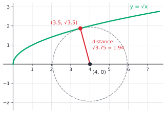

# Optimization

After this lesson you can turn a word problem into a function of one variable, find its best value on the allowed domain with the right check (endpoints, first or second derivative, convexity), solve classic problems about boxes, cans and distances, find the profit-maximizing output where marginal revenue equals marginal cost, and run gradient descent in one variable with a sensible learning rate.

Before this: [rates of change and marginal analysis](01-rates-of-change-and-marginal-analysis.md), [the mean value theorem and extrema](03-mean-value-theorem-and-extrema.md) and [concavity and curve sketching](04-concavity-and-curve-sketching.md).

## Quick check

Try these first. If you get all three right, skip to [Practice](#practice).

1. Two numbers add to 20. What is the largest possible product?
2. Find the minimum of $f(x) = x + \frac{16}{x}$ for $x > 0$.
3. A profit function is $P(q) = -2q^2 + 80q - 300$. Find the output that maximizes profit, and the maximum profit.

<details class="solution" markdown>
<summary>Answers</summary>

1. With the numbers $x$ and $20 - x$ the product is $x(20 - x)$, whose derivative $20 - 2x$ is zero at $x = 10$. The product is 100, for $10$ and $10$.
2. $f'(x) = 1 - \frac{16}{x^2} = 0$ gives $x = 4$, and $f''(x) = \frac{32}{x^3} > 0$, so it is a minimum, $f(4) = 4 + 4 = 8$.
3. $P'(q) = -4q + 80 = 0$ gives $q = 20$, and $P''(q) = -4 < 0$. The maximum profit is $P(20) = -800 + 1600 - 300 = 500$.

</details>

## The idea

A farmer has 200 m of fence and a straight river on one side of the field. The fence only goes on the other three sides. What shape of rectangle encloses the most area? A wide field uses most of the fence on the long side and leaves little depth, and a deep field uses most of the fence on the short sides. The best one is in between, and neither extreme is it. The derivative finds the best.

Every optimization problem has the same skeleton. There is a quantity you want as large or as small as possible (the area), a limit on what you may choose (the 200 m), and a way to describe all the possible choices (the width $x$ of the field, from 0 to 100 m). The work is mostly in turning the words into a function of one variable. After that it is the closest thing in calculus to a recipe: find the critical points, add the endpoints, and compare.

The same skeleton covers a firm choosing its output to maximize profit, a program choosing a parameter to minimize a loss, and a delivery company choosing how much to order at once. The last section of the lesson shows the one-variable version of how machine-learning models are trained: gradient descent, which finds a minimum by repeatedly stepping downhill, and which goes wrong in a particular way if the steps are too long.

## Definitions

An **optimization problem** asks for the largest or smallest value of a function, over the points that are allowed. The function being made large or small is the **objective function**. The conditions on the variables are the **constraints**, and the set of values that satisfy them is the **feasible set** (here, an interval, the domain of the one-variable objective). A point where the objective takes its largest value on the feasible set is a **maximizer**, and one where it takes its smallest value is a **minimizer**. In plain words, the objective is what you want to improve, the constraints say what is allowed, and the answer is the allowed choice that does best.

The tools are the ones from the last two lessons. A maximizer or minimizer on a feasible interval is either an endpoint or a critical point inside it (Fermat's theorem). In plain words, the best choice is at a flat spot, at a corner, or at the edge of what is allowed.

The **profit-maximization condition** for a firm with revenue $R(q)$ and cost $C(q)$ is $R'(q) = C'(q)$, that is, marginal revenue equals marginal cost. In plain words, produce up to the point where one more unit would bring in exactly what it costs to make.

**Gradient descent** in one variable minimizes a differentiable function $f$ by choosing a starting value $w_0$ and a **learning rate** (or step size) $\eta > 0$, and repeating

$$
w_{n+1} = w_n - \eta f'(w_n).
$$

In plain words, if the slope is positive the function rises to the right, so move left; if it is negative, move right. The step is proportional to the slope, so it shrinks near a flat spot.

## How to do it

### A method for word problems

1. Read the problem and say what is to be maximized or minimized, in words. Draw a picture and label it.
2. Name the variables, with units. Write the objective as a formula in them.
3. Write the constraint as an equation and use it to remove all but one variable from the objective, so you have $f(x)$.
4. Find the feasible interval for $x$: what values make sense? (Lengths can't be negative, a cut can't be longer than the sheet.) Note whether it is closed or open.
5. Find the critical points of $f$ in the interval: where $f'(x) = 0$ or $f'(x)$ doesn't exist.
6. Decide which one is best. On a closed interval, compare $f$ at the critical points and at both endpoints (the closed interval method). On an open or unbounded interval, use the first derivative test or the second derivative test, or convexity, and look at the limits at the open ends.
7. Answer the question that was asked, with units: the best value of the variable, and of the objective if asked, and the other variables.
8. Check: try values on either side, and ask whether the answer is reasonable.

### Why a single critical point is enough

On an open interval the closed interval method has no endpoints to compare. This theorem replaces them.

*Theorem.* Let $f$ be continuous on an interval $I$ (of any kind), and differentiable on $I$ except possibly at a point $c$ inside it. If $f'(x) < 0$ for $x < c$ in $I$ and $f'(x) > 0$ for $x > c$ in $I$, then $f(c)$ is the absolute minimum of $f$ on $I$. If the signs are reversed, it is the absolute maximum.

We know the signs of $f'$ on each side of $c$. We want $f(x) \ge f(c)$ for every $x \in I$, and not just near $c$. The plan is to apply the sign-of-the-derivative theorem on each side, up to and including $c$.

*Proof.* On the part of $I$ to the left of $c$, together with $c$ itself, $f$ is continuous and $f' < 0$ inside, so $f$ is decreasing there: $f(x) > f(c)$ for $x < c$. On the part to the right, together with $c$, $f' > 0$ inside, so $f$ is increasing: $f(x) > f(c)$ for $x > c$. So $f(x) \ge f(c)$ for all $x \in I$. The maximum case is the same with the signs reversed. $\blacksquare$

Look back at how it is used. If $f'$ is continuous and $c$ is the only zero of $f'$ in $I$, then $f'$ has one sign on each side of $c$ (otherwise the intermediate value theorem would give another zero), so you only need one test value on each side. The same job is done by convexity from [concavity and curve sketching](04-concavity-and-curve-sketching.md): if $f'' \ge 0$ on $I$, then any critical point is an absolute minimum.

### Profit maximization

Profit is $P(q) = R(q) - C(q)$ for output $q$ in the feasible interval $[0, q_{\max}]$. At a maximizer $q^*$ inside the interval, Fermat's theorem gives $P'(q^*) = 0$, which says

$$
R'(q^*) = C'(q^*).
$$

This is a necessary condition, and it also finds minima and flat points. The second derivative test sorts them out: $P''(q^*) < 0$, that is $R''(q^*) < C''(q^*)$, means a local maximum. In plain words, beyond $q^*$ the marginal cost must be rising faster than the marginal revenue, so that beyond $q^*$ each extra unit costs more than it brings in.

For a firm that sells at a price $p$ that it can't change, $R(q) = pq$ and $R' = p$, so the condition becomes "price equals marginal cost".

### Gradient descent in one variable

Gradient descent doesn't need $f'(w) = 0$ to be solvable. It only needs $f'$ to be computed, which is why it is how models with millions of parameters are trained (with a gradient in place of the slope, see [partial derivatives and the gradient](../09-multivariable-calculus-light/02-partial-derivatives-and-the-gradient.md)).

For a bowl-shaped $f(w) = (w - 3)^2 + 1$ the slope is $f'(w) = 2(w - 3)$, so the update is $w_{n+1} = w_n - 2\eta(w_n - 3)$. Subtract 3 from both sides:

$$
w_{n+1} - 3 = (1 - 2\eta)(w_n - 3).
$$

So the distance from the minimum is multiplied by $1 - 2\eta$ at every step, and after $n$ steps it is $(1 - 2\eta)^n(w_0 - 3)$. This tends to 0 exactly when $\lvert 1 - 2\eta \rvert < 1$, that is $0 < \eta < 1$. The figure shows what happens with $w_0 = 0$.


| Learning rate $\eta$ | Factor $1 - 2\eta$ | Behaviour from $w_0 = 0$ |
|---|---|---|
| 0.1 | 0.8 | creeps towards 3 from below |
| 0.5 | 0 | lands on 3 in one step |
| 0.9 | $-0.8$ | zigzags across 3, closing in |
| 1.0 | $-1$ | bounces between 0 and 6 forever |
| 1.1 | $-1.2$ | each swing is bigger: it diverges |

For a general function the rule of thumb is that the learning rate must stay below $\frac{2}{L}$, where $L$ is how sharply the slope can change (the largest value of $f''$ in the region). Here $L = 2$ and the limit is $\eta < 1$. The choice $\eta = \frac{1}{f''} = 0.5$ is exactly Newton's method applied to $f'(w) = 0$, which is why it lands on the minimum at once for a quadratic.

There is a second danger. If $f$ is not convex, gradient descent finds a valley, and not necessarily the lowest one. For $g(w) = w^4 - 3w^2 + w$ there are two valleys, near $w = -1.30$ (value $-3.51$) and $w = 1.13$ (value $-1.07$). Starting at $w_0 = 0.5$ or 2 ends in the shallower one, and starting at $-0.5$ or $-2$ ends in the deeper one.

## Worked examples

<div class="example" markdown>

### Example 1: a box from a sheet

A box with no lid is made from a 30 cm by 20 cm sheet of cardboard by cutting a square of side $x$ from each corner and folding up the sides. Which $x$ gives the largest volume?

Step 1: the objective is the volume. The picture is the left panel of the figure.

Step 2: the box has height $x$, length $30 - 2x$ and width $20 - 2x$, so $V(x) = x(30 - 2x)(20 - 2x) = 4x^3 - 100x^2 + 600x$ cm$^3$.

Step 3: there is only one variable already, since the constraint (the size of the sheet) was used to write the length and width.

Step 4: the cut can't be negative, and the width $20 - 2x$ can't be negative, so $0 \le x \le 10$. This is a closed interval.

Step 5: $V'(x) = 12x^2 - 200x + 600 = 4(3x^2 - 50x + 150)$. The quadratic formula gives $x = \frac{50 \pm \sqrt{700}}{6}$, so $x \approx 3.924$ or $x \approx 12.743$. Only the first is in $[0, 10]$.

Step 6: compare. $V(0) = 0$, $V(10) = 0$ and $V(3.924) \approx 1056.3$. The largest is at $x \approx 3.924$.


Step 7: cut squares of side about 3.92 cm. The box is 22.15 cm long, 12.15 cm wide and 3.92 cm high, with a volume of about 1056 cm$^3$.

Check: $V(3.5) = 1046.5$ and $V(4.5) = 1039.5$, both below, and $V''(x) = 24x - 200 = -105.8 < 0$ at the critical point. The curve is flat near the top: $V(3.9) = 1056.28$ and $V(4) = 1056$, so a cut of 4 cm loses almost nothing.

</div>

<div class="example" markdown>

### Example 2: a fence along a river, and a limit on the bank

A farmer has 200 m of fence for three sides of a rectangular field, with a straight river on the fourth side. Let $x$ be the length of each side perpendicular to the river and $y$ the length parallel to it. Find the largest area. Then repeat it if only 80 m of river bank is available.

The constraint is $2x + y = 200$, so $y = 200 - 2x$, and the area is $A(x) = x(200 - 2x) = 200x - 2x^2$, with $0 \le x \le 100$ (so that $y \ge 0$). Then $A'(x) = 200 - 4x = 0$ gives $x = 50$, $y = 100$ and $A = 5000$ m$^2$. The endpoints give $A(0) = A(100) = 0$, so the best field is 50 m by 100 m.

Now suppose $y \le 80$. Then $200 - 2x \le 80$, so $x \ge 60$, and the feasible interval is $[60, 100]$. The critical point $x = 50$ is no longer in it. Compare the endpoints: $A(60) = 60 \cdot 80 = 4800$ and $A(100) = 0$. The best is at the endpoint $x = 60$, with $y = 80$ and $A = 4800$ m$^2$, and the figure shows it. The limit costs 200 m$^2$.


Check: $A(55) = 4950$ and $A(40) = 4800$, both under 5000 in the first problem. In the second, $A(61) = 61 \cdot 78 = 4758$, which is lower than 4800, so the area falls as $x$ increases past 60. When the best interior point is outside the feasible interval, the best feasible point is at the edge.

</div>

<div class="example" markdown>

### Example 3: the can that uses the least metal

A cylindrical can must hold 355 cm$^3$. Find the radius and height that use the least metal, taking the metal to be the total surface area (top, bottom and side).

The surface area is $S = 2\pi r^2 + 2\pi rh$. The constraint is $\pi r^2 h = 355$, so $h = \frac{355}{\pi r^2}$. Substituting,

$$
S(r) = 2\pi r^2 + 2\pi r\cdot\frac{355}{\pi r^2} = 2\pi r^2 + \frac{710}{r}, \qquad r > 0.
$$

The domain is open: $r > 0$. The derivative is $S'(r) = 4\pi r - \frac{710}{r^2}$, which is zero when $r^3 = \frac{710}{4\pi} = \frac{355}{2\pi} \approx 56.50$, so $r \approx 3.837$ cm. Then $h = \frac{355}{\pi r^2} \approx 7.674$ cm, which is $2r$: the best can is as tall as it is wide.

To justify it: $S''(r) = 4\pi + \frac{1420}{r^3} > 0$ for every $r > 0$, so $S$ is convex on $(0, \infty)$ and the critical point is the absolute minimum. This also fits the ends of the domain: $S \to \infty$ as $r \to 0^+$ and as $r \to \infty$. The least surface area is $S \approx 277.5$ cm$^2$.


Check: $S(3.5) = 279.8$ and $S(4.2) = 279.9$, both just above 277.5. The minimum is flat: a can 6.6 cm wide ($r = 3.3$) and 10.4 cm tall uses $S = 283.6$ cm$^2$, only 2.2% more metal. Other costs (seams, handling, shelf space) can easily outweigh a saving that small, so a real can need not have the exact optimal shape.

</div>

<div class="example" markdown>

### Example 4: the closest point on a curve

Find the point on the curve $y = \sqrt{x}$ that is closest to $(4, 0)$.

The distance from $(x, \sqrt{x})$ to $(4, 0)$ is $\sqrt{(x - 4)^2 + x}$. The square root is increasing, so the distance is smallest exactly where the square of the distance is smallest. This avoids a messy derivative: minimize $D(x) = (x - 4)^2 + x$ for $x \ge 0$.

Then $D'(x) = 2(x - 4) + 1 = 2x - 7 = 0$ gives $x = 3.5$, and $D''(x) = 2 > 0$, so $D$ is convex and this is the absolute minimum. The closest point is $(3.5, \sqrt{3.5}) \approx (3.5, 1.871)$, at distance $\sqrt{D(3.5)} = \sqrt{3.75} \approx 1.936$.



Check: $D(3) = 4$, $D(3.5) = 3.75$ and $D(4) = 4$, so 3.5 is lower than both neighbours. The tangent to the curve at $x = 3.5$ has slope $\frac{1}{2\sqrt{3.5}} = 0.2673$, and the segment from $(4, 0)$ has slope $\frac{\sqrt{3.5}}{3.5 - 4} = -3.742$. The product is $-1$, so the shortest segment is perpendicular to the curve, as the circle in the figure suggests.

</div>

<div class="example" markdown>

### Example 5: profit where marginal revenue equals marginal cost

A seller faces the price $p(q) = 100 - 2q$ for $0 \le q \le 50$ and has the cost $C(q) = 200 + 20q + 2q^2$, as in [rates of change and marginal analysis](01-rates-of-change-and-marginal-analysis.md). Find the profit-maximizing output.

The revenue is $R(q) = 100q - 2q^2$, so $R'(q) = 100 - 4q$ and $C'(q) = 20 + 4q$. Setting $R' = C'$ gives $100 - 4q = 20 + 4q$, so $q = 10$.

Then $P(q) = R - C = -4q^2 + 80q - 200$ has $P''(q) = -8 < 0$, so it is concave, and $q = 10$ is a maximum. The price is $p = 100 - 20 = 80$ dollars, the revenue is \$800, the cost is \$600 and the profit is \$200. The endpoints are far worse: at $q = 0$ there is a loss of \$200, and at $q = 50$ a loss of \$6,200.


Check: the profit is \$196 at $q = 9$, \$200 at $q = 10$ and \$196 at $q = 11$. The seller makes a profit only for $10 - \sqrt{50} < q < 10 + \sqrt{50}$, that is for $2.93 < q < 17.07$ (the profit is just \$4 at both $q = 3$ and $q = 17$). In the figure the gap between the curves is largest at $q = 10$, where the tangents are parallel: this is what "marginal revenue equals marginal cost" looks like.

</div>

<div class="example" markdown>

### Example 6: how much to order at once (finish it yourself)

A shop sells 1,200 units a year at a steady rate. Each order costs \$50 to place, and holding a unit in stock costs \$3 a year, charged on the average stock $\frac{Q}{2}$ when it orders $Q$ units at a time. The yearly cost is

$$
T(Q) = \frac{50 \cdot 1200}{Q} + 3 \cdot \frac{Q}{2} = \frac{60000}{Q} + 1.5Q, \qquad Q > 0.
$$

Find the order size $Q$ that minimizes the yearly cost, and that cost.

<details class="solution" markdown>
<summary>Finish</summary>

$T'(Q) = -\frac{60000}{Q^2} + 1.5 = 0$ gives $Q^2 = 40000$, so $Q = 200$. Also $T''(Q) = \frac{120000}{Q^3} > 0$ for $Q > 0$, so $T$ is convex and $Q = 200$ is the absolute minimum. The cost is $T(200) = 300 + 300 = 600$ dollars a year, with an order every $\frac{200}{1200}$ of a year, six times a year.

Check: $T(100) = 600 + 150 = 750$ dollars and $T(300) = 200 + 450 = 650$ dollars, both above \$600. At the minimum the ordering cost and the holding cost are equal (\$300 each), which is typical of this kind of balance.

</details>

</div>

## Edge cases and common mistakes

<div class="warning" markdown>

Watch out: leaving two variables in the objective. $A = xy$ can't be differentiated until the constraint $2x + y = 200$ removes $y$. Substitute before you differentiate.

</div>

<div class="warning" markdown>

Watch out: ignoring the domain. In the box problem the second root of $V'$ is $x = 12.74$, which would make a negative width. A critical point outside the feasible interval is not a candidate.

</div>

<div class="warning" markdown>

Watch out: skipping the endpoints. In Example 2 with the limit on the river bank, there is no critical point in the feasible interval, and the answer is at an endpoint. Setting the derivative to zero finds nothing useful there.

</div>

<div class="warning" markdown>

Watch out: answering a different question. If the question asks for the dimensions, giving only $x$ is not enough, and if it asks for the maximum area, giving only $x = 50$ is not enough. Reread the question and give every number it asks for, with units.

</div>

<div class="warning" markdown>

Watch out: taking a critical point to be the maximum without checking. $R' = C'$ finds minima of profit as well as maxima: it is the sign of $P''$ (or of $P'$ on each side) that tells them apart.

</div>

<div class="warning" markdown>

Watch out: forgetting the last step when you minimize a squared distance. Example 4 minimized $D = d^2$, and the distance is $\sqrt{D}$, so the final answer is $\sqrt{3.75}$, and not 3.75.

</div>

<div class="warning" markdown>

Watch out: a learning rate that is too large. Gradient descent doesn't fail loudly: the values just grow. Always print the loss at each step, and lower $\eta$ if it rises.

</div>

## Tricks and shortcuts

Minimize the square of a distance, not the distance, to avoid the square root. The same trick works for any positive quantity that has a square root or a ratio in it: minimize the square, or the reciprocal, or the logarithm, if it makes the derivative easier.

Optima are flat. At the best point the objective changes very slowly, so a small mistake in the choice costs very little: the can with $r = 3.3$ is only 2.2% off, and the box with a 4 cm cut loses less than 0.03% of its volume. That is why rough numbers in practice (round order sizes, standard can sizes) work well.

Symmetry often gives the answer without calculus: of all rectangles with a fixed perimeter the square has the largest area, and two numbers with a fixed sum have the largest product when they are equal. The calculus then confirms it.

A quick check on a profit or cost optimum: at the best point, nudge $q$ up by 1 and down by 1 and confirm both are worse, as in Example 5.

## In code

A gradient descent loop in one variable, run with five learning rates on $f(w) = (w - 3)^2 + 1$, then on a function with two valleys from four starting points, and then a Newton step on $f'(w) = 0$.

<details class="code" markdown>
<summary>In code</summary>

```python
def gradient_descent(df, w0, eta, steps):
    """Repeat w <- w - eta * f'(w) and return the final w."""
    w = w0
    for _ in range(steps):
        w -= eta * df(w)
    return w


# f(w) = (w - 3)**2 + 1 has f'(w) = 2 (w - 3) and its minimum at w = 3.
df = lambda w: 2 * (w - 3)
for eta in (0.1, 0.5, 0.9, 1.0, 1.1):
    print(eta, round(gradient_descent(df, 0.0, eta, 10), 4))
# 0.1 2.6779
# 0.5 3.0
# 0.9 2.6779
# 1.0 0.0
# 1.1 -15.5752

# A non-convex function: g(w) = w**4 - 3 w**2 + w has two valleys.
g = lambda w: w**4 - 3 * w**2 + w
dg = lambda w: 4 * w**3 - 6 * w + 1
for w0 in (-2.0, -0.5, 0.5, 2.0):
    w = gradient_descent(dg, w0, 0.01, 2000)
    print(w0, round(w, 4), round(g(w), 4))
# -2.0 -1.3008 -3.5139
# -0.5 -1.3008 -3.5139
# 0.5 1.1309 -1.0702
# 2.0 1.1309 -1.0702

# Newton's method on f'(w) = 0 reaches the minimum of the quadratic in one step.
w = 0.0
w = w - df(w) / 2          # f''(w) = 2
print(w)
# 3.0
```

With $\eta = 0.1$ and $\eta = 0.9$ the value after 10 steps is the same, $2.6779$, because the factors $0.8$ and $-0.8$ have the same size, but the second one gets there zigzagging across 3. With $\eta = 1.0$ the loop never settles, and with $\eta = 1.1$ the values grow. For $g$ the answer depends on where you start: two of the four starts end in the shallower valley.

</details>

## FAQ

### Why minimize the square of the distance and not the distance?

The two have the same minimizer, because the square root is an increasing function: if $D_1 < D_2$ then $\sqrt{D_1} < \sqrt{D_2}$. The square has a derivative without a square root in it, so the algebra is easier. The only price is to remember to take the root at the end.

### What if the derivative is never zero on the feasible interval?

Then there are no critical points inside, and the best value is at an endpoint (or there is none, on an open interval). Example 2 with the limit on the bank is like that. For a linear objective such as $P(q) = 5q - 100$, the best output is the largest allowed.

### Does gradient descent find the best answer?

Only for convex functions, where every valley is the lowest. For a function with several valleys it finds one of them, depending on the start. Training a neural network is of the second kind, which is why the starting values, the learning rate and the number of steps matter, and why different runs can end at different values of the loss.

### Why does $R' = C'$ give a maximum and not a minimum of profit?

By itself it doesn't. It says that $P'(q) = 0$, which is a critical point. The second derivative test says it is a maximum if $P''(q) < 0$, which is the same as saying that marginal cost rises faster than marginal revenue at that output. If marginal cost were falling there, producing more would be better, and the critical point would be a minimum of profit.

## Practice

### Warm-up

1\. Two nonnegative numbers $x$ and $y$ add to 30. Find the largest value of $xy^2$.

<details class="solution" markdown>
<summary>Solution</summary>

With $y = 30 - x$ and $0 \le x \le 30$, let $f(x) = x(30 - x)^2$. Then $f'(x) = (30 - x)^2 - 2x(30 - x) = (30 - x)(30 - 3x)$, which is zero at $x = 30$ and $x = 10$. The values are $f(0) = 0$, $f(10) = 10 \cdot 400 = 4000$ and $f(30) = 0$. The maximum is 4000, at $x = 10$ and $y = 20$.

Check: $f(9) = 9 \cdot 441 = 3969$ and $f(11) = 11 \cdot 361 = 3971$, both below 4000.

</details>

2\. A rectangle has an area of 64 m$^2$. What dimensions give the smallest perimeter?

<details class="solution" markdown>
<summary>Solution</summary>

With sides $x$ and $\frac{64}{x}$ the perimeter is $P(x) = 2x + \frac{128}{x}$ for $x > 0$. Then $P'(x) = 2 - \frac{128}{x^2} = 0$ gives $x^2 = 64$, so $x = 8$, and $P''(x) = \frac{256}{x^3} > 0$, so it is the absolute minimum. The rectangle is 8 m by 8 m, a square, with perimeter 32 m.

Check: a 4 m by 16 m rectangle has perimeter 40 m, and a 2 m by 32 m rectangle has 68 m.

</details>

3\. A farmer has 120 m of fence to build a rectangular enclosure divided into two equal pens by a fence parallel to one pair of sides. Find the dimensions that enclose the largest area.

<details class="solution" markdown>
<summary>Solution</summary>

Let the outer rectangle be $w$ wide and $h$ high, with the divider of length $h$. The fence is $2w + 3h = 120$, so $w = 60 - 1.5h$, and the area is $A(h) = (60 - 1.5h)h = 60h - 1.5h^2$ for $0 \le h \le 40$. Then $A'(h) = 60 - 3h = 0$ gives $h = 20$, $w = 30$ and $A = 600$ m$^2$. The endpoints give $A(0) = A(40) = 0$.

Check: $2(30) + 3(20) = 120$. Also $h = 19$ gives $w = 60 - 28.5 = 31.5$ and $A = 31.5 \cdot 19 = 598.5$, below 600.

</details>

### Standard

4\. A box with a square base and no lid must have a volume of 4000 cm$^3$. Find the dimensions that use the least material, and the surface area.

<details class="solution" markdown>
<summary>Solution</summary>

Let the base have side $x$ and the height be $h = \frac{4000}{x^2}$. The material is the base plus four sides: $S(x) = x^2 + 4xh = x^2 + \frac{16000}{x}$ for $x > 0$. Then $S'(x) = 2x - \frac{16000}{x^2} = 0$ gives $x^3 = 8000$, so $x = 20$ and $h = 10$. Since $S''(x) = 2 + \frac{32000}{x^3} > 0$, it is the absolute minimum. The box is 20 cm by 20 cm by 10 cm, with $S = 400 + 800 = 1200$ cm$^2$.

Check: $V = 20 \cdot 20 \cdot 10 = 4000$. And $x = 18$ gives $S = 324 + 888.9 = 1212.9$, which is larger.

</details>

5\. Find the point on the line $y = 2x + 1$ that is closest to the origin, and the distance.

<details class="solution" markdown>
<summary>Solution</summary>

The square of the distance from $(x, 2x + 1)$ to the origin is $D(x) = x^2 + (2x + 1)^2 = 5x^2 + 4x + 1$. Then $D'(x) = 10x + 4 = 0$ gives $x = -0.4$, and $D'' = 10 > 0$, so it is a minimum. The point is $(-0.4, 0.2)$, and the distance is $\sqrt{0.16 + 0.04} = \sqrt{0.2} \approx 0.447$.

Check: the formula for the distance from the origin to the line $2x - y + 1 = 0$ is $\frac{\lvert 1 \rvert}{\sqrt{5}} = 0.447$, in agreement.

</details>

6\. A firm sells $q$ units at the price $p(q) = 200 - 2q$ dollars and has the cost $C(q) = 500 + 56q + q^2$ dollars. Find the output that maximizes profit, the price and the profit, and check with the second derivative.

<details class="solution" markdown>
<summary>Solution</summary>

$R(q) = 200q - 2q^2$, so $R'(q) = 200 - 4q$, and $C'(q) = 56 + 2q$. Setting $R' = C'$: $200 - 4q = 56 + 2q$, so $6q = 144$ and $q = 24$. The price is $p = 200 - 48 = 152$ dollars. The profit is $R(24) - C(24) = (4800 - 1152) - (500 + 1344 + 576) = 3648 - 2420 = 1228$ dollars.

The second derivative of profit is $P'' = R'' - C'' = -4 - 2 = -6 < 0$, so it is a maximum.

Check: $P(23) = 3542 - 2317 = 1225$ and $P(25) = 3750 - 2525 = 1225$ dollars, both below \$1,228.

</details>

### Challenge

7\. (a) Show that a cylindrical can of any fixed volume $V$ that uses the least surface area has height equal to its diameter. (b) Now suppose the top and bottom cost twice as much per cm$^2$ as the side. What is the best ratio $\frac{h}{r}$?

<details class="solution" markdown>
<summary>Solution</summary>

(a) $S = 2\pi r^2 + 2\pi rh$ with $h = \frac{V}{\pi r^2}$ gives $S(r) = 2\pi r^2 + \frac{2V}{r}$. Then $S'(r) = 4\pi r - \frac{2V}{r^2} = 0$ gives $r^3 = \frac{V}{2\pi}$, and $h = \frac{V}{\pi r^2} = \frac{2\pi r^3}{\pi r^2} = 2r$. Since $S'' = 4\pi + \frac{4V}{r^3} > 0$, it is the absolute minimum.

(b) The cost, in units of the side's cost per cm$^2$, is $K = 2(2\pi r^2) + 2\pi rh = 4\pi r^2 + \frac{2V}{r}$. Then $K'(r) = 8\pi r - \frac{2V}{r^2} = 0$ gives $r^3 = \frac{V}{4\pi}$, and $h = \frac{V}{\pi r^2} = \frac{4\pi r^3}{\pi r^2} = 4r$. So $\frac{h}{r} = 4$, a taller and thinner can, which makes sense because the expensive ends are made smaller.

Check: for $V = 355$ in (a), $r^3 = \frac{355}{2\pi} = 56.5$, so $r = 3.837$ as in Example 3, and $h = 2r$.

</details>

8\. (Reviews [quadratic functions and graphs](../../03-high-school/05-quadratics-and-complex-numbers/01-quadratic-functions-and-graphs.md).) (a) For $f(w) = aw^2 + bw + c$ with $a > 0$, show that the derivative gives the vertex formula $w^* = -\frac{b}{2a}$. (b) Show that gradient descent on $f$ satisfies $w_{n+1} - w^* = (1 - 2a\eta)(w_n - w^*)$, and find the range of learning rates for which it converges to $w^*$.

<details class="solution" markdown>
<summary>Solution</summary>

(a) $f'(w) = 2aw + b = 0$ gives $w = -\frac{b}{2a}$, and $f'' = 2a > 0$ makes it the minimum. This is the vertex of the parabola.

(b) $w_{n+1} = w_n - \eta(2aw_n + b)$. Since $b = -2aw^*$, we have $2aw_n + b = 2a(w_n - w^*)$, so $w_{n+1} - w^* = (w_n - w^*) - 2a\eta(w_n - w^*) = (1 - 2a\eta)(w_n - w^*)$. After $n$ steps the distance is multiplied by $(1 - 2a\eta)^n$, which tends to 0 if and only if $\lvert 1 - 2a\eta \rvert < 1$, so $0 < \eta < \frac{1}{a}$.

Check: with $a = 1$, $b = -6$ (so $w^* = 3$), this is the example above, where the limit is $\eta < 1$, and for $a = 2$ the limit is $\eta < 0.5$.

</details>

## Where this shows up

- Later in this book, optimization of several variables uses the same method with the gradient in place of the derivative ([multivariable optimization and Lagrange multipliers](../09-multivariable-calculus-light/03-multivariable-optimization-and-lagrange-multipliers.md)). The next chapter starts with [Riemann sums and the definite integral](../04-integrals/01-riemann-sums-and-the-definite-integral.md), which reverses the question of this chapter: from a rate of change back to the total change.
- In economics, profit maximization, cost minimization and utility maximization are all optimization problems (profit maximization and market structure<!-- link: ../../07-economics-math/03-firms-and-consumers/03-profit-maximization-and-market-structure.md -->, Lagrange multipliers, utility and cost minimization<!-- link: ../../07-economics-math/03-firms-and-consumers/05-lagrange-multipliers-utility-and-cost-minimization.md -->).
- In CS, gradient descent trains machine-learning models, the order-size problem is the economic order quantity of operations research, and choosing a block size or a cache size to balance two costs is the same calculation as the can and the order size.
