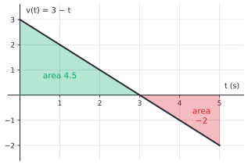

# Riemann sums and the definite integral

After this lesson you can estimate the area under a curve with left, right, midpoint and trapezoid sums, state the limit definition of the definite integral, compute a simple integral from that definition, treat area below the axis as negative, use the properties of the integral, and turn a velocity into a distance.

Before this: [the derivative definition](../02-derivatives/01-the-derivative-definition.md), [continuity, asymptotes and the IVT](../01-limits-and-continuity/03-continuity-asymptotes-and-ivt.md) and [summation notation and series](../../03-high-school/11-sequences-series-and-counting/02-summation-notation-and-series.md), which has the sums of $k$ and $k^2$ used below.

## Quick check

Try these first. If you get all three right, skip to [Practice](#practice).

1. Estimate the area under $f(x) = x^2$ from $x = 0$ to $x = 2$ with a left sum of four rectangles of equal width.
2. A car's speed is $v(t) = 10 + 2t$ metres per second for $0 \le t \le 5$. How far does it travel? (Draw the region under the graph and use geometry.)
3. Evaluate $\sum_{k=1}^{n} \frac{k^2}{n^3}$ as a closed form in $n$, and say what it approaches as $n$ grows.

<details class="solution" markdown>
<summary>Answers</summary>

1. The width is $\frac{2 - 0}{4} = 0.5$ and the left endpoints are $0, 0.5, 1, 1.5$. The heights are $0, 0.25, 1, 2.25$, so the sum is $0.5(0 + 0.25 + 1 + 2.25) = 1.75$.
2. The region under the graph is a trapezoid with parallel sides $v(0) = 10$ and $v(5) = 20$ and width 5, so its area is $5 \cdot \frac{10 + 20}{2} = 75$. The car travels 75 m.
3. Pull out $\frac{1}{n^3}$ and use the sum of squares: $\frac{1}{n^3} \cdot \frac{n(n+1)(2n+1)}{6} = \frac{(n+1)(2n+1)}{6n^2} = \frac{1}{6}\left(1 + \frac{1}{n}\right)\left(2 + \frac{1}{n}\right)$. As $n$ grows this approaches $\frac{2}{6} = \frac{1}{3}$.

</details>

## The idea

A car's speedometer is read every 10 seconds. How far did the car go in a minute? Between readings the speed changes, so there is no single speed to multiply by 60 seconds. But if you pretend the speed stays at the reading you took at the start of each 10-second stretch, you get a sum of "speed times time" pieces. Pretend it stays at the reading from the end of each stretch and you get another sum. The true distance lies somewhere near both, and the more often you read the speedometer, the closer the two guesses get.

This is the whole idea of the integral. A quantity that accumulates (distance, water in a tank, money earned) is a rate times a time, and when the rate changes you chop the time into small pieces, treat the rate as constant on each piece, add, and let the pieces shrink. On a graph of the rate against time, "rate times time" is the area of a rectangle, so the total is an area under a curve.

The picture below shows the rectangle idea for $y = x^2$ on the interval from 0 to 1, with four rectangles each time. The three panels differ only in where each rectangle gets its height: the left end of its base, the right end, or the middle.


The left sum 0.2188 is too small, because the curve is rising and each rectangle sits under it. The right sum 0.4688 is too big for the same reason, and the midpoint sum 0.3281 is close to the true area, which turns out to be $\frac{1}{3} = 0.3333\ldots$. Using more rectangles squeezes the left and right sums together. The rest of the lesson makes that squeeze precise.

The integral also needs a definition because area is not defined for a curved region. A rectangle has area by definition, and the area of a curved region is whatever number the rectangle estimates approach. This is the same move the derivative made: slopes are defined for straight lines, and the slope of a curve is the limit of slopes of secant lines.

## Definitions

Let $f$ be a function defined on the closed interval $[a, b]$, and let $n$ be a positive integer. Put $\Delta x = \frac{b - a}{n}$ and $x_k = a + k\,\Delta x$ for $k = 0, 1, \dots, n$. These points cut $[a, b]$ into $n$ **subintervals** $[x_{k-1}, x_k]$, each of width $\Delta x$. In each subinterval pick a **sample point** $x_k^*$. The **Riemann sum** is

$$
S_n = \sum_{k=1}^{n} f(x_k^*)\,\Delta x.
$$

In plain words, each term is the area of one rectangle (height $f(x_k^*)$, width $\Delta x$), and the sum is the total area of the rectangles. The choice $x_k^* = x_{k-1}$ gives the **left sum** $L_n$, the choice $x_k^* = x_k$ gives the **right sum** $R_n$, and the choice $x_k^* = \frac{x_{k-1} + x_k}{2}$ gives the **midpoint sum** $M_n$. The average of the left and right sums is the **trapezoid sum**,

$$
T_n = \frac{L_n + R_n}{2} = \Delta x\left(\frac{f(x_0)}{2} + f(x_1) + \cdots + f(x_{n-1}) + \frac{f(x_n)}{2}\right).
$$

Each of its terms is the area of a trapezoid, a strip under the straight line joining two points of the graph, which is why it is the average of the left and right sums. The second form is what code uses: the interior values count once and the two end values count half.

The **definite integral** of $f$ from $a$ to $b$ is the limit of the Riemann sums,

$$
\int_a^b f(x)\,dx = \lim_{n \to \infty} \sum_{k=1}^{n} f(x_k^*)\,\Delta x,
$$

when this limit exists and has the same value for every choice of sample points. In that case $f$ is **integrable** on $[a, b]$. The numbers $a$ and $b$ are the **limits of integration**, $f(x)$ is the **integrand**, and $x$ is a dummy variable, a placeholder like the index in a sum, so $\int_a^b f(x)\,dx = \int_a^b f(t)\,dt$. In plain words, the integral is the number that the rectangle estimates settle down to as the rectangles get thinner.

The notation comes from the sum. The symbol $\int$ is a stretched "S" for "sum", $dx$ stands for the width $\Delta x$ when it becomes tiny, and $f(x)\,dx$ is the area of a rectangle of height $f(x)$ and width $dx$. For now, $dx$ just marks the variable. The symbol $\int_a^b$ always needs its two limits, and this is the definite integral, a number. (The next lesson introduces the indefinite integral, which is a family of functions.)

Two remarks on the definition. First, a university analysis course allows unequal widths, and asks only that the widest subinterval shrink to 0. For the functions in this book the two definitions agree, so equal widths are used. Second, not every function is integrable.

*Theorem 1.* If $f$ is continuous on $[a, b]$, then $f$ is integrable on $[a, b]$. The same is true if $f$ is bounded and has only finitely many jumps.

This book accepts Theorem 1 without proof, since the proof needs a property of continuous functions on closed intervals (uniform continuity) that a real analysis course develops. For a monotonic function there is a short argument, shown below. A function that is wildly discontinuous may fail to be integrable, as Practice problem 8 shows.

**Signed area** is area that counts as positive above the $x$-axis and negative below it. Where $f(x) < 0$ the rectangle heights $f(x_k^*)$ are negative, so those terms in the Riemann sum are negative, and the integral is automatically the area above the axis minus the area below it. This is not a convention added later. It is what the definition produces.

## How to do it

### Estimating an integral with rectangles

1. Choose $n$ and compute $\Delta x = \frac{b - a}{n}$. List the points $x_0 = a, x_1, \dots, x_n = b$.
2. Choose the rule (left, right, midpoint) and list the sample points.
3. Evaluate $f$ at the sample points, add the values, and multiply the sum by $\Delta x$. Multiply once at the end, not once per term.
4. For the trapezoid sum, average the left and right sums, or give the two end values weight $\frac{1}{2}$.
5. Check the size: the estimate should lie between the smallest and largest value of $f$ times $b - a$, and for an increasing function the left sum is below the right sum.

For a function that only increases on $[a, b]$, the left sum is a lower estimate and the right sum is an upper estimate, and the gap between them is easy to find. Each right-sum rectangle is the left-sum rectangle one step to the right, so all the heights match up except the first and last. Subtracting, everything cancels in pairs:

$$
R_n - L_n = \Delta x\bigl(f(b) - f(a)\bigr).
$$

For a decreasing function, the roles swap. Because $\Delta x \to 0$, the gap shrinks to 0, which is why the integral of a monotonic function exists: it is squeezed between $L_n$ and $R_n$. In Example 1, with $n = 4$ and $f(x) = \frac{1}{x}$ on $[1, 3]$, the gap is $0.5\left(1 - \frac{1}{3}\right) = 0.3333$, and the left and right sums are $1.2833$ and $0.95$, which differ by exactly that.

### Computing an integral from the definition

*Theorem 2.* $\displaystyle\int_0^1 x^2\,dx = \frac{1}{3}$.

We know the definition, the fact that $f(x) = x^2$ is continuous and so the limit exists (Theorem 1), and the formula $\sum_{k=1}^{n} k^2 = \frac{n(n+1)(2n+1)}{6}$ from [summation notation and series](../../03-high-school/11-sequences-series-and-counting/02-summation-notation-and-series.md). We want the value of the limit. The plan is to use right sums with equal widths, because their sample points $\frac{k}{n}$ make the sum a multiple of $\sum k^2$, then find the closed form of $R_n$ and take its limit. Since the limit exists, it is the same for every choice of sample points, so one choice is enough.

*Proof.* Here $a = 0$, $b = 1$, so $\Delta x = \frac{1}{n}$ and the right endpoints are $x_k = \frac{k}{n}$. Then

$$
R_n = \sum_{k=1}^{n} \left(\frac{k}{n}\right)^2 \cdot \frac{1}{n} = \frac{1}{n^3}\sum_{k=1}^{n} k^2 = \frac{1}{n^3} \cdot \frac{n(n+1)(2n+1)}{6} = \frac{1}{6}\left(1 + \frac{1}{n}\right)\left(2 + \frac{1}{n}\right).
$$

As $n \to \infty$, $\frac{1}{n} \to 0$, so $R_n \to \frac{1}{6} \cdot 1 \cdot 2 = \frac{1}{3}$. $\blacksquare$

Look back: the left sum gives the same limit, as it must. Its closed form is $L_n = \frac{(n-1)(2n-1)}{6n^2}$, which also tends to $\frac{1}{3}$, and $R_n - L_n = \frac{1}{n}$, the gap from the formula for increasing functions. The table shows how slowly the two sums squeeze in.

| $n$ | $L_n$ | $R_n$ |
|---|---|---|
| 4 | 0.21875 | 0.46875 |
| 10 | 0.28500 | 0.38500 |
| 100 | 0.32835 | 0.33835 |
| 1000 | 0.33283 | 0.33383 |

The same argument with $\Delta x = \frac{b}{n}$ gives $\int_0^b x^2\,dx = \frac{b^3}{3}$, and with $f(x) = x$ and the sum of $k$ it gives $\int_0^b x\,dx = \frac{b^2}{2}$, the area of a triangle. These are antiderivatives of $x^2$ and $x$ evaluated at $b$, which is no accident, and the [next lesson](02-fundamental-theorem-of-calculus.md) explains it. After this, computing from the definition is almost never done by hand again. It is shown here so that you know where the number $\frac{1}{3}$ comes from.

### Properties of the integral

*Theorem 3.* Let $f$ and $g$ be integrable on the intervals involved and let $c$ be a constant. Then:

| Property | Statement |
|---|---|
| zero width | $\displaystyle\int_a^a f(x)\,dx = 0$ |
| reversal | $\displaystyle\int_b^a f(x)\,dx = -\int_a^b f(x)\,dx$ |
| constant | $\displaystyle\int_a^b c\,dx = c\,(b - a)$ |
| constant multiple | $\displaystyle\int_a^b c\,f(x)\,dx = c\int_a^b f(x)\,dx$ |
| sum and difference | $\displaystyle\int_a^b \bigl(f(x) \pm g(x)\bigr)\,dx = \int_a^b f(x)\,dx \pm \int_a^b g(x)\,dx$ |
| additivity | $\displaystyle\int_a^c f(x)\,dx = \int_a^b f(x)\,dx + \int_b^c f(x)\,dx$ for any $a$, $b$, $c$ |
| comparison | if $f(x) \le g(x)$ on $[a, b]$ with $a < b$, then $\displaystyle\int_a^b f(x)\,dx \le \int_a^b g(x)\,dx$ |
| absolute value | $\displaystyle\left\lvert \int_a^b f(x)\,dx \right\rvert \le \int_a^b \lvert f(x) \rvert\,dx$ for $a < b$ |

In plain words: the integral of a constant is a rectangle, the integral splits over sums and pulls out constants, pieces of an interval add, a bigger function has a bigger integral, and swapping the limits flips the sign.

*Proof (sketch).* The zero width and reversal rules are definitions that keep the other rules true for every order of $a$, $b$, $c$: with the order swapped, $\Delta x$ changes sign. For the other rules, write the Riemann sum on both sides. For the sum rule, $\sum \bigl(f(x_k^*) + g(x_k^*)\bigr)\Delta x = \sum f(x_k^*)\Delta x + \sum g(x_k^*)\Delta x$ by the rules for finite sums, and the limit of a sum is the sum of the limits. The constant multiple rule is the same with the constant factored out. For the constant rule, every term is $c\,\Delta x$ and there are $n$ of them, so the sum is $c\,n\,\Delta x = c(b - a)$ for every $n$. For the comparison rule, each term of the sum for $f$ is at most the matching term for $g$, because $\Delta x > 0$, so $S_n(f) \le S_n(g)$, and limits keep the inequality. The absolute value rule follows from the comparison rule applied to $-\lvert f \rvert \le f \le \lvert f \rvert$. For additivity, when $a < b < c$ choose the subintervals so that $b$ is an endpoint (the limit doesn't depend on how they are cut), and the rectangles over $[a, b]$ and over $[b, c]$ together make the rectangles over $[a, c]$. $\blacksquare$

Look back: most of this is "the same rule for finite sums, carried through a limit". Additivity is why you can split an integral at a place where the formula for $f$ changes, as for $\lvert x \rvert$ at 0.

### Distance, displacement and signed area

If $v(t)$ is the velocity of an object on a line at time $t$, then $v(t_k^*)\,\Delta t$ is the displacement over one short stretch of time, and the Riemann sum of these is the total displacement. In the limit,

$$
\text{displacement from } t = a \text{ to } t = b \text{ is } \int_a^b v(t)\,dt,
\qquad
\text{total distance travelled is } \int_a^b \lvert v(t) \rvert\,dt.
$$

Velocity is negative when the object moves backward, so the signed area is the net change in position, and the area counted without signs is the distance an odometer would show. In general, the units of an integral are the units of the integrand times the units of the variable: metres per second times seconds is metres.

## Worked examples

<div class="example" markdown>

### Example 1: three sums for $\frac{1}{x}$

Estimate $\int_1^3 \frac{1}{x}\,dx$ with $n = 4$ using the left, right, midpoint and trapezoid sums. Then compare with the true value $\ln 3$.

Step 1: $\Delta x = \frac{3 - 1}{4} = 0.5$, and the points are $1, 1.5, 2, 2.5, 3$.

Step 2 and 3, left: the sample points are $1, 1.5, 2, 2.5$, and $f$ there is $1,\ 0.6667,\ 0.5,\ 0.4$, which add to $2.5667$. Multiply by $0.5$: $L_4 = 1.2833$.

Right: the sample points are $1.5, 2, 2.5, 3$, with values $0.6667,\ 0.5,\ 0.4,\ 0.3333$, adding to $1.9$, so $R_4 = 0.95$.

Midpoint: the sample points are $1.25, 1.75, 2.25, 2.75$, with values $0.8,\ 0.5714,\ 0.4444,\ 0.3636$, adding to $2.1795$, so $M_4 = 1.0898$.

Step 4, trapezoid: $T_4 = \frac{1.2833 + 0.95}{2} = 1.1167$.

Check: the function is decreasing, so the left sum should be too big and the right sum too small, and $1.2833 > \ln 3 = 1.0986 > 0.95$. The midpoint estimate $1.0898$ is off by $0.009$, and the trapezoid estimate $1.1167$ is off by $0.018$, twice as far and on the other side. This pattern holds for curves like this one that bend upward: the midpoint rule is too low and the trapezoid rule is too high.

</div>

<div class="example" markdown>

### Example 2: a limit of sums for a linear function

Compute $\int_0^2 (3x + 1)\,dx$ from the definition, using right sums.

Here $\Delta x = \frac{2}{n}$ and $x_k = \frac{2k}{n}$. So

$$
R_n = \sum_{k=1}^{n}\left(\frac{6k}{n} + 1\right)\frac{2}{n} = \frac{12}{n^2}\sum_{k=1}^{n} k + \frac{2}{n}\sum_{k=1}^{n} 1 = \frac{12}{n^2} \cdot \frac{n(n+1)}{2} + \frac{2}{n} \cdot n = \frac{6(n+1)}{n} + 2.
$$

As $n \to \infty$, $\frac{6(n+1)}{n} = 6 + \frac{6}{n} \to 6$, so the integral is $6 + 2 = 8$.

Check with geometry: the region under $y = 3x + 1$ from 0 to 2 is a trapezoid with parallel sides $1$ and $7$ and width 2, so its area is $2 \cdot \frac{1 + 7}{2} = 8$. For $n = 100$ the formula gives $R_{100} = 8.06$, already close.

</div>

<div class="example" markdown>

### Example 3: displacement against distance

A particle moves on a line with velocity $v(t) = 3 - t$ metres per second for $0 \le t \le 5$. Find its displacement and the total distance it travels.

The graph of $v$ is a line crossing the axis at $t = 3$. The displacement is the signed area. From $t = 0$ to $t = 3$ the region is a triangle with base 3 and height 3, so its area is $\frac{1}{2} \cdot 3 \cdot 3 = 4.5$. From $t = 3$ to $t = 5$ the region is below the axis, a triangle with base 2 and height 2, so the integral over that stretch is $-\frac{1}{2} \cdot 2 \cdot 2 = -2$.



By additivity, the displacement is $4.5 + (-2) = 2.5$ m. The particle ends 2.5 m forward of where it started. The distance is $\int_0^5 \lvert v \rvert\,dt = 4.5 + 2 = 6.5$ m: the particle moves forward 4.5 m, turns around at $t = 3$ and moves back 2 m.

Check with the trapezoid formula on the whole interval: $5 \cdot \frac{v(0) + v(5)}{2} = 5 \cdot \frac{3 + (-2)}{2} = 2.5$, which equals the displacement because $v$ is linear, so the trapezoid sum is exact. The distance can't be found that way, because $\lvert v \rvert$ is not linear on the whole interval.

</div>

<div class="example" markdown>

### Example 4: using the properties

Given $\int_0^1 x^2\,dx = \frac{1}{3}$ and $\int_0^1 x\,dx = \frac{1}{2}$, evaluate $\int_0^1 \left(6x^2 - 4x + 3\right)dx$ and $\int_1^0 x^2\,dx$. Then use the semicircle to evaluate $\int_{-3}^{3}\left(x + \sqrt{9 - x^2}\right)dx$.

For the first, use the sum rule and the constant multiple rule, and the constant rule for the last term:

$$
6 \cdot \frac{1}{3} - 4 \cdot \frac{1}{2} + 3 \cdot (1 - 0) = 2 - 2 + 3 = 3.
$$

For the second, reversal gives $\int_1^0 x^2\,dx = -\int_0^1 x^2\,dx = -\frac{1}{3}$.

For the third, split the integral. The graph of $y = \sqrt{9 - x^2}$ is the upper half of the circle of radius 3, so $\int_{-3}^{3}\sqrt{9 - x^2}\,dx = \frac{1}{2}\pi \cdot 3^2 = \frac{9\pi}{2}$. The graph of $y = x$ from $-3$ to 3 has a triangle of area $\frac{9}{2}$ above the axis on the right and a triangle of area $\frac{9}{2}$ below the axis on the left, which cancel, so $\int_{-3}^{3} x\,dx = 0$. The total is $\frac{9\pi}{2} \approx 14.137$.

Check: a midpoint sum of the whole integrand with $n = 100000$ gives $14.1372$, and $\frac{9\pi}{2} = 14.1372$. Also, the first answer is plausible: on $[0, 1]$ the integrand $6x^2 - 4x + 3$ ranges from 3 at $x = 0$ down to $\frac{7}{3}$ at its lowest point $x = \frac{1}{3}$ and up to 5 at $x = 1$, so an average of 3 is reasonable.

</div>

<div class="example" markdown>

### Example 5: trapezoid sums from data (finish it yourself)

A car's speed is read every 10 seconds, giving the table below. Estimate the distance in the minute with the left, right and trapezoid sums.

| $t$ (s) | 0 | 10 | 20 | 30 | 40 | 50 | 60 |
|---|---|---|---|---|---|---|---|
| $v$ (m/s) | 0 | 6 | 11 | 14 | 15 | 15 | 12 |

The width is $\Delta t = 10$ s. The left sum uses the readings at $t = 0, 10, \dots, 50$ and the right sum uses those at $t = 10, \dots, 60$. Compute both, and then the trapezoid estimate, and say whether the true distance is certainly between the left and right sums.

<details class="solution" markdown>
<summary>Finish</summary>

The left sum is $10(0 + 6 + 11 + 14 + 15 + 15) = 10 \cdot 61 = 610$ m. The right sum is $10(6 + 11 + 14 + 15 + 15 + 12) = 10 \cdot 73 = 730$ m. The trapezoid sum is their average, 670 m, which is also $10\left(\frac{0}{2} + 6 + 11 + 14 + 15 + 15 + \frac{12}{2}\right) = 10 \cdot 67$.

The true distance is not guaranteed to lie between 610 and 730. The speed rises and then falls, so it isn't monotonic, and neither sum is a certain lower or upper bound. (With these readings the two sums do bracket the trapezoid estimate, but that is the average of the two, so it says nothing about the truth.) The trapezoid estimate, 670 m, is the sensible single answer, and the average speed is about 40 km/h.

Check: the average speed is $\frac{670}{60} \approx 11.2$ m/s, which lies between the lowest reading 0 and the highest 15 and is consistent with most readings being between 11 and 15.

</details>

</div>

## Edge cases and common mistakes

<div class="warning" markdown>

Watch out: the integral is the signed area, not the area. The integral of $\sin x$ from 0 to $2\pi$ is 0, not 4, because the two arches cancel. If you want total area, split the interval where the function changes sign and integrate $\lvert f \rvert$, as the distance in Example 3 does.

</div>

<div class="warning" markdown>

Watch out: a Riemann sum is an estimate, and the number of rectangles is $n$, not the width. A common slip is to use $\Delta x = b - a$ and forget to divide by $n$, or to add the $n + 1$ points $x_0, \dots, x_n$ when the left and right sums use only $n$ of them. The left sum skips $x_n$ and the right sum skips $x_0$.

</div>

<div class="warning" markdown>

Watch out: the integral does not depend on the name of the dummy variable, but it does depend on the limits. The answer to $\int_0^1 x^2\,dx$ is the number $\frac{1}{3}$, with no $x$ left in it. When the upper limit is itself a variable, as in $\int_0^x t^2\,dt$, use a different letter inside, because writing $\int_0^x x^2\,dx$ uses $x$ for two different things.

</div>

<div class="warning" markdown>

Watch out: the properties hold for sums and constant multiples, not for products. In general $\int f(x)g(x)\,dx \ne \int f(x)\,dx \cdot \int g(x)\,dx$. With $f = g = x$ on $[0, 1]$, the left side is $\int_0^1 x^2\,dx = \frac{1}{3}$ and the right side is $\frac{1}{2} \cdot \frac{1}{2} = \frac{1}{4}$.

</div>

A function with a jump is still integrable. For $f(x) = \lfloor x \rfloor$ on $[0, 3]$ the integral is $0 + 1 + 2 = 3$, the area of three unit-width rectangles. The left and right sums with $n = 3$ are 3 and 6, which differ by $\Delta x\,(f(3) - f(0)) = 3$, matching the formula for monotonic functions. Changing $f$ at a single point changes no integral, because the one rectangle that sees the new value has width $\Delta x$, which shrinks to 0.

If $f$ is unbounded on $[a, b]$, as $\frac{1}{x}$ is on $[0, 1]$, the sums don't settle down and this definition of the integral doesn't apply. [Partial fractions and improper integrals](05-partial-fractions-and-improper-integrals.md) handles that case with a second limit.

## Tricks and shortcuts

A function that is increasing everywhere on $[a, b]$ gives a free error bound: the true value is between $L_n$ and $R_n$, and the width of that window is $\Delta x\,(f(b) - f(a))$. To reach an answer within $0.01$ for $\int_0^1 x^2\,dx$, you need $\frac{1}{n} \le 0.01$, so $n = 100$ rectangles.

The trapezoid sum is the best quick estimate by hand, because it costs one more addition than the left sum and the error shrinks like $\frac{1}{n^2}$ and not $\frac{1}{n}$. The midpoint sum has about half its error and the opposite sign, so $\frac{2M_n + T_n}{3}$ is better than either. That combination is Simpson's rule. For $\int_1^3 \frac{1}{x}\,dx$ with $n = 4$, it gives $\frac{2(1.0898) + 1.1167}{3} = 1.0987$, against the true value $1.0986$.

Symmetry saves work. If $f$ is odd, so $f(-x) = -f(x)$, then $\int_{-a}^{a} f(x)\,dx = 0$, because the areas on the two sides cancel. If $f$ is even, then $\int_{-a}^{a} f(x)\,dx = 2\int_0^a f(x)\,dx$. In Example 4, the term $x$ is odd and drops out.

## In code

The code computes the sums from the definition and the trapezoid rule, then shows how the error falls for $\int_0^1 \frac{4}{1 + x^2}\,dx = \pi$. (The true value is found in the next lesson. It is $4\arctan 1 = \pi$.) The left sum's error falls by a factor of 10 for each tenfold increase in $n$, while the trapezoid and midpoint errors fall by a factor of about 100.

<details class="code" markdown>
<summary>In code</summary>

```python
import math

def riemann(f, a, b, n, rule="left"):
    """Left, right or midpoint sum of f on [a, b] with n equal rectangles."""
    dx = (b - a) / n
    shift = {"left": 0.0, "right": 1.0, "mid": 0.5}[rule]
    return dx * sum(f(a + (k + shift) * dx) for k in range(n))

def trapezoid(f, a, b, n):
    dx = (b - a) / n
    return dx * (f(a) / 2 + sum(f(a + k * dx) for k in range(1, n)) + f(b) / 2)

# The integral of x^2 from 0 to 1, as in the lesson.
for n in (4, 100):
    print(n, round(riemann(lambda x: x * x, 0, 1, n, "left"), 5),
          round(riemann(lambda x: x * x, 0, 1, n, "right"), 5))
# 4 0.21875 0.46875
# 100 0.32835 0.33835

# Error against n for 4 / (1 + x^2) on [0, 1], whose integral is pi.
f = lambda x: 4 / (1 + x * x)
print("   n   left error   trapezoid error   midpoint error")
for n in (10, 100, 1000, 10000):
    e_left = abs(riemann(f, 0, 1, n, "left") - math.pi)
    e_trap = abs(trapezoid(f, 0, 1, n) - math.pi)
    e_mid = abs(riemann(f, 0, 1, n, "mid") - math.pi)
    print(f"{n:5d}   {e_left:.2e}     {e_trap:.2e}          {e_mid:.2e}")
#    n   left error   trapezoid error   midpoint error
#    10   9.83e-02     1.67e-03          8.33e-04
#   100   9.98e-03     1.67e-05          8.33e-06
#  1000   1.00e-03     1.67e-07          8.33e-08
# 10000   1.00e-04     1.67e-09          8.33e-10
```

</details>

The table is the picture in the figure below: on a log-log plot, error against $n$ is a straight line, and the slope tells the order of the method. The left sum has slope $-1$, and the trapezoid and midpoint rules have slope $-2$. The trapezoid error follows a bound you will meet in a numerical analysis course, $\frac{(b - a)^3 M_2}{12 n^2}$, where $M_2$ is the largest value of $\lvert f'' \rvert$ on the interval. Here $M_2 = 8$, so the bound at $n = 100$ is $6.7 \times 10^{-5}$, and the actual error $1.7 \times 10^{-5}$ is below it.


## FAQ

### Why does the integral give the area, when area was never defined for curves?

Because the area of a curved region is defined to be this limit, and it is the only definition that agrees with area for rectangles and triangles, keeps the area of a union of non-overlapping pieces equal to the sum, and makes a bigger region have a bigger area. The definition also agrees with every curved area you can find another way: the integral of $\sqrt{9 - x^2}$ from $-3$ to 3 is $\frac{9\pi}{2}$, the area of a half disc of radius 3.

### Does it matter whether I use left, right or midpoint sums?

For one value of $n$ the answers differ, as the figure shows. In the limit it doesn't matter for an integrable function: all the choices of sample points give the same number. In practice the midpoint and trapezoid sums are much better estimates than the left and right sums for the same work.

### Is $dx$ an infinitely small number?

As a memory aid, yes: $f(x)\,dx$ is an infinitesimal rectangle. The definition doesn't use infinitesimals, though. It uses a limit of sums with $\Delta x$ shrinking, and $dx$ marks which variable the width is measured in. This matters in the next lessons, where substitution changes $dx$ into $du$, and the rule that does so is proved with the chain rule.

### Why would anyone compute an integral from the limit definition?

Almost nobody does for exact answers, because the fundamental theorem of calculus in the next lesson replaces the limit by a subtraction. The definition earns its place in two ways. It says what the integral means, which is how you set up an integral for a new problem, such as volume or total cost. And for functions with no formula for an antiderivative, such as $e^{-x^2}$, a Riemann sum or a better rule like the trapezoid rule is how a computer finds the number.

## Practice

### Warm-up

1\. For $f(x) = x$ on $[0, 2]$ with $n = 4$, find the left, right, midpoint and trapezoid sums. Which equals $\int_0^2 x\,dx$?

<details class="solution" markdown>
<summary>Solution</summary>

The width is $\Delta x = 0.5$ and the points are $0, 0.5, 1, 1.5, 2$. Left: $0.5(0 + 0.5 + 1 + 1.5) = 1.5$. Right: $0.5(0.5 + 1 + 1.5 + 2) = 2.5$. Midpoint: the sample points are $0.25, 0.75, 1.25, 1.75$, which add to 4, so the sum is $2$. Trapezoid: $\frac{1.5 + 2.5}{2} = 2$.

The midpoint and trapezoid sums both equal the exact value, because the region under a line is a triangle of area $\frac{1}{2} \cdot 2 \cdot 2 = 2$, and the trapezoid and midpoint rules are exact for straight lines.

Check: the left sum 1.5 is below 2 and the right sum 2.5 is above, as they should be for an increasing function, and the gap $2.5 - 1.5 = 1$ equals $\Delta x\,(f(2) - f(0)) = 0.5 \cdot 2$.

</details>

2\. Use geometry to evaluate (a) $\int_{-2}^{2}\sqrt{4 - x^2}\,dx$, (b) $\int_{-1}^{3}(x - 1)\,dx$ and (c) $\int_0^3 5\,dx$.

<details class="solution" markdown>
<summary>Solution</summary>

(a) The graph is the upper half of the circle of radius 2, so the area is $\frac{1}{2}\pi \cdot 2^2 = 2\pi$.

(b) The line $y = x - 1$ crosses the axis at $x = 1$. From $-1$ to 1 it is below the axis, a triangle of base 2 and height 2, area 2, so the signed area is $-2$. From 1 to 3 it is above the axis, a triangle of base 2 and height 2, area $2$. The total is $-2 + 2 = 0$.

(c) A rectangle of height 5 and width 3, so 15, which is also the constant rule $5(3 - 0)$.

Check (b): the line is symmetric about the point $(1, 0)$, so the two triangles cancel. Check (a): $2\pi \approx 6.28$ is a bit less than the $4 \times 2 = 8$ of the rectangle around the half disc.

</details>

3\. Suppose $\int_0^2 f(x)\,dx = 3$ and $\int_2^5 f(x)\,dx = -1$. Find (a) $\int_0^5 f(x)\,dx$, (b) $\int_5^0 f(x)\,dx$, (c) $\int_0^5 \bigl(2f(x) + 1\bigr)\,dx$.

<details class="solution" markdown>
<summary>Solution</summary>

(a) By additivity, $3 + (-1) = 2$.

(b) By reversal, $-2$.

(c) By the sum and constant multiple rules, $2 \cdot 2 + \int_0^5 1\,dx = 4 + 5 = 9$.

Check (c) with a simple example: if $f(x) = 0.4$ on $[0, 5]$, then $\int_0^5 f = 2$, and $\int_0^5 (0.8 + 1)\,dx = 1.8 \cdot 5 = 9$.

</details>

### Standard

4\. Estimate $\int_0^4 \sqrt{x}\,dx$ with $n = 4$ using the left, right, midpoint and trapezoid sums, and compare with the exact value $\frac{16}{3}$.

<details class="solution" markdown>
<summary>Solution</summary>

The width is $\Delta x = 1$ and the points are $0, 1, 2, 3, 4$. Left: $\sqrt{0} + \sqrt{1} + \sqrt{2} + \sqrt{3} = 0 + 1 + 1.4142 + 1.7321 = 4.1463$. Right: $1 + 1.4142 + 1.7321 + 2 = 6.1463$. Trapezoid: the average, $5.1463$. Midpoint: the sample points are $0.5, 1.5, 2.5, 3.5$ and $\sqrt{\cdot}$ gives $0.7071 + 1.2247 + 1.5811 + 1.8708 = 5.3838$.

The exact value is $\frac{16}{3} = 5.3333$. The midpoint sum is off by $0.05$ and the trapezoid sum by $0.19$. The trapezoid sum is the lower one here because $\sqrt{x}$ bends downward, so the chords lie below the curve. The pattern is the opposite of Example 1.

Check: the gap $R_4 - L_4 = 2 = \Delta x\,(f(4) - f(0)) = 1 \cdot 2$, as the formula for increasing functions says.

</details>

5\. Use right sums and $\sum k^2$ to compute $\int_0^3 x^2\,dx$ from the definition.

<details class="solution" markdown>
<summary>Solution</summary>

The width is $\Delta x = \frac{3}{n}$ and the right endpoints are $x_k = \frac{3k}{n}$. Then

$$
R_n = \sum_{k=1}^{n}\frac{9k^2}{n^2} \cdot \frac{3}{n} = \frac{27}{n^3}\cdot\frac{n(n+1)(2n+1)}{6} = \frac{27}{6}\left(1 + \frac{1}{n}\right)\left(2 + \frac{1}{n}\right).
$$

As $n \to \infty$ this tends to $\frac{27}{6} \cdot 2 = 9$.

Check: this is $\frac{b^3}{3}$ with $b = 3$, which is $\frac{27}{3} = 9$. For $n = 100$, $R_{100} = 4.5 \cdot 1.01 \cdot 2.01 = 9.1355$, and it is above 9 as it should be for an increasing function.

</details>

6\. (Reviews [summation notation and series](../../03-high-school/11-sequences-series-and-counting/02-summation-notation-and-series.md).) Use $\sum_{k=1}^{n} k^3 = \left(\frac{n(n+1)}{2}\right)^2$ to compute $\int_0^1 x^3\,dx$ from the definition.

<details class="solution" markdown>
<summary>Solution</summary>

With $\Delta x = \frac{1}{n}$ and $x_k = \frac{k}{n}$,

$$
R_n = \sum_{k=1}^{n}\frac{k^3}{n^3}\cdot\frac{1}{n} = \frac{1}{n^4}\left(\frac{n(n+1)}{2}\right)^2 = \frac{(n+1)^2}{4n^2} = \frac{1}{4}\left(1 + \frac{1}{n}\right)^2.
$$

As $n \to \infty$ this tends to $\frac{1}{4}$.

Check: for $n = 100$, $R_{100} = \frac{1}{4}(1.01)^2 = 0.255025$, a little above $\frac{1}{4}$, and the left sum $L_{100} = \frac{1}{4}(0.99)^2 = 0.245025$ is a little below. The pattern $\int_0^1 x^n\,dx = \frac{1}{n+1}$ matches $\frac{1}{3}$ for $n = 2$.

</details>

### Challenge

7\. Recognise each limit as a definite integral and find its value. (a) $\displaystyle\lim_{n \to \infty}\frac{1}{n}\sum_{k=1}^{n}\frac{k^2}{n^2}$. (b) $\displaystyle\lim_{n \to \infty}\sum_{k=1}^{n}\frac{2}{n}\sqrt{4 - \left(\frac{2k}{n}\right)^2}$.

<details class="solution" markdown>
<summary>Solution</summary>

(a) This is a right sum with $\Delta x = \frac{1}{n}$ and $x_k = \frac{k}{n}$ for $f(x) = x^2$ on $[0, 1]$, so the limit is $\int_0^1 x^2\,dx = \frac{1}{3}$.

(b) Here $\Delta x = \frac{2}{n}$ and $x_k = \frac{2k}{n}$, so $a = 0$, $b = 2$, and the summand is $f(x_k)\,\Delta x$ with $f(x) = \sqrt{4 - x^2}$. The limit is $\int_0^2 \sqrt{4 - x^2}\,dx$, the area of a quarter of the disc of radius 2, which is $\frac{1}{4}\pi \cdot 4 = \pi$.

Check: for $n = 100000$ the sum in (b) is $3.14157$ and $\pi = 3.14159$, and in (a) the sum is $0.33334$.

</details>

8\. Let $f(x) = 1$ if $x$ is rational and $f(x) = 0$ if $x$ is irrational, on $[0, 1]$. Show that $f$ is not integrable, using the fact that every interval, however short, contains both rational and irrational numbers.

<details class="solution" markdown>
<summary>Solution</summary>

We know that every subinterval $[x_{k-1}, x_k]$ contains a rational number and an irrational number. We want two choices of sample points whose Riemann sums have different limits, so that the limit in the definition does not exist.

Choose each sample point $x_k^*$ to be rational. Then every term is $f(x_k^*)\,\Delta x = \Delta x$, and the sum is $n\,\Delta x = 1$ for every $n$, so these sums tend to 1. Now choose each sample point irrational. Then every term is 0, the sums are all 0, and they tend to 0. The definition requires the limit to be the same for every choice of sample points, and $1 \ne 0$, so $f$ is not integrable.

Check: this doesn't contradict Theorem 1, because $f$ is not continuous anywhere: it jumps between 0 and 1 in every interval. It is bounded, but has infinitely many jumps.

</details>

## Where this shows up

- The [fundamental theorem of calculus](02-fundamental-theorem-of-calculus.md) connects this integral to the derivative and turns the limit into a subtraction, and [applications of integrals](06-applications-of-integrals.md) uses the "chop, treat as constant, add" idea for areas, volumes and averages.
- In CS, numerical integration is Riemann sums with better rules, and Monte Carlo integration replaces the grid of sample points with random ones, which is how many probabilistic and graphics programs compute integrals in many dimensions. The error table above is the same kind of order-of-accuracy analysis as in algorithm analysis (asymptotic notation<!-- link: ../../06-cs-math/04-sums-recurrences-and-algorithms/04-asymptotic-notation.md -->).
- In economics and probability, an integral is a total built from a rate or a density: cost from marginal cost, and a probability from a density ([continuous random variables and the normal distribution](../07-probability/04-continuous-random-variables-and-the-normal.md)).
