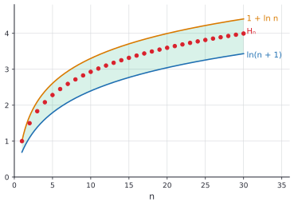

# Convergence tests

After this lesson you can decide whether a series converges using comparison, limit comparison, the integral test, the ratio and root tests and the alternating series test, tell absolute from conditional convergence, bound the error of a partial sum, choose a test for a given series, and bound the harmonic numbers by $\ln n$.

Before this: [infinite series basics](02-infinite-series-basics.md), [sequences and their limits](01-sequences-and-their-limits.md) (especially the monotone convergence theorem) and [partial fractions and improper integrals](../04-integrals/05-partial-fractions-and-improper-integrals.md) (the $p$ test for integrals).

## Quick check

Try these first. If you get all three right, skip to [Practice](#practice).

1. Does $\displaystyle\sum_{k=1}^{\infty}\frac{1}{k^3}$ converge? Does $\displaystyle\sum_{k=1}^{\infty}\frac{1}{\sqrt{k}}$?
2. True or false: if $0 \le a_k \le b_k$ and $\sum a_k$ diverges, then $\sum b_k$ diverges.
3. Does $\displaystyle\sum_{k=1}^{\infty}\frac{(-1)^k}{k}$ converge?

<details class="solution" markdown>
<summary>Answers</summary>

1. The first converges and the second diverges. By the $p$ test for integrals, $\int_1^\infty x^{-p}\,dx$ converges when $p > 1$ and diverges when $p \le 1$, and the series behaves the same way (this lesson proves it). Here $p = 3$ and $p = \frac{1}{2}$.
2. True. The larger series is at least as big as one that already has no finite sum.
3. Yes. The terms alternate in sign, decrease in size and tend to 0, so the alternating series test applies. (The sum is $-\ln 2$.)

</details>

## The idea

Most series have no formula for the partial sums. For $\sum \frac{1}{k^2}$ or $\sum \frac{k^2}{2^k}$ there is nothing to telescope and no geometric ratio. A convergence test answers the yes or no question without the sum: it compares the series with one you already understand, or looks at how quickly the terms shrink.

Everything starts from one observation. If every term is non-negative, the partial sums $S_n$ are increasing, and the monotone convergence theorem says an increasing sequence converges exactly when it is bounded above. So for non-negative terms, "converges" means "the partial sums never pass some ceiling". Comparison tests build a ceiling from a known series, the integral test builds one from an area, and the ratio test builds one from a geometric series.

The picture for the integral test is the key one. The area under $y = \frac{1}{x}$ from 1 to 7 is trapped between two sums of rectangles of width 1. The rectangles that sit below the curve have heights $\frac{1}{2}, \frac{1}{3}, \dots, \frac{1}{7}$, and the rectangles that stick out above it have heights $1, \frac{1}{2}, \dots, \frac{1}{6}$. So a sum of terms and an integral of the same function can't be far apart, and one is finite exactly when the other is.


The tests have different jobs. Some prove convergence, some prove divergence, and some (the ratio test with limit 1) say nothing. The end of the lesson has a table that says which to try first, and an application to the harmonic numbers $H_n$, which turn up in the running time of randomized algorithms.

## Definitions

A **$p$-series** is a series $\sum_{k=1}^{\infty}\frac{1}{k^p}$ for a real number $p$. The harmonic series is the case $p = 1$. In plain words, $p$-series are the standard yardsticks for comparison.

A series $\sum a_k$ is **absolutely convergent** if $\sum \lvert a_k \rvert$ converges. It is **conditionally convergent** if $\sum a_k$ converges but $\sum \lvert a_k \rvert$ diverges. In plain words, absolute convergence is convergence even when every minus sign is replaced by a plus, and conditional convergence needs the cancellation between positive and negative terms. The alternating harmonic series $1 - \frac{1}{2} + \frac{1}{3} - \cdots$ is conditionally convergent. The series $1 - \frac{1}{4} + \frac{1}{9} - \cdots$ is absolutely convergent.

An **alternating series** is a series whose terms alternate in sign, which can be written $\sum (-1)^{k-1}b_k$ or $\sum (-1)^k b_k$ with every $b_k > 0$. In plain words, plus, minus, plus, minus, with the sizes $b_k$.

For a convergent series with sum $S$ and partial sum $S_n$, the **remainder** is $R_n = S - S_n = \sum_{k=n+1}^{\infty}a_k$. In plain words, the remainder is the part that is left out when you stop after $n$ terms, and it is the error of using $S_n$ as an estimate.

## How to do it

### Series with non-negative terms

*Theorem 1.* If $a_k \ge 0$ for every $k$, then $\sum a_k$ converges if and only if its partial sums are bounded above.

We know $S_{n+1} = S_n + a_{n+1} \ge S_n$, so $(S_n)$ is increasing. We want to link convergence to boundedness. The plan is to use the monotone convergence theorem in one direction and the fact that convergent sequences are bounded in the other.

*Proof.* If the series converges, $(S_n)$ is a convergent sequence, so it is bounded. If $(S_n)$ is bounded above, it is an increasing, bounded sequence, so it converges by the monotone convergence theorem. $\blacksquare$

Look back: if the partial sums are not bounded, they tend to infinity, so a series of non-negative terms either converges or diverges to $\infty$. It cannot oscillate. This is why the tests below are simple yes-or-no questions for non-negative terms.

### Comparison tests

*Theorem 2 (comparison test).* Suppose $0 \le a_k \le b_k$ for every $k$ (or for every $k$ from some point on).

- If $\sum b_k$ converges, then $\sum a_k$ converges.
- If $\sum a_k$ diverges, then $\sum b_k$ diverges.

We know the terms are ordered, so the partial sums are ordered as well. We want to transfer a bound from one series to the other. The plan is to use Theorem 1.

*Proof.* Write $A_n$ and $B_n$ for the partial sums. Then $A_n \le B_n$. If $\sum b_k = B$ converges, then $A_n \le B_n \le B$ (the partial sums of $\sum b_k$ increase to $B$), so $(A_n)$ is bounded above, and $\sum a_k$ converges by Theorem 1. The second statement is the contrapositive of the first. $\blacksquare$

Look back: the direction matters. A small series that converges tells you nothing about a big one, and a big series that diverges tells you nothing about a small one. The test says the smaller series inherits convergence, and the bigger one inherits divergence. Dropping finitely many terms changes nothing, which is why "from some point on" is allowed.

*Theorem 3 (limit comparison test).* Let $a_k > 0$ and $b_k > 0$, and suppose $\displaystyle\lim_{k \to \infty}\frac{a_k}{b_k} = c$ with $0 < c < \infty$. Then $\sum a_k$ and $\sum b_k$ either both converge or both diverge.

We know that $\frac{a_k}{b_k}$ settles near $c$. We want to sandwich $a_k$ between multiples of $b_k$. The plan is to take the band $\frac{c}{2} < \frac{a_k}{b_k} < \frac{3c}{2}$, which holds from some point on, and use Theorem 2 in both directions.

*Proof.* There is an $N$ with $\frac{c}{2} < \frac{a_k}{b_k} < \frac{3c}{2}$ for $k \ge N$, that is, $\frac{c}{2}\,b_k < a_k < \frac{3c}{2}\,b_k$. If $\sum b_k$ converges, then so does $\sum \frac{3c}{2}b_k$, and $\sum a_k$ converges by Theorem 2. If $\sum b_k$ diverges, then so does $\sum \frac{c}{2}b_k$, and $\sum a_k$ diverges by Theorem 2. The other two cases swap the roles of $a_k$ and $b_k$, using $b_k < \frac{2}{c}a_k$. $\blacksquare$

Look back: the test says that series whose terms are eventually proportional behave alike. For a rational function of $k$, compare with $\frac{1}{k^p}$ where $p$ is the degree of the denominator minus the degree of the numerator (after replacing roots by fractional powers). If the limit is 0 or $\infty$, the test gives only one direction: with $c = 0$, convergence of $\sum b_k$ implies that of $\sum a_k$; with $c = \infty$, divergence of $\sum b_k$ implies that of $\sum a_k$.

### The integral test and $p$-series

*Theorem 4 (integral test).* Let $f$ be continuous, positive and decreasing on $[1, \infty)$, and let $a_k = f(k)$. Then $\sum_{k=1}^{\infty}a_k$ and $\displaystyle\int_1^{\infty}f(x)\,dx$ either both converge or both diverge. If they converge, the remainder satisfies

$$
\int_{n+1}^{\infty}f(x)\,dx \le R_n \le \int_n^{\infty}f(x)\,dx.
$$

We know that $f$ is decreasing, so on each interval $[k, k + 1]$ the function is between its values at the two ends. We want to compare the sum of the $a_k$ with the area. The plan is the picture: a rectangle of width 1 and height $a_{k+1}$ fits under the curve over $[k, k+1]$, and one of height $a_k$ covers it.

*Proof.* On $[k, k+1]$ we have $f(k+1) \le f(x) \le f(k)$, so integrating over an interval of length 1,

$$
a_{k+1} \le \int_k^{k+1}f(x)\,dx \le a_k.
$$

Add this for $k = 1, 2, \dots, n - 1$, which gives

$$
a_2 + a_3 + \cdots + a_n \le \int_1^n f(x)\,dx \le a_1 + a_2 + \cdots + a_{n-1}.
$$

If the improper integral converges to $I$, then $S_n \le a_1 + \int_1^n f \le a_1 + I$ (using the left inequality and $f > 0$), so the partial sums are bounded and the series converges by Theorem 1. If the integral diverges, then $\int_1^n f \to \infty$, and the right inequality gives $S_{n-1} \ge \int_1^n f \to \infty$, so the series diverges. For the remainder, sum the displayed inequality over $k = n + 1, n + 2, \dots$ in the same way. $\blacksquare$

Look back: the function only needs to be decreasing and positive for $x \ge$ some point, and the test can start at any whole number. The integral is not the sum. The sum and the integral are close but not equal, and the test only says they converge together.

*Theorem 5 ($p$-series).* The series $\sum_{k=1}^{\infty}\frac{1}{k^p}$ converges if $p > 1$ and diverges if $p \le 1$.

The function $f(x) = \frac{1}{x^p}$ is continuous, positive and decreasing on $[1, \infty)$ when $p > 0$, and the [$p$ test for integrals](../04-integrals/05-partial-fractions-and-improper-integrals.md) says $\int_1^\infty x^{-p}\,dx$ converges exactly when $p > 1$. By the integral test the series does too. For $p \le 0$ the terms $\frac{1}{k^p} = k^{-p}$ do not tend to 0, so the series diverges by the $n$-th term test. $\blacksquare$

The remainder bound turns into an error estimate. For $\sum \frac{1}{k^2}$ and $n = 10$ we have $S_{10} = 1.5498$, and $\int_{11}^\infty \frac{dx}{x^2} = \frac{1}{11}$ and $\int_{10}^\infty\frac{dx}{x^2} = \frac{1}{10}$, so the sum is between $1.5498 + 0.0909 = 1.6407$ and $1.5498 + 0.1 = 1.6498$. The true value is $\frac{\pi^2}{6} = 1.6449$.

### Ratio and root tests

*Theorem 6 (ratio test).* Let $a_k \ne 0$ and suppose $\displaystyle L = \lim_{k \to \infty}\left\lvert\frac{a_{k+1}}{a_k}\right\rvert$ exists. If $L < 1$, the series $\sum a_k$ converges absolutely. If $L > 1$ (or the ratios tend to $\infty$), it diverges. If $L = 1$, the test gives no information.

We know the ratios of consecutive terms settle near $L$. We want to compare the series with a geometric series. The plan, for $L < 1$, is to pick a ratio $r$ between $L$ and 1 and show the terms eventually shrink at least as fast as $r^k$, the same idea as the factorial proof in the last lesson.

*Proof.* Suppose $L < 1$ and let $r = \frac{L + 1}{2}$, so $L < r < 1$. There is a $K$ with $\left\lvert\frac{a_{k+1}}{a_k}\right\rvert < r$ for $k \ge K$. Then $\lvert a_{K+1} \rvert < r\lvert a_K \rvert$, $\lvert a_{K+2} \rvert < r^2\lvert a_K \rvert$, and in general $\lvert a_{K+j} \rvert < r^j\lvert a_K \rvert$. The series $\sum_j r^j\lvert a_K \rvert$ is geometric with ratio $r < 1$, so it converges, and $\sum \lvert a_k \rvert$ converges by the comparison test. Now suppose $L > 1$. Then from some $K$ on, $\lvert a_{k+1} \rvert > \lvert a_k \rvert$, so the terms grow in size, can't tend to 0, and the series diverges by the $n$-th term test. For $L = 1$, the series $\sum \frac{1}{k}$ and $\sum \frac{1}{k^2}$ both have $L = 1$ and one diverges while the other converges, so no conclusion is possible. $\blacksquare$

*Theorem 7 (root test).* Suppose $\displaystyle L = \lim_{k \to \infty}\lvert a_k \rvert^{1/k}$ exists. If $L < 1$, then $\sum a_k$ converges absolutely. If $L > 1$, it diverges. If $L = 1$, the test gives no information.

The proof is the same as for the ratio test. If $L < 1$ pick $r$ with $L < r < 1$; eventually $\lvert a_k \rvert < r^k$, and the geometric series $\sum r^k$ is the ceiling. If $L > 1$, eventually $\lvert a_k \rvert > 1$, so the terms don't tend to 0. The root test is the better choice when the $k$-th term is itself raised to the $k$-th power, as in $\left(\frac{k}{2k + 1}\right)^k$.

### The alternating series test

*Theorem 8 (alternating series test).* Let $b_k > 0$ with $b_k$ decreasing and $b_k \to 0$. Then $\sum_{k=1}^{\infty}(-1)^{k-1}b_k$ converges. Also, if $S$ is the sum, then $S$ lies between any two consecutive partial sums, and the error satisfies $\lvert S - S_n \rvert \le b_{n+1}$.

We know the terms alternate and shrink to 0. We want convergence, and an error bound. The plan is in the figure: the even partial sums $S_2, S_4, \dots$ rise, the odd partial sums $S_1, S_3, \dots$ fall, and the odd ones stay above the even ones, so the two sequences squeeze toward a common limit.


*Proof.* The even partial sums satisfy $S_{2m+2} = S_{2m} + (b_{2m+1} - b_{2m+2}) \ge S_{2m}$ because $b_k$ is decreasing, so they are increasing. Also $S_{2m} = b_1 - (b_2 - b_3) - \cdots - b_{2m} \le b_1$, so they are bounded above. By monotone convergence $S_{2m} \to S$ for some $S$. The odd partial sums are $S_{2m+1} = S_{2m} + b_{2m+1}$, and $b_{2m+1} \to 0$, so $S_{2m+1} \to S$ as well. When the even and the odd partial sums converge to the same $S$, the whole sequence converges to $S$. Since the evens increase to $S$ and the odds decrease to $S$ (the odd sums satisfy $S_{2m+3} = S_{2m+1} - (b_{2m+2} - b_{2m+3}) \le S_{2m+1}$), we have $S_{2m} \le S \le S_{2m+1}$, so $S$ lies between consecutive partial sums, and $\lvert S - S_n \rvert \le \lvert S_{n+1} - S_n \rvert = b_{n+1}$. $\blacksquare$

Look back: the three conditions are all used. Without $b_k \to 0$ the odd and even limits differ, and without "decreasing" the evens need not increase. The error bound is the best feature of this test: stop when the next term is smaller than the accuracy you want, and the answer is the partial sum.

*Theorem 9 (absolute convergence implies convergence).* If $\sum \lvert a_k \rvert$ converges, then $\sum a_k$ converges.

We know the absolute values add to a finite number. We want the signed series to converge as well. The plan is to shift the terms to be non-negative and compare. Since $-\lvert a_k \rvert \le a_k \le \lvert a_k \rvert$, the number $a_k + \lvert a_k \rvert$ is between 0 and $2\lvert a_k \rvert$.

*Proof.* We have $0 \le a_k + \lvert a_k \rvert \le 2\lvert a_k \rvert$. The series $\sum 2\lvert a_k \rvert$ converges, so $\sum (a_k + \lvert a_k \rvert)$ converges by comparison. Then $\sum a_k = \sum (a_k + \lvert a_k \rvert) - \sum \lvert a_k \rvert$ is a difference of two convergent series, which converges. $\blacksquare$

Look back: this is why the ratio and root tests, which prove absolute convergence, are enough to prove convergence, and why the comparison tests are applied to $\lvert a_k \rvert$ when the signs are mixed.

### Choosing a test

Try the quick tests first. The table lists what to look for.

| The series looks like | Try | Result |
|---|---|---|
| terms not tending to 0 | $n$-th term test | diverges |
| $a\,r^k$ | geometric series | converges iff $\lvert r \rvert < 1$, sum $\frac{a}{1 - r}$ |
| $\frac{1}{k^p}$ | $p$-series | converges iff $p > 1$ |
| a sum of differences $b_k - b_{k+1}$ | telescoping | $b_1 - \lim b_k$ |
| a rational or algebraic expression in $k$ | limit comparison with $\frac{1}{k^p}$ | same behaviour as the $p$-series |
| factorials, or $c^k$ times powers of $k$ | ratio test | $L < 1$ converges, $L > 1$ diverges |
| something to the power $k$ | root test | $L < 1$ converges, $L > 1$ diverges |
| $f(k)$ with $f$ positive, decreasing and easy to integrate | integral test | same as $\int_1^\infty f$ |
| alternating signs, $b_k$ decreasing to 0 | alternating series test | converges, error at most $b_{n+1}$ |
| mixed signs, no pattern | test $\lvert a_k \rvert$ | absolutely convergent implies convergent |

If the ratio test gives $L = 1$, move to a comparison or the integral test. A ratio near 1 usually means the terms behave like a power of $k$, which is the job of limit comparison.

### Harmonic numbers and $\ln n$

The integral test inequalities give sharp bounds for the harmonic numbers $H_n = 1 + \frac{1}{2} + \cdots + \frac{1}{n}$. Apply $a_k = \frac{1}{k}$ to the two inequalities in the proof of Theorem 4. Adding $\int_k^{k+1}\frac{dx}{x} \le \frac{1}{k}$ for $k = 1, \dots, n$ gives $\ln(n + 1) \le H_n$, and adding $\frac{1}{k} \le \int_{k-1}^{k}\frac{dx}{x}$ for $k = 2, \dots, n$ gives $H_n - 1 \le \ln n$. Together,

$$
\ln(n + 1) \le H_n \le 1 + \ln n.
$$

So $H_n$ grows like $\ln n$, to within an additive error of at most 1. The bounds explain the slow divergence. Since $H_n \approx \ln n + 0.58$, the sum reaches 5 at about $n = e^{4.42} \approx 83$ and reaches 10 at about $e^{9.42} \approx 12{,}400$, so each additional unit costs a factor of $e$ in the number of terms.



| $n$ | $\ln(n + 1)$ | $H_n$ | $1 + \ln n$ |
|---|---|---|---|
| 10 | 2.398 | 2.929 | 3.303 |
| 100 | 4.615 | 5.187 | 5.605 |
| 1,000 | 6.909 | 7.485 | 7.908 |
| 1,000,000 | 13.816 | 14.393 | 14.816 |

In fact the gap $H_n - \ln n$ settles down. The sequence $H_n - \ln n$ is decreasing, because $H_{n+1} - \ln(n + 1) - (H_n - \ln n) = \frac{1}{n + 1} - \int_n^{n+1}\frac{dx}{x} \le 0$ (the integrand is at least $\frac{1}{n + 1}$ on the interval). It is bounded below by 0 since $H_n \ge \ln(n + 1) > \ln n$. By monotone convergence it converges, to a number written $\gamma \approx 0.5772$ called Euler's constant. So $H_n = \ln n + 0.5772\ldots + \varepsilon_n$ with $\varepsilon_n \to 0$, which is the form used in algorithm analysis.

This is why harmonic numbers matter in algorithms. A standard result, which follows from the recurrence for the number of comparisons, is that randomized quicksort with a uniformly random pivot makes $2(n + 1)H_n - 4n$ comparisons on average for $n$ distinct keys, which grows like $2n\ln n$. For $n = 1000$ that is about 10,986 comparisons, while a quadratic algorithm would make about 500,000. In the coupon collector problem, collecting all of $n$ equally likely coupons takes $nH_n$ draws on average: for $n = 100$ it is about 518.7, only about 5.2 draws per coupon. Both statements are derived in later chapters (recurrences<!-- link: ../../06-cs-math/04-sums-recurrences-and-algorithms/02-recurrences.md -->, [discrete random variables](../07-probability/03-discrete-random-variables.md)) and both use $H_n \approx \ln n$.

## Worked examples

<div class="example" markdown>

### Example 1: comparison

(a) Does $\displaystyle\sum_{k=1}^{\infty}\frac{1}{k^2 + 3}$ converge? (b) Does $\displaystyle\sum_{k=1}^{\infty}\frac{1}{\sqrt{k} + 1}$ converge?

For (a), the terms are positive and $\frac{1}{k^2 + 3} < \frac{1}{k^2}$, because the denominator is bigger. The series $\sum \frac{1}{k^2}$ is a $p$-series with $p = 2 > 1$, so it converges. The smaller series converges by the comparison test.

For (b), we want a divergent series that is smaller. Since $\sqrt{k} + 1 \le 2\sqrt{k}$ for $k \ge 1$, we have $\frac{1}{\sqrt{k} + 1} \ge \frac{1}{2\sqrt{k}}$. The series $\sum \frac{1}{2\sqrt{k}} = \frac{1}{2}\sum\frac{1}{k^{1/2}}$ diverges, because $p = \frac{1}{2} \le 1$. The larger series diverges by comparison.

Check: the sum in (a) to 10,000 terms is 0.7402, below $\frac{\pi^2}{6} = 1.645$, as comparison requires. In (b), $\sqrt{k} + 1 \le 2\sqrt{k}$ holds because $1 \le \sqrt{k}$. Using the wrong direction, such as $\frac{1}{\sqrt{k} + 1} < \frac{1}{\sqrt{k}}$, would be useless in (b), because a divergent bigger series says nothing.

</div>

<div class="example" markdown>

### Example 2: limit comparison

Does $\displaystyle\sum_{k=1}^{\infty}\frac{\sqrt{k}}{k^2 + 1}$ converge?

The top is $k^{1/2}$ and the bottom is about $k^2$, so for large $k$ the term is about $\frac{k^{1/2}}{k^2} = \frac{1}{k^{3/2}}$. Take $b_k = \frac{1}{k^{3/2}}$. Then

$$
\frac{a_k}{b_k} = \frac{\sqrt{k}}{k^2 + 1}\cdot k^{3/2} = \frac{k^2}{k^2 + 1} \to 1.
$$

The limit is positive and finite. The series $\sum b_k$ is a $p$-series with $p = \frac{3}{2} > 1$, so it converges, and by limit comparison so does $\sum a_k$.

Check: the ratio $\frac{k^2}{k^2 + 1}$ is $0.990$ at $k = 10$ and $0.9999$ at $k = 100$. Direct comparison would also work with $b_k$ here, since $\frac{\sqrt{k}}{k^2 + 1} < \frac{1}{k^{3/2}}$, but the inequality is harder to see for messier terms.

</div>

<div class="example" markdown>

### Example 3: the integral test

Decide whether $\displaystyle\sum_{k=2}^{\infty}\frac{1}{k\ln k}$ and $\displaystyle\sum_{k=2}^{\infty}\frac{1}{k(\ln k)^2}$ converge.

For both, $f(x)$ is positive and decreasing for $x \ge 2$, since $x$ and $\ln x$ are positive and increasing, and continuous. For the first, substitute $u = \ln x$, so $du = \frac{dx}{x}$:

$$
\int_2^b\frac{dx}{x\ln x} = \int_{\ln 2}^{\ln b}\frac{du}{u} = \ln(\ln b) - \ln(\ln 2) \to \infty.
$$

The integral diverges, so the series diverges. For the second,

$$
\int_2^b\frac{dx}{x(\ln x)^2} = \int_{\ln 2}^{\ln b}\frac{du}{u^2} = \frac{1}{\ln 2} - \frac{1}{\ln b} \to \frac{1}{\ln 2},
$$

so the integral converges, and so does the series.

Check: the partial sum of the first series up to $k = 10^6$ is only 3.42. It diverges, but so slowly that the numbers give no hint, which is why the proof matters. The ratio test would fail for both, because the ratios tend to 1.

</div>

<div class="example" markdown>

### Example 4: ratio test, three outcomes

(a) $\displaystyle\sum\frac{k^2}{2^k}$. The ratio is $\frac{(k + 1)^2}{2^{k+1}}\cdot\frac{2^k}{k^2} = \frac{1}{2}\left(1 + \frac{1}{k}\right)^2 \to \frac{1}{2}$. Since $L = \frac{1}{2} < 1$, the series converges.

(b) $\displaystyle\sum\frac{k^k}{k!}$. The ratio is $\frac{(k + 1)^{k+1}}{(k + 1)!}\cdot\frac{k!}{k^k} = \frac{(k + 1)^k}{k^k} = \left(1 + \frac{1}{k}\right)^k \to e > 1$, so the series diverges. (Directly, the terms exceed 1 since each ratio exceeds 1.)

(c) $\displaystyle\sum\frac{1}{k^2}$. The ratio is $\left(\frac{k}{k + 1}\right)^2 \to 1$. The test says nothing, though the series converges by Theorem 5.

Check: the values of $\left(1 + \frac{1}{k}\right)^k$ for $k = 1, 10, 100, 1000$ are $2, 2.594, 2.705, 2.717$, rising to $e \approx 2.718$. The series in (a) sums to 6 numerically (the exact value can be found with the tools of the next lesson).

</div>

<div class="example" markdown>

### Example 5: an alternating series and its error

Use the alternating harmonic series $\displaystyle\sum_{k=1}^{\infty}\frac{(-1)^{k-1}}{k}$ to estimate its sum within 0.001.

Here $b_k = \frac{1}{k}$ is decreasing and tends to 0, so the series converges by the alternating series test, and $\lvert S - S_n \rvert \le b_{n+1} = \frac{1}{n + 1}$. For the error to be below 0.001 it is enough that $\frac{1}{n + 1} < 0.001$, that is, $n \ge 1000$. We need 1,000 terms.

Check: the bound is honest for small $n$. For $n = 10$, $S_{10} = 0.6456$ and the sum is $\ln 2 = 0.6931$, so the error is $0.0475$, below the bound $\frac{1}{11} = 0.0909$. The sum lies between $S_{10} = 0.6456$ and $S_{11} = 0.7365$. Since the series is conditionally convergent (the series of absolute values is the harmonic series), it converges very slowly, and rearranging its terms would change the sum, as seen in the last lesson.

</div>

<div class="example" markdown>

### Example 6: finish it yourself

Is $\displaystyle\sum_{k=1}^{\infty}(-1)^k\frac{k}{k^2 + 1}$ absolutely convergent, conditionally convergent or divergent?

Start with the absolute values. The terms $\frac{k}{k^2 + 1}$ are about $\frac{1}{k}$. Limit comparison with $b_k = \frac{1}{k}$ gives $\frac{k}{k^2 + 1}\cdot k = \frac{k^2}{k^2 + 1} \to 1$, so $\sum\frac{k}{k^2 + 1}$ diverges like the harmonic series. So the series is not absolutely convergent. Now check the conditions of the alternating test for $b_k = \frac{k}{k^2 + 1}$.

<details class="solution" markdown>
<summary>Finish</summary>

The terms tend to 0, since $\frac{k}{k^2 + 1} = \frac{1/k}{1 + 1/k^2} \to 0$. For decreasing, compare $b_k$ and $b_{k+1}$ through the function $g(x) = \frac{x}{x^2 + 1}$: $g'(x) = \frac{(x^2 + 1) - 2x^2}{(x^2 + 1)^2} = \frac{1 - x^2}{(x^2 + 1)^2} \le 0$ for $x \ge 1$, so $b_k$ is decreasing from $k = 1$ on. By the alternating series test the series converges. It converges but does not converge absolutely, so it is conditionally convergent.

Check: the terms are $\frac{1}{2}, \frac{2}{5}, \frac{3}{10}, \frac{4}{17}, \dots$, decreasing ($0.5, 0.4, 0.3, 0.235$), and the partial sum after 10,000 terms is $-0.2696$, near the limit.

</details>

</div>

## Edge cases and common mistakes

<div class="warning" markdown>

Watch out: the ratio test with $L = 1$ proves nothing. Both $\sum\frac{1}{k}$ and $\sum\frac{1}{k^2}$ give $L = 1$. When the ratio tends to 1, switch to comparison or the integral test.

</div>

<div class="warning" markdown>

Watch out: comparison goes one way. If $a_k \le b_k$ and $\sum b_k$ diverges, you can't conclude that $\sum a_k$ diverges, since $\frac{1}{k^2} \le \frac{1}{k}$ and only the bigger series diverges. To prove divergence, compare with a smaller divergent series. To prove convergence, compare with a bigger convergent one.

</div>

<div class="warning" markdown>

Watch out: the integral test needs the function to be positive, continuous and decreasing. For $\sum\sin^2(\pi k) = 0$ and $f(x) = \sin^2(\pi x)$, the integral $\int_1^\infty\sin^2(\pi x)\,dx$ diverges while the series, whose terms are all 0, converges. The function is not decreasing, and the test doesn't apply.

</div>

<div class="warning" markdown>

Watch out: the alternating series test needs $b_k$ to decrease and to tend to 0. For $\sum(-1)^k\frac{k}{k + 1}$ the sizes tend to 1, so the terms don't tend to 0 and the series diverges by the $n$-th term test. The error bound $b_{n+1}$ holds for alternating series that satisfy the test, and not for series with mixed signs in general.

</div>

<div class="warning" markdown>

Watch out: the integral test says the series and the integral converge together, not that the series sums to the integral. $\int_1^\infty\frac{dx}{x^2} = 1$ but $\sum_{k=1}^\infty\frac{1}{k^2} = 1.645\ldots$.

</div>

<div class="warning" markdown>

Watch out: limit comparison needs positive terms and a limit that is neither 0 nor $\infty$. For $a_k = \frac{1}{k^2}$ and $b_k = \frac{1}{k}$ the ratio tends to 0, and the test gives nothing in the direction of "$\sum b_k$ diverges so $\sum a_k$ diverges", which would be false.

</div>

## Tricks and shortcuts

For a quotient of polynomials in $k$ (or roots of them), the series behaves like $\sum\frac{1}{k^p}$ with $p$ equal to the degree of the denominator minus the degree of the numerator. So $\frac{3k^2 + k}{k^4 + 2}$ behaves like $\frac{3}{k^2}$ and converges, while $\frac{k + 5}{k^2 - 3}$ behaves like $\frac{1}{k}$ and diverges. The "degree" of $\sqrt{k}$ is $\frac{1}{2}$.

A factorial or an exponential in the terms is a signal for the ratio test, and a $k$-th power is a signal for the root test. The ratio test turns $\frac{x^k}{k!}$ into $\frac{x}{k + 1} \to 0$ for every $x$, which is why the series for $e^x$ converges everywhere (next lesson).

Exponentials beat powers: a series like $\sum\frac{k^{100}}{1.01^k}$ converges, because $k^{100} \ll 1.01^k$ eventually, even though the first terms are huge. The ratio test confirms it, with $L = \frac{1}{1.01}$.

## In code

The code checks the harmonic bounds, the alternating series error bound, the integral-test bracket for $\sum\frac{1}{k^2}$ and the quicksort formula against the exact recurrence.

<details class="code" markdown>
<summary>In code</summary>

```python
import math
from fractions import Fraction

# Harmonic numbers lie between ln(n + 1) and 1 + ln n.
for n in (10, 100, 1000):
    H = sum(1 / k for k in range(1, n + 1))
    print(n, round(math.log(n + 1), 3), round(H, 3), round(1 + math.log(n), 3))
# 10 2.398 2.929 3.303
# 100 4.615 5.187 5.605
# 1000 6.909 7.485 7.908

# H_n - ln n approaches Euler's constant, 0.5772...
n = 10**6
print(round(sum(1 / k for k in range(1, n + 1)) - math.log(n), 6))
# 0.577216

# Alternating harmonic series: the error after n terms is at most 1/(n + 1).
S10 = sum((-1) ** (k - 1) / k for k in range(1, 11))
print(round(S10, 4), round(math.log(2) - S10, 4), round(1 / 11, 4))
# 0.6456 0.0475 0.0909

# Integral test bracket for sum 1/k^2 after 10 terms.
S10 = sum(1 / k**2 for k in range(1, 11))
print(round(S10 + 1 / 11, 4), round(math.pi**2 / 6, 4), round(S10 + 1 / 10, 4))
# 1.6407 1.6449 1.6498

# Randomized quicksort: expected comparisons from the recurrence vs the formula.
C = [Fraction(0)]
for m in range(1, 51):
    C.append((m - 1) + Fraction(2, m) * sum(C))
Hn = sum(Fraction(1, k) for k in range(1, 51))
print(float(C[50]), float(2 * 51 * Hn - 200))
# 258.9189445096014 258.9189445096014
```

</details>

## FAQ

### How do I know which test to try first?

Check the terms first: if they don't tend to 0, you are done. Then look for a geometric series or a $p$-series, then for factorials, exponentials or $k$-th powers (ratio or root test), then for rational expressions (limit comparison). The integral test is for terms like $\frac{1}{k\ln k}$ where the ratio test fails and no comparison is natural. The table above lists them in that order.

### Why does the ratio test fail when $L = 1$?

Because $L = 1$ is where the geometric comparison breaks. The proof needs a number $r < 1$ with the ratios eventually below $r$, and if the ratios tend to 1 from below there is no such $r$. A ratio of $1 - \frac{1}{k}$ (like $\frac{1}{k}$) and a ratio of $1 - \frac{2}{k}$ (like $\frac{1}{k^2}$) both tend to 1 but lead to different outcomes, so the limit alone can't separate them.

### Does the alternating series test prove too much? Why isn't $1 - 1 + 1 - 1 + \cdots$ convergent?

The terms $b_k = 1$ don't tend to 0, and that condition is needed. Without it the even partial sums are all 0 and the odd partial sums all 1, with different limits.

### Why bother with absolute convergence?

Because it is the safe kind. An absolutely convergent series can be rearranged, split into positive and negative parts, and multiplied by other series without changing the result. A conditionally convergent series can't be treated that way, as the last lesson showed.

## Practice

### Warm-up

1\. Decide each by the $p$-series test: (a) $\sum_{k=1}^\infty k^{-2/3}$, (b) $\sum_{k=1}^\infty\frac{1}{k^{1.5}}$, (c) $\sum_{k=1}^\infty\frac{5}{k^2}$.

<details class="solution" markdown>
<summary>Solution</summary>

(a) $p = \frac{2}{3} \le 1$, so it diverges. (b) $p = 1.5 > 1$, so it converges. (c) It is $5\sum\frac{1}{k^2}$, a constant multiple of a $p$-series with $p = 2$, so it converges.

Check: the partial sums of (c) approach $5 \cdot 1.645 = 8.22$, and those of (a) grow like $3k^{1/3}$ without bound.

</details>

2\. Does $\displaystyle\sum_{k=1}^{\infty}\frac{3^k}{k!}$ converge?

<details class="solution" markdown>
<summary>Solution</summary>

The ratio is $\frac{3^{k+1}}{(k + 1)!}\cdot\frac{k!}{3^k} = \frac{3}{k + 1} \to 0$. Since $L = 0 < 1$, the series converges by the ratio test.

Check: the terms are $3, 4.5, 4.5, 3.375, \dots$ and then fall quickly. The sum is $e^3 - 1 \approx 19.0855$.

</details>

3\. Does $\displaystyle\sum_{k=1}^{\infty}\frac{(-1)^k}{\sqrt{k}}$ converge? Is the convergence absolute?

<details class="solution" markdown>
<summary>Solution</summary>

The terms alternate, $\frac{1}{\sqrt{k}}$ is decreasing and tends to 0, so the series converges by the alternating series test. The series of absolute values is the $p$-series with $p = \frac{1}{2}$, which diverges. So the convergence is conditional, not absolute.

Check: the partial sums are $-1, -0.29, -0.87, -0.37, \dots$, alternating around a limit near $-0.605$.

</details>

### Standard

4\. Show that $\displaystyle\sum_{k=1}^{\infty}\frac{3k^2 + k}{k^4 + 2}$ converges.

<details class="solution" markdown>
<summary>Solution</summary>

The terms are positive and look like $\frac{3k^2}{k^4} = \frac{3}{k^2}$. Take $b_k = \frac{1}{k^2}$. Then $\frac{a_k}{b_k} = \frac{3k^4 + k^3}{k^4 + 2} = \frac{3 + 1/k}{1 + 2/k^4} \to 3$, which is positive and finite. The series $\sum\frac{1}{k^2}$ converges ($p = 2$), so by limit comparison the given series converges.

Check: at $k = 1000$ the ratio $\frac{a_k}{b_k}$ is $3.001$.

</details>

5\. Show that $\displaystyle\sum_{k=1}^\infty k\,e^{-k^2}$ converges using the integral test, and give an upper bound for the sum.

<details class="solution" markdown>
<summary>Solution</summary>

Let $f(x) = x e^{-x^2}$, which is positive and continuous. Its derivative is $(1 - 2x^2)e^{-x^2}$, which is negative for $x \ge 1$, so $f$ is decreasing on $[1, \infty)$. With $u = x^2$, $\int_1^b xe^{-x^2}\,dx = \frac{1}{2}\left(e^{-1} - e^{-b^2}\right) \to \frac{e^{-1}}{2} \approx 0.1839$, so the integral converges and so does the series.

From the proof, $S \le a_1 + \int_1^\infty f = e^{-1} + \frac{e^{-1}}{2} \approx 0.3679 + 0.1839 = 0.5518$.

Check: the actual sum is $0.4049$, below the bound $0.5518$.

</details>

6\. How many terms of $\displaystyle\sum_{k=1}^\infty\frac{(-1)^{k-1}}{k^2}$ guarantee an error below 0.001? Compute that partial sum and check against $\frac{\pi^2}{12} \approx 0.822467$.

<details class="solution" markdown>
<summary>Solution</summary>

The error is at most $b_{n+1} = \frac{1}{(n + 1)^2}$. We need $(n + 1)^2 > 1000$, so $n + 1 \ge 32$, that is, $n \ge 31$.

The partial sum is $S_{31} = 0.822971$. The error is $\left\lvert 0.822467 - 0.822971 \right\rvert = 0.000504$, which is below $\frac{1}{32^2} = 0.000977$ and below 0.001.

Check: $S_{31}$ is an odd partial sum, so it sits above the sum, as the figure for the alternating test predicts.

</details>

### Challenge

7\. For which real numbers $p$ does $\displaystyle\sum_{k=2}^\infty\frac{1}{k(\ln k)^p}$ converge?

<details class="solution" markdown>
<summary>Solution</summary>

For $p > 0$ the function $f(x) = \frac{1}{x(\ln x)^p}$ is positive, continuous and decreasing for $x \ge 2$. With $u = \ln x$, $\int_2^b f = \int_{\ln 2}^{\ln b}u^{-p}\,du$. This is the $p$ test for $\int^\infty u^{-p}\,du$: for $p > 1$ it tends to $\frac{(\ln 2)^{1-p}}{p - 1}$, and for $p \le 1$ it diverges (for $p = 1$ it is $\ln\ln b$). So the series converges exactly when $p > 1$ among $p > 0$. For $p \le 0$, $\frac{1}{k(\ln k)^p} = \frac{(\ln k)^{-p}}{k} \ge \frac{1}{k}$ for $k \ge 3$ (since $(\ln k)^{-p} \ge 1$ once $\ln k \ge 1$), so the series diverges by comparison with the harmonic series.

The answer: it converges if and only if $p > 1$.

Check: $p = 2$ converges by Example 3 and $p = 1$ diverges by Example 3, consistent with the answer.

</details>

8\. (Reviews [partial fractions and improper integrals](../04-integrals/05-partial-fractions-and-improper-integrals.md).) Evaluate $\int_1^\infty x^{-3/2}\,dx$. Use the integral test inequality to show that $2 \le \sum_{k=1}^\infty k^{-3/2} \le 3$.

<details class="solution" markdown>
<summary>Solution</summary>

$\int_1^b x^{-3/2}\,dx = \left[-2x^{-1/2}\right]_1^b = 2 - \frac{2}{\sqrt{b}} \to 2$. The function is positive, continuous and decreasing. In the proof of the integral test, $\int_1^n f \le a_1 + \cdots + a_{n-1} \le S$, so $S \ge 2$ (taking $n \to \infty$), and $S_n \le a_1 + \int_1^n f \le 1 + 2 = 3$, so $S \le 3$.

Check: the actual sum is about $2.612$, which is between 2 and 3.

</details>

## Where this shows up

- The next lesson applies the ratio test to power series, to find the radius of convergence, and the alternating series error bound to estimate values of functions ([power series and Taylor series](04-power-series-and-taylor-series.md)).
- In CS, the harmonic numbers $H_n \approx \ln n$ appear in the average-case analysis of quicksort, in hashing and in the coupon collector problem (recurrences<!-- link: ../../06-cs-math/04-sums-recurrences-and-algorithms/02-recurrences.md -->, asymptotic notation<!-- link: ../../06-cs-math/04-sums-recurrences-and-algorithms/04-asymptotic-notation.md -->). Comparing a sum with an integral is the standard way to get the order of growth of a sum.
- In probability, a distribution on the counting numbers needs its probabilities to form a convergent series with sum 1, and its expected value is another series that must converge ([discrete random variables](../07-probability/03-discrete-random-variables.md)).
