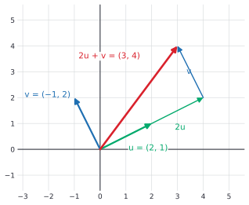
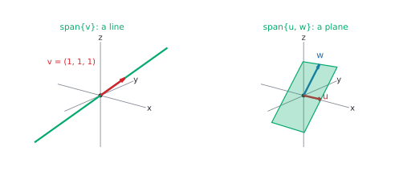

# Vectors, dot product and span

After this lesson you can compute with vectors in $\mathbb{R}^n$, find lengths and angles with the dot product, prove the Cauchy-Schwarz and triangle inequalities, describe the span of a set of vectors as a line or a plane, test whether a vector is in a span, and read a row of data or a bundle of goods as a vector.

Before this: [vectors in the plane](../../03-high-school/10-vectors-and-matrices/01-vectors-in-the-plane.md) and [matrix basics](../../03-high-school/10-vectors-and-matrices/02-matrix-basics.md). The proofs use the style of [direct proof](../../04-proofs-and-logic/03-core-proof-methods/01-direct-proof.md) and [proofs about sets](../../04-proofs-and-logic/04-more-proof-methods/03-proofs-about-sets.md).

## Quick check

Try these first. If you get all three right, skip to [Practice](#practice).

1. For $\mathbf{u} = (2, -1, 3)$ and $\mathbf{v} = (1, 4, -2)$, find $2\mathbf{u} - \mathbf{v}$ and $\mathbf{u} \cdot \mathbf{v}$.
2. Find the number $t$ that makes $(1, t, 2)$ perpendicular to $(3, -1, 1)$.
3. Is $(1, 2, 4)$ in the span of $(1, 0, 1)$ and $(0, 1, 1)$? Is $(1, 2, 3)$?

<details class="solution" markdown>
<summary>Answers</summary>

1. $2\mathbf{u} - \mathbf{v} = (4 - 1,\; -2 - 4,\; 6 + 2) = (3, -6, 8)$ and $\mathbf{u} \cdot \mathbf{v} = 2 - 4 - 6 = -8$.
2. The dot product is $3 - t + 2 = 5 - t$, which is $0$ when $t = 5$. Check: $(1, 5, 2) \cdot (3, -1, 1) = 3 - 5 + 2 = 0$.
3. A combination $a(1, 0, 1) + b(0, 1, 1) = (a, b, a + b)$ has third entry equal to the sum of the first two. For $(1, 2, 4)$ that would need $4 = 3$, so no. For $(1, 2, 3)$ it works with $a = 1$ and $b = 2$, so yes.

</details>

## The idea

A spreadsheet row is a list of numbers. A student who studied 12 hours, slept 7 hours a night and wrote 3 practice exams is the row $(12, 7, 3)$. A shopping basket with 2 loaves, 1 jar of jam and 6 apples is $(2, 1, 6)$. A document counted by word is a list of word counts. Each of these is a point in $\mathbb{R}^n$, where $n$ is the number of entries, and you can also picture it as an arrow from the origin to that point.

Two operations make these lists useful. The first is to combine them: add two baskets, double a basket, or mix two recipes. The second is to measure them: how large is this vector, and how close are the directions of two vectors? The first operation leads to linear combinations and span, and the second to the dot product. This lesson builds both in any number of entries, and proves the inequality that makes the measuring honest.

The high-school lessons did the plane. Everything there carries over to three entries with one extra coordinate, and to $n$ entries with no new idea, only a picture you can't draw. We draw in $\mathbb{R}^2$ and $\mathbb{R}^3$ and prove for $\mathbb{R}^n$, so that the pictures guide and the proofs cover everything.



## Definitions

For a positive integer $n$, the set $\mathbb{R}^n$ is the set of all ordered lists $\mathbf{x} = (x_1, x_2, \dots, x_n)$ of $n$ real numbers. An element of $\mathbb{R}^n$ is a **vector**, and the numbers $x_i$ are its **components**. Two vectors are equal when all their components are equal. The **zero vector** $\mathbf{0}$ has every component $0$. A real number, used to scale a vector, is a **scalar**.

In plain words, a vector in $\mathbb{R}^3$ is a point $(x_1, x_2, x_3)$ in space, or the arrow from the origin to it. The notation is the one from the high-school lessons: a bold letter in print, an arrow $\vec{v}$ by hand. Inside a matrix product, a vector is a column,

$$
\mathbf{x} = \begin{pmatrix} x_1 \\ x_2 \\ \vdots \\ x_n \end{pmatrix},
$$

and in running text it is written $(x_1, \dots, x_n)$. These are the same vector.

The **sum** of $\mathbf{u}$ and $\mathbf{v}$ in $\mathbb{R}^n$ is $\mathbf{u} + \mathbf{v} = (u_1 + v_1, \dots, u_n + v_n)$, and the **scalar multiple** of $\mathbf{v}$ by $c$ is $c\mathbf{v} = (cv_1, \dots, cv_n)$. We write $-\mathbf{v}$ for $(-1)\mathbf{v}$ and $\mathbf{u} - \mathbf{v}$ for $\mathbf{u} + (-\mathbf{v})$. Both operations work one component at a time, so they inherit the rules of real arithmetic:

| Rule | For all $\mathbf{u}, \mathbf{v}, \mathbf{w}$ in $\mathbb{R}^n$ and scalars $c, d$ |
|---|---|
| commutative | $\mathbf{u} + \mathbf{v} = \mathbf{v} + \mathbf{u}$ |
| associative | $(\mathbf{u} + \mathbf{v}) + \mathbf{w} = \mathbf{u} + (\mathbf{v} + \mathbf{w})$ |
| zero | $\mathbf{v} + \mathbf{0} = \mathbf{v}$ |
| negative | $\mathbf{v} + (-\mathbf{v}) = \mathbf{0}$ |
| distributes over vectors | $c(\mathbf{u} + \mathbf{v}) = c\mathbf{u} + c\mathbf{v}$ |
| distributes over scalars | $(c + d)\mathbf{v} = c\mathbf{v} + d\mathbf{v}$ |
| scalars multiply | $c(d\mathbf{v}) = (cd)\mathbf{v}$ |
| one | $1\mathbf{v} = \mathbf{v}$ |

Each rule is proved by checking one component. For the sixth, the $i$-th component of $(c + d)\mathbf{v}$ is $(c + d)v_i = cv_i + dv_i$, which is the $i$-th component of $c\mathbf{v} + d\mathbf{v}$. These eight rules are everything the rest of the chapter uses about adding and scaling, which is why the theory also works for other objects that obey them (polynomials, functions, matrices). We stay in $\mathbb{R}^n$.

A **linear combination** of the vectors $\mathbf{v}_1, \dots, \mathbf{v}_k$ is a vector $c_1\mathbf{v}_1 + \dots + c_k\mathbf{v}_k$, where $c_1, \dots, c_k$ are scalars called the **weights**. In plain words, you scale each vector by a weight and add them up. In the figure above, $(3, 4) = 2\mathbf{u} + 1\mathbf{v}$ is a linear combination of $\mathbf{u}$ and $\mathbf{v}$ with weights $2$ and $1$. The **span** of $\mathbf{v}_1, \dots, \mathbf{v}_k$, written $\operatorname{span}\{\mathbf{v}_1, \dots, \mathbf{v}_k\}$, is the set of all their linear combinations. The span of the empty list is $\{\mathbf{0}\}$. In plain words, the span is everything you can reach using these vectors as your only moves, with any amount of each.

The **dot product** of $\mathbf{u}$ and $\mathbf{v}$ in $\mathbb{R}^n$ is the number

$$
\mathbf{u} \cdot \mathbf{v} = u_1 v_1 + u_2 v_2 + \dots + u_n v_n = \sum_{i=1}^{n} u_i v_i.
$$

In plain words, multiply matching components and add. For a column vector, $\mathbf{u} \cdot \mathbf{v} = \mathbf{u}^T\mathbf{v}$, a $1 \times n$ matrix times an $n \times 1$ matrix. The **norm** (or length) of $\mathbf{v}$ is $\lVert \mathbf{v} \rVert = \sqrt{\mathbf{v} \cdot \mathbf{v}}$, and the **distance** between $\mathbf{u}$ and $\mathbf{v}$ is $\lVert \mathbf{u} - \mathbf{v} \rVert$. In $\mathbb{R}^2$ these are the length and distance formulas from the Pythagorean theorem. Two vectors are **orthogonal**, written $\mathbf{u} \perp \mathbf{v}$, when $\mathbf{u} \cdot \mathbf{v} = 0$. In plain words, orthogonal is the word for perpendicular once there may be more than three dimensions, and the zero vector is orthogonal to every vector.

The dot product has four properties, each checked component by component. For all vectors and scalars,

- symmetry: $\mathbf{u} \cdot \mathbf{v} = \mathbf{v} \cdot \mathbf{u}$,
- linearity: $(a\mathbf{u} + b\mathbf{v}) \cdot \mathbf{w} = a(\mathbf{u} \cdot \mathbf{w}) + b(\mathbf{v} \cdot \mathbf{w})$,
- positivity: $\mathbf{v} \cdot \mathbf{v} \ge 0$,
- definiteness: $\mathbf{v} \cdot \mathbf{v} = 0$ only when $\mathbf{v} = \mathbf{0}$.

The last two hold because $\mathbf{v} \cdot \mathbf{v} = v_1^2 + \dots + v_n^2$ is a sum of squares of real numbers, each at least $0$, and the sum is $0$ only when every square is $0$. Together they make the norm behave: $\lVert \mathbf{v} \rVert \ge 0$, $\lVert \mathbf{v} \rVert = 0$ only for $\mathbf{0}$, and $\lVert c\mathbf{v} \rVert = \lvert c \rvert \lVert \mathbf{v} \rVert$ (because $\sqrt{c^2 \, \mathbf{v} \cdot \mathbf{v}} = \lvert c \rvert \sqrt{\mathbf{v} \cdot \mathbf{v}}$).

## How to do it

### Measuring: the Cauchy-Schwarz inequality

In the plane, the dot product equals $\lVert \mathbf{u} \rVert \lVert \mathbf{v} \rVert \cos\theta$, so $\lvert \mathbf{u} \cdot \mathbf{v} \rvert \le \lVert \mathbf{u} \rVert \lVert \mathbf{v} \rVert$ because a cosine is at most 1 in size. In $\mathbb{R}^{100}$ there is no picture to define an angle from, so we turn it around. We want to define the angle by

$$
\cos\theta = \frac{\mathbf{u} \cdot \mathbf{v}}{\lVert \mathbf{u} \rVert \, \lVert \mathbf{v} \rVert},
$$

and that is only legal if the right side always lies between $-1$ and $1$. This is the Cauchy-Schwarz inequality.


*Theorem 1 (Cauchy-Schwarz inequality).* For all $\mathbf{u}, \mathbf{v}$ in $\mathbb{R}^n$, $\lvert \mathbf{u} \cdot \mathbf{v} \rvert \le \lVert \mathbf{u} \rVert \, \lVert \mathbf{v} \rVert$. Equality holds exactly when one of the two vectors is a scalar multiple of the other.

What we know: the four properties of the dot product. What we want: the inequality, and when it is an equality. The plan: the figure suggests it. Subtract from $\mathbf{u}$ its shadow $t\mathbf{v}$ along $\mathbf{v}$. What is left, $\mathbf{u} - t\mathbf{v}$, has a length that can't be negative. Expanding that fact for the best choice of $t$ gives the inequality.

*Proof.* If $\mathbf{v} = \mathbf{0}$, both sides are $0$ and $\mathbf{v} = 0 \cdot \mathbf{u}$ is a multiple of $\mathbf{u}$, so the theorem holds. Suppose $\mathbf{v} \ne \mathbf{0}$. For every real number $t$, positivity and linearity give

$$
0 \le \lVert \mathbf{u} - t\mathbf{v} \rVert^2 = (\mathbf{u} - t\mathbf{v}) \cdot (\mathbf{u} - t\mathbf{v}) = \mathbf{u} \cdot \mathbf{u} - 2t\,(\mathbf{u} \cdot \mathbf{v}) + t^2\,(\mathbf{v} \cdot \mathbf{v}).
$$

Choose $t = \dfrac{\mathbf{u} \cdot \mathbf{v}}{\mathbf{v} \cdot \mathbf{v}}$, which is allowed because $\mathbf{v} \cdot \mathbf{v} > 0$. The last two terms become $-2\dfrac{(\mathbf{u} \cdot \mathbf{v})^2}{\mathbf{v} \cdot \mathbf{v}} + \dfrac{(\mathbf{u} \cdot \mathbf{v})^2}{\mathbf{v} \cdot \mathbf{v}} = -\dfrac{(\mathbf{u} \cdot \mathbf{v})^2}{\mathbf{v} \cdot \mathbf{v}}$, so

$$
0 \le \lVert \mathbf{u} \rVert^2 - \frac{(\mathbf{u} \cdot \mathbf{v})^2}{\lVert \mathbf{v} \rVert^2}.
$$

Multiply by $\lVert \mathbf{v} \rVert^2 > 0$ to get $(\mathbf{u} \cdot \mathbf{v})^2 \le \lVert \mathbf{u} \rVert^2 \lVert \mathbf{v} \rVert^2$, and take square roots of these non-negative numbers.

For equality, suppose $\lvert \mathbf{u} \cdot \mathbf{v} \rvert = \lVert \mathbf{u} \rVert \lVert \mathbf{v} \rVert$ with $\mathbf{v} \ne \mathbf{0}$. Then the display above is an equality, so $\lVert \mathbf{u} - t\mathbf{v} \rVert^2 = 0$ for our $t$, and definiteness gives $\mathbf{u} = t\mathbf{v}$. Conversely, if $\mathbf{u} = c\mathbf{v}$, then $\lvert \mathbf{u} \cdot \mathbf{v} \rvert = \lvert c \rvert \lVert \mathbf{v} \rVert^2 = \lVert c\mathbf{v} \rVert \lVert \mathbf{v} \rVert$. $\blacksquare$

Look back: the shadow $t\mathbf{v}$ with $t = \frac{\mathbf{u} \cdot \mathbf{v}}{\mathbf{v} \cdot \mathbf{v}}$ is the projection of $\mathbf{u}$ on $\mathbf{v}$, and a later lesson, [orthogonality, projections and least squares](07-orthogonality-projections-and-least-squares.md), builds on it. Check with the figure's vectors $\mathbf{u} = (3, 2)$ and $\mathbf{v} = (4, 1)$: $\mathbf{u} \cdot \mathbf{v} = 14$, $\lVert \mathbf{u} \rVert \lVert \mathbf{v} \rVert = \sqrt{13}\sqrt{17} \approx 14.87$, and $14 \le 14.87$.

For nonzero $\mathbf{u}$ and $\mathbf{v}$ in $\mathbb{R}^n$, the **angle** between them is now defined as the number $\theta$ in $[0, \pi]$ with $\cos\theta = \frac{\mathbf{u} \cdot \mathbf{v}}{\lVert \mathbf{u} \rVert \lVert \mathbf{v} \rVert}$. The theorem says the fraction is between $-1$ and $1$, so such a $\theta$ exists, and it is unique. In $\mathbb{R}^2$ and $\mathbb{R}^3$ this is the geometric angle, by the [law of cosines argument](../../03-high-school/10-vectors-and-matrices/01-vectors-in-the-plane.md#the-dot-product-and-the-angle-between-vectors) (two vectors always lie in one plane). By the same equality case, $\theta = 0$ or $\theta = \pi$ exactly when the vectors are multiples of each other.

*Theorem 2 (triangle inequality).* For all $\mathbf{u}, \mathbf{v}$ in $\mathbb{R}^n$, $\lVert \mathbf{u} + \mathbf{v} \rVert \le \lVert \mathbf{u} \rVert + \lVert \mathbf{v} \rVert$.

What we know: Theorem 1. What we want: a bound on a length. The plan: lengths are square roots, so square both sides, expand, and bound the one cross term with Theorem 1.

*Proof.* Expanding the dot product,

$$
\lVert \mathbf{u} + \mathbf{v} \rVert^2 = \lVert \mathbf{u} \rVert^2 + 2\,\mathbf{u} \cdot \mathbf{v} + \lVert \mathbf{v} \rVert^2 \le \lVert \mathbf{u} \rVert^2 + 2\lVert \mathbf{u} \rVert \lVert \mathbf{v} \rVert + \lVert \mathbf{v} \rVert^2 = \bigl(\lVert \mathbf{u} \rVert + \lVert \mathbf{v} \rVert\bigr)^2,
$$

where the inequality is $\mathbf{u} \cdot \mathbf{v} \le \lvert \mathbf{u} \cdot \mathbf{v} \rvert \le \lVert \mathbf{u} \rVert \lVert \mathbf{v} \rVert$. Both sides are non-negative, so taking square roots keeps the inequality. $\blacksquare$

Look back: in a triangle with sides $\mathbf{u}$, $\mathbf{v}$ and $\mathbf{u} + \mathbf{v}$, this says one side is at most the sum of the other two. The proof also shows that equality needs $\mathbf{u} \cdot \mathbf{v} = \lVert \mathbf{u} \rVert \lVert \mathbf{v} \rVert$, which by the equality case of Theorem 1 means that one vector is a non-negative multiple of the other: they point the same way. Check with $\mathbf{u} = (3, 0)$ and $\mathbf{v} = (0, 4)$: $\lVert \mathbf{u} + \mathbf{v} \rVert = 5 \le 7$.

A last consequence is the Pythagorean theorem in $\mathbb{R}^n$: $\lVert \mathbf{u} + \mathbf{v} \rVert^2 = \lVert \mathbf{u} \rVert^2 + \lVert \mathbf{v} \rVert^2$ exactly when $\mathbf{u} \perp \mathbf{v}$. This is the first display of the proof above with the cross term $2\,\mathbf{u} \cdot \mathbf{v}$ equal to $0$.

### Combining: span and the pictures

Start with one vector. If $\mathbf{v} \ne \mathbf{0}$, then $\operatorname{span}\{\mathbf{v}\} = \{c\mathbf{v} : c \in \mathbb{R}\}$ is the line through the origin in the direction of $\mathbf{v}$. With two vectors that are not multiples of each other, the span $\{s\mathbf{u} + r\mathbf{w}\}$ is the plane through the origin containing both. This is the parametric form of a plane: start at the origin and move $s$ times along $\mathbf{u}$ and $r$ times along $\mathbf{w}$. If $\mathbf{w}$ is a multiple of $\mathbf{u}$, the "plane" collapses to a line, and if both are $\mathbf{0}$, to a point.



Every span passes through the origin, since taking all weights $0$ gives $\mathbf{0}$. That is why a line that misses the origin, such as $y = x + 1$, is never a span.

*Theorem 3 (a span is closed under combining).* Let $S = \operatorname{span}\{\mathbf{v}_1, \dots, \mathbf{v}_k\}$. Then $\mathbf{0} \in S$, and if $\mathbf{x}, \mathbf{y} \in S$ and $c$ is a scalar, then $\mathbf{x} + \mathbf{y} \in S$ and $c\mathbf{x} \in S$.

What we know: the definition of span. What we want: three membership claims. The plan: write $\mathbf{x}$ and $\mathbf{y}$ as combinations, and combine the combinations using the eight rules.

*Proof.* The zero vector is $0\mathbf{v}_1 + \dots + 0\mathbf{v}_k$. Let $\mathbf{x} = \sum a_i\mathbf{v}_i$ and $\mathbf{y} = \sum b_i\mathbf{v}_i$. By the commutative and distributive rules, $\mathbf{x} + \mathbf{y} = \sum (a_i + b_i)\mathbf{v}_i$ and $c\mathbf{x} = \sum (ca_i)\mathbf{v}_i$, which are again linear combinations of the $\mathbf{v}_i$. $\blacksquare$

Look back: the proof only regroups weights, which is why the next lesson can turn "closed under combining" into the definition of a subspace.

*Theorem 4 (adding a vector that is already in the span).* If $\mathbf{w} \in \operatorname{span}\{\mathbf{v}_1, \dots, \mathbf{v}_k\}$, then $\operatorname{span}\{\mathbf{v}_1, \dots, \mathbf{v}_k, \mathbf{w}\} = \operatorname{span}\{\mathbf{v}_1, \dots, \mathbf{v}_k\}$.

What we know: $\mathbf{w} = \sum a_i\mathbf{v}_i$ for some weights. What we want: two sets are equal. The plan, as in [proofs about sets](../../04-proofs-and-logic/04-more-proof-methods/03-proofs-about-sets.md), is to prove two inclusions. Writing $S$ for the small span and $T$ for the big one, $S \subseteq T$ is immediate and $T \subseteq S$ replaces $\mathbf{w}$ by its expansion.

*Proof.* ($S \subseteq T$) A combination of the $\mathbf{v}_i$ is a combination of $\mathbf{v}_1, \dots, \mathbf{v}_k, \mathbf{w}$ with weight $0$ on $\mathbf{w}$. ($T \subseteq S$) Let $\mathbf{x} = \sum b_i\mathbf{v}_i + d\mathbf{w}$ be in $T$. Substituting $\mathbf{w} = \sum a_i\mathbf{v}_i$ gives $\mathbf{x} = \sum (b_i + da_i)\mathbf{v}_i$, which is in $S$. $\blacksquare$

Look back: a vector that is already reachable adds no new moves. Example: $(1, 1)$ is in the span of $(1, 0)$ and $(0, 1)$, so adding it to the list leaves the span as all of $\mathbb{R}^2$. This idea, called redundancy, is the engine of the lesson on [linear independence, basis and dimension](04-linear-independence-basis-and-dimension.md).

### Is this vector in the span?

To decide whether $\mathbf{b}$ is in $\operatorname{span}\{\mathbf{v}_1, \dots, \mathbf{v}_k\}$:

1. Write the question as an equation: do weights $c_1, \dots, c_k$ exist with $c_1\mathbf{v}_1 + \dots + c_k\mathbf{v}_k = \mathbf{b}$?
2. Compare components. This gives one linear equation in $c_1, \dots, c_k$ for each component of $\mathbf{b}$.
3. Solve the system. For two unknowns, use the first two equations and substitute. For larger systems, use the method of the next lesson, [systems and Gaussian elimination](02-systems-and-gaussian-elimination.md).
4. If a solution exists, $\mathbf{b}$ is in the span, and the solution gives the weights. If the equations contradict each other, it is not.
5. Check by computing the combination.

The equations of Step 2 are the matrix equation $A\mathbf{c} = \mathbf{b}$, where the columns of $A$ are $\mathbf{v}_1, \dots, \mathbf{v}_k$. This is the column reading of a matrix-vector product from [matrix basics](../../03-high-school/10-vectors-and-matrices/02-matrix-basics.md#multiplying-matrices): $A\mathbf{c}$ is the combination of the columns of $A$ with weights $c_i$. So $A\mathbf{x} = \mathbf{b}$ has a solution exactly when $\mathbf{b}$ is in the span of the columns of $A$, and the next lesson builds on this sentence.

### Vectors as data

A **feature vector** lists the measurements of one item, such as $(12, 7, 3)$ for the student above. A data set with $m$ items and $n$ features is $m$ vectors in $\mathbb{R}^n$, the rows of an $m \times n$ matrix. A weighted total is a dot product: if the exam counts $50\%$, the project $30\%$ and the quiz $20\%$, then the mark for scores $\mathbf{s} = (80, 90, 70)$ is $\mathbf{w} \cdot \mathbf{s}$ with $\mathbf{w} = (0.5, 0.3, 0.2)$.

*Cosine similarity.* To compare two documents, count how often each word of a fixed vocabulary appears in each, giving vectors $\mathbf{a}$ and $\mathbf{b}$. The distance $\lVert \mathbf{a} - \mathbf{b} \rVert$ depends on the lengths of the documents, because a document pasted twice has twice the counts. The angle does not, because $\cos\theta$ is unchanged when either vector is scaled by a positive number. So search and recommendation code often uses the **cosine similarity** $\dfrac{\mathbf{a} \cdot \mathbf{b}}{\lVert \mathbf{a} \rVert \lVert \mathbf{b} \rVert}$, which is $1$ for the same direction and $0$ for orthogonal vectors. Theorem 1 is what guarantees it stays in $[-1, 1]$. Example 2 works one out.

*Bundles and prices.* In economics a bundle of $n$ goods is a quantity vector $\mathbf{q} = (q_1, \dots, q_n)$ and the prices form a price vector $\mathbf{p} = (p_1, \dots, p_n)$. The total cost is $\mathbf{p} \cdot \mathbf{q} = p_1 q_1 + \dots + p_n q_n$. A consumer with income $m$ can afford exactly the bundles with $\mathbf{p} \cdot \mathbf{q} \le m$, the budget set. Its boundary $\mathbf{p} \cdot \mathbf{q} = m$ is a line (for two goods) or a plane (for three), and the price vector $\mathbf{p}$ is orthogonal to that boundary: moving along the boundary from $\mathbf{q}$ to $\mathbf{q}'$ changes the cost by $\mathbf{p} \cdot (\mathbf{q}' - \mathbf{q}) = m - m = 0$. Example 3 shows this.

## Worked examples

<div class="example" markdown>

### Example 1: lengths and the angle in $\mathbb{R}^3$

Let $\mathbf{u} = (1, 2, 2)$ and $\mathbf{v} = (2, 3, -6)$. Find $\mathbf{u} \cdot \mathbf{v}$, both norms, the angle between them, and check Theorems 1 and 2.

The dot product is $1 \cdot 2 + 2 \cdot 3 + 2 \cdot (-6) = 2 + 6 - 12 = -4$. The norms are $\lVert \mathbf{u} \rVert = \sqrt{1 + 4 + 4} = 3$ and $\lVert \mathbf{v} \rVert = \sqrt{4 + 9 + 36} = 7$, both whole numbers. So

$$
\cos\theta = \frac{-4}{3 \cdot 7} = -\frac{4}{21} \approx -0.1905, \qquad \theta = \arccos\left(-\frac{4}{21}\right) \approx 100.98^\circ.
$$

The dot product is negative, so the angle is a little more than a right angle, as the answer says. For Theorem 1, $\lvert \mathbf{u} \cdot \mathbf{v} \rvert = 4 \le 21 = \lVert \mathbf{u} \rVert \lVert \mathbf{v} \rVert$. For Theorem 2, $\mathbf{u} + \mathbf{v} = (3, 5, -4)$ has norm $\sqrt{50} \approx 7.07$, which is at most $3 + 7 = 10$.

Check: the Pythagorean identity would need $\lVert \mathbf{u} + \mathbf{v} \rVert^2 = 9 + 49 = 58$ for orthogonal vectors, and the true value $50$ equals $58 + 2(-4)$, as the expansion in the proof says.

</div>

<div class="example" markdown>

### Example 2: cosine similarity of documents

The vocabulary is (rate, bank, goal, game). Document A has counts $(4, 3, 0, 1)$, a bank story. B is a short bank story with counts $(2, 1, 0, 0)$. C is a hockey story with $(0, 1, 5, 3)$. D is A pasted twice, $(8, 6, 0, 2)$. Compare each with A.

The norms are $\lVert \mathbf{A} \rVert = \sqrt{26} \approx 5.099$, $\lVert \mathbf{B} \rVert = \sqrt{5} \approx 2.236$, $\lVert \mathbf{C} \rVert = \sqrt{35} \approx 5.916$ and $\lVert \mathbf{D} \rVert = \sqrt{104} \approx 10.198$. The dot products with A are $\mathbf{A} \cdot \mathbf{B} = 8 + 3 = 11$, $\mathbf{A} \cdot \mathbf{C} = 0 + 3 + 0 + 3 = 6$ and $\mathbf{A} \cdot \mathbf{D} = 32 + 18 + 0 + 2 = 52$. Dividing gives

| Compared with A | Cosine similarity | Distance to A |
|---|---|---|
| B | $\dfrac{11}{\sqrt{26}\sqrt{5}} \approx 0.965$ | $3.00$ |
| C | $\dfrac{6}{\sqrt{26}\sqrt{35}} \approx 0.199$ | $7.00$ |
| D | $\dfrac{52}{\sqrt{26}\sqrt{104}} = 1$ | $\approx 5.10$ |

By cosine similarity, D is the same document as A, B is close and C is far, which matches the stories. By distance, B is the nearest and D is farther away than B, only because D is longer.

Check: $\mathbf{D} = 2\mathbf{A}$, so by the equality case of Theorem 1 the cosine must be exactly $1$, and it is.

</div>

<div class="example" markdown>

### Example 3: a budget line and its normal vector

The prices of two goods are $\mathbf{p} = (3, 5)$ in dollars per unit, and the income is \$30. Find the budget boundary, the direction along it, and the dot product of that direction with $\mathbf{p}$.

The boundary is $\mathbf{p} \cdot \mathbf{q} = 30$, that is, $3q_1 + 5q_2 = 30$. It passes through $(10, 0)$ and $(0, 6)$. The direction along it is $(0, 6) - (10, 0) = (-10, 6)$, or $(5, -3)$ after dividing by $-2$. Then $\mathbf{p} \cdot (5, -3) = 15 - 15 = 0$, so $\mathbf{p}$ is orthogonal to the line. The bundle $(4, 2)$ costs $3 \cdot 4 + 5 \cdot 2 = \$22 \le \$30$, so it is affordable, and $(8, 2)$ costs \$34, so it is not.

Check: the direction $(5, -3)$ means that giving up 3 units of good 2 buys 5 units of good 1, and indeed $3 \cdot 5 = 15 = 5 \cdot 3$ dollars.

</div>

<div class="example" markdown>

### Example 4: is the vector in the span?

Is $\mathbf{b} = (3, 5, 7)$ in $\operatorname{span}\{(1, 1, 1), (1, 2, 3)\}$? Is $\mathbf{c} = (1, 0, 0)$?

Step 1 for $\mathbf{b}$: look for $c_1, c_2$ with $c_1(1, 1, 1) + c_2(1, 2, 3) = (3, 5, 7)$. Step 2: the components give $c_1 + c_2 = 3$, $c_1 + 2c_2 = 5$ and $c_1 + 3c_2 = 7$. Step 3: subtracting the first two gives $c_2 = 2$, so $c_1 = 1$. The third equation is $1 + 6 = 7$, which holds. So $\mathbf{b} = 1 \cdot (1, 1, 1) + 2 \cdot (1, 2, 3)$ is in the span.

For $\mathbf{c}$, the first two equations $c_1 + c_2 = 1$ and $c_1 + 2c_2 = 0$ give $c_2 = -1$ and $c_1 = 2$. The third equation $c_1 + 3c_2 = 0$ then reads $2 - 3 = 0$, which is false. So $\mathbf{c}$ is not in the span.

Check: $(1, 1, 1) + 2(1, 2, 3) = (3, 5, 7)$. For $\mathbf{c}$ the only candidate weights give $(2, 2, 2) - (1, 2, 3) = (1, 0, -1) \ne (1, 0, 0)$.

</div>

<div class="example" markdown>

### Example 5: vectors orthogonal to two vectors (finish it yourself)

Find all vectors $\mathbf{w} = (a, b, c)$ in $\mathbb{R}^3$ that are orthogonal to both $(1, 1, 0)$ and $(0, 1, 1)$.

Orthogonal to $(1, 1, 0)$ means $a + b = 0$, and orthogonal to $(0, 1, 1)$ means $b + c = 0$. So $a = -b$ and $c = -b$, and $\mathbf{w} = (-b, b, -b) = -b\,(1, -1, 1)$. Every such $\mathbf{w}$ is a multiple of $(1, -1, 1)$, which is a line through the origin. The last step is the check, and it also gives the equation of the plane spanned by $(1, 1, 0)$ and $(0, 1, 1)$.

<details class="solution" markdown>
<summary>Finish</summary>

Check that $(1, -1, 1)$ really is orthogonal to both: $(1, -1, 1) \cdot (1, 1, 0) = 1 - 1 + 0 = 0$ and $(1, -1, 1) \cdot (0, 1, 1) = 0 - 1 + 1 = 0$. Then the plane $\operatorname{span}\{(1, 1, 0), (0, 1, 1)\}$ is the set of $\mathbf{x} = (x, y, z)$ with $(1, -1, 1) \cdot \mathbf{x} = 0$, that is, $x - y + z = 0$. Both spanning vectors satisfy it, and so does every combination of them by linearity of the dot product. The same equation tells you at a glance that $(2, 5, 3)$ is in the plane ($2 - 5 + 3 = 0$) and $(1, 0, 0)$ is not.

</details>

</div>

## Edge cases and common mistakes

<div class="warning" markdown>

Watch out: the dot product of two vectors is a number, not a vector, and it can't be cancelled like a factor. From $\mathbf{u} \cdot \mathbf{v} = \mathbf{u} \cdot \mathbf{w}$ you can't conclude $\mathbf{v} = \mathbf{w}$. For $\mathbf{u} = (1, 0)$, both $(2, 5)$ and $(2, -7)$ give $2$. What you can conclude is $\mathbf{u} \cdot (\mathbf{v} - \mathbf{w}) = 0$, that is, $\mathbf{v} - \mathbf{w} \perp \mathbf{u}$.

</div>

<div class="warning" markdown>

Watch out: the zero vector. It is orthogonal to every vector, because its dot product with anything is $0$. But it has no direction, so the angle between $\mathbf{0}$ and another vector is not defined: the formula for $\cos\theta$ divides by $\lVert \mathbf{0} \rVert = 0$. Cosine similarity of a document with no counted words is undefined too, and code has to handle that case.

</div>

<div class="warning" markdown>

Watch out: orthogonal and parallel are opposites in the plane, and different things in general. Orthogonal means $\mathbf{u} \cdot \mathbf{v} = 0$. Parallel means one is a scalar multiple of the other. In $\mathbb{R}^3$, two vectors can be neither: $(1, 0, 0)$ and $(1, 1, 0)$ are not orthogonal (the dot product is $1$) and not multiples of each other.

</div>

<div class="warning" markdown>

Watch out: the span is a set, not a list. $\operatorname{span}\{(1, 0), (0, 1)\}$ and $\operatorname{span}\{(1, 0), (0, 1), (1, 1)\}$ are the same set, all of $\mathbb{R}^2$, by Theorem 4. Counting how many vectors you listed doesn't tell you how big the span is. Also, $\mathbb{R}^2$ is not literally a subset of $\mathbb{R}^3$, because $(1, 2)$ and $(1, 2, 0)$ are different objects. The plane $z = 0$ in $\mathbb{R}^3$ is a copy of it.

</div>

<div class="warning" markdown>

Watch out: the triangle inequality is an inequality. $\lVert \mathbf{u} + \mathbf{v} \rVert = \lVert \mathbf{u} \rVert + \lVert \mathbf{v} \rVert$ holds only when the vectors point the same way, and $\lVert \mathbf{u} + \mathbf{v} \rVert^2 = \lVert \mathbf{u} \rVert^2 + \lVert \mathbf{v} \rVert^2$ holds only when they are orthogonal. Mixing up the two is the most common slip. The first has a cross term that is as large as it can be, and the second has a cross term of exactly $0$.

</div>

## Tricks and shortcuts

To test whether a vector in $\mathbb{R}^3$ lies in the span of two independent vectors, find one vector $\mathbf{n}$ orthogonal to both (Example 5 does this) and compute one dot product. The plane is $\{\mathbf{x} : \mathbf{n} \cdot \mathbf{x} = 0\}$, so $\mathbf{b}$ is in the span exactly when $\mathbf{n} \cdot \mathbf{b} = 0$. For the quick check, $\mathbf{n} = (1, 1, -1)$ is orthogonal to $(1, 0, 1)$ and $(0, 1, 1)$, and $(1, 2, 4)$ gives $1 + 2 - 4 = -1 \ne 0$.

To get a cosine, normalize first and take a single dot product: $\cos\theta = \hat{\mathbf{u}} \cdot \hat{\mathbf{v}}$, where $\hat{\mathbf{u}} = \mathbf{u} / \lVert \mathbf{u} \rVert$. Code that compares many documents often stores the unit vectors for this reason, so that each similarity is one dot product.

A fast sanity check for a dot product is the sign. Positive means an angle below $90^\circ$, negative means above, and $0$ means a right angle. If your hand computation of $\cos\theta$ is outside $[-1, 1]$, you have made an arithmetic slip.

## In code

The same operations in Python, with NumPy. Cosine similarity of the documents of Example 2, a check of Theorem 1 on random vectors with a fixed seed, and a span test by least squares.

<details class="code" markdown>
<summary>In code</summary>

```python
import numpy as np

A = np.array([4, 3, 0, 1])
B = np.array([2, 1, 0, 0])
C = np.array([0, 1, 5, 3])
D = 2 * A

def cosine(u, v):
    return (u @ v) / (np.linalg.norm(u) * np.linalg.norm(v))

for name, v in [("B", B), ("C", C), ("D", D)]:
    print(name, round(cosine(A, v), 3), round(np.linalg.norm(A - v), 2))
# B 0.965 3.0
# C 0.199 7.0
# D 1.0 5.1

# Cauchy-Schwarz on 1000 random pairs in R^50: |u.v| <= |u||v|
rng = np.random.default_rng(0)
U = rng.normal(size=(1000, 50))
V = rng.normal(size=(1000, 50))
lhs = np.abs((U * V).sum(axis=1))
rhs = np.linalg.norm(U, axis=1) * np.linalg.norm(V, axis=1)
print((lhs <= rhs).all(), (lhs / rhs).max() < 1)
# True True

# Is b in span{(1,1,1), (1,2,3)}? Solve for the weights by least squares
M = np.array([[1, 1], [1, 2], [1, 3]])
for b in (np.array([3, 5, 7]), np.array([1, 0, 0])):
    c, *_ = np.linalg.lstsq(M, b, rcond=None)
    print(c.round(3), np.allclose(M @ c, b))
# [1. 2.] True
# [ 1.333 -0.5  ] False
```

</details>

The last line shows least squares at work: for $(1, 0, 0)$ no weights fit, so the program returns the weights of the closest point of the span, and the check `allclose` says it is not an exact fit. That idea is the subject of [orthogonality, projections and least squares](07-orthogonality-projections-and-least-squares.md).

## FAQ

### Why define the angle in $\mathbb{R}^{100}$ when nobody can picture it?

Because any two vectors lie in a common plane (the span of the two), and inside that plane the angle is the ordinary one. The formula computes it without drawing anything. Cosine similarity of word vectors, in dimensions of thousands, is this definition, and Theorem 1 is what makes it a legitimate cosine.

### Is a vector a point or an arrow?

Either, as long as you are consistent. A point is a location and an arrow is a move, but the arrow from the origin to a point has the same components as the point, so the two pictures translate into each other. For span and linear combinations, the arrow picture is easier. For data, the point picture is easier.

### Why does every span contain the zero vector?

Because the weights are allowed to be zero: $0\mathbf{v}_1 + \dots + 0\mathbf{v}_k = \mathbf{0}$. This is why lines and planes that miss the origin are not spans. They are spans shifted by a fixed vector. The solution set of $A\mathbf{x} = \mathbf{b}$ with $\mathbf{b} \ne \mathbf{0}$ is such a shifted set.

### What if the dot product is zero but neither vector is zero?

Then the vectors are orthogonal and the angle is $90^\circ$. This is the normal case for orthogonality: $(1, 2, 0)$ and $(2, -1, 5)$ are both nonzero and have dot product $0$. A product of two numbers is $0$ only when one factor is $0$, but the dot product doesn't work that way.

## Practice

### Warm-up

1\. For $\mathbf{u} = (1, -2, 2)$ and $\mathbf{v} = (3, 0, -4)$, find $\mathbf{u} + \mathbf{v}$, $3\mathbf{u} - 2\mathbf{v}$, $\mathbf{u} \cdot \mathbf{v}$, $\lVert \mathbf{u} \rVert$ and $\lVert \mathbf{v} \rVert$.

<details class="solution" markdown>
<summary>Solution</summary>

$\mathbf{u} + \mathbf{v} = (4, -2, -2)$. $3\mathbf{u} - 2\mathbf{v} = (3, -6, 6) - (6, 0, -8) = (-3, -6, 14)$. $\mathbf{u} \cdot \mathbf{v} = 3 + 0 - 8 = -5$. $\lVert \mathbf{u} \rVert = \sqrt{1 + 4 + 4} = 3$ and $\lVert \mathbf{v} \rVert = \sqrt{9 + 0 + 16} = 5$.

Check with Theorem 1: $\lvert -5 \rvert = 5 \le 3 \cdot 5 = 15$.

</details>

2\. Find all values of $t$ for which $(t, 2, -1)$ and $(3, t, 4)$ are orthogonal.

<details class="solution" markdown>
<summary>Solution</summary>

The dot product is $3t + 2t - 4 = 5t - 4$, which is $0$ for $t = \frac{4}{5}$. This is the only value.

Check: $\left(\frac{4}{5}, 2, -1\right) \cdot \left(3, \frac{4}{5}, 4\right) = \frac{12}{5} + \frac{8}{5} - 4 = 4 - 4 = 0$.

</details>

3\. Is $(4, 5, 6)$ in $\operatorname{span}\{(1, 0, 2), (0, 1, 1)\}$?

<details class="solution" markdown>
<summary>Solution</summary>

A combination is $c_1(1, 0, 2) + c_2(0, 1, 1) = (c_1, c_2, 2c_1 + c_2)$. The first two components force $c_1 = 4$ and $c_2 = 5$, and then the third is $2 \cdot 4 + 5 = 13 \ne 6$. So no.

Check: with $\mathbf{n} = (2, 1, -1)$, which is orthogonal to both spanning vectors ($2 + 0 - 2 = 0$ and $0 + 1 - 1 = 0$), we get $\mathbf{n} \cdot (4, 5, 6) = 8 + 5 - 6 = 7 \ne 0$, so $(4, 5, 6)$ is not in the plane.

</details>

### Standard

4\. Find the angle between $(1, 2, 3, 4)$ and $(4, 3, 2, 1)$ in $\mathbb{R}^4$.

<details class="solution" markdown>
<summary>Solution</summary>

The dot product is $4 + 6 + 6 + 4 = 20$. Each norm is $\sqrt{1 + 4 + 9 + 16} = \sqrt{30}$. So $\cos\theta = \frac{20}{30} = \frac{2}{3}$ and $\theta = \arccos\frac{2}{3} \approx 48.19^\circ$.

Check: the answer is between $-1$ and $1$ as Theorem 1 requires, and positive dot product means an acute angle.

</details>

5\. Three documents have counts $\mathbf{a} = (2, 1, 0)$, $\mathbf{b} = (4, 2, 1)$ and $\mathbf{c} = (0, 1, 3)$. Which of $\mathbf{b}$ and $\mathbf{c}$ is more similar to $\mathbf{a}$ by cosine similarity? Which is nearer to $\mathbf{a}$ in distance?

<details class="solution" markdown>
<summary>Solution</summary>

$\mathbf{a} \cdot \mathbf{b} = 10$, $\mathbf{a} \cdot \mathbf{c} = 1$, and the norms are $\sqrt{5}$, $\sqrt{21}$ and $\sqrt{10}$. The cosines are $\frac{10}{\sqrt{5}\sqrt{21}} \approx 0.976$ for $\mathbf{b}$ and $\frac{1}{\sqrt{5}\sqrt{10}} \approx 0.141$ for $\mathbf{c}$, so $\mathbf{b}$ is more similar. The distances are $\lVert \mathbf{a} - \mathbf{b} \rVert = \lVert (-2, -1, -1) \rVert = \sqrt{6} \approx 2.45$ and $\lVert \mathbf{a} - \mathbf{c} \rVert = \lVert (2, 0, -3) \rVert = \sqrt{13} \approx 3.61$, so $\mathbf{b}$ is also nearer.

Check: $\mathbf{b}$ is almost $2\mathbf{a}$ with a small extra, and the cosine of $0.976$ is close to $1$.

</details>

6\. Prove that if $\mathbf{u} \perp \mathbf{v}$ and $\mathbf{u} \perp \mathbf{w}$, then $\mathbf{u} \perp (a\mathbf{v} + b\mathbf{w})$ for all scalars $a$ and $b$. Say in words what this tells you about $\mathbf{u}$ and $\operatorname{span}\{\mathbf{v}, \mathbf{w}\}$.

<details class="solution" markdown>
<summary>Solution</summary>

What we know: $\mathbf{u} \cdot \mathbf{v} = 0$ and $\mathbf{u} \cdot \mathbf{w} = 0$. What we want: $\mathbf{u} \cdot (a\mathbf{v} + b\mathbf{w}) = 0$. The plan: use linearity of the dot product.

*Proof.* By linearity, $\mathbf{u} \cdot (a\mathbf{v} + b\mathbf{w}) = a(\mathbf{u} \cdot \mathbf{v}) + b(\mathbf{u} \cdot \mathbf{w}) = a \cdot 0 + b \cdot 0 = 0$. $\blacksquare$

So $\mathbf{u}$ is orthogonal to every vector of the span: being orthogonal to the spanning vectors is enough to be orthogonal to the whole plane. Check with $\mathbf{u} = (1, -1, 1)$, $\mathbf{v} = (1, 1, 0)$, $\mathbf{w} = (0, 1, 1)$ from Example 5: $\mathbf{u} \cdot (2\mathbf{v} + 3\mathbf{w}) = \mathbf{u} \cdot (2, 5, 3) = 2 - 5 + 3 = 0$.

</details>

### Challenge

7\. Prove the parallelogram law: $\lVert \mathbf{u} + \mathbf{v} \rVert^2 + \lVert \mathbf{u} - \mathbf{v} \rVert^2 = 2\lVert \mathbf{u} \rVert^2 + 2\lVert \mathbf{v} \rVert^2$ for all $\mathbf{u}, \mathbf{v}$ in $\mathbb{R}^n$. What does it say about a parallelogram with sides $\mathbf{u}$ and $\mathbf{v}$?

<details class="solution" markdown>
<summary>Solution</summary>

What we know: the expansion of a squared norm. What we want: an identity. The plan: expand both squares and add, so that the cross terms cancel.

*Proof.* $\lVert \mathbf{u} + \mathbf{v} \rVert^2 = \lVert \mathbf{u} \rVert^2 + 2\,\mathbf{u} \cdot \mathbf{v} + \lVert \mathbf{v} \rVert^2$ and $\lVert \mathbf{u} - \mathbf{v} \rVert^2 = \lVert \mathbf{u} \rVert^2 - 2\,\mathbf{u} \cdot \mathbf{v} + \lVert \mathbf{v} \rVert^2$. Adding, the terms $\pm 2\,\mathbf{u} \cdot \mathbf{v}$ cancel and what is left is $2\lVert \mathbf{u} \rVert^2 + 2\lVert \mathbf{v} \rVert^2$. $\blacksquare$

The vectors $\mathbf{u} + \mathbf{v}$ and $\mathbf{u} - \mathbf{v}$ are the two diagonals of the parallelogram, so the sum of the squares of the diagonals equals the sum of the squares of the four sides. Check with $\mathbf{u} = (3, 0)$ and $\mathbf{v} = (0, 4)$: the diagonals $(3, 4)$ and $(3, -4)$ have squared lengths $25 + 25 = 50$, and the sides give $2 \cdot 9 + 2 \cdot 16 = 50$.

</details>

8\. (Reviews [proofs about sets](../../04-proofs-and-logic/04-more-proof-methods/03-proofs-about-sets.md).) Prove that $\operatorname{span}\{\mathbf{u}, \mathbf{v}\} = \operatorname{span}\{\mathbf{u} + \mathbf{v}, \mathbf{u} - \mathbf{v}\}$ for all $\mathbf{u}, \mathbf{v}$ in $\mathbb{R}^n$.

<details class="solution" markdown>
<summary>Solution</summary>

What we know: the definition of span and the proof template for set equality, which is two inclusions. What we want: each span is inside the other. The plan: write each of the two new vectors as a combination of the old ones, and the old ones as combinations of the new ones.

*Proof.* ($\supseteq$) The vectors $\mathbf{u} + \mathbf{v}$ and $\mathbf{u} - \mathbf{v}$ are combinations of $\mathbf{u}$ and $\mathbf{v}$, so by Theorem 3 (a span is closed under combining) every combination of them is too. So $\operatorname{span}\{\mathbf{u} + \mathbf{v}, \mathbf{u} - \mathbf{v}\} \subseteq \operatorname{span}\{\mathbf{u}, \mathbf{v}\}$.

($\subseteq$) We have $\mathbf{u} = \frac{1}{2}(\mathbf{u} + \mathbf{v}) + \frac{1}{2}(\mathbf{u} - \mathbf{v})$ and $\mathbf{v} = \frac{1}{2}(\mathbf{u} + \mathbf{v}) - \frac{1}{2}(\mathbf{u} - \mathbf{v})$, so $\mathbf{u}$ and $\mathbf{v}$ are in the span of the new pair, and so is every combination of them. $\blacksquare$

Look back: the proof is a change of ingredients. Check with $\mathbf{u} = (1, 0)$ and $\mathbf{v} = (0, 1)$: the new vectors $(1, 1)$ and $(1, -1)$ span $\mathbb{R}^2$ too, and $(5, 3) = 4(1, 1) + 1(1, -1)$.

</details>

## Where this shows up

- The next lesson, [systems and Gaussian elimination](02-systems-and-gaussian-elimination.md), turns "is $\mathbf{b}$ in the span?" into a method that works for any size. Later lessons use the norm and dot product again in [orthogonality, projections and least squares](07-orthogonality-projections-and-least-squares.md), where the shadow $t\mathbf{v}$ from the proof of Theorem 1 becomes the projection.
- In CS, embeddings of words, images and users are vectors, and nearest-neighbour search is a cosine or distance computation. The correlation coefficient in correlation and linear regression<!-- link: ../08-statistics/04-correlation-and-linear-regression.md --> is the cosine of the angle between two data vectors after subtracting each one's mean. The gradient in partial derivatives and the gradient<!-- link: ../09-multivariable-calculus-light/02-partial-derivatives-and-the-gradient.md --> is a vector, and the direction of steepest ascent follows from Theorem 1.
- In economics, prices and quantities are vectors and spending is a dot product. Regression and econometrics intuition<!-- link: ../../07-economics-math/04-more-tools/03-regression-and-econometrics-intuition.md --> writes a model as a combination of data columns.
