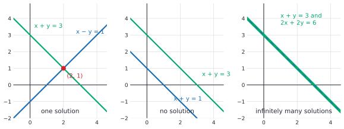

# Systems and Gaussian elimination

After this lesson you can write a system of linear equations as $A\mathbf{x} = \mathbf{b}$, row reduce its augmented matrix to reduced row echelon form, read off whether the system has no solution, one solution or infinitely many, write a solution set in parametric vector form, and explain why the row operations don't change the solutions and why elimination costs about $n^3$ operations.

Before this: [vectors, dot product and span](01-vectors-dot-product-and-span.md) and [systems of linear equations](../../03-high-school/02-linear-functions-and-systems/02-systems-of-linear-equations.md), which solved small systems by elimination and introduced the augmented matrix. This lesson makes that method exact, proves it works, and takes it to any size.

## Quick check

Try these first. If you get all three right, skip to [Practice](#practice).

1. Is each matrix in reduced row echelon form? (a) $\begin{pmatrix} 1 & 0 & 4 \\ 0 & 1 & 2 \end{pmatrix}$ (b) $\begin{pmatrix} 1 & 2 & 0 \\ 0 & 0 & 0 \\ 0 & 0 & 1 \end{pmatrix}$ (c) $\begin{pmatrix} 2 & 0 \\ 0 & 1 \end{pmatrix}$
2. The augmented matrix of a system in $x, y, z$ reduces to $\left(\begin{array}{ccc|c} 1 & 0 & 2 & 3 \\ 0 & 1 & -1 & 4 \\ 0 & 0 & 0 & 0 \end{array}\right)$. Describe all the solutions.
3. Can a system of 2 equations in 3 unknowns have exactly one solution?

<details class="solution" markdown>
<summary>Answers</summary>

1. (a) Yes. (b) No: the zero row is above a nonzero row. (c) No: the first pivot is $2$, not $1$.
2. The third column has no pivot, so $z$ is free. Write $z = t$. The rows say $x + 2z = 3$ and $y - z = 4$, so $x = 3 - 2t$, $y = 4 + t$. The solutions are $(3 - 2t,\; 4 + t,\; t)$ for every real $t$, a line in space.
3. No. Either the equations contradict each other (no solution), or there are at most 2 pivots among 3 columns, which leaves a free variable and infinitely many solutions.

</details>

## The idea

Take the system $2x + y = 5$ and $x - y = 1$. You can read it in two ways. By rows, each equation is a line in the plane, and a solution is a point on both lines. By columns, the system says

$$
x\begin{pmatrix} 2 \\ 1 \end{pmatrix} + y\begin{pmatrix} 1 \\ -1 \end{pmatrix} = \begin{pmatrix} 5 \\ 1 \end{pmatrix},
$$

so a solution is a pair of weights that builds the vector $\mathbf{b} = (5, 1)$ out of the two columns. Both pictures give $(x, y) = (2, 1)$: the lines cross there, and $2\begin{pmatrix} 2 \\ 1 \end{pmatrix} + 1\begin{pmatrix} 1 \\ -1 \end{pmatrix} = \begin{pmatrix} 5 \\ 1 \end{pmatrix}$.


The column reading connects this lesson to the last one. The question "does the system have a solution?" is the question "is $\mathbf{b}$ in the span of the columns?", and "how many solutions?" asks in how many ways $\mathbf{b}$ can be built from the columns. Elimination answers both questions at once, for any number of equations and unknowns, and tells you ahead of time whether to expect a point, a line, a plane or nothing.

You solved small systems by adding multiples of one equation to another until each equation had fewer unknowns. Gaussian elimination is that, made systematic enough for a computer to run on ten thousand equations. It works on the grid of numbers only, without writing the unknowns each time.

## Definitions

A **linear equation** in the unknowns $x_1, \dots, x_n$ is an equation $a_1x_1 + \dots + a_nx_n = b$ with fixed numbers $a_1, \dots, a_n, b$. A **system of linear equations** is a list of $m$ such equations in the same $n$ unknowns, and a **solution** is a vector $(x_1, \dots, x_n)$ in $\mathbb{R}^n$ that satisfies every equation. The **solution set** is the set of all solutions. A system is **consistent** if its solution set is not empty, and **inconsistent** otherwise.

The **coefficient matrix** $A$ is the $m \times n$ matrix of the coefficients, with one row per equation, $\mathbf{x}$ is the column of unknowns and $\mathbf{b}$ the column of right-hand sides. The system is the single equation $A\mathbf{x} = \mathbf{b}$, since row $i$ of $A\mathbf{x}$ is the dot product of row $i$ of $A$ with $\mathbf{x}$. The **augmented matrix** is $[A \mid \mathbf{b}]$, the matrix $A$ with $\mathbf{b}$ added as an extra column. In plain words, the augmented matrix is the whole system with the unknowns and plus signs left out.

The three **elementary row operations** on a matrix are:

1. swap two rows, written $R_i \leftrightarrow R_j$,
2. multiply a row by a nonzero number, written $R_i \to cR_i$ with $c \ne 0$,
3. add a multiple of one row to a different row, written $R_i \to R_i + cR_j$ with $j \ne i$.

Two matrices are **row equivalent** if one can be turned into the other by a sequence of elementary row operations. Applied to the augmented matrix, these are the three operations on equations from the high-school lesson.

A matrix is in **row echelon form** (REF) if every zero row is below every nonzero row, and the first nonzero entry of each nonzero row, its **leading entry**, lies in a column strictly to the right of the leading entry of the row above. It is in **reduced row echelon form** (RREF) if, in addition, every leading entry is $1$ and each leading $1$ is the only nonzero entry in its column. In plain words, the nonzero entries form a staircase going down and to the right, and in the reduced form each step is a $1$ with zeros above and below it. The leading entries of the RREF are its **pivots**, and a column that contains a pivot is a **pivot column**. For example,

$$
\begin{pmatrix} 1 & 2 & 0 & 3 \\ 0 & 0 & 1 & 4 \\ 0 & 0 & 0 & 0 \end{pmatrix}
$$

is in RREF with pivots in columns $1$ and $3$. The matrix $\begin{pmatrix} 2 & 1 \\ 0 & 3 \end{pmatrix}$ is in REF but not in RREF.

For a system $A\mathbf{x} = \mathbf{b}$, a variable whose column of $A$ is a pivot column is a **basic variable**, and a variable whose column has no pivot is a **free variable**. In plain words, a free variable can take any value you like, and the basic variables are then forced.

A system is **homogeneous** if $\mathbf{b} = \mathbf{0}$, that is, $A\mathbf{x} = \mathbf{0}$. It always has the **trivial solution** $\mathbf{x} = \mathbf{0}$, and any other solution is **nontrivial**.

## How to do it

### Why row operations are safe

*Theorem 1.* If the augmented matrices of two systems are row equivalent, the systems have the same solution set.

What we know: a row operation changes one or two rows, and the rows are equations. What we want: every solution of the old system solves the new one, and conversely. The plan: show that each new equation follows from old equations, and that every operation can be undone by another operation of the same kind. Then it is enough to treat one operation, and a chain of operations follows one step at a time.

*Proof.* Suppose first that a single operation turns $[A \mid \mathbf{b}]$ into $[A' \mid \mathbf{b}']$. Let $\mathbf{x}$ be a solution of the old system. Every row of the new matrix is a row of the old one, or a nonzero multiple $c\,(\text{row } i)$, or $(\text{row } i) + c\,(\text{row } j)$. If $\mathbf{x}$ satisfies the equations $\mathbf{r}_i \cdot \mathbf{x} = \beta_i$ and $\mathbf{r}_j \cdot \mathbf{x} = \beta_j$, then by linearity of the dot product it satisfies $c\,\mathbf{r}_i \cdot \mathbf{x} = c\beta_i$ and $(\mathbf{r}_i + c\mathbf{r}_j) \cdot \mathbf{x} = \beta_i + c\beta_j$. So $\mathbf{x}$ solves every equation of the new system.

Conversely, each operation is undone by an operation of the same kind: swapping the same two rows again, multiplying by $\frac{1}{c}$ (allowed because $c \ne 0$), and adding $-c$ times row $j$. So the old system is obtained from the new one by one operation, and the argument above, run backwards, shows that every solution of the new system solves the old one. For a chain of operations, apply this to each step in turn. $\blacksquare$

Look back: the condition $c \ne 0$ in operation 2 is what makes it reversible. Multiplying a row by $0$ replaces an equation by $0 = 0$ and throws information away. The condition $j \ne i$ in operation 3 is there for the same reason: adding a multiple of a row to itself is a scaling, and it can be a scaling by $0$.

### The algorithm

*Gaussian elimination* uses the operations to reach an echelon form. Continuing to the reduced form is sometimes called Gauss-Jordan elimination. The steps are:

1. Write the augmented matrix $[A \mid \mathbf{b}]$.
2. Look at the leftmost column that has a nonzero entry in or below the current row. Swap rows if needed to bring a nonzero entry to the current row. This entry is the pivot. (If no column is left, go to Step 5.)
3. Add multiples of the pivot row to the rows below it so that every entry below the pivot becomes $0$. The multiple to use for a row is "the entry below, divided by the pivot".
4. Move to the next row, and repeat Steps 2 and 3 on the part of the matrix below and to the right of the pivot. When you run out of rows or columns, the matrix is in REF.
5. If some row has the form $\begin{pmatrix} 0 & \cdots & 0 \mid c \end{pmatrix}$ with $c \ne 0$, stop: the system is inconsistent.
6. Otherwise, start from the lowest pivot and work upward. Multiply each pivot row by the reciprocal of its pivot, so the pivot is $1$, and subtract multiples of it from the rows above, so the pivot is the only nonzero entry in its column. The matrix is now in RREF.
7. Read the solutions from the RREF, as explained next.
8. Check the answer in the original equations.

You may scale a pivot row to make its pivot $1$ as soon as you find it, if that keeps the numbers small; the reduced form needs it eventually. A common trap is to do the steps out of order and undo a zero you made earlier, so finish a column before moving to the next.

### Reading the solutions

*Theorem 2 (uniqueness of the RREF).* Every matrix is row equivalent to exactly one matrix in reduced row echelon form.

That every matrix can be reduced to some RREF follows from the algorithm. That the result is the same whichever operations you choose is accepted here, and the proof, an induction on the number of columns, is in most textbooks. It is why "the RREF" and "the pivot columns" make sense. An echelon form that is not reduced is not unique: the pivots' positions are the same, but the entries are not.

*Theorem 3 (the three cases).* Let $R$ be the RREF of $[A \mid \mathbf{b}]$, where $A$ has $n$ columns.

- (a) If a row of $R$ is $\begin{pmatrix} 0 & \cdots & 0 \mid 1 \end{pmatrix}$, the system has no solution.
- (b) If not, and every one of the $n$ columns of $A$ is a pivot column, the system has exactly one solution.
- (c) If not, and some column of $A$ is not a pivot column, the system has infinitely many solutions, with one free variable for each non-pivot column.

What we know: by Theorem 1, $A\mathbf{x} = \mathbf{b}$ has the same solutions as the system with augmented matrix $R$. What we want: the three claims. The plan: read the equations of $R$ one row at a time.

*Proof.* (a) That row says $0x_1 + \dots + 0x_n = 1$, which no $\mathbf{x}$ satisfies.

Otherwise, no row is of that form. A pivot in the last column would be the leading $1$ of a row $\begin{pmatrix} 0 & \cdots & 0 \mid 1 \end{pmatrix}$, so all pivots are in the first $n$ columns. A zero row $\begin{pmatrix} 0 & \cdots & 0 \mid 0 \end{pmatrix}$ says $0 = 0$ and can be ignored. Every other row has its leading $1$ in the column of some basic variable $x_j$, and since the leading $1$ is the only nonzero entry of its column, that variable appears in this row only. So the row reads

$$
x_j = d - (\text{terms in the free variables}),
$$

where $d$ is the last entry of the row.

(b) If every column of $A$ is a pivot column, there are no free variables, so each row reads $x_j = d$, and the solution is unique.

(c) If some variables are free, choose any real values for them. Each basic variable is then determined by its row. This gives a solution for every choice of the free values, and different choices give different solutions, so there are infinitely many. $\blacksquare$

Look back: the proof gives a recipe for finding the solutions as well as showing that they exist. Each free variable gets a name ($s$, $t$, ...), and each basic variable is written in terms of them. The last line of Quick check 2 is this procedure, and Example 2 does it in full.

The description $\mathbf{x} = \mathbf{p} + s\,\mathbf{u} + t\,\mathbf{w}$ of a solution set is called **parametric vector form**: a fixed vector $\mathbf{p}$ plus a combination of fixed vectors with free parameters as weights. Geometrically, one free variable gives a line, two give a plane, and so on, not through the origin unless $\mathbf{p}$ can be taken to be $\mathbf{0}$.

### Zero, one or infinitely many

The first and third cases of the theorem are a statement about counting solutions. The count has a gap: a system has $0$, $1$ or infinitely many solutions, never exactly two. The proof doesn't need the RREF.

*Theorem 4.* If a system of linear equations has two different solutions, it has infinitely many.

What we know: two solutions $\mathbf{p} \ne \mathbf{q}$. What we want: infinitely many more. The plan: the line through $\mathbf{p}$ and $\mathbf{q}$ consists of solutions.

*Proof.* For each real number $t$ let $\mathbf{x}_t = \mathbf{p} + t(\mathbf{q} - \mathbf{p})$. Take any equation $\mathbf{r} \cdot \mathbf{x} = \beta$ of the system. Then $\mathbf{r} \cdot \mathbf{x}_t = \mathbf{r} \cdot \mathbf{p} + t(\mathbf{r} \cdot \mathbf{q} - \mathbf{r} \cdot \mathbf{p}) = \beta + t(\beta - \beta) = \beta$. So every $\mathbf{x}_t$ is a solution. Different values of $t$ give different vectors, because $\mathbf{q} - \mathbf{p} \ne \mathbf{0}$. $\blacksquare$

Look back: the picture is the one from the high-school lesson, where two distinct lines through two common points must coincide. Here it is for any number of unknowns.



In three unknowns each equation is a plane. Two planes that are not parallel meet in a line, so two equations in three unknowns have a line of solutions, or none if the planes are parallel and distinct. A third plane then either crosses that line in a single point, contains the whole line, or misses it. The last case is often a triangular prism: each pair of planes meets in a line and the three lines are parallel, so no point is on all three. Example 3 is such a system.

### Homogeneous systems and the shape of a solution set

*Theorem 5.* A homogeneous system with more unknowns than equations has a nontrivial solution.

What we know: $m$ equations in $n$ unknowns with $n > m$. What we want: a solution other than $\mathbf{0}$. The plan: count pivots, since each row has at most one.

*Proof.* The system is consistent, because $\mathbf{0}$ is a solution. Row reducing $[A \mid \mathbf{0}]$ never changes the zero column, so the RREF has at most $m$ pivots, one per row at most. There are $n > m$ columns, so at least one column has no pivot, and that variable is free. By Theorem 3(c) there are infinitely many solutions, so at least one is nonzero. $\blacksquare$

Look back: for example, $x + y + z = 0$ alone has a plane of solutions, and 3 equations in 4 unknowns always leave a line. This theorem is the engine behind the proof, in the next lesson, that you can't fit more than $n$ independent vectors into $\mathbb{R}^n$.

*Theorem 6 (shape of the solution set).* Suppose $\mathbf{p}$ is one solution of $A\mathbf{x} = \mathbf{b}$. Then the solution set is $\{\mathbf{p} + \mathbf{h} : \mathbf{h} \text{ is a solution of } A\mathbf{x} = \mathbf{0}\}$.

What we know: $A\mathbf{p} = \mathbf{b}$. What we want: equality of two sets. The plan: prove the two inclusions, using the fact that $A(\mathbf{u} + \mathbf{v}) = A\mathbf{u} + A\mathbf{v}$, which holds because each row of $A$ gives a dot product.

*Proof.* ($\supseteq$) If $A\mathbf{h} = \mathbf{0}$, then $A(\mathbf{p} + \mathbf{h}) = A\mathbf{p} + A\mathbf{h} = \mathbf{b} + \mathbf{0} = \mathbf{b}$. ($\subseteq$) If $A\mathbf{x} = \mathbf{b}$, put $\mathbf{h} = \mathbf{x} - \mathbf{p}$. Then $A\mathbf{h} = A\mathbf{x} - A\mathbf{p} = \mathbf{b} - \mathbf{b} = \mathbf{0}$, and $\mathbf{x} = \mathbf{p} + \mathbf{h}$. $\blacksquare$

Look back: the solution set of $A\mathbf{x} = \mathbf{b}$ is the solution set of $A\mathbf{x} = \mathbf{0}$ pushed along by one particular solution. In parametric vector form, $\mathbf{p}$ is the fixed vector and the combinations of the other vectors are the solutions of the homogeneous system. In Example 2 below, $\mathbf{p} = (5, 0, 2, 0)$.

### What elimination costs

Count the multiplications and divisions for $n$ equations in $n$ unknowns. In forward elimination, when you clear below the $k$-th pivot there are $n - k$ rows below it. Each one needs one division (for the multiplier) and then one multiplication for each of the $n - k + 1$ entries to the right of the pivot, counting the right-hand side. Adding $(n - k)(n - k + 2)$ over $k = 1, \dots, n - 1$ gives $\frac{n(n-1)(2n+5)}{6}$ operations, which is about $\frac{n^3}{3}$ for large $n$. Back substitution adds $\frac{n(n+1)}{2}$, which is much less. In the notation of a later lesson on asymptotic notation<!-- link: ../../06-cs-math/04-sums-recurrences-and-algorithms/04-asymptotic-notation.md -->, elimination costs $\Theta(n^3)$.

| $n$ | forward elimination | back substitution | total |
|---|---|---|---|
| $10$ | $375$ | $55$ | $430$ |
| $100$ | $338{,}250$ | $5{,}050$ | $343{,}300$ |
| $1000$ | $333{,}832{,}500$ | $500{,}500$ | $334{,}333{,}000$ |

Each time $n$ is multiplied by $10$, the work is multiplied by about $1000$, and doubling $n$ multiplies the work by about $8$. A thousand unknowns is a third of a billion operations, which a computer does in a fraction of a second, and ten thousand unknowns is a thousand times more. Carrying on to the full RREF costs about $\frac{n^3}{2}$, which is why programs stop at an echelon form and finish with back substitution.

## Worked examples

<div class="example" markdown>

### Example 1: a unique solution, step by step

Solve $x + 2y + z = 9$, $2x + y - z = 0$ and $3x - y + 2z = 9$.

Step 1: the augmented matrix is

$$
\left(\begin{array}{ccc|c} 1 & 2 & 1 & 9 \\ 2 & 1 & -1 & 0 \\ 3 & -1 & 2 & 9 \end{array}\right).
$$

Step 2: the first column has a nonzero entry in row 1, so the pivot is the $1$ there. Step 3: clear below it with $R_2 \to R_2 - 2R_1$ and $R_3 \to R_3 - 3R_1$:

$$
\left(\begin{array}{ccc|c} 1 & 2 & 1 & 9 \\ 0 & -3 & -3 & -18 \\ 0 & -7 & -1 & -18 \end{array}\right).
$$

Step 4: the next pivot is the $-3$ in row 2. Scale it with $R_2 \to -\frac{1}{3}R_2$ to get $\begin{pmatrix} 0 & 1 & 1 \mid 6 \end{pmatrix}$, then clear below with $R_3 \to R_3 + 7R_2$:

$$
\left(\begin{array}{ccc|c} 1 & 2 & 1 & 9 \\ 0 & 1 & 1 & 6 \\ 0 & 0 & 6 & 24 \end{array}\right).
$$

This is an echelon form. Step 5: no row is $\begin{pmatrix} 0 & 0 & 0 \mid c \end{pmatrix}$, so the system is consistent. Step 6: scale the last row, $R_3 \to \frac{1}{6}R_3$, to get $\begin{pmatrix} 0 & 0 & 1 \mid 4 \end{pmatrix}$. Clear above it with $R_2 \to R_2 - R_3$ and $R_1 \to R_1 - R_3$, then clear above the second pivot with $R_1 \to R_1 - 2R_2$:

$$
\left(\begin{array}{ccc|c} 1 & 0 & 0 & 1 \\ 0 & 1 & 0 & 2 \\ 0 & 0 & 1 & 4 \end{array}\right).
$$

Step 7: all three columns are pivot columns, so by Theorem 3(b) the solution is unique: $(x, y, z) = (1, 2, 4)$.

Step 8, the check: $1 + 4 + 4 = 9$, $2 + 2 - 4 = 0$ and $3 - 2 + 8 = 9$. All three equations hold.

</div>

<div class="example" markdown>

### Example 2: infinitely many solutions

Solve $x_1 + 2x_2 + x_3 = 7$, $2x_1 + 4x_2 - x_3 + 3x_4 = 8$ and $3x_1 + 6x_2 + 3x_4 = 15$.

The augmented matrix is $\left(\begin{array}{cccc|c} 1 & 2 & 1 & 0 & 7 \\ 2 & 4 & -1 & 3 & 8 \\ 3 & 6 & 0 & 3 & 15 \end{array}\right)$. Clear below the first pivot with $R_2 \to R_2 - 2R_1$ and $R_3 \to R_3 - 3R_1$:

$$
\left(\begin{array}{cccc|c} 1 & 2 & 1 & 0 & 7 \\ 0 & 0 & -3 & 3 & -6 \\ 0 & 0 & -3 & 3 & -6 \end{array}\right).
$$

Column 2 has only zeros below row 1, so it has no pivot, and we move to column 3, where the pivot is the $-3$ in row 2. The operation $R_3 \to R_3 - R_2$ makes row 3 all zeros. Scale with $R_2 \to -\frac{1}{3}R_2$ and clear above with $R_1 \to R_1 - R_2$:

$$
\left(\begin{array}{cccc|c} 1 & 2 & 0 & 1 & 5 \\ 0 & 0 & 1 & -1 & 2 \\ 0 & 0 & 0 & 0 & 0 \end{array}\right).
$$

The pivot columns are $1$ and $3$, so $x_2$ and $x_4$ are free. Write $x_2 = s$ and $x_4 = t$. The rows say $x_1 = 5 - 2s - t$ and $x_3 = 2 + t$. In parametric vector form,

$$
\begin{pmatrix} x_1 \\ x_2 \\ x_3 \\ x_4 \end{pmatrix} = \begin{pmatrix} 5 \\ 0 \\ 2 \\ 0 \end{pmatrix} + s\begin{pmatrix} -2 \\ 1 \\ 0 \\ 0 \end{pmatrix} + t\begin{pmatrix} -1 \\ 0 \\ 1 \\ 1 \end{pmatrix}.
$$

There are two parameters, so the solution set is a plane inside $\mathbb{R}^4$. The third equation was the sum of the first two, so it added nothing, which is why a row of zeros appeared.

Check with $s = 1$ and $t = 1$, which gives $\mathbf{x} = (2, 1, 3, 1)$. The equations read $2 + 2 + 3 = 7$, $4 + 4 - 3 + 3 = 8$ and $6 + 6 + 0 + 3 = 15$. All hold, and so do other choices of $s$ and $t$.

</div>

<div class="example" markdown>

### Example 3: no solution

Solve $x + y + z = 6$, $x - y + z = 2$ and $2x + 2z = 9$.

The augmented matrix is $\left(\begin{array}{ccc|c} 1 & 1 & 1 & 6 \\ 1 & -1 & 1 & 2 \\ 2 & 0 & 2 & 9 \end{array}\right)$. Use $R_2 \to R_2 - R_1$ and $R_3 \to R_3 - 2R_1$:

$$
\left(\begin{array}{ccc|c} 1 & 1 & 1 & 6 \\ 0 & -2 & 0 & -4 \\ 0 & -2 & 0 & -3 \end{array}\right).
$$

Now $R_3 \to R_3 - R_2$ gives the row $\begin{pmatrix} 0 & 0 & 0 \mid 1 \end{pmatrix}$, which says $0 = 1$. By Theorem 3(a) the system has no solution.

Why: adding the first two equations gives $2x + 2z = 8$, and the third equation says $2x + 2z = 9$. In the column picture, the columns $(1, 1, 2)$, $(1, -1, 0)$ and $(1, 1, 2)$ span only a plane, namely $x + y - z = 0$, as in [the dot-product test of the last lesson](01-vectors-dot-product-and-span.md#tricks-and-shortcuts). The right-hand side $\mathbf{b} = (6, 2, 9)$ gives $6 + 2 - 9 = -1 \ne 0$, so it is not in the plane. Geometrically the three planes form a prism: the normals $(1, 1, 1)$, $(1, -1, 1)$ and $(2, 0, 2)$ satisfy $(2, 0, 2) = (1, 1, 1) + (1, -1, 1)$, but the right-hand sides do not.

Check: if $(x, y, z)$ were a solution, adding the first two equations would give $2x + 2z = 8$ while the third gives $9$. Changing the last right-hand side from $9$ to $8$ makes the system consistent, with the line of solutions $(4 - t, 2, t)$: for $t = 1$ the point $(3, 2, 1)$ gives $3 + 2 + 1 = 6$, $3 - 2 + 1 = 2$ and $2 \cdot 3 + 2 \cdot 1 = 8$.

</div>

<div class="example" markdown>

### Example 4: a homogeneous system (finish it yourself)

Find all solutions of $x_1 + 2x_2 - x_4 = 0$ and $x_1 + 2x_2 + x_3 - 3x_4 = 0$.

The augmented matrix is $\left(\begin{array}{cccc|c} 1 & 2 & 0 & -1 & 0 \\ 1 & 2 & 1 & -3 & 0 \end{array}\right)$. The operation $R_2 \to R_2 - R_1$ gives

$$
\left(\begin{array}{cccc|c} 1 & 2 & 0 & -1 & 0 \\ 0 & 0 & 1 & -2 & 0 \end{array}\right),
$$

which is already in RREF, with pivots in columns $1$ and $3$. There are $4 > 2$ unknowns, so Theorem 5 promises a nontrivial solution. The free variables are $x_2$ and $x_4$. The last step is to solve for $x_1$ and $x_3$ and write the answer in parametric vector form.

<details class="solution" markdown>
<summary>Finish</summary>

Put $x_2 = s$ and $x_4 = t$. The rows say $x_1 = -2s + t$ and $x_3 = 2t$, so

$$
\mathbf{x} = s\begin{pmatrix} -2 \\ 1 \\ 0 \\ 0 \end{pmatrix} + t\begin{pmatrix} 1 \\ 0 \\ 2 \\ 1 \end{pmatrix}.
$$

There is no fixed vector $\mathbf{p}$, or rather $\mathbf{p} = \mathbf{0}$, because the system is homogeneous.

Check with $s = 1$ and $t = 1$, which gives $(-1, 1, 2, 1)$: the first equation is $-1 + 2 - 1 = 0$ and the second is $-1 + 2 + 2 - 3 = 0$.

</details>

</div>

## Edge cases and common mistakes

<div class="warning" markdown>

Watch out: an operation of the form $R_i \to R_i + cR_i$ is not allowed. It multiplies row $i$ by $1 + c$, and for $c = -1$ it zeros the row and destroys an equation. The same goes for "$R_1 \to R_1 - R_2$ and, at the same time, $R_2 \to R_2 - R_1$": the second step uses the old $R_1$ and the first has already changed it, so do them one after the other. One operation changes one row.

</div>

<div class="warning" markdown>

Watch out: a zero row is not always a problem. $\begin{pmatrix} 0 & 0 & 0 \mid 0 \end{pmatrix}$ says $0 = 0$, which is true and means an equation was redundant, as in Example 2. Only a row $\begin{pmatrix} 0 & 0 & 0 \mid c \end{pmatrix}$ with $c \ne 0$ means no solution. A system with a zero row is consistent exactly when no row has that bad form.

</div>

<div class="warning" markdown>

Watch out: more unknowns than equations does not guarantee infinitely many solutions. $x + y + z = 1$ and $x + y + z = 2$ has $3 > 2$ unknowns and no solution. Theorem 5 is about homogeneous systems, which are always consistent. For a general system, more unknowns than equations gives either no solution or infinitely many, never exactly one.

</div>

<div class="warning" markdown>

Watch out: free variables belong to columns, not rows. A column without a pivot is free, whatever its entries look like, and the number of free variables is $n$ minus the number of pivots. Also, don't read the augmented column as an unknown: the vertical bar is not a column of $A$, and a pivot there means inconsistency, not a variable.

</div>

<div class="warning" markdown>

Watch out: working on the left side only. Every operation applies to the whole row of $[A \mid \mathbf{b}]$, including the right-hand side. Forgetting the last column is the most common arithmetic slip, and it gives an answer that satisfies the wrong system.

</div>

## Tricks and shortcuts

Keep fractions out by choosing the operations. Swap rows to get a pivot of $1$ or $-1$ where one is available. If two rows have leading entries $2$ and $3$, combine in one move with $R_2 \to 2R_2 - 3R_1$, which is a scaling of $R_2$ by $2 \ne 0$ followed by an addition, so it is allowed. Fractions are not wrong, only slower: answers such as $x = \frac{7}{3}$ are normal.

Add a checksum column. To the right of $[A \mid \mathbf{b}]$ put the sum of each row. Row operations act on the sums in the same way as on the entries, so after each step the checksum should still equal the sum of the row. A mismatch points to the row where you slipped.

Predict the case before you start. If you can spot that one equation is a combination of the others (Example 2), or that the left sides are dependent but the right sides are not (Example 3), you know the outcome. A system with more equations than unknowns is called overdetermined, and it usually has no solution. A regression, in [orthogonality, projections and least squares](07-orthogonality-projections-and-least-squares.md), finds the best approximate answer instead.

## In code

A short row reduction with exact fractions, the same steps as by hand, run on Example 2. Then a warning from floating point numbers: the same elimination without row swaps gives a wrong answer on a system that is easy for a human, and the operation count from above.

<details class="code" markdown>
<summary>In code</summary>

```python
from fractions import Fraction

def rref(rows):
    """Row reduce a matrix (a list of rows) with exact fractions.
    Returns the reduced matrix and the list of pivot columns."""
    M = [[Fraction(x) for x in row] for row in rows]
    n_rows, n_cols = len(M), len(M[0])
    pivots = []
    r = 0
    for c in range(n_cols):
        if r == n_rows:
            break
        p = next((i for i in range(r, n_rows) if M[i][c] != 0), None)
        if p is None:
            continue                            # no pivot here: free variable
        M[r], M[p] = M[p], M[r]                 # swap
        M[r] = [x / M[r][c] for x in M[r]]      # scale: the pivot becomes 1
        for i in range(n_rows):
            if i != r:
                f = M[i][c]
                M[i] = [a - f * b for a, b in zip(M[i], M[r])]  # clear column c
        pivots.append(c)
        r += 1
    return M, pivots

# Example 2: 3 equations, 4 unknowns, augmented matrix
R, piv = rref([[1, 2, 1, 0, 7], [2, 4, -1, 3, 8], [3, 6, 0, 3, 15]])
for row in R:
    print([str(x) for x in row])
# ['1', '2', '0', '1', '5']
# ['0', '0', '1', '-1', '2']
# ['0', '0', '0', '0', '0']
print("pivot columns:", piv)   # pivot columns: [0, 2]

# Floats: the same method without and with a row swap
def solve(M, swap):
    n = len(M)
    M = [row[:] for row in M]
    for k in range(n):
        if swap:
            p = max(range(k, n), key=lambda i: abs(M[i][k]))
            M[k], M[p] = M[p], M[k]
        for i in range(k + 1, n):
            f = M[i][k] / M[k][k]
            M[i] = [a - f * b for a, b in zip(M[i], M[k])]
    x = [0.0] * n
    for i in range(n - 1, -1, -1):
        x[i] = (M[i][n] - sum(M[i][j] * x[j] for j in range(i + 1, n))) / M[i][i]
    return x

system = [[1e-20, 1.0, 1.0], [1.0, 1.0, 2.0]]   # 1e-20 x + y = 1 and x + y = 2
print(solve(system, swap=False))   # [0.0, 1.0]  x is wrong
print(solve(system, swap=True))    # [1.0, 1.0]  x is about 1, as it should be

# Multiplications and divisions in forward elimination plus back substitution
def count(n):
    forward = sum((n - k - 1) * (1 + (n - k)) for k in range(n))
    back = n * (n + 1) // 2
    return forward, back

for n in (10, 100, 1000):
    f, b = count(n)
    print(n, f, b, f + b)
# 10 375 55 430
# 100 338250 5050 343300
# 1000 333832500 500500 334333000
```

</details>

The first run divides by $10^{-20}$, which magnifies rounding error until the information in $x$ is lost, and the row swap (partial pivoting) avoids it by always dividing by the largest available entry. Library routines such as `numpy.linalg.solve` use this idea, and a later lesson on floating point basics<!-- link: ../../06-cs-math/01-number-representation/04-floating-point-basics.md --> explains why rounding works this way.

## FAQ

### Why is adding a multiple of one equation to another allowed?

Because the new equation is a consequence of the old ones, and the old one can be recovered from the new one and the other by subtracting again. Theorem 1 is this argument. A line through a point of intersection stays a line through that point, so the solutions never change.

### Does it matter in which order I choose the pivots?

The echelon form you reach may look different, but the RREF is always the same (Theorem 2), so the pivot columns and the solution set are the same. Different choices mainly affect how many fractions you meet on the way. A computer chooses pivots to keep rounding errors small.

### Why not solve $A\mathbf{x} = \mathbf{b}$ by computing $A^{-1}$ and multiplying?

The inverse exists only for square matrices with full pivots, and finding it costs several times as much as elimination on one system, so you spend more and learn nothing you needed. When $A$ is square and invertible, the answer is the same: $\mathbf{x} = A^{-1}\mathbf{b}$. The next lesson, [matrix algebra and inverses](03-matrix-algebra-and-inverses.md), computes inverses by row reduction and says when they are worth it.

### What if there are more equations than unknowns?

Then the equations usually contradict each other, as a regression with more data points than coefficients does. A consistent system with more equations than unknowns is possible (some equations are redundant), and Theorem 3 still applies. When there is no exact solution, the best approximate one comes from the method in [orthogonality, projections and least squares](07-orthogonality-projections-and-least-squares.md).

## Practice

### Warm-up

1\. For each matrix, say whether it is in REF, in RREF, or neither. (a) $\begin{pmatrix} 1 & 2 & 0 & 3 \\ 0 & 0 & 1 & 4 \\ 0 & 0 & 0 & 0 \end{pmatrix}$ (b) $\begin{pmatrix} 1 & 0 & 0 \\ 0 & 0 & 1 \\ 0 & 1 & 0 \end{pmatrix}$ (c) $\begin{pmatrix} 1 & 3 & 0 \\ 0 & 2 & 1 \end{pmatrix}$

<details class="solution" markdown>
<summary>Solution</summary>

(a) RREF: the pivots are $1$, in columns $1$ and $3$, with zeros above and below them, and the zero row is at the bottom. (b) Neither: the leading entry of row 3 (column 2) is to the left of the leading entry of row 2 (column 3). Swapping rows 2 and 3 would give the identity matrix. (c) REF but not RREF: the second pivot is $2$ and there is a $3$ above it.

Check (c): scale $R_2 \to \frac{1}{2}R_2$ and use $R_1 \to R_1 - 3R_2$ to reach RREF $\begin{pmatrix} 1 & 0 & -\frac{3}{2} \\ 0 & 1 & \frac{1}{2} \end{pmatrix}$.

</details>

2\. Solve $x + y + 2z = 3$, $2x + y - z = 2$ and $x - y + z = 4$ by row reduction.

<details class="solution" markdown>
<summary>Solution</summary>

Start with $\left(\begin{array}{ccc|c} 1 & 1 & 2 & 3 \\ 2 & 1 & -1 & 2 \\ 1 & -1 & 1 & 4 \end{array}\right)$. Use $R_2 \to R_2 - 2R_1$ and $R_3 \to R_3 - R_1$ to get rows $\begin{pmatrix} 0 & -1 & -5 \mid -4 \end{pmatrix}$ and $\begin{pmatrix} 0 & -2 & -1 \mid 1 \end{pmatrix}$. Scale $R_2 \to -R_2$ to get $\begin{pmatrix} 0 & 1 & 5 \mid 4 \end{pmatrix}$, then $R_3 \to R_3 + 2R_2$ gives $\begin{pmatrix} 0 & 0 & 9 \mid 9 \end{pmatrix}$. So $z = 1$, and then $y = 4 - 5 = -1$ and $x = 3 - y - 2z = 3 + 1 - 2 = 2$.

Check: $2 - 1 + 2 = 3$, $4 - 1 - 1 = 2$ and $2 + 1 + 1 = 4$. The solution is $(2, -1, 1)$.

</details>

3\. The augmented matrix of a system in $x_1, x_2, x_3, x_4$ has RREF $\left(\begin{array}{cccc|c} 1 & 0 & 3 & 0 & 2 \\ 0 & 1 & -1 & 0 & -4 \\ 0 & 0 & 0 & 1 & 5 \end{array}\right)$. Write the solution set in parametric vector form.

<details class="solution" markdown>
<summary>Solution</summary>

The pivot columns are $1$, $2$ and $4$, so $x_3$ is the only free variable. Put $x_3 = t$. The rows give $x_1 = 2 - 3t$, $x_2 = -4 + t$ and $x_4 = 5$. So $\mathbf{x} = (2, -4, 0, 5) + t\,(-3, 1, 1, 0)$, a line in $\mathbb{R}^4$.

Check with $t = 1$: $\mathbf{x} = (-1, -3, 1, 5)$ and the rows read $-1 + 3 = 2$, $-3 - 1 = -4$ and $5 = 5$.

</details>

### Standard

4\. For which values of $k$ and $m$ does the system $x + y + z = 1$, $x + 2y + 3z = 2$, $2x + 3y + kz = m$ have no solution, exactly one solution, or infinitely many?

<details class="solution" markdown>
<summary>Solution</summary>

The augmented matrix is $\left(\begin{array}{ccc|c} 1 & 1 & 1 & 1 \\ 1 & 2 & 3 & 2 \\ 2 & 3 & k & m \end{array}\right)$. Use $R_2 \to R_2 - R_1$ and $R_3 \to R_3 - 2R_1$, which give $\begin{pmatrix} 0 & 1 & 2 \mid 1 \end{pmatrix}$ and $\begin{pmatrix} 0 & 1 & k - 2 \mid m - 2 \end{pmatrix}$. Then $R_3 \to R_3 - R_2$ gives $\begin{pmatrix} 0 & 0 & k - 4 \mid m - 3 \end{pmatrix}$.

If $k \ne 4$, there is a pivot in every column, so there is exactly one solution, for every $m$. If $k = 4$ and $m = 3$, the last row is zero, so there is a free variable and infinitely many solutions. If $k = 4$ and $m \ne 3$, the last row is $\begin{pmatrix} 0 & 0 & 0 \mid m - 3 \end{pmatrix}$ with a nonzero right side, so there is no solution.

Check: with $k = 4$ the third left side is the sum of the first two ($2x + 3y + 4z$), which has right side $1 + 2 = 3$, so $m = 3$ is exactly what keeps the system consistent.

</details>

5\. Let $A\mathbf{x} = \mathbf{0}$ be a homogeneous system. Prove that if $\mathbf{x}$ and $\mathbf{y}$ are solutions and $c$, $d$ are numbers, then $c\mathbf{x} + d\mathbf{y}$ is a solution.

<details class="solution" markdown>
<summary>Solution</summary>

What we know: each equation is $\mathbf{r} \cdot \mathbf{x} = 0$ for a row $\mathbf{r}$ of $A$, and the same for $\mathbf{y}$. What we want: $\mathbf{r} \cdot (c\mathbf{x} + d\mathbf{y}) = 0$ for every row. The plan: linearity of the dot product.

*Proof.* For every row $\mathbf{r}$ of $A$, $\mathbf{r} \cdot (c\mathbf{x} + d\mathbf{y}) = c\,(\mathbf{r} \cdot \mathbf{x}) + d\,(\mathbf{r} \cdot \mathbf{y}) = c \cdot 0 + d \cdot 0 = 0$. $\blacksquare$

Look back: this says that the solution set of a homogeneous system is closed under combining, like a span. The next lesson calls such a set a subspace. Check with Example 4: the solutions $(-2, 1, 0, 0)$ and $(1, 0, 2, 1)$ combine to $2(-2, 1, 0, 0) + 3(1, 0, 2, 1) = (-1, 2, 6, 3)$, and $-1 + 4 - 3 = 0$ and $-1 + 4 + 6 - 9 = 0$.

</details>

6\. Balance the chemical equation $a\,\mathrm{C_3H_8} + b\,\mathrm{O_2} \to c\,\mathrm{CO_2} + d\,\mathrm{H_2O}$ by writing one equation for each element and solving the homogeneous system.

<details class="solution" markdown>
<summary>Solution</summary>

Count atoms on both sides. Carbon: $3a = c$. Hydrogen: $8a = 2d$. Oxygen: $2b = 2c + d$. As a homogeneous system in $(a, b, c, d)$ this is $3a - c = 0$, $8a - 2d = 0$ and $2b - 2c - d = 0$. There are 4 unknowns and 3 equations, so Theorem 5 gives a nontrivial solution.

Take $a$ as the free variable: $c = 3a$, $d = 4a$, and $2b = 6a + 4a = 10a$, so $b = 5a$. The smallest whole-number solution has $a = 1$: $(a, b, c, d) = (1, 5, 3, 4)$, that is, $\mathrm{C_3H_8} + 5\,\mathrm{O_2} \to 3\,\mathrm{CO_2} + 4\,\mathrm{H_2O}$.

Check: carbon $3 = 3$, hydrogen $8 = 2 \cdot 4$, oxygen $2 \cdot 5 = 10 = 2 \cdot 3 + 4$.

</details>

### Challenge

7\. Solve $10^{-20}x + y = 1$ and $x + y = 2$ exactly (to good accuracy) by hand, and then explain what goes wrong if a computer with about 16 significant digits does elimination without swapping the rows. Use the program in [In code](#in-code) to confirm.

<details class="solution" markdown>
<summary>Solution</summary>

Subtract the first equation from the second: $(1 - 10^{-20})x = 1$, so $x = \frac{1}{1 - 10^{-20}} \approx 1$ and then $y = 1 - 10^{-20}x \approx 1$. The true solution is almost exactly $(1, 1)$.

Without a swap, the pivot is $10^{-20}$ and the multiplier for row 2 is $10^{20}$. Row 2 becomes $\begin{pmatrix} 0 & 1 - 10^{20} \mid 2 - 10^{20} \end{pmatrix}$. With 16 digits, $1 - 10^{20}$ and $2 - 10^{20}$ both round to $-10^{20}$, so the computer gets $y = 1$, which is right, and then $x = \frac{1 - y}{10^{-20}} = 0$, which is wrong. The $1$ and the $2$ were lost when added to $10^{20}$.

With a swap, the pivot is $1$ and the multiplier is $10^{-20}$, which is harmless: row 2 becomes $\begin{pmatrix} 0 & 1 - 10^{-20} \mid 1 - 2 \cdot 10^{-20} \end{pmatrix}$, which rounds to $y = 1$, and then $x = 2 - y = 1$.

Check: the program prints `[0.0, 1.0]` without swapping and `[1.0, 1.0]` with swapping.

</details>

8\. (Reviews [existence and uniqueness proofs](../../04-proofs-and-logic/04-more-proof-methods/02-existence-and-uniqueness-proofs.md).) Prove that if $A$ is an $m \times n$ matrix with $n > m$ and the system $A\mathbf{x} = \mathbf{b}$ is consistent, then it has infinitely many solutions.

<details class="solution" markdown>
<summary>Solution</summary>

What we know: a solution $\mathbf{p}$ exists (existence is given), and Theorem 5 gives a nontrivial solution of the homogeneous system, since $n > m$. What we want: infinitely many solutions. The plan: use Theorem 6 to shift the nontrivial homogeneous solutions by $\mathbf{p}$.

*Proof.* By Theorem 5 there is $\mathbf{h} \ne \mathbf{0}$ with $A\mathbf{h} = \mathbf{0}$. Then $t\mathbf{h}$ is also a homogeneous solution for each real $t$, by Practice 5 with $c = t$ and $d = 0$. By Theorem 6, each $\mathbf{p} + t\mathbf{h}$ is a solution of $A\mathbf{x} = \mathbf{b}$, and different values of $t$ give different vectors because $\mathbf{h} \ne \mathbf{0}$. $\blacksquare$

Look back: the proof separates the two jobs of the [existence and uniqueness lesson](../../04-proofs-and-logic/04-more-proof-methods/02-existence-and-uniqueness-proofs.md): $\mathbf{p}$ is the existence, and the nontrivial $\mathbf{h}$ breaks uniqueness. Check with Example 2: $n = 4 > m = 3$, $\mathbf{p} = (5, 0, 2, 0)$ and $\mathbf{h} = (-2, 1, 0, 0)$, and $\mathbf{p} + 2\mathbf{h} = (1, 2, 2, 0)$ gives $1 + 4 + 2 = 7$, $2 + 8 - 2 = 8$ and $3 + 12 = 15$.

</details>

## Where this shows up

- The next lesson, [matrix algebra and inverses](03-matrix-algebra-and-inverses.md), uses row operations as matrices and computes inverses by reducing $[A \mid I]$. Then [linear independence, basis and dimension](04-linear-independence-basis-and-dimension.md) turns pivots into dimensions, and Theorem 5 above is the key step of its main lemma.
- In CS, solving $A\mathbf{x} = \mathbf{b}$ is a step inside graphics, circuit and physics simulations, and inside regression through the normal equations. Production code uses a factored form of elimination (LU) with row swaps. See [Correlation and linear regression](../08-statistics/04-correlation-and-linear-regression.md).
- In economics, equilibrium in several linked markets and the input-output model are systems of linear equations, one equation per good or industry. The row swaps of Gaussian elimination reappear in the simplex method for linear programs, which starts from the feasible regions of [two-variable inequalities](../../03-high-school/02-linear-functions-and-systems/03-two-variable-inequalities-and-feasible-regions.md).
