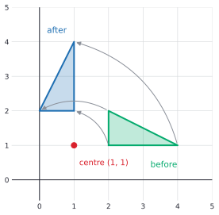
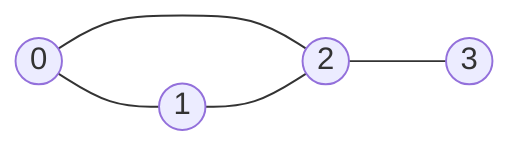

# Matrix algebra and inverses

After this lesson you can multiply matrices by rows, by columns and as a composition, use the rules of matrix algebra (and know which ones fail), prove the key rules for products, transposes and inverses, compute an inverse by row reducing $[A \mid I]$, and state and prove the first part of the invertible matrix theorem.

Before this: [systems and Gaussian elimination](02-systems-and-gaussian-elimination.md) and [matrix basics](../../03-high-school/10-vectors-and-matrices/02-matrix-basics.md), which defined the product, the identity, the transpose and the $2 \times 2$ inverse. Here we prove the rules and extend the inverse to any size.

## Quick check

Try these first. If you get all three right, skip to [Practice](#practice).

1. For $A = \begin{pmatrix} 1 & 1 \\ 0 & 1 \end{pmatrix}$ and $B = \begin{pmatrix} 1 & 0 \\ 1 & 1 \end{pmatrix}$, compute $AB$ and $BA$.
2. Find the inverse of $\begin{pmatrix} 2 & 1 \\ 5 & 3 \end{pmatrix}$.
3. If $A$ and $B$ are invertible $n \times n$ matrices, is $(AB)^{-1} = A^{-1}B^{-1}$?

<details class="solution" markdown>
<summary>Answers</summary>

1. $AB = \begin{pmatrix} 1 + 1 & 0 + 1 \\ 0 + 1 & 0 + 1 \end{pmatrix} = \begin{pmatrix} 2 & 1 \\ 1 & 1 \end{pmatrix}$ and $BA = \begin{pmatrix} 1 & 1 \\ 1 & 2 \end{pmatrix}$. They are different.
2. The determinant is $2 \cdot 3 - 1 \cdot 5 = 1$, so the inverse is $\begin{pmatrix} 3 & -1 \\ -5 & 2 \end{pmatrix}$. Check: the first row times the first column is $6 - 5 = 1$.
3. No in general. The correct rule is $(AB)^{-1} = B^{-1}A^{-1}$, with the order reversed, the way you put on socks and then shoes but take off the shoes first. This lesson proves it.

</details>

## The idea

A matrix is a machine that takes a vector in and gives a vector out. Two machines in a row make one machine, and the product $AB$ is the matrix of that combined machine: first $B$, then $A$. A graphics program that rotates a picture about its centre does it in three steps, move the centre to the origin, rotate, move back, and multiplies the three matrices into one. The product depends on the order, because rotating and then moving is not moving and then rotating.

The inverse is the undo button. If the machine turns the shape on the left into the shape in the middle of the figure below, its inverse turns it back. Some machines have no undo: the matrix on the right flattens the shape onto a line, and two different points $P$ and $Q$ land on the same spot, so nothing can say where a point at $(2, 2)$ came from.


This lesson makes that picture exact. It proves which familiar rules of arithmetic carry over to matrices (most of them, with the order of factors kept) and which don't (commutativity and cancellation). It then shows how to find an inverse with the row reduction of the last lesson, and why "$A$ has an inverse" is the same statement as a list of other facts about $A$.

## Definitions

An $m \times n$ matrix $A = (a_{ij})$ has $m$ rows and $n$ columns, and $a_{ij}$ is the entry in row $i$ and column $j$. The **product** of an $m \times n$ matrix $A$ and an $n \times p$ matrix $B$ is the $m \times p$ matrix $AB$ with entries

$$
(AB)_{ij} = \sum_{k=1}^{n} a_{ik}b_{kj}.
$$

In plain words, entry $(i, j)$ of $AB$ is row $i$ of $A$ dotted with column $j$ of $B$. The product is defined only when the number of columns of $A$ equals the number of rows of $B$. For a square matrix, the **power** $A^k$ is $A$ multiplied by itself $k$ times, and $A^0 = I$.

The **identity matrix** $I = I_n$ is the $n \times n$ matrix with $1$ on the diagonal and $0$ elsewhere, so $I_{ij} = 1$ if $i = j$ and $0$ otherwise. The **transpose** $A^T$ of an $m \times n$ matrix is the $n \times m$ matrix with $(A^T)_{ij} = a_{ji}$. A square matrix is **symmetric** if $A^T = A$ and **diagonal** if all its entries off the diagonal are $0$. In plain words, transposing reflects the matrix across its main diagonal, and a symmetric matrix is its own mirror image.

A square matrix $A$ is **invertible** if there is a matrix $B$ of the same size with $AB = BA = I$. Such a $B$ is an **inverse** of $A$, and a square matrix that is not invertible is **singular**. In plain words, the inverse undoes $A$ from either side. Theorem 4 shows that the inverse is unique, and it is written $A^{-1}$.

An **elementary matrix** is a matrix obtained from $I$ by one elementary row operation (swap two rows, multiply a row by $c \ne 0$, or add a multiple of one row to another). For $n = 3$,

$$
\begin{pmatrix} 0 & 1 & 0 \\ 1 & 0 & 0 \\ 0 & 0 & 1 \end{pmatrix}, \qquad \begin{pmatrix} 1 & 0 & 0 \\ 0 & 5 & 0 \\ 0 & 0 & 1 \end{pmatrix}, \qquad \begin{pmatrix} 1 & 0 & 0 \\ -2 & 1 & 0 \\ 0 & 0 & 1 \end{pmatrix}
$$

are the three kinds: swap rows $1$ and $2$, multiply row $2$ by $5$, and add $-2$ times row $1$ to row $2$.

## How to do it

### Three ways to read a product

The entry formula is the definition. Two other readings of the same product are worth knowing, since each one is the right tool for some job.

*Theorem 1.* Let $A$ be $m \times n$ and $B$ be $n \times p$, with columns $\mathbf{b}_1, \dots, \mathbf{b}_p$ for $B$. Then

- column $j$ of $AB$ is $A\mathbf{b}_j$, so $AB$ is obtained by applying $A$ to each column of $B$;
- row $i$ of $AB$ is $(\text{row } i \text{ of } A)\,B$;
- $A\mathbf{x}$ is the linear combination $x_1\mathbf{a}_1 + \dots + x_n\mathbf{a}_n$ of the columns $\mathbf{a}_j$ of $A$, with the entries of $\mathbf{x}$ as weights.

What we know: the entry formula. What we want: three rearrangements of it. The plan: fix the index that stays fixed in each claim and read the sum.

*Proof.* Entry $i$ of $A\mathbf{b}_j$ is $\sum_k a_{ik}b_{kj}$, which is $(AB)_{ij}$, so the entries of column $j$ of $AB$ and of $A\mathbf{b}_j$ agree. Fixing $i$ and letting $j$ vary shows the second claim in the same way. For the third, entry $i$ of $A\mathbf{x}$ is $\sum_k a_{ik}x_k$, and entry $i$ of $x_1\mathbf{a}_1 + \dots + x_n\mathbf{a}_n$ is $\sum_k x_k a_{ik}$, the same sum. $\blacksquare$

Look back: the third claim is the one used for span and systems: $A\mathbf{x}$ is a combination of the columns, so $A\mathbf{x} = \mathbf{b}$ is solvable exactly when $\mathbf{b}$ is in the span of the columns. The first claim says that $AB$ is "$A$ applied to every column of $B$", which is why $AB$ means "do $B$, then $A$": the columns of $B$ are the outputs of $B$.

### The rules of matrix algebra

*Theorem 2.* For matrices of sizes that make the expressions defined, and for a scalar $c$:

| Rule | Statement |
|---|---|
| associative | $(AB)C = A(BC)$ |
| distributive | $A(B + C) = AB + AC$ and $(A + B)C = AC + BC$ |
| scalars | $c(AB) = (cA)B = A(cB)$ |
| identity | $IA = A = AI$ |

What we know: the entry formula for the product. What we want: equality of entries in each rule. The plan: write out the entries on both sides and rearrange finite sums. We prove associativity, the one that needs a little thought, and leave the others for Practice.

*Proof of associativity.* Let $A$ be $m \times n$, $B$ be $n \times p$ and $C$ be $p \times q$. The entry $(i, j)$ of $(AB)C$ is

$$
\sum_{l=1}^{p} (AB)_{il}\,c_{lj} = \sum_{l=1}^{p}\sum_{k=1}^{n} a_{ik}b_{kl}c_{lj},
$$

and the entry $(i, j)$ of $A(BC)$ is

$$
\sum_{k=1}^{n} a_{ik}(BC)_{kj} = \sum_{k=1}^{n}\sum_{l=1}^{p} a_{ik}b_{kl}c_{lj}.
$$

Both are the sum of the same $np$ terms $a_{ik}b_{kl}c_{lj}$, one for each pair $(k, l)$, only added in a different order. A finite sum doesn't depend on the order, so the two entries are equal. $\blacksquare$

Look back: associativity is why $ABC$ needs no brackets and why $A^k$ makes sense. It also means that you can pick the cheaper order of multiplication: for a vector $\mathbf{x}$, $A(B\mathbf{x})$ costs two matrix-vector products and $(AB)\mathbf{x}$ costs a matrix-matrix product first.

Three rules from ordinary arithmetic are missing from the table, and each fails.

*Commutativity fails.* In general $AB \ne BA$, even when both products are defined and square. The matrices of Quick check 1 are an example: $AB = \begin{pmatrix} 2 & 1 \\ 1 & 1 \end{pmatrix}$ and $BA = \begin{pmatrix} 1 & 1 \\ 1 & 2 \end{pmatrix}$. So $(A + B)^2 = A^2 + AB + BA + B^2$ is not $A^2 + 2AB + B^2$, and $(AB)^2$ is not $A^2B^2$.

*Zero products don't force a zero factor.* For $N = \begin{pmatrix} 0 & 1 \\ 0 & 0 \end{pmatrix}$ we have $N \ne 0$ and $N^2 = 0$.

*Cancellation fails.* $AB = AC$ does not give $B = C$: take $A = \begin{pmatrix} 1 & 0 \\ 0 & 0 \end{pmatrix}$, $B = \begin{pmatrix} 1 & 2 \\ 3 & 4 \end{pmatrix}$ and $C = \begin{pmatrix} 1 & 2 \\ 5 & 6 \end{pmatrix}$, which give $AB = AC = \begin{pmatrix} 1 & 2 \\ 0 & 0 \end{pmatrix}$. Cancellation does work when $A$ is invertible: multiply $AB = AC$ on the left by $A^{-1}$.

### The transpose

*Theorem 3.* For matrices of suitable sizes and a scalar $c$: $(A^T)^T = A$, $(A + B)^T = A^T + B^T$, $(cA)^T = cA^T$, and $(AB)^T = B^TA^T$.

What we know: $(A^T)_{ij} = a_{ji}$. What we want: the last rule, which reverses the order. The plan: compare entry $(i, j)$ on both sides. The other three rules follow at once from the definition.

*Proof of $(AB)^T = B^TA^T$.* Entry $(i, j)$ of $(AB)^T$ is entry $(j, i)$ of $AB$, which is $\sum_k a_{jk}b_{ki}$. Entry $(i, j)$ of $B^TA^T$ is $\sum_k (B^T)_{ik}(A^T)_{kj} = \sum_k b_{ki}a_{jk}$. The sums are equal. $\blacksquare$

Look back: the order reverses because the sizes force it. If $A$ is $m \times n$ and $B$ is $n \times p$, then $AB$ is $m \times p$, so $(AB)^T$ is $p \times m$, and the only product of $A^T$ ($n \times m$) and $B^T$ ($p \times n$) with that size is $B^TA^T$. Check with the matrices of Example 1 below.

### The inverse

*Theorem 4 (uniqueness of the inverse).* A square matrix has at most one inverse.

What we know: two matrices $B$ and $C$ with $AB = BA = I$ and $AC = CA = I$. What we want: $B = C$. The plan, as in the [uniqueness proofs](../../04-proofs-and-logic/04-more-proof-methods/02-existence-and-uniqueness-proofs.md), is to write $B$ and $C$ as the same product by inserting an $I$.

*Proof.* $B = BI = B(AC) = (BA)C = IC = C$. $\blacksquare$

Look back: the proof uses a right inverse for $B$ and a left inverse for $C$, which is a hint that for square matrices one side is enough. Theorem 8 says so. This is also the same argument that showed an inverse function is unique in [injective, surjective and bijective](../../04-proofs-and-logic/06-relations-and-functions/05-injective-surjective-bijective.md).

*Theorem 5 (rules for inverses).* Let $A$ and $B$ be invertible $n \times n$ matrices and $c \ne 0$. Then $AB$, $A^{-1}$, $A^T$ and $cA$ are invertible, and

$$
(AB)^{-1} = B^{-1}A^{-1}, \qquad (A^{-1})^{-1} = A, \qquad (A^T)^{-1} = (A^{-1})^T, \qquad (cA)^{-1} = \tfrac{1}{c}A^{-1}.
$$

What we know: the definition of the inverse, and Theorem 4, which says that to show a matrix is the inverse it is enough to find one that works. What we want: the four formulas. The plan: multiply and use associativity.

*Proof.* For the first, $(AB)(B^{-1}A^{-1}) = A(BB^{-1})A^{-1} = AIA^{-1} = AA^{-1} = I$, and in the same way $(B^{-1}A^{-1})(AB) = B^{-1}(A^{-1}A)B = B^{-1}B = I$. By Theorem 4, $B^{-1}A^{-1}$ is the inverse of $AB$. For the second, $A^{-1}A = AA^{-1} = I$ says that $A$ is an inverse of $A^{-1}$. For the third, transpose $AA^{-1} = I$ and $A^{-1}A = I$ with Theorem 3 to get $(A^{-1})^TA^T = I$ and $A^T(A^{-1})^T = I$. For the fourth, $(cA)\left(\frac{1}{c}A^{-1}\right) = AA^{-1} = I$, and the other order is the same. $\blacksquare$

Look back: the reversed order in $(AB)^{-1}$ is the undoing-in-reverse idea of the introduction, and the proof is the check by multiplying out. The rule extends to any number of factors: $(ABC)^{-1} = C^{-1}B^{-1}A^{-1}$.

### Computing the inverse

*Theorem 6 (row operations are matrix multiplications).* If $E$ is the elementary matrix of a row operation, then $EA$ is the matrix obtained by performing that operation on $A$. Each elementary matrix is invertible, and its inverse is the elementary matrix of the reverse operation.

What we know: the row reading of a product from Theorem 1. What we want: $EA$ is the operation applied to $A$. The plan: look at each row of $E$.

*Proof.* Row $r$ of $EA$ is (row $r$ of $E$) times $A$. A row of $I$ with a single $1$ in position $k$ times $A$ gives row $k$ of $A$. For the swap $R_i \leftrightarrow R_j$, row $i$ of $E$ has its $1$ in position $j$, so row $i$ of $EA$ is row $j$ of $A$, and likewise for row $j$, and the other rows of $E$ are those of $I$, so those rows of $A$ stay. For scaling, row $i$ of $E$ is $c$ times the unit row $i$, so row $i$ of $EA$ is $c$ times row $i$ of $A$. For $R_i \to R_i + cR_j$, row $i$ of $E$ is (unit row $i$) $+ c$ (unit row $j$), so row $i$ of $EA$ is row $i$ of $A$ plus $c$ times row $j$ of $A$. For the inverse, if $E'$ is the matrix of the reverse operation, then $E'E$ is the reverse operation applied to $E$, and undoing the operation that made $E$ from $I$ gives $I$. Likewise $EE' = I$. $\blacksquare$

*Theorem 7 (inverse by row reduction).* Let $A$ be an $n \times n$ matrix. If a sequence of row operations changes $A$ into $I$, then the same sequence changes $I$ into $A^{-1}$. In other words, $[A \mid I]$ reduces to $[I \mid A^{-1}]$.

What we know: Theorem 6. What we want: that the product of the elementary matrices of the sequence is a two-sided inverse of $A$. The plan: collect the operations into one matrix $L$, show $LA = I$, and use invertibility of $L$ to get $AL = I$ as well.

*Proof.* Let $E_1, \dots, E_k$ be the elementary matrices of the operations, in order, and $L = E_k \cdots E_1$. By Theorem 6, $LA = I$. By Theorem 5 extended to $k$ factors, $L$ is invertible, with inverse $E_1^{-1} \cdots E_k^{-1}$. Multiply $LA = I$ on the left by $L^{-1}$ to get $A = L^{-1}$. Then $AL = L^{-1}L = I$ as well, so $L = A^{-1}$. Finally $L = LI$ is the result of applying the same operations to $I$. $\blacksquare$

Look back: the matrix $[A \mid I]$ is $A$ and $I$ side by side, and every operation acts on both halves at once, so the right half records everything done to the left half. Theorem 7 says nothing about what happens if $A$ can't be reduced to $I$. Then $A$ is singular, by Theorem 8 below.

To find $A^{-1}$:

1. Write the $n \times 2n$ matrix $[A \mid I]$.
2. Row reduce it, as in the last lesson, aiming for $I$ on the left.
3. If the left half becomes $I$, the right half is $A^{-1}$. If the left half has a zero row (fewer than $n$ pivots), $A$ has no inverse.
4. Check by multiplying: $AA^{-1}$ should be $I$.

For $2 \times 2$ matrices, the high-school formula $\frac{1}{ad - bc}\begin{pmatrix} d & -b \\ -c & a \end{pmatrix}$ does the same job in one line when $ad - bc \ne 0$ ([matrix basics](../../03-high-school/10-vectors-and-matrices/02-matrix-basics.md) proves it, including that $ad - bc = 0$ means no inverse). The general quantity $\det A$ is the subject of [determinants](06-determinants.md).

### The invertible matrix theorem

Whether $A$ has an inverse can be read off from many different facts about $A$. Here is the first part of the list, with the rest to come in later lessons.

*Theorem 8 (invertible matrix theorem, first part).* For an $n \times n$ matrix $A$, the following statements are equivalent, which means that all are true or all are false.

- (a) $A$ is invertible.
- (b) The RREF of $A$ is $I_n$.
- (c) $A$ has $n$ pivots.
- (d) $A\mathbf{x} = \mathbf{0}$ has only the trivial solution.
- (e) $A\mathbf{x} = \mathbf{b}$ has a solution for every $\mathbf{b}$ in $\mathbb{R}^n$, that is, the columns of $A$ span $\mathbb{R}^n$.
- (f) $A\mathbf{x} = \mathbf{b}$ has exactly one solution for every $\mathbf{b}$ in $\mathbb{R}^n$.
- (g) $A^T$ is invertible.
- (h) $A$ is a product of elementary matrices.

What we know: Theorems 1 to 7 and the three cases of the last lesson. What we want: eight statements that stand or fall together. The plan: a loop of implications (a) $\Rightarrow$ (f) $\Rightarrow$ (e) $\Rightarrow$ (c) $\Rightarrow$ (b) $\Rightarrow$ (a), then attach (d), (g) and (h) to it.

*Proof.* (a) $\Rightarrow$ (f). If $A\mathbf{x} = \mathbf{b}$, multiply by $A^{-1}$ to get $\mathbf{x} = A^{-1}\mathbf{b}$. So there is at most one solution, and $A^{-1}\mathbf{b}$ is one, because $A(A^{-1}\mathbf{b}) = \mathbf{b}$.

(f) $\Rightarrow$ (e) is immediate: exactly one solution is at least one. The two forms in (e) agree by the third reading in Theorem 1.

(e) $\Rightarrow$ (c). We prove the contrapositive. Suppose $A$ has fewer than $n$ pivots. Then its RREF $R$ has a zero row, and since zero rows come last, the last row of $R$ is zero. The system with augmented matrix $[R \mid \mathbf{e}_n]$, where $\mathbf{e}_n = (0, \dots, 0, 1)$, has the row $\begin{pmatrix} 0 & \cdots & 0 \mid 1 \end{pmatrix}$, so it has no solution. Undo the row operations that took $A$ to $R$ on the matrix $[R \mid \mathbf{e}_n]$: they give a matrix $[A \mid \mathbf{b}]$ for some $\mathbf{b}$, which is row equivalent to $[R \mid \mathbf{e}_n]$, so by Theorem 1 of the last lesson it has the same, empty, solution set. So (e) fails for this $\mathbf{b}$.

(c) $\Rightarrow$ (b). With $n$ pivots in $n$ rows and $n$ columns, every row and every column has exactly one pivot, and the staircase of pivots lies on the diagonal. In the RREF each pivot is $1$ and the only nonzero entry of its column, so the matrix is $I_n$.

(b) $\Rightarrow$ (a). This is Theorem 7.

(a) $\Rightarrow$ (d). If $A\mathbf{x} = \mathbf{0}$, then $\mathbf{x} = A^{-1}\mathbf{0} = \mathbf{0}$. (d) $\Rightarrow$ (c). If $A\mathbf{x} = \mathbf{0}$ has only the trivial solution, there is no free variable (Theorem 3(c) of the last lesson), so every column is a pivot column, and there are $n$ pivots.

(a) $\Leftrightarrow$ (g). If $A$ is invertible, so is $A^T$ by Theorem 5. Apply that to $A^T$ for the converse, since $(A^T)^T = A$.

(b) $\Rightarrow$ (h). If $E_k \cdots E_1A = I$, then $A = E_1^{-1} \cdots E_k^{-1}$, a product of elementary matrices by Theorem 6. (h) $\Rightarrow$ (a). Elementary matrices are invertible, and so is a product of invertible matrices. $\blacksquare$

Look back: the theorem collects four different faces of one fact: algebra (a, g, h), the pivots (b, c), homogeneous systems (d) and solvability (e, f). When one is easy to check, you have all of them. The pivot count is the usual test. Two consequences are worth stating. First, if $A$ and $B$ are $n \times n$ and $AB = I$, then $BA = I$: if $B\mathbf{x} = \mathbf{0}$, then $\mathbf{x} = AB\mathbf{x} = \mathbf{0}$, so $B$ satisfies (d), is invertible, and $A = B^{-1}$. Second, for square matrices a one-sided inverse is an inverse. Later lessons add more statements to the list: independent columns, a basis, rank $n$, nonzero determinant, and $0$ not an eigenvalue.

An elementary matrix can also be used to record elimination: if $U$ is the echelon form of $A$ and no row swaps were needed, then $A = E_1^{-1} \cdots E_k^{-1}U = LU$, with $L$ lower triangular. This LU factorization is how software solves many systems with the same $A$: factor once, and each right-hand side then costs only $n^2$ operations.

### Matrices in computer science

*Graphics.* To move a point $(x, y)$ by $(a, b)$ is not a matrix product of a $2 \times 2$ matrix, because $(0, 0)$ would have to move. The standard fix is homogeneous coordinates: write the point as $(x, y, 1)$ and use $3 \times 3$ matrices,

$$
T(a, b) = \begin{pmatrix} 1 & 0 & a \\ 0 & 1 & b \\ 0 & 0 & 1 \end{pmatrix}, \qquad R = \begin{pmatrix} 0 & -1 & 0 \\ 1 & 0 & 0 \\ 0 & 0 & 1 \end{pmatrix}.
$$

Here $T(a, b)\begin{pmatrix} x \\ y \\ 1 \end{pmatrix} = \begin{pmatrix} x + a \\ y + b \\ 1 \end{pmatrix}$, and $R$ rotates by $90^\circ$ about the origin. To rotate about the point $(1, 1)$, shift that point to the origin, rotate, and shift back: $M = T(1, 1)\,R\,T(-1, -1)$, read from right to left. The product is $M = \begin{pmatrix} 0 & -1 & 2 \\ 1 & 0 & 0 \\ 0 & 0 & 1 \end{pmatrix}$, and a graphics pipeline multiplies such matrices once and applies the result to every vertex.



*Walks in a graph.* The adjacency matrix $A$ of a graph has $a_{ij} = 1$ if vertices $i$ and $j$ are joined by an edge and $0$ otherwise. Take the graph with vertices $0, 1, 2, 3$ and edges $0$-$1$, $0$-$2$, $1$-$2$, $2$-$3$.



A **walk** of length $k$ is a sequence of $k + 1$ vertices in which each consecutive pair is joined by an edge, and vertices may repeat.

*Theorem 9.* The entry $(A^k)_{ij}$ is the number of walks of length $k$ from vertex $i$ to vertex $j$.

What we know: the definition of $A$ and the product formula. What we want: a statement for every $k \ge 1$. The plan is [induction](../../04-proofs-and-logic/05-induction/01-mathematical-induction.md) on $k$: a walk of length $k + 1$ is a walk of length $k$ followed by one more edge.

*Proof.* For $k = 1$, a walk of length $1$ from $i$ to $j$ is an edge, so the count is $a_{ij}$, which is $(A^1)_{ij}$. Suppose the claim holds for $k$. A walk of length $k + 1$ from $i$ to $j$ is a walk of length $k$ from $i$ to some vertex $l$, followed by an edge from $l$ to $j$. For each $l$ there are $(A^k)_{il}$ walks of the first kind by the induction hypothesis, and $a_{lj}$ choices for the last edge, which is $1$ or $0$. So the number of walks is $\sum_l (A^k)_{il}\,a_{lj} = (A^{k+1})_{ij}$. $\blacksquare$

Look back: the proof is the product formula read as a counting rule. For the graph above, $(A^3)_{03} = 1$: the only walk of length $3$ from $0$ to $3$ is $0, 1, 2, 3$. The diagonal entry $(A^2)_{00} = 2$ is the degree of vertex $0$ (go out along an edge and straight back), and the trace of $A^3$ is $6$, which is $6$ times the number of triangles ($1$ here), since each triangle gives $6$ closed walks of length $3$: three starting points and two directions.

### Matrices in economics: an input-output model

An economy has $n$ industries. Let $c_{ij}$ be the dollars of industry $i$'s output needed to produce one dollar of industry $j$'s output, and let $\mathbf{d}$ be the final demand, what households and exporters buy. If $\mathbf{x}$ is the vector of total outputs, then output $i$ has to cover what other industries use plus final demand:

$$
\mathbf{x} = C\mathbf{x} + \mathbf{d}, \qquad\text{so}\qquad (I - C)\mathbf{x} = \mathbf{d}.
$$

When $I - C$ is invertible, $\mathbf{x} = (I - C)^{-1}\mathbf{d}$. This is the Leontief model. Column $j$ of $(I - C)^{-1}$ says how much of each industry's output is needed, directly and through the chain of suppliers, to deliver one extra dollar of final demand for good $j$. It is a known result, accepted here, that if every column of $C$ sums to less than $1$ then $I - C$ is invertible and $(I - C)^{-1} = I + C + C^2 + \cdots$: each term is another round of supplier-of-supplier demand. Statistics Canada publishes real [input-output tables and multipliers](https://www150.statcan.gc.ca/n1/en/catalogue/15-211-X) for the provinces. The numbers in Example 4 are made up, and only the method is real.

## Worked examples

<div class="example" markdown>

### Example 1: a product in three ways, and its transpose

Let $A = \begin{pmatrix} 1 & 2 \\ 0 & 1 \\ 3 & -1 \end{pmatrix}$ and $B = \begin{pmatrix} 2 & 0 & 1 \\ 1 & 3 & -1 \end{pmatrix}$. Compute $AB$ and $BA$, and check that $(AB)^T = B^TA^T$.

The size of $A$ is $3 \times 2$ and of $B$ is $2 \times 3$, so $AB$ is $3 \times 3$ and $BA$ is $2 \times 2$. Both exist, and they can't be equal, because they have different sizes.

By entries, $(AB)_{11} = 1 \cdot 2 + 2 \cdot 1 = 4$. By columns (Theorem 1), the first column of $AB$ is $A\begin{pmatrix} 2 \\ 1 \end{pmatrix} = 2\begin{pmatrix} 1 \\ 0 \\ 3 \end{pmatrix} + 1\begin{pmatrix} 2 \\ 1 \\ -1 \end{pmatrix} = \begin{pmatrix} 4 \\ 1 \\ 5 \end{pmatrix}$. Doing the same for the other two columns,

$$
AB = \begin{pmatrix} 4 & 6 & -1 \\ 1 & 3 & -1 \\ 5 & -3 & 4 \end{pmatrix}, \qquad BA = \begin{pmatrix} 2 + 0 + 3 & 4 + 0 - 1 \\ 1 + 0 - 3 & 2 + 3 + 1 \end{pmatrix} = \begin{pmatrix} 5 & 3 \\ -2 & 6 \end{pmatrix}.
$$

For the transpose, $(AB)^T$ has the rows of $AB$ as columns, $\begin{pmatrix} 4 & 1 & 5 \\ 6 & 3 & -3 \\ -1 & -1 & 4 \end{pmatrix}$. And $B^T = \begin{pmatrix} 2 & 1 \\ 0 & 3 \\ 1 & -1 \end{pmatrix}$, $A^T = \begin{pmatrix} 1 & 0 & 3 \\ 2 & 1 & -1 \end{pmatrix}$, so $B^TA^T$ has first row $(2 \cdot 1 + 1 \cdot 2,\; 0 + 1,\; 2 \cdot 3 - 1) = (4, 1, 5)$, and the same for the other two rows.

Check: the first row of $B^TA^T$ is $(4, 1, 5)$, matching the first row of $(AB)^T$. Also, $A^TB^T$ would be $2 \times 2$, a different size, which is why the order must reverse.

</div>

<div class="example" markdown>

### Example 2: failures of commutativity and cancellation

Let $N = \begin{pmatrix} 0 & 1 \\ 0 & 0 \end{pmatrix}$ and $M = \begin{pmatrix} 0 & 0 \\ 1 & 0 \end{pmatrix}$. Compute $NM$, $MN$ and $N^2$.

Row times column gives $NM = \begin{pmatrix} 1 & 0 \\ 0 & 0 \end{pmatrix}$ and $MN = \begin{pmatrix} 0 & 0 \\ 0 & 1 \end{pmatrix}$, so $NM \ne MN$. Also $N^2 = \begin{pmatrix} 0 & 0 \\ 0 & 0 \end{pmatrix}$. So $N \ne 0$ but $N \cdot N = 0$, and the rule "a product is zero only if a factor is zero" fails.

The same example breaks a factoring habit. $(N + M)^2 = N^2 + NM + MN + M^2 = I$, since $N^2 = M^2 = 0$, while $N^2 + 2NM + M^2 = 2NM \ne I$.

Check: $N + M = \begin{pmatrix} 0 & 1 \\ 1 & 0 \end{pmatrix}$, and squaring it gives $\begin{pmatrix} 1 & 0 \\ 0 & 1 \end{pmatrix} = I$.

</div>

<div class="example" markdown>

### Example 3: an inverse by row reduction

Find the inverse of $A = \begin{pmatrix} 1 & 2 & 3 \\ 0 & 1 & 4 \\ 5 & 6 & 0 \end{pmatrix}$.

Step 1: write $[A \mid I]$. Step 2: reduce. Clear below the first pivot with $R_3 \to R_3 - 5R_1$, and below the second with $R_3 \to R_3 + 4R_2$:

$$
\left(\begin{array}{ccc|ccc} 1 & 2 & 3 & 1 & 0 & 0 \\ 0 & 1 & 4 & 0 & 1 & 0 \\ 0 & 0 & 1 & -5 & 4 & 1 \end{array}\right).
$$

There are three pivots, so by Theorem 8 the matrix is invertible. Clear above the last pivot with $R_2 \to R_2 - 4R_3$ and $R_1 \to R_1 - 3R_3$, then above the second with $R_1 \to R_1 - 2R_2$:

$$
\left(\begin{array}{ccc|ccc} 1 & 0 & 0 & -24 & 18 & 5 \\ 0 & 1 & 0 & 20 & -15 & -4 \\ 0 & 0 & 1 & -5 & 4 & 1 \end{array}\right).
$$

Step 3: the right half is $A^{-1} = \begin{pmatrix} -24 & 18 & 5 \\ 20 & -15 & -4 \\ -5 & 4 & 1 \end{pmatrix}$.

Step 4, the check: the first row of $A$ times the columns of $A^{-1}$ gives $-24 + 40 - 15 = 1$, $18 - 30 + 12 = 0$ and $5 - 8 + 3 = 0$. The second row $(0, 1, 4)$ gives $20 - 20 = 0$, $-15 + 16 = 1$ and $-4 + 4 = 0$, and the third row $(5, 6, 0)$ gives $-120 + 120 = 0$, $90 - 90 = 0$ and $25 - 24 = 1$. So $AA^{-1} = I$. The determinant of this $A$ is $1$, which is why the inverse has whole-number entries.

</div>

<div class="example" markdown>

### Example 4: a two-industry economy

The two industries are agriculture (A) and manufacturing (M), with made-up numbers. To produce \$1 of A's output takes \$0.20 of A's output and \$0.40 of M's. To produce \$1 of M's output takes \$0.30 of A's and \$0.10 of M's. So

$$
C = \begin{pmatrix} 0.2 & 0.3 \\ 0.4 & 0.1 \end{pmatrix}, \qquad I - C = \begin{pmatrix} 0.8 & -0.3 \\ -0.4 & 0.9 \end{pmatrix}.
$$

Final demand is \$100 million for A and \$200 million for M. Find the total outputs.

The columns of $C$ sum to $0.6$ and $0.4$, both below $1$. The determinant of $I - C$ is $0.8 \cdot 0.9 - 0.3 \cdot 0.4 = 0.6$, so by the $2 \times 2$ formula

$$
(I - C)^{-1} = \frac{1}{0.6}\begin{pmatrix} 0.9 & 0.3 \\ 0.4 & 0.8 \end{pmatrix} = \begin{pmatrix} 1.5 & 0.5 \\ \tfrac{2}{3} & \tfrac{4}{3} \end{pmatrix}.
$$

Then $\mathbf{x} = (I - C)^{-1}\begin{pmatrix} 100 \\ 200 \end{pmatrix} = \begin{pmatrix} 150 + 100 \\ \tfrac{200}{3} + \tfrac{800}{3} \end{pmatrix} = \begin{pmatrix} 250 \\ 333.\overline{3} \end{pmatrix}$. Agriculture produces \$250 million and manufacturing \$333.3 million, more than the demand because each uses the other's output. An untidy decimal is fine.

Check: agriculture's output covers its own use, manufacturing's use and demand: $0.2 \cdot 250 + 0.3 \cdot 333.\overline{3} + 100 = 50 + 100 + 100 = 250$. Manufacturing: $0.4 \cdot 250 + 0.1 \cdot 333.\overline{3} + 200 = 100 + 33.\overline{3} + 200 = 333.\overline{3}$. The first column of the inverse reads: an extra \$1 of demand for A needs \$1.50 of A's output and \$0.67 of M's in total.

</div>

<div class="example" markdown>

### Example 5: the inverse of a product (finish it yourself)

Let $A = \begin{pmatrix} 1 & 2 \\ 3 & 7 \end{pmatrix}$ and $B = \begin{pmatrix} 2 & 1 \\ 1 & 1 \end{pmatrix}$. Verify $(AB)^{-1} = B^{-1}A^{-1}$ and show that $A^{-1}B^{-1}$ is a different matrix.

Both determinants are $1$: $7 - 6 = 1$ and $2 - 1 = 1$. By the $2 \times 2$ formula, $A^{-1} = \begin{pmatrix} 7 & -2 \\ -3 & 1 \end{pmatrix}$ and $B^{-1} = \begin{pmatrix} 1 & -1 \\ -1 & 2 \end{pmatrix}$. The product is $AB = \begin{pmatrix} 4 & 3 \\ 13 & 10 \end{pmatrix}$, with determinant $40 - 39 = 1$, so $(AB)^{-1} = \begin{pmatrix} 10 & -3 \\ -13 & 4 \end{pmatrix}$. The last step is to multiply $B^{-1}A^{-1}$ and $A^{-1}B^{-1}$ and compare.

<details class="solution" markdown>
<summary>Finish</summary>

$B^{-1}A^{-1} = \begin{pmatrix} 1 & -1 \\ -1 & 2 \end{pmatrix}\begin{pmatrix} 7 & -2 \\ -3 & 1 \end{pmatrix} = \begin{pmatrix} 7 + 3 & -2 - 1 \\ -7 - 6 & 2 + 2 \end{pmatrix} = \begin{pmatrix} 10 & -3 \\ -13 & 4 \end{pmatrix}$, which equals $(AB)^{-1}$.

$A^{-1}B^{-1} = \begin{pmatrix} 7 & -2 \\ -3 & 1 \end{pmatrix}\begin{pmatrix} 1 & -1 \\ -1 & 2 \end{pmatrix} = \begin{pmatrix} 7 + 2 & -7 - 4 \\ -3 - 1 & 3 + 2 \end{pmatrix} = \begin{pmatrix} 9 & -11 \\ -4 & 5 \end{pmatrix}$, which is not.

Check: $(AB)\bigl(B^{-1}A^{-1}\bigr) = \begin{pmatrix} 4 & 3 \\ 13 & 10 \end{pmatrix}\begin{pmatrix} 10 & -3 \\ -13 & 4 \end{pmatrix} = \begin{pmatrix} 40 - 39 & -12 + 12 \\ 130 - 130 & -39 + 40 \end{pmatrix} = I$.

</details>

</div>

## Edge cases and common mistakes

<div class="warning" markdown>

Watch out: $(AB)^{-1} = A^{-1}B^{-1}$ is wrong, and so is $(AB)^T = A^TB^T$. Both reverse the order. The sizes catch the second mistake when the matrices are not square, and Example 5 catches the first.

</div>

<div class="warning" markdown>

Watch out: the inverse is not the matrix of reciprocals. For $A = \begin{pmatrix} 2 & 4 \\ 1 & 3 \end{pmatrix}$ the matrix of reciprocals $\begin{pmatrix} \frac{1}{2} & \frac{1}{4} \\ 1 & \frac{1}{3} \end{pmatrix}$ is not $A^{-1}$. Only for a diagonal matrix with nonzero diagonal entries do the two ideas agree: the inverse of $\operatorname{diag}(2, 5)$ is $\operatorname{diag}(\frac{1}{2}, \frac{1}{5})$.

</div>

<div class="warning" markdown>

Watch out: a matrix with a nonzero entry everywhere can still be singular, and a matrix with zeros can be invertible. The test is the number of pivots, not the entries. For $\begin{pmatrix} 1 & 2 \\ 3 & 6 \end{pmatrix}$ the second row is $3$ times the first, so there is only one pivot and the matrix has no inverse: the determinant is $6 - 6 = 0$.

</div>

<div class="warning" markdown>

Watch out: when you solve $A\mathbf{x} = \mathbf{b}$ with the inverse, multiply on the left: $\mathbf{x} = A^{-1}\mathbf{b}$, not $\mathbf{b}A^{-1}$ (which usually is not even defined). Since order matters, "divide both sides by $A$" is not a legal sentence. Say which side.

</div>

<div class="warning" markdown>

Watch out: only square matrices have inverses. An $m \times n$ matrix with $m \ne n$ may have a one-sided inverse, but not a two-sided one, and Theorem 8 does not apply to it.

</div>

## Tricks and shortcuts

To check a computed inverse, multiply a single row of $A$ by a single column of $A^{-1}$ and see $1$ or $0$ in the right place. If $A$ is invertible, one wrong entry usually shows up in the first test you do.

A diagonal matrix is easy: $\operatorname{diag}(d_1, \dots, d_n)^k = \operatorname{diag}(d_1^k, \dots, d_n^k)$ and its inverse is $\operatorname{diag}(\frac{1}{d_1}, \dots, \frac{1}{d_n})$ when no $d_i$ is $0$. Most of the later theory of eigenvalues is about turning a matrix into a diagonal one so that this applies.

A product of many matrices costs less if you multiply from the end that touches a vector. $ABC\mathbf{x}$ computed as $A(B(C\mathbf{x}))$ uses only matrix-vector products, which cost $n^2$ each, instead of matrix-matrix products, which cost $n^3$.

To solve $A\mathbf{x} = \mathbf{b}$ for a single $\mathbf{b}$, row reduce $[A \mid \mathbf{b}]$ and don't compute $A^{-1}$. Finding the inverse takes about three times as many operations as solving one system, and the extra information is useful only if you will use it for many right-hand sides, and for those the LU factorization is cheaper.

## In code

Matrix products with NumPy's `@`, an inverse, a check of the rules, the walk counts from Theorem 9, and the Leontief model of Example 4 (with a three-industry variant at the end).

<details class="code" markdown>
<summary>In code</summary>

```python
import numpy as np

A = np.array([[1, 2], [0, 1], [3, -1]])
B = np.array([[2, 0, 1], [1, 3, -1]])
print(A @ B)
# [[ 4  6 -1]
#  [ 1  3 -1]
#  [ 5 -3  4]]
print(B @ A)
# [[ 5  3]
#  [-2  6]]
print(np.array_equal((A @ B).T, B.T @ A.T))   # True

# The inverse of Example 3, and the reversed order for products
M = np.array([[1, 2, 3], [0, 1, 4], [5, 6, 0]])
print(np.linalg.inv(M).round(6))
# [[-24.  18.   5.]
#  [ 20. -15.  -4.]
#  [ -5.   4.   1.]]
X = np.array([[1, 2], [3, 7]])
Y = np.array([[2, 1], [1, 1]])
inv = np.linalg.inv
print(np.allclose(inv(X @ Y), inv(Y) @ inv(X)))   # True
print(np.allclose(inv(X @ Y), inv(X) @ inv(Y)))   # False

# Walks of length k: powers of the adjacency matrix of Theorem 9
adj = np.array([[0, 1, 1, 0], [1, 0, 1, 0], [1, 1, 0, 1], [0, 0, 1, 0]])
print(np.linalg.matrix_power(adj, 3)[0, 3])        # 1
print(np.trace(np.linalg.matrix_power(adj, 3)))    # 6

# Leontief: solve (I - C) x = d, as in Example 4
C = np.array([[0.2, 0.3], [0.4, 0.1]])
d = np.array([100, 200])
x = np.linalg.solve(np.eye(2) - C, d)
print(x.round(2))                                  # [250.   333.33]
print(np.linalg.inv(np.eye(2) - C).round(4))
# [[1.5    0.5   ]
#  [0.6667 1.3333]]

# The series I + C + C^2 + ... gives the same inverse
S = sum(np.linalg.matrix_power(C, k) for k in range(60))
print(S.round(4))
# [[1.5    0.5   ]
#  [0.6667 1.3333]]
```

</details>

The code uses `solve` rather than `inv` for $\mathbf{x}$, which is the advice in Tricks and shortcuts. The sum of 60 powers of $C$ shows the series from the economics section at work.

## FAQ

### Why isn't matrix multiplication done entry by entry?

Because entrywise multiplication doesn't describe composing two machines. The row-times-column rule is the one that makes $(AB)\mathbf{x} = A(B\mathbf{x})$ for every vector $\mathbf{x}$, which is what a product should mean. Entrywise products exist in code (NumPy's `*`), where they are used to scale each entry, not to compose.

### If $A$ is singular, can $A\mathbf{x} = \mathbf{b}$ still have a solution?

Yes, for some $\mathbf{b}$. By Theorem 8, a singular square matrix fails (e) and (f) as a whole, so some $\mathbf{b}$ has no solution and, when one does exist, there are infinitely many (the system has a free variable). The solvable $\mathbf{b}$ are exactly those in the span of the columns.

### Why does one-sided inverse suffice for square matrices but not in general?

Because for a square matrix, having $n$ pivots in the $n$ columns means also having them in the $n$ rows. A $2 \times 3$ matrix can have a right inverse (it can have a pivot in each row) but never a left inverse, since $3$ columns can't all have a pivot among $2$ rows. Square matrices are the one case where rows and columns match.

### What does it mean that matrices "don't commute", practically?

That the order of operations is part of the answer. Rotating then stretching differs from stretching then rotating, and in code, `A @ B` and `B @ A` are different results. When two particular matrices do commute (all rotations about the origin in the plane do, for example), that is a fact to prove, not to assume.

## Practice

### Warm-up

1\. Compute $AB$ for $A = \begin{pmatrix} 1 & 0 & 2 \\ -1 & 3 & 1 \end{pmatrix}$ and $B = \begin{pmatrix} 2 & 1 \\ 0 & -1 \\ 1 & 1 \end{pmatrix}$. Is $BA$ defined, and what size is it?

<details class="solution" markdown>
<summary>Solution</summary>

$AB$ is $2 \times 2$. Row 1 of $A$ with the columns of $B$: $1 \cdot 2 + 0 \cdot 0 + 2 \cdot 1 = 4$ and $1 \cdot 1 + 0 \cdot (-1) + 2 \cdot 1 = 3$. Row 2: $-2 + 0 + 1 = -1$ and $-1 - 3 + 1 = -3$. So $AB = \begin{pmatrix} 4 & 3 \\ -1 & -3 \end{pmatrix}$.

$BA$ is defined: $B$ is $3 \times 2$ and $A$ is $2 \times 3$, so $BA$ is $3 \times 3$.

Check: the sizes $(2 \times 3)(3 \times 2)$ have equal middle numbers, and the outer numbers give $2 \times 2$.

</details>

2\. Find the inverse of $\begin{pmatrix} 3 & 5 \\ 1 & 2 \end{pmatrix}$ and use it to solve $3x + 5y = 7$, $x + 2y = 3$.

<details class="solution" markdown>
<summary>Solution</summary>

The determinant is $6 - 5 = 1$, so the inverse is $\begin{pmatrix} 2 & -5 \\ -1 & 3 \end{pmatrix}$. Then $\begin{pmatrix} x \\ y \end{pmatrix} = \begin{pmatrix} 2 & -5 \\ -1 & 3 \end{pmatrix}\begin{pmatrix} 7 \\ 3 \end{pmatrix} = \begin{pmatrix} 14 - 15 \\ -7 + 9 \end{pmatrix} = \begin{pmatrix} -1 \\ 2 \end{pmatrix}$.

Check: $3(-1) + 5(2) = 7$ and $-1 + 4 = 3$.

</details>

3\. Show by an example that $(A + B)^2 \ne A^2 + 2AB + B^2$ in general, using $A = \begin{pmatrix} 1 & 1 \\ 0 & 1 \end{pmatrix}$ and $B = \begin{pmatrix} 1 & 0 \\ 1 & 1 \end{pmatrix}$.

<details class="solution" markdown>
<summary>Solution</summary>

$A + B = \begin{pmatrix} 2 & 1 \\ 1 & 2 \end{pmatrix}$, so $(A + B)^2 = \begin{pmatrix} 5 & 4 \\ 4 & 5 \end{pmatrix}$. Also $A^2 = \begin{pmatrix} 1 & 2 \\ 0 & 1 \end{pmatrix}$, $B^2 = \begin{pmatrix} 1 & 0 \\ 2 & 1 \end{pmatrix}$ and $AB = \begin{pmatrix} 2 & 1 \\ 1 & 1 \end{pmatrix}$, so $A^2 + 2AB + B^2 = \begin{pmatrix} 6 & 4 \\ 4 & 4 \end{pmatrix}$, which is not equal.

Check: the correct expansion has $BA = \begin{pmatrix} 1 & 1 \\ 1 & 2 \end{pmatrix}$ in place of the second $AB$, and $A^2 + AB + BA + B^2 = \begin{pmatrix} 5 & 4 \\ 4 & 5 \end{pmatrix}$.

</details>

### Standard

4\. Find the inverse of $P = \begin{pmatrix} 2 & 1 & 0 \\ 1 & 1 & 1 \\ 0 & 1 & 3 \end{pmatrix}$ by row reducing $[P \mid I]$, and use it to solve $P\mathbf{x} = (1, 2, 3)$.

<details class="solution" markdown>
<summary>Solution</summary>

Swap $R_1 \leftrightarrow R_2$ to start with a $1$: $\left(\begin{array}{ccc|ccc} 1 & 1 & 1 & 0 & 1 & 0 \\ 2 & 1 & 0 & 1 & 0 & 0 \\ 0 & 1 & 3 & 0 & 0 & 1 \end{array}\right)$. Then $R_2 \to R_2 - 2R_1$ gives $\begin{pmatrix} 0 & -1 & -2 \mid 1 & -2 & 0 \end{pmatrix}$. Scale $R_2 \to -R_2$ to get $\begin{pmatrix} 0 & 1 & 2 \mid -1 & 2 & 0 \end{pmatrix}$, and $R_3 \to R_3 - R_2$ gives $\begin{pmatrix} 0 & 0 & 1 \mid 1 & -2 & 1 \end{pmatrix}$. Three pivots, so $P$ is invertible. Clear above: $R_2 \to R_2 - 2R_3$ gives $\begin{pmatrix} 0 & 1 & 0 \mid -3 & 6 & -2 \end{pmatrix}$, then $R_1 \to R_1 - R_3 - R_2$ gives $\begin{pmatrix} 1 & 0 & 0 \mid 2 & -3 & 1 \end{pmatrix}$. So

$$
P^{-1} = \begin{pmatrix} 2 & -3 & 1 \\ -3 & 6 & -2 \\ 1 & -2 & 1 \end{pmatrix}, \qquad \mathbf{x} = P^{-1}\begin{pmatrix} 1 \\ 2 \\ 3 \end{pmatrix} = \begin{pmatrix} 2 - 6 + 3 \\ -3 + 12 - 6 \\ 1 - 4 + 3 \end{pmatrix} = \begin{pmatrix} -1 \\ 3 \\ 0 \end{pmatrix}.
$$

Check: $P\mathbf{x} = (2(-1) + 3,\; -1 + 3 + 0,\; 0 + 3 + 0) = (1, 2, 3)$.

</details>

5\. Prove: if $A$ is invertible and $AB = AC$, then $B = C$. Then give an example where $AB = AC$, $B \ne C$, and $A$ is not invertible.

<details class="solution" markdown>
<summary>Solution</summary>

What we know: $AB = AC$ and $A^{-1}$ exists. What we want: $B = C$. The plan: multiply by $A^{-1}$ on the left.

*Proof.* $B = IB = (A^{-1}A)B = A^{-1}(AB) = A^{-1}(AC) = (A^{-1}A)C = C$. $\blacksquare$

For the example, $A = \begin{pmatrix} 1 & 0 \\ 0 & 0 \end{pmatrix}$, $B = \begin{pmatrix} 1 & 2 \\ 3 & 4 \end{pmatrix}$ and $C = \begin{pmatrix} 1 & 2 \\ 5 & 6 \end{pmatrix}$ give $AB = AC = \begin{pmatrix} 1 & 2 \\ 0 & 0 \end{pmatrix}$ with $B \ne C$. The matrix $A$ has one pivot, so it is singular.

Check: the proof needs $A^{-1}$, and this $A$ has none, so no contradiction.

</details>

6\. A 4-cycle graph has vertices $a, b, c, d$ and edges $a$-$b$, $b$-$c$, $c$-$d$, $d$-$a$. Write its adjacency matrix $A$ (in the order $a, b, c, d$), compute $A^2$, and say how many walks of length $2$ go from $a$ to $c$ and from $a$ to $a$.

<details class="solution" markdown>
<summary>Solution</summary>

$A = \begin{pmatrix} 0 & 1 & 0 & 1 \\ 1 & 0 & 1 & 0 \\ 0 & 1 & 0 & 1 \\ 1 & 0 & 1 & 0 \end{pmatrix}$ and $A^2 = \begin{pmatrix} 2 & 0 & 2 & 0 \\ 0 & 2 & 0 & 2 \\ 2 & 0 & 2 & 0 \\ 0 & 2 & 0 & 2 \end{pmatrix}$. By Theorem 9, there are $(A^2)_{ac} = 2$ walks from $a$ to $c$ ($a, b, c$ and $a, d, c$) and $(A^2)_{aa} = 2$ walks from $a$ to $a$ ($a, b, a$ and $a, d, a$, the degree of $a$). There is no walk of length $2$ from $a$ to $b$ ($(A^2)_{ab} = 0$): $a$ and $b$ are neighbours, and in this graph neighbours have no common neighbour.

Check: the entries in each row of $A^2$ sum to $4$, which is the number of walks of length $2$ out of any vertex ($2$ neighbours, each with $2$ onward edges).

</details>

### Challenge

7\. Let $A$ be a square matrix with $A^2 = 0$. Prove that $I - A$ is invertible and find its inverse. Connect your answer to the series $I + C + C^2 + \cdots$ of the Leontief model.

<details class="solution" markdown>
<summary>Solution</summary>

What we know: $A^2 = 0$. What we want: a matrix $B$ with $(I - A)B = B(I - A) = I$. The plan: guess $B = I + A$, the first two terms of the series, and multiply out.

*Proof.* $(I - A)(I + A) = I + A - A - A^2 = I - A^2 = I$, and $(I + A)(I - A) = I - A^2 = I$ in the same way. So $I - A$ is invertible with inverse $I + A$. $\blacksquare$

The series $I + A + A^2 + \cdots$ stops after the second term because every later power is $0$. The Leontief series goes on forever, but the idea is the same.

Check with $A = \begin{pmatrix} 0 & 1 \\ 0 & 0 \end{pmatrix}$: $I - A = \begin{pmatrix} 1 & -1 \\ 0 & 1 \end{pmatrix}$ has inverse $\begin{pmatrix} 1 & 1 \\ 0 & 1 \end{pmatrix} = I + A$, as the $2 \times 2$ formula gives.

</details>

8\. (Reviews [mathematical induction](../../04-proofs-and-logic/05-induction/01-mathematical-induction.md).) Prove by induction that if $D = \operatorname{diag}(d_1, \dots, d_n)$, then $D^k = \operatorname{diag}(d_1^k, \dots, d_n^k)$ for every integer $k \ge 1$.

<details class="solution" markdown>
<summary>Solution</summary>

What we know: the product of two diagonal matrices. For $E = \operatorname{diag}(e_1, \dots, e_n)$, the entry $(i, j)$ of $DE$ is $\sum_l d_i\delta_{il}\,e_l\delta_{lj}$, which is $d_ie_i$ if $i = j$ and $0$ otherwise, so $DE = \operatorname{diag}(d_1e_1, \dots, d_ne_n)$. What we want: the statement $P(k)$ for all $k \ge 1$. The plan: induction on $k$.

*Proof.* Base case: $D^1 = D = \operatorname{diag}(d_1^1, \dots, d_n^1)$. Inductive step: assume $D^k = \operatorname{diag}(d_1^k, \dots, d_n^k)$. Then $D^{k+1} = D^kD = \operatorname{diag}(d_1^k d_1, \dots, d_n^k d_n) = \operatorname{diag}(d_1^{k+1}, \dots, d_n^{k+1})$ by the product rule for diagonal matrices. By induction the statement holds for all $k \ge 1$. $\blacksquare$

Check with $D = \operatorname{diag}(2, 3)$ and $k = 5$: $D^5 = \operatorname{diag}(32, 243)$, and $2^5 = 32$, $3^5 = 243$.

</details>

## Where this shows up

- The next lessons build on these rules: [linear independence, basis and dimension](04-linear-independence-basis-and-dimension.md) adds more statements to the invertible matrix theorem, [linear transformations, kernel and image](05-linear-transformations-kernel-and-image.md) shows that every matrix is a linear map and the product is composition, and [determinants](06-determinants.md) gives the number that is nonzero exactly when $A$ is invertible.
- In CS, 3D graphics and robotics multiply transformation matrices, and the adjacency matrix powers of Theorem 9 count paths, as in [graph basics](../../06-cs-math/05-graphs/01-graph-basics.md). In machine learning each layer of a neural network is a matrix, and the transpose rule is behind the way gradients are computed backwards through the layers.
- In economics, input-output analysis uses $(I - C)^{-1}$, and [regression and econometrics intuition](../../07-economics-math/04-more-tools/03-regression-and-econometrics-intuition.md) uses $(X^TX)^{-1}X^T\mathbf{y}$, which needs the rules for transposes and inverses proved here.
