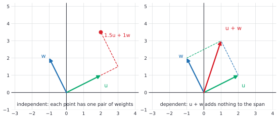
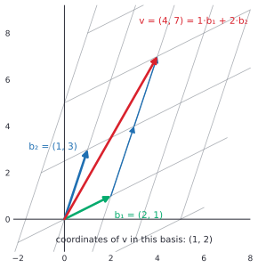

# Linear independence, basis and dimension

After this lesson you can test whether vectors are linearly independent, apply the subspace test, find bases for the column space and null space of a matrix, compute coordinates relative to a basis, and prove that every basis of a subspace has the same number of vectors, so that dimension and rank make sense.

Before this: [vectors, dot product and span](01-vectors-dot-product-and-span.md), [systems and Gaussian elimination](02-systems-and-gaussian-elimination.md) and [matrix algebra and inverses](03-matrix-algebra-and-inverses.md). The proofs use [proofs about sets](../../04-proofs-and-logic/04-more-proof-methods/03-proofs-about-sets.md) and [proof by contradiction](../../04-proofs-and-logic/03-core-proof-methods/06-proof-by-contradiction.md).

## Quick check

Try these first. If you get all three right, skip to [Practice](#practice).

1. Are $(1, 2)$ and $(2, 4)$ linearly independent? Are $(1, 0, 0)$, $(0, 1, 0)$ and $(1, 1, 0)$?
2. Is $W = \{(x, y, z) : z = 2x\}$ a subspace of $\mathbb{R}^3$?
3. Find the coordinates of $(3, 1)$ relative to the basis $(1, 1)$, $(1, -1)$.

<details class="solution" markdown>
<summary>Answers</summary>

1. No: $(2, 4) = 2(1, 2)$, so $2(1, 2) - (2, 4) = \mathbf{0}$ is a nontrivial combination equal to zero. And no for the three vectors: $(1, 1, 0) = (1, 0, 0) + (0, 1, 0)$.
2. Yes. It contains $\mathbf{0}$, a sum of two vectors with $z = 2x$ again has $z = 2x$, and so does a scalar multiple.
3. Solve $c_1(1, 1) + c_2(1, -1) = (3, 1)$: $c_1 + c_2 = 3$ and $c_1 - c_2 = 1$ give $c_1 = 2$ and $c_2 = 1$. The coordinates are $(2, 1)$. Check: $2(1, 1) + (1, -1) = (3, 1)$.

</details>

## The idea

The vectors $(1, 0)$, $(0, 1)$ and $(1, 1)$ span the plane $\mathbb{R}^2$, but one of them is wasted: $(1, 1)$ is already $(1, 0) + (0, 1)$, so dropping it changes nothing, as Theorem 4 of the first lesson says. A list with no wasted vector is **independent**. A list that is independent and still spans a given space is the smallest list that does the job, and it is called a basis.

Why should anyone want that? Because with a basis every vector in the space has exactly one set of weights, its coordinates. That turns "a point in a plane inside $\mathbb{R}^{100}$" into a pair of numbers, and it is how a coordinate system is built for any flat space, whatever its size. The fact that makes this work is that all bases of a given space have the same number of vectors. That number is the dimension, and it is what you mean when you say that a plane is two-dimensional.



The lesson has four parts: independence and how to test it, subspaces (the flat spaces that have bases), the proof that dimension is well defined, and the connection to the pivots of the last two lessons through rank.

## Definitions

Vectors $\mathbf{v}_1, \dots, \mathbf{v}_k$ in $\mathbb{R}^n$ are **linearly independent** if the only way to get the zero vector as a combination is the trivial one:

$$
c_1\mathbf{v}_1 + \dots + c_k\mathbf{v}_k = \mathbf{0} \quad\text{implies}\quad c_1 = \dots = c_k = 0.
$$

They are **linearly dependent** otherwise, that is, if some combination with at least one nonzero weight equals $\mathbf{0}$. In plain words, independent means that no vector is built from the others. A list with the zero vector is dependent ($1 \cdot \mathbf{0} = \mathbf{0}$), a single nonzero vector is independent, and two vectors are independent exactly when neither is a multiple of the other. The empty list is independent.

A **subspace** of $\mathbb{R}^n$ is a set $W$ of vectors in $\mathbb{R}^n$ such that

- $\mathbf{0} \in W$,
- if $\mathbf{u}, \mathbf{v} \in W$, then $\mathbf{u} + \mathbf{v} \in W$ (closed under addition),
- if $\mathbf{u} \in W$ and $c$ is a scalar, then $c\mathbf{u} \in W$ (closed under scalar multiplication).

In plain words, a subspace is a flat piece of $\mathbb{R}^n$ through the origin: you can't leave it by adding or scaling. The lines and planes through the origin are subspaces, and so are $\{\mathbf{0}\}$ and $\mathbb{R}^n$ itself. Checking these three conditions is the **subspace test**.

For an $m \times n$ matrix $A$, the **null space** is $N(A) = \{\mathbf{x} \in \mathbb{R}^n : A\mathbf{x} = \mathbf{0}\}$, the solution set of the homogeneous system, and the **column space** is $\operatorname{col}(A) = \operatorname{span}\{\text{columns of } A\} = \{A\mathbf{x} : \mathbf{x} \in \mathbb{R}^n\}$. The null space lives in $\mathbb{R}^n$ (one coordinate for each column) and the column space in $\mathbb{R}^m$ (one for each row).

A **basis** of a subspace $W$ is a list of vectors in $W$ that is linearly independent and spans $W$. The **standard basis** of $\mathbb{R}^n$ is $\mathbf{e}_1, \dots, \mathbf{e}_n$, where $\mathbf{e}_i$ has a $1$ in position $i$ and $0$ elsewhere. If $\mathcal{B} = (\mathbf{b}_1, \dots, \mathbf{b}_k)$ is a basis and $\mathbf{v} = c_1\mathbf{b}_1 + \dots + c_k\mathbf{b}_k$, the **coordinates** of $\mathbf{v}$ relative to $\mathcal{B}$ are the weights, written $[\mathbf{v}]_{\mathcal{B}} = (c_1, \dots, c_k)$. Theorem 5 shows that they are unique. In plain words, a basis is a set of axes for $W$, and the coordinates say how far to go along each.

The **dimension** of a subspace $W$, written $\dim W$, is the number of vectors in a basis of $W$. The **rank** of a matrix $A$ is $\operatorname{rank}(A) = \dim \operatorname{col}(A)$, and its **nullity** is $\dim N(A)$. These are well defined only because all bases of $W$ have the same size, which Theorem 7 proves. The subspace $\{\mathbf{0}\}$ has the empty basis and dimension $0$.

## How to do it

### Testing independence

*Theorem 1.* The columns of an $m \times n$ matrix $A$ are linearly independent exactly when $A\mathbf{x} = \mathbf{0}$ has only the trivial solution, and exactly when every column of $A$ is a pivot column.

What we know: $A\mathbf{x}$ is the combination $x_1\mathbf{a}_1 + \dots + x_n\mathbf{a}_n$ of the columns (Theorem 1 of the last lesson). What we want: the two equivalences. The plan: translate the definition of independence into the equation $A\mathbf{x} = \mathbf{0}$, then use the case analysis from the lesson on elimination.

*Proof.* The definition says that $x_1\mathbf{a}_1 + \dots + x_n\mathbf{a}_n = \mathbf{0}$ forces $\mathbf{x} = \mathbf{0}$, which is the statement $A\mathbf{x} = \mathbf{0} \Rightarrow \mathbf{x} = \mathbf{0}$. By Theorem 3 of [systems and Gaussian elimination](02-systems-and-gaussian-elimination.md), the consistent system $A\mathbf{x} = \mathbf{0}$ has exactly one solution when every column is a pivot column, and infinitely many, so a nontrivial one, when some column has no pivot. $\blacksquare$

To test whether $\mathbf{v}_1, \dots, \mathbf{v}_k$ are independent:

1. Make them the columns of a matrix $A$.
2. Row reduce $A$ to echelon form.
3. If every column has a pivot, they are independent. If some column has no pivot, they are dependent.
4. To find a dependency, solve $A\mathbf{x} = \mathbf{0}$ for a nonzero $\mathbf{x}$, as in the last lesson. The entries are the weights.
5. Check by computing the combination.

Two shortcuts follow at once. More than $n$ vectors in $\mathbb{R}^n$ are always dependent (there are more columns than rows, so at most $n$ pivots leave a free column). And $n$ vectors in $\mathbb{R}^n$ are independent exactly when the square matrix has $n$ pivots.

### Redundancy

*Theorem 2 (the redundancy lemma).* Vectors $\mathbf{v}_1, \dots, \mathbf{v}_k$ with $k \ge 2$ are linearly dependent exactly when at least one of them is a linear combination of the others.

What we know: the definition of dependence. What we want: both directions of "exactly when". The plan, as for any if-and-only-if proof, is to do each direction in turn. For ($\Rightarrow$) divide by a nonzero weight, and for ($\Leftarrow$) move the vector to the other side.

*Proof.* ($\Rightarrow$) Suppose $c_1\mathbf{v}_1 + \dots + c_k\mathbf{v}_k = \mathbf{0}$ with some $c_j \ne 0$. Solve for $\mathbf{v}_j$: $\mathbf{v}_j = -\frac{1}{c_j}\sum_{i \ne j} c_i\mathbf{v}_i$, a combination of the others. ($\Leftarrow$) Suppose $\mathbf{v}_j = \sum_{i \ne j} a_i\mathbf{v}_i$. Then $\sum_{i \ne j} a_i\mathbf{v}_i - 1 \cdot \mathbf{v}_j = \mathbf{0}$ is a combination equal to zero whose weight on $\mathbf{v}_j$ is $-1 \ne 0$. $\blacksquare$

Look back: the proof shows that the weight which makes the dependency visible is the nonzero one. The caution in the statement is "at least one", not "each": in $(1, 0)$, $(0, 1)$, $(1, 1)$ every vector is a combination of the others, but in $(1, 0)$, $(2, 0)$, $(0, 1)$ the vector $(0, 1)$ is not, and the list is still dependent. Check: $2(1, 0) - (2, 0) + 0(0, 1) = \mathbf{0}$.

*Theorem 3 (growing an independent list).* If $\mathbf{v}_1, \dots, \mathbf{v}_k$ are linearly independent and $\mathbf{w}$ is not in $\operatorname{span}\{\mathbf{v}_1, \dots, \mathbf{v}_k\}$, then $\mathbf{v}_1, \dots, \mathbf{v}_k, \mathbf{w}$ are linearly independent.

What we know: independence of the $\mathbf{v}_i$ and $\mathbf{w} \notin$ span. What we want: independence of the longer list. The plan: take a combination equal to $\mathbf{0}$ and show that every weight is $0$. We use the weight of $\mathbf{w}$ first.

*Proof.* Suppose $c_1\mathbf{v}_1 + \dots + c_k\mathbf{v}_k + d\mathbf{w} = \mathbf{0}$. If $d \ne 0$, then $\mathbf{w} = -\frac{1}{d}\sum c_i\mathbf{v}_i$ would be in the span, which it is not. So $d = 0$, which leaves $c_1\mathbf{v}_1 + \dots + c_k\mathbf{v}_k = \mathbf{0}$, and the independence of the $\mathbf{v}_i$ gives every $c_i = 0$. $\blacksquare$

Look back: the proof is the redundancy lemma in the other direction. A vector outside the span brings something new, and a vector inside brings nothing. Together, Theorems 2 and 3 of this lesson and Theorem 4 of the first lesson say: removing a redundant vector keeps the span, and adding a non-redundant vector keeps independence. These are the two tools for building a basis.

### Subspaces

*Theorem 4.* For every matrix $A$, the null space $N(A)$ and the column space $\operatorname{col}(A)$ are subspaces. So is every span $\operatorname{span}\{\mathbf{v}_1, \dots, \mathbf{v}_k\}$.

What we know: the definitions, and that $A(\mathbf{u} + \mathbf{v}) = A\mathbf{u} + A\mathbf{v}$ and $A(c\mathbf{u}) = c(A\mathbf{u})$ by the rules of matrix algebra. What we want: the three conditions of the subspace test for each set. The plan: spans are done by Theorem 3 of the first lesson, the column space is a span, and for the null space we check the conditions directly.

*Proof.* A span is closed under combining and contains $\mathbf{0}$ by Theorem 3 of [vectors, dot product and span](01-vectors-dot-product-and-span.md), and $\operatorname{col}(A)$ is the span of the columns. For $N(A)$: $A\mathbf{0} = \mathbf{0}$, so $\mathbf{0} \in N(A)$. If $A\mathbf{u} = \mathbf{0}$ and $A\mathbf{v} = \mathbf{0}$, then $A(\mathbf{u} + \mathbf{v}) = \mathbf{0} + \mathbf{0} = \mathbf{0}$ and $A(c\mathbf{u}) = c\mathbf{0} = \mathbf{0}$. $\blacksquare$

Look back: the null-space proof is Practice 5 of the elimination lesson. It also gives a big family of examples: every set defined by homogeneous linear equations, such as $\{(x, y, z) : x + 2y - z = 0\}$, is the null space of its coefficient matrix and so is a subspace.


To decide whether a set $W$ is a subspace:

1. Check that $\mathbf{0} \in W$. If not, stop: it is not a subspace.
2. Take two arbitrary elements $\mathbf{u}, \mathbf{v} \in W$ and show $\mathbf{u} + \mathbf{v} \in W$, using the defining condition of $W$.
3. Take an arbitrary $\mathbf{u} \in W$ and scalar $c$, and show $c\mathbf{u} \in W$.
4. If a condition fails, give one explicit counterexample, as the figure does.

### Basis and coordinates

*Theorem 5 (unique coordinates).* If $(\mathbf{b}_1, \dots, \mathbf{b}_k)$ is a basis of $W$, then each $\mathbf{v} \in W$ can be written as a combination of $\mathbf{b}_1, \dots, \mathbf{b}_k$ in exactly one way.

What we know: the basis spans $W$ and is independent. What we want: existence and uniqueness of the weights. The plan: spanning gives existence, and independence applied to the difference of two representations gives uniqueness.

*Proof.* Existence is the definition of span. For uniqueness, suppose $\mathbf{v} = \sum c_i\mathbf{b}_i = \sum d_i\mathbf{b}_i$. Subtracting gives $\sum (c_i - d_i)\mathbf{b}_i = \mathbf{0}$, so every $c_i - d_i = 0$ by independence. $\blacksquare$

Look back: this is why a basis is more than a spanning set. With the redundant list $(1, 0), (0, 1), (1, 1)$ the point $(2, 2)$ is $2(1, 0) + 2(0, 1) + 0(1, 1)$ and also $0(1, 0) + 0(0, 1) + 2(1, 1)$.

To find coordinates relative to a basis $(\mathbf{b}_1, \dots, \mathbf{b}_k)$ of $\mathbb{R}^n$ with $k = n$: put the basis vectors as the columns of a matrix $B$ and solve $B\mathbf{c} = \mathbf{v}$. Since a basis of $\mathbb{R}^n$ has $n$ pivots, $B$ is invertible by the invertible matrix theorem, and $[\mathbf{v}]_{\mathcal{B}} = B^{-1}\mathbf{v}$. In the standard basis, $B = I$ and the coordinates of $\mathbf{v}$ are the components of $\mathbf{v}$.



### Dimension

All of the following depends on a single lemma. It says that a space spanned by $m$ vectors can't hold more than $m$ independent vectors. It is a version of the exchange (or Steinitz) lemma, proved here from the counting fact of the elimination lesson.

*Theorem 6 (the exchange lemma).* If $\mathbf{w}_1, \dots, \mathbf{w}_m$ are vectors in $\mathbb{R}^n$ and $\mathbf{v}_1, \dots, \mathbf{v}_k$ are vectors in $\operatorname{span}\{\mathbf{w}_1, \dots, \mathbf{w}_m\}$ with $k > m$, then $\mathbf{v}_1, \dots, \mathbf{v}_k$ are linearly dependent.

What we know: each $\mathbf{v}_j$ is a combination of the $\mathbf{w}_i$. What we want: a nontrivial combination of the $\mathbf{v}_j$ equal to $\mathbf{0}$. The plan: write the $\mathbf{v}_j$ in terms of the $\mathbf{w}_i$, which turns the search for weights $c_j$ into a homogeneous system with $m$ equations and $k > m$ unknowns. Theorem 5 of the elimination lesson says that such a system has a nontrivial solution.

*Proof.* Write $\mathbf{v}_j = \sum_{i=1}^{m} a_{ij}\mathbf{w}_i$ for each $j$. For weights $c_1, \dots, c_k$,

$$
\sum_{j=1}^{k} c_j\mathbf{v}_j = \sum_{j=1}^{k} c_j \sum_{i=1}^{m} a_{ij}\mathbf{w}_i = \sum_{i=1}^{m} \left(\sum_{j=1}^{k} a_{ij}c_j\right)\mathbf{w}_i.
$$

Consider the homogeneous system $\sum_{j=1}^{k} a_{ij}c_j = 0$ for $i = 1, \dots, m$. It has $m$ equations in the $k$ unknowns $c_1, \dots, c_k$, and $k > m$, so it has a solution with not all $c_j$ zero. For this choice every bracket above is $0$, so $\sum c_j\mathbf{v}_j = \mathbf{0}$ with a nonzero weight. $\blacksquare$

Look back: the proof is a counting argument in disguise, and it uses nothing else about vectors. In $\mathbb{R}^2$ (spanned by $\mathbf{e}_1, \mathbf{e}_2$) every three vectors are dependent, and in $\mathbb{R}^3$ every four. The statement is false for $k \le m$, as it must be: $m$ independent vectors can span an $m$-dimensional space. Check with the redundancy figure: the three vectors $\mathbf{u}$, $\mathbf{w}$, $\mathbf{u} + \mathbf{w}$ lie in the span of the two vectors $\mathbf{u}$, $\mathbf{w}$, and they are dependent.

*Theorem 7 (dimension is well defined).* Any two bases of the same subspace $W$ have the same number of vectors.

What we know: Theorem 6. What we want: equal sizes. The plan: each basis is an independent list inside the span of the other, so Theorem 6 bounds its size in both directions.

*Proof.* Let $\mathcal{B}_1$ have $m$ vectors and $\mathcal{B}_2$ have $k$ vectors. The vectors of $\mathcal{B}_2$ lie in $W = \operatorname{span}\mathcal{B}_1$ and are independent. If $k > m$, Theorem 6 would make them dependent, so $k \le m$. Exchanging the roles gives $m \le k$. So $m = k$. $\blacksquare$

Look back: this is the theorem that licenses the word "dimension". The proof is a contradiction argument in one line, and it does not say what the basis is, only how many vectors it has. Check: $\mathbb{R}^2$ has the bases $(\mathbf{e}_1, \mathbf{e}_2)$ and $((2, 1), (1, 3))$ (the figure above), both with two vectors.

*Corollary 8.* Let $W$ be a subspace of $\mathbb{R}^n$.

- (a) $\dim \mathbb{R}^n = n$.
- (b) $W$ has a basis, and $\dim W \le n$.
- (c) If $\dim W = d$, then any list of more than $d$ vectors in $W$ is dependent, no list of fewer than $d$ vectors spans $W$, and any $d$ independent vectors in $W$, and any $d$ vectors that span $W$, form a basis of $W$.
- (d) If $W \subseteq V$ are subspaces, then $\dim W \le \dim V$, with equality only when $W = V$.

*Proof of (a), (b) and (c).* (a) The standard basis spans $\mathbb{R}^n$, since $(x_1, \dots, x_n) = \sum x_i\mathbf{e}_i$, and is independent, since $\sum c_i\mathbf{e}_i = (c_1, \dots, c_n)$ is $\mathbf{0}$ only if every $c_i = 0$. (b) If $W = \{\mathbf{0}\}$, the empty list is a basis. Otherwise pick $\mathbf{w}_1 \ne \mathbf{0}$ in $W$. Suppose independent $\mathbf{w}_1, \dots, \mathbf{w}_k$ in $W$ are chosen. If they span $W$, they are a basis. If not, pick $\mathbf{w}_{k+1} \in W$ outside their span, and the longer list is independent by Theorem 3. Since $\mathbb{R}^n$ is spanned by $n$ vectors, Theorem 6 says no independent list has more than $n$ vectors, so the process stops after at most $n$ steps, and then $\dim W \le n$.

(c) Let $\mathcal{B}$ be a basis with $d$ vectors. More than $d$ vectors in $W = \operatorname{span}\mathcal{B}$ are dependent by Theorem 6. If fewer than $d$ vectors spanned $W$, then the $d$ independent vectors of $\mathcal{B}$ would lie in the span of fewer than $d$ vectors, which contradicts Theorem 6. Now take $d$ independent vectors in $W$. If they did not span $W$, adding a vector outside their span would give $d + 1$ independent vectors by Theorem 3, contradicting the first claim, so they span $W$ and are a basis. Take $d$ vectors that span $W$. If they were dependent, Theorem 2 lets us drop one that is a combination of the others without changing the span (Theorem 4 of the first lesson), leaving fewer than $d$ vectors that span $W$, which is impossible. So they are independent and a basis. $\blacksquare$

Part (d) is Practice 7. Look back: part (c) turns the test for a basis into a count. In $\mathbb{R}^3$, three independent vectors are automatically a basis, and you never need to check spanning. This is the form in which the theorem is used most.

### Bases from pivots, and rank

*Theorem 9 (bases for the column space and the null space).* Let $A$ be an $m \times n$ matrix with RREF $R$.

- (a) The columns of $A$ in the pivot positions (the pivot columns of $A$, not of $R$) form a basis of $\operatorname{col}(A)$.
- (b) The vectors $\mathbf{u}_j$ that multiply the free variables $x_j$ in the parametric vector form of the solutions of $A\mathbf{x} = \mathbf{0}$ form a basis of $N(A)$. There is one for each free variable.

What we know: row operations don't change the solutions of $A\mathbf{x} = \mathbf{0}$ (Theorem 1 of the elimination lesson), and the structure of the RREF. What we want: independence and spanning for each list. The plan for (a): $A$ and $R$ satisfy the same relations between columns, and in $R$ the situation is clear. For (b): the parametric form is a spanning list by construction, and the free coordinates show independence.

*Proof.* (a) For weights $c_1, \dots, c_n$, the equation $\sum c_j\mathbf{a}_j = \mathbf{0}$ (that is, $A\mathbf{c} = \mathbf{0}$) holds exactly when $R\mathbf{c} = \mathbf{0}$, so the columns of $A$ and the columns of $R$ have exactly the same linear relations. In $R$ the pivot columns are the first $r$ unit vectors $\mathbf{e}_1, \dots, \mathbf{e}_r$, which are independent, and every other column $\mathbf{r}_j$ has zeros below row $r$, so $\mathbf{r}_j = \sum_{i \le r} R_{ij}\mathbf{r}_{p_i}$ is a combination of the pivot columns. Transfer these facts to $A$. A relation among the pivot columns of $A$ would be a relation among those of $R$, so it is trivial: they are independent. And each non-pivot column is $\mathbf{a}_j = \sum_{i \le r} R_{ij}\mathbf{a}_{p_i}$, so every column of $A$, and so every combination of columns, is in the span of the pivot columns. So the pivot columns are a basis of $\operatorname{col}(A)$.

(b) By Theorem 3 of the elimination lesson, every solution is $\mathbf{x} = \sum_{j \text{ free}} x_j\mathbf{u}_j$, where $\mathbf{u}_j$ has a $1$ in position $j$, $0$ in the other free positions, and the forced values in the pivot positions. So the $\mathbf{u}_j$ span $N(A)$. If $\sum t_j\mathbf{u}_j = \mathbf{0}$, then looking at the entry in free position $j$ gives $t_j = 0$. So they are independent. $\blacksquare$

Look back: part (a) needs the pivot columns of $A$, not of $R$. Row operations change the column space (Practice 8), so the columns of $R$ span a different space, but they point out which columns of $A$ to keep. Example 2 does both bases.

*Theorem 10 (rank and nullity).* For an $m \times n$ matrix $A$ with $r$ pivots:

- (a) $\operatorname{rank}(A) = r$ and $\dim N(A) = n - r$, so $\operatorname{rank}(A) + \dim N(A) = n$.
- (b) $\operatorname{rank}(A) = \operatorname{rank}(A^T)$: the number of independent columns equals the number of independent rows.

What we know: Theorem 9. What we want: the two counts. The plan: count the vectors in each basis, and for (b) show that the nonzero rows of $R$ are a basis of the row space.

*Proof.* (a) By Theorem 9(a), the basis of $\operatorname{col}(A)$ has one vector per pivot, $r$ in all. By Theorem 9(b), the basis of $N(A)$ has one vector per free variable, and there are $n - r$ free variables, one for each of the $n$ columns that is not a pivot column.

(b) The row space of $A$ is the span of its rows, which is $\operatorname{col}(A^T)$. Each row operation replaces rows by combinations of rows and can be undone, so $A$ and $R$ have the same row space. The $r$ nonzero rows of $R$ are independent: in a combination $\sum c_i(\text{row } i \text{ of } R)$ the entry in pivot column $p_i$ is $c_i$, so the combination is $\mathbf{0}$ only if all $c_i = 0$. They span the row space, so $\dim(\text{row space}) = r$. Hence $\operatorname{rank}(A^T) = r = \operatorname{rank}(A)$. $\blacksquare$

Look back: the identity $\operatorname{rank}(A) + \dim N(A) = n$ is the rank-nullity theorem, here in the language of pivots: each of the $n$ columns is either a pivot column or a free column. The next lesson, [linear transformations, kernel and image](05-linear-transformations-kernel-and-image.md), proves the same count for any linear map, as $\dim(\text{domain}) = \dim(\text{kernel}) + \dim(\text{image})$, where kernel and image are the null space and column space seen as parts of a map. Check with $A = \begin{pmatrix} 1 & 2 \\ 2 & 4 \end{pmatrix}$: one pivot, so rank $1$, null space $\operatorname{span}\{(-2, 1)\}$ of dimension $1$, and $1 + 1 = 2$.

With rank in hand the invertible matrix theorem grows by five more statements.

*Theorem 11 (invertible matrix theorem, second part).* For an $n \times n$ matrix $A$, each of the following is equivalent to (a) through (h) of [matrix algebra and inverses](03-matrix-algebra-and-inverses.md#the-invertible-matrix-theorem): the columns of $A$ are linearly independent; the columns of $A$ span $\mathbb{R}^n$; the columns of $A$ are a basis of $\mathbb{R}^n$; $\operatorname{rank}(A) = n$; $N(A) = \{\mathbf{0}\}$; and the rows of $A$ are a basis of $\mathbb{R}^n$.

*Proof.* Independent columns is (d) by Theorem 1. Spanning columns is (e), because $A\mathbf{x}$ ranges over the span of the columns. A basis is both, so it is (d) and (e) together. Rank $n$ means $n$ pivots, which is (c) by Theorem 9(a). $N(A) = \{\mathbf{0}\}$ is (d). The rows of $A$ are the columns of $A^T$, so the claim for rows is the claim for columns of $A^T$, and $A^T$ is invertible exactly when $A$ is, by (g). $\blacksquare$

## Worked examples

<div class="example" markdown>

### Example 1: testing independence and finding the dependency

Are $\mathbf{v}_1 = (1, 2, 1)$, $\mathbf{v}_2 = (2, 1, -1)$ and $\mathbf{v}_3 = (4, 5, 1)$ linearly independent? If not, find a dependency.

Step 1: make the vectors the columns of $A = \begin{pmatrix} 1 & 2 & 4 \\ 2 & 1 & 5 \\ 1 & -1 & 1 \end{pmatrix}$. Step 2: row reduce. With $R_2 \to R_2 - 2R_1$ and $R_3 \to R_3 - R_1$ we get $\begin{pmatrix} 1 & 2 & 4 \\ 0 & -3 & -3 \\ 0 & -3 & -3 \end{pmatrix}$. Then $R_3 \to R_3 - R_2$ makes the last row zero, and scaling and clearing above gives the RREF $\begin{pmatrix} 1 & 0 & 2 \\ 0 & 1 & 1 \\ 0 & 0 & 0 \end{pmatrix}$.

Step 3: the third column has no pivot, so the vectors are dependent. Step 4: the free variable is $x_3 = t$, and $x_1 = -2t$, $x_2 = -t$. Taking $t = -1$ gives weights $(2, 1, -1)$, that is, $2\mathbf{v}_1 + \mathbf{v}_2 - \mathbf{v}_3 = \mathbf{0}$, or $\mathbf{v}_3 = 2\mathbf{v}_1 + \mathbf{v}_2$.

Step 5, the check: $2(1, 2, 1) + (2, 1, -1) = (4, 5, 1) = \mathbf{v}_3$. The span of the three vectors is a plane, with $\mathbf{v}_1, \mathbf{v}_2$ as a basis. Replacing $\mathbf{v}_3$ by $\mathbf{e}_3 = (0, 0, 1)$ gives three pivots (the determinant is $-3 \ne 0$), so $\mathbf{v}_1, \mathbf{v}_2, \mathbf{e}_3$ are independent.

</div>

<div class="example" markdown>

### Example 2: bases for the column space and the null space

Find bases for $\operatorname{col}(A)$ and $N(A)$ for $A = \begin{pmatrix} 1 & 2 & 1 & 0 \\ 2 & 4 & -1 & 3 \\ 3 & 6 & 0 & 3 \end{pmatrix}$, and check the rank-nullity count.

This is the coefficient matrix of Example 2 of the elimination lesson, whose RREF is $R = \begin{pmatrix} 1 & 2 & 0 & 1 \\ 0 & 0 & 1 & -1 \\ 0 & 0 & 0 & 0 \end{pmatrix}$, with pivots in columns $1$ and $3$.

By Theorem 9(a), a basis of $\operatorname{col}(A)$ is columns $1$ and $3$ of $A$ itself, not of $R$: $(1, 2, 3)$ and $(1, -1, 0)$. The other columns are combinations of them, as column $4$ of $R$ says: $\mathbf{a}_4 = 1\mathbf{a}_1 - 1\mathbf{a}_3 = (1, 2, 3) - (1, -1, 0) = (0, 3, 3)$, which is the fourth column of $A$.

By Theorem 9(b), the free variables are $x_2 = s$ and $x_4 = t$, with $x_1 = -2s - t$ and $x_3 = t$. A basis of $N(A)$ is $(-2, 1, 0, 0)$ and $(-1, 0, 1, 1)$.

Check: $\operatorname{rank}(A) = 2$ and $\dim N(A) = 2$, and $2 + 2 = 4 = n$. Also $A\,(-1, 0, 1, 1)^T = \mathbf{0}$, row by row: $-1 + 0 + 1 + 0 = 0$, $-2 + 0 - 1 + 3 = 0$ and $-3 + 0 + 0 + 3 = 0$.

</div>

<div class="example" markdown>

### Example 3: coordinates relative to a basis

The vectors $\mathbf{b}_1 = (2, 1)$ and $\mathbf{b}_2 = (1, 3)$ form a basis of $\mathbb{R}^2$. Find the coordinates of $(4, 7)$ and of $(7, 9)$.

Two vectors in $\mathbb{R}^2$ are a basis exactly when they are independent. The matrix $B = \begin{pmatrix} 2 & 1 \\ 1 & 3 \end{pmatrix}$ has determinant $6 - 1 = 5 \ne 0$, so it has two pivots and the vectors are independent. The coordinates solve $B\mathbf{c} = \mathbf{v}$, so $\mathbf{c} = B^{-1}\mathbf{v}$ with $B^{-1} = \frac{1}{5}\begin{pmatrix} 3 & -1 \\ -1 & 2 \end{pmatrix}$.

For $(4, 7)$: $\mathbf{c} = \frac{1}{5}(12 - 7,\; -4 + 14) = (1, 2)$, which is the picture in the figure above. For $(7, 9)$: $\mathbf{c} = \frac{1}{5}(21 - 9,\; -7 + 18) = \left(\frac{12}{5}, \frac{11}{5}\right)$. Fractional coordinates are normal.

Check: $1(2, 1) + 2(1, 3) = (4, 7)$ and $\frac{12}{5}(2, 1) + \frac{11}{5}(1, 3) = \left(\frac{24 + 11}{5},\; \frac{12 + 33}{5}\right) = (7, 9)$.

</div>

<div class="example" markdown>

### Example 4: the subspace test, with non-examples

Decide whether each set is a subspace: (a) $W_1 = \{(x, y, z) : x + 2y - z = 0\}$; (b) $W_2 = \{(x, y) : x + y = 1\}$; (c) $W_3 = \{(x, y) : x \ge 0 \text{ and } y \ge 0\}$; (d) $W_4 = \{(x, y) : xy = 0\}$.

(a) Step 1: $0 + 0 - 0 = 0$, so $\mathbf{0} \in W_1$. Step 2: if $(x, y, z)$ and $(x', y', z')$ are in $W_1$, then $(x + x') + 2(y + y') - (z + z') = (x + 2y - z) + (x' + 2y' - z') = 0 + 0 = 0$. Step 3: $cx + 2cy - cz = c \cdot 0 = 0$. So $W_1$ is a subspace. It is the null space of the matrix $\begin{pmatrix} 1 & 2 & -1 \end{pmatrix}$, so it has dimension $3 - 1 = 2$, a plane.

(b) $\mathbf{0} \notin W_2$, because $0 + 0 \ne 1$. Not a subspace.

(c) Step 1 passes, and the set is closed under addition, but $(1, 1) \in W_3$ while $(-1)(1, 1) = (-1, -1) \notin W_3$. Not a subspace.

(d) The vectors $(1, 0)$ and $(0, 1)$ are in $W_4$ since $1 \cdot 0 = 0$, but their sum $(1, 1)$ has $xy = 1$. Not a subspace.

Check: (a) contains $(1, 0, 1)$ and $(0, 1, 2)$ and their sum $(1, 1, 3)$ gives $1 + 2 - 3 = 0$. The counterexamples in (b) to (d) are the ones drawn in the figure of the subspaces.

</div>

<div class="example" markdown>

### Example 5: complete and incomplete markets (finish it yourself)

An economy has three states of next year, boom, normal and bust. An asset pays a list of amounts, one per state, so its payoff is a vector in $\mathbb{R}^3$. A bond pays $\mathbf{a} = (1, 1, 1)$ and a stock pays $\mathbf{b} = (2, 1, 0)$ (hypothetical numbers, in dollars). A third asset pays $\mathbf{c} = (3, 2, 1)$. A payoff $\mathbf{p}$ can be replicated if $\mathbf{p} = x\mathbf{a} + y\mathbf{b} + z\mathbf{c}$ for some quantities $x, y, z$, where a negative quantity is a short position. The market is complete if every payoff in $\mathbb{R}^3$ can be replicated. Is it complete? Can $(1, 0, 0)$, a payment only in a boom, be replicated?

The matrix with columns $\mathbf{a}, \mathbf{b}, \mathbf{c}$ is $\begin{pmatrix} 1 & 2 & 3 \\ 1 & 1 & 2 \\ 1 & 0 & 1 \end{pmatrix}$. Since $\mathbf{c} = \mathbf{a} + \mathbf{b}$, the third column is redundant, so there are two pivots and the span of the payoffs is a plane, not all of $\mathbb{R}^3$. The market is not complete. The last step is to show that $(1, 0, 0)$ is not in that plane.

<details class="solution" markdown>
<summary>Finish</summary>

The plane $\operatorname{span}\{\mathbf{a}, \mathbf{b}\}$ is $\{\mathbf{x} : \mathbf{n} \cdot \mathbf{x} = 0\}$ for any $\mathbf{n}$ orthogonal to both. Take $\mathbf{n} = (1, -2, 1)$: $\mathbf{n} \cdot \mathbf{a} = 1 - 2 + 1 = 0$ and $\mathbf{n} \cdot \mathbf{b} = 2 - 2 + 0 = 0$. Then $\mathbf{n} \cdot (1, 0, 0) = 1 \ne 0$, so $(1, 0, 0)$ is not in the plane and can't be replicated.

Check by replacing the third asset with $\mathbf{c}' = (0, 0, 1)$, which pays only in a bust. Now the matrix has columns $\mathbf{a}, \mathbf{b}, \mathbf{c}'$, and solving $x\mathbf{a} + y\mathbf{b} + z\mathbf{c}' = (1, 0, 0)$ gives $x + 2y = 1$, $x + y = 0$ and $x + z = 0$, so $y = -x$, $x - 2x = 1$, $x = -1$, $y = 1$, $z = 1$. Verify: $-(1, 1, 1) + (2, 1, 0) + (0, 0, 1) = (1, 0, 0)$. Three independent payoffs in $\mathbb{R}^3$ are a basis, so this market is complete.

</details>

</div>

## Edge cases and common mistakes

<div class="warning" markdown>

Watch out: independence is a property of the whole list, not of pairs. The vectors $(1, 0)$, $(0, 1)$, $(1, 1)$ are pairwise independent (no two are multiples of each other), but the three are dependent. To test a list, row reduce the matrix and count pivots.

</div>

<div class="warning" markdown>

Watch out: the zero vector and the empty list. A list that contains $\mathbf{0}$ is dependent. The empty list is independent and spans $\{\mathbf{0}\}$, so the zero subspace has dimension $0$ and the empty basis. A subspace must contain $\mathbf{0}$, which is the first test and the one that catches lines and planes that miss the origin.

</div>

<div class="warning" markdown>

Watch out: a basis is not unique, only its size is. Both $(\mathbf{e}_1, \mathbf{e}_2)$ and $((1, 1), (1, -1))$ are bases of $\mathbb{R}^2$. Coordinates depend on the basis chosen, so say which basis you mean, and never compare coordinates in different bases.

</div>

<div class="warning" markdown>

Watch out: take the pivot columns from $A$, not from $R$. The columns of the RREF are different vectors and they span a different space. In Example 2, the column space of $R$ is the plane $z = 0$ with basis $\mathbf{e}_1, \mathbf{e}_2$, which is not the column space of $A$.

</div>

<div class="warning" markdown>

Watch out: the dimension of a subspace is not the dimension of the space it sits in. A plane in $\mathbb{R}^{100}$ has dimension $2$, because a basis has $2$ vectors, even though each vector has $100$ components. A hyperplane $\{\mathbf{x} : \mathbf{n} \cdot \mathbf{x} = 0\}$ in $\mathbb{R}^n$ has dimension $n - 1$.

</div>

<div class="warning" markdown>

Watch out: the null space and column space live in different spaces. For an $m \times n$ matrix, $N(A)$ is a subspace of $\mathbb{R}^n$ and $\operatorname{col}(A)$ is a subspace of $\mathbb{R}^m$. If $m \ne n$, they can't be compared, and "the null space is inside the column space" doesn't even make sense.

</div>

## Tricks and shortcuts

A set described by homogeneous linear equations is always a subspace, being the null space of the coefficient matrix, and its dimension is $n$ minus the number of pivots. So $\{(x, y, z, w) : x + y = 0, z = w\}$ is a subspace of $\mathbb{R}^4$ of dimension $4 - 2 = 2$. If an equation has a nonzero constant on the right, or an inequality, or a product, check carefully, because the set usually fails.

To check whether $n$ vectors form a basis of $\mathbb{R}^n$, count pivots only. By Corollary 8(c) there is no need to check spanning separately. For $n = 2$ and $n = 3$, a nonzero determinant is the same test.

A quick sign of dependence: two proportional columns, a zero column, or a column equal to the sum of two others. More vectors than components is always dependent.

## In code

Rank, a basis of the column space and a basis of the null space, with SymPy for exact answers, and a check that a data matrix whose rows mix two patterns has rank 2. It runs the matrices of Examples 1 and 2 and the complete-market test of Example 5.

<details class="code" markdown>
<summary>In code</summary>

```python
import numpy as np
import sympy as sp

# Example 1: are the columns independent?
V = sp.Matrix([[1, 2, 4], [2, 1, 5], [1, -1, 1]])
R, pivots = V.rref()
print(R.tolist(), pivots)      # [[1, 0, 2], [0, 1, 1], [0, 0, 0]] (0, 1)
print(V.nullspace()[0].T)      # Matrix([[-2, -1, 1]])  the dependency

# Example 2: bases of the column space and null space
A = sp.Matrix([[1, 2, 1, 0], [2, 4, -1, 3], [3, 6, 0, 3]])
print([c.T for c in A.columnspace()])
# [Matrix([[1, 2, 3]]), Matrix([[1, -1, 0]])]
print([n.T for n in A.nullspace()])
# [Matrix([[-2, 1, 0, 0]]), Matrix([[-1, 0, 1, 1]])]
print(A.rank(), len(A.nullspace()), A.cols)   # 2 2 4

# Example 3: coordinates by solving B c = v
B = np.array([[2, 1], [1, 3]])           # columns are the basis vectors
for v in (np.array([4, 7]), np.array([7, 9])):
    print(np.linalg.solve(B, v))
# [1. 2.]
# [2.4 2.2]

# 100 rows that are mixtures of two patterns in R^6 have rank 2
rng = np.random.default_rng(1)
patterns = rng.integers(-3, 4, size=(2, 6))
weights = rng.integers(-2, 3, size=(100, 2))
data = weights @ patterns
print(data.shape, np.linalg.matrix_rank(data))   # (100, 6) 2

# Example 5: payoff matrices, columns bond, stock and a third asset
P = np.array([[1, 2, 3], [1, 1, 2], [1, 0, 1]])
print(np.linalg.matrix_rank(P))                  # 2  (incomplete)
P2 = np.array([[1, 2, 0], [1, 1, 0], [1, 0, 1]])
print(np.linalg.matrix_rank(P2), np.linalg.solve(P2, [1, 0, 0]))
# 3 [-1.  1.  1.]
```

</details>

Library rank functions such as `np.linalg.matrix_rank` work with floating point numbers and a tolerance, so a column that is "almost" a combination of the others can be counted either way. That is the numerical face of near-dependent columns, which matter in regression.

## FAQ

### Why do we need independence at all, if span is enough?

Because span alone allows redundancy, and then the weights aren't unique. A basis has no redundancy, so each vector has exactly one set of coordinates (Theorem 5), and a statement like "the solution is $(1, 2)$ in this basis" has one meaning. Uniqueness is also what makes the dimension a well-defined number.

### Why is the exchange lemma true?

It is a counting statement: $m$ spanning vectors give only $m$ "degrees of freedom", so $k > m$ vectors in their span must satisfy a relation. The proof makes that exact by turning the search for a relation into a homogeneous system with more unknowns than equations, which always has a nontrivial solution. The lemma is false for $k \le m$, because an independent list of $m$ vectors can exist.

### Is the dimension of the null space really determined by the matrix?

Yes. It is the number of free variables, which is $n$ minus the number of pivots, and the number of pivots doesn't depend on the order of row operations, because the RREF is unique. Two different bases of the null space have the same size by Theorem 7.

### Do these ideas work for things other than lists of numbers?

Yes. Polynomials of degree at most $2$ have the basis $1, x, x^2$ and dimension $3$, and a polynomial $a + bx + cx^2$ has coordinates $(a, b, c)$. Continuous functions form a space with no finite basis. The proofs in this lesson use only the eight rules of addition and scaling from the first lesson, plus the fact that a homogeneous system with more unknowns than equations has a nontrivial solution, so they carry over to such spaces. A first course in abstract linear algebra repeats this lesson with that wording.

## Practice

### Warm-up

1\. Decide whether each list is independent: (a) $(1, 2), (3, 5)$; (b) $(1, 2, 3), (2, 4, 6)$; (c) $(1, 0, 0), (0, 1, 0), (0, 0, 1), (1, 1, 1)$.

<details class="solution" markdown>
<summary>Solution</summary>

(a) Independent: neither is a multiple of the other (the determinant $5 - 6 = -1 \ne 0$ gives two pivots). (b) Dependent: $(2, 4, 6) = 2(1, 2, 3)$. (c) Dependent: four vectors in $\mathbb{R}^3$, and $(1, 1, 1) = \mathbf{e}_1 + \mathbf{e}_2 + \mathbf{e}_3$.

Check (b): $2(1, 2, 3) - (2, 4, 6) = (0, 0, 0)$.

</details>

2\. Is each set a subspace of $\mathbb{R}^2$ or $\mathbb{R}^3$? Give a reason. (a) $\{(x, y) : y = 3x\}$ (b) $\{(x, y, z) : x + y + z = 1\}$ (c) $\{(x, y) : x \ge 0\}$

<details class="solution" markdown>
<summary>Solution</summary>

(a) Yes: it contains $(0, 0)$, and $(x, 3x) + (x', 3x') = (x + x', 3(x + x'))$ and $c(x, 3x) = (cx, 3cx)$ are in it. It is the line through the origin with direction $(1, 3)$. (b) No: $\mathbf{0}$ is not in it, since $0 \ne 1$. (c) No: $(1, 0)$ is in the set but $(-1)(1, 0) = (-1, 0)$ is not.

Check (a): it is the null space of $\begin{pmatrix} 3 & -1 \end{pmatrix}$, a homogeneous equation $3x - y = 0$.

</details>

3\. Find the coordinates of $(1, 5)$ relative to the basis $(1, 1)$, $(1, 2)$.

<details class="solution" markdown>
<summary>Solution</summary>

Solve $c_1(1, 1) + c_2(1, 2) = (1, 5)$: $c_1 + c_2 = 1$ and $c_1 + 2c_2 = 5$. Subtracting gives $c_2 = 4$, so $c_1 = -3$. The coordinates are $(-3, 4)$.

Check: $-3(1, 1) + 4(1, 2) = (-3 + 4,\; -3 + 8) = (1, 5)$.

</details>

### Standard

4\. Find a basis of the column space and of the null space of $A = \begin{pmatrix} 1 & 0 & 1 & 2 \\ 0 & 1 & 1 & 3 \\ 1 & 1 & 2 & 5 \end{pmatrix}$, and state its rank and nullity.

<details class="solution" markdown>
<summary>Solution</summary>

Subtract $R_1 + R_2$ from $R_3$: the third row becomes zero, so the matrix is already in RREF form $\begin{pmatrix} 1 & 0 & 1 & 2 \\ 0 & 1 & 1 & 3 \\ 0 & 0 & 0 & 0 \end{pmatrix}$, with pivots in columns $1$ and $2$. A basis of $\operatorname{col}(A)$ is the first two columns of $A$: $(1, 0, 1)$ and $(0, 1, 1)$. The free variables are $x_3 = s$ and $x_4 = t$, with $x_1 = -s - 2t$ and $x_2 = -s - 3t$, so a basis of $N(A)$ is $(-1, -1, 1, 0)$ and $(-2, -3, 0, 1)$. The rank is $2$ and the nullity is $2$.

Check: $2 + 2 = 4$ columns. And $A(-1, -1, 1, 0)^T = (-1 + 1,\; -1 + 1,\; -2 + 2) = (0, 0, 0)$.

</details>

5\. Prove that if $\mathbf{v}_1, \mathbf{v}_2, \mathbf{v}_3$ are linearly independent in $\mathbb{R}^n$, then so are $\mathbf{v}_1 + \mathbf{v}_2$, $\mathbf{v}_2 + \mathbf{v}_3$ and $\mathbf{v}_1 + \mathbf{v}_3$.

<details class="solution" markdown>
<summary>Solution</summary>

What we know: independence of the $\mathbf{v}_i$. What we want: only the trivial combination of the new vectors gives $\mathbf{0}$. The plan: regroup by the original vectors.

*Proof.* Suppose $a(\mathbf{v}_1 + \mathbf{v}_2) + b(\mathbf{v}_2 + \mathbf{v}_3) + c(\mathbf{v}_1 + \mathbf{v}_3) = \mathbf{0}$. Regrouping, $(a + c)\mathbf{v}_1 + (a + b)\mathbf{v}_2 + (b + c)\mathbf{v}_3 = \mathbf{0}$. By independence, $a + c = 0$, $a + b = 0$ and $b + c = 0$. Subtracting the second from the first gives $c = b$, and with $b + c = 0$ this gives $2b = 0$, so $b = c = 0$ and then $a = 0$. $\blacksquare$

Check with $\mathbf{v}_i = \mathbf{e}_i$ in $\mathbb{R}^3$: the new vectors $(1, 1, 0)$, $(0, 1, 1)$, $(1, 0, 1)$ have determinant $2 \ne 0$, so they are independent. The step $2b = 0 \Rightarrow b = 0$ in the proof is where $2 \ne 0$ is used.

</details>

6\. Show that $W = \{(x, y, z) : x + 2y - 3z = 0\}$ is a subspace of $\mathbb{R}^3$, find a basis, and give its dimension.

<details class="solution" markdown>
<summary>Solution</summary>

$W$ is the null space of the $1 \times 3$ matrix $\begin{pmatrix} 1 & 2 & -3 \end{pmatrix}$, so it is a subspace by Theorem 4. The matrix has one pivot, in column $1$, and the free variables are $y = s$ and $z = t$ with $x = -2s + 3t$. So $(x, y, z) = s(-2, 1, 0) + t(3, 0, 1)$, and by Theorem 9(b) the vectors $(-2, 1, 0)$ and $(3, 0, 1)$ form a basis. The dimension is $2$, a plane.

Check: $-2 + 2 - 0 = 0$ and $3 + 0 - 3 = 0$, so both basis vectors are in $W$. And $\dim W = 3 - 1 = 2$ by rank-nullity.

</details>

### Challenge

7\. Prove part (d) of Corollary 8: if $W \subseteq V$ are subspaces of $\mathbb{R}^n$, then $\dim W \le \dim V$, and $\dim W = \dim V$ only if $W = V$.

<details class="solution" markdown>
<summary>Solution</summary>

What we know: a basis of $W$ is an independent list in $W$, so it is an independent list in $V$. What we want: a size comparison and an equality case. The plan: use Corollary 8(c) for the space $V$.

*Proof.* Let $d = \dim V$ and let $\mathcal{B}$ be a basis of $W$. Its vectors are independent and lie in $V$, so by 8(c) there are at most $d$ of them: $\dim W \le \dim V$. If $\dim W = d$, then $\mathcal{B}$ is a list of $d$ independent vectors in $V$, which by 8(c) is a basis of $V$. So $V = \operatorname{span}\mathcal{B} = W$. $\blacksquare$

Look back: the equality case is why a subspace of $\mathbb{R}^3$ with dimension $3$ is all of $\mathbb{R}^3$, and one of dimension $2$ inside a plane is the whole plane. Check: a line in a plane has dimension $1 < 2$ and is not the whole plane.

</details>

8\. (Reviews [proofs about sets](../../04-proofs-and-logic/04-more-proof-methods/03-proofs-about-sets.md).) Let $E$ be an invertible $m \times m$ matrix and $A$ an $m \times n$ matrix. Prove that $N(EA) = N(A)$, and show with an example that $\operatorname{col}(EA)$ can differ from $\operatorname{col}(A)$.

<details class="solution" markdown>
<summary>Solution</summary>

What we know: $E$ has an inverse. What we want: equality of two sets, which is two inclusions. The plan: for each direction, apply $E$ or $E^{-1}$ to the equation.

*Proof.* ($N(A) \subseteq N(EA)$) If $A\mathbf{x} = \mathbf{0}$, then $(EA)\mathbf{x} = E(A\mathbf{x}) = E\mathbf{0} = \mathbf{0}$. ($N(EA) \subseteq N(A)$) If $(EA)\mathbf{x} = \mathbf{0}$, multiply by $E^{-1}$: $A\mathbf{x} = E^{-1}(EA\mathbf{x}) = E^{-1}\mathbf{0} = \mathbf{0}$. $\blacksquare$

This is the reason row operations don't change the solutions of $A\mathbf{x} = \mathbf{0}$ (each is multiplication by an invertible elementary matrix). For the column space, take $A = \begin{pmatrix} 1 \\ 1 \end{pmatrix}$ and the elementary matrix $E = \begin{pmatrix} 1 & 0 \\ -1 & 1 \end{pmatrix}$ (the operation $R_2 \to R_2 - R_1$). Then $EA = \begin{pmatrix} 1 \\ 0 \end{pmatrix}$. The column space of $A$ is the line spanned by $(1, 1)$ and that of $EA$ is the line spanned by $(1, 0)$, which are different lines.

Check: the null spaces of both are $\{\mathbf{0}\}$ (a nonzero multiple of the single column is never $\mathbf{0}$), as the theorem says, while $(1, 0)$ is in $\operatorname{col}(EA)$ and not in $\operatorname{col}(A)$.

</details>

## Where this shows up

- The next lesson, [linear transformations, kernel and image](05-linear-transformations-kernel-and-image.md), restates $N(A)$ and $\operatorname{col}(A)$ as the kernel and image of a map and proves rank-nullity for every linear map. Then [determinants](06-determinants.md) tests independence of $n$ vectors in $\mathbb{R}^n$ with a single number, [orthogonality, projections and least squares](07-orthogonality-projections-and-least-squares.md) builds bases whose vectors are at right angles, and [eigenvalues and eigenvectors](08-eigenvalues-and-eigenvectors.md) looks for the best basis for one matrix.
- In CS and data science, a data matrix of rank $2$ whose rows live in $\mathbb{R}^{100}$ can be stored with two patterns and two weights per row, which is the idea behind compression and dimension reduction. Dependent columns in a regression design matrix, called multicollinearity, make the fitted coefficients non-unique, as in [correlation and linear regression](../08-statistics/04-correlation-and-linear-regression.md).
- In economics, the rank of the payoff matrix decides whether a market is complete, as in Example 5, and independence of the equations decides whether an equilibrium of linked markets is unique. The same rank condition decides whether the coefficients of a regression are unique ([regression and econometrics intuition](../../07-economics-math/04-more-tools/03-regression-and-econometrics-intuition.md).
