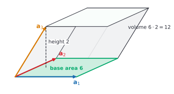
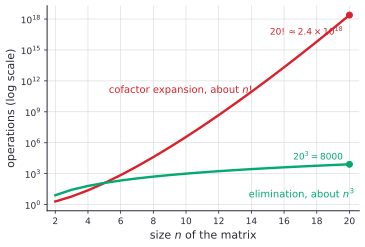

# Determinants

After this lesson you can compute a determinant by cofactor expansion and by row reduction, explain it as the signed factor by which a matrix scales area or volume, prove that a square matrix is invertible exactly when its determinant is not zero, and say why elimination is the way computers do it.

Before this: [linear transformations, kernel and image](05-linear-transformations-kernel-and-image.md), [systems and Gaussian elimination](02-systems-and-gaussian-elimination.md) and [matrix algebra and inverses](03-matrix-algebra-and-inverses.md).

## Quick check

Try these first. If you get all three right, skip to [Practice](#practice).

1. Find $\det\begin{pmatrix} 3 & 1 \\ 4 & 2 \end{pmatrix}$ and the area of the image of the unit square under this matrix.
2. Find $\det\begin{pmatrix} 2 & 5 & 1 \\ 0 & -3 & 7 \\ 0 & 0 & 4 \end{pmatrix}$.
3. A $3 \times 3$ matrix $A$ has $\det A = 5$. What are $\det(2A)$ and $\det(A^{-1})$?

<details class="solution" markdown>
<summary>Answers</summary>

1. $\det = 3 \cdot 2 - 1 \cdot 4 = 2$, so the unit square becomes a parallelogram of area $2$.
2. The matrix is triangular, so the determinant is the product of the diagonal: $2 \cdot (-3) \cdot 4 = -24$.
3. Scaling all three rows by 2 multiplies the determinant by $2^3$, so $\det(2A) = 8 \cdot 5 = 40$. And $\det(A^{-1}) = \frac{1}{5}$.

</details>

## The idea

The last lesson ended with a square being turned into a parallelogram. Look at its area. The matrix $A = \begin{pmatrix} 3 & 1 \\ 1 & 2 \end{pmatrix}$ sends $\mathbf{i}$ to $(3, 1)$ and $\mathbf{j}$ to $(1, 2)$, and the parallelogram on those two arrows has area 5. A stretch such as $\begin{pmatrix} 2 & 0 \\ 0 & 0.5 \end{pmatrix}$ turns the unit square into a rectangle of area $2 \cdot 0.5 = 1$, and a shear $\begin{pmatrix} 1 & 1 \\ 0 & 1 \end{pmatrix}$ slides the square into a parallelogram that still has area 1. A projection squashes it flat, with area 0.

The single number that says how much area the matrix makes is the determinant. It also carries a sign. In the left panel below the arrows $A\mathbf{i}$, $A\mathbf{j}$ still go counterclockwise, like $\mathbf{i}$, $\mathbf{j}$ do, and the determinant is $+5$. In the right panel the two columns are swapped, the F has been flipped as if in a mirror, and the determinant is $-5$. The size is the area scale factor and the sign says whether the map keeps or reverses orientation.


In three dimensions the same idea gives volume. The columns of a $3 \times 3$ matrix are three arrows from the origin, and the determinant is the signed volume of the box they span.



Here the columns are $(3, 0, 0)$, $(1, 2, 0)$ and $(1, 1, 2)$. The base is the parallelogram on the first two, with area $3 \cdot 2 = 6$, and the third arrow rises 2 above the base plane. Volume is base times height, $6 \cdot 2 = 12$, and the determinant of that matrix is the product of its diagonal, $3 \cdot 2 \cdot 2 = 12$.

The rest of the lesson turns this picture into algebra. There is a formula (cofactor expansion), and a faster method (row reduction) that works because row operations change the determinant in a simple, known way. The pictures also predict the main theorem: a matrix that flattens space to zero volume cannot be undone, so the determinant is zero exactly when there is no inverse.

## Definitions

For a $1 \times 1$ matrix, $\det(a) = a$. For an $n \times n$ matrix $A = (a_{ij})$ with $n \ge 2$, the **minor** $M_{ij}$ is the $(n-1) \times (n-1)$ matrix left after deleting row $i$ and column $j$, and the **cofactor** of the entry $a_{ij}$ is the number $C_{ij} = (-1)^{i+j}\det(M_{ij})$. The **determinant** of $A$ is defined by expansion along the first row:

$$
\det A = a_{11}C_{11} + a_{12}C_{12} + \cdots + a_{1n}C_{1n} = \sum_{j=1}^{n} (-1)^{1+j}\, a_{1j} \det(M_{1j}).
$$

In plain words, go along the top row, multiply each entry by the determinant of what is left when its row and column are crossed out, and add with alternating signs $+, -, +, -, \dots$. The definition is recursive: an $n \times n$ determinant is built from $(n-1) \times (n-1)$ determinants, down to $1 \times 1$. The signs $(-1)^{i+j}$ form a checkerboard:

$$
\begin{pmatrix} + & - & + & \cdots \\ - & + & - & \cdots \\ + & - & + & \cdots \\ \vdots & \vdots & \vdots & \ddots \end{pmatrix}
$$

For $n = 2$ the definition gives $\det\begin{pmatrix} a & b \\ c & d \end{pmatrix} = a \cdot d - b \cdot c = ad - bc$. For $n = 3$ it gives

$$
\det\begin{pmatrix} a & b & c \\ d & e & f \\ g & h & i \end{pmatrix} = a(ei - fh) - b(di - fg) + c(dh - eg).
$$

The determinant is also written $\lvert A \rvert$, with vertical bars; this is not an absolute value, and a determinant can be negative. The $2 \times 2$ formula is the same number as the one in [matrix basics](../../03-high-school/10-vectors-and-matrices/02-matrix-basics.md), where it decided whether the inverse formula works.

A square matrix is **upper triangular** if every entry below the diagonal is 0, and **lower triangular** if every entry above the diagonal is 0. In plain words, the nonzero entries sit on and on one side of the diagonal. A diagonal matrix is both.

The three elementary row operations are the ones from [Gaussian elimination](02-systems-and-gaussian-elimination.md): swap two rows, multiply a row by a nonzero number $c$, and add a multiple of one row to another row.

## How to do it

### The size of a determinant is an area

*Theorem 1.* For a $2 \times 2$ matrix $A = \begin{pmatrix} a & b \\ c & d \end{pmatrix}$, the parallelogram with sides $\mathbf{u} = (a, c)$ and $\mathbf{v} = (b, d)$, which is the image of the unit square, has area $\lvert ad - bc \rvert$.

We know that the area of a parallelogram is base times height, and that the dot product with a unit vector gives a component. We want the area in terms of $a$, $b$, $c$, $d$. The plan is to take $\mathbf{u}$ as the base and compute the height as the length of the part of $\mathbf{v}$ that is perpendicular to $\mathbf{u}$.

*Proof.* The base has length $\lVert \mathbf{u} \rVert = \sqrt{a^2 + c^2}$, and we assume $\mathbf{u} \ne \mathbf{0}$ (otherwise the parallelogram is a segment, with area 0 and $ad - bc = 0$ as well). The vector $\mathbf{n} = (-c, a)$ is perpendicular to $\mathbf{u}$, since $\mathbf{u} \cdot \mathbf{n} = -ac + ca = 0$, and it has the same length as $\mathbf{u}$. So $\frac{\mathbf{n}}{\lVert \mathbf{u} \rVert}$ is a unit vector perpendicular to the base. The height of the parallelogram is the size of the component of $\mathbf{v}$ along it:

$$
\text{height} = \left\lvert \mathbf{v} \cdot \frac{\mathbf{n}}{\lVert \mathbf{u} \rVert} \right\rvert = \frac{\lvert -bc + da \rvert}{\lVert \mathbf{u} \rVert}.
$$

Then the area is base times height, $\lVert \mathbf{u} \rVert \cdot \frac{\lvert ad - bc \rvert}{\lVert \mathbf{u} \rVert} = \lvert ad - bc \rvert$. $\blacksquare$

Look back: the proof also shows where the sign comes from. The number $ad - bc$ is positive when $\mathbf{v}$ lies on the left of $\mathbf{u}$ (the side that $\mathbf{n}$ points to, a counterclockwise turn from $\mathbf{u}$) and negative when it lies on the right. Because a linear map treats every piece of the plane the same way, every region, and not just the unit square, has its area multiplied by the same factor $\lvert \det A \rvert$ (the proof of that uses squares to approximate a region, as in [Riemann sums](../04-integrals/01-riemann-sums-and-the-definite-integral.md), and this book accepts it). The $3 \times 3$ statement, that the volume of the box on three columns is $\lvert \det A \rvert$, is accepted the same way.

### Row operations and the determinant

The cofactor definition is expensive, so the practical tool is a theorem that says what each row operation does.

*Theorem 2.* Let $A$ be a square matrix.

- Expansion along any row or any column gives $\det A$ (with the checkerboard signs).
- If $B$ is $A$ with two rows swapped, then $\det B = -\det A$.
- If $B$ is $A$ with one row multiplied by $c$, then $\det B = c\det A$.
- If $B$ is $A$ with a multiple of one row added to another row, then $\det B = \det A$.
- $\det(A^T) = \det A$, so every statement about rows is also true of columns.

The proofs of these go by induction on the size of the matrix, using the expansion, and they take a few pages; this book states them. For the $2 \times 2$ case you can check every one by hand. Swapping the rows gives $\det\begin{pmatrix} c & d \\ a & b \end{pmatrix} = cb - da = -(ad - bc)$. Multiplying the first row by $k$ gives $kad - kbc = k(ad - bc)$. Adding $k$ times row 2 to row 1 gives

$$
\det\begin{pmatrix} a + kc & b + kd \\ c & d \end{pmatrix} = (a + kc)d - (b + kd)c = ad - bc + kcd - kcd = ad - bc.
$$

The geometry agrees. Adding a multiple of one column to another is a shear of the parallelogram, which slides it without changing its base or height. Swapping the columns reverses the orientation. Scaling one column by $k$ stretches one side by $k$, and the area by $k$. This also shows that two equal rows give $\det = 0$ (swap them: $\det = -\det$, so $\det = 0$), and that a zero row gives 0 (scale it by 2, which changes nothing, so $\det = 2\det$).

Scaling the whole matrix scales every row, so for an $n \times n$ matrix, $\det(cA) = c^n \det A$.

*Theorem 3.* The determinant of a triangular matrix is the product of its diagonal entries.

We know the definition and that we may expand along any row or column. We want $\det A = a_{11}a_{22}\cdots a_{nn}$ for triangular $A$. The plan is to induct on $n$, expanding along a row or column that has only one nonzero entry.

*Proof.* For $n = 1$ the statement is the definition. Suppose it holds for size $n - 1$. If $A$ is upper triangular, the first column is $(a_{11}, 0, \dots, 0)$, so expansion down the first column has one term: $\det A = a_{11}\det(M_{11})$. The minor $M_{11}$ is upper triangular of size $n - 1$ with diagonal entries $a_{22}, \dots, a_{nn}$, so by the inductive hypothesis its determinant is $a_{22}\cdots a_{nn}$. If $A$ is lower triangular, expand along the first row instead, which also has only $a_{11}$ nonzero. $\blacksquare$

Look back: the proof is why the box in the picture, with columns $(3, 0, 0)$, $(1, 2, 0)$, $(1, 1, 2)$, has determinant $3 \cdot 2 \cdot 2$. A triangular matrix is the case where each new column adds a new dimension on top of the earlier ones.

### A determinant of zero means no inverse

*Theorem 4.* A square matrix $A$ is invertible if and only if $\det A \ne 0$.

We know that row reduction takes $A$ to its reduced row echelon form $R$, that $A$ is invertible exactly when $R = I$, and Theorem 2 on how each row operation changes the determinant. We want a link between $\det A$ and whether $R = I$. The plan is to follow the determinant through the reduction: each step multiplies it by a nonzero number, so $\det A$ and $\det R$ are zero together.

*Proof.* Reduce $A$ to $R$ with elementary row operations. A swap multiplies the determinant by $-1$, a scaling by $c \ne 0$ multiplies it by $c$, and adding a multiple of a row leaves it alone. So $\det R = f \cdot \det A$, where $f$ is a product of the numbers $-1$, $c$ and $1$ and is not zero. Therefore $\det A = 0$ exactly when $\det R = 0$.

If $A$ is invertible, $R = I$ and $\det R = 1 \ne 0$, so $\det A \ne 0$. If $A$ is not invertible, then $R \ne I$. A square matrix in reduced form that has a pivot in every column is $I$, so $R$ has fewer than $n$ pivots and therefore has a row of zeros. Expanding along that row gives $\det R = 0$, so $\det A = 0$. $\blacksquare$

Look back: the theorem agrees with the picture. A matrix with $\det = 0$ squashes the plane (or space) into something flatter, and a flattened shape can't be unfolded again. The proof also hands you a computing method: row reduce, and track the factors. Theorem 4 adds more lines to the invertible matrix theorem of [matrix algebra and inverses](03-matrix-algebra-and-inverses.md): $A$ is invertible if and only if its determinant is nonzero, if and only if its columns are linearly independent, if and only if $A\mathbf{x} = \mathbf{0}$ has only the solution $\mathbf{0}$.

### The product rule for determinants

*Theorem 5.* For square matrices $A$ and $B$ of the same size, $\det(AB) = \det(A)\det(B)$.

This book states it without proof. The geometry makes it plausible: $B$ scales areas by $\lvert \det B \rvert$ and then $A$ scales them by $\lvert \det A \rvert$, so the composite $AB$ scales by the product. A check for two $2 \times 2$ matrices: $A = \begin{pmatrix} 2 & 1 \\ 1 & 3 \end{pmatrix}$ has $\det A = 5$, and $B = \begin{pmatrix} 1 & 4 \\ 2 & 1 \end{pmatrix}$ has $\det B = -7$, and $AB = \begin{pmatrix} 4 & 9 \\ 7 & 7 \end{pmatrix}$ has $\det(AB) = 28 - 63 = -35 = 5 \cdot (-7)$.

Two consequences follow at once. If $A$ is invertible, then $\det(A)\det(A^{-1}) = \det(AA^{-1}) = \det I = 1$, so $\det(A^{-1}) = \frac{1}{\det A}$. And $\det(A^k) = (\det A)^k$. Watch out that there is no such rule for sums: $\det(A + B) \ne \det A + \det B$ in general. For the matrices above, $\det(A + B) = \det\begin{pmatrix} 3 & 5 \\ 3 & 4 \end{pmatrix} = -3$, while $5 + (-7) = -2$.

### Computing a determinant

1. For a $2 \times 2$ matrix use $ad - bc$. For a triangular matrix multiply the diagonal.
2. For a small matrix with a row or column that has several zeros, expand along it, using the checkerboard signs. Each zero entry removes a whole minor.
3. Otherwise row reduce to an upper triangular form using only swaps and adding multiples of a row to a row. Keep a count $s$ of swaps. Then $\det A = (-1)^s \cdot (\text{product of the diagonal})$.
4. If you scale a row, divide the determinant by the scale factor in the end (or avoid scaling).
5. Check: a zero, a repeated row or an invertibility test, or a numerical check with `numpy.linalg.det` (see [In code](#in-code)).

### Cramer's rule

*Theorem 6 (Cramer's rule).* Let $A$ be an invertible $n \times n$ matrix and $\mathbf{b}$ a vector in $\mathbb{R}^n$. The solution of $A\mathbf{x} = \mathbf{b}$ has entries $x_i = \dfrac{\det A_i}{\det A}$, where $A_i$ is the matrix $A$ with column $i$ replaced by $\mathbf{b}$.

We know $\det(AB) = \det A \det B$, and that column $j$ of a product $AB$ is $A$ times column $j$ of $B$. We want a formula for one entry of $\mathbf{x}$. The plan is to multiply $A$ by the identity matrix with its column $i$ replaced by $\mathbf{x}$, and take determinants.

*Proof.* Let $I_i$ be the identity matrix with column $i$ replaced by $\mathbf{x}$. Column $j \ne i$ of $A I_i$ is $A\mathbf{e}_j$, which is column $j$ of $A$, and column $i$ is $A\mathbf{x} = \mathbf{b}$. So $A I_i = A_i$. Taking determinants, $\det A \cdot \det I_i = \det A_i$. Row $i$ of $I_i$ has $x_i$ on the diagonal and zeros elsewhere, so expanding along row $i$ gives $\det I_i = x_i \cdot \det(I_{n-1}) = x_i$. Hence $\det A \cdot x_i = \det A_i$, and $\det A \ne 0$ by Theorem 4. $\blacksquare$

Look back: Cramer's rule gives each unknown as a ratio of two determinants, which is neat for $2 \times 2$ systems and for symbolic work (it shows how a solution depends on a parameter). It is a poor way to compute a large system, because it needs $n + 1$ determinants and elimination solves the system for the cost of about one.

### Why elimination is how computers do it

Take the cofactor expansion at its word. A determinant of size $n$ is $n$ terms, each one an entry times a determinant of size $n - 1$. Let $C(n)$ be the number of multiplications. Then $C(1) = 0$ and $C(n) = n\,C(n-1) + n$: $n$ minors plus $n$ products. The values are $C(2) = 2$, $C(3) = 9$, $C(5) = 205$, $C(10) = 6{,}235{,}300$ and $C(20) = 4{,}180{,}411{,}311{,}071{,}440{,}000$. Dividing the recurrence by $n!$ shows that $C(n) = n!\sum_{k=1}^{n-1}\frac{1}{k!}$, which is between $1.5\,n!$ and $1.72\,n!$ for $n \ge 3$. So cofactor expansion costs about $n!$ operations.

Elimination makes the matrix triangular and then multiplies the diagonal. To clear the column below pivot $k$, each of the $n - k$ rows below needs one division and at most $n - k$ multiplications, so the total is about $\sum_{k}(n-k)(n-k+1) \approx \frac{n^3}{3}$. For $n = 20$ that is under 3,000 operations against more than $4 \times 10^{18}$.



At a billion multiplications per second, a $20 \times 20$ determinant by cofactors would take about 130 years. By elimination it takes a few microseconds. Numerical libraries compute a determinant by an elimination method (an LU factorization), and for a large matrix they usually avoid the determinant altogether and solve the system directly. See Asymptotic notation<!-- link: ../../06-cs-math/04-sums-recurrences-and-algorithms/04-asymptotic-notation.md --> for how $n!$, $n^3$ and other growth rates are compared.

## Worked examples

<div class="example" markdown>

### Example 1: cofactor expansion, along two different rows

Find $\det A$ for $A = \begin{pmatrix} 2 & 1 & 3 \\ 0 & -1 & 0 \\ 1 & 2 & 4 \end{pmatrix}$.

Step 2: look for zeros. Row 2 has two, so expand along it. The checkerboard sign of the entry $-1$ in position $(2, 2)$ is $+$, and the other entries are 0. The minor of the entry is $\begin{pmatrix} 2 & 3 \\ 1 & 4 \end{pmatrix}$, with determinant $8 - 3 = 5$. So $\det A = (+1)(-1)(5) = -5$.

Check by expanding along the first row, with signs $+, -, +$:

$$
\det A = 2\,(-1 \cdot 4 - 0 \cdot 2) - 1\,(0 \cdot 4 - 0 \cdot 1) + 3\,(0 \cdot 2 - (-1) \cdot 1) = 2(-4) - 0 + 3(1) = -5.
$$

Both rows give $-5$, as Theorem 2 says. The nonzero determinant also tells us that $A$ is invertible.

</div>

<div class="example" markdown>

### Example 2: row reduction, with a swap and a fraction

Find $\det A$ for $A = \begin{pmatrix} 0 & 2 & 1 \\ 1 & 1 & 0 \\ 2 & 3 & 4 \end{pmatrix}$.

Step 3: the top left entry is 0, so swap rows 1 and 2. That multiplies the determinant by $-1$, so the count of swaps is $s = 1$:

$$
\begin{pmatrix} 1 & 1 & 0 \\ 0 & 2 & 1 \\ 2 & 3 & 4 \end{pmatrix}.
$$

Subtract 2 times row 1 from row 3, which doesn't change the determinant. Row 3 becomes $(0, 1, 4)$. Then subtract $\frac{1}{2}$ of row 2 from row 3, and row 3 becomes $\left(0, 0, 4 - \frac{1}{2}\right) = \left(0, 0, \frac{7}{2}\right)$. The triangular matrix has diagonal $1, 2, \frac{7}{2}$, with product $7$.

So $\det A = (-1)^1 \cdot 7 = -7$. A fraction appeared in the middle, which is fine: it is the pivot, not the answer.

Check by cofactors along the first row: $0 \cdot (\ldots) - 2\,(1 \cdot 4 - 0 \cdot 2) + 1\,(1 \cdot 3 - 1 \cdot 2) = -8 + 1 = -7$.

</div>

<div class="example" markdown>

### Example 3: a zero determinant and what it means

Show that $A = \begin{pmatrix} 1 & 2 & 3 \\ 4 & 5 & 6 \\ 7 & 8 & 9 \end{pmatrix}$ is not invertible, and find a nonzero vector that $A$ sends to $\mathbf{0}$.

Look at the rows. Row 3 is $2 \cdot (4, 5, 6) - (1, 2, 3) = (7, 8, 9)$, so the third row is a combination of the other two. Subtracting that combination from row 3 doesn't change the determinant and gives a row of zeros, so $\det A = 0$ by Theorem 2, and $A$ is not invertible by Theorem 4.

The columns obey a matching relation. The vector $\mathbf{x} = (1, -2, 1)$ gives $A\mathbf{x} = (1 - 4 + 3,\; 4 - 10 + 6,\; 7 - 16 + 9) = (0, 0, 0)$, so the kernel contains a nonzero vector and the map is not injective. The image is a plane (rank 2), so the unit cube is flattened onto a plane, which is the volume 0 in the picture.

Check by cofactors: $1(45 - 48) - 2(36 - 42) + 3(32 - 35) = -3 + 12 - 9 = 0$.

</div>

<div class="example" markdown>

### Example 4: areas of a triangle and a polygon

Find the area of the triangle with vertices $(1, 1)$, $(4, 2)$ and $(2, 5)$. Then find the area of the quadrilateral with vertices $(0, 0)$, $(4, 0)$, $(5, 3)$ and $(1, 4)$, in that order around the boundary.

Triangle: move the first vertex to the origin by subtracting it from the others. The two sides from it are $(3, 1)$ and $(1, 4)$. The parallelogram on these has area $\lvert 3 \cdot 4 - 1 \cdot 1 \rvert = 11$, and the triangle is half of it: $5.5$.

Quadrilateral: for each consecutive pair of vertices $(x_i, y_i)$ and $(x_{i+1}, y_{i+1})$, compute the determinant $x_i y_{i+1} - x_{i+1} y_i$ and add the four values, going around the polygon and returning to the first vertex. The values are $0 \cdot 0 - 4 \cdot 0 = 0$, then $4 \cdot 3 - 5 \cdot 0 = 12$, then $5 \cdot 4 - 1 \cdot 3 = 17$, then $1 \cdot 0 - 0 \cdot 4 = 0$. The area is half the absolute value of the sum: $\frac{29}{2} = 14.5$.

Check: split the quadrilateral along the diagonal from $(0, 0)$ to $(5, 3)$. The triangle $(0, 0)$, $(4, 0)$, $(5, 3)$ has area $\frac{1}{2}\lvert 4 \cdot 3 - 0 \cdot 5 \rvert = 6$ and the triangle $(0, 0)$, $(5, 3)$, $(1, 4)$ has area $\frac{1}{2}\lvert 5 \cdot 4 - 3 \cdot 1 \rvert = 8.5$, and $6 + 8.5 = 14.5$. The formula is called the shoelace formula, and it is a sum of $2 \times 2$ determinants.

</div>

<div class="example" markdown>

### Example 5: two linked markets with Cramer's rule (finish it yourself)

In a hypothetical economy, the prices $p_1$ and $p_2$ (in dollars) of two goods are linked, because each good's demand rises with the other's price. Market clearing gives

$$
\begin{aligned} 5p_1 - p_2 &= 60, \\ -p_1 + 3p_2 &= 50. \end{aligned}
$$

Here $A = \begin{pmatrix} 5 & -1 \\ -1 & 3 \end{pmatrix}$ and $\mathbf{b} = (60, 50)$, and $\det A = 15 - 1 = 14 \ne 0$. By Cramer's rule, $p_1 = \dfrac{\det A_1}{14}$ with $A_1 = \begin{pmatrix} 60 & -1 \\ 50 & 3 \end{pmatrix}$, so $\det A_1 = 180 + 50 = 230$ and $p_1 = \frac{230}{14} = \frac{115}{7}$, about \$16.43.

Find $p_2$ with Cramer's rule, and check both prices in the two equations.

<details class="solution" markdown>
<summary>Finish</summary>

Replace column 2 of $A$ by $\mathbf{b}$: $A_2 = \begin{pmatrix} 5 & 60 \\ -1 & 50 \end{pmatrix}$, so $\det A_2 = 250 + 60 = 310$ and $p_2 = \frac{310}{14} = \frac{155}{7}$, about \$22.14.

Check: $5 \cdot \frac{115}{7} - \frac{155}{7} = \frac{575 - 155}{7} = \frac{420}{7} = 60$, and $-\frac{115}{7} + 3 \cdot \frac{155}{7} = \frac{-115 + 465}{7} = \frac{350}{7} = 50$. Both equations hold. The untidy fractions are normal.

</details>

</div>

## Edge cases and common mistakes

<div class="warning" markdown>

Watch out: the determinant of a sum is not the sum of the determinants. With $A = I$ and $B = -I$ for $2 \times 2$ matrices, $\det(A + B) = \det(0) = 0$ while $\det A + \det B = 1 + 1 = 2$. The determinant respects products, not sums.

</div>

<div class="warning" markdown>

Watch out: $\det(cA) = c^n \det A$, not $c\det A$. For a $3 \times 3$ matrix, doubling every entry multiplies the volume of the box by $2^3 = 8$, because each of the three edges doubles. Only a single row scaled by $c$ multiplies the determinant by $c$.

</div>

<div class="warning" markdown>

Watch out: the product of the diagonal gives the determinant only for a triangular matrix. For $\begin{pmatrix} 1 & 2 \\ 3 & 4 \end{pmatrix}$ the diagonal product is 4, and the determinant is $4 - 6 = -2$. Reduce to triangular form first, and keep track of the swaps.

</div>

<div class="warning" markdown>

Watch out: the rule of Sarrus, which copies the first two columns beside a $3 \times 3$ matrix and adds the products along the diagonals, works only for $3 \times 3$ matrices. For $4 \times 4$ and bigger it gives wrong answers. Use cofactors or elimination.

</div>

<div class="warning" markdown>

Watch out: signs in elimination. A row swap changes the sign of the determinant, and scaling a row by $c$ multiplies it by $c$. Adding a multiple of one row to another changes nothing. A common slip is to forget the swap, and a second is to divide a row by a pivot and not account for it. The safe method uses only swaps and "add a multiple".

</div>

<div class="warning" markdown>

Watch out: the determinant is defined only for square matrices. A $2 \times 3$ matrix has no determinant, because it can't be inverted and can't be said to scale area (it sends the plane into three-dimensional space). The corresponding questions for non-square matrices are about rank.

</div>

## Tricks and shortcuts

Expand along the row or column with the most zeros. When you do, write the checkerboard signs first, so the sign of each cofactor is not an afterthought.

A determinant is zero when a row is zero, when two rows are equal or one is a multiple of another, or more generally when one row is a combination of the others. Spotting this saves the whole calculation, as in Example 3. In an exam, test for a zero determinant before expanding.

For a $2 \times 2$ matrix the inverse formula $A^{-1} = \frac{1}{ad - bc}\begin{pmatrix} d & -b \\ -c & a \end{pmatrix}$ has the determinant in the denominator: the inverse scales area by the reciprocal factor, $\frac{1}{\det A}$, which is the $\det(A^{-1}) = \frac{1}{\det A}$ of Theorem 5.

If, during elimination, a column has no nonzero entry at or below the pivot position, stop: the determinant is 0.

For a block triangular matrix, the determinant is the product of the determinants of the diagonal blocks. For example, $\begin{pmatrix} 1 & 2 & 7 \\ 3 & 4 & 8 \\ 0 & 0 & 5 \end{pmatrix}$ has determinant $(1 \cdot 4 - 2 \cdot 3) \cdot 5 = -10$ (expand along the last row).

## In code

The code compares the two methods. It counts the multiplications that cofactor expansion and exact elimination use, and confirms that they agree. The counts are the point: at $n = 8$ cofactor expansion already needs hundreds of times as many operations.

<details class="code" markdown>
<summary>In code</summary>

```python
import numpy as np
from fractions import Fraction

def det_cofactor(A, count):
    """Expand along the first row. count[0] tallies the multiplications."""
    n = len(A)
    if n == 1:
        return A[0][0]
    total = 0
    for j in range(n):
        minor = [row[:j] + row[j + 1:] for row in A[1:]]
        count[0] += 1
        total += (-1) ** j * A[0][j] * det_cofactor(minor, count)
    return total

def det_elimination(A, count):
    """Row reduce with exact fractions; track swaps and multiply the pivots."""
    n = len(A)
    A = [[Fraction(x) for x in row] for row in A]
    sign = 1
    for k in range(n):
        p = next((i for i in range(k, n) if A[i][k] != 0), None)
        if p is None:
            return Fraction(0)
        if p != k:
            A[k], A[p] = A[p], A[k]
            sign = -sign
        for i in range(k + 1, n):
            m = A[i][k] / A[k][k]
            count[0] += 1 + (n - k - 1)          # one division, then the row update
            for j in range(k, n):
                A[i][j] -= m * A[k][j]
    result = Fraction(sign)
    for k in range(n):
        result *= A[k][k]
    count[0] += n - 1
    return result

A = [[0, 2, 1], [1, 1, 0], [2, 3, 4]]
c1, c2 = [0], [0]
print(det_cofactor(A, c1), det_elimination(A, c2), c1[0], c2[0])
# -7 -7 9 10
print(round(np.linalg.det(np.array(A, dtype=float)), 6))
# -7.0

rng = np.random.default_rng(1)
for n in [4, 6, 8]:
    B = rng.integers(-5, 6, size=(n, n)).tolist()
    c1, c2 = [0], [0]
    d1, d2 = det_cofactor(B, c1), det_elimination(B, c2)
    print(n, d1, d2 == d1, c1[0], c2[0])
# 4 -588 True 40 23
# 6 6300 True 1236 75
# 8 -888387 True 69280 175
```

</details>

## FAQ

### Why is the determinant defined by such an odd formula?

The formula is the shortest way to write down the one function with three properties that match the geometry: it is linear in each row separately (scale one edge of the box and the volume scales), it changes sign when two rows are swapped (orientation flips), and it equals 1 for the identity (the unit cube has volume 1). A full course proves that exactly one function has those three properties, and cofactor expansion is a formula for it. You can read the formula as bookkeeping for "volume of a box" in $n$ dimensions.

### Why does the sign alternate in the expansion?

The alternating signs make the swap property work. Without the checkerboard, swapping two rows would not simply flip the sign. You can see it in the $2 \times 2$ case. With the minus sign, two identical columns ($a = b$ and $c = d$) give $ad - bc = ac - ca = 0$, a flat parallelogram. With a plus sign the value would be $2ac$, which is not 0.

### If the determinant is a number, does it tell me everything about the matrix?

No. Many different matrices have determinant 1: all the rotations, all the shears, and mixtures of them. The determinant records only how much volume is scaled and whether orientation flips. It is enough to decide invertibility, and, with the eigenvalues in the [last lesson of the chapter](08-eigenvalues-and-eigenvectors.md), it is the product of them. It says nothing about angles or lengths.

### Is a very small determinant a sign that a matrix is nearly singular?

Not reliably. The matrix $10^{-3}I_{10}$ has determinant $10^{-30}$ and is perfectly well behaved: it just scales every direction the same way. Nearness to singular is about the ratio of the largest to the smallest stretching directions, called the condition number, which comes from the singular value decomposition and is not part of this chapter.

## Practice

### Warm-up

1\. Find each determinant. (a) $\begin{pmatrix} 3 & -2 \\ 5 & 4 \end{pmatrix}$. (b) $\begin{pmatrix} 2 & 4 \\ 1 & 2 \end{pmatrix}$. (c) $\begin{pmatrix} 2 & 7 & 1 \\ 0 & -3 & 5 \\ 0 & 0 & 4 \end{pmatrix}$.

<details class="solution" markdown>
<summary>Solution</summary>

(a) $3 \cdot 4 - (-2) \cdot 5 = 12 + 10 = 22$.

(b) $2 \cdot 2 - 4 \cdot 1 = 0$. The second row is half of the first, so the matrix is not invertible.

(c) The matrix is upper triangular, so the determinant is $2 \cdot (-3) \cdot 4 = -24$.

Check (c) by expanding down the first column: only the entry 2 is nonzero, and $2 \cdot \det\begin{pmatrix} -3 & 5 \\ 0 & 4 \end{pmatrix} = 2 \cdot (-12) = -24$.

</details>

2\. (a) Find the area of the image of the unit square under $A = \begin{pmatrix} 1 & 2 \\ 3 & -1 \end{pmatrix}$, and say whether orientation is kept or reversed. What happens to a region of area 10? (b) Find the volume of the box spanned by the columns of $\begin{pmatrix} 1 & 0 & 1 \\ 0 & 3 & 1 \\ 2 & 1 & 1 \end{pmatrix}$.

<details class="solution" markdown>
<summary>Solution</summary>

(a) $\det A = 1 \cdot (-1) - 2 \cdot 3 = -7$. The area of the image is $\lvert -7 \rvert = 7$, and the negative sign means the orientation is reversed. A region of area 10 goes to a region of area $70$.

(b) Expanding along the first row, $\det = 1(3 \cdot 1 - 1 \cdot 1) - 0 + 1(0 \cdot 1 - 3 \cdot 2) = 2 - 6 = -4$. The volume is $\lvert -4 \rvert = 4$.

Check (b) by expanding down column 1 instead. The first column is $(1, 0, 2)$, so $\det = 1\cdot\det\begin{pmatrix} 3 & 1 \\ 1 & 1 \end{pmatrix} + 2\cdot\det\begin{pmatrix} 0 & 1 \\ 3 & 1 \end{pmatrix} = 1 \cdot 2 + 2 \cdot (0 - 3) = 2 - 6 = -4$.

</details>

3\. For $4 \times 4$ matrices $A$ and $B$ with $\det A = 3$ and $\det B = -2$, find $\det(AB)$, $\det(A^{-1})$, $\det(2A)$, $\det(A^T)$ and $\det(B^2)$.

<details class="solution" markdown>
<summary>Solution</summary>

$\det(AB) = 3 \cdot (-2) = -6$. $\det(A^{-1}) = \frac{1}{3}$. $\det(2A) = 2^4 \cdot 3 = 48$, since all four rows are doubled. $\det(A^T) = 3$. $\det(B^2) = (-2)^2 = 4$.

Check: for $\det(2A)$ the box in four dimensions has every edge doubled, so the volume is multiplied by $2^4 = 16$, and $16 \cdot 3 = 48$.

</details>

### Standard

4\. Find $\det\begin{pmatrix} 1 & 2 & 3 \\ 0 & 4 & 5 \\ 1 & 0 & 6 \end{pmatrix}$ by expanding down the first column, and again by row reduction.

<details class="solution" markdown>
<summary>Solution</summary>

Down the first column with signs $+, -, +$: $1\cdot\det\begin{pmatrix} 4 & 5 \\ 0 & 6 \end{pmatrix} - 0 + 1\cdot\det\begin{pmatrix} 2 & 3 \\ 4 & 5 \end{pmatrix} = 1 \cdot 24 + (10 - 12) = 24 - 2 = 22$.

By row reduction, subtract row 1 from row 3: row 3 becomes $(0, -2, 3)$. Then add $\frac{1}{2}$ of row 2 to row 3: it becomes $\left(0, 0, 3 + \frac{5}{2}\right) = \left(0, 0, \frac{11}{2}\right)$. No swaps, and the diagonal is $1, 4, \frac{11}{2}$ with product $22$.

Check: both methods give 22.

</details>

5\. Find the determinant of the tridiagonal matrix $T = \begin{pmatrix} 2 & 1 & 0 & 0 \\ 1 & 2 & 1 & 0 \\ 0 & 1 & 2 & 1 \\ 0 & 0 & 1 & 2 \end{pmatrix}$ by row reduction.

<details class="solution" markdown>
<summary>Solution</summary>

Subtract $\frac{1}{2}$ of row 1 from row 2: row 2 becomes $\left(0, \frac{3}{2}, 1, 0\right)$. Subtract $\frac{2}{3}$ of the new row 2 from row 3: row 3 becomes $\left(0, 0, 2 - \frac{2}{3}, 1\right) = \left(0, 0, \frac{4}{3}, 1\right)$. Subtract $\frac{3}{4}$ of the new row 3 from row 4: row 4 becomes $\left(0, 0, 0, 2 - \frac{3}{4}\right) = \left(0, 0, 0, \frac{5}{4}\right)$.

No swaps were needed, so the determinant is the product of the pivots: $2 \cdot \frac{3}{2} \cdot \frac{4}{3} \cdot \frac{5}{4} = 5$.

Check: the pivots telescope, and the same pattern for the $n \times n$ version of this matrix gives $n + 1$. For $n = 2$ the matrix $\begin{pmatrix} 2 & 1 \\ 1 & 2 \end{pmatrix}$ has determinant $3$.

</details>

6\. (a) Solve $x + 2y = 5$, $3x - y = 1$ with Cramer's rule. (b) What does Cramer's rule say about the system $x + 2y = 5$, $2x + 4y = 10$, and what does the system actually have?

<details class="solution" markdown>
<summary>Solution</summary>

(a) $\det A = 1 \cdot (-1) - 2 \cdot 3 = -7$. For $x$, replace column 1 by $(5, 1)$: $\det\begin{pmatrix} 5 & 2 \\ 1 & -1 \end{pmatrix} = -5 - 2 = -7$, so $x = \frac{-7}{-7} = 1$. For $y$, replace column 2: $\det\begin{pmatrix} 1 & 5 \\ 3 & 1 \end{pmatrix} = 1 - 15 = -14$, so $y = 2$.

(b) The coefficient determinant is $1 \cdot 4 - 2 \cdot 2 = 0$, so Cramer's rule does not apply: it would divide by zero. The second equation is twice the first, so the system has infinitely many solutions, every point on the line $x + 2y = 5$.

Check (a): $1 + 4 = 5$ and $3 - 2 = 1$.

</details>

### Challenge

7\. Prove, using only the fact that swapping two rows changes the sign of a determinant, that a square matrix with two equal rows has determinant 0. Then use this and the row-addition rule to show that adding a multiple of a row to another row doesn't change the determinant in the $3 \times 3$ case, by splitting the determinant as a sum.

<details class="solution" markdown>
<summary>Solution</summary>

First part. Let $A$ have two equal rows, and let $B$ be $A$ with those two rows swapped. Then $B = A$, because the rows are equal, and the swap rule gives $\det B = -\det A$. So $\det A = -\det A$, which gives $2\det A = 0$ and $\det A = 0$.

Second part. The determinant is linear in each row separately: expanding along the row that changes, $\det$ is a sum of the entries of that row times fixed cofactors, so replacing row 1 by $\mathbf{r}_1 + k\mathbf{r}_2$ gives

$$
\det\begin{pmatrix} \mathbf{r}_1 + k\mathbf{r}_2 \\ \mathbf{r}_2 \\ \mathbf{r}_3 \end{pmatrix} = \det\begin{pmatrix} \mathbf{r}_1 \\ \mathbf{r}_2 \\ \mathbf{r}_3 \end{pmatrix} + k\det\begin{pmatrix} \mathbf{r}_2 \\ \mathbf{r}_2 \\ \mathbf{r}_3 \end{pmatrix}.
$$

The last matrix has two equal rows, so its determinant is 0 by the first part. The determinant is unchanged.

Check with numbers: for the rows $(1, 2, 0)$, $(0, 1, 1)$, $(1, 0, 1)$ the determinant is $1(1) - 2(0 - 1) + 0 = 3$. Adding $2 \cdot (0, 1, 1)$ to row 1 gives $(1, 4, 2)$, and $\det\begin{pmatrix} 1 & 4 & 2 \\ 0 & 1 & 1 \\ 1 & 0 & 1 \end{pmatrix} = 1(1) - 4(0 - 1) + 2(0 - 1) = 1 + 4 - 2 = 3$.

</details>

8\. (Reviews [matrix basics](../../03-high-school/10-vectors-and-matrices/02-matrix-basics.md).) For $A = \begin{pmatrix} a & b \\ c & d \end{pmatrix}$ with $\det A \ne 0$, verify that $A^{-1} = \frac{1}{\det A}\begin{pmatrix} d & -b \\ -c & a \end{pmatrix}$ by multiplying. Then find the inverse of $\begin{pmatrix} 2 & 1 \\ 5 & 3 \end{pmatrix}$ and use it to solve $\begin{pmatrix} 2 & 1 \\ 5 & 3 \end{pmatrix}\mathbf{x} = \begin{pmatrix} 1 \\ 2 \end{pmatrix}$.

<details class="solution" markdown>
<summary>Solution</summary>

Multiply: $\begin{pmatrix} a & b \\ c & d \end{pmatrix}\begin{pmatrix} d & -b \\ -c & a \end{pmatrix} = \begin{pmatrix} ad - bc & -ab + ba \\ cd - dc & -cb + da \end{pmatrix} = (ad - bc)I$. Dividing by $\det A = ad - bc$ gives $A A^{-1} = I$, and the product in the other order works the same way. The division is allowed exactly when $\det A \ne 0$.

For $\begin{pmatrix} 2 & 1 \\ 5 & 3 \end{pmatrix}$ the determinant is $6 - 5 = 1$, so the inverse is $\begin{pmatrix} 3 & -1 \\ -5 & 2 \end{pmatrix}$. Then $\mathbf{x} = \begin{pmatrix} 3 & -1 \\ -5 & 2 \end{pmatrix}\begin{pmatrix} 1 \\ 2 \end{pmatrix} = \begin{pmatrix} 3 - 2 \\ -5 + 4 \end{pmatrix} = \begin{pmatrix} 1 \\ -1 \end{pmatrix}$.

Check: $2 \cdot 1 + 1 \cdot (-1) = 1$ and $5 \cdot 1 + 3 \cdot (-1) = 2$.

</details>

## Where this shows up

- The [eigenvalues lesson](08-eigenvalues-and-eigenvectors.md) finds eigenvalues as the roots of $\det(A - \lambda I) = 0$, using exactly Theorem 4: a nonzero vector is sent to zero by $A - \lambda I$ if and only if the determinant vanishes.
- In calculus, the determinant of the matrix of derivatives (the Jacobian) is the local area scale factor when you change variables in an integral. See Double integrals<!-- link: ../09-multivariable-calculus-light/04-double-integrals.md -->.
- In CS, the shoelace formula and the sign of a $2 \times 2$ determinant (which side of a line a point is on) are building blocks of computational geometry. In numerical work, a determinant is rarely computed for its own sake, and the $n!$ against $n^3$ gap above is a standard example of why the algorithm matters.
- In economics, a linear model with a coefficient matrix that has determinant zero has no unique solution. In regression, the same condition on $X^TX$ is called perfect multicollinearity. See Regression and econometrics intuition<!-- link: ../../07-economics-math/04-more-tools/03-regression-and-econometrics-intuition.md -->.
