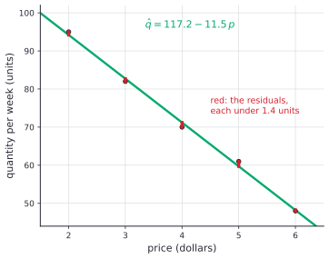

# Orthogonality, projections and least squares

After this lesson you can project a vector onto a line or a subspace, build an orthogonal basis with Gram-Schmidt, and solve an overdetermined system $A\mathbf{x} = \mathbf{b}$ as well as it can be solved, using the normal equations $A^T A\hat{\mathbf{x}} = A^T\mathbf{b}$, including fitting a line to data.

Before this: [vectors, dot product and span](01-vectors-dot-product-and-span.md), [matrix algebra and inverses](03-matrix-algebra-and-inverses.md), [linear independence, basis and dimension](04-linear-independence-basis-and-dimension.md) and [linear transformations, kernel and image](05-linear-transformations-kernel-and-image.md). The idea of minimizing a sum of squares is the one from [optimization](../03-applications-of-derivatives/05-optimization.md).

## Quick check

Try these first. If you get all three right, skip to [Practice](#practice).

1. Are $(1, 2, -1)$ and $(3, -1, 1)$ orthogonal?
2. Find the projection of $\mathbf{v} = (1, 3)$ onto the line through $\mathbf{u} = (2, 1)$.
3. The system $x = 1$, $x = 2$, $x = 4$ has no solution. Which single value of $x$ makes the sum of the squared errors $(x - 1)^2 + (x - 2)^2 + (x - 4)^2$ smallest?

<details class="solution" markdown>
<summary>Answers</summary>

1. The dot product is $3 - 2 - 1 = 0$, so yes.
2. $\mathbf{v} \cdot \mathbf{u} = 5$ and $\mathbf{u} \cdot \mathbf{u} = 5$, so the projection is $\frac{5}{5}(2, 1) = (2, 1)$.
3. The mean, $\frac{1 + 2 + 4}{3} = \frac{7}{3}$. The derivative $2(x - 1) + 2(x - 2) + 2(x - 4) = 6x - 14$ is zero there. This is the least-squares answer to the system, and it is a projection in disguise.

</details>

## The idea

A system of equations with more equations than unknowns usually has no solution. Ten measurements of a price and a quantity don't fall on one straight line; three readings of the same quantity differ a little. In matrix form $A\mathbf{x} = \mathbf{b}$ has no solution because the vector $\mathbf{b}$ is not in the column space of $A$: it is not a combination of the columns. If we can't hit $\mathbf{b}$, we can aim for the closest point that we can hit.

Closest has a geometric meaning, and it uses the dot product. In the plane, the closest point of a line to a point $\mathbf{v}$ is the foot of the perpendicular. In space, the closest point of a plane is again the foot of the perpendicular. The vector from the foot to $\mathbf{v}$ meets the line (or plane) at a right angle, and that single right angle fixes the whole answer. Everything in this lesson is about using it.


The picture on the left is a projection onto a line. The picture on the right is the first step of Gram-Schmidt, which builds a perpendicular pair of arrows out of any pair: keep the first arrow, and cut from the second arrow its shadow on the first. The remainder is perpendicular to the first arrow. Repeating that in higher dimensions makes a whole basis of perpendicular arrows, and with such a basis, projections are simple sums.

In the space of data vectors, the same picture solves the problem. If $\operatorname{col}(A)$ is a plane in space and $\mathbf{b}$ is a point off it, the best $A\hat{\mathbf{x}}$ is the foot of the perpendicular from $\mathbf{b}$, and the equation that says "the leftover is perpendicular to every column" is $A^T(\mathbf{b} - A\hat{\mathbf{x}}) = \mathbf{0}$. That is the whole theory of least squares, and fitting a line to data is one case of it.


## Definitions

In $\mathbb{R}^n$ the dot product of $\mathbf{u} = (u_1, \dots, u_n)$ and $\mathbf{v} = (v_1, \dots, v_n)$ is $\mathbf{u} \cdot \mathbf{v} = u_1 v_1 + \dots + u_n v_n = \mathbf{u}^T\mathbf{v}$, and the length (or norm) of $\mathbf{v}$ is $\lVert \mathbf{v} \rVert = \sqrt{\mathbf{v} \cdot \mathbf{v}}$. Since $\mathbf{v} \cdot \mathbf{v}$ is a sum of squares, it is $0$ only when $\mathbf{v} = \mathbf{0}$.

Two vectors are **orthogonal** if $\mathbf{u} \cdot \mathbf{v} = 0$. In plain words, they meet at a right angle (the zero vector counts as orthogonal to everything). A list of vectors is an **orthogonal set** if each two different vectors in it are orthogonal. It is an **orthonormal set** if, in addition, each vector has length 1. An **orthogonal basis** (or **orthonormal basis**) of a subspace is a basis that is an orthogonal (or orthonormal) set. In plain words, an orthonormal basis is a set of perpendicular unit arrows, like $\mathbf{i}$, $\mathbf{j}$ in the plane.

For a subspace $W$ of $\mathbb{R}^n$, the **orthogonal complement** is $W^\perp = \{\mathbf{z} \in \mathbb{R}^n \mid \mathbf{z} \cdot \mathbf{w} = 0 \text{ for every } \mathbf{w} \text{ in } W\}$. In plain words, it is everything perpendicular to the whole of $W$. For a plane through the origin in $\mathbb{R}^3$ it is the line through the origin along the normal.

The **orthogonal projection** of $\mathbf{v}$ onto a nonzero vector $\mathbf{u}$ is

$$
\operatorname{proj}_{\mathbf{u}}\mathbf{v} = \frac{\mathbf{v} \cdot \mathbf{u}}{\mathbf{u} \cdot \mathbf{u}}\,\mathbf{u}.
$$

In plain words, it is the shadow of $\mathbf{v}$ on the line through $\mathbf{u}$. The number in front is how many copies of $\mathbf{u}$ the shadow is.

The projection of $\mathbf{v}$ onto a subspace $W$, written $\hat{\mathbf{v}}$ or $\operatorname{proj}_W\mathbf{v}$, is the vector $\hat{\mathbf{v}}$ in $W$ for which $\mathbf{v} - \hat{\mathbf{v}}$ lies in $W^\perp$. The vector $\mathbf{z} = \mathbf{v} - \hat{\mathbf{v}}$ is called the **residual** (or error). The next theorem shows that it exists and is unique.

A **least-squares solution** of $A\mathbf{x} = \mathbf{b}$ is a vector $\hat{\mathbf{x}}$ that makes $\lVert \mathbf{b} - A\mathbf{x} \rVert$ as small as possible: $\lVert \mathbf{b} - A\hat{\mathbf{x}} \rVert \le \lVert \mathbf{b} - A\mathbf{x} \rVert$ for every $\mathbf{x}$. The name comes from the fact that minimizing the length is the same as minimizing its square, $\sum_i (b_i - (A\mathbf{x})_i)^2$, a sum of squared errors.

A square matrix $Q$ is an **orthogonal matrix** if $Q^TQ = I$. In plain words, its columns form an orthonormal basis of $\mathbb{R}^n$, since the entry $(i, j)$ of $Q^TQ$ is the dot product of column $i$ with column $j$. The rotations and reflections of the last lessons are orthogonal matrices.

## How to do it

### Orthogonal vectors are independent, and give easy coordinates

*Theorem 1.* An orthogonal set of nonzero vectors $\mathbf{u}_1, \dots, \mathbf{u}_k$ is linearly independent. If $\mathbf{y}$ lies in their span, then

$$
\mathbf{y} = \frac{\mathbf{y} \cdot \mathbf{u}_1}{\mathbf{u}_1 \cdot \mathbf{u}_1}\mathbf{u}_1 + \dots + \frac{\mathbf{y} \cdot \mathbf{u}_k}{\mathbf{u}_k \cdot \mathbf{u}_k}\mathbf{u}_k.
$$

We know the vectors are orthogonal and nonzero. We want independence and a formula for the weights. The plan is to dot a combination with one of the vectors: every other term drops out.

*Proof.* Suppose $\mathbf{y} = c_1\mathbf{u}_1 + \dots + c_k\mathbf{u}_k$. Take the dot product with $\mathbf{u}_j$. By the rules of the dot product, $\mathbf{y} \cdot \mathbf{u}_j = c_1(\mathbf{u}_1 \cdot \mathbf{u}_j) + \dots + c_k(\mathbf{u}_k \cdot \mathbf{u}_j)$. Every term with $i \ne j$ is 0 because the vectors are orthogonal, leaving $\mathbf{y} \cdot \mathbf{u}_j = c_j(\mathbf{u}_j \cdot \mathbf{u}_j)$. Since $\mathbf{u}_j \ne \mathbf{0}$, we have $\mathbf{u}_j \cdot \mathbf{u}_j > 0$, so $c_j = \frac{\mathbf{y} \cdot \mathbf{u}_j}{\mathbf{u}_j \cdot \mathbf{u}_j}$. This is the formula. For independence take $\mathbf{y} = \mathbf{0}$: then every $c_j = \frac{0}{\mathbf{u}_j \cdot \mathbf{u}_j} = 0$. $\blacksquare$

Look back: finding coordinates in an ordinary basis means solving a system of equations. In an orthogonal basis each coordinate is one dot product, computed alone. For an orthonormal basis the denominators are 1, so the coordinates are just $\mathbf{y} \cdot \mathbf{q}_j$. Also, in a plane $\mathbb{R}^2$ any two orthogonal nonzero vectors are therefore a basis, and in $\mathbb{R}^3$ any three are.

### The orthogonal decomposition

*Theorem 2 (orthogonal decomposition).* Let $W$ be a subspace of $\mathbb{R}^n$ with an orthogonal basis $\mathbf{u}_1, \dots, \mathbf{u}_k$. Every $\mathbf{y}$ in $\mathbb{R}^n$ can be written in exactly one way as $\mathbf{y} = \hat{\mathbf{y}} + \mathbf{z}$ with $\hat{\mathbf{y}}$ in $W$ and $\mathbf{z}$ in $W^\perp$, and

$$
\hat{\mathbf{y}} = \operatorname{proj}_{\mathbf{u}_1}\mathbf{y} + \dots + \operatorname{proj}_{\mathbf{u}_k}\mathbf{y}.
$$

We know Theorem 1 and the definition of $W^\perp$. We want a vector in $W$ whose leftover is perpendicular to all of $W$, and we want to know there is only one. The plan is to define $\hat{\mathbf{y}}$ by the formula, check that the leftover is orthogonal to each basis vector (which is enough to be orthogonal to the whole span), and prove uniqueness by showing that a vector in both $W$ and $W^\perp$ is zero.

*Proof.* Existence. Define $\hat{\mathbf{y}}$ by the formula, so $\hat{\mathbf{y}}$ is in $W$, and let $\mathbf{z} = \mathbf{y} - \hat{\mathbf{y}}$. For each $j$,

$$
\mathbf{z} \cdot \mathbf{u}_j = \mathbf{y} \cdot \mathbf{u}_j - \frac{\mathbf{y} \cdot \mathbf{u}_j}{\mathbf{u}_j \cdot \mathbf{u}_j}(\mathbf{u}_j \cdot \mathbf{u}_j) = 0,
$$

because the other terms of $\hat{\mathbf{y}}$ are orthogonal to $\mathbf{u}_j$. A vector $\mathbf{w}$ in $W$ is a combination $\sum d_j\mathbf{u}_j$, so $\mathbf{z} \cdot \mathbf{w} = \sum d_j(\mathbf{z} \cdot \mathbf{u}_j) = 0$. So $\mathbf{z}$ is in $W^\perp$.

Uniqueness. Suppose $\mathbf{y} = \hat{\mathbf{y}} + \mathbf{z} = \hat{\mathbf{y}}' + \mathbf{z}'$ are two such decompositions. Then $\hat{\mathbf{y}} - \hat{\mathbf{y}}' = \mathbf{z}' - \mathbf{z}$. The left side is in $W$ and the right side is in $W^\perp$, so the vector $\mathbf{d}$ equal to both is orthogonal to itself: $\mathbf{d} \cdot \mathbf{d} = 0$, so $\mathbf{d} = \mathbf{0}$. Then the two decompositions agree. $\blacksquare$

Look back: for a line, the theorem is the formula $\operatorname{proj}_{\mathbf{u}}\mathbf{v}$ and its right angle. For a larger subspace the projection is the sum of the shadows on the orthogonal basis vectors. Watch out that the sum of shadows works only for an orthogonal basis: for a non-orthogonal pair the shadows overlap and the sum overshoots (see the common mistakes below). Every subspace of $\mathbb{R}^n$ has an orthogonal basis, which is the next method, so the theorem holds for every subspace, and the projection $\hat{\mathbf{y}}$ doesn't depend on which orthogonal basis was used (by uniqueness).

*Theorem 3 (best approximation).* With $\hat{\mathbf{y}}$ as in Theorem 2, $\lVert \mathbf{y} - \hat{\mathbf{y}} \rVert < \lVert \mathbf{y} - \mathbf{w} \rVert$ for every vector $\mathbf{w}$ in $W$ other than $\hat{\mathbf{y}}$.

We know that $\mathbf{y} - \hat{\mathbf{y}}$ is orthogonal to $W$. We want to compare its length with the distance from $\mathbf{y}$ to any other $\mathbf{w}$ in $W$. The plan is to use the Pythagorean theorem on a right triangle with corners $\mathbf{y}$, $\hat{\mathbf{y}}$ and $\mathbf{w}$.

*Proof.* Write $\mathbf{y} - \mathbf{w} = (\mathbf{y} - \hat{\mathbf{y}}) + (\hat{\mathbf{y}} - \mathbf{w})$. The first vector is in $W^\perp$ and the second is in $W$, so they are orthogonal, and the Pythagorean theorem holds in the form $\lVert \mathbf{a} + \mathbf{b} \rVert^2 = \lVert \mathbf{a} \rVert^2 + 2\,\mathbf{a} \cdot \mathbf{b} + \lVert \mathbf{b} \rVert^2 = \lVert \mathbf{a} \rVert^2 + \lVert \mathbf{b} \rVert^2$ when $\mathbf{a} \cdot \mathbf{b} = 0$:

$$
\lVert \mathbf{y} - \mathbf{w} \rVert^2 = \lVert \mathbf{y} - \hat{\mathbf{y}} \rVert^2 + \lVert \hat{\mathbf{y}} - \mathbf{w} \rVert^2 > \lVert \mathbf{y} - \hat{\mathbf{y}} \rVert^2,
$$

because $\hat{\mathbf{y}} - \mathbf{w} \ne \mathbf{0}$. Taking square roots gives the claim. $\blacksquare$

Look back: this is the dashed triangle in the second figure. The foot of the perpendicular beats every other point of the plane, and the proof needs no calculus. The distance from $\mathbf{y}$ to the subspace is $\lVert \mathbf{z} \rVert$.

### Gram-Schmidt: building an orthogonal basis

Given any basis $\mathbf{v}_1, \dots, \mathbf{v}_k$ of a subspace, the **Gram-Schmidt process** makes an orthogonal basis $\mathbf{u}_1, \dots, \mathbf{u}_k$ of the same subspace:

1. Put $\mathbf{u}_1 = \mathbf{v}_1$.
2. For $j = 2, \dots, k$, subtract from $\mathbf{v}_j$ its projections onto the earlier $\mathbf{u}$'s:

$$
\mathbf{u}_j = \mathbf{v}_j - \frac{\mathbf{v}_j \cdot \mathbf{u}_1}{\mathbf{u}_1 \cdot \mathbf{u}_1}\mathbf{u}_1 - \dots - \frac{\mathbf{v}_j \cdot \mathbf{u}_{j-1}}{\mathbf{u}_{j-1} \cdot \mathbf{u}_{j-1}}\mathbf{u}_{j-1}.
$$

3. For an orthonormal basis, divide each $\mathbf{u}_j$ by its length: $\mathbf{q}_j = \frac{\mathbf{u}_j}{\lVert \mathbf{u}_j \rVert}$.
4. Check that each pair of $\mathbf{u}$'s has dot product 0.

*Theorem 4.* If $\mathbf{v}_1, \dots, \mathbf{v}_k$ are linearly independent, the vectors $\mathbf{u}_1, \dots, \mathbf{u}_k$ from the process are nonzero and orthogonal, and for each $j$ the span of $\mathbf{u}_1, \dots, \mathbf{u}_j$ equals the span of $\mathbf{v}_1, \dots, \mathbf{v}_j$.

We know Theorem 2. We want orthogonality, nonzero vectors and equal spans. The plan is an induction on $j$: step $j$ subtracts from $\mathbf{v}_j$ exactly its projection onto the span of the earlier $\mathbf{u}$'s, so by Theorem 2 what is left is orthogonal to them.

*Proof.* Suppose $\mathbf{u}_1, \dots, \mathbf{u}_{j-1}$ are nonzero and orthogonal with the same span $W_{j-1}$ as $\mathbf{v}_1, \dots, \mathbf{v}_{j-1}$ (true for $j - 1 = 1$). The formula for $\mathbf{u}_j$ is $\mathbf{v}_j$ minus its projection onto $W_{j-1}$, computed with the orthogonal basis $\mathbf{u}_1, \dots, \mathbf{u}_{j-1}$, so by Theorem 2, $\mathbf{u}_j$ is orthogonal to every vector in $W_{j-1}$. It is not zero: if it were, $\mathbf{v}_j$ would be in $W_{j-1}$, the span of $\mathbf{v}_1, \dots, \mathbf{v}_{j-1}$, contradicting independence. Finally $\mathbf{u}_j = \mathbf{v}_j + (\text{a vector in } W_{j-1})$ and $\mathbf{v}_j = \mathbf{u}_j + (\text{a vector in } W_{j-1})$, so each of $\mathbf{u}_j$ and $\mathbf{v}_j$ is in the span of the other together with $W_{j-1}$, and the spans of $\mathbf{u}_1, \dots, \mathbf{u}_j$ and $\mathbf{v}_1, \dots, \mathbf{v}_j$ are equal. $\blacksquare$

Look back: the process never needs more than dot products. If the input vectors are dependent, some $\mathbf{u}_j$ comes out as $\mathbf{0}$, which is a way to detect it (throw that one away and continue). Computer libraries package the process as the QR factorization $A = QR$, where $Q$ has orthonormal columns and $R$ is upper triangular, because $\mathbf{v}_j$ is a combination of $\mathbf{q}_1, \dots, \mathbf{q}_j$ only.

### The normal equations

*Theorem 5.* Let $A$ be an $m \times n$ matrix and $\mathbf{b}$ a vector in $\mathbb{R}^m$. A vector $\hat{\mathbf{x}}$ is a least-squares solution of $A\mathbf{x} = \mathbf{b}$ if and only if

$$
A^TA\hat{\mathbf{x}} = A^T\mathbf{b}.
$$

A least-squares solution always exists. If the columns of $A$ are linearly independent, then $A^TA$ is invertible and the solution is unique: $\hat{\mathbf{x}} = (A^TA)^{-1}A^T\mathbf{b}$.

We know Theorems 2 and 3 for the subspace $W = \operatorname{col}(A)$, and that $A\mathbf{x}$ is a combination of the columns. We want the equation that $\hat{\mathbf{x}}$ satisfies. The plan is to say that $A\hat{\mathbf{x}}$ must be the projection $\hat{\mathbf{b}}$ of $\mathbf{b}$ onto $\operatorname{col}(A)$, so the residual is orthogonal to every column, and then to write "orthogonal to every column" as a matrix equation.

*Proof.* As $\mathbf{x}$ ranges over $\mathbb{R}^n$, the vector $A\mathbf{x}$ ranges over $\operatorname{col}(A)$. By Theorem 3 the closest vector of $\operatorname{col}(A)$ to $\mathbf{b}$ is the projection $\hat{\mathbf{b}}$, and it is the only one. So $\hat{\mathbf{x}}$ is a least-squares solution if and only if $A\hat{\mathbf{x}} = \hat{\mathbf{b}}$, and such an $\hat{\mathbf{x}}$ exists because $\hat{\mathbf{b}}$ is in $\operatorname{col}(A)$. By Theorem 2, $A\hat{\mathbf{x}} = \hat{\mathbf{b}}$ means that $\mathbf{b} - A\hat{\mathbf{x}}$ is in $(\operatorname{col}(A))^\perp$ (and conversely, if the residual is orthogonal to $\operatorname{col}(A)$ then $A\hat{\mathbf{x}}$ is the projection by uniqueness). That says $\mathbf{a}_j \cdot (\mathbf{b} - A\hat{\mathbf{x}}) = 0$ for each column $\mathbf{a}_j$ of $A$, which is the statement $A^T(\mathbf{b} - A\hat{\mathbf{x}}) = \mathbf{0}$, since the entries of $A^T\mathbf{r}$ are the dot products of the columns of $A$ with $\mathbf{r}$. Rearranging gives $A^TA\hat{\mathbf{x}} = A^T\mathbf{b}$.

For the last claim, suppose the columns are independent and $A^TA\mathbf{x} = \mathbf{0}$. Then $\mathbf{x}^TA^TA\mathbf{x} = \lVert A\mathbf{x} \rVert^2 = 0$, so $A\mathbf{x} = \mathbf{0}$, and independence of the columns gives $\mathbf{x} = \mathbf{0}$. The square matrix $A^TA$ has only the zero vector in its null space, so it is invertible. $\blacksquare$

Look back: the normal equations are "the residual is perpendicular to every column of $A$" written out, and the name comes from "normal" meaning perpendicular. When the columns are dependent, $A^TA$ is not invertible, and there are many least-squares solutions, all with the same $A\hat{\mathbf{x}} = \hat{\mathbf{b}}$: the best point is unique, the way to write it is not.

A calculus check, in one variable. Fit the line through the origin $y = mx$ to the points $(x_i, y_i)$. The sum of squared errors is $S(m) = \sum (y_i - mx_i)^2$, and $S'(m) = -2\sum x_i(y_i - mx_i) = 0$ gives $m = \frac{\sum x_iy_i}{\sum x_i^2}$. In matrix form $A = \mathbf{x}$ is a single column, $A^TA = \mathbf{x} \cdot \mathbf{x}$ and $A^T\mathbf{b} = \mathbf{x} \cdot \mathbf{y}$, so the normal equation $(\mathbf{x} \cdot \mathbf{x})m = \mathbf{x} \cdot \mathbf{y}$ gives the same $m$. With two unknowns, $S(a, b) = \sum (y_i - a - bx_i)^2$ needs a derivative in each unknown, a partial derivative (see [partial derivatives and the gradient](../09-multivariable-calculus-light/02-partial-derivatives-and-the-gradient.md)), and setting both to zero gives exactly the two rows of $A^T(\mathbf{b} - A\mathbf{x}) = \mathbf{0}$; Example 3 shows it. The sum $S$ is a sum of squares of linear functions, a bowl-shaped function, so the critical point is the minimum. Theorem 3 gives the same fact without any calculus.

The projection onto $\operatorname{col}(A)$ is $\hat{\mathbf{b}} = A(A^TA)^{-1}A^T\mathbf{b}$, so the matrix that projects is $P = A(A^TA)^{-1}A^T$. It satisfies $P^2 = P$ (projecting twice is projecting once) and $P^T = P$. When the columns are orthonormal, $A^TA = I$ and $P = QQ^T$. For a single column $\mathbf{u}$, $P = \frac{\mathbf{u}\mathbf{u}^T}{\mathbf{u}^T\mathbf{u}}$.

### Fitting a line

To fit $y = a + bx$ to data points $(x_1, y_1), \dots, (x_m, y_m)$:

1. Write the equations $a + bx_i = y_i$ as $A\mathbf{x} = \mathbf{b}$, with columns "all ones" and "the $x_i$": $A = \begin{pmatrix} 1 & x_1 \\ \vdots & \vdots \\ 1 & x_m \end{pmatrix}$, $\mathbf{x} = (a, b)$ and $\mathbf{b} = (y_1, \dots, y_m)$.
2. Form $A^TA = \begin{pmatrix} m & \sum x_i \\ \sum x_i & \sum x_i^2 \end{pmatrix}$ and $A^T\mathbf{b} = \begin{pmatrix} \sum y_i \\ \sum x_iy_i \end{pmatrix}$.
3. Solve the $2 \times 2$ system $A^TA\hat{\mathbf{x}} = A^T\mathbf{b}$ (for example with Cramer's rule from [determinants](06-determinants.md)).
4. Check: compute the residuals $y_i - (a + bx_i)$. They should add to 0 (because of the column of ones) and have $\sum x_i r_i = 0$.

Solving with Cramer's rule gives the familiar slope $b = \dfrac{m\sum x_iy_i - \sum x_i\sum y_i}{m\sum x_i^2 - \left(\sum x_i\right)^2}$ and intercept $a = \bar{y} - b\bar{x}$, where $\bar{x}$ and $\bar{y}$ are the means. The statistics lesson [correlation and linear regression](../08-statistics/04-correlation-and-linear-regression.md) reaches the same line from the side of correlation.

## Worked examples

<div class="example" markdown>

### Example 1: projecting onto a plane

Let $W$ be the plane in $\mathbb{R}^3$ spanned by $\mathbf{w}_1 = (1, 1, 0)$ and $\mathbf{w}_2 = (1, -1, 2)$. Find the projection of $\mathbf{b} = (1, 2, 3)$ onto $W$, the residual, and the distance from $\mathbf{b}$ to $W$.

First confirm that the basis is orthogonal, so that Theorem 2 applies: $\mathbf{w}_1 \cdot \mathbf{w}_2 = 1 - 1 + 0 = 0$.

The dot products are $\mathbf{b} \cdot \mathbf{w}_1 = 3$, $\mathbf{w}_1 \cdot \mathbf{w}_1 = 2$, $\mathbf{b} \cdot \mathbf{w}_2 = 1 - 2 + 6 = 5$ and $\mathbf{w}_2 \cdot \mathbf{w}_2 = 6$. Then

$$
\hat{\mathbf{b}} = \frac{3}{2}(1, 1, 0) + \frac{5}{6}(1, -1, 2) = \left(\frac{3}{2} + \frac{5}{6},\; \frac{3}{2} - \frac{5}{6},\; \frac{5}{3}\right) = \left(\frac{7}{3}, \frac{2}{3}, \frac{5}{3}\right).
$$

The residual is $\mathbf{z} = \mathbf{b} - \hat{\mathbf{b}} = \left(-\frac{4}{3}, \frac{4}{3}, \frac{4}{3}\right) = \frac{4}{3}(-1, 1, 1)$, and the distance from $\mathbf{b}$ to the plane is $\lVert \mathbf{z} \rVert = \frac{4}{3}\sqrt{3} \approx 2.309$.

Check: $\mathbf{z} \cdot \mathbf{w}_1 = \frac{4}{3}(-1 + 1 + 0) = 0$ and $\mathbf{z} \cdot \mathbf{w}_2 = \frac{4}{3}(-1 - 1 + 2) = 0$. The residual is perpendicular to both basis vectors, and $\hat{\mathbf{b}} + \mathbf{z} = \mathbf{b}$.

</div>

<div class="example" markdown>

### Example 2: Gram-Schmidt on three vectors

Apply Gram-Schmidt to $\mathbf{v}_1 = (1, 1, 0)$, $\mathbf{v}_2 = (1, 0, 1)$ and $\mathbf{v}_3 = (0, 1, 1)$, then normalize.

Step 1: $\mathbf{u}_1 = (1, 1, 0)$, with $\mathbf{u}_1 \cdot \mathbf{u}_1 = 2$.

Step 2, for $j = 2$: $\mathbf{v}_2 \cdot \mathbf{u}_1 = 1$, so $\mathbf{u}_2 = (1, 0, 1) - \frac{1}{2}(1, 1, 0) = \left(\frac{1}{2}, -\frac{1}{2}, 1\right)$, with $\mathbf{u}_2 \cdot \mathbf{u}_2 = \frac{1}{4} + \frac{1}{4} + 1 = \frac{3}{2}$.

Step 2, for $j = 3$: $\mathbf{v}_3 \cdot \mathbf{u}_1 = 1$ and $\mathbf{v}_3 \cdot \mathbf{u}_2 = -\frac{1}{2} + 1 = \frac{1}{2}$, so

$$
\mathbf{u}_3 = (0, 1, 1) - \frac{1}{2}(1, 1, 0) - \frac{1/2}{3/2}\left(\frac{1}{2}, -\frac{1}{2}, 1\right) = (0, 1, 1) - \left(\frac{1}{2}, \frac{1}{2}, 0\right) - \left(\frac{1}{6}, -\frac{1}{6}, \frac{1}{3}\right) = \left(-\frac{2}{3}, \frac{2}{3}, \frac{2}{3}\right).
$$

Step 3: the lengths are $\sqrt{2}$, $\sqrt{\frac{3}{2}} = \frac{\sqrt{6}}{2}$ and $\frac{2}{\sqrt{3}}$. Scaling to unit length gives $\mathbf{q}_1 = \frac{1}{\sqrt{2}}(1, 1, 0)$, $\mathbf{q}_2 = \frac{1}{\sqrt{6}}(1, -1, 2)$ and $\mathbf{q}_3 = \frac{1}{\sqrt{3}}(-1, 1, 1)$.

Step 4, the check: $\mathbf{u}_1 \cdot \mathbf{u}_2 = \frac{1}{2} - \frac{1}{2} = 0$, $\mathbf{u}_1 \cdot \mathbf{u}_3 = -\frac{2}{3} + \frac{2}{3} = 0$ and $\mathbf{u}_2 \cdot \mathbf{u}_3 = -\frac{1}{3} - \frac{1}{3} + \frac{2}{3} = 0$. Also $\mathbf{q}_2$ is the second basis vector of Example 1 divided by its length, and $\mathbf{q}_3$ is the direction of the residual there, the normal to the plane spanned by the first two vectors, as it should be. The fractions are untidy until you normalize, and then each $\mathbf{q}_j$ is a clean multiple of an integer vector.

</div>

<div class="example" markdown>

### Example 3: a three-point line, and the calculus check

Fit $y = a + bx$ to the points $(0, 1)$, $(1, 2)$ and $(2, 2)$. These three points are not on a line, since the slope from the first to the second is 1 and from the second to the third is 0.

Step 1: $A = \begin{pmatrix} 1 & 0 \\ 1 & 1 \\ 1 & 2 \end{pmatrix}$ and $\mathbf{b} = (1, 2, 2)$. Step 2: $A^TA = \begin{pmatrix} 3 & 3 \\ 3 & 5 \end{pmatrix}$ and $A^T\mathbf{b} = \begin{pmatrix} 5 \\ 6 \end{pmatrix}$.

Step 3: $\det(A^TA) = 15 - 9 = 6$. Cramer's rule gives $a = \frac{5 \cdot 5 - 3 \cdot 6}{6} = \frac{7}{6}$ and $b = \frac{3 \cdot 6 - 3 \cdot 5}{6} = \frac{1}{2}$. The line is $y = \frac{7}{6} + \frac{1}{2}x$.

Step 4, the check: the fitted values are $\frac{7}{6}$, $\frac{5}{3}$ and $\frac{13}{6}$, so the residuals are $-\frac{1}{6}$, $\frac{1}{3}$ and $-\frac{1}{6}$. They add to 0, and $\sum x_ir_i = 0 \cdot \left(-\frac{1}{6}\right) + 1 \cdot \frac{1}{3} + 2 \cdot \left(-\frac{1}{6}\right) = 0$.

The calculus check: $S(a, b) = (1 - a)^2 + (2 - a - b)^2 + (2 - a - 2b)^2$. Its partial derivatives are $\frac{\partial S}{\partial a} = -2\left[(1 - a) + (2 - a - b) + (2 - a - 2b)\right]$ and $\frac{\partial S}{\partial b} = -2\left[(2 - a - b) + 2(2 - a - 2b)\right]$. At $a = \frac{7}{6}$, $b = \frac{1}{2}$ the brackets are $-\frac{1}{6} + \frac{1}{3} - \frac{1}{6} = 0$ and $\frac{1}{3} + 2\left(-\frac{1}{6}\right) = 0$. Both are 0, and they are exactly the two sums in the residual check. The smallest value is $S = \frac{1}{36} + \frac{1}{9} + \frac{1}{36} = \frac{1}{6}$.

</div>

<div class="example" markdown>

### Example 4: fitting a demand line

A shop recorded how many units of a product it sold per week at five different prices. The numbers are hypothetical.

| price $p$ (dollars) | 2 | 3 | 4 | 5 | 6 |
|---|---|---|---|---|---|
| quantity $q$ (units per week) | 95 | 82 | 70 | 61 | 48 |

Fit $q = a + bp$. The sums are $m = 5$, $\sum p = 20$, $\sum p^2 = 90$, $\sum q = 356$ and $\sum pq = 190 + 246 + 280 + 305 + 288 = 1309$. The normal equations are

$$
\begin{pmatrix} 5 & 20 \\ 20 & 90 \end{pmatrix}\begin{pmatrix} a \\ b \end{pmatrix} = \begin{pmatrix} 356 \\ 1309 \end{pmatrix}.
$$

The determinant is $450 - 400 = 50$, so $a = \frac{356 \cdot 90 - 20 \cdot 1309}{50} = \frac{5860}{50} = 117.2$ and $b = \frac{5 \cdot 1309 - 20 \cdot 356}{50} = \frac{-575}{50} = -11.5$.

The fitted line is $\hat{q} = 117.2 - 11.5\,p$. In words, each dollar added to the price lowers the predicted weekly sales by 11.5 units, and a price of \$4.50 predicts $117.2 - 51.75 = 65.45$ units. (The line is a description of five data points. Reading it as a law for prices far outside \$2 to \$6 is a guess.)

Check the residuals $q - \hat{q}$: they are $0.8$, $-0.7$, $-1.2$, $1.3$ and $-0.2$. They add to 0, and $\sum p\,r = 1.6 - 2.1 - 4.8 + 6.5 - 1.2 = 0$. The sum of squared residuals is $0.64 + 0.49 + 1.44 + 1.69 + 0.04 = 4.3$.



</div>

<div class="example" markdown>

### Example 5: another line (finish it yourself)

Fit $y = a + bx$ to $(1, 2)$, $(2, 2)$ and $(3, 5)$. Here $A = \begin{pmatrix} 1 & 1 \\ 1 & 2 \\ 1 & 3 \end{pmatrix}$ and $\mathbf{b} = (2, 2, 5)$, with $A^TA = \begin{pmatrix} 3 & 6 \\ 6 & 14 \end{pmatrix}$ and $A^T\mathbf{b} = \begin{pmatrix} 9 \\ 21 \end{pmatrix}$.

Solve the normal equations, write the line, and check the residuals.

<details class="solution" markdown>
<summary>Finish</summary>

The determinant is $42 - 36 = 6$. Then $a = \frac{9 \cdot 14 - 6 \cdot 21}{6} = \frac{126 - 126}{6} = 0$ and $b = \frac{3 \cdot 21 - 6 \cdot 9}{6} = \frac{63 - 54}{6} = \frac{3}{2}$. The line is $y = \frac{3}{2}x$, which happens to pass through the origin.

Check: the fitted values are $1.5$, $3$ and $4.5$, so the residuals are $0.5$, $-1$ and $0.5$. They add to 0, and $\sum x_ir_i = 0.5 - 2 + 1.5 = 0$.

</details>

</div>

## Edge cases and common mistakes

<div class="warning" markdown>

Watch out: adding projections onto a basis that is not orthogonal. Take $\mathbf{u}_1 = (1, 0)$ and $\mathbf{u}_2 = (1, 1)$, which span the whole plane, and $\mathbf{b} = (0, 1)$. The two shadows are $\operatorname{proj}_{\mathbf{u}_1}\mathbf{b} = (0, 0)$ and $\operatorname{proj}_{\mathbf{u}_2}\mathbf{b} = \left(\frac{1}{2}, \frac{1}{2}\right)$. Their sum is not $\mathbf{b}$, although $\mathbf{b}$ is in the span. The formula needs an orthogonal basis, so run Gram-Schmidt first.

</div>

<div class="warning" markdown>

Watch out: orthogonal is not the same as orthonormal. The vectors $(1, 1)$ and $(1, -1)$ are orthogonal, but they have length $\sqrt{2}$, so the matrix with those columns is not an orthogonal matrix: $Q^TQ = 2I$. Divide each column by its length to get $Q^TQ = I$.

</div>

<div class="warning" markdown>

Watch out: forgetting the column of ones. Fitting $y = bx$ (no intercept) is a different problem from $y = a + bx$, and it gives a different slope. Without the column of ones, the residuals do not have to add to 0.

</div>

<div class="warning" markdown>

Watch out: the normal equations fail when the columns of $A$ are dependent. If two columns are equal, or one is a multiple of another (as when the same quantity is measured in two units), then $A^TA$ is singular and the equations have a whole line of solutions. All of them give the same fitted vector $\hat{\mathbf{b}}$; they differ only in how the weight is shared between the dependent columns.

</div>

<div class="warning" markdown>

Watch out: "least squares" measures vertical distances (the error in $y$), not the perpendicular distance from each point to the line. A fit that minimizes perpendicular distances is a different method (total least squares) and gives a different line. The perpendicular in this lesson is in the space of data vectors, not in the picture of the scatter plot.

</div>

<div class="warning" markdown>

Watch out: a good fit is not a cause. The line in Example 4 describes how sales and price moved together in the five records. It says nothing about why, and a different shop might see a different slope.

</div>

## Tricks and shortcuts

To test a projection, take the dot product of the residual with each basis vector of the subspace. Every one must be 0. It takes one line and catches arithmetic slips.

For a projection onto a line the matrix is $P = \frac{\mathbf{u}\mathbf{u}^T}{\mathbf{u}^T\mathbf{u}}$. For $\mathbf{u} = (1, 2)$ it is $\frac{1}{5}\begin{pmatrix} 1 & 2 \\ 2 & 4 \end{pmatrix}$, with $P^2 = P$ and rank 1.

In Gram-Schmidt, you can scale each $\mathbf{u}_j$ by any nonzero number before using it in later steps. This clears the fractions: in Example 2 use $(1, -1, 2)$ in place of $\left(\frac{1}{2}, -\frac{1}{2}, 1\right)$. The projections don't change, since $\frac{\mathbf{v} \cdot \mathbf{u}}{\mathbf{u} \cdot \mathbf{u}}\mathbf{u}$ is the same for $\mathbf{u}$ and $c\mathbf{u}$.

For a line fit, compute the means first. The line always passes through the point $(\bar{x}, \bar{y})$: in Example 4 the means are $4$ and $71.2$, and $117.2 - 11.5 \cdot 4 = 71.2$. This is the column-of-ones condition $\sum r_i = 0$ in disguise.

Solve the normal equations, don't invert $A^TA$. Computing $(A^TA)^{-1}$ is slower and less accurate than solving the system, and a library routine like `lstsq` avoids forming $A^TA$ at all.

## In code

The code fits the demand data three ways (the normal equations, `numpy.linalg.lstsq` and QR), checks that the residual is orthogonal to the columns, runs Gram-Schmidt on the vectors of Example 2, and shows why libraries avoid the normal equations on awkward data.

<details class="code" markdown>
<summary>In code</summary>

```python
import numpy as np

# Hypothetical weekly demand data: price in dollars, quantity in units.
price = np.array([2, 3, 4, 5, 6], dtype=float)
qty = np.array([95, 82, 70, 61, 48], dtype=float)
A = np.column_stack([np.ones_like(price), price])      # columns: 1 and p

# 1. The normal equations A^T A x = A^T b.
x_normal = np.linalg.solve(A.T @ A, A.T @ qty)
print(x_normal)
# [117.2 -11.5]

# 2. The library routine, which does not form A^T A.
x_lstsq, rss, rank, sing = np.linalg.lstsq(A, qty, rcond=None)
print(x_lstsq, rss, rank)
# [117.2 -11.5] [4.3] 2

# The residual is orthogonal to every column of A.
resid = qty - A @ x_lstsq
print(np.round(resid, 2))
# [ 0.8 -0.7 -1.2  1.3 -0.2]
print(np.round(A.T @ resid, 8) + 0.0)
# [0. 0.]

# Gram-Schmidt by hand, on the vectors of Example 2.
def gram_schmidt(V):
    U = []
    for v in V.T:
        u = v - sum(((v @ w) / (w @ w) * w for w in U), np.zeros(len(v)))
        U.append(u)
    return np.array(U).T

V = np.array([[1, 1, 0], [1, 0, 1], [0, 1, 1]], dtype=float).T
U = gram_schmidt(V)
print(np.round(U.T, 4))
# [[ 1.      1.      0.    ]
#  [ 0.5    -0.5     1.    ]
#  [-0.6667  0.6667  0.6667]]
print(np.round(U.T @ U, 4) + 0.0)
# [[2.     0.     0.    ]
#  [0.     1.5    0.    ]
#  [0.     0.     1.3333]]

# The same fit through an orthonormal basis: a QR factorization A = QR.
Q, R = np.linalg.qr(A)
print(np.linalg.solve(R, Q.T @ qty))
# [117.2 -11.5]

# Why libraries avoid the normal equations: forming A^T A squares the condition number.
B = np.vander(np.linspace(0, 1, 20), 8)
print(f"{np.linalg.cond(B):.3g} {np.linalg.cond(B.T @ B):.3g}")
# 1.05e+05 1.11e+10
```

</details>

The off-diagonal zeros in the Gram-Schmidt check say that the three columns are orthogonal, and the diagonal entries are the squared lengths. The condition number measures how much a small change in the data can change the answer, and the squared value shows that the normal equations lose about twice as many digits as QR does, on that example.

## FAQ

### Why squares? Why not the sum of the absolute errors?

Squares make three things work. The sum of squares is differentiable everywhere, so calculus finds the minimum. It matches the length in the Pythagorean theorem, so "closest" becomes "perpendicular", and the answer comes from solving a linear system. And the solution is unique when the columns are independent. Minimizing the sum of absolute errors is a legitimate method, and it is less pulled by a single extreme point, but it has no formula and needs an iterative algorithm. A side effect of squares is that one very wrong point can pull the line a lot.

### Why must the residual be perpendicular to the column space?

Suppose it weren't. Then the residual has a nonzero component along some direction in $\operatorname{col}(A)$, and moving $A\hat{\mathbf{x}}$ a little along that direction would shorten the residual, so $A\hat{\mathbf{x}}$ wasn't the closest point. Only a residual with no component along any column leaves no room to improve. The proof of Theorem 3 does this exactly, with the Pythagorean theorem in place of a "little move".

### What if $A\mathbf{x} = \mathbf{b}$ does have a solution?

Then $\mathbf{b}$ is in $\operatorname{col}(A)$, its projection is itself, the residual is $\mathbf{0}$, and the least-squares solutions are the exact solutions. The normal equations contain the ordinary case as the special case where the minimum is zero.

### Does a least-squares fit work for curves, not just lines?

Yes, as long as the model is linear in the unknown coefficients. To fit a parabola $y = a + bx + cx^2$ use a third column of the $x_i^2$. The columns need not be linear in $x$; only the unknowns $a$, $b$, $c$ must appear linearly. The same normal equations apply.

## Practice

### Warm-up

1\. Which pairs are orthogonal? (a) $(1, 2, -1)$ and $(3, -1, 1)$. (b) $(1, 1, 1)$ and $(1, 2, -3)$. (c) $(2, 0, 1)$ and $(1, 1, 2)$. Then scale $(1, 1, 1)$ to a unit vector.

<details class="solution" markdown>
<summary>Solution</summary>

(a) $3 - 2 - 1 = 0$, orthogonal. (b) $1 + 2 - 3 = 0$, orthogonal. (c) $2 + 0 + 2 = 4 \ne 0$, not orthogonal.

The length of $(1, 1, 1)$ is $\sqrt{3}$, so the unit vector is $\frac{1}{\sqrt{3}}(1, 1, 1)$.

Check: its length is $\sqrt{\frac{1}{3} + \frac{1}{3} + \frac{1}{3}} = 1$.

</details>

2\. Find the projection of $\mathbf{v} = (3, 4)$ onto the line through $\mathbf{u} = (1, 2)$, and check that the residual is orthogonal to $\mathbf{u}$.

<details class="solution" markdown>
<summary>Solution</summary>

$\mathbf{v} \cdot \mathbf{u} = 3 + 8 = 11$ and $\mathbf{u} \cdot \mathbf{u} = 5$, so $\operatorname{proj}_{\mathbf{u}}\mathbf{v} = \frac{11}{5}(1, 2) = \left(\frac{11}{5}, \frac{22}{5}\right)$. The residual is $\left(3 - \frac{11}{5},\; 4 - \frac{22}{5}\right) = \left(\frac{4}{5}, -\frac{2}{5}\right)$.

Check: $\left(\frac{4}{5}, -\frac{2}{5}\right) \cdot (1, 2) = \frac{4}{5} - \frac{4}{5} = 0$.

</details>

3\. The vectors $\mathbf{u}_1 = (1, 1)$ and $\mathbf{u}_2 = (1, -1)$ are an orthogonal basis of $\mathbb{R}^2$. Write $\mathbf{y} = (5, 1)$ in this basis without solving a system.

<details class="solution" markdown>
<summary>Solution</summary>

By Theorem 1 the coefficients are $\frac{\mathbf{y} \cdot \mathbf{u}_1}{\mathbf{u}_1 \cdot \mathbf{u}_1} = \frac{6}{2} = 3$ and $\frac{\mathbf{y} \cdot \mathbf{u}_2}{\mathbf{u}_2 \cdot \mathbf{u}_2} = \frac{4}{2} = 2$. So $\mathbf{y} = 3\mathbf{u}_1 + 2\mathbf{u}_2$.

Check: $3(1, 1) + 2(1, -1) = (5, 1)$.

</details>

### Standard

4\. Let $W$ be the plane in $\mathbb{R}^3$ spanned by $(1, 0, 1)$ and $(0, 1, 0)$. Find the projection of $\mathbf{b} = (2, 3, 4)$ onto $W$ and the distance from $\mathbf{b}$ to $W$.

<details class="solution" markdown>
<summary>Solution</summary>

The two spanning vectors are orthogonal ($0 + 0 + 0 = 0$), so Theorem 2 applies. $\mathbf{b} \cdot (1, 0, 1) = 6$ and $(1, 0, 1) \cdot (1, 0, 1) = 2$, giving the coefficient 3. $\mathbf{b} \cdot (0, 1, 0) = 3$ and $(0, 1, 0) \cdot (0, 1, 0) = 1$, giving the coefficient 3. The projection is $3(1, 0, 1) + 3(0, 1, 0) = (3, 3, 3)$. The residual is $(-1, 0, 1)$ and the distance is $\sqrt{2}$.

Check: $(-1, 0, 1) \cdot (1, 0, 1) = 0$ and $(-1, 0, 1) \cdot (0, 1, 0) = 0$.

</details>

5\. Apply Gram-Schmidt to $\mathbf{v}_1 = (1, 2, 2)$ and $\mathbf{v}_2 = (-1, 0, 2)$ and give an orthonormal basis of their span.

<details class="solution" markdown>
<summary>Solution</summary>

$\mathbf{u}_1 = (1, 2, 2)$, with $\mathbf{u}_1 \cdot \mathbf{u}_1 = 9$. Next, $\mathbf{v}_2 \cdot \mathbf{u}_1 = -1 + 0 + 4 = 3$, so $\mathbf{u}_2 = (-1, 0, 2) - \frac{3}{9}(1, 2, 2) = \left(-\frac{4}{3}, -\frac{2}{3}, \frac{4}{3}\right)$. Scaling by $\frac{3}{2}$ gives the cleaner $(-2, -1, 2)$. The lengths are $3$ and $3$, so the orthonormal basis is $\mathbf{q}_1 = \frac{1}{3}(1, 2, 2)$ and $\mathbf{q}_2 = \frac{1}{3}(-2, -1, 2)$.

Check: $(1, 2, 2) \cdot (-2, -1, 2) = -2 - 2 + 4 = 0$, and $\lVert (-2, -1, 2) \rVert = \sqrt{4 + 1 + 4} = 3$.

</details>

6\. Fit a line $y = a + bx$ to the points $(0, 1)$, $(1, 3)$, $(2, 4)$ and $(3, 4)$ by the normal equations, and check the residuals.

<details class="solution" markdown>
<summary>Solution</summary>

$m = 4$, $\sum x = 6$, $\sum x^2 = 14$, $\sum y = 12$ and $\sum xy = 0 + 3 + 8 + 12 = 23$. The normal equations are $4a + 6b = 12$ and $6a + 14b = 23$. The determinant is $56 - 36 = 20$, so $a = \frac{12 \cdot 14 - 6 \cdot 23}{20} = \frac{30}{20} = 1.5$ and $b = \frac{4 \cdot 23 - 6 \cdot 12}{20} = \frac{20}{20} = 1$. The line is $y = 1.5 + x$.

Check: the fitted values are $1.5$, $2.5$, $3.5$, $4.5$, so the residuals are $-0.5$, $0.5$, $0.5$, $-0.5$. They add to 0, and $\sum x_ir_i = 0 + 0.5 + 1 - 1.5 = 0$.

</details>

### Challenge

7\. (a) For $A = \begin{pmatrix} 1 \\ 2 \end{pmatrix}$ compute $P = A(A^TA)^{-1}A^T$ and check that $P\mathbf{v}$ matches Practice problem 2. (b) Prove in general that $P = A(A^TA)^{-1}A^T$ satisfies $P^2 = P$ and $P^T = P$ when the columns of $A$ are independent.

<details class="solution" markdown>
<summary>Solution</summary>

(a) $A^TA = 5$, so $P = \frac{1}{5}\begin{pmatrix} 1 \\ 2 \end{pmatrix}\begin{pmatrix} 1 & 2 \end{pmatrix} = \frac{1}{5}\begin{pmatrix} 1 & 2 \\ 2 & 4 \end{pmatrix}$. Then $P\begin{pmatrix} 3 \\ 4 \end{pmatrix} = \frac{1}{5}\begin{pmatrix} 11 \\ 22 \end{pmatrix}$, the projection found in problem 2.

(b) Write $P = A M A^T$ with $M = (A^TA)^{-1}$. Then $P^2 = A(A^TA)^{-1}(A^TA)(A^TA)^{-1}A^T = A(A^TA)^{-1}A^T = P$, since the middle product $(A^TA)^{-1}(A^TA)$ is $I$. For the transpose, $(A^TA)^T = A^TA$, so its inverse is also symmetric, and $P^T = (A^T)^T M^T A^T = A M A^T = P$.

Check for (a): $P^2 = \frac{1}{25}\begin{pmatrix} 1 + 4 & 2 + 8 \\ 2 + 8 & 4 + 16 \end{pmatrix} = \frac{1}{25}\begin{pmatrix} 5 & 10 \\ 10 & 20 \end{pmatrix} = P$.

</details>

8\. (Reviews [optimization](../03-applications-of-derivatives/05-optimization.md).) Fit the line through the origin $y = mx$ to the points $(1, 2)$, $(2, 3)$ and $(3, 5)$ by minimizing $S(m) = \sum (y_i - mx_i)^2$ with a derivative. Use the second derivative to confirm a minimum, and compare with the normal equation.

<details class="solution" markdown>
<summary>Solution</summary>

$S(m) = (2 - m)^2 + (3 - 2m)^2 + (5 - 3m)^2$. Then $S'(m) = -2(2 - m) - 4(3 - 2m) - 6(5 - 3m) = -4 + 2m - 12 + 8m - 30 + 18m = 28m - 46$. This is zero at $m = \frac{46}{28} = \frac{23}{14}$. The second derivative is $S''(m) = 28 > 0$, so it is a minimum. The matrix form: $A = \begin{pmatrix} 1 \\ 2 \\ 3 \end{pmatrix}$ gives $A^TA = 14$ and $A^T\mathbf{b} = 2 + 6 + 15 = 23$, so $14m = 23$ and $m = \frac{23}{14}$, the same.

Check: the residuals are $2 - \frac{23}{14} = \frac{5}{14}$, $3 - \frac{46}{14} = -\frac{4}{14}$ and $5 - \frac{69}{14} = \frac{1}{14}$, and $\sum x_ir_i = \frac{5 - 8 + 3}{14} = 0$. The minimum value is $S = \frac{25 + 16 + 1}{196} = \frac{3}{14}$.

</details>

## Where this shows up

- In the next lesson, [eigenvalues and eigenvectors](08-eigenvalues-and-eigenvectors.md), the symmetric matrices have an orthonormal basis of eigenvectors, so every vector is written with the coordinates of Theorem 1.
- In statistics and economics, a regression is a least-squares fit. The next steps are [correlation and linear regression](../08-statistics/04-correlation-and-linear-regression.md) and [regression and econometrics intuition](../../07-economics-math/04-more-tools/03-regression-and-econometrics-intuition.md), where the normal equations $A^TA\hat{\mathbf{x}} = A^T\mathbf{b}$ become the formula for the coefficients.
- In CS, fitting a linear model to data is least squares, and training it by gradient descent (the one-variable case is in [optimization](../03-applications-of-derivatives/05-optimization.md)) approaches the same solution. QR factorization, built from Gram-Schmidt, is how numerical libraries solve least-squares problems.
