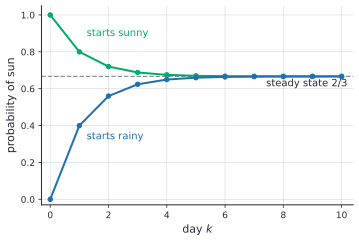
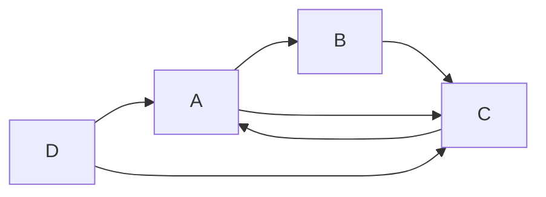

# Eigenvalues and eigenvectors

After this lesson you can find the eigenvalues and eigenvectors of a matrix, decide whether it can be diagonalized and do so, use $A = PDP^{-1}$ to compute powers of a matrix, and use eigenvalues to find the long-run behaviour of a Markov chain and a closed formula for the Fibonacci numbers.

Before this: [determinants](06-determinants.md), [linear transformations, kernel and image](05-linear-transformations-kernel-and-image.md), [linear independence, basis and dimension](04-linear-independence-basis-and-dimension.md) and [orthogonality, projections and least squares](07-orthogonality-projections-and-least-squares.md). Complex eigenvalues use [complex numbers](../../03-high-school/05-quadratics-and-complex-numbers/03-complex-numbers.md).

## Quick check

Try these first. If you get all three right, skip to [Practice](#practice).

1. Is $\mathbf{v} = (1, 1)$ an eigenvector of $A = \begin{pmatrix} 2 & 1 \\ 1 & 2 \end{pmatrix}$? If so, for which eigenvalue?
2. Find the eigenvalues of $\begin{pmatrix} 2 & 5 \\ 0 & -3 \end{pmatrix}$.
3. If $A$ has eigenvalue 3 with eigenvector $\mathbf{v}$, what is $A^4\mathbf{v}$?

<details class="solution" markdown>
<summary>Answers</summary>

1. $A\mathbf{v} = (3, 3) = 3\mathbf{v}$, so yes, with eigenvalue 3.
2. The matrix is triangular, so the eigenvalues are the diagonal entries, $2$ and $-3$.
3. Applying $A$ multiplies $\mathbf{v}$ by 3 each time, so $A^4\mathbf{v} = 3^4\mathbf{v} = 81\mathbf{v}$.

</details>

## The idea

Most vectors change direction when a matrix acts on them. Take $A = \begin{pmatrix} 2 & 1 \\ 1 & 2 \end{pmatrix}$ and the vector $\mathbf{i} = (1, 0)$: it goes to $(2, 1)$, which points somewhere else. But a few special directions behave differently. The vector $(1, 1)$ goes to $(3, 3)$, which is the same direction, three times as long. The vector $(1, -1)$ goes to $(1, -1)$, unchanged. Along these two directions the matrix does nothing complicated: it stretches by 3 along one and by 1 along the other.


The picture shows what a matrix does to a whole circle: it turns it into an ellipse, and for this matrix the two special directions are exactly the axes of the ellipse. Each point of the circle is a combination of the two special vectors, so once you know what happens along those two lines, you know what happens everywhere. That is the point of the lesson. If a matrix has enough of these special directions, then in those directions it is just a list of stretch factors, and everything hard about repeated multiplication becomes easy: after $k$ steps the stretch along each direction is the $k$-th power of its factor.

The stretch factor is an eigenvalue and the special direction is an eigenvector. The words come from the German *eigen*, "own" or "characteristic": the directions a matrix keeps as its own. The lesson shows how to find them (a determinant equation from the last lesson), when there are enough of them (a proof), and what they are good for: powers of a matrix, a weather model that settles down, the Fibonacci numbers and the idea behind PageRank.

## Definitions

Let $A$ be an $n \times n$ matrix. A nonzero vector $\mathbf{v}$ in $\mathbb{R}^n$ is an **eigenvector** of $A$ if $A\mathbf{v} = \lambda\mathbf{v}$ for some scalar $\lambda$. The scalar $\lambda$ is the **eigenvalue** belonging to $\mathbf{v}$. In plain words, $A$ sends $\mathbf{v}$ to a multiple of itself, so it stretches (or flips, or collapses) $\mathbf{v}$ without turning it off its line. The vector must be nonzero, because $A\mathbf{0} = \lambda\mathbf{0}$ holds for every $\lambda$ and would say nothing. The eigenvalue itself may be zero.

For an eigenvalue $\lambda$ of $A$, the **eigenspace** is $E_\lambda = \{\mathbf{v} \mid A\mathbf{v} = \lambda\mathbf{v}\} = N(A - \lambda I)$. In plain words, it is all the eigenvectors for $\lambda$ together with $\mathbf{0}$. It is a subspace, because it is a null space.

The **characteristic polynomial** of $A$ is $p(\lambda) = \det(A - \lambda I)$. It is a polynomial of degree $n$ in $\lambda$. The equation $p(\lambda) = 0$ is the **characteristic equation**.

The **algebraic multiplicity** of an eigenvalue is its multiplicity as a root of $p$, and its **geometric multiplicity** is the dimension of its eigenspace. In plain words, the first says how many times $\lambda$ appears among the eigenvalues, and the second says how many independent eigenvectors it has. The geometric multiplicity is at least 1 and at most the algebraic one (a fact this book states).

A square matrix $A$ is **diagonalizable** if there is an invertible matrix $P$ and a diagonal matrix $D$ with $A = PDP^{-1}$. In plain words, in the right basis the matrix is just a list of stretch factors.

A real matrix can have complex eigenvalues. When that happens the eigenvectors have complex entries. Unless a section says otherwise, this lesson uses real eigenvalues, and the section on rotations shows the complex case.

## How to do it

### Finding eigenvalues

*Theorem 1.* A number $\lambda$ is an eigenvalue of $A$ if and only if $\det(A - \lambda I) = 0$.

We know the definition, the null space, and from the [determinants lesson](06-determinants.md) that a square matrix has a nonzero null vector exactly when its determinant is 0. We want to turn "$A\mathbf{v} = \lambda\mathbf{v}$ for some $\mathbf{v} \ne \mathbf{0}$" into an equation in $\lambda$ alone. The plan is to move everything to one side and recognize a null space.

*Proof.* The equation $A\mathbf{v} = \lambda\mathbf{v}$ is the same as $A\mathbf{v} - \lambda I\mathbf{v} = \mathbf{0}$, that is, $(A - \lambda I)\mathbf{v} = \mathbf{0}$. So $\lambda$ is an eigenvalue exactly when this has a solution $\mathbf{v} \ne \mathbf{0}$, which means that $A - \lambda I$ has a nonzero null vector, so it is not invertible. By Theorem 4 of the last lesson, that happens exactly when $\det(A - \lambda I) = 0$. $\blacksquare$

Look back: the proof tells you what to do next. For each eigenvalue you found, the eigenvectors are the nonzero solutions of $(A - \lambda I)\mathbf{v} = \mathbf{0}$, which row reduction handles, and the system must have a free variable (otherwise $\lambda$ wouldn't be an eigenvalue).

For a $2 \times 2$ matrix $A = \begin{pmatrix} a & b \\ c & d \end{pmatrix}$ the characteristic polynomial is

$$
\det\begin{pmatrix} a - \lambda & b \\ c & d - \lambda \end{pmatrix} = (a - \lambda)(d - \lambda) - bc = \lambda^2 - (a + d)\lambda + (ad - bc).
$$

The number $a + d$ is the **trace** $\operatorname{tr} A$, the sum of the diagonal entries. So $p(\lambda) = \lambda^2 - (\operatorname{tr} A)\lambda + \det A$. Since $p(\lambda) = (\lambda - \lambda_1)(\lambda - \lambda_2)$ for the two roots, comparing coefficients gives $\lambda_1 + \lambda_2 = \operatorname{tr} A$ and $\lambda_1\lambda_2 = \det A$. The same holds for every size (stated here): the sum of the eigenvalues, counted with multiplicity and allowing complex values, is the trace, and the product is the determinant. These two facts are useful checks.

*Theorem 2.* The eigenvalues of a triangular matrix are its diagonal entries.

*Proof.* If $A$ is triangular then so is $A - \lambda I$, with diagonal entries $a_{ii} - \lambda$. By the determinant of a triangular matrix, $\det(A - \lambda I) = (a_{11} - \lambda)\cdots(a_{nn} - \lambda)$, whose roots are $a_{11}, \dots, a_{nn}$. $\blacksquare$

### The method

1. Write $A - \lambda I$ and compute $p(\lambda) = \det(A - \lambda I)$. For $2 \times 2$, use $\lambda^2 - (\operatorname{tr} A)\lambda + \det A$. For a triangular matrix, read the eigenvalues off the diagonal.
2. Solve $p(\lambda) = 0$ for the eigenvalues.
3. For each eigenvalue $\lambda$, solve $(A - \lambda I)\mathbf{v} = \mathbf{0}$ by row reduction. The nonzero solutions are the eigenvectors, and the solution set is the eigenspace.
4. Check: multiply $A$ by each eigenvector and compare with $\lambda\mathbf{v}$. Also check the sum of eigenvalues against the trace and the product against the determinant.

### Independent eigenvectors and diagonalization

*Theorem 3.* Eigenvectors that belong to different eigenvalues are linearly independent. That is, if $\mathbf{v}_1, \dots, \mathbf{v}_k$ are eigenvectors of $A$ for eigenvalues $\lambda_1, \dots, \lambda_k$ that are all different, then $\mathbf{v}_1, \dots, \mathbf{v}_k$ are linearly independent.

We know $A\mathbf{v}_i = \lambda_i\mathbf{v}_i$ with $\mathbf{v}_i \ne \mathbf{0}$ and the $\lambda_i$ different. We want independence. The proof is by contradiction: we take the shortest dependent list at the front and show that it forces a nonzero vector to be zero.

*Proof.* Suppose the list is dependent. Let $p$ be the smallest number such that $\mathbf{v}_1, \dots, \mathbf{v}_p$ is dependent. Then $p \ge 2$, since $\mathbf{v}_1 \ne \mathbf{0}$ is independent alone, and $\mathbf{v}_1, \dots, \mathbf{v}_{p-1}$ is independent. So $\mathbf{v}_p$ is a combination of the earlier ones:

$$
\mathbf{v}_p = c_1\mathbf{v}_1 + \dots + c_{p-1}\mathbf{v}_{p-1}.
$$

Apply $A$ to both sides: $\lambda_p\mathbf{v}_p = c_1\lambda_1\mathbf{v}_1 + \dots + c_{p-1}\lambda_{p-1}\mathbf{v}_{p-1}$. Multiply the first equation by $\lambda_p$: $\lambda_p\mathbf{v}_p = c_1\lambda_p\mathbf{v}_1 + \dots + c_{p-1}\lambda_p\mathbf{v}_{p-1}$. Subtract:

$$
\mathbf{0} = c_1(\lambda_1 - \lambda_p)\mathbf{v}_1 + \dots + c_{p-1}(\lambda_{p-1} - \lambda_p)\mathbf{v}_{p-1}.
$$

The vectors $\mathbf{v}_1, \dots, \mathbf{v}_{p-1}$ are independent, so every coefficient is 0. Since $\lambda_i - \lambda_p \ne 0$, every $c_i = 0$. But then $\mathbf{v}_p = \mathbf{0}$, which is not allowed for an eigenvector. This contradiction shows that the list is independent. $\blacksquare$

Look back: the proof is a short trick, apply $A$ and also multiply by $\lambda_p$, and then the difference removes $\mathbf{v}_p$. A consequence is that a matrix with $n$ different eigenvalues has $n$ independent eigenvectors, so it is diagonalizable by the next theorem.

*Theorem 4.* An $n \times n$ matrix $A$ is diagonalizable if and only if it has $n$ linearly independent eigenvectors. In that case $A = PDP^{-1}$, where the columns of $P$ are the eigenvectors and $D$ is the diagonal matrix of the matching eigenvalues, in the same order.

*Proof.* Let $P$ have columns $\mathbf{p}_1, \dots, \mathbf{p}_n$ and let $D = \operatorname{diag}(\lambda_1, \dots, \lambda_n)$. Column $j$ of $AP$ is $A\mathbf{p}_j$, and column $j$ of $PD$ is $\lambda_j\mathbf{p}_j$. So $AP = PD$ means exactly $A\mathbf{p}_j = \lambda_j\mathbf{p}_j$ for every $j$, that is, each $\mathbf{p}_j$ is an eigenvector (or zero) for $\lambda_j$. If the columns are $n$ independent eigenvectors, $P$ is invertible, and $AP = PD$ gives $A = PDP^{-1}$. Conversely, if $A = PDP^{-1}$ with $P$ invertible, then $AP = PD$, so the columns of $P$ are eigenvectors, and they are independent because $P$ is invertible. $\blacksquare$

Look back: diagonalization is a change of basis. Multiplying by $P^{-1}$ writes a vector in the eigenvector basis, $D$ stretches each coordinate, and $P$ writes the answer back in standard coordinates. A matrix fails to be diagonalizable when some eigenvalue has fewer independent eigenvectors than its algebraic multiplicity (Example 3).

*Powers.* If $A = PDP^{-1}$ then $A^k = PD^kP^{-1}$, where $D^k$ is $D$ with every diagonal entry raised to the $k$-th power. The reason is that $A^2 = PDP^{-1}PDP^{-1} = PD^2P^{-1}$, the middle $P^{-1}P$ being $I$, and in general the $P^{-1}P$ pairs cancel in a chain.

### A Markov chain

A weather model: if today is sunny, tomorrow is sunny with probability $0.8$ and rainy with probability $0.2$. If today is rainy, tomorrow is sunny with probability $0.4$ and rainy with probability $0.6$. (The numbers are made up.) Let $\mathbf{x}_k = (s_k, r_k)$ be the probabilities of sun and rain on day $k$. The transition probabilities are conditional probabilities (see [conditional probability and Bayes' theorem](../07-probability/02-conditional-probability-and-bayes.md)), and the law of total probability gives

$$
\begin{pmatrix} s_{k+1} \\ r_{k+1} \end{pmatrix} = \begin{pmatrix} 0.8 & 0.4 \\ 0.2 & 0.6 \end{pmatrix}\begin{pmatrix} s_k \\ r_k \end{pmatrix}, \qquad \mathbf{x}_{k+1} = M\mathbf{x}_k, \qquad \mathbf{x}_k = M^k\mathbf{x}_0.
$$

Column $j$ of $M$ holds the probabilities of tomorrow's weather given today's weather $j$, so each column adds to 1. A matrix with nonnegative entries and columns adding to 1 is called a **stochastic matrix**, and a sequence $\mathbf{x}_{k+1} = M\mathbf{x}_k$ is a **Markov chain**. A vector $\mathbf{x}$ with $M\mathbf{x} = \mathbf{x}$ and entries adding to 1 is a **steady-state vector**: an eigenvector of eigenvalue 1.

*Theorem 5.* Every stochastic matrix has 1 as an eigenvalue.

*Proof.* Let $\mathbf{1}$ be the column of all ones. The columns of $M$ add to 1, so $M^T\mathbf{1} = \mathbf{1}$ (entry $j$ of $M^T\mathbf{1}$ is the sum of column $j$ of $M$). So 1 is an eigenvalue of $M^T$. A matrix and its transpose have the same determinant, so $\det(M - \lambda I) = \det(M^T - \lambda I)$ and they have the same eigenvalues. $\blacksquare$

The characteristic polynomial of the weather matrix is $\lambda^2 - 1.4\lambda + 0.4 = (\lambda - 1)(\lambda - 0.4)$, with trace $1.4$ and determinant $0.8 \cdot 0.6 - 0.4 \cdot 0.2 = 0.4$. The eigenvalues are $1$ and $0.4$. The eigenvector for 1 solves $(M - I)\mathbf{v} = \mathbf{0}$, that is $-0.2s + 0.4r = 0$, so $\mathbf{v} = (2, 1)$. For $0.4$ the equation is $0.4s + 0.4r = 0$ and $\mathbf{v} = (1, -1)$. Dividing the first by the sum of its entries gives the steady state $\left(\frac{2}{3}, \frac{1}{3}\right)$: in the long run it is sunny two days in three.

Start from a rainy day, $\mathbf{x}_0 = (0, 1)$. Write it in the eigenvectors, $(0, 1) = \frac{1}{3}(2, 1) - \frac{2}{3}(1, -1)$. Each step multiplies the first piece by 1 and the second by $0.4$, so

$$
\mathbf{x}_k = \frac{1}{3}(2, 1) - \frac{2}{3}(0.4)^k(1, -1) = \left(\frac{2}{3} - \frac{2}{3}(0.4)^k,\; \frac{1}{3} + \frac{2}{3}(0.4)^k\right).
$$

The $0.4^k$ part dies out, so the chain approaches the steady state whatever the starting point.



This is typical. For a stochastic matrix where some power has all entries positive, the eigenvalue 1 is the largest in absolute value, the others have absolute value below 1, and every starting distribution converges to the one steady-state vector. This book states the result (it is a theorem of Perron and Frobenius) and proves the two-state case above by diagonalizing.

### Fibonacci numbers from an eigenvalue problem

The Fibonacci numbers are $F_0 = 0$, $F_1 = 1$ and $F_{n+1} = F_n + F_{n-1}$. In matrix form,

$$
\begin{pmatrix} F_{n+1} \\ F_n \end{pmatrix} = \begin{pmatrix} 1 & 1 \\ 1 & 0 \end{pmatrix}\begin{pmatrix} F_n \\ F_{n-1} \end{pmatrix}, \qquad \begin{pmatrix} F_{n+1} \\ F_n \end{pmatrix} = A^n\begin{pmatrix} 1 \\ 0 \end{pmatrix}.
$$

The characteristic polynomial is $\lambda^2 - \lambda - 1$, with roots $\varphi = \frac{1 + \sqrt{5}}{2} \approx 1.618$ and $\psi = \frac{1 - \sqrt{5}}{2} \approx -0.618$. An eigenvector for $\lambda$ is $(\lambda, 1)$, because $A(\lambda, 1) = (\lambda + 1, \lambda)$ and $\lambda + 1 = \lambda^2$ for a root. The starting vector is a combination of the two eigenvectors: $(1, 0) = \frac{1}{\sqrt{5}}\left[(\varphi, 1) - (\psi, 1)\right]$, since $\frac{\varphi - \psi}{\sqrt{5}} = 1$. Apply $A^n$, which multiplies each piece by its eigenvalue to the $n$-th power, and read the second entry:

$$
F_n = \frac{\varphi^n - \psi^n}{\sqrt{5}}.
$$

This is Binet's formula. For $n = 10$: $\varphi^{10} \approx 122.9919$ and $\psi^{10} \approx 0.0081$, so $F_{10} = \frac{122.9919 - 0.0081}{2.2361} = 55$. Because $\lvert \psi \rvert < 1$, the term $\psi^n$ vanishes, so $F_n$ is the nearest integer to $\frac{\varphi^n}{\sqrt{5}}$, and the ratio $\frac{F_{n+1}}{F_n}$ tends to $\varphi$. The eigenvalue $\varphi$ is the growth rate. See [Recurrences](../../06-cs-math/04-sums-recurrences-and-algorithms/02-recurrences.md) for the same formula by the characteristic equation of a recurrence.

### Complex eigenvalues: a rotation

The rotation by $\theta$, $R = \begin{pmatrix} \cos\theta & -\sin\theta \\ \sin\theta & \cos\theta \end{pmatrix}$, has trace $2\cos\theta$ and determinant $1$, so $p(\lambda) = \lambda^2 - 2\cos\theta\,\lambda + 1$. By the quadratic formula the roots are $\cos\theta \pm i\sin\theta = e^{\pm i\theta}$, with absolute value 1. Unless $\theta$ is $0^\circ$ or $180^\circ$ they are not real, which makes sense in the picture: every direction in the plane turns, so no line is kept, and no real eigenvector exists. For $\theta = 90^\circ$ the eigenvalues are $\pm i$, with eigenvector $(1, -i)$ for $i$. A real matrix has its complex eigenvalues in conjugate pairs. The pair $a \pm bi$ tells you the matrix rotates by the angle of $a + bi$ and scales by its absolute value $\sqrt{a^2 + b^2}$. For example, $\begin{pmatrix} 1 & -1 \\ 1 & 1 \end{pmatrix}$ has eigenvalues $1 \pm i$, absolute value $\sqrt{2}$ and angle $45^\circ$, which is the last panel of the gallery in [linear transformations](05-linear-transformations-kernel-and-image.md).

### PageRank as an eigenvector

A web search engine needs to rank pages. The idea in the original PageRank paper (Brin and Page, 1998, "The anatomy of a large-scale hypertextual Web search engine", *Computer Networks and ISDN Systems* 30, pages 107 to 117) is a random surfer who follows a random link from the current page with probability $d$ and jumps to a random page otherwise. The paper describes $d$ as a damping factor between 0 and 1, usually set to $0.85$. The rank of a page is the long-run fraction of time the surfer spends there. That is the steady-state vector of a Markov chain.

Here is a toy web of four pages. Page A links to B and C, B links to C, C links to A, and D links to A and C.



Let column $j$ of $L$ spread page $j$'s vote equally over the pages it links to. Then the surfer's chain is $G = dL + \frac{1 - d}{4}J$, where $J$ is the matrix of all ones, and $G$ is stochastic with all entries positive. The rank vector $\mathbf{r}$ satisfies $G\mathbf{r} = \mathbf{r}$, an eigenvector for the eigenvalue 1, with entries adding to 1. With $d = 0.85$ it is about $(0.380, 0.199, 0.384, 0.038)$ for A, B, C, D. Page C ranks first because three pages vote for it, and D ranks last because nobody links to it, so it receives only the random jumps, $\frac{1 - d}{4} = 0.0375$. For a real web with billions of pages nobody solves a determinant: the vector is found by multiplying a starting vector by $G$ repeatedly (power iteration), which converges because the other eigenvalues have absolute value below 1, exactly like the $0.4^k$ above.

### Symmetric matrices

A matrix is **symmetric** if $A^T = A$. In plain words, it is unchanged when reflected across the diagonal. Covariance matrices and the matrix $A^TA$ of the last lesson are symmetric.

*Theorem 6.* If $A$ is symmetric, eigenvectors belonging to different eigenvalues are orthogonal.

We know $A^T = A$, so $(A\mathbf{v}) \cdot \mathbf{w} = \mathbf{v}^TA^T\mathbf{w} = \mathbf{v}^TA\mathbf{w} = \mathbf{v} \cdot (A\mathbf{w})$. We want $\mathbf{v} \cdot \mathbf{w} = 0$. The plan is to compute that one quantity in two ways.

*Proof.* Let $A\mathbf{v} = \lambda\mathbf{v}$ and $A\mathbf{w} = \mu\mathbf{w}$ with $\lambda \ne \mu$. Then $\lambda(\mathbf{v} \cdot \mathbf{w}) = (A\mathbf{v}) \cdot \mathbf{w} = \mathbf{v} \cdot (A\mathbf{w}) = \mu(\mathbf{v} \cdot \mathbf{w})$. So $(\lambda - \mu)(\mathbf{v} \cdot \mathbf{w}) = 0$, and since $\lambda - \mu \ne 0$, $\mathbf{v} \cdot \mathbf{w} = 0$. $\blacksquare$

The rest of the story is a theorem that this book states without proof. *Spectral theorem:* a real symmetric matrix has only real eigenvalues, and $\mathbb{R}^n$ has an orthonormal basis of eigenvectors, so $A = QDQ^T$ with $Q$ an orthogonal matrix, $Q^{-1} = Q^T$. Symmetric matrices are always diagonalizable, and the eigenvectors are perpendicular axes, as in the ellipse picture, where the axes of the ellipse $(1, 1)$ and $(1, -1)$ are orthogonal. The same fact is behind principal component analysis, which finds the axes of a cloud of data as the eigenvectors of its covariance matrix (see [joint distributions, covariance and sums](../07-probability/05-joint-distributions-covariance-and-sums.md)).

## Worked examples

<div class="example" markdown>

### Example 1: eigenvalues, eigenvectors, diagonalization and a power

Let $B = \begin{pmatrix} 4 & 1 \\ 2 & 3 \end{pmatrix}$. Find the eigenvalues and eigenvectors, diagonalize $B$, and compute $B^3$.

Step 1: the trace is $7$ and the determinant is $12 - 2 = 10$, so $p(\lambda) = \lambda^2 - 7\lambda + 10$. Step 2: it factors as $(\lambda - 5)(\lambda - 2)$, so the eigenvalues are $5$ and $2$.

Step 3, for $\lambda = 5$: $B - 5I = \begin{pmatrix} -1 & 1 \\ 2 & -2 \end{pmatrix}$, and $-x + y = 0$ gives $\mathbf{v}_1 = (1, 1)$. For $\lambda = 2$: $B - 2I = \begin{pmatrix} 2 & 1 \\ 2 & 1 \end{pmatrix}$, and $2x + y = 0$ gives $\mathbf{v}_2 = (1, -2)$.

Step 4, the check: $B\mathbf{v}_1 = (5, 5) = 5\mathbf{v}_1$ and $B\mathbf{v}_2 = (4 - 2,\; 2 - 6) = (2, -4) = 2\mathbf{v}_2$. The sum $5 + 2 = 7$ is the trace and the product $10$ is the determinant.

Two different eigenvalues give independent eigenvectors (Theorem 3), so $B = PDP^{-1}$ with $P = \begin{pmatrix} 1 & 1 \\ 1 & -2 \end{pmatrix}$ and $D = \begin{pmatrix} 5 & 0 \\ 0 & 2 \end{pmatrix}$. Here $\det P = -3$ and $P^{-1} = \frac{1}{3}\begin{pmatrix} 2 & 1 \\ 1 & -1 \end{pmatrix}$. Then

$$
B^3 = PD^3P^{-1} = \begin{pmatrix} 1 & 1 \\ 1 & -2 \end{pmatrix}\begin{pmatrix} 125 & 0 \\ 0 & 8 \end{pmatrix}\frac{1}{3}\begin{pmatrix} 2 & 1 \\ 1 & -1 \end{pmatrix} = \frac{1}{3}\begin{pmatrix} 258 & 117 \\ 234 & 141 \end{pmatrix} = \begin{pmatrix} 86 & 39 \\ 78 & 47 \end{pmatrix}.
$$

Check: multiplying out $B \cdot B$ gives $\begin{pmatrix} 18 & 7 \\ 14 & 11 \end{pmatrix}$, and times $B$ again gives $\begin{pmatrix} 86 & 39 \\ 78 & 47 \end{pmatrix}$.

</div>

<div class="example" markdown>

### Example 2: a $3 \times 3$ triangular matrix

Find the eigenvalues and eigenvectors of $T = \begin{pmatrix} 2 & 1 & 4 \\ 0 & 3 & 5 \\ 0 & 0 & 7 \end{pmatrix}$.

The matrix is upper triangular, so by Theorem 2 the eigenvalues are $2$, $3$ and $7$. They are different, so $T$ has three independent eigenvectors and is diagonalizable.

For $\lambda = 2$: $T - 2I = \begin{pmatrix} 0 & 1 & 4 \\ 0 & 1 & 5 \\ 0 & 0 & 5 \end{pmatrix}$. The last row gives $z = 0$, then $y = 0$, and $x$ is free, so $\mathbf{v} = (1, 0, 0)$.

For $\lambda = 3$: $T - 3I = \begin{pmatrix} -1 & 1 & 4 \\ 0 & 0 & 5 \\ 0 & 0 & 4 \end{pmatrix}$. Then $z = 0$ and $-x + y = 0$, so $\mathbf{v} = (1, 1, 0)$.

For $\lambda = 7$: $T - 7I = \begin{pmatrix} -5 & 1 & 4 \\ 0 & -4 & 5 \\ 0 & 0 & 0 \end{pmatrix}$. The second row gives $y = \frac{5}{4}z$, and the first gives $5x = y + 4z = \frac{21}{4}z$. Taking $z = 20$ clears the fractions: $\mathbf{v} = (21, 25, 20)$.

Check the last one: $T\mathbf{v} = (42 + 25 + 80,\; 75 + 100,\; 140) = (147, 175, 140) = 7(21, 25, 20)$. Check the trace: $2 + 3 + 7 = 12$ is the sum of the diagonal, and $\det T = 2 \cdot 3 \cdot 7 = 42$ is the product of the eigenvalues.

</div>

<div class="example" markdown>

### Example 3: a matrix that cannot be diagonalized

Let $N = \begin{pmatrix} 1 & 1 \\ 0 & 1 \end{pmatrix}$, the shear. Find its eigenvalues and eigenspaces and decide whether it is diagonalizable.

The matrix is triangular with diagonal $1, 1$, so $p(\lambda) = (\lambda - 1)^2$ and the only eigenvalue is 1, with algebraic multiplicity 2.

The eigenspace is $N(N - I) = N\left(\begin{pmatrix} 0 & 1 \\ 0 & 0 \end{pmatrix}\right)$. The only condition is $y = 0$, so the eigenspace is the line spanned by $(1, 0)$, with geometric multiplicity 1.

There is only one independent eigenvector, and a diagonalization needs two, so $N$ is not diagonalizable. The picture agrees: the shear slides every point sideways, so the only direction it keeps is the horizontal axis. Compare the identity matrix, with the same characteristic polynomial $(\lambda - 1)^2$ but an eigenspace of dimension 2 (every vector), which is diagonalizable (it is already diagonal).

Check: if $N = PDP^{-1}$ then $D = I$ because the only eigenvalue is 1, so $N = PIP^{-1} = I$, which is false.

</div>

<div class="example" markdown>

### Example 4: two brands, month by month

In a hypothetical market, each month 90% of the customers of brand X stay with it and 10% switch to brand Y. Of brand Y's customers, 30% switch to X and 70% stay. Find the long-run market shares, and the shares after 3 months if the market starts at 50% each.

The share vector $\mathbf{x} = (x, y)$ evolves by $M = \begin{pmatrix} 0.9 & 0.3 \\ 0.1 & 0.7 \end{pmatrix}$, whose columns add to 1. The trace is $1.6$, and since one eigenvalue is 1 (Theorem 5) the other is $0.6$. The determinant is $0.63 - 0.03 = 0.6$, consistent.

For the eigenvalue 1: $(M - I)\mathbf{v} = \mathbf{0}$ gives $-0.1x + 0.3y = 0$, so $\mathbf{v} = (3, 1)$. Divide by $4$ to make the entries add to 1: the long-run shares are $(0.75, 0.25)$. For $0.6$: $0.3x + 0.3y = 0$ gives $(1, -1)$.

Starting at $(0.5, 0.5)$: write it as $(0.5, 0.5) = a(3, 1) + b(1, -1)$. Then $3a + b = 0.5$ and $a - b = 0.5$, so $a = 0.25$ and $b = -0.25$. After $k$ months, $\mathbf{x}_k = 0.25(3, 1) - 0.25(0.6)^k(1, -1)$. For $k = 3$, $0.6^3 = 0.216$, so $\mathbf{x}_3 = (0.75 - 0.054,\; 0.25 + 0.054) = (0.696, 0.304)$.

Check by stepping: $M(0.5, 0.5) = (0.6, 0.4)$, then $M(0.6, 0.4) = (0.66, 0.34)$, then $M(0.66, 0.34) = (0.696, 0.304)$. The shares are moving to $(0.75, 0.25)$ and the gap shrinks by a factor of $0.6$ each month.

</div>

<div class="example" markdown>

### Example 5: a symmetric matrix (finish it yourself)

Let $S = \begin{pmatrix} 1 & 2 \\ 2 & -2 \end{pmatrix}$. The trace is $-1$ and the determinant is $-2 - 4 = -6$, so $p(\lambda) = \lambda^2 + \lambda - 6 = (\lambda + 3)(\lambda - 2)$, and the eigenvalues are $2$ and $-3$.

Find an eigenvector for each, check that they are orthogonal, scale them to unit length and write $S = QDQ^T$.

<details class="solution" markdown>
<summary>Finish</summary>

For $\lambda = 2$: $S - 2I = \begin{pmatrix} -1 & 2 \\ 2 & -4 \end{pmatrix}$, so $-x + 2y = 0$ and $\mathbf{v}_1 = (2, 1)$. For $\lambda = -3$: $S + 3I = \begin{pmatrix} 4 & 2 \\ 2 & 1 \end{pmatrix}$, so $2x + y = 0$ and $\mathbf{v}_2 = (1, -2)$.

The dot product is $2 \cdot 1 + 1 \cdot (-2) = 0$, as Theorem 6 says. Both vectors have length $\sqrt{5}$, so $Q = \frac{1}{\sqrt{5}}\begin{pmatrix} 2 & 1 \\ 1 & -2 \end{pmatrix}$ and $D = \begin{pmatrix} 2 & 0 \\ 0 & -3 \end{pmatrix}$, and $S = QDQ^T$.

Check: $Q^TQ = \frac{1}{5}\begin{pmatrix} 5 & 0 \\ 0 & 5 \end{pmatrix} = I$. Also $QDQ^T$ has top left entry $\frac{1}{5}(2 \cdot 2 \cdot 2 + 1 \cdot (-3) \cdot 1) = \frac{8 - 3}{5} = 1$, matching $S$.

</details>

</div>

## Edge cases and common mistakes

<div class="warning" markdown>

Watch out: the zero vector is never an eigenvector, but zero can be an eigenvalue. If $0$ is an eigenvalue, the eigenvectors are the nonzero vectors in the kernel, and the matrix is not invertible. The matrix $\begin{pmatrix} 2 & 4 \\ 1 & 2 \end{pmatrix}$ has eigenvalues $0$ and $4$.

</div>

<div class="warning" markdown>

Watch out: eigenvalues of $A + B$ or $AB$ are not the sums or products of the eigenvalues of $A$ and $B$. Row reduction also changes eigenvalues, so don't reduce $A$ and then read off eigenvalues from the pivots. Only for a triangular matrix are the eigenvalues the diagonal entries.

</div>

<div class="warning" markdown>

Watch out: repeated eigenvalues don't guarantee a full set of eigenvectors. Both $I$ and $\begin{pmatrix} 1 & 1 \\ 0 & 1 \end{pmatrix}$ have the eigenvalue 1 twice, and only one of them is diagonalizable. Always count the independent eigenvectors, not the eigenvalues.

</div>

<div class="warning" markdown>

Watch out: in $A = PDP^{-1}$ the columns of $P$ and the entries of $D$ must be in the same order. If you swap two columns of $P$, swap the matching diagonal entries of $D$. A mismatch gives a matrix that is not $A$.

</div>

<div class="warning" markdown>

Watch out: an eigenvector can be scaled by any nonzero number, so $(1, 1)$, $(2, 2)$ and $(-3, -3)$ are all "the" eigenvector. A textbook answer may look different from yours (as with $(-\frac{1}{2}, 1)$ and $(1, -2)$) and still be right. Check by multiplying.

</div>

<div class="warning" markdown>

Watch out: for a Markov chain the columns of $M$ add to 1 in the convention of this book (the column is "from"). Some books use rows. If you load the numbers into the wrong orientation, the vector $M\mathbf{x}$ no longer adds to 1, which is a quick test.

</div>

## Tricks and shortcuts

For $2 \times 2$, use $\lambda^2 - (\operatorname{tr} A)\lambda + \det A$ and never expand the determinant. Then check that the eigenvalues add to the trace and multiply to the determinant.

After finding one eigenvalue of a $2 \times 2$ matrix, the other is $\operatorname{tr} A$ minus the first. For a stochastic $2 \times 2$ matrix the eigenvalues are $1$ and $\operatorname{tr} M - 1$, so the second eigenvalue of the weather matrix is $1.4 - 1 = 0.4$ without any algebra.

To find an eigenvector of a $2 \times 2$ matrix for $\lambda$, the two rows of $A - \lambda I$ are multiples of each other, so use either row: for $\begin{pmatrix} a - \lambda & b \\ c & d - \lambda \end{pmatrix}$ with first row $(r, s)$, a null vector is $(s, -r)$. In Example 1, the row $(-1, 1)$ gives $(1, 1)$.

For powers and long-run behaviour, you rarely need the full $P^{-1}$: write the starting vector in the eigenvectors (solve a small system) and multiply each coefficient by $\lambda^k$.

A quick test for diagonalizability: $n$ different eigenvalues are enough. If an eigenvalue is repeated, compute $\dim N(A - \lambda I)$ and compare with the multiplicity.

## In code

The code finds eigenvalues and eigenvectors with NumPy (the routine `eig` may return complex arrays, so the code takes the real parts, which is safe for these matrices), checks a diagonalization and a power, runs the weather chain, computes Fibonacci numbers from Binet's formula, finds PageRank by power iteration for the toy web, and diagonalizes a symmetric matrix with `eigh`.

<details class="code" markdown>
<summary>In code</summary>

```python
import numpy as np

# Eigenvalues and eigenvectors of B = [[4, 1], [2, 3]].
B = np.array([[4.0, 1.0], [2.0, 3.0]])
vals, vecs = np.linalg.eig(B)
vals, vecs = vals.real, vecs.real        # the eigenvalues of this matrix are real
print(np.round(vals, 6))
# [5. 2.]
print(np.round(vecs / vecs[0], 4))       # scale each column so its first entry is 1
# [[ 1.  1.]
#  [ 1. -2.]]
print(np.allclose(B @ vecs, vecs * vals))
# True

# Diagonalization and powers: B^10 = P D^10 P^{-1}.
P, D = vecs, np.diag(vals)
B10 = P @ np.diag(vals**10) @ np.linalg.inv(P)
print(np.allclose(B10, np.linalg.matrix_power(B, 10)))
# True

# The weather Markov chain: columns are "from", rows are "to"; each column adds to 1.
M = np.array([[0.8, 0.4], [0.2, 0.6]])
x = np.array([0.0, 1.0])                  # day 0: rainy for sure
for day in range(1, 6):
    x = M @ x
    print(day, np.round(x, 5))
# 1 [0.4 0.6]
# 2 [0.56 0.44]
# 3 [0.624 0.376]
# 4 [0.6496 0.3504]
# 5 [0.65984 0.34016]
vals, vecs = np.linalg.eig(M)
vals, vecs = vals.real, vecs.real
steady = vecs[:, np.argmax(vals)]
print(np.round(np.sort(vals), 4), np.round(steady / steady.sum(), 4))
# [0.4 1. ] [0.6667 0.3333]

# Fibonacci from the eigenvalues of [[1, 1], [1, 0]] (Binet's formula).
phi, psi = (1 + 5**0.5) / 2, (1 - 5**0.5) / 2
print([round((phi**n - psi**n) / 5**0.5) for n in range(11)])
# [0, 1, 1, 2, 3, 5, 8, 13, 21, 34, 55]
print(np.linalg.matrix_power(np.array([[1, 1], [1, 0]]), 10))
# [[89 55]
#  [55 34]]

# PageRank on a four-page toy web by power iteration (damping d = 0.85).
L = np.array([[0, 0, 1, 0.5],
              [0.5, 0, 0, 0],
              [0.5, 1, 0, 0.5],
              [0, 0, 0, 0]])               # column j: where page j sends its vote
d, n = 0.85, 4
G = d * L + (1 - d) / n * np.ones((n, n))
r = np.ones(n) / n
for _ in range(60):
    r = G @ r
print(np.round(r, 4), round(r.sum(), 6))
# [0.3797 0.1989 0.3839 0.0375] 1.0

# A symmetric matrix: eigh returns real eigenvalues and orthonormal eigenvectors.
S = np.array([[2.0, -1.0, 0.0], [-1.0, 2.0, -1.0], [0.0, -1.0, 2.0]])
w, Q = np.linalg.eigh(S)
print(np.round(w, 4), np.allclose(Q.T @ Q, np.eye(3)), np.allclose(Q @ np.diag(w) @ Q.T, S))
# [0.5858 2.     3.4142] True True
```

</details>

## FAQ

### Why do eigenvalues matter if I can just multiply the matrix repeatedly?

For one product you can. For the $k$-th power, a long-run limit or a closed formula, the eigenvalues tell you what happens without computing anything: the largest eigenvalue in absolute value sets the growth rate, and a matrix whose eigenvalues all have absolute value below 1 shrinks everything to zero. Multiplying a thousand times shows a pattern, while the eigenvalues explain it.

### Why must the eigenvector be nonzero?

Because $A\mathbf{0} = \lambda\mathbf{0}$ is true for every $\lambda$, so allowing $\mathbf{0}$ would make every number an eigenvalue. The point of an eigenvalue is a direction that survives. The eigenspace does contain $\mathbf{0}$, since it must be a subspace, but the eigenvectors are its nonzero members.

### What if the characteristic polynomial has no real roots?

Then the matrix has no real eigenvector, as for a rotation by $90^\circ$. The roots are complex, and the complex eigenvectors still satisfy $A\mathbf{v} = \lambda\mathbf{v}$ if you allow complex entries. The complex eigenvalue $a + bi$ describes a rotation and scaling in the plane.

### Is $PDP^{-1}$ the only way to simplify a matrix?

No. A matrix like the shear in Example 3 can't be diagonalized, and the best simplification there is a form with a 1 above the diagonal (the Jordan form, which a second course covers). For symmetric matrices there is the better $QDQ^T$ with perpendicular axes, and for a general rectangular matrix there is the singular value decomposition. All of them ask the same question: in which basis does the matrix look simplest?

## Practice

### Warm-up

1\. Find the eigenvalues and eigenvectors of $A = \begin{pmatrix} 1 & 2 \\ 0 & 3 \end{pmatrix}$.

<details class="solution" markdown>
<summary>Solution</summary>

The matrix is triangular, so the eigenvalues are $1$ and $3$. For $\lambda = 1$: $A - I = \begin{pmatrix} 0 & 2 \\ 0 & 2 \end{pmatrix}$, so $y = 0$ and $\mathbf{v} = (1, 0)$. For $\lambda = 3$: $A - 3I = \begin{pmatrix} -2 & 2 \\ 0 & 0 \end{pmatrix}$, so $-2x + 2y = 0$ and $\mathbf{v} = (1, 1)$.

Check: $A(1, 1) = (1 + 2,\; 3) = (3, 3) = 3(1, 1)$ and $A(1, 0) = (1, 0)$.

</details>

2\. Is $(1, 2)$ an eigenvector of $\begin{pmatrix} 2 & 0 \\ 1 & 3 \end{pmatrix}$? Is $(0, 1)$?

<details class="solution" markdown>
<summary>Solution</summary>

$\begin{pmatrix} 2 & 0 \\ 1 & 3 \end{pmatrix}\begin{pmatrix} 1 \\ 2 \end{pmatrix} = \begin{pmatrix} 2 \\ 7 \end{pmatrix}$, which is not a multiple of $(1, 2)$, so no. And $\begin{pmatrix} 2 & 0 \\ 1 & 3 \end{pmatrix}\begin{pmatrix} 0 \\ 1 \end{pmatrix} = \begin{pmatrix} 0 \\ 3 \end{pmatrix} = 3\begin{pmatrix} 0 \\ 1 \end{pmatrix}$, so yes, with eigenvalue 3.

Check: the matrix is triangular with diagonal $2, 3$, so $3$ is an eigenvalue, as found.

</details>

3\. Use the trace and determinant to find the eigenvalues of $\begin{pmatrix} 5 & 2 \\ 2 & 2 \end{pmatrix}$.

<details class="solution" markdown>
<summary>Solution</summary>

The trace is $7$ and the determinant is $10 - 4 = 6$, so $\lambda^2 - 7\lambda + 6 = (\lambda - 1)(\lambda - 6)$ and the eigenvalues are $1$ and $6$.

Check: $1 + 6 = 7$ and $1 \cdot 6 = 6$. An eigenvector for $6$ is $(2, 1)$: $A(2, 1) = (12, 6) = 6(2, 1)$.

</details>

### Standard

4\. Diagonalize $A = \begin{pmatrix} 1 & 4 \\ 1 & 1 \end{pmatrix}$ and compute $A^5$.

<details class="solution" markdown>
<summary>Solution</summary>

The trace is $2$ and the determinant is $1 - 4 = -3$, so $\lambda^2 - 2\lambda - 3 = (\lambda - 3)(\lambda + 1)$ and the eigenvalues are $3$ and $-1$. For $\lambda = 3$: $A - 3I = \begin{pmatrix} -2 & 4 \\ 1 & -2 \end{pmatrix}$ gives $\mathbf{v} = (2, 1)$. For $\lambda = -1$: $A + I = \begin{pmatrix} 2 & 4 \\ 1 & 2 \end{pmatrix}$ gives $\mathbf{v} = (2, -1)$.

So $P = \begin{pmatrix} 2 & 2 \\ 1 & -1 \end{pmatrix}$, $D = \begin{pmatrix} 3 & 0 \\ 0 & -1 \end{pmatrix}$ and $P^{-1} = \frac{1}{4}\begin{pmatrix} 1 & 2 \\ 1 & -2 \end{pmatrix}$ (the determinant of $P$ is $-4$). Then $D^5 = \begin{pmatrix} 243 & 0 \\ 0 & -1 \end{pmatrix}$, and

$$
A^5 = PD^5P^{-1} = \begin{pmatrix} 486 & -2 \\ 243 & 1 \end{pmatrix}\frac{1}{4}\begin{pmatrix} 1 & 2 \\ 1 & -2 \end{pmatrix} = \frac{1}{4}\begin{pmatrix} 484 & 976 \\ 244 & 484 \end{pmatrix} = \begin{pmatrix} 121 & 244 \\ 61 & 121 \end{pmatrix}.
$$

Check: $A^2 = \begin{pmatrix} 5 & 8 \\ 2 & 5 \end{pmatrix}$, $A^4 = \begin{pmatrix} 41 & 80 \\ 20 & 41 \end{pmatrix}$, and $A^4 A = \begin{pmatrix} 41 + 80 & 164 + 80 \\ 20 + 41 & 80 + 41 \end{pmatrix} = \begin{pmatrix} 121 & 244 \\ 61 & 121 \end{pmatrix}$.

</details>

5\. In a hypothetical two-brand market each month 90% of brand X's customers stay and 10% leave for Y, while 30% of Y's customers move to X. Find the matrix, its eigenvalues, and the long-run share of X. (This is Example 4 again, with a different question: what does the second eigenvalue say about the speed?)

<details class="solution" markdown>
<summary>Solution</summary>

$M = \begin{pmatrix} 0.9 & 0.3 \\ 0.1 & 0.7 \end{pmatrix}$ has eigenvalues $1$ and $0.6$ (the trace is $1.6$) and the long-run shares $(0.75, 0.25)$, so brand X settles at 75%. The second eigenvalue $0.6$ is the factor by which the distance to the steady state shrinks each month. After 5 months the gap is $0.6^5 \approx 0.078$ of its starting size, so the shares are within about 8% of the gap they started with, and after 10 months $0.6^{10} \approx 0.006$.

Check: $M(0.75, 0.25) = (0.675 + 0.075,\; 0.075 + 0.175) = (0.75, 0.25)$.

</details>

6\. Find the eigenvalues of the rotation $\begin{pmatrix} 0 & -1 \\ 1 & 0 \end{pmatrix}$ and an eigenvector for each, using complex numbers.

<details class="solution" markdown>
<summary>Solution</summary>

The trace is $0$ and the determinant is $1$, so $\lambda^2 + 1 = 0$ and $\lambda = \pm i$. For $\lambda = i$: $A - iI = \begin{pmatrix} -i & -1 \\ 1 & -i \end{pmatrix}$. The first row gives $-iv_1 - v_2 = 0$, so $v_2 = -iv_1$, and $\mathbf{v} = (1, -i)$. The conjugate $(1, i)$ belongs to $-i$.

Check: $A(1, -i) = (0 \cdot 1 + (-1)(-i),\; 1 \cdot 1 + 0) = (i, 1)$, and $i \cdot (1, -i) = (i, -i^2) = (i, 1)$. They agree.

</details>

### Challenge

7\. Let $A$ be invertible with eigenvalue $\lambda$ and eigenvector $\mathbf{v}$. Prove that $\lambda \ne 0$, that $\frac{1}{\lambda}$ is an eigenvalue of $A^{-1}$ with the same eigenvector, and that $\lambda^k$ is an eigenvalue of $A^k$ for every integer $k \ge 1$.

<details class="solution" markdown>
<summary>Solution</summary>

If $\lambda = 0$ then $A\mathbf{v} = \mathbf{0}$ with $\mathbf{v} \ne \mathbf{0}$, so $A$ would have a nonzero null vector and not be invertible. So $\lambda \ne 0$.

Apply $A^{-1}$ to $A\mathbf{v} = \lambda\mathbf{v}$: $\mathbf{v} = \lambda A^{-1}\mathbf{v}$, so $A^{-1}\mathbf{v} = \frac{1}{\lambda}\mathbf{v}$, which is allowed because $\lambda \ne 0$.

For powers, $A^2\mathbf{v} = A(\lambda\mathbf{v}) = \lambda A\mathbf{v} = \lambda^2\mathbf{v}$, and by repeating the step (induction on $k$), $A^k\mathbf{v} = \lambda^k\mathbf{v}$.

Check with Example 1: $B$ has eigenvalues $5$ and $2$, and $B^3$ has $125$ and $8$. Its trace is $86 + 47 = 133 = 125 + 8$ and its determinant is $86 \cdot 47 - 39 \cdot 78 = 4042 - 3042 = 1000 = 125 \cdot 8$.

</details>

8\. (Reviews [determinants](06-determinants.md).) Prove that a square matrix is invertible if and only if $0$ is not an eigenvalue. Then, for $A = \begin{pmatrix} 2 & 4 \\ 1 & 2 \end{pmatrix}$, find the eigenvalues, and describe the kernel as an eigenspace.

<details class="solution" markdown>
<summary>Solution</summary>

By Theorem 1, $0$ is an eigenvalue if and only if $\det(A - 0 \cdot I) = \det A = 0$, and by the determinant theorem, $\det A = 0$ if and only if $A$ is not invertible. So $A$ is invertible exactly when $0$ is not an eigenvalue.

For the matrix, the trace is $4$ and the determinant is $4 - 4 = 0$, so $\lambda^2 - 4\lambda = \lambda(\lambda - 4)$ and the eigenvalues are $0$ and $4$. The eigenspace for $0$ is $N(A - 0I) = N(A)$, which is the kernel: $2x + 4y = 0$ gives the line spanned by $(-2, 1)$. The eigenspace for $4$ is spanned by $(2, 1)$, since $A - 4I = \begin{pmatrix} -2 & 4 \\ 1 & -2 \end{pmatrix}$.

Check: $A(-2, 1) = (-4 + 4,\; -2 + 2) = (0, 0)$ and $A(2, 1) = (8, 4) = 4(2, 1)$.

</details>

## Where this shows up

- In the lesson on [second-order linear equations](../10-differential-equations-light/02-second-order-linear-equations.md), the characteristic equation of a differential equation is the same idea, and its roots (real or complex) give the growth, decay or oscillation. The complex pair $a \pm bi$ of a rotation matrix reappears there as an oscillation.
- In CS, PageRank and other ranking methods find an eigenvector, and the adjacency matrix of a graph has eigenvalues that describe its structure (see [graph basics](../../06-cs-math/05-graphs/01-graph-basics.md)). Principal component analysis diagonalizes a covariance matrix, and the stability of an iteration $\mathbf{x}_{k+1} = A\mathbf{x}_k$ depends on whether all eigenvalues have absolute value below 1.
- In economics, a Markov chain models brand switching, and a linear dynamic model $\mathbf{x}_{t+1} = A\mathbf{x}_t$ is stable if all eigenvalues of $A$ have absolute value below 1. The Leontief inverse $(I - C)^{-1}$ of [linear transformations](05-linear-transformations-kernel-and-image.md) is the sum $I + C + C^2 + \cdots$ when that condition holds for $C$.
