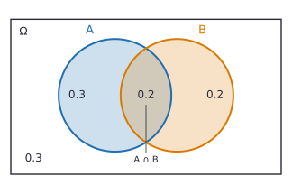

# Sample spaces, events and axioms

After this lesson you can model a random experiment as a sample space with a probability measure, state the three axioms of probability, prove the standard rules from them (the complement rule, monotonicity, inclusion-exclusion for two events and the union bound), and compute probabilities by counting and by area.

Before this: [basic probability](../../02-middle-school/07-statistics-and-probability/02-basic-probability.md), [counting: permutations and combinations](../../03-high-school/11-sequences-series-and-counting/03-counting-permutations-combinations.md) and [sets and set operations](../../04-proofs-and-logic/02-logic-and-sets/06-sets-and-set-operations.md).

## Quick check

Try these first. If you get all three right, skip to [Practice](#practice).

1. You roll two fair dice. What is the probability that the sum is at least 10 or both dice show the same number?
2. For two events, $P(A) = 0.5$, $P(B) = 0.4$ and $P(A \cap B) = 0.2$. Find $P(A \cup B)$ and the probability that neither event happens.
3. Two events have $P(A) = 0.7$ and $P(B) = 0.6$. Can they be mutually exclusive? What is the smallest possible value of $P(A \cap B)$?

<details class="solution" markdown>
<summary>Answers</summary>

1. Of the 36 equally likely cells, 6 have a sum of at least 10, and 6 are doubles. Two cells, $(5, 5)$ and $(6, 6)$, are in both lists, so the union has $6 + 6 - 2 = 10$ cells and the probability is $\frac{10}{36} = \frac{5}{18}$.
2. $P(A \cup B) = 0.5 + 0.4 - 0.2 = 0.7$, so the probability of neither is $1 - 0.7 = 0.3$.
3. No. Disjoint events would give $P(A \cup B) = 0.7 + 0.6 = 1.3$, which is more than 1. Since $P(A \cup B) \le 1$, we need $0.7 + 0.6 - P(A \cap B) \le 1$, so $P(A \cap B) \ge 0.3$.

</details>

## The idea

Throw a dart at a square target so that every spot is equally likely to be hit. What is the probability of landing in the left half? One half, because the left half is half of the area. What is the probability of hitting one exact point, say the centre? There are infinitely many points and each is as likely as any other, so the probability of any single point must be 0. The probabilities of single outcomes can't be the whole story: you can't build the answer $\frac{1}{2}$ for the left half by adding up infinitely many zeros. What works instead is to give probabilities to sets of outcomes, such as "the left half", and to ask only that these probabilities follow a few sensible rules.

The same idea covers a die. There each outcome has a probability, and the probability of a set of outcomes is the sum. The rules that a die and a dartboard both obey are short: probabilities are never negative, the probability that something happens is 1, and the probability of "this or that" is the sum when the two can't both happen. Everything else in probability, from the complement rule of [basic probability](../../02-middle-school/07-statistics-and-probability/02-basic-probability.md) to the central limit theorem, is a consequence of these rules.

This lesson states them and proves what follows. The proofs are short, and they show why the rules you already use hold for dice and for everything else. Along the way the lesson fixes a common source of mistakes: a probability model is a choice, and a wrong choice of "equally likely outcomes" gives a wrong answer that looks right.

## Definitions

An **experiment** is a process with an uncertain result. The **sample space** $\Omega$ (capital omega) is the set of all possible outcomes, and a single outcome is written $\omega$. This chapter uses $\Omega$ where the earlier lesson used $S$, since $\Omega$ is the standard symbol in probability courses.

In plain words, the sample space lists everything that could happen, and each experiment has to be described exactly enough that one outcome happens and no two outcomes happen together. For one roll of a die, $\Omega = \{1, 2, 3, 4, 5, 6\}$. For two rolls, $\Omega$ is the set of 36 ordered pairs. For the dart, $\Omega$ is the unit square $[0, 1] \times [0, 1]$, a set with infinitely many points.

An **event** is a subset of $\Omega$ that we are willing to give a probability. An event $A$ happens when the outcome $\omega$ is an element of $A$. So events are sets, and the set operations of [the sets lesson](../../04-proofs-and-logic/02-logic-and-sets/06-sets-and-set-operations.md) become the words of probability:

| Set notation | In words |
|---|---|
| $A \cup B$ | $A$ or $B$ (at least one of them) |
| $A \cap B$ | $A$ and $B$ (both) |
| $A^c$ | not $A$ |
| $A \setminus B$ | $A$ but not $B$ |
| $A \cap B = \emptyset$ | $A$ and $B$ are disjoint, also called mutually exclusive |
| $A \subseteq B$ | if $A$ happens then $B$ happens |

For a finite or countable sample space every subset is an event. For the unit square, not every subset can be given an area (a fact from measure theory, mentioned in the FAQ), so the events are the nice sets: every region you can describe with curves and inequalities is one. A collection of events has to be closed under complements and countable unions, so that "not $A$" and "$A_1$ or $A_2$ or $\dots$" are events whenever $A$ and the $A_i$ are. You will rarely need to think about this, and the proofs below only use that the sets they build are events.

A **probability measure** on $\Omega$ is a function $P$ that assigns to each event $A$ a number $P(A)$ and satisfies three axioms, due to Kolmogorov (1933):

1. (Non-negativity) $P(A) \ge 0$ for every event $A$.
2. (Normalization) $P(\Omega) = 1$.
3. (Countable additivity) If $A_1, A_2, A_3, \dots$ are pairwise disjoint events, so that $A_i \cap A_j = \emptyset$ whenever $i \ne j$, then

$$
P\!\left(\bigcup_{i=1}^{\infty} A_i\right) = \sum_{i=1}^{\infty} P(A_i).
$$

In plain words: probabilities are not negative, the whole sample space has probability 1, and for events that can't happen together the probability of "one of them" is the sum of their probabilities. A sample space together with a probability measure is a **probability space**.

For a finite or countable $\Omega$, a probability measure is the same as a list of numbers $p(\omega) \ge 0$ with $\sum_\omega p(\omega) = 1$, one for each outcome, where $P(A) = \sum_{\omega \in A} p(\omega)$. When the sample space is finite and every outcome has the same probability, the measure is the counting rule from the earlier lesson:

$$
P(A) = \frac{\lvert A \rvert}{\lvert \Omega \rvert}.
$$

This formula satisfies the axioms (the count is never negative, $\lvert \Omega \rvert / \lvert \Omega \rvert = 1$, and counts of disjoint sets add), so it is a valid model whenever the outcomes really are equally likely. For a continuous sample space such as the square, the model with all points equally likely is **area**: $P(A) = \operatorname{area}(A)$ for a region $A$ of the unit square. It also satisfies the axioms, since areas are not negative, the square has area 1 and areas of disjoint regions add.

## How to do it

### Building and using a probability model

1. Describe the experiment and write down the sample space $\Omega$. Make sure that exactly one outcome happens.
2. Choose the probability measure: list $p(\omega)$ for each outcome, or say that all outcomes are equally likely and use counting, or say that the point is uniform in a region and use area. This step is a modelling choice, so say why it is reasonable.
3. Write each event of the question as a subset of $\Omega$, with the dictionary above.
4. Compute its probability: add the outcome probabilities, count, or find an area. If the event is a union, use inclusion-exclusion. If it is "at least one", try the complement.
5. Check that every probability is between 0 and 1, that an event and its complement add to 1, and that a smaller event has a smaller probability than a bigger one.

### What the axioms imply

The five theorems below are proved from the three axioms and nothing else. That is the point: once the axioms are accepted, every other rule has to follow, and none needs a separate assumption.

*Theorem 1 (the empty event, and finite additivity).* $P(\emptyset) = 0$. If $A_1, \dots, A_n$ are pairwise disjoint events, then $P(A_1 \cup \cdots \cup A_n) = P(A_1) + \cdots + P(A_n)$.

We know the three axioms and that an infinite series of equal positive terms diverges (the [series](../05-sequences-and-series/01-sequences-and-their-limits.md) lessons make "diverges" precise). We want $P(\emptyset) = 0$, and then the finite version of axiom 3. The plan is to apply axiom 3 to an infinite list in which every event is $\emptyset$.

*Proof.* Let $c = P(\emptyset)$, a real number with $c \ge 0$ by axiom 1. The events $A_i = \emptyset$ for $i = 1, 2, 3, \dots$ are pairwise disjoint, because $\emptyset \cap \emptyset = \emptyset$, and their union is $\emptyset$. Axiom 3 gives $c = c + c + c + \cdots$. If $c > 0$ the partial sums $nc$ grow without bound, so the series can't equal the real number $c$. Hence $c = 0$.

For the second claim, take disjoint events $A_1, \dots, A_n$ and set $A_i = \emptyset$ for $i > n$. The whole infinite list is pairwise disjoint, and axiom 3 gives $P(A_1 \cup \cdots \cup A_n) = P(A_1) + \cdots + P(A_n) + 0 + 0 + \cdots$. $\blacksquare$

Look back: this is why the third axiom is stated for infinite lists. It contains the finite case, once the empty event is known to have probability 0. In particular, two disjoint events satisfy $P(A \cup B) = P(A) + P(B)$, the rule from the earlier lesson.

*Theorem 2 (the complement rule).* For every event $A$, $P(A^c) = 1 - P(A)$. In particular $0 \le P(A) \le 1$.

We know the axioms and Theorem 1. We want $P(A^c)$ in terms of $P(A)$. The plan is to split $\Omega$ into $A$ and $A^c$.

*Proof.* The events $A$ and $A^c$ are disjoint and $A \cup A^c = \Omega$. By Theorem 1 and axiom 2, $P(A) + P(A^c) = P(\Omega) = 1$, so $P(A^c) = 1 - P(A)$. Axiom 1 gives $P(A^c) \ge 0$, so $P(A) = 1 - P(A^c) \le 1$. $\blacksquare$

Look back: the bound $P(A) \le 1$ was not an axiom. It came free from non-negativity and total probability 1. With $A = \Omega$ the rule says $P(\emptyset) = 0$ again, now from a second route.

*Theorem 3 (monotonicity).* If $A \subseteq B$, then $P(A) \le P(B)$, and $P(B \setminus A) = P(B) - P(A)$.

We know the axioms. We want to compare two nested events. The plan is to write $B$ as $A$ plus the leftover part.

*Proof.* If $A \subseteq B$, then $B = A \cup (B \setminus A)$, and the two pieces are disjoint. By Theorem 1, $P(B) = P(A) + P(B \setminus A)$. So $P(B \setminus A) = P(B) - P(A)$, and since $P(B \setminus A) \ge 0$ by axiom 1, $P(B) \ge P(A)$. $\blacksquare$

Look back: a bigger set of outcomes can't be less likely. A computation that gives "the card is the king of hearts" a bigger probability than "the card is a heart" has a mistake in it.

*Theorem 4 (inclusion-exclusion for two events).* For all events $A$ and $B$,

$$
P(A \cup B) = P(A) + P(B) - P(A \cap B).
$$

We know Theorems 1 and 3. We want the probability of a union of two events that may overlap. The plan is to cut $A \cup B$ into disjoint pieces, and to get the probability of the second piece from $B$.

*Proof.* The union is the disjoint union $A \cup B = A \cup (B \setminus A)$, so $P(A \cup B) = P(A) + P(B \setminus A)$. Also $B$ is the disjoint union $B = (A \cap B) \cup (B \setminus A)$, so $P(B) = P(A \cap B) + P(B \setminus A)$, that is, $P(B \setminus A) = P(B) - P(A \cap B)$. Substituting in the first equation gives the formula. $\blacksquare$

Look back: adding $P(A)$ and $P(B)$ counts the outcomes in both events twice, and subtracting $P(A \cap B)$ repairs it, as for [counting sets](../../04-proofs-and-logic/02-logic-and-sets/06-sets-and-set-operations.md#three-sets-and-counting). The figure shows the four regions for the numbers of Quick check problem 2.



The four region probabilities add to 1. The circle $A$ holds $0.3 + 0.2 = 0.5$ and the circle $B$ holds $0.2 + 0.2 = 0.4$, so $P(A \cup B) = 0.3 + 0.2 + 0.2 = 0.7$, as the formula says. A rearranged form is also useful: since $P(A \cup B) \le 1$, we get $P(A \cap B) \ge P(A) + P(B) - 1$. For three events the formula continues in the same way:

$$
P(A \cup B \cup C) = P(A) + P(B) + P(C) - P(A \cap B) - P(A \cap C) - P(B \cap C) + P(A \cap B \cap C).
$$

Practice problem 7 proves it from Theorem 4.

*Theorem 5 (the union bound).* For events $A_1, \dots, A_n$,

$$
P(A_1 \cup A_2 \cup \cdots \cup A_n) \le P(A_1) + P(A_2) + \cdots + P(A_n).
$$

We know Theorem 4 and axiom 1. We want an upper bound for "at least one of these events happens" that needs no information about how the events overlap. The plan is induction on $n$, using Theorem 4 to add one event at a time.

*Proof.* For $n = 1$ the two sides are equal. Suppose the bound holds for $n$ events, and let $B = A_1 \cup \cdots \cup A_n$. By Theorem 4, $P(B \cup A_{n+1}) = P(B) + P(A_{n+1}) - P(B \cap A_{n+1})$, and $P(B \cap A_{n+1}) \ge 0$, so $P(B \cup A_{n+1}) \le P(B) + P(A_{n+1})$. By the induction hypothesis $P(B) \le P(A_1) + \cdots + P(A_n)$, which gives the bound for $n + 1$ events. $\blacksquare$

Look back: equality holds exactly when the overlaps have probability 0, for instance when the events are disjoint. The bound is also true for infinitely many events, and it is often called Boole's inequality. Its strength is that it needs nothing about dependence. Its weakness is that when the events overlap a lot, the right side can exceed 1 and say nothing: Example 2 shows both cases.

## Worked examples

<div class="example" markdown>

### Example 1: a union, a complement and a difference

At a college (hypothetical numbers), a randomly chosen student takes a CS course with probability 0.30, takes an economics course with probability 0.20, and takes both with probability 0.05. Find the probability that the student takes (a) CS or economics, (b) neither, (c) CS but not economics, (d) exactly one of the two.

Step 1: the experiment is choosing one student, so $\Omega$ is the set of students. Step 2: the measure is given, so only the three numbers are known. Step 3: let $C$ be "takes CS" and $E$ be "takes economics". Then $P(C) = 0.30$, $P(E) = 0.20$ and $P(C \cap E) = 0.05$.

Step 4, part (a): this is a union, so use Theorem 4:

$$
P(C \cup E) = 0.30 + 0.20 - 0.05 = 0.45.
$$

(b) "Neither" is the complement of the union, so $P = 1 - 0.45 = 0.55$.

(c) CS but not economics is $C \setminus E$. Since $E \cap C \subseteq C$, Theorem 3 gives $P(C \setminus E) = P(C) - P(C \cap E) = 0.30 - 0.05 = 0.25$.

(d) Exactly one of the two is the disjoint union of $C \setminus E$ and $E \setminus C$. The second has probability $0.20 - 0.05 = 0.15$, so $P = 0.25 + 0.15 = 0.40$.

Step 5: the four regions are 0.25 (CS only), 0.05 (both), 0.15 (economics only) and 0.55 (neither), and $0.25 + 0.05 + 0.15 + 0.55 = 1$. Each event is smaller than any event that contains it: $0.05 \le 0.30 \le 0.45$.

</div>

<div class="example" markdown>

### Example 2: hash collisions and the union bound

A program stores $n = 10{,}000$ keys in a table with $m = 2^{32}$ slots, and a hash function sends each key to a uniformly random slot, independently of the others (an idealized model). What is the probability that some two keys land in the same slot?

Step 1: an outcome is the list of slots chosen for the $n$ keys, so there are $m^n$ equally likely outcomes. Step 2: counting applies, since all lists are equally likely. Step 3: for each pair of keys $i < j$, let $A_{ij}$ be the event "keys $i$ and $j$ collide". The event we want is the union of all $\binom{n}{2}$ of these events.

Step 4: for a given pair, key $j$ lands in the slot of key $i$ with probability $\frac{1}{m}$, so $P(A_{ij}) = \frac{1}{m}$. The union bound gives

$$
P(\text{some collision}) \le \binom{n}{2}\cdot\frac{1}{m} = \frac{n(n-1)}{2m} = \frac{49{,}995{,}000}{4{,}294{,}967{,}296} \approx 0.0116.
$$

So the chance of any collision is at most about 1.2%. No work was needed on how the events $A_{ij}$ depend on each other, and that is the usefulness of the bound.

Step 5: how good is it? The exact probability is the complement of "all slots different", which counts as $\frac{m(m-1)\cdots(m-n+1)}{m^n}$, as in the birthday problem of the counting lesson. Computed, it is 0.01157, so the bound 0.01164 is very close. When the bound is tight, as here, it is because the events almost never overlap. For $n = 23$ people and $m = 365$ days the same bound gives $\frac{253}{365} \approx 0.693$, while the exact probability is 0.507: the overlaps matter more there, so the bound is loose, though still correct.

</div>

<div class="example" markdown>

### Example 3: a random point in the unit square

A point is chosen uniformly in the unit square, so $P(A) = \operatorname{area}(A)$. Find the probability of (a) $x + y \le 1$, (b) $\lvert x - y \rvert < 0.1$, (c) $x^2 + y^2 \le 1$, and (d) the point being exactly the centre.


Steps 1 to 3: $\Omega = [0, 1]^2$ and each event is a region, drawn above. Step 4: find each area.

(a) The region is a right triangle with legs of length 1, so the area is $\frac{1}{2}$.

(b) The complement is two right triangles, one above the band and one below. Each has legs $0.9$, so each has area $\frac{1}{2}(0.9)^2 = 0.405$. The band has area $1 - 2(0.405) = 0.19$.

(c) The region is a quarter of the unit disc, with area $\frac{\pi}{4} \approx 0.785$. As an integral, the area is $\int_0^1\sqrt{1 - x^2}\,dx$, the kind of area from [Riemann sums and the definite integral](../04-integrals/01-riemann-sums-and-the-definite-integral.md).

(d) A single point has area 0, so its probability is 0. The same holds for each of the infinitely many points, yet one of them is the outcome.

Step 5: all three probabilities are between 0 and 1, and (a) is smaller than (c), which fits the picture: the triangle sits inside the quarter disc. The quarter disc is also inside the whole square, so $\frac{\pi}{4} \le 1$.

An event with probability 0 is not the same as an impossible event. It is a statement about size: the probability of any set with no area is 0, whether the set is a single point or a whole line segment. Part (c) also gives a way to compute $\pi$ by simulation, which [In code](#in-code) shows.

</div>

<div class="example" markdown>

### Example 4: a loaded die (finish it yourself)

A die is loaded so that the six has probability 0.25 and each other face has probability 0.15. Check that this is a probability model. Let $A$ be "the roll is even" and $B$ be "the roll is at least 4". Find $P(A)$, $P(B)$, $P(A \cap B)$ and $P(A \cup B)$.

Step 1: $\Omega = \{1, \dots, 6\}$. Step 2: the numbers are $p(1) = \dots = p(5) = 0.15$ and $p(6) = 0.25$. They are not negative and $5(0.15) + 0.25 = 1$, so the axioms hold for $P(A) = \sum_{\omega \in A} p(\omega)$. Step 3: $A = \{2, 4, 6\}$, $B = \{4, 5, 6\}$ and $A \cap B = \{4, 6\}$.

Now add the outcome probabilities for $P(A)$, $P(B)$ and $P(A \cap B)$, and then use Theorem 4 for $P(A \cup B)$.

<details class="solution" markdown>
<summary>Finish</summary>

$P(A) = 0.15 + 0.15 + 0.25 = 0.55$, $P(B) = 0.15 + 0.15 + 0.25 = 0.55$ and $P(A \cap B) = p(4) + p(6) = 0.40$. By Theorem 4, $P(A \cup B) = 0.55 + 0.55 - 0.40 = 0.70$.

Check by listing the union: $A \cup B = \{2, 4, 5, 6\}$, and $0.15 + 0.15 + 0.15 + 0.25 = 0.70$. The complement is $\{1, 3\}$ with probability $0.30$, and $0.70 + 0.30 = 1$. Counting outcomes would have given $\frac{4}{6} \approx 0.667$, the wrong answer for this die.

</details>

</div>

## Edge cases and common mistakes

<div class="warning" markdown>

Watch out: assuming equally likely outcomes without a reason. The sum of two dice can be $2, 3, \dots, 12$, but these eleven values are not equally likely: a sum of 2 happens in one of the 36 cells and a sum of 7 in six. Two coin flips give four equally likely outcomes, HH, HT, TH and TT, not three. "Win the lottery or don't" gives two outcomes that are nowhere near equally likely. A sample space is a list of outcomes, and only some lists of outcomes make the counting formula valid. Before you count, ask what physical symmetry makes the outcomes equally likely, and if there is none, use a model with unequal probabilities.

</div>

<div class="warning" markdown>

Watch out: adding probabilities of events that overlap. The sum $P(A) + P(B)$ is the probability of the union only when $A$ and $B$ are disjoint. Otherwise it is too big by $P(A \cap B)$. The union bound turns this error into a deliberate upper bound, and it is the only legitimate way to add overlapping events without the correction term.

</div>

<div class="warning" markdown>

Watch out: probability 0 does not mean impossible, and probability 1 does not mean certain, once the sample space is infinite. Every single point of the square has probability 0, and the event "the point is not the centre" has probability 1 though it can fail. For a finite sample space with every outcome having positive probability, the empty event is the only one with probability 0. In general, only the empty event is guaranteed to be impossible.

</div>

<div class="warning" markdown>

Watch out for the Monty Hall problem. You are on a game show with three doors, a car behind one and goats behind the others. You pick door 1. The host, who knows where the car is, opens another door that shows a goat, and offers you the chance to switch to the remaining door. Most people say that two doors are left, so each has probability $\frac{1}{2}$, and switching makes no difference. That is the "equally likely" mistake: the two remaining doors are not symmetric, because the host's choice depended on where the car is. A simulation in [In code](#in-code) shows that switching wins about $\frac{2}{3}$ of the time. The conditional probability lesson ([conditional probability and Bayes' theorem](02-conditional-probability-and-bayes.md)) solves the problem exactly.

</div>

<div class="warning" markdown>

Watch out: mutually exclusive is not the same as covering everything. A group of events is **exhaustive** when its union is $\Omega$. Events that are both pairwise disjoint and exhaustive form a **partition**, and only for a partition do the probabilities have to add to 1. "A student takes CS" and "a student takes economics" are neither: some take both, and some take neither, as Example 1 shows.

</div>

## Tricks and shortcuts

Draw the picture before computing. A Venn diagram for two events, with the four region probabilities written in, turns most of the questions of Example 1 into reading off numbers, and the regions have to add up to 1.

For "at least one", start with the complement: $P(\text{at least one}) = 1 - P(\text{none})$. For "or", subtract the overlap: $P(A \cup B) = P(A) + P(B) - P(A \cap B)$. For a quick estimate of an "at least one" over many unlikely events, use the union bound: with 50 independent daily jobs that each fail with probability 0.001, the chance that at least one fails is at most $50(0.001) = 0.05$, and the exact value is $1 - 0.999^{50} = 0.0488$.

To test a probability model, add up the probabilities of all the outcomes. If the total is not 1, something is missing or counted twice. To test a counting argument, check it on a tiny version with a sample space you can write out, such as 2 dice or 3 coin flips.

## In code

A sample space with equally likely outcomes can be written out and queried: an event is a yes-or-no test on an outcome, and `Fraction` keeps the answers exact. A random point in the square is a simulation, and the Monty Hall game is the preview promised above.

<details class="code" markdown>
<summary>In code</summary>

```python
import math
import random
from fractions import Fraction
from itertools import product

# A finite sample space: two dice, 36 outcomes, each with probability 1/36.
omega = list(product(range(1, 7), repeat=2))

def P(event):
    return Fraction(sum(1 for w in omega if event(w)), len(omega))

big = lambda w: sum(w) >= 10
doubles = lambda w: w[0] == w[1]
both = lambda w: big(w) and doubles(w)
either = lambda w: big(w) or doubles(w)
print(P(big), P(doubles), P(both), P(either))   # 1/6 1/6 1/18 5/18
print(P(big) + P(doubles) - P(both))            # 5/18

# A random point in the unit square: probability is area, so estimate the area of x^2 + y^2 <= 1.
random.seed(2026)
n = 100_000
hits = sum(1 for _ in range(n) if random.random() ** 2 + random.random() ** 2 <= 1)
print(4 * hits / n, math.pi)                   # 3.15468 3.141592653589793

# The union bound for a hash table: n keys, m slots, probability that some two keys collide.
n_keys, m_slots = 10_000, 2**32
bound = n_keys * (n_keys - 1) / 2 / m_slots
exact = 1 - math.prod(1 - i / m_slots for i in range(n_keys))
print(round(bound, 5), round(exact, 5))        # 0.01164 0.01157

# Monty Hall by simulation (solved in the next lesson).
random.seed(7)
stay = switch = 0
for _ in range(100_000):
    car, pick = random.randrange(3), random.randrange(3)
    host = random.choice([d for d in range(3) if d != pick and d != car])
    other = next(d for d in range(3) if d != pick and d != host)
    stay += pick == car
    switch += other == car
print(stay / 100_000, switch / 100_000)        # 0.33225 0.66775
```

The estimate of $\pi$ is off by about 0.013 with 100,000 points, which is the size of error to expect and a point that [the law of large numbers and the CLT](06-law-of-large-numbers-and-clt.md) makes precise. In the Monty Hall simulation the host picks at random between two goat doors when he has a choice, and the switching door is whatever door is neither your pick nor the host's.

</details>

## FAQ

### Why does the third axiom use infinitely many events?

Because many natural events are unions of infinitely many pieces. A fair coin is flipped until the first head. The event "the first head comes on flip $k$" has probability $\left(\frac{1}{2}\right)^k$, and these events are disjoint, so "a head eventually comes" is their infinite union. Its probability should be $\frac{1}{2} + \frac{1}{4} + \frac{1}{8} + \cdots = 1$, a [geometric series](../05-sequences-and-series/02-infinite-series-basics.md). Finite additivity alone would not let you add up the infinite list, and countable additivity does.

### Why can't every subset be an event?

For the unit square, or even for the interval $[0, 1]$, there are subsets so irregular that no assignment of length or area to all of them can follow the axioms and also give every shifted copy of a set the same length. This is a theorem of measure theory (the Vitali construction of 1905). The fix is to give probabilities only to a large family of well-behaved subsets, closed under complements and countable unions, which contains every interval and every region of the plane that you can describe by inequalities. In practice, any event you write down is in the family.

### What does "uniformly at random" mean?

It means all outcomes are equally likely in some specified sample space, and the choice of space matters. Bertrand's paradox asks for the probability that a random chord of a circle is longer than the side of the inscribed equilateral triangle. If you pick two random points on the circle and join them, the answer is $\frac{1}{3}$. If you pick a random direction and then a random distance along the radius for the chord's midpoint, it is $\frac{1}{2}$. If you pick the midpoint uniformly inside the disc, it is $\frac{1}{4}$. Simulation confirms all three, 0.332, 0.500 and 0.250. The three recipes are three different probability measures on the set of chords, and "random chord" doesn't say which one is meant.

### Is a probability of 0.5 the same as "50-50"?

Only if you know the model. "Either it rains or it doesn't" has two outcomes but not probability $\frac{1}{2}$ each. A probability is a number that comes from a model of the experiment (equal weights, a measured frequency or a physical argument), and the axioms say only how the numbers must fit together once the model is chosen.

## Practice

### Warm-up

1\. A coin is flipped three times. (a) Write down $\Omega$. (b) Write the event "at least two heads" as a set, and find its probability. (c) Write the complement as a set.

<details class="solution" markdown>
<summary>Solution</summary>

(a) $\Omega = \{\text{HHH}, \text{HHT}, \text{HTH}, \text{HTT}, \text{THH}, \text{THT}, \text{TTH}, \text{TTT}\}$, which has $2^3 = 8$ equally likely outcomes.

(b) The event is $A = \{\text{HHH}, \text{HHT}, \text{HTH}, \text{THH}\}$, so $P(A) = \frac{4}{8} = \frac{1}{2}$.

(c) $A^c = \{\text{HTT}, \text{THT}, \text{TTH}, \text{TTT}\}$, "at most one head", and $P(A^c) = \frac{4}{8} = 1 - P(A)$.

Check: $A$ and $A^c$ are disjoint and together hold all 8 outcomes.

</details>

2\. For events $A$ and $B$, $P(A) = 0.4$, $P(B) = 0.3$ and $P(A \cup B) = 0.6$. Find $P(A \cap B)$, the probability of exactly one of the events, and the probability of neither.

<details class="solution" markdown>
<summary>Solution</summary>

Theorem 4 rearranged gives $P(A \cap B) = P(A) + P(B) - P(A \cup B) = 0.4 + 0.3 - 0.6 = 0.1$. Exactly one of the events is $(A \setminus B) \cup (B \setminus A)$, with probability $(0.4 - 0.1) + (0.3 - 0.1) = 0.3 + 0.2 = 0.5$. Neither has probability $1 - 0.6 = 0.4$.

Check: the four regions $0.3$, $0.1$, $0.2$ and $0.4$ add up to 1.

</details>

3\. Decide whether each list of numbers is a valid probability model on $\Omega = \{a, b, c\}$ (outcomes $a$, $b$, $c$ in order): (i) $(0.5, 0.3, 0.3)$, (ii) $(0.2, -0.1, 0.9)$, (iii) $(\frac{1}{2}, \frac{1}{3}, \frac{1}{6})$. Say which axiom fails when it is not.

<details class="solution" markdown>
<summary>Solution</summary>

(i) The total is $1.1$, so normalization (axiom 2) fails. (ii) The total is 1, but $-0.1$ is negative, so non-negativity (axiom 1) fails. (iii) All are non-negative and $\frac{1}{2} + \frac{1}{3} + \frac{1}{6} = \frac{3 + 2 + 1}{6} = 1$, so it is valid.

Check (iii): the probability of $\{a, b\}$ is $\frac{5}{6}$, and by the complement rule it should be $1 - P(c) = 1 - \frac{1}{6} = \frac{5}{6}$.

</details>

### Standard

4\. A point is chosen uniformly in the unit square. Find the probability that $xy \le \frac{1}{2}$.

<details class="solution" markdown>
<summary>Solution</summary>

The probability is the area of the region $xy \le \frac{1}{2}$ inside the square. For $0 \le x \le \frac{1}{2}$, every $y$ from 0 to 1 works, since $xy \le \frac{1}{2}$. For $\frac{1}{2} \le x \le 1$, the condition is $y \le \frac{1}{2x}$, and $\frac{1}{2x} \le 1$ there. So

$$
\text{area} = \frac{1}{2} + \int_{1/2}^{1}\frac{1}{2x}\,dx = \frac{1}{2} + \frac{1}{2}\ln 2 \approx 0.8466.
$$

Check: the complement is the small region above the curve $y = \frac{1}{2x}$, with area $\frac{1}{2} - \frac{1}{2}\ln 2 \approx 0.1534$, and the two areas add to 1. A simulation with 100,000 points gives about 0.846.

</details>

5\. A system has 4 components. On a given day each fails with probability 0.01, independently. Use the union bound to bound the probability that some component fails, then find the exact value and compare.

<details class="solution" markdown>
<summary>Solution</summary>

The union bound gives $P(\text{some failure}) \le 4(0.01) = 0.04$. For the exact value use the complement: no component fails with probability $0.99^4 = 0.960596$, so the probability of at least one failure is $1 - 0.960596 = 0.039404$.

The bound $0.04$ is slightly above the exact $0.0394$, the gap being the probability of two or more failures counted more than once. Check: Theorem 4 for two of the components alone gives $0.01 + 0.01 - 0.0001 = 0.0199$, a little under the bound $0.02$.

</details>

6\. A 5-card hand is dealt from a standard 52-card deck, all hands equally likely. Find the probability of (a) exactly 2 hearts, (b) all 5 cards in the same suit.

<details class="solution" markdown>
<summary>Solution</summary>

There are $\binom{52}{5} = 2{,}598{,}960$ equally likely hands (order ignored).

(a) Choose 2 of the 13 hearts and 3 of the 39 other cards: $\binom{13}{2}\binom{39}{3} = 78 \cdot 9139 = 712{,}842$. The probability is $\frac{712{,}842}{2{,}598{,}960} \approx 0.2743$.

(b) Pick the suit in 4 ways and 5 cards of it in $\binom{13}{5} = 1287$ ways: $4 \cdot 1287 = 5148$ hands, so the probability is $\frac{5148}{2{,}598{,}960} \approx 0.00198$, about 0.2%.

Check: the counts for 0, 1, 2, 3, 4 and 5 hearts, $\binom{13}{k}\binom{39}{5-k}$, add up to $2{,}598{,}960$, and the five-heart count is $1287$, a quarter of 5148.

</details>

### Challenge

7\. Prove the three-event inclusion-exclusion formula from Theorem 4.

<details class="solution" markdown>
<summary>Solution</summary>

What we know: Theorem 4, and the distributive law $(A \cup B) \cap C = (A \cap C) \cup (B \cap C)$. What we want: the formula for $P(A \cup B \cup C)$. The plan is to apply Theorem 4 twice, first to $A \cup B$ and $C$, then to $A \cap C$ and $B \cap C$.

*Proof.* Theorem 4 with the events $A \cup B$ and $C$ gives

$$
P(A \cup B \cup C) = P(A \cup B) + P(C) - P\bigl((A \cup B) \cap C\bigr).
$$

Expand the first term by Theorem 4: $P(A \cup B) = P(A) + P(B) - P(A \cap B)$. For the last term, $(A \cup B) \cap C = (A \cap C) \cup (B \cap C)$, and Theorem 4 again gives

$$
P\bigl((A \cap C) \cup (B \cap C)\bigr) = P(A \cap C) + P(B \cap C) - P(A \cap B \cap C),
$$

since $(A \cap C) \cap (B \cap C) = A \cap B \cap C$. Substituting both into the first display gives

$$
P(A) + P(B) + P(C) - P(A \cap B) - P(A \cap C) - P(B \cap C) + P(A \cap B \cap C). \qquad \blacksquare
$$

Check with one die, $A = \{1, 2, 3\}$, $B = \{2, 3, 4\}$, $C = \{3, 4, 5\}$: the formula gives $\frac{3 + 3 + 3 - 2 - 1 - 2 + 1}{6} = \frac{5}{6}$, and the union is $\{1, 2, 3, 4, 5\}$ with probability $\frac{5}{6}$.

</details>

8\. (Reviews [sets and set operations](../../04-proofs-and-logic/02-logic-and-sets/06-sets-and-set-operations.md).) Prove that for events $A_1, \dots, A_n$, $P(A_1 \cap \cdots \cap A_n) \ge 1 - \bigl(P(A_1^c) + \cdots + P(A_n^c)\bigr)$. Then find a lower bound for the probability that all of three checks pass, if each passes with probability 0.9.

<details class="solution" markdown>
<summary>Solution</summary>

What we know: De Morgan's law for sets, the complement rule and the union bound. What we want: a lower bound on the probability of an intersection. The plan is to turn the intersection into the complement of a union.

*Proof.* By De Morgan's law, $(A_1 \cap \cdots \cap A_n)^c = A_1^c \cup \cdots \cup A_n^c$. The union bound gives $P(A_1^c \cup \cdots \cup A_n^c) \le P(A_1^c) + \cdots + P(A_n^c)$. By the complement rule, $P(A_1 \cap \cdots \cap A_n) = 1 - P(A_1^c \cup \cdots \cup A_n^c)$, which is at least $1 - \bigl(P(A_1^c) + \cdots + P(A_n^c)\bigr)$. $\blacksquare$

With three checks each failing with probability $0.1$, the probability that all pass is at least $1 - 3(0.1) = 0.7$. The bound needs no independence. If the checks are independent, the exact value is $0.9^3 = 0.729$, which is above 0.7, as it must be.

Check with $n = 2$ and $P(A) = P(B) = 0.9$: the bound is $0.8$, matching $P(A \cap B) \ge P(A) + P(B) - 1$ from the inclusion-exclusion discussion.

</details>

## Where this shows up

- The next lesson, [conditional probability and Bayes' theorem](02-conditional-probability-and-bayes.md), changes the sample space to a smaller event and solves the Monty Hall problem. Random variables then turn outcomes into numbers: [discrete random variables](03-discrete-random-variables.md) and [continuous random variables and the normal distribution](04-continuous-random-variables-and-the-normal.md).
- In CS, the union bound is the standard tool for analyzing randomized algorithms and hash tables, where you bound the chance that any one of many bad events happens ([discrete probability](../../06-cs-math/03-counting-and-discrete-probability/05-discrete-probability.md)). Counting with equally likely outcomes returns in [counting rules](../../06-cs-math/03-counting-and-discrete-probability/01-counting-rules.md).
- In economics and finance, a probability space is the model behind every expected value and every risk calculation: the outcomes are the possible states of the world, and an event is a statement about them, as in insurance and expected value<!-- link: ../../08-financial-math/07-taxes-insurance-and-planning/02-insurance-and-expected-value.md -->.
