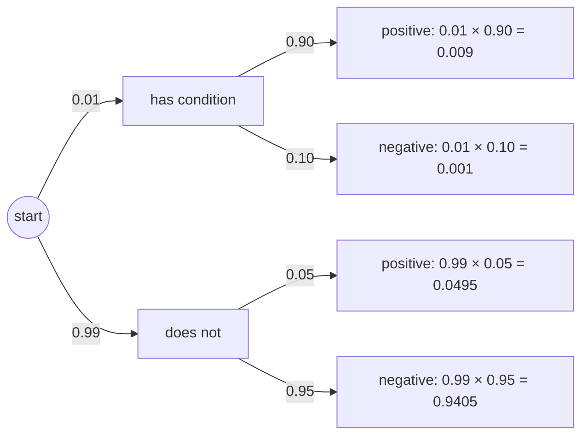

# Conditional probability and Bayes' theorem

After this lesson you can compute a conditional probability, use the multiplication rule and the law of total probability, test whether events are independent, apply Bayes' theorem to tests and filters, and solve the Monty Hall problem.

Before this: [sample spaces, events and axioms](01-sample-spaces-events-and-axioms.md) and [basic probability](../../02-middle-school/07-statistics-and-probability/02-basic-probability.md), where draws without replacement were flagged as a problem for the multiplication rule.

## Quick check

Try these first. If you get all three right, skip to [Practice](#practice).

1. You roll two fair dice. Given that the first die is even, what is the probability that the sum is 8?
2. An urn holds 4 red and 6 blue marbles. You draw two without replacement. What is the probability that both are red?
3. Of your incoming email, 60% comes from source A, and 2% of that is flagged as suspicious. The other 40% comes from source B, and 5% of that is flagged. What fraction of all email is flagged, and what fraction of flagged email comes from B?

<details class="solution" markdown>
<summary>Answers</summary>

1. The first die is even in 18 of the 36 cells. Among them the sum is 8 for $(2, 6)$, $(4, 4)$ and $(6, 2)$, so the probability is $\frac{3}{18} = \frac{1}{6}$.
2. The first marble is red with probability $\frac{4}{10}$. Given that, 3 red are left among 9, so the second is red with probability $\frac{3}{9}$. Multiply: $\frac{4}{10} \cdot \frac{3}{9} = \frac{2}{15}$.
3. Flagged email is $0.6 \cdot 0.02 + 0.4 \cdot 0.05 = 0.012 + 0.020 = 0.032$, so 3.2% of all email is flagged. The part from B is $\frac{0.020}{0.032} = 0.625$, so 62.5% of the flagged email comes from B.

</details>

## The idea

Roll a die behind a screen. Your friend peeks and says "it's even." Before the peek, the probability of a six was $\frac{1}{6}$. After it, only 2, 4 and 6 remain, they are equally likely, and the probability of a six is $\frac{1}{3}$. The new information didn't change the die. It changed which outcomes are still possible, and so it changed the sample space you are using. The probability of $A$ in the world where $B$ is known to have happened is the conditional probability of $A$ given $B$.

A picture gives the formula. Draw the sample space as a box, with $B$ as a region inside it. Once you know $B$ happened, the rest of the box is gone, and $B$ is your new box. The part of $A$ that is still possible is $A \cap B$. To make the new box have total probability 1, divide by the probability of $B$. So the probability of $A$ given $B$ is the share of $B$ that is also in $A$.

The same idea answers questions about tests. A medical test is right 90% of the time on sick people. A person tests positive. How likely is it that they are sick? The 90% is the probability of a positive given sick, and the question asks for the probability of sick given a positive. These are different numbers, and the second one depends on how common the disease is. Bayes' theorem converts one into the other. Many people get this wrong, and Example 1 shows by how much.

## Definitions

Let $A$ and $B$ be events with $P(B) > 0$. The **conditional probability** of $A$ given $B$ is

$$
P(A \mid B) = \frac{P(A \cap B)}{P(B)}.
$$

In plain words, restrict attention to the outcomes in $B$ and ask what share of them lie in $A$. For the die, $P(6 \mid \text{even}) = \frac{1/6}{1/2} = \frac{1}{3}$. If $P(B) = 0$ the ratio is a division by zero, and $P(A \mid B)$ is not defined.

For a fixed $B$, the function $A \mapsto P(A \mid B)$ is itself a probability measure. This is worth checking, because it means that every rule of the previous lesson holds after conditioning.

*Theorem 1 (conditioning gives a probability measure).* If $P(B) > 0$, then $Q(A) = P(A \mid B)$ satisfies the three axioms.

We know the definition and the axioms for $P$. We want the axioms for $Q$. The plan is to check each axiom, using the definition of $Q$.

*Proof.* Non-negativity: $Q(A) = \frac{P(A \cap B)}{P(B)} \ge 0$, since the numerator is at least 0 and the denominator is positive. Normalization: $Q(\Omega) = \frac{P(\Omega \cap B)}{P(B)} = \frac{P(B)}{P(B)} = 1$. Additivity: let $A_1, A_2, \dots$ be pairwise disjoint. Then the sets $A_i \cap B$ are pairwise disjoint too, and $\left(\bigcup_i A_i\right) \cap B = \bigcup_i (A_i \cap B)$. So

$$
Q\!\left(\bigcup_i A_i\right) = \frac{P\left(\bigcup_i (A_i \cap B)\right)}{P(B)} = \frac{\sum_i P(A_i \cap B)}{P(B)} = \sum_i Q(A_i). \qquad \blacksquare
$$

Look back: for example, $P(A^c \mid B) = 1 - P(A \mid B)$, the complement rule, now inside the world of $B$. What conditioning does not satisfy is $P(A \mid B^c) = 1 - P(A \mid B)$. The two sides condition on different events, and they are usually not related.

Rearranging the definition gives the **multiplication rule**: if $P(A) > 0$ and $P(B) > 0$, then

$$
P(A \cap B) = P(A \mid B)\,P(B) = P(B \mid A)\,P(A).
$$

In plain words, to find the probability that both happen, take the probability of one, then the probability of the other given the first. This is the rule behind every tree diagram: the number on a branch is a conditional probability, and a path multiplies. For three events it extends to $P(A_1 \cap A_2 \cap A_3) = P(A_1)\,P(A_2 \mid A_1)\,P(A_3 \mid A_1 \cap A_2)$. Three cards drawn from a deck are all hearts with probability $\frac{13}{52} \cdot \frac{12}{51} \cdot \frac{11}{50} = \frac{11}{850} \approx 0.0129$.

Two events $A$ and $B$ are **independent** when

$$
P(A \cap B) = P(A)\,P(B).
$$

In plain words, knowing that one happened doesn't change the probability of the other. The next theorem makes "doesn't change" precise.

*Theorem 2 (independence).* Suppose $P(B) > 0$. Then $A$ and $B$ are independent if and only if $P(A \mid B) = P(A)$. In that case $A$ and $B^c$ are independent as well.

We know the definitions. We want to show two equivalences and a consequence. The plan is to use the multiplication rule for the first, and the complement rule for the second.

*Proof.* If $A$ and $B$ are independent, then $P(A \mid B) = \frac{P(A \cap B)}{P(B)} = \frac{P(A)P(B)}{P(B)} = P(A)$. Conversely, if $P(A \mid B) = P(A)$, the multiplication rule gives $P(A \cap B) = P(A \mid B)P(B) = P(A)P(B)$. For the last claim, $A$ is the disjoint union of $A \cap B$ and $A \cap B^c$, so $P(A \cap B^c) = P(A) - P(A \cap B) = P(A) - P(A)P(B) = P(A)\bigl(1 - P(B)\bigr) = P(A)\,P(B^c)$. $\blacksquare$

Look back: independence is a statement about numbers, not about causes. Two events can overlap and still be independent, as Practice problem 3 shows, so the only reliable test is the product. The same argument shows that if $A$ and $B$ are independent, so are $A^c$ and $B^c$.

Independence and mutual exclusion are different, and they almost never go together. If $A$ and $B$ are disjoint and both have positive probability, then $P(A \cap B) = 0$ while $P(A)P(B) > 0$, so they are dependent: if $A$ happened, then $B$ certainly did not.

For more than two events the definition asks for more. Events $A$, $B$ and $C$ are **mutually independent** when every sub-collection multiplies: $P(A \cap B) = P(A)P(B)$, $P(A \cap C) = P(A)P(C)$, $P(B \cap C) = P(B)P(C)$ and $P(A \cap B \cap C) = P(A)P(B)P(C)$. Pairwise independence is not enough. Flip two fair coins, and let $A$ be "the first is heads", $B$ be "the second is heads" and $C$ be "the two coins match". Each has probability $\frac{1}{2}$ and each pair is independent, for example $P(A \cap C) = P(\text{HH}) = \frac{1}{4}$. But $P(A \cap B \cap C) = P(\text{HH}) = \frac{1}{4}$, not $\frac{1}{8}$.

A **partition** of $\Omega$ is a list of events $B_1, \dots, B_n$ that are pairwise disjoint and whose union is $\Omega$, so that exactly one of them happens. The first of the two main theorems says that to find the probability of an event, you can split by cases.

*Theorem 3 (law of total probability).* If $B_1, \dots, B_n$ is a partition of $\Omega$ with $P(B_i) > 0$ for all $i$, then for every event $A$,

$$
P(A) = \sum_{i=1}^{n} P(A \mid B_i)\,P(B_i).
$$

We know the multiplication rule and finite additivity. We want $P(A)$ as a sum over cases. The plan is to cut $A$ along the partition.

*Proof.* The sets $A \cap B_i$ are pairwise disjoint, and their union is $A \cap \Omega = A$. By finite additivity, $P(A) = \sum_i P(A \cap B_i)$, and by the multiplication rule $P(A \cap B_i) = P(A \mid B_i)P(B_i)$. $\blacksquare$

Look back: the law says that $P(A)$ is a weighted average of the conditional probabilities $P(A \mid B_i)$, with weights $P(B_i)$ that add to 1. In Quick check problem 3 the flagged share, 3.2%, lies between the two flag rates 2% and 5%, nearer to 2% because source A has more weight.

*Theorem 4 (Bayes' theorem).* Let $B_1, \dots, B_n$ be a partition with $P(B_i) > 0$, and let $A$ be an event with $P(A) > 0$. Then for each $j$,

$$
P(B_j \mid A) = \frac{P(A \mid B_j)\,P(B_j)}{\sum_{i=1}^{n} P(A \mid B_i)\,P(B_i)}.
$$

We know the definition of conditional probability and Theorem 3. We want to turn $P(A \mid B_j)$ around into $P(B_j \mid A)$. The plan is to write $P(B_j \cap A)$ two ways.

*Proof.* By the definition and the multiplication rule, $P(B_j \mid A) = \frac{P(B_j \cap A)}{P(A)} = \frac{P(A \mid B_j)P(B_j)}{P(A)}$. By Theorem 3, the denominator is $P(A) = \sum_i P(A \mid B_i)P(B_i)$. $\blacksquare$

Look back: the proof is two lines, and the theorem is not much more than the definition. Its use is in the direction of the conversion. In the language of inference, the $P(B_j)$ are the **prior** probabilities (before seeing $A$), the $P(A \mid B_j)$ are the **likelihoods** (how well each hypothesis predicts $A$), and the $P(B_j \mid A)$ are the **posterior** probabilities (after seeing $A$). With two hypotheses, $H$ and $H^c$, the formula is

$$
P(H \mid E) = \frac{P(E \mid H)\,P(H)}{P(E \mid H)\,P(H) + P(E \mid H^c)\,P(H^c)}.
$$

The **base rate fallacy** is the mistake of ignoring the prior $P(H)$: reading a high $P(E \mid H)$ as a high $P(H \mid E)$. The prior can swamp the likelihood, and Example 1 is the standard demonstration.

## How to do it

### A Bayes problem

1. Name the events: the hypothesis $H$ (what you want to know about) and the evidence $E$ (what you observed).
2. Write the given numbers as probabilities and say which is which: the prior $P(H)$, and the likelihoods $P(E \mid H)$ and $P(E \mid H^c)$. A "90% accurate" claim hides two different numbers, so find the one for each case.
3. Find $P(E)$ with the law of total probability: $P(E) = P(E \mid H)P(H) + P(E \mid H^c)P(H^c)$.
4. Apply Bayes' theorem: $P(H \mid E) = \frac{P(E \mid H)P(H)}{P(E)}$.
5. Check with natural frequencies. Imagine 10,000 people (or 100,000), count how many are in each case, and read the answer as a ratio of counts.

### Choosing between the rules

1. To find the probability that two things both happen, use the multiplication rule: $P(A \cap B) = P(A)P(B \mid A)$. Multiply along a tree path.
2. If knowing $B$ doesn't change $P(A)$, the events are independent, and the rule becomes $P(A)P(B)$. Test it with the definition, not with a feeling of unrelatedness.
3. To find the probability of an outcome that can arise several ways, add the paths: this is the law of total probability.
4. To reverse a conditional, $P(A \mid B)$ into $P(B \mid A)$, use Bayes' theorem.

## Worked examples

<div class="example" markdown>

### Example 1: a medical test and the base rate

A condition affects 1% of a population (hypothetical numbers throughout). A screening test gives a positive result for 90% of people who have it (the sensitivity) and for 5% of people who don't (so the specificity, the share of healthy people who test negative, is 95%). A person tests positive. What is the probability that they have the condition?

Step 1: let $H$ be "has the condition" and $E$ be "tests positive". Step 2: the prior is $P(H) = 0.01$, so $P(H^c) = 0.99$. The likelihoods are $P(E \mid H) = 0.90$ and $P(E \mid H^c) = 0.05$.



Step 3: a positive result can come from two branches, so by the law of total probability

$$
P(E) = 0.90 \cdot 0.01 + 0.05 \cdot 0.99 = 0.009 + 0.0495 = 0.0585.
$$

Step 4:

$$
P(H \mid E) = \frac{0.009}{0.0585} = \frac{2}{13} \approx 0.154.
$$

So fewer than 1 in 6 people who test positive have the condition, though the test is right on 90% of the people who have it. The fraction $\frac{2}{13}$ is an untidy answer, and that is fine.

Step 5: take 10,000 people. About 100 have the condition, and 90 of them test positive. Of the 9,900 who don't, 5% test positive, which is 495 people. The positives number $90 + 495 = 585$, and $\frac{90}{585} = \frac{2}{13}$.


The picture shows why. The false positives come from the huge healthy group, and a 5% error rate on 9,900 people produces more positives than a 90% hit rate on 100 people. A negative result is much more informative: $P(H \mid E^c) = \frac{0.001}{0.9405 + 0.001} \approx 0.0011$, about 0.1%.

The answer moves a lot with the prevalence and with the false positive rate. The next figure plots $P(H \mid E)$ against the prevalence for three tests that all have sensitivity 90%. At 1% prevalence, raising the specificity from 95% to 99% lifts the answer from 0.154 to about 0.476, and 99.9% lifts it to about 0.901.


</div>

<div class="example" markdown>

### Example 2: a spam filter

A mail server's statistics (hypothetical) say that 40% of incoming messages are spam. The word "winner" appears in 30% of spam and in 1% of legitimate mail (called ham). What is the probability that a message containing "winner" is spam? Then suppose the word "free" also appears, which occurs in 20% of spam and 5% of ham.

For one word, the prior is $P(\text{spam}) = 0.4$ and the likelihoods are $0.30$ and $0.01$. By the law of total probability, $P(\text{winner}) = 0.3 \cdot 0.4 + 0.01 \cdot 0.6 = 0.12 + 0.006 = 0.126$. Bayes' theorem gives

$$
P(\text{spam} \mid \text{winner}) = \frac{0.12}{0.126} = \frac{20}{21} \approx 0.952.
$$

For two words, a spam filter assumes that, within each class, the words appear independently (this is called the naive Bayes assumption, and it is an assumption: words are not really independent). Then the likelihood of seeing both words is the product, $0.30 \cdot 0.20 = 0.06$ in spam and $0.01 \cdot 0.05 = 0.0005$ in ham. So

$$
P(\text{spam} \mid \text{both}) = \frac{0.4 \cdot 0.06}{0.4 \cdot 0.06 + 0.6 \cdot 0.0005} = \frac{0.024}{0.0243} \approx 0.988.
$$

Check: the second word raised the probability from 0.952 to 0.988, because "free" is four times as common in spam as in ham, and the posterior must lie between 0 and 1. The contrast with Example 1 is the prior and the likelihood ratio: here spam is common (40%), and "winner" is thirty times as likely in spam as in ham, a strong signal.

</div>

<div class="example" markdown>

### Example 3: the Monty Hall problem

Behind three doors there is one car and two goats. You pick door 1. The host, who knows where the car is, opens one of the other doors to show a goat, choosing at random when he has a choice, and offers you the chance to switch. Should you?

Step 1: let $C_i$ be "the car is behind door $i$", and let $H_3$ be the evidence, "the host opens door 3". Step 2: the prior is $P(C_i) = \frac{1}{3}$ for each $i$. The likelihoods come from the host's rule:

- If the car is behind door 1, the host can open door 2 or 3 and picks at random, so $P(H_3 \mid C_1) = \frac{1}{2}$.
- If the car is behind door 2, the host must open door 3, so $P(H_3 \mid C_2) = 1$.
- If the car is behind door 3, he can't open it, so $P(H_3 \mid C_3) = 0$.

Step 3: the partition is $C_1, C_2, C_3$, and

$$
P(H_3) = \frac{1}{3} \cdot \frac{1}{2} + \frac{1}{3} \cdot 1 + \frac{1}{3} \cdot 0 = \frac{1}{2}.
$$

Step 4: Bayes' theorem gives

$$
P(C_1 \mid H_3) = \frac{\frac{1}{3}\cdot\frac{1}{2}}{\frac{1}{2}} = \frac{1}{3}, \qquad P(C_2 \mid H_3) = \frac{\frac{1}{3}\cdot 1}{\frac{1}{2}} = \frac{2}{3}.
$$

Staying with door 1 wins with probability $\frac{1}{3}$, and switching to door 2 wins with probability $\frac{2}{3}$. Switching doubles your chances.

Step 5: the symmetric case, where the host opens door 2, gives the same answer by relabelling. In 200,000 simulated games switching won 66.6% of the time (see [In code](#in-code)). A short way to see it: your first pick is right with probability $\frac{1}{3}$, and the host's action doesn't change that, since he can always show a goat. So the other closed door holds the remaining $\frac{2}{3}$.

</div>

<div class="warning" markdown>

Watch out: the answer depends on the host's rule. Suppose the host doesn't know where the car is, opens door 2 or 3 at random, and by luck it shows a goat. Now $P(H_3 \text{ and goat}) = P(H_3 \mid C_1)P(C_1) + P(H_3 \mid C_2)P(C_2)$ with $P(H_3 \mid C_1) = P(H_3 \mid C_2) = \frac{1}{2}$, and the posterior of door 1 is $\frac{1/6}{1/6 + 1/6} = \frac{1}{2}$. Switching makes no difference. The information is the same on the screen and different in the sample space, and conditional probability depends on how you came to know something.

</div>

<div class="example" markdown>

### Example 4: a second test (finish it yourself)

The person from Example 1 takes a second, independent test of the same kind (independent given their true condition), and it is also positive. What is the probability that they have the condition now?

Step 1: use the same $H$, but the new evidence $E_2$ is the second positive. Step 2: the prior is now what you believed after the first test, $P(H) = \frac{2}{13}$, so $P(H^c) = \frac{11}{13}$. The likelihoods are unchanged: $P(E_2 \mid H) = 0.90$ and $P(E_2 \mid H^c) = 0.05$. Step 3: the total probability of a positive is $P(E_2) = 0.90 \cdot \frac{2}{13} + 0.05 \cdot \frac{11}{13} = \frac{1.8 + 0.55}{13}$.

Do Step 4, and check the answer with natural frequencies.

<details class="solution" markdown>
<summary>Finish</summary>

$P(E_2) = \frac{2.35}{13}$, so

$$
P(H \mid E_2) = \frac{0.90 \cdot \frac{2}{13}}{\frac{2.35}{13}} = \frac{1.8}{2.35} = \frac{36}{47} \approx 0.766.
$$

Two positive tests lift the probability from 1% to about 77%.

Check with frequencies: of 10,000 people, 100 are sick and 9,900 are not. A first positive comes for 90 of the sick and 495 of the healthy. A second positive then comes for $0.9 \cdot 90 = 81$ of those sick and $0.05 \cdot 495 = 24.75$ of those healthy, so the share is $\frac{81}{81 + 24.75} = 0.766$.

</details>

</div>

## Edge cases and common mistakes

<div class="warning" markdown>

Watch out: $P(A \mid B)$ and $P(B \mid A)$ are different numbers. In Example 1, $P(\text{positive} \mid \text{sick}) = 0.90$ and $P(\text{sick} \mid \text{positive}) = 0.154$. In court, the same confusion is called the prosecutor's fallacy: "the chance that an innocent person matches this DNA is one in a million" is $P(\text{match} \mid \text{innocent})$, which is not the probability that a matching person is innocent, $P(\text{innocent} \mid \text{match})$. Which one you get depends on how many people could have matched in the first place.

</div>

<div class="warning" markdown>

Watch out: word problems about children. A family has two children, and each is a boy or a girl with equal probability, independently. If you learn that at least one is a boy, the sample space is $\{\text{BB}, \text{BG}, \text{GB}\}$, and the probability that both are boys is $\frac{1}{3}$. If you learn that the older child is a boy, the sample space is $\{\text{BB}, \text{BG}\}$ and the probability is $\frac{1}{2}$. The two statements sound alike and give different answers. As with Monty Hall, the probability depends on how the information was obtained, so write down the rule that produced it.

</div>

<div class="warning" markdown>

Watch out: independence does not carry over to conditioning. In the two-coin example, the events "first is heads" and "second is heads" are independent. Given that the coins match, they are not: $P(A \cap B \mid C) = \frac{1/4}{1/2} = \frac{1}{2}$, while $P(A \mid C)P(B \mid C) = \frac{1}{2} \cdot \frac{1}{2} = \frac{1}{4}$. Once you know that the coins match, learning that the first is heads tells you the second is too.

</div>

<div class="warning" markdown>

Watch out: don't drop the denominator. Writing $P(H \mid E) = P(E \mid H)P(H)$ is wrong, since this is the probability of the pair $H \cap E$, not the probability of $H$ given $E$. In Example 1 the numerator is $0.009$, a number that is less than a tenth of the correct answer. Divide by $P(E)$, and compute $P(E)$ from every way that $E$ can happen, including the false positives.

</div>

Conditioning on an event of probability 0 is not defined by the formula. In a continuous sample space there are many such events (a single exact value), and conditioning on them needs a more careful definition than the ratio above.

Finally, many conditional-probability puzzles are hard because the sample space is unclear. When an answer looks wrong, write out the sample space, mark the outcomes that survive the condition, and count or weigh them. For Monty Hall, the six outcomes (car position and host's door) with their probabilities $\frac{1}{6}$ and $\frac{1}{3}$ settle the question.

## Tricks and shortcuts

Natural frequencies are the fastest check. Replace probabilities by counts out of a large round number, find the counts for each branch, and read the posterior as a ratio of two counts. Studies of how people reason (Gigerenzer and Hoffrage, 1995) found that this form is much easier to get right than probabilities, and in Example 1 the whole calculation is $\frac{90}{90 + 495}$.

The odds form of Bayes' theorem makes repeated updates easy. The **odds** of $H$ are $\frac{P(H)}{P(H^c)}$, and the **likelihood ratio** of the evidence is $\frac{P(E \mid H)}{P(E \mid H^c)}$. Then

$$
\text{posterior odds} = \text{prior odds} \times \text{likelihood ratio}.
$$

In Example 1 the prior odds are $1 : 99$ and the likelihood ratio is $\frac{0.90}{0.05} = 18$, so the posterior odds are $18 : 99 = 2 : 11$, which is a probability of $\frac{2}{13}$. A second positive test multiplies by 18 again, giving $36 : 11$, a probability of $\frac{36}{47}$, as in Example 4.

A tree diagram has a built-in check, because the leaves add to 1 (Example 1: $0.009 + 0.001 + 0.0495 + 0.9405 = 1$). Another check is that the posterior must lie between the prior and 1 when the evidence favours $H$.

For Monty Hall with many doors, the argument scales: with 100 doors, you pick one (probability $\frac{1}{100}$ of being right), the host opens 98 goat doors, and the one door left closed holds the other $\frac{99}{100}$.

## In code

Bayes' theorem is a three-line function. Simulation shows the same answer another way: generate many people, keep those who tested positive (that is conditioning), and count how many are sick. The Monty Hall part compares a host who knows with a host who opens a door blindly and is discarded when he reveals the car.

<details class="code" markdown>
<summary>In code</summary>

```python
import random
from fractions import Fraction

def bayes(prior, like_h, like_not_h):
    """P(H | E) from P(H), P(E | H) and P(E | not H)."""
    p_e = prior * like_h + (1 - prior) * like_not_h      # law of total probability
    return prior * like_h / p_e

post = bayes(Fraction(1, 100), Fraction(9, 10), Fraction(5, 100))
print(post, float(post))                                 # 2/13 0.15384615384615385
post2 = bayes(post, Fraction(9, 10), Fraction(5, 100))   # a second, independent positive test
print(post2, float(post2))                               # 36/47 0.7659574468085106

# Simulate the medical test: condition on "positive" by filtering.
random.seed(2026)
positives = sick_and_positive = 0
for _ in range(1_000_000):
    sick = random.random() < 0.01
    positive = random.random() < (0.90 if sick else 0.05)
    if positive:
        positives += 1
        sick_and_positive += sick
print(positives / 1_000_000, sick_and_positive / positives)   # 0.058111 0.1543

# Monty Hall: the host knows where the car is, versus a host who opens a random door.
random.seed(7)
n = 200_000
wins_knowing = sum(1 for _ in range(n) if random.randrange(3) != 0)   # switching wins when my pick was wrong
games = wins_random = 0
for _ in range(n):
    car = random.randrange(3)
    host = random.choice([1, 2])        # I picked door 0; the host opens door 1 or 2 blindly
    if host == car:                     # he revealed the car, so this game does not count
        continue
    games += 1
    wins_random += (3 - host) == car    # switch to the other closed door
print(wins_knowing / n, wins_random / games)             # 0.66552 0.49941587910195157
```

The simulated share of positives, 0.0581, is close to $P(E) = 0.0585$ from Example 1, and the share of sick people among them, 0.154, is close to $\frac{2}{13}$. When the host knows where the car is, switching wins exactly when the first pick was wrong, which is the first `wins_knowing` line. For the blind host, the games where he reveals the car are thrown away, and switching wins half of the rest.

</details>

## FAQ

### Why does the host's knowledge matter in Monty Hall?

Because his action carries information only when it depends on the car's position. A host who knows must avoid the car. Seeing him open door 3 is then twice as likely when the car is behind door 2 (he has no other choice) as when it is behind door 1 (he opens door 3 only half the time), which moves the odds to $\frac{1}{3}$ and $\frac{2}{3}$. A host who opens a door blindly opens door 3 half the time in both cases, so a goat behind door 3 is equally likely under both and tells you nothing about which door hides the car: the odds stay at $\frac{1}{2}$ each.

### Why is conditional probability defined as a ratio?

It is the only definition that keeps relative sizes. Inside $B$, the probabilities of subsets of $B$ keep their ratios to each other, as if nothing had happened, and only the total changes from $P(B)$ to 1. Dividing by $P(B)$ rescales without distorting. Theorem 1 shows the result obeys the axioms.

### Where do the prior probabilities come from?

From data, from a physical argument, or from judgment. The prevalence of a disease can come from a survey, and the share of spam from a server's records. When a prior is a guess, the posterior inherits the guess, and one common practice is to try a range of priors and see whether the conclusion changes. Treating probability as a degree of belief that is updated by Bayes' theorem is the Bayesian view of statistics. The formulas are the same as in the frequency view, and only the interpretation differs.

### Is "A is independent of B" the same as "B is independent of A"?

Yes. The definition $P(A \cap B) = P(A)P(B)$ is symmetric in $A$ and $B$. The version $P(A \mid B) = P(A)$ looks one-sided, but when both probabilities are positive it is equivalent to $P(B \mid A) = P(B)$.

## Practice

### Warm-up

1\. Two fair dice are rolled. Given that at least one shows a 6, what is the probability that the sum is at least 10?

<details class="solution" markdown>
<summary>Solution</summary>

At least one 6 happens in $36 - 25 = 11$ of the 36 cells. Among them, a sum of at least 10 happens for $(4, 6)$, $(6, 4)$, $(5, 6)$, $(6, 5)$ and $(6, 6)$, which is 5 cells. So $P = \frac{5}{11} \approx 0.4545$.

Check with the definition: $P(\text{sum} \ge 10 \cap \text{a 6}) = \frac{5}{36}$ and $P(\text{a 6}) = \frac{11}{36}$, so the ratio is $\frac{5}{11}$. The unconditional probability of a sum of at least 10 is $\frac{6}{36} \approx 0.167$, lower, as it should be: a 6 on the table makes a big sum more likely.

</details>

2\. Three cards are drawn from a standard deck without replacement. (a) What is the probability that all three are hearts? (b) What is the probability that the second card is an ace?

<details class="solution" markdown>
<summary>Solution</summary>

(a) By the multiplication rule, $\frac{13}{52} \cdot \frac{12}{51} \cdot \frac{11}{50} = \frac{1716}{132{,}600} = \frac{11}{850} \approx 0.0129$.

(b) Split on whether the first card is an ace. If it is (probability $\frac{4}{52}$), the second is an ace with probability $\frac{3}{51}$. If it isn't (probability $\frac{48}{52}$), the second is an ace with probability $\frac{4}{51}$. By the law of total probability, $\frac{4}{52}\cdot\frac{3}{51} + \frac{48}{52}\cdot\frac{4}{51} = \frac{12 + 192}{2652} = \frac{204}{2652} = \frac{1}{13}$.

Check: $\frac{1}{13}$ is also the probability that the first card is an ace. By symmetry, each position in the shuffled deck is equally likely to hold an ace.

</details>

3\. Of 80 students, 40 take CS, 30 take statistics and 15 take both. Choose a student at random. Are "takes CS" and "takes statistics" independent?

<details class="solution" markdown>
<summary>Solution</summary>

$P(\text{CS}) = \frac{40}{80} = 0.5$, $P(\text{stats}) = \frac{30}{80} = 0.375$ and $P(\text{both}) = \frac{15}{80} = 0.1875$. The product is $0.5 \times 0.375 = 0.1875$, which equals $P(\text{both})$. So the events are independent.

Check with the conditional form: $P(\text{CS} \mid \text{stats}) = \frac{15}{30} = 0.5 = P(\text{CS})$. The events overlap and are independent, which is possible only because they aren't disjoint.

</details>

### Standard

4\. A factory has two machines. Machine A makes 60% of the items and 3% of its items are defective. Machine B makes 40% and 5% of its items are defective (hypothetical numbers). (a) What fraction of all items is defective? (b) An item is found to be defective. What is the probability that it came from machine A?

<details class="solution" markdown>
<summary>Solution</summary>

(a) By the law of total probability, $P(D) = 0.03 \cdot 0.6 + 0.05 \cdot 0.4 = 0.018 + 0.020 = 0.038$.

(b) By Bayes' theorem, $P(A \mid D) = \frac{0.018}{0.038} = \frac{9}{19} \approx 0.474$.

Check: machine B makes fewer items but a higher defect rate, so B accounts for $\frac{0.020}{0.038} \approx 0.526$ of the defective items, and $0.474 + 0.526 = 1$. In 10,000 items, 6,000 are from A with 180 defective, and 4,000 are from B with 200 defective, so $\frac{180}{380} = 0.474$.

</details>

5\. A rare condition affects 0.2% of people. A test has sensitivity 99% and specificity 98% (hypothetical numbers). (a) Find the probability that a person who tests positive has the condition. (b) Why is it so much lower than 99%?

<details class="solution" markdown>
<summary>Solution</summary>

(a) The prior is $P(H) = 0.002$. The likelihoods are $P(E \mid H) = 0.99$ and $P(E \mid H^c) = 1 - 0.98 = 0.02$. Then $P(E) = 0.99 \cdot 0.002 + 0.02 \cdot 0.998 = 0.00198 + 0.01996 = 0.02194$, and

$$
P(H \mid E) = \frac{0.00198}{0.02194} \approx 0.0902.
$$

About 9%.

(b) Among 100,000 people there are 200 sick, of whom 198 test positive, and 99,800 healthy, of whom 1,996 test positive. The false positives outnumber the true positives by about 10 to 1, because the condition is rare.

Check: $\frac{198}{198 + 1996} = \frac{198}{2194} = 0.0902$. In odds form, the prior odds $\frac{0.002}{0.998}$ times the likelihood ratio $\frac{0.99}{0.02} = 49.5$ give about $0.0992$, which is a probability of $\frac{0.0992}{1.0992} \approx 0.0902$.

</details>

6\. A spam filter (hypothetical numbers): 25% of mail is spam, the word "invoice" appears in 2% of spam and in 10% of ham. What is the probability that a message containing "invoice" is spam? Explain the sign of the change from the prior.

<details class="solution" markdown>
<summary>Solution</summary>

The numerator is $0.25 \cdot 0.02 = 0.005$, and the denominator is $0.005 + 0.75 \cdot 0.10 = 0.005 + 0.075 = 0.080$. So $P(\text{spam} \mid \text{invoice}) = \frac{0.005}{0.080} = 0.0625$.

The word is five times as common in ham as in spam (likelihood ratio $\frac{0.02}{0.10} = 0.2$), so it is evidence against spam, and the probability falls from 25% to 6.25%.

Check with odds: prior odds $\frac{0.25}{0.75} = \frac{1}{3}$, times $0.2$ gives $\frac{1}{15}$, which is a probability of $\frac{1}{16} = 0.0625$.

</details>

### Challenge

7\. Generalize Monty Hall to $n \ge 3$ doors. You pick one door, the host (who knows where the car is) opens one other door showing a goat, and you then switch to one of the remaining closed doors chosen uniformly at random. Show that the probability of winning is $\frac{n - 1}{n(n - 2)}$, and compare it with the probability $\frac{1}{n}$ of winning by staying. Check $n = 3$ and $n = 4$.

<details class="solution" markdown>
<summary>Solution</summary>

What we know: the law of total probability. What we want: $P(\text{win})$ for the switching rule. The plan is to split on whether your first pick was the car.

Your first pick is the car with probability $\frac{1}{n}$. Then every closed door that is left has a goat, and switching loses. Your first pick is a goat with probability $\frac{n - 1}{n}$. Then the host opens another goat door, and among the $n - 2$ other closed doors exactly one holds the car, so a uniformly random switch finds it with probability $\frac{1}{n - 2}$. By the law of total probability,

$$
P(\text{win by switching}) = \frac{1}{n}\cdot 0 + \frac{n - 1}{n}\cdot\frac{1}{n - 2} = \frac{n - 1}{n(n - 2)}.
$$

This exceeds $\frac{1}{n}$, since $\frac{n - 1}{n - 2} > 1$, so switching always helps.

Check: for $n = 3$ the formula is $\frac{2}{3 \cdot 1} = \frac{2}{3}$, the classic answer. For $n = 4$ it is $\frac{3}{4 \cdot 2} = \frac{3}{8} = 0.375$, against $\frac{1}{4}$ for staying. A simulation of 200,000 four-door games gave 0.3767.

</details>

8\. (Reviews [basic probability](../../02-middle-school/07-statistics-and-probability/02-basic-probability.md).) A bag holds 2 red and 3 blue marbles. You draw two without replacement. (a) Find $P(\text{second is red} \mid \text{first is red})$. (b) Find $P(\text{second is red})$ with the law of total probability. (c) Find $P(\text{first is red} \mid \text{second is red})$. (d) Are the two draws independent?

<details class="solution" markdown>
<summary>Solution</summary>

(a) After a red is removed, 1 red remains among 4 marbles, so the probability is $\frac{1}{4}$.

(b) Split on the first draw: $P(\text{second red}) = \frac{2}{5}\cdot\frac{1}{4} + \frac{3}{5}\cdot\frac{2}{4} = \frac{2}{20} + \frac{6}{20} = \frac{2}{5}$.

(c) The probability of two reds is $\frac{2}{5} \cdot \frac{1}{4} = \frac{1}{10}$, so $P(\text{first red} \mid \text{second red}) = \frac{1/10}{2/5} = \frac{1}{4}$.

(d) No: $P(\text{second red} \mid \text{first red}) = \frac{1}{4}$ differs from $P(\text{second red}) = \frac{2}{5}$.

Check: the answer to (b) equals the probability that the first marble is red, $\frac{2}{5}$, by the same symmetry as in Warm-up problem 2. In the earlier lesson's warning, the wrong product $\frac{2}{5} \cdot \frac{2}{5} = 0.16$ was replaced by $\frac{1}{10}$, and here the conditional probability $\frac{1}{4}$ explains why: $\frac{2}{5} \cdot \frac{1}{4} = \frac{1}{10}$.

</details>

## Where this shows up

- Statistical inference runs on the reversal in this lesson: a p-value is a probability of data given a hypothesis, not of the hypothesis given data ([hypothesis testing](../08-statistics/03-hypothesis-testing.md)). Conditional transition probabilities, row by row, form the matrix of a Markov chain, and powers of that matrix are studied in [eigenvalues and eigenvectors](../06-linear-algebra/08-eigenvalues-and-eigenvectors.md). The next lesson, [discrete random variables](03-discrete-random-variables.md), turns outcomes into numbers.
- In CS, naive Bayes classifiers, spam filters, diagnosis systems and the analysis of randomized algorithms use Bayes' theorem and independence ([discrete probability](../../06-cs-math/03-counting-and-discrete-probability/05-discrete-probability.md)). Machine-learning models estimate conditional probabilities $P(\text{label} \mid \text{features})$.
- In economics and finance, insurers and lenders update a risk estimate when new information arrives, which is Bayes' theorem on a customer's record ([insurance and expected value](../../08-financial-math/07-taxes-insurance-and-planning/02-insurance-and-expected-value.md)). Medical screening decisions turn on the base rate in the same way as Example 1.
