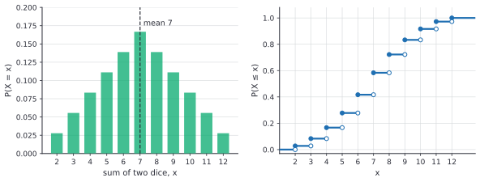

# Discrete random variables

After this lesson you can describe a discrete random variable by its PMF and CDF, compute its expected value, variance and standard deviation, use linearity of expectation with indicator variables, recognize the Bernoulli, binomial, geometric and Poisson distributions, and compare simulated averages with exact ones.

Before this: [sample spaces, events and axioms](01-sample-spaces-events-and-axioms.md), [conditional probability and Bayes' theorem](02-conditional-probability-and-bayes.md) and [counting: permutations and combinations](../../03-high-school/11-sequences-series-and-counting/03-counting-permutations-combinations.md).

## Quick check

Try these first. If you get all three right, skip to [Practice](#practice).

1. Flip a fair coin twice and let $X$ be the number of heads. Write the probability of each value of $X$, and find the average value of $X$.
2. Let $X$ be one roll of a fair die. Find $E[X]$ and $\operatorname{Var}(X)$.
3. You roll a fair die 10 times. What is the expected number of sixes? You roll two dice. What is the expected sum?

<details class="solution" markdown>
<summary>Answers</summary>

1. The four outcomes HH, HT, TH, TT have 2, 1, 1 and 0 heads, so $P(X = 0) = \frac{1}{4}$, $P(X = 1) = \frac{1}{2}$ and $P(X = 2) = \frac{1}{4}$. The average is $0 \cdot \frac{1}{4} + 1 \cdot \frac{1}{2} + 2 \cdot \frac{1}{4} = 1$.
2. $E[X] = \frac{1 + 2 + \cdots + 6}{6} = 3.5$. Also $E[X^2] = \frac{1 + 4 + 9 + 16 + 25 + 36}{6} = \frac{91}{6}$, so $\operatorname{Var}(X) = \frac{91}{6} - 3.5^2 = \frac{91}{6} - \frac{49}{4} = \frac{35}{12} \approx 2.917$.
3. Each roll is a six with probability $\frac{1}{6}$, so the expected number of sixes in 10 rolls is $10 \cdot \frac{1}{6} = \frac{5}{3} \approx 1.67$. The expected sum of two dice is $3.5 + 3.5 = 7$.

</details>

## The idea

Most questions about chance are about a number that depends on the outcome: the number of heads in 10 flips, the sum of two dice, the number of requests a server gets in a minute, the winnings of a game. A number that depends on the outcome is a **random variable**. Once the outcomes have been turned into numbers, we can ask for the average value, the typical spread, and the probability of each value, and the answers have standard names and formulas.

Play a game: roll a die, and win \$1 for a 1, \$2 for a 2, and so on up to \$6. After many rounds you have won about \$3.50 per round, because each value turns up about one time in six: $\frac{1}{6}(1 + 2 + \cdots + 6) = 3.5$. No single round pays \$3.50, but the average of many rounds settles near it. That long-run average, computed from the probabilities without playing, is the expected value. The idea is a weighted average, with the probabilities as the weights.

The picture is a bar chart. The height of each bar is the probability of that value, and the expected value is the point where the chart would balance on a pencil. The spread of the bars around that point is the variance. The [integrals chapter](../04-integrals/06-applications-of-integrals.md) previewed the continuous case, where the sum becomes an integral, and the next lesson takes it up. In this lesson every expected value is a sum.

## Definitions

A **random variable** is a function $X$ from the sample space $\Omega$ to the real numbers: each outcome $\omega$ is assigned a number $X(\omega)$. The word "variable" is misleading, since it is a function, and the randomness is in which outcome happens. The set $\{X = x\}$ means $\{\omega \in \Omega : X(\omega) = x\}$, an event, so $P(X = x)$ makes sense. A random variable is **discrete** if it takes finitely many values, or countably many such as $0, 1, 2, \dots$.

For two flips, with $X$ the number of heads:

| Outcome $\omega$ | HH | HT | TH | TT |
|---|---|---|---|---|
| $X(\omega)$ | 2 | 1 | 1 | 0 |

The **probability mass function** (PMF) of a discrete $X$ is $p_X(x) = P(X = x)$. It satisfies $p_X(x) \ge 0$ and $\sum_x p_X(x) = 1$, with the sum over the values that $X$ can take. In plain words, the PMF lists each possible value with its probability. For the table above, $p_X(0) = \frac{1}{4}$, $p_X(1) = \frac{1}{2}$ and $p_X(2) = \frac{1}{4}$.

The **cumulative distribution function** (CDF) is $F_X(x) = P(X \le x)$, defined for every real number $x$. In plain words, it is the running total of the PMF. It is non-decreasing, has limits 0 at $-\infty$ and 1 at $+\infty$, and jumps up at each possible value by the probability of that value. For a discrete variable it is a staircase. Probabilities of intervals come from differences: $P(a < X \le b) = F_X(b) - F_X(a)$.

The figure shows the PMF and the CDF for the sum of two dice. The bars are the PMF, and in the staircase each filled dot marks the value of the CDF at a possible value, with the open dot showing where the step started.



The **expected value** (or mean) of a discrete $X$ is

$$
E[X] = \sum_x x\,p_X(x),
$$

provided that $\sum_x \lvert x \rvert\,p_X(x)$ is finite. We write $\mu = E[X]$. In plain words, the expected value is each possible value times its probability, added up: the balance point of the PMF, and the long-run average of many independent copies of $X$.

For a function $g$, the expected value of $g(X)$ is computed without finding the PMF of $g(X)$ first. Each outcome contributes its own value, so grouping outcomes by the value of $X$ gives the next lemma, which is the formula used almost everywhere.

*Lemma 1 (expectation of a function).* If $\Omega$ is finite or countable, and $E[X]$ exists, then $E[X] = \sum_{\omega} X(\omega)\,P(\{\omega\})$. For every function $g$ for which the sum exists, $E[g(X)] = \sum_x g(x)\,p_X(x)$.

We know the definition of the PMF. We want to rewrite a sum over values as a sum over outcomes, and back. The plan is to group the outcomes by the value of $X$.

*Proof.* The events $\{X = x\}$, one for each possible value $x$, partition $\Omega$. Splitting the sum over outcomes by the value of $X$ gives

$$
\sum_{\omega} X(\omega)P(\{\omega\}) = \sum_x \sum_{\omega : X(\omega) = x} x\,P(\{\omega\}) = \sum_x x \sum_{\omega : X(\omega) = x}P(\{\omega\}) = \sum_x x\,P(X = x).
$$

For the second claim, apply the first to the random variable $g(X)$, which has the value $g(x)$ on every outcome in $\{X = x\}$, and group in the same way. $\blacksquare$

Look back: the formula $E[g(X)] = \sum g(x)p_X(x)$ is why you never have to find the distribution of $X^2$ to get $E[X^2]$. The first formula is the one that proves linearity, in the next section.

The **variance** of $X$ is the expected squared distance from the mean, and the **standard deviation** is its square root:

$$
\operatorname{Var}(X) = E\bigl[(X - \mu)^2\bigr], \qquad \sigma = \sqrt{\operatorname{Var}(X)}.
$$

In plain words, the variance measures spread, and the standard deviation $\sigma$ puts it back in the units of $X$ (dollars, not dollars squared). A variable that is always equal to its mean has variance 0.

## How to do it

### Computing the distribution, mean and variance

1. List the values $X$ can take, and find the probability of each with counting, a tree or a known formula. These are the PMF.
2. Check that the probabilities are non-negative and add to 1.
3. Compute the mean: $\mu = \sum x\,p_X(x)$.
4. Compute $E[X^2] = \sum x^2\,p_X(x)$, and then $\operatorname{Var}(X) = E[X^2] - \mu^2$ (Theorem 2 shows why this equals the definition). Take the square root for $\sigma$.
5. Check the answer's size: $\mu$ lies between the smallest and largest value, the variance is not negative, and $\sigma$ is no bigger than the range.

### Linearity of expectation

*Theorem 1 (linearity of expectation).* If $X$ and $Y$ are random variables on the same sample space whose expected values exist, and $a$ and $b$ are constants, then

$$
E[aX + bY] = a\,E[X] + b\,E[Y].
$$

No assumption of independence is needed.

We know Lemma 1. We want to show that expectation of a sum is the sum of the expectations, whatever the relationship between $X$ and $Y$. The plan is to compute with the sum over outcomes, where the sum splits term by term.

*Proof.* Take $\Omega$ finite or countable. The random variable $aX + bY$ takes the value $aX(\omega) + bY(\omega)$ at the outcome $\omega$. By Lemma 1,

$$
E[aX + bY] = \sum_{\omega}\bigl(aX(\omega) + bY(\omega)\bigr)P(\{\omega\}) = a\sum_{\omega}X(\omega)P(\{\omega\}) + b\sum_{\omega}Y(\omega)P(\{\omega\}) = a\,E[X] + b\,E[Y]. \qquad \blacksquare
$$

Look back: the proof never uses a joint distribution. This is why linearity is the most useful fact in the lesson. A sum of dependent variables is often hard to describe, but its mean is easy. The same formula holds for any number of terms, by induction.

An **indicator variable** of an event $A$ is $I_A$, the random variable that equals 1 if $A$ happens and 0 otherwise. Its expected value is $E[I_A] = 1 \cdot P(A) + 0 \cdot P(A^c) = P(A)$. In plain words, the expected value of a yes-or-no variable is the probability of yes. A count of how many of several events happen is the sum of their indicators, so by linearity its expected value is the sum of their probabilities.

*Theorem 2 (variance shortcut).* If $E[X^2]$ exists, then $\operatorname{Var}(X) = E[X^2] - \mu^2$. Also $\operatorname{Var}(aX + b) = a^2\operatorname{Var}(X)$ for constants $a$ and $b$.

We know linearity. We want an easier formula for the variance, and its behaviour under scaling. The plan is to expand the square.

*Proof.* Expanding, $(X - \mu)^2 = X^2 - 2\mu X + \mu^2$, and by linearity $E[(X - \mu)^2] = E[X^2] - 2\mu E[X] + \mu^2 = E[X^2] - 2\mu^2 + \mu^2 = E[X^2] - \mu^2$. For the second claim, $E[aX + b] = a\mu + b$, so $(aX + b) - (a\mu + b) = a(X - \mu)$, and $\operatorname{Var}(aX + b) = E\bigl[a^2(X - \mu)^2\bigr] = a^2\operatorname{Var}(X)$. $\blacksquare$

Look back: adding a constant shifts the mean and leaves the spread alone, and multiplying by $a$ multiplies the standard deviation by $\lvert a \rvert$. The identity $\operatorname{Var}(X) = E[X^2] - \mu^2$ also shows that $E[X^2] \ge \mu^2$, since a variance can't be negative.

*Theorem 3 (fixed points of a random permutation).* Shuffle $n$ distinct items into a uniformly random order, and let $X$ be the number of items that end up in their original position. Then $E[X] = 1$, whatever $n$ is.

We know indicators and linearity. We want the mean of a count. The plan is to write $X$ as a sum of indicators, one for each item, and to find the probability that a given item stays put.

*Proof.* Let $I_i$ be the indicator of the event that item $i$ is in position $i$, so $X = I_1 + \cdots + I_n$. Of the $n!$ equally likely orders, those with item $i$ in position $i$ number $(n - 1)!$, since the other items can be ordered freely. So $E[I_i] = P(\text{item } i \text{ is fixed}) = \frac{(n - 1)!}{n!} = \frac{1}{n}$. By linearity, $E[X] = n \cdot \frac{1}{n} = 1$. $\blacksquare$

Look back: the indicators are not independent (if $n - 1$ items are fixed, the last is too), and the proof didn't need them to be. For $n = 4$ the 24 orders give 0, 1, 2 and 4 fixed points in 9, 8, 6 and 1 of them, so the average is $\frac{0 \cdot 9 + 1 \cdot 8 + 2 \cdot 6 + 4 \cdot 1}{24} = 1$. The distribution of $X$ is complicated, and its mean is simple. The problem is also known as the hat-check problem: if $n$ people throw their hats in a pile and each takes one at random, on average one person gets their own hat back.

### Named distributions

Four distributions come up so often that they have names. Each is a model for a type of situation, and the figure shows one PMF of each type.


A **Bernoulli** variable with parameter $p$ is the indicator of an event of probability $p$: $P(X = 1) = p$ and $P(X = 0) = 1 - p = q$. Here $E[X] = p$, and $E[X^2] = p$ too, since $X^2 = X$, so $\operatorname{Var}(X) = p - p^2 = pq$.

A **binomial** variable with parameters $n$ and $p$, written $X \sim \text{Bin}(n, p)$, counts the successes in $n$ independent trials, each succeeding with probability $p$:

$$
P(X = k) = \binom{n}{k}p^k q^{n-k}, \qquad k = 0, 1, \dots, n.
$$

The reason: a particular sequence of results with $k$ successes and $n - k$ failures has probability $p^k q^{n-k}$, by independence, and there are $\binom{n}{k}$ such sequences, as in [counting](../../03-high-school/11-sequences-series-and-counting/03-counting-permutations-combinations.md). These sequences are separate events, so their probabilities add. The probabilities sum to 1 by the [binomial theorem](../../03-high-school/11-sequences-series-and-counting/04-binomial-theorem.md): $\sum_k \binom{n}{k}p^k q^{n-k} = (p + q)^n = 1$.

*Theorem 4 (mean and variance of the binomial).* If $X \sim \text{Bin}(n, p)$, then $E[X] = np$ and $\operatorname{Var}(X) = npq$.

We know indicators, linearity and Theorem 2. We want the mean and variance of a count of successes. The plan is to write $X = I_1 + \cdots + I_n$, one Bernoulli indicator per trial, find the mean by linearity, and find $E[X^2]$ through $E[X(X - 1)]$.

*Proof.* The indicators $I_j$ have $E[I_j] = p$, so $E[X] = np$. Next, $X(X - 1) = \sum_{i \ne j} I_i I_j$, a sum over the $n(n - 1)$ ordered pairs of different trials. The product $I_iI_j$ is 1 only if both trials succeed, which has probability $p \cdot p$ because the trials are independent, so $E[I_iI_j] = p^2$ and $E[X(X - 1)] = n(n - 1)p^2$. Then $E[X^2] = E[X(X - 1)] + E[X] = n(n - 1)p^2 + np$, and by Theorem 2

$$
\operatorname{Var}(X) = n(n - 1)p^2 + np - n^2p^2 = np - np^2 = np(1 - p). \qquad \blacksquare
$$

Look back: the mean of the binomial didn't need independence, and the variance did, in the step $E[I_iI_j] = p^2$. The lesson on [joint distributions](05-joint-distributions-covariance-and-sums.md) proves the general rule that variances of independent variables add. Practice problem 8 gives a second proof of the mean, from the counting identity $k\binom{n}{k} = n\binom{n-1}{k-1}$.

A **geometric** variable with parameter $p$ counts the trials up to and including the first success, in independent trials with success probability $p$:

$$
P(X = k) = q^{k-1}p, \qquad k = 1, 2, 3, \dots
$$

The first $k - 1$ trials must fail and the $k$-th must succeed. The probabilities form a [geometric series](../05-sequences-and-series/02-infinite-series-basics.md) with sum $p\,(1 + q + q^2 + \cdots) = \frac{p}{1 - q} = 1$.

*Theorem 5 (mean of the geometric).* If $X$ is geometric with parameter $p$, then $E[X] = \frac{1}{p}$.

We know the geometric series. We want the expected number of trials. The plan is to rewrite $E[X]$ as a sum of tail probabilities $P(X \ge k)$, each of which is easy.

*Proof.* For a variable with values $1, 2, 3, \dots$, we have $E[X] = \sum_{j \ge 1}j\,P(X = j) = \sum_{j \ge 1}\sum_{k=1}^{j}P(X = j) = \sum_{k \ge 1}\sum_{j \ge k}P(X = j) = \sum_{k \ge 1}P(X \ge k)$, swapping the order of a sum of non-negative terms. For the geometric variable, $X \ge k$ means that the first $k - 1$ trials failed, so $P(X \ge k) = q^{k-1}$. Then $E[X] = \sum_{k \ge 1}q^{k-1} = \frac{1}{1 - q} = \frac{1}{p}$. $\blacksquare$

Look back: it takes on average $\frac{1}{p}$ trials: 6 rolls for the first six, 5 attempts when each succeeds with probability 0.2. The variance is $\frac{q}{p^2}$, which Practice problem 5 uses. The geometric variable forgets its past: given that the first $m$ trials failed, the number of further trials is geometric again. The next lesson proves the same property for the exponential distribution.

A **Poisson** variable with parameter $\lambda > 0$ counts events that occur at random at an average rate of $\lambda$ per interval:

$$
P(X = k) = \frac{e^{-\lambda}\lambda^k}{k!}, \qquad k = 0, 1, 2, \dots
$$

The probabilities sum to 1 because $\sum_k \frac{\lambda^k}{k!} = e^{\lambda}$ (the Taylor series of the exponential function, from [power series and Taylor series](../05-sequences-and-series/04-power-series-and-taylor-series.md)). The same series gives the mean: $E[X] = \sum_{k \ge 1}k\,\frac{e^{-\lambda}\lambda^k}{k!} = \lambda e^{-\lambda}\sum_{k \ge 1}\frac{\lambda^{k-1}}{(k - 1)!} = \lambda e^{-\lambda}e^{\lambda} = \lambda$. The variance is also $\lambda$.

*Theorem 6 (Poisson as a limit of binomials).* Fix $\lambda > 0$ and $k \in \{0, 1, 2, \dots\}$. If $X_n \sim \text{Bin}\bigl(n, \frac{\lambda}{n}\bigr)$, then

$$
\lim_{n \to \infty}P(X_n = k) = \frac{e^{-\lambda}\lambda^k}{k!}.
$$

We know the binomial PMF and the limit $\left(1 - \frac{\lambda}{n}\right)^n \to e^{-\lambda}$ (from the [sequences](../05-sequences-and-series/01-sequences-and-their-limits.md) lesson). We want the limit of each probability. The plan is to split the PMF into factors, each with a limit that is easy.

*Proof.* Write

$$
\binom{n}{k}\left(\frac{\lambda}{n}\right)^k\left(1 - \frac{\lambda}{n}\right)^{n-k} = \frac{\lambda^k}{k!}\cdot\frac{n(n - 1)\cdots(n - k + 1)}{n^k}\cdot\left(1 - \frac{\lambda}{n}\right)^n\cdot\left(1 - \frac{\lambda}{n}\right)^{-k}.
$$

As $n \to \infty$ with $k$ fixed, the second factor is $1\cdot\left(1 - \frac{1}{n}\right)\cdots\left(1 - \frac{k - 1}{n}\right) \to 1$, the third tends to $e^{-\lambda}$, and the fourth tends to 1. The product tends to $\frac{\lambda^k}{k!}e^{-\lambda}$. $\blacksquare$

Look back: many rare chances add up to a Poisson count. Think of a minute cut into $n$ tiny pieces, in each of which a request arrives with probability $\frac{\lambda}{n}$ and the average number of requests is $n \cdot \frac{\lambda}{n} = \lambda$. The approximation is good already for finite $n$: for $\text{Bin}(1000, 0.003)$ the probability of 3 events is 0.22438 and the Poisson($3$) value is 0.22404.

## Worked examples

<div class="example" markdown>

### Example 1: the PMF, mean and variance of a game

You roll a fair die. You win \$5 on a 6, \$1 on a 4 or 5, and lose \$2 on a 1, 2 or 3 (hypothetical stakes). Let $X$ be your winnings in dollars. Find the PMF, $E[X]$, $\operatorname{Var}(X)$ and $\sigma$.

Step 1: the values are $5$, $1$ and $-2$, with probabilities $\frac{1}{6}$, $\frac{2}{6}$ and $\frac{3}{6}$. Step 2: $\frac{1}{6} + \frac{2}{6} + \frac{3}{6} = 1$.

Step 3: the mean is

$$
E[X] = 5 \cdot \frac{1}{6} + 1 \cdot \frac{2}{6} + (-2)\cdot\frac{3}{6} = \frac{5 + 2 - 6}{6} = \frac{1}{6} \approx 0.167.
$$

You win about 17 cents per round on average, and no round pays that. Step 4: $E[X^2] = 25\cdot\frac{1}{6} + 1\cdot\frac{2}{6} + 4\cdot\frac{3}{6} = \frac{25 + 2 + 12}{6} = \frac{39}{6} = 6.5$. So

$$
\operatorname{Var}(X) = 6.5 - \left(\tfrac{1}{6}\right)^2 = \frac{233}{36} \approx 6.472, \qquad \sigma \approx 2.544.
$$

Step 5: the mean $0.167$ lies between $-2$ and $5$, and $\sigma \approx 2.5$ is a typical distance from the mean: the three values are $4.83$, $0.83$ and $2.17$ away from it. The untidy variance is fine. Check the variance a second way, from the definition: $\frac{1}{6}(4.83)^2 + \frac{2}{6}(0.83)^2 + \frac{3}{6}(2.17)^2 = 3.894 + 0.231 + 2.347 = 6.472$, the same value.

</div>

<div class="example" markdown>

### Example 2: guessing on a quiz

A quiz has 10 multiple-choice questions with 4 choices each. You guess every one, so the number right is $X \sim \text{Bin}(10, 0.25)$. Find $P(X = 2)$, $P(X \ge 6)$, and the mean and standard deviation.

For exactly 2 right, $P(X = 2) = \binom{10}{2}(0.25)^2(0.75)^8 = 45 \cdot 0.0625 \cdot 0.100113 = 0.2816$. For at least 6, add the terms for $k = 6, \dots, 10$:

$$
P(X \ge 6) = \sum_{k=6}^{10}\binom{10}{k}(0.25)^k(0.75)^{10-k} \approx 0.01973.
$$

So about 2%: guessing rarely gets you a pass mark of 60%. The mean is $np = 2.5$, and the standard deviation is $\sqrt{npq} = \sqrt{10 \cdot 0.25 \cdot 0.75} = \sqrt{1.875} \approx 1.369$.

Check: the PMF should sum to 1, and its mean should be $np$. Adding $k\,P(X = k)$ over $k = 0, \dots, 10$ gives $2.5$ in Python. Two right is the most likely single value, with 3 close behind (0.2503), as the shape of the binomial PMF suggests, since its peak is near the mean of 2.5. A simulation of 100,000 quizzes gives $P(X \ge 6) \approx 0.0195$ (see [In code](#in-code)).

</div>

<div class="example" markdown>

### Example 3: a Poisson count

A server gets requests at an average rate of 3 per minute (a hypothetical rate), modelled as a Poisson variable $X$ with $\lambda = 3$. Find the probability of no requests in a minute, and of 5 or more.

$P(X = 0) = e^{-3} \approx 0.0498$. For 5 or more, use the complement:

$$
P(X \ge 5) = 1 - \sum_{k=0}^{4}\frac{e^{-3}3^k}{k!} = 1 - e^{-3}\left(1 + 3 + \frac{9}{2} + \frac{27}{6} + \frac{81}{24}\right) = 1 - 0.8153 \approx 0.1847.
$$

So a busy minute with 5 or more requests happens about once in every 5 or 6 minutes, although the average is only 3. Check: the sum inside the bracket is $1 + 3 + 4.5 + 4.5 + 3.375 = 16.375$, and $16.375 \cdot e^{-3} = 0.8153$. Also the PMF values at $k = 2$ and $k = 3$ are equal (both 0.2240), as in the figure, since $\frac{\lambda^2}{2!} = \frac{\lambda^3}{3!}$ when $\lambda = 3$.

</div>

<div class="example" markdown>

### Example 4: insurance

You own a phone worth \$1,000. In a year it is lost or broken with probability 0.02, and then you lose the full \$1,000 (hypothetical numbers). An insurance plan costs \$30 a year and replaces the phone in either case. Compare the two choices.

Without insurance, your loss $L$ is a Bernoulli-type variable: \$1,000 with probability 0.02 and \$0 otherwise. Then $E[L] = 1000 \cdot 0.02 = 20$ dollars, and $E[L^2] = 1000^2 \cdot 0.02 = 20{,}000$, so $\operatorname{Var}(L) = 20{,}000 - 20^2 = 19{,}600$ and $\sigma = \$140$. With the plan, you pay \$30 for certain, so the expected cost is \$30 and the standard deviation is 0.

On expected value alone the plan is a bad deal: it costs \$10 a year more than the average loss. What the extra \$10 buys is the removal of a 2% chance of a \$1,000 hit. Whether that is worth \$10 depends on how much a \$1,000 loss would hurt you, which an expected value can't measure.

From the insurer's side the same numbers give a profit. Across 10,000 such customers the premiums are \$300,000, and the expected payout is $10{,}000 \cdot 20 = \$200{,}000$. The payout's standard deviation is $1000\sqrt{10{,}000 \cdot 0.02 \cdot 0.98} = \$14{,}000$, small next to the expected margin of \$100,000, because the expected payout grows in proportion to the number of customers while its standard deviation grows only with the square root. [The law of large numbers](06-law-of-large-numbers-and-clt.md) is the reason. The expected margin has to cover the insurer's costs, which this simple model ignores.

Check: for the payout, $\operatorname{Var}$ of 10,000 independent losses is $10{,}000 \cdot 19{,}600$, and the standard deviation is $\sqrt{10{,}000}\cdot 140 = 100 \cdot 140 = \$14{,}000$.

</div>

<div class="example" markdown>

### Example 5: expected value in a lottery (finish it yourself)

A lottery ticket costs \$5. The prizes are (hypothetical numbers): \$10,000,000 with probability $\frac{1}{14{,}000{,}000}$, \$100 with probability $\frac{1}{500}$, \$10 with probability $\frac{1}{20}$, and nothing otherwise. Is a ticket a good bet in the sense of expected value?

Step 1: the prize $X$ takes the values 10,000,000, 100, 10 and 0. Step 2: the probabilities listed are not negative and their sum is under 1, and the remainder is the probability of 0. Step 3: $E[X] = \sum x\,p(x)$ has three nonzero terms:

$$
E[X] = \frac{10{,}000{,}000}{14{,}000{,}000} + \frac{100}{500} + \frac{10}{20}.
$$

Work out the three terms, then find the expected net gain after paying for the ticket, and the expected prize per dollar spent.

<details class="solution" markdown>
<summary>Finish</summary>

The terms are $0.7143 + 0.2 + 0.5 = 1.4143$, so the expected prize is about \$1.41. The expected net gain is $1.4143 - 5 = -3.5857$, a loss of about \$3.59 per ticket. Per dollar spent a ticket returns $\frac{1.4143}{5} \approx 0.283$, about 28 cents.

The jackpot is half the expected prize but happens about once in 14 million tickets. The standard deviation of the prize is about \$2,673, almost all from the jackpot, while the probability of winning anything at all is $\frac{1}{14{,}000{,}000} + \frac{1}{500} + \frac{1}{20} \approx 0.052$, about 1 in 19.

Check: each term is a probability times a prize. The small prizes already contribute \$0.70 of the \$5, so the ticket would break even only if the jackpot probability rose to $\frac{5 - 0.7}{10{,}000{,}000}$, about 1 in 2.3 million, six times the stated chance.

</details>

</div>

## Edge cases and common mistakes

<div class="warning" markdown>

Watch out: the expected value is not the most likely value, and it need not be a possible value. A fair die has $E[X] = 3.5$, and no roll is 3.5. The most likely value is the mode, and the "typical" value depends on the shape: for the lottery in Example 5, the expected prize is \$1.41 and the most likely prize is \$0. The mean is a long-run average, and a single play can be far from it.

</div>

<div class="warning" markdown>

Watch out: $E[X^2]$ is not $(E[X])^2$, and $E[1/X]$ is not $1/E[X]$. Expectation commutes with linear functions only. For a fair die, $E[X^2] = \frac{91}{6} \approx 15.17$ and $(E[X])^2 = 12.25$, and the difference is exactly the variance, $\frac{35}{12}$. Use $E[g(X)] = \sum g(x)p_X(x)$ for anything else.

</div>

<div class="warning" markdown>

Watch out: linearity holds for expected values and not for probabilities or variances. $E[X + Y] = E[X] + E[Y]$ always. But $\operatorname{Var}(X + Y) = \operatorname{Var}(X) + \operatorname{Var}(Y)$ only when $X$ and $Y$ are independent (or at least uncorrelated), as the lesson on [joint distributions](05-joint-distributions-covariance-and-sums.md) shows. And $E[XY] = E[X]E[Y]$ needs independence too. For $Y = X$, $E[X \cdot X] = E[X^2]$ is not $E[X]^2$.

</div>

<div class="warning" markdown>

Watch out: the binomial needs independent trials with the same $p$. The number of aces in a 5-card hand is not binomial, because the cards are drawn without replacement and the probability of an ace changes from card to card. For small samples from a very large population the binomial is a good approximation, but the exact model is the hypergeometric distribution.

</div>

An expected value can fail to exist. Let a game pay $2^k$ dollars if the first head of a fair coin comes on flip $k$, which has probability $2^{-k}$. Every term of $\sum_k 2^k \cdot 2^{-k}$ is 1, so the sum diverges and $E[X]$ is infinite. This is the St. Petersburg game. With no finite mean, the average of $n$ plays doesn't settle near any number as $n$ grows, which is the reason for the finiteness condition in the definition.

Two small points about the geometric variable. Some books count the failures before the first success, so that the values start at 0 and the mean is $\frac{q}{p}$. This book counts trials, starting at 1, with mean $\frac{1}{p}$. When you use a library, check which one it implements. And for $p = 1$ the first trial always succeeds and $X = 1$ with no randomness.

## Tricks and shortcuts

For a count of "how many of these things happen", write it as a sum of indicators and add the probabilities. Hat checks, matching birthdays, fixed points, duplicates in a hash table, the number of heads in $n$ flips ($n \cdot \frac{1}{2}$): none of these needs a distribution. In a group of 23 people there are $\binom{23}{2} = 253$ pairs, each pair has a shared birthday with probability $\frac{1}{365}$, so the expected number of matching pairs is $\frac{253}{365} \approx 0.69$, which is less than 1 although the probability of at least one match is over 50%. Expectation and probability answer different questions.

For the variance of a sum of independent pieces, add the variances and don't add the standard deviations: for 100 independent die rolls the variance of the total is $100 \cdot \frac{35}{12} \approx 291.7$ and the standard deviation is $\sqrt{291.7} \approx 17.1$, not $100 \cdot 1.708$.

A quick check of a PMF is that the probabilities add to 1, and a quick check of a mean is that it sits inside the range of the values. For symmetric PMFs the mean is the centre of symmetry, as 7 is for two dice.

When estimating the size of a sum, use the standard deviation as the typical error: a binomial count is usually within two standard deviations of its mean. For 100 flips the mean is 50 and $\sigma = 5$, so counts between about 40 and 60 are typical.

## In code

The exact mean and variance of a PMF are two lines. Simulation then checks the formulas: the expected number of fixed points of a shuffled deck, a binomial tail, the mean of a geometric variable, and the Poisson limit.

<details class="code" markdown>
<summary>In code</summary>

```python
import math
import random
from collections import Counter
from fractions import Fraction
from itertools import permutations

# Mean and variance of one fair die, exactly.
pmf = {x: Fraction(1, 6) for x in range(1, 7)}
mean = sum(x * p for x, p in pmf.items())
var = sum((x - mean) ** 2 * p for x, p in pmf.items())
print(mean, var, round(float(var), 4))          # 7/2 35/12 2.9167

# Fixed points of a random permutation: exact for n = 4, simulated for n = 52.
exact = Counter(sum(1 for i, v in enumerate(p) if i == v) for p in permutations(range(4)))
print(sorted(exact.items()), sum(k * c for k, c in exact.items()) / 24)   # [(0, 9), (1, 8), (2, 6), (4, 1)] 1.0
random.seed(2026)
trials = 100_000
total = 0
for _ in range(trials):
    deck = list(range(52))
    random.shuffle(deck)
    total += sum(1 for i, v in enumerate(deck) if i == v)
print(total / trials)                           # 1.00077

# Binomial: exact tail against simulation (10 guesses at p = 1/4, P(at least 6 right)).
n, p = 10, 0.25
exact_tail = sum(math.comb(n, k) * p**k * (1 - p) ** (n - k) for k in range(6, n + 1))
sim_tail = sum(1 for _ in range(trials) if sum(random.random() < p for _ in range(n)) >= 6) / trials
print(round(exact_tail, 5), sim_tail)           # 0.01973 0.01949

# Geometric: mean number of trials until the first success when p = 0.2.
def first_success(p):
    k = 1
    while random.random() >= p:
        k += 1
    return k
print(sum(first_success(0.2) for _ in range(trials)) / trials)   # 5.02231

# Poisson as a limit: Binomial(1000, 0.003) against Poisson(3), for k = 0..4.
for k in range(5):
    b = math.comb(1000, k) * 0.003**k * 0.997 ** (1000 - k)
    q = math.exp(-3) * 3**k / math.factorial(k)
    print(k, round(b, 5), round(q, 5))
# 0 0.04956 0.04979
# 1 0.14914 0.14936
# 2 0.22415 0.22404
# 3 0.22438 0.22404
# 4 0.16828 0.16803
```

The shuffled deck has an average of 1.0008 fixed points over 100,000 shuffles, matching Theorem 3 (the simulated average is within the usual error, about $\frac{1}{\sqrt{100{,}000}} \approx 0.003$). The binomial and Poisson columns agree to two or three decimal places already at $n = 1000$.

</details>

## FAQ

### Why is a random variable a function and not a number?

Because the number depends on what happens. Before the experiment it is not a fixed number, and after the outcome $\omega$ is known it is the number $X(\omega)$. Writing it as a function of the outcome is what lets two random variables on the same experiment be added or multiplied outcome by outcome, which is how linearity of expectation is proved. In practice you rarely write $X(\omega)$, and a statement like $P(X \le 3)$ is shorthand for the probability of the event $\{\omega : X(\omega) \le 3\}$.

### Why is the variance defined with a square?

Squares make every deviation count as positive, so deviations above and below the mean can't cancel (the plain deviations always average to 0, as in the [describing data](../../02-middle-school/07-statistics-and-probability/01-describing-data.md) lesson). The absolute value would also work, but the square has a nicer algebra: it gives the shortcut $E[X^2] - \mu^2$, the rule $\operatorname{Var}(aX) = a^2\operatorname{Var}(X)$, and, in a later lesson, the clean statement that variances of independent variables add.

### What is the difference between the PMF and the CDF?

The PMF gives the probability of each exact value, and the CDF gives the probability of at most each value. Each determines the other: the CDF is the running total of the PMF, and the PMF is the size of each jump of the CDF. The CDF has the advantage of working for every random variable, discrete or continuous, which is why the next lesson uses it.

### When should I use the Poisson distribution instead of the binomial?

When the count comes from many independent chances that are each rare, and you know the average count but not $n$ and $p$ separately: calls to a help line, typos on a page, hits to a server in a minute. If you know $n$ and $p$, the binomial is exact. The Poisson is the simpler formula when $n$ is large and $p$ is small, with $\lambda = np$.

## Practice

### Warm-up

1\. A coin is flipped 3 times, and $X$ is the number of heads. Give the PMF and the CDF as tables, and find $E[X]$ and $\operatorname{Var}(X)$.

<details class="solution" markdown>
<summary>Solution</summary>

The counts of outcomes with $0, 1, 2, 3$ heads are $1, 3, 3, 1$ out of 8, so the PMF is $\frac{1}{8}, \frac{3}{8}, \frac{3}{8}, \frac{1}{8}$ and the CDF values at $0, 1, 2, 3$ are $\frac{1}{8}, \frac{4}{8}, \frac{7}{8}, 1$.

The mean is $\frac{0 + 3 + 6 + 3}{8} = 1.5$. Then $E[X^2] = \frac{0 + 3 + 12 + 9}{8} = 3$, so $\operatorname{Var}(X) = 3 - 1.5^2 = 0.75$.

Check with the binomial formulas for $n = 3$ and $p = \frac{1}{2}$: $np = 1.5$ and $npq = 3 \cdot \frac{1}{4} = 0.75$.

</details>

2\. Roll a fair die. You win \$5 for a 6, \$1 for a 4 or 5, and lose \$2 for a 1, 2 or 3. In 600 rounds, about how much do you expect to win in total?

<details class="solution" markdown>
<summary>Solution</summary>

From Example 1 the expected winnings per round are $\frac{1}{6}$ of a dollar. By linearity, the expected total over 600 rounds is $600 \cdot \frac{1}{6} = 100$ dollars.

Check by counting: in 600 rounds, about 100 sixes (\$500), 200 fours or fives (\$200) and 300 losses ($-\$600$), and $500 + 200 - 600 = 100$. The actual total will vary: the standard deviation of the total is $\sqrt{600 \cdot 6.472} \approx 62$ dollars.

</details>

3\. You guess on a quiz with 10 questions of 4 choices each, as in Example 2. Find the probability of getting exactly 3 right, and of getting at least one right.

<details class="solution" markdown>
<summary>Solution</summary>

Exactly 3 right: $\binom{10}{3}(0.25)^3(0.75)^7 = 120 \cdot 0.015625 \cdot 0.133484 = 0.2503$. At least one right: use the complement, $1 - 0.75^{10} = 1 - 0.0563 = 0.9437$.

Check: the PMF at 2, 3 and 4 right is 0.2816, 0.2503 and 0.1460, peaking at 2 since the mean is 2.5, and $P(X = 0) = 0.0563$ matches the complement.

</details>

### Standard

4\. In a group of 30 people, each has one of 365 equally likely birthdays. Let $M$ be the number of pairs of people with the same birthday. Find $E[M]$ by indicators. Then find the probability that at least one pair matches, and compare.

<details class="solution" markdown>
<summary>Solution</summary>

There are $\binom{30}{2} = 435$ pairs. For a given pair, the second person matches the first with probability $\frac{1}{365}$. Let $I_j$ be the indicator that pair $j$ matches, so $M = \sum_j I_j$ and $E[M] = 435 \cdot \frac{1}{365} \approx 1.192$.

The probability of at least one match is $1 - \prod_{i=0}^{29}\frac{365 - i}{365} \approx 0.7063$. The expected number of matching pairs, 1.19, is above 1, but the probability of at least one is about 71%: the count of matching pairs is sometimes 2 or more, and those cases add to the mean without adding to the probability.

Check: with $n = 23$ the expected number is $\frac{253}{365} = 0.693$, and the probability is $0.507$. The expected count is always at least the probability, since $E[M] \ge P(M \ge 1)$ for a count.

</details>

5\. Each attempt to connect to a busy server succeeds with probability 0.2, independently. Let $X$ be the number of attempts until the first success. Find the probability that you need more than 5 attempts, the expected number of attempts, and the standard deviation, which for a geometric variable is $\frac{\sqrt{q}}{p}$.

<details class="solution" markdown>
<summary>Solution</summary>

$X$ is geometric with $p = 0.2$ and $q = 0.8$. More than 5 attempts means the first 5 all fail: $0.8^5 = 0.32768$. The mean is $\frac{1}{p} = 5$. The variance is $\frac{q}{p^2} = \frac{0.8}{0.04} = 20$, so $\sigma = \sqrt{20} \approx 4.47$.

The standard deviation is almost as large as the mean, so the waiting time is very variable: a result of 1 attempt and a result of 12 are both quite possible.

Check: $P(X \le 5) = 1 - 0.32768 = 0.67232$, the sum $0.2 + 0.16 + 0.128 + 0.1024 + 0.08192$ of the first five PMF values.

</details>

6\. Calls reach a help line at an average of 2 per hour (a hypothetical rate), as a Poisson process. (a) Find the probability of no calls in an hour. (b) Find the probability of at least 3 calls in two hours.

<details class="solution" markdown>
<summary>Solution</summary>

(a) With $\lambda = 2$, $P(X = 0) = e^{-2} \approx 0.1353$.

(b) In two hours the rate is $\lambda = 4$. Then $P(X \le 2) = e^{-4}\left(1 + 4 + \frac{16}{2}\right) = 13e^{-4} \approx 0.2381$, so $P(X \ge 3) = 1 - 0.2381 = 0.7619$.

Check: $e^{-4} = 0.018316$ and $13 \cdot 0.018316 = 0.2381$. The two-hour mean 4 is twice the one-hour mean, since expected values add, so it is natural that at least 3 calls is likely.

</details>

### Challenge

7\. (Coupon collector.) A fair die is rolled repeatedly until every face has appeared at least once. Show that the expected number of rolls is $6\left(1 + \frac{1}{2} + \frac{1}{3} + \frac{1}{4} + \frac{1}{5} + \frac{1}{6}\right) = 14.7$.

<details class="solution" markdown>
<summary>Solution</summary>

What we know: linearity of expectation and the mean $\frac{1}{p}$ of a geometric variable. What we want: the expected total number of rolls. The plan is to cut the process into phases, one for each new face, and add the expected lengths of the phases.

Let $T_i$ be the number of rolls in phase $i$, from the moment $i - 1$ different faces have been seen until the $i$-th new face appears. During phase $i$ each roll shows a new face with probability $\frac{6 - (i - 1)}{6} = \frac{7 - i}{6}$, independently, so $T_i$ is geometric with $p = \frac{7 - i}{6}$ and $E[T_i] = \frac{6}{7 - i}$. The total number of rolls is $T_1 + \cdots + T_6$, and by linearity

$$
E[T] = \frac{6}{6} + \frac{6}{5} + \frac{6}{4} + \frac{6}{3} + \frac{6}{2} + \frac{6}{1} = 6\left(1 + \tfrac{1}{2} + \tfrac{1}{3} + \tfrac{1}{4} + \tfrac{1}{5} + \tfrac{1}{6}\right) = 6 \cdot \frac{49}{20} = 14.7.
$$

Check: the first phase takes 1 roll for sure, and the last takes 6 rolls on average, which is the biggest term. A simulation of 100,000 runs gives an average of 14.72.

</details>

8\. (Reviews [counting](../../03-high-school/11-sequences-series-and-counting/03-counting-permutations-combinations.md).) Use the identity $k\binom{n}{k} = n\binom{n-1}{k-1}$ to prove that $E[X] = np$ for $X \sim \text{Bin}(n, p)$, without indicators.

<details class="solution" markdown>
<summary>Solution</summary>

What we want: $\sum_{k=0}^{n}k\binom{n}{k}p^kq^{n-k} = np$. The plan is to use the identity to pull out $np$ and recognize what is left as a binomial sum.

The $k = 0$ term is 0. For $k \ge 1$, the identity gives $k\binom{n}{k} = n\binom{n-1}{k-1}$, so

$$
E[X] = n\sum_{k=1}^{n}\binom{n-1}{k-1}p^kq^{n-k} = np\sum_{k=1}^{n}\binom{n-1}{k-1}p^{k-1}q^{(n-1)-(k-1)}.
$$

With $j = k - 1$ the last sum is $\sum_{j=0}^{n-1}\binom{n-1}{j}p^jq^{n-1-j} = (p + q)^{n-1} = 1$ by the binomial theorem. So $E[X] = np$.

Check with $n = 3$ and $p = \frac{1}{2}$: $\sum_k k\binom{3}{k}\frac{1}{8} = \frac{0 + 3 + 6 + 3}{8} = 1.5 = np$.

</details>

## Where this shows up

- The next lesson, [continuous random variables and the normal distribution](04-continuous-random-variables-and-the-normal.md), replaces sums by integrals, and [joint distributions, covariance and sums](05-joint-distributions-covariance-and-sums.md) proves that variances of independent variables add, which this lesson used for the insurer's payout in Example 4. Averages of many independent variables settle near their mean: [the law of large numbers and the CLT](06-law-of-large-numbers-and-clt.md).
- In CS, linearity of expectation with indicators gives the expected running time of randomized quicksort, the expected number of collisions in a hash table, and the expected cost of a random walk ([discrete probability](../../06-cs-math/03-counting-and-discrete-probability/05-discrete-probability.md)). The Poisson model describes request arrivals, and the geometric distribution describes retries with a fixed failure rate.
- In economics and finance, an expected value is how a decision under risk is scored. Insurance and lotteries are the two simplest cases, as in Examples 4 and 5 ([insurance and expected value](../../08-financial-math/07-taxes-insurance-and-planning/02-insurance-and-expected-value.md) develops the first), and the mean and variance of a return are the starting numbers for investing ([investing returns and risk](../../08-financial-math/06-investing-and-retirement/01-investing-returns-and-risk.md)).
