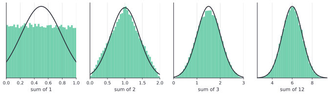

# Continuous random variables and the normal distribution

After this lesson you can use a density and a CDF to find probabilities of a continuous random variable, compute expected values and variances by integrals, work with the uniform and exponential distributions (including memorylessness), standardize a normal variable and find normal probabilities with a table or Python, and say why the normal distribution appears so often.

Before this: [discrete random variables](03-discrete-random-variables.md) and [partial fractions and improper integrals](../04-integrals/05-partial-fractions-and-improper-integrals.md), where densities were checked to have total area 1. The expected value as an integral was previewed in [applications of integrals](../04-integrals/06-applications-of-integrals.md).

## Quick check

Try these first. If you get all three right, skip to [Practice](#practice).

1. A random variable has density $f(x) = cx$ on $[0, 2]$ and 0 elsewhere. Find $c$, then $P(X > 1)$ and $E[X]$.
2. A number $X$ is chosen uniformly from $[0, 10]$. Find $P(3 < X < 5)$, the mean and the variance.
3. A waiting time is exponential with rate 0.5 per second. Find $P(X > 4)$. If you have already waited 3 seconds, what is the probability that you wait more than 4 further seconds?

<details class="solution" markdown>
<summary>Answers</summary>

1. The area must be 1: $\int_0^2 cx\,dx = 2c = 1$, so $c = \frac{1}{2}$. Then $P(X > 1) = \int_1^2 \frac{x}{2}\,dx = \frac{4 - 1}{4} = \frac{3}{4}$, and $E[X] = \int_0^2 x\cdot\frac{x}{2}\,dx = \frac{8}{6} = \frac{4}{3}$.
2. The density is $\frac{1}{10}$ on $[0, 10]$, so $P(3 < X < 5) = \frac{2}{10} = 0.2$. The mean is the midpoint, 5, and the variance is $\frac{10^2}{12} \approx 8.33$.
3. $P(X > t) = e^{-0.5t}$, so $P(X > 4) = e^{-2} \approx 0.1353$. After 3 seconds the chance of a further 4 is the same, $e^{-2} \approx 0.1353$, because the exponential distribution forgets how long you have waited (this is proved below).

</details>

## The idea

A spinner is equally likely to stop at any angle from 0 to 360 degrees. What is the probability that it stops at exactly 90 degrees? There are infinitely many angles and each is as likely as any other, so each has probability 0, as in the dartboard of [the first lesson](01-sample-spaces-events-and-axioms.md). What has a probability is an interval: the chance of stopping between 90 and 180 degrees is $\frac{90}{360} = \frac{1}{4}$. For a continuous quantity the probability sits in intervals, and it is spread out along the number line the way mass is spread along a rod.

Mass along a rod is described by a density: mass per unit length. Probability is described the same way. A density is a function whose area over an interval is the probability of that interval. A tall part of the graph means that the variable is likely to land near there, and a flat low part means that it rarely does. The graph shows the shape of the randomness in one picture.

The picture comes from histograms. Record many waiting times, group them into bins and draw bars whose areas are the fractions of waiting times in each bin. As you collect more data and use thinner bins, the bar tops trace out a smooth curve, and the areas under pieces of it are the probabilities. The expected value is then the balance point of this curve, found with an integral where the discrete lesson used a sum. The most important density of all has the bell shape that you have probably met in statistics classes, and the later part of this lesson explains where it comes from.

## Definitions

A random variable $X$ is **continuous** if there is a function $f \ge 0$, its **probability density function** (density, for short), such that for all $a \le b$

$$
P(a \le X \le b) = \int_a^b f(x)\,dx, \qquad \int_{-\infty}^{\infty}f(x)\,dx = 1.
$$

In plain words, probabilities are areas under the graph of $f$, and the total area is 1. Two consequences follow at once. Since $\int_a^a f = 0$, we have $P(X = a) = 0$ for every single value $a$, and so $P(a < X < b) = P(a \le X \le b)$: the endpoints don't matter. And $f(x)$ is not a probability. It can be larger than 1: the uniform variable on $[0, \frac{1}{2}]$ has density 2. What is at most 1 is an area. The units of a density are probability per unit of $x$, such as "per second".

The **cumulative distribution function** (CDF) is the same as in the discrete case, $F(x) = P(X \le x)$, now an integral:

$$
F(x) = \int_{-\infty}^{x}f(t)\,dt, \qquad P(a < X \le b) = F(b) - F(a).
$$

In plain words, $F(x)$ is the area to the left of $x$. It is non-decreasing, runs from 0 to 1, and has no jumps. By the [fundamental theorem of calculus](../04-integrals/02-fundamental-theorem-of-calculus.md), $F'(x) = f(x)$ wherever $f$ is continuous, so the density is the slope of the CDF. The left half of the figure below shows a density with a shaded area, and the right half shows the CDF, where the same probability is a difference of two heights.


The **expected value** and **variance** of a continuous $X$ replace sums by integrals:

$$
E[X] = \int_{-\infty}^{\infty}x\,f(x)\,dx, \qquad \operatorname{Var}(X) = \int_{-\infty}^{\infty}(x - \mu)^2 f(x)\,dx = E[X^2] - \mu^2,
$$

where $\mu = E[X]$, $E[g(X)] = \int g(x)f(x)\,dx$, and $\sigma = \sqrt{\operatorname{Var}(X)}$. The expected value is defined when $\int \lvert x \rvert f(x)\,dx$ is finite. In plain words, the mean is the balance point of the density, and the variance is the average squared distance from it. The identity $\operatorname{Var}(X) = E[X^2] - \mu^2$ and the rules $E[aX + b] = aE[X] + b$ and $\operatorname{Var}(aX + b) = a^2\operatorname{Var}(X)$ hold for the same reasons as in [the discrete lesson](03-discrete-random-variables.md#linearity-of-expectation): the proofs only use that expectation is linear in functions of $X$, and integrals are linear.

## How to do it

### Working with a density

1. Check that $f \ge 0$ and that the area is 1. If a constant $c$ is unknown, solve $\int f = 1$ for it.
2. For a probability, integrate $f$ over the interval. Draw the graph first, so you integrate over the right piece of a function that is defined in pieces.
3. For a "less than" or "greater than" question, use the CDF: $P(X \le x) = F(x)$ and $P(X > x) = 1 - F(x)$.
4. For the mean, integrate $x f(x)$. For the variance, find $E[X^2] = \int x^2 f(x)\,dx$ and subtract $\mu^2$.
5. Check: the answers are between 0 and 1 for probabilities, the mean lies where the density has weight, and the variance is not negative.

### The uniform distribution

A **uniform** variable on $[a, b]$ has density $f(x) = \frac{1}{b - a}$ for $a \le x \le b$ and 0 elsewhere. It models "a point chosen at random in an interval", with all equal-length pieces equally likely, and it is the one that a computer's random-number function produces on $[0, 1]$.

*Theorem 1 (the uniform distribution).* If $X$ is uniform on $[a, b]$, then $E[X] = \frac{a + b}{2}$ and $\operatorname{Var}(X) = \frac{(b - a)^2}{12}$.

We know the definitions of the mean and the variance. We want both for the constant density $\frac{1}{b - a}$. The plan is to compute $E[X]$ and $E[X^2]$ by integrating powers of $x$.

*Proof.* The mean is $\int_a^b \frac{x}{b - a}\,dx = \frac{b^2 - a^2}{2(b - a)} = \frac{a + b}{2}$. For the second moment, $E[X^2] = \int_a^b\frac{x^2}{b - a}\,dx = \frac{b^3 - a^3}{3(b - a)} = \frac{a^2 + ab + b^2}{3}$. Then

$$
\operatorname{Var}(X) = \frac{a^2 + ab + b^2}{3} - \frac{(a + b)^2}{4} = \frac{4a^2 + 4ab + 4b^2 - 3a^2 - 6ab - 3b^2}{12} = \frac{a^2 - 2ab + b^2}{12} = \frac{(b - a)^2}{12}. \qquad \blacksquare
$$

Look back: the mean is the midpoint, as symmetry suggests. The variance depends only on the length $b - a$, and not on where the interval sits, as it should: shifting a variable doesn't change its spread. For $[0, 1]$ the variance is $\frac{1}{12}$, so $\sigma \approx 0.289$.

### The exponential distribution

An **exponential** variable with rate $\lambda > 0$ has density $f(x) = \lambda e^{-\lambda x}$ for $x \ge 0$ and 0 for $x < 0$. It models a waiting time, for instance until the next request at a server. The integral from $t$ to infinity gives the survival probability $P(X > t) = e^{-\lambda t}$ and the CDF $F(x) = 1 - e^{-\lambda x}$, as in the [integrals chapter](../04-integrals/05-partial-fractions-and-improper-integrals.md#worked-examples). Its mean is $\frac{1}{\lambda}$, found there by parts, and the variance comes from one more integration by parts. The units fit: a rate in "per second" has a mean in seconds.

*Theorem 2 (exponential mean and variance).* If $X$ is exponential with rate $\lambda$, then $E[X] = \frac{1}{\lambda}$ and $\operatorname{Var}(X) = \frac{1}{\lambda^2}$.

We know the density, integration by parts, and that $b^k e^{-\lambda b} \to 0$ as $b \to \infty$ (an exponential beats a power, by [L'Hopital's rule](../03-applications-of-derivatives/02-linear-approximation-and-lhopitals-rule.md)). We want $E[X]$ and $E[X^2]$. The plan is to integrate by parts, and to use the mean to get the second moment.

*Proof.* With $u = x$ and $dv = \lambda e^{-\lambda x}dx$, so $v = -e^{-\lambda x}$:

$$
E[X] = \Bigl[-x e^{-\lambda x}\Bigr]_0^\infty + \int_0^\infty e^{-\lambda x}\,dx = 0 + \frac{1}{\lambda}.
$$

For the second moment, take $u = x^2$ and the same $dv$: $E[X^2] = \bigl[-x^2e^{-\lambda x}\bigr]_0^\infty + \int_0^\infty 2x\,e^{-\lambda x}\,dx = 0 + \frac{2}{\lambda}\int_0^\infty x\,\lambda e^{-\lambda x}\,dx = \frac{2}{\lambda}E[X] = \frac{2}{\lambda^2}$. So $\operatorname{Var}(X) = \frac{2}{\lambda^2} - \frac{1}{\lambda^2} = \frac{1}{\lambda^2}$. $\blacksquare$

Look back: the standard deviation equals the mean, $\frac{1}{\lambda}$. This is a sign of how spread out waiting times are: a mean wait of 2 seconds comes with a standard deviation of 2 seconds. For $\lambda = 0.5$ the median is $2\ln 2 \approx 1.39$, below the mean 2, as in [partial fractions and improper integrals](../04-integrals/05-partial-fractions-and-improper-integrals.md#practice), because the long right tail pulls the mean up.

*Theorem 3 (memorylessness).* If $X$ is exponential with rate $\lambda$, then for all $s, t \ge 0$,

$$
P(X > s + t \mid X > s) = P(X > t).
$$

We know the survival function $P(X > t) = e^{-\lambda t}$ and the definition of conditional probability. We want to compare the chance of waiting $t$ more, given that you have already waited $s$, with the chance of waiting $t$ from scratch. The plan is to compute the ratio.

*Proof.* The event $\{X > s + t\}$ is contained in $\{X > s\}$, so $P(X > s + t \mid X > s) = \frac{P(X > s + t)}{P(X > s)} = \frac{e^{-\lambda(s+t)}}{e^{-\lambda s}} = e^{-\lambda t} = P(X > t)$. $\blacksquare$

Look back: having waited $s$ seconds without a request tells you nothing about how much longer you will wait. The exponential distribution is the continuous version of the geometric distribution of the last lesson, which forgets its past in the same way. It is also the only continuous distribution on $[0, \infty)$ with this property (Practice problem 7 proves it when the survival function is differentiable). This is the right model for events that arrive "at random", with no wear and no schedule, and it is the wrong one for a light bulb, where an old bulb is closer to failing.

If requests arrive according to a Poisson count with an average rate of $\lambda$ per unit time, as in the Poisson distribution, then the waiting times between requests are exponential with the same rate $\lambda$. That fact is stated here without proof. It ties the two lessons together: for the server in [the last lesson](03-discrete-random-variables.md) with $\lambda = 3$ requests per minute, the mean wait for the next request is $\frac{1}{3}$ of a minute, or 20 seconds.

### The normal distribution

A **normal** (or Gaussian) variable with mean $\mu$ and variance $\sigma^2$, written $X \sim N(\mu, \sigma^2)$, has density

$$
f(x) = \frac{1}{\sigma\sqrt{2\pi}}\,e^{-(x - \mu)^2/(2\sigma^2)}.
$$

In plain words, it is the bell curve, centred at $\mu$, with width set by $\sigma$: the curve is symmetric about $\mu$, and its inflection points are at $\mu \pm \sigma$. The case $\mu = 0$, $\sigma = 1$ is the **standard normal**, with density $\varphi(z) = \frac{1}{\sqrt{2\pi}}e^{-z^2/2}$ and CDF $\Phi(z) = \int_{-\infty}^{z}\varphi(t)\,dt$. A standard normal variable is usually named $Z$.

The constant $\frac{1}{\sqrt{2\pi}}$ is there so that the area is 1, which needs $\int_{-\infty}^{\infty}e^{-z^2/2}\,dz = \sqrt{2\pi}$. This integral can't be found with the techniques of the integrals chapter. It is computed in a multivariable course by squaring it and switching to polar coordinates ([double integrals](../09-multivariable-calculus-light/04-double-integrals.md)), and this book accepts the value. Also, $e^{-z^2/2}$ has no antiderivative that is a combination of the elementary functions, so $\Phi$ can't be written as a formula. It is tabulated, and computed numerically by every statistics package.


The mean $\mu$ slides the curve, and $\sigma$ stretches it: a larger $\sigma$ gives a lower and wider bell, with the area still 1. All normal curves are the same curve in different units, which is the content of the next theorem, so one table of $\Phi$ serves them all.

*Theorem 4 (standard normal mean and variance).* If $Z$ is standard normal, then $E[Z] = 0$ and $\operatorname{Var}(Z) = 1$.

We know that $\int_{-\infty}^{\infty}\varphi = 1$, that $\varphi'(z) = -z\varphi(z)$, and integration by parts. We want $E[Z]$ and $E[Z^2]$. The plan is symmetry for the mean, and parts for the second moment.

*Proof.* The function $z\varphi(z)$ has the antiderivative $-\varphi(z)$, so $\int_0^\infty z\varphi(z)\,dz = \varphi(0) - 0 = \frac{1}{\sqrt{2\pi}}$, which is finite. By symmetry, $\int_{-\infty}^0 z\varphi(z)\,dz = -\frac{1}{\sqrt{2\pi}}$, and the two halves cancel, so $E[Z] = 0$. For the variance, $\operatorname{Var}(Z) = E[Z^2] = \int_{-\infty}^{\infty}z\cdot z\varphi(z)\,dz$. Integrate by parts with $u = z$ and $dv = z\varphi(z)\,dz$, so $v = -\varphi(z)$:

$$
E[Z^2] = \Bigl[-z\varphi(z)\Bigr]_{-\infty}^{\infty} + \int_{-\infty}^{\infty}\varphi(z)\,dz = 0 + 1 = 1. \qquad \blacksquare
$$

Look back: the boundary term vanishes because $z e^{-z^2/2} \to 0$ as $z \to \pm\infty$, and the remaining integral is the total area. The "1" in the variance of the standard normal comes from the normalizing constant. This also explains the names: in $N(\mu, \sigma^2)$ the parameters really are the mean and the variance, as the next theorem confirms.

*Theorem 5 (standardizing).* If $X \sim N(\mu, \sigma^2)$ with $\sigma > 0$, then $Z = \frac{X - \mu}{\sigma}$ is standard normal. Equivalently, $P(X \le x) = \Phi\!\left(\frac{x - \mu}{\sigma}\right)$ for every $x$.

We know the normal density and the substitution rule for integrals ([u-substitution](../04-integrals/03-u-substitution.md)). We want to turn an integral of the $N(\mu, \sigma^2)$ density into one of $\varphi$. The plan is to substitute $u = \frac{t - \mu}{\sigma}$.

*Proof.* Start with $P(X \le x) = \int_{-\infty}^{x}\frac{1}{\sigma\sqrt{2\pi}}e^{-(t - \mu)^2/(2\sigma^2)}\,dt$. Put $u = \frac{t - \mu}{\sigma}$, so that $dt = \sigma\,du$ and the upper limit becomes $\frac{x - \mu}{\sigma}$. The integral turns into $\int_{-\infty}^{(x - \mu)/\sigma}\frac{1}{\sqrt{2\pi}}e^{-u^2/2}\,du = \Phi\!\left(\frac{x - \mu}{\sigma}\right)$. The event $\{X \le x\}$ is the event $\left\{\frac{X - \mu}{\sigma} \le \frac{x - \mu}{\sigma}\right\}$, so $Z$ has the CDF $\Phi$. $\blacksquare$

Look back: the number $z = \frac{x - \mu}{\sigma}$ says how many standard deviations $x$ lies above the mean, and it is called the **z-score**. Since $X = \mu + \sigma Z$, the rules for means and variances give $E[X] = \mu$ and $\operatorname{Var}(X) = \sigma^2$, which is why the parameters have those names.

### Finding normal probabilities

1. Write the question as a probability about $X \sim N(\mu, \sigma^2)$.
2. Convert each boundary to a z-score, $z = \frac{x - \mu}{\sigma}$.
3. Express the probability with $\Phi$: $P(X \le x) = \Phi(z)$, $P(X > x) = 1 - \Phi(z)$ and $P(a < X \le b) = \Phi(z_b) - \Phi(z_a)$. A z table lists $\Phi(z)$, the area to the left. For a negative $z$ use the symmetry $\Phi(-z) = 1 - \Phi(z)$.
4. Look up the values in a table, or compute them with `statistics.NormalDist` in Python.
5. Check with the 68-95-99.7 rule below.

Some values of $\Phi$ to remember:

| $z$ | 0 | 1 | 1.645 | 1.96 | 2 | 2.576 | 3 |
|---|---|---|---|---|---|---|---|
| $\Phi(z)$ | 0.5000 | 0.8413 | 0.9500 | 0.9750 | 0.9772 | 0.9950 | 0.9987 |

The probability that a normal variable lies within $k$ standard deviations of its mean is $P(\lvert Z \rvert < k) = 2\Phi(k) - 1$, which gives the **68-95-99.7 rule**: about 68.3% of the probability is within 1 standard deviation, 95.4% within 2 and 99.7% within 3 (the exact values are 0.6827, 0.9545 and 0.9973). The right half of the figure above shows these three regions.

## Worked examples

<div class="example" markdown>

### Example 1: an exponential waiting time

Requests reach a server so that the waiting time $X$ in seconds for the next one is exponential with rate $\lambda = 0.5$ (a hypothetical rate). Find the CDF, the mean and standard deviation, $P(1 < X < 3)$, and the probability of waiting more than 5 seconds given that you have already waited 2.

Step 1: the density is $0.5e^{-0.5x}$ for $x \ge 0$. Step 2: integrating, $F(x) = 1 - e^{-0.5x}$. Step 3: so $P(1 < X < 3) = F(3) - F(1) = 0.7769 - 0.3935 = 0.3834$, the area shaded in the figure, matching the value found by direct integration in the integrals chapter. Step 4: the mean is $\frac{1}{\lambda} = 2$ seconds and the variance is $\frac{1}{\lambda^2} = 4$, so $\sigma = 2$ seconds.

For the conditional question, use memorylessness: $P(X > 5 \mid X > 2) = P(X > 3) = e^{-1.5} \approx 0.2231$. The 2 seconds already waited don't count.

Step 5: check the conditional probability from the definition: $\frac{P(X > 5)}{P(X > 2)} = \frac{e^{-2.5}}{e^{-1}} = e^{-1.5}$. Also $P(X > 5) = 0.0821$, much smaller than 0.2231, which fits: waiting 5 seconds from scratch is less likely than waiting 3 more.

</div>

<div class="example" markdown>

### Example 2: generating an exponential from a uniform

A computer's `random()` gives a uniform variable $U$ on $[0, 1)$. Show that $X = -\frac{\ln(1 - U)}{\lambda}$ is exponential with rate $\lambda$.

Step 1: find the CDF of $X$. For $x \ge 0$, the event $\{X \le x\}$ is $\{-\ln(1 - U) \le \lambda x\}$. Step 2: multiply by $-1$ and exponentiate, which reverses the inequality: $\{1 - U \ge e^{-\lambda x}\}$, that is, $\{U \le 1 - e^{-\lambda x}\}$. Step 3: for a uniform $U$, the probability that $U \le c$ is $c$ when $0 \le c \le 1$, so $P(X \le x) = 1 - e^{-\lambda x}$. This is the exponential CDF, so $X$ is exponential with rate $\lambda$.

Check: a simulation of 100,000 values with $\lambda = 0.5$ gives a mean of 2.007 and $P(X > 3) \approx 0.2237$, against the exact 2 and $e^{-1.5} = 0.2231$. The same idea ("apply the inverse of the CDF to a uniform") generates any distribution whose CDF can be inverted.

</div>

<div class="example" markdown>

### Example 3: exam marks

Marks on an exam are modelled as $N(72, 10^2)$ (hypothetical numbers). Find the probability that a student scores above 85, the probability of a mark between 65 and 80, and the mark that 90% of students fall below.

Steps 1 and 2: for $X > 85$ the z-score is $z = \frac{85 - 72}{10} = 1.3$. Step 3: $P(X > 85) = 1 - \Phi(1.3) = 1 - 0.9032 = 0.0968$, about 9.7%.

For $65 < X < 80$ the z-scores are $-0.7$ and $0.8$, so the probability is $\Phi(0.8) - \Phi(-0.7) = 0.7881 - 0.2420 = 0.5462$, about 54.6%.

For the 90th percentile, we need $z$ with $\Phi(z) = 0.90$, which is $z = 1.2816$ (a value from the table or from `inv_cdf`). Then $x = \mu + z\sigma = 72 + 12.816 = 84.82$.

Step 5: check with the rule. The marks 65 and 80 are 0.7 and 0.8 standard deviations from the mean, inside the band of one standard deviation that holds 68.3%, so the answer has to be under 68.3%, and 54.6% fits. A mark of 85 is 1.3 standard deviations above the mean. The upper tail beyond one standard deviation is 15.9% and beyond two is 2.3%, so 9.7% is between them, as it should be.

</div>

<div class="example" markdown>

### Example 4: measurement error (finish it yourself)

A sensor's error, in millimetres, is modelled as $N(0, 0.5^2)$ (hypothetical). (a) Find the probability that the error is more than 1 mm in either direction. (b) Find the error bound $b$ such that the error is within $\pm b$ with probability 0.99.

For (a), the standard deviation is $\sigma = 0.5$, so an error of 1 mm is $z = \frac{1}{0.5} = 2$ standard deviations. By symmetry, the probability of being outside $\pm 1$ is $2\bigl(1 - \Phi(2)\bigr)$. Work that out. For (b), we need $P(\lvert Z \rvert < k) = 0.99$, which means $\Phi(k) = 0.995$. Use the table value of $\Phi(2.576) = 0.995$ and then convert $k$ back to millimetres.

<details class="solution" markdown>
<summary>Finish</summary>

(a) $2\bigl(1 - 0.9772\bigr) = 0.0456$, about 4.6%. This agrees with the rule: 95.4% within 2 standard deviations leaves 4.6% outside.

(b) $k = 2.576$, so $b = k\sigma = 2.576 \cdot 0.5 = 1.288$ mm. The error is within $\pm 1.29$ mm with probability 99%.

Check: $2\Phi(2.576) - 1 = 2(0.995) - 1 = 0.99$. Also 1.288 is between 2 and 3 standard deviations' worth of error, 1 mm and 1.5 mm, and the probabilities 95.4% and 99.7% bracket 99%.

</details>

</div>

## Edge cases and common mistakes

<div class="warning" markdown>

Watch out: a density is not a probability. For the uniform distribution on $[0, 0.5]$ the density is 2, and $f(x) = 2$ does not mean a probability of 2. Only the area $\int f$ over an interval is a probability. The value $f(x)$ tells you the relative likelihood of the neighbourhood of $x$, with units of probability per unit of $x$.

</div>

<div class="warning" markdown>

Watch out: in $N(\mu, \sigma^2)$ the second parameter is the variance, but many software tools take the standard deviation. Python's `NormalDist(mu, sigma)` takes $\sigma$, so $N(72, 10^2)$ is `NormalDist(72, 10)` and not `NormalDist(72, 100)`. The z-score divides by $\sigma$, and dividing by the variance by mistake gives a wildly wrong probability. If the problem says "variance 25", use $\sigma = 5$.

</div>

<div class="warning" markdown>

Watch out: the table gives the area to the left. $\Phi(1.3) = 0.9032$ is $P(Z \le 1.3)$, and the probability of a score above 85 is the complement $1 - 0.9032$. For a negative z-score, a table that lists only positive $z$ needs the symmetry $\Phi(-z) = 1 - \Phi(z)$. A check that catches both: a probability of being above a value that is above the mean has to be under 0.5.

</div>

<div class="warning" markdown>

Watch out: not everything is normal. Waiting times are skewed (exponential, not normal), counts are discrete, and incomes and file sizes have long right tails. A normal model for a positive quantity assigns some probability to negative values: for response times with mean 2 and standard deviation 2, a normal model would give probability $\Phi(-1) = 16\%$ to negative times. Use the normal when there is a reason, such as a sum or average of many small independent effects.

</div>

A continuous variable may have no mean. The Cauchy distribution has density $\frac{1}{\pi(1 + x^2)}$, which is a bell-like curve with total area 1 (its antiderivative is $\frac{\arctan x}{\pi}$). But its tails fall like $\frac{1}{x^2}$, so $x f(x)$ falls like $\frac{1}{x}$, and by the $p$ test with $p = 1$ the integral $\int x f(x)\,dx$ diverges. Practice problem 8 works this out. The normal density's tails fall much faster, so all its moments exist.

Finally, two small points. The tails of the normal never reach 0: the probability of being more than 6 standard deviations from the mean is about $2 \times 10^{-9}$, tiny but not zero. And the probability that a continuous variable is exactly a given number is 0, so "$X \le 3$" and "$X < 3$" have the same probability, while for a discrete variable they usually differ.

## Tricks and shortcuts

Standardize first and think in standard deviations. Everything about a normal variable reduces to a question about $Z$. For a quick estimate, use 68-95-99.7. For a rough tail, remember that a probability above $+1$ is 16%, above $+2$ is 2.3% and above $+3$ is 0.13%.

Two common cut-offs are worth knowing by heart. About 95% of the probability is within 1.96 standard deviations of the mean, often rounded to 2, and 99% is within 2.576. The first is the origin of the "plus or minus two standard deviations" rule of thumb and of the 1.96 in confidence intervals ([confidence intervals](../08-statistics/02-confidence-intervals.md)).

For the exponential, the survival function $P(X > t) = e^{-\lambda t}$ is the quickest route to any probability, and the median is $\frac{\ln 2}{\lambda}$, which is about $\frac{0.69}{\lambda}$. For the uniform, probabilities are lengths divided by $b - a$, with no integration.

A symmetric density has its mean at the centre of symmetry, and a long right tail pulls the mean above the median.

## Why the normal appears

Roll one die and the result is flat. Add two and the sum is a triangle. Add twelve and the histogram already looks like a bell. The figure below shows sums of $n$ independent uniform variables on $[0, 1]$, for $n = 1, 2, 3, 12$, with the normal curve that has the same mean and variance drawn over each histogram.



This is a preview of the central limit theorem, stated precisely in [the law of large numbers and the CLT](06-law-of-large-numbers-and-clt.md): the sum, or the average, of many independent contributions is approximately normal, almost whatever the distribution of each contribution. The shape of the individual piece washes out, and only its mean and variance matter. That is why the normal is the model for measurement error (many small causes add up), for the total of many small bets, and for the sampling distribution of an average, and why a table of $\Phi$ is enough for so many problems.

## In code

Python's standard library has the normal distribution in `statistics.NormalDist`, with `cdf` for $\Phi$ and `inv_cdf` for its inverse. The code checks that the standard normal density has area 1, mean 0 and variance 1 (a midpoint sum), generates exponential waits from uniform numbers as in Example 2, and tests memorylessness on the simulated data.

<details class="code" markdown>
<summary>In code</summary>

```python
import math
import random
from statistics import NormalDist

Z = NormalDist()                                   # standard normal: mu = 0, sigma = 1
print(round(Z.cdf(1.96), 4), round(Z.inv_cdf(0.975), 4))   # 0.975 1.96
print([round(2 * Z.cdf(k) - 1, 4) for k in (1, 2, 3)])      # [0.6827, 0.9545, 0.9973]

marks = NormalDist(mu=72, sigma=10)                # the second argument is sigma, not the variance
print(round(1 - marks.cdf(85), 4), round(marks.cdf(80) - marks.cdf(65), 4), round(marks.inv_cdf(0.9), 2))
# 0.0968 0.5462 84.82

# The area under the standard normal density, and its mean and variance, by a midpoint sum.
def integral(f, a, b, n=200_000):
    dx = (b - a) / n
    return dx * sum(f(a + (k + 0.5) * dx) for k in range(n))

phi = lambda z: math.exp(-z * z / 2) / math.sqrt(2 * math.pi)
print(round(integral(phi, -10, 10), 6),
      abs(round(integral(lambda z: z * phi(z), -10, 10), 6)),
      round(integral(lambda z: z * z * phi(z), -10, 10), 6))   # 1.0 0.0 1.0

# Inverse transform sampling: if U is uniform on (0, 1), then -ln(1 - U) / lam is exponential with rate lam.
random.seed(1)
lam = 0.5
waits = [-math.log(1 - random.random()) / lam for _ in range(100_000)]
print(round(sum(waits) / len(waits), 3), round(sum(w > 3 for w in waits) / len(waits), 4), round(math.exp(-1.5), 4))
# 2.007 0.2237 0.2231

# Memorylessness: among the waits longer than 2, how many exceed 5? Compare with P(X > 3).
longer = [w for w in waits if w > 2]
print(round(sum(w > 5 for w in longer) / len(longer), 4), round(math.exp(-1.5), 4))   # 0.2266 0.2231
```

The midpoint sums give an area of 1, a mean of 0 and a variance of 1 for the standard normal density, as Theorem 4 says. The sample mean 2.007 of the simulated waits is within the usual sampling error of the exact mean 2, and the conditional frequency 0.2266 is close to $e^{-1.5} = 0.2231$.

</details>

## FAQ

### If every single value has probability 0, how can anything happen?

Because probability 0 for each value doesn't contradict a probability of 1 for the whole line. The probability of an interval is the area under the density, and an interval is made of uncountably many points, so its probability is not the sum of the probabilities of its points. Countable additivity of the axioms covers only countably many pieces. In practice every measurement has finite precision, so "exactly 3.000..." never comes up: the question you can answer is whether the reading falls in an interval.

### Why does the normal density have the constant $\frac{1}{\sqrt{2\pi}}$?

It makes the total area equal to 1. The area under $e^{-z^2/2}$ is $\sqrt{2\pi}$, so dividing by it gives a density. For $N(\mu, \sigma^2)$, the substitution $u = \frac{t - \mu}{\sigma}$ in Theorem 5 produces a factor $\sigma$, which the $\frac{1}{\sigma}$ in front cancels, so the total area is 1 for every $\mu$ and $\sigma$.

### Why is the exponential distribution memoryless but a light bulb is not?

Memorylessness says that the chance of surviving another $t$ doesn't depend on age. That is true of events with a constant chance per instant, like a radioactive atom decaying or an independent request arriving. A bulb wears out, so an old bulb is more likely to fail soon than a new one, and its lifetime needs a different model. The exponential is a good model when the failure rate is constant, and a poor one when it grows with age.

### What is the difference between "normal" and "standard normal"?

The standard normal has mean 0 and standard deviation 1. Every normal variable is a shifted and rescaled standard normal, $X = \mu + \sigma Z$, so tables and software only need the standard one.

## Practice

### Warm-up

1\. A variable has density $f(x) = 3x^2$ on $[0, 1]$ and 0 elsewhere. Check that it is a density, then find $P(X < 0.5)$ and $E[X]$.

<details class="solution" markdown>
<summary>Solution</summary>

The function is non-negative, and $\int_0^1 3x^2\,dx = 1$, so it is a density. The CDF on $[0, 1]$ is $F(x) = x^3$, so $P(X < 0.5) = 0.5^3 = 0.125$. The mean is $\int_0^1 x \cdot 3x^2\,dx = \frac{3}{4}$.

Check: the density is larger near 1, so the mean is above the midpoint $\frac{1}{2}$, and only 12.5% of the probability is in the left half, as $\frac{1}{8}$ of the area.

</details>

2\. A bus arrives at a uniformly random moment within a 30-minute window. Find the probability that you wait more than 20 minutes, the mean wait and the standard deviation.

<details class="solution" markdown>
<summary>Solution</summary>

The wait $X$ is uniform on $[0, 30]$. $P(X > 20) = \frac{10}{30} = \frac{1}{3}$. The mean is $15$ minutes. The variance is $\frac{30^2}{12} = 75$, so $\sigma = \sqrt{75} \approx 8.66$ minutes.

Check: the probability is the length of the interval over the total length. The standard deviation 8.66 is less than half the range 30, as it must be for a variable confined to $[0, 30]$.

</details>

3\. For a standard normal $Z$, find (a) $P(Z \le 1.5)$, (b) $P(-1 < Z < 2)$ and (c) $P(Z > 2.576)$.

<details class="solution" markdown>
<summary>Solution</summary>

(a) $\Phi(1.5) = 0.9332$. (b) $\Phi(2) - \Phi(-1) = 0.9772 - (1 - 0.8413) = 0.9772 - 0.1587 = 0.8186$. (c) $1 - \Phi(2.576) = 1 - 0.9950 = 0.0050$.

Check: (b) is between the 68% within one standard deviation and the 95.4% within two, and fits since the interval stretches 2 on one side and 1 on the other. (c) is half of the 1% that lies outside $\pm 2.576$.

</details>

### Standard

4\. A bus arrives at a stop so that your waiting time is exponential with a mean of 10 minutes. You have already waited 10 minutes. What is the probability that you wait at least 5 more minutes? Compare it with the probability of waiting at least 15 minutes from the start, and say which one a common mistake would report.

<details class="solution" markdown>
<summary>Solution</summary>

The rate is $\lambda = \frac{1}{10}$ per minute. By memorylessness, $P(X > 15 \mid X > 10) = P(X > 5) = e^{-0.5} \approx 0.6065$. From the start, $P(X > 15) = e^{-1.5} \approx 0.2231$. The mistake is to report 0.2231 for the conditional question, which ignores the information that you have already waited 10 minutes. The right conditional probability is the larger number, 60.7%.

Check: $\frac{P(X > 15)}{P(X > 10)} = \frac{e^{-1.5}}{e^{-1}} = e^{-0.5}$.

</details>

5\. The lifetime of a battery is modelled as $N(500, 40^2)$ hours (hypothetical numbers). (a) Find the probability that a battery lasts under 420 hours. (b) Find the lifetime that 95% of batteries exceed.

<details class="solution" markdown>
<summary>Solution</summary>

(a) The z-score is $\frac{420 - 500}{40} = -2$, and $\Phi(-2) = 1 - 0.9772 = 0.0228$, about 2.3%.

(b) We want $x$ with $P(X > x) = 0.95$, that is, $P(X \le x) = 0.05$, so $z = -1.645$ and $x = 500 - 1.645 \cdot 40 = 434.2$ hours.

Check: the answer (a) matches the rule that about 2.3% lies below $-2$ standard deviations. For (b), 434.2 is 1.645 standard deviations below the mean, and by symmetry the area to its left is 5%.

</details>

6\. A variable has density $f(x) = \frac{3}{8}x^2$ on $[0, 2]$. Verify that the area is 1, and find $E[X]$, $\operatorname{Var}(X)$ and the CDF.

<details class="solution" markdown>
<summary>Solution</summary>

The area is $\int_0^2\frac{3}{8}x^2\,dx = \frac{3}{8}\cdot\frac{8}{3} = 1$. The mean is $\int_0^2\frac{3}{8}x^3\,dx = \frac{3}{8}\cdot 4 = 1.5$. The second moment is $\int_0^2\frac{3}{8}x^4\,dx = \frac{3}{8}\cdot\frac{32}{5} = 2.4$, so $\operatorname{Var}(X) = 2.4 - 1.5^2 = 0.15$. The CDF for $0 \le x \le 2$ is $F(x) = \frac{x^3}{8}$.

Check: $F(2) = 1$ and $F'(x) = \frac{3x^2}{8} = f(x)$. The mean 1.5 lies in $[0, 2]$ and above the midpoint 1, since the density is bigger at the right.

</details>

### Challenge

7\. Suppose $X \ge 0$ is a continuous random variable whose survival function $S(t) = P(X > t)$ is differentiable, with $S(0) = 1$, and $X$ is memoryless: $P(X > s + t \mid X > s) = P(X > t)$ for all $s, t \ge 0$. Show that $X$ is exponential.

<details class="solution" markdown>
<summary>Solution</summary>

What we know: the definition of conditional probability, and that a function satisfying $S' = cS$ with $S(0) = 1$ is $e^{ct}$. What we want: $S(t) = e^{-\lambda t}$ for some $\lambda > 0$. The plan is to turn memorylessness into an equation for $S$ and differentiate it.

By the definition of conditional probability, memorylessness says $\frac{S(s + t)}{S(s)} = S(t)$, that is, $S(s + t) = S(s)S(t)$ (assuming $S(s) > 0$). Differentiate both sides with respect to $s$ and then set $s = 0$: $S'(t) = S'(0)S(t)$. Write $c = S'(0)$. The function $S$ solves $S' = cS$ with $S(0) = 1$, so $S(t) = e^{ct}$. Since $S$ is non-increasing (a survival function) and not constant, $c < 0$, and with $\lambda = -c > 0$ we get $P(X > t) = e^{-\lambda t}$, the exponential survival function.

Check: $S(s + t) = e^{-\lambda(s+t)} = e^{-\lambda s}e^{-\lambda t} = S(s)S(t)$, as required. The step "a solution of $S' = cS$ is $e^{ct}$" is the uniqueness part of the calculus of the exponential: $\frac{d}{dt}\bigl(S(t)e^{-ct}\bigr) = 0$, so $S(t)e^{-ct}$ is constant, equal to its value 1 at $t = 0$.

</details>

8\. (Reviews [partial fractions and improper integrals](../04-integrals/05-partial-fractions-and-improper-integrals.md).) Show that $f(x) = \frac{1}{\pi(1 + x^2)}$ is a density, but that a variable with this density (the Cauchy distribution) has no expected value.

<details class="solution" markdown>
<summary>Solution</summary>

What we know: $\int\frac{dx}{1 + x^2} = \arctan x$, the limits of $\arctan$ at $\pm\infty$ are $\pm\frac{\pi}{2}$, and the $p$ test. What we want: total area 1, and divergence of $\int x f(x)\,dx$. The plan is to compute improper integrals as limits.

The function is positive. Its area is $\frac{1}{\pi}\bigl[\arctan x\bigr]_{-\infty}^{\infty} = \frac{1}{\pi}\left(\frac{\pi}{2} - \left(-\frac{\pi}{2}\right)\right) = 1$, so it is a density.

For the mean, consider $\int_0^b\frac{x}{\pi(1 + x^2)}\,dx = \frac{1}{2\pi}\ln(1 + b^2)$, which tends to infinity as $b \to \infty$. So $\int_0^\infty x f(x)\,dx$ diverges, and so does $\int_{-\infty}^\infty \lvert x \rvert f(x)\,dx$. The expected value doesn't exist, even though the density is symmetric about 0: the two infinite halves can't be cancelled (the same warning as for $\int_{-\infty}^{\infty}x\,dx$ in the integrals lesson).

Check: for large $x$ the integrand $\frac{x}{\pi(1 + x^2)}$ behaves like $\frac{1}{\pi x}$, the case $p = 1$ of the $p$ test, which diverges. For the normal density the same integral converges (Theorem 4).

</details>

## Where this shows up

- The next lesson, [joint distributions, covariance and sums](05-joint-distributions-covariance-and-sums.md), treats two variables together, and states that a sum of independent normal variables is normal. Then [the law of large numbers and the CLT](06-law-of-large-numbers-and-clt.md) makes the preview in this lesson precise.
- In statistics, confidence intervals and hypothesis tests use $\Phi$ and its inverse throughout ([confidence intervals](../08-statistics/02-confidence-intervals.md), [hypothesis testing](../08-statistics/03-hypothesis-testing.md)). In CS, exponential waits model request arrivals and queues, uniform variables drive random sampling, and the inverse-transform method of Example 2 is how simulations generate non-uniform random numbers.
- In economics and finance, returns, measurement errors and regression residuals are often modelled as normal ([regression and econometrics intuition](../../07-economics-math/04-more-tools/03-regression-and-econometrics-intuition.md), [investing returns and risk](../../08-financial-math/06-investing-and-retirement/01-investing-returns-and-risk.md)), with the caveat that real returns have heavier tails than the normal curve allows.
