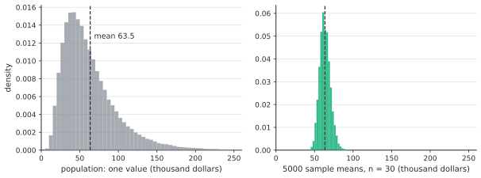
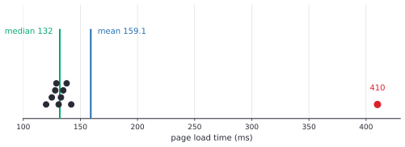
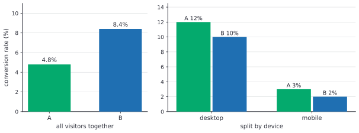

# Descriptive statistics and study design

After this lesson you can summarize a sample with a mean, median, standard deviation and quartiles, explain why the sample variance divides by $n - 1$, use z-scores and choose between robust and non-robust summaries, say what a sampling distribution is, and judge a study: tell an observational study from a randomized experiment, spot confounding, sampling bias, survivorship bias and Simpson's paradox, and explain why randomization supports a causal claim.

Before this: [describing data](../../02-middle-school/07-statistics-and-probability/01-describing-data.md) (centre, spread, quartiles, outliers), [scatter plots and two-way tables](../../02-middle-school/07-statistics-and-probability/03-scatter-plots-and-two-way-tables.md) (confounding in a first form), [joint distributions, covariance and sums](../07-probability/05-joint-distributions-covariance-and-sums.md) (the variance of a sum) and [continuous random variables and the normal distribution](../07-probability/04-continuous-random-variables-and-the-normal.md) (the z-score and the mean of a distribution).

## Quick check

Try these first. If you get all three right, skip to [Practice](#practice).

1. Find the sample variance and the sample standard deviation of 2, 4, 4, 6, 9.
2. An exam has class mean 70 and standard deviation 8. Find the z-score of a mark of 82, and say what it means.
3. A company offers a bonus program to anyone who wants it, and the volunteers sell more than the others. Can you conclude that the program raises sales? How would you test it?

<details class="solution" markdown>
<summary>Answers</summary>

1. The mean is $\bar{x} = 5$ and the squared deviations are $9, 1, 1, 1, 16$, which add to 28. Divide by $n - 1 = 4$: $s^2 = 7$ and $s = \sqrt{7} \approx 2.65$.
2. $z = \frac{82 - 70}{8} = 1.5$. The mark is 1.5 standard deviations above the mean.
3. No. People who volunteer may be more motivated, or have better territories, so the volunteers could have sold more without the program. To test it, offer the program to a randomly chosen half of the staff and compare the two halves.

</details>

## The idea

A campus club wants to know how many hours a week students at a university of 30,000 spend on a part-time job. Asking all 30,000 is too much work, so the club asks 40 students and finds a mean of 9.4 hours (made-up numbers). That number describes the 40 students exactly. The club wants to say something about the 30,000, and the 40 are a small piece of them. Another 40 students would give a different mean, say 8.7 or 10.1.

So statistics has two jobs. Describing data means summarizing what you have with a few numbers and pictures, which [describing data](../../02-middle-school/07-statistics-and-probability/01-describing-data.md) began. Inference means using the sample to say something about the larger group, and saying how far off you might be. This lesson finishes the description tools (the standard deviation and the z-score), and then looks at the question that decides whether inference is possible at all: how the data were collected.

The picture below shows the idea of a sampling distribution. The left panel is a skewed population of 200,000 values (hypothetical incomes, in thousands of dollars). The right panel draws 5000 random samples of 30 values from it and plots the mean of each sample. The sample means pile up around the population mean, and they are far less spread out than the individual values. Every method in the next three lessons rests on that second picture.



The second half of the lesson is about a different risk. A sample can be large and still wrong, if the way it was gathered favours some people. And an association found in data can be real while the explanation is not what it seems. Experiments with random assignment are the tool that removes that second risk.

## Definitions

A **population** is the whole group you want to know about, and a **sample** is the part of it you actually observe. A **parameter** is a number that describes the population, such as its mean $\mu$ or standard deviation $\sigma$. A **statistic** is a number computed from the sample, such as the sample mean $\bar{x}$. In plain words, parameters are about everyone and are usually unknown, and statistics are about the people you measured and are what you can compute.

For a sample $x_1, \dots, x_n$, the mean $\bar{x} = \frac{1}{n}\sum_{i=1}^{n} x_i$ and the median are as in [describing data](../../02-middle-school/07-statistics-and-probability/01-describing-data.md). The **sample variance** is

$$
s^2 = \frac{1}{n - 1}\sum_{i=1}^{n}(x_i - \bar{x})^2,
$$

and the **sample standard deviation** is $s = \sqrt{s^2}$. In plain words, $s^2$ is roughly the average squared distance from the mean, and $s$ puts that back in the units of the data. A typical value lies about $s$ from the mean. When the data are the whole population, the same formula with $N$ in place of $n - 1$ and $\mu$ in place of $\bar{x}$ gives the **population variance** $\sigma^2$. Software often has both: Python's `statistics.stdev` divides by $n - 1$ and `statistics.pstdev` divides by $n$.

The divisor $n - 1$ has a name, the **degrees of freedom**, the number of deviations $x_i - \bar{x}$ that can vary freely: since they add up to 0, once $n - 1$ of them are known the last is forced. The next section shows why this divisor, and not $n$, is the right one.

The **z-score** of a value $x$ in a sample is

$$
z = \frac{x - \bar{x}}{s},
$$

the number of standard deviations $x$ lies above the sample mean (below it, if negative). It is the same idea as the standardized normal variable of [the normal distribution lesson](../07-probability/04-continuous-random-variables-and-the-normal.md), computed from data. Values of $z$ have no units, so z-scores compare marks from different exams.

A **robust** summary is one that a few extreme or corrupted values can't move far. The **breakdown point** of a summary is the largest fraction of the data you can replace with arbitrary values before the summary can be made as large as you like. The mean has breakdown point 0 (one value is enough, as in [describing data](../../02-middle-school/07-statistics-and-probability/01-describing-data.md#the-idea)), the median has $\frac{1}{2}$, the IQR has $\frac{1}{4}$ and the standard deviation has 0.

A distribution is **skewed right** when its long tail is on the high side and **skewed left** when it is on the low side. Right-skewed data usually has mean above median, and left-skewed data the opposite.

An **estimator** is a rule that turns a sample into a guess at a parameter, and the **sampling distribution** of a statistic is its distribution over all the samples you could draw. In plain words, it answers: if I repeated the whole study many times, how would the answer vary? The sample mean $\bar{x}$ is an estimator of $\mu$. An estimator is **unbiased** if the average of its sampling distribution equals the parameter.

Now the vocabulary of design. An **observational study** records data on individuals without changing anything about them. An **experiment** applies a **treatment** to the individuals on purpose and records the **response**. A **randomized experiment** decides who gets which treatment by a chance device, which is **random assignment**. A **control group** receives no treatment (or a standard one) for comparison. A **confounding variable** is a variable that is related to both the treatment (or explanatory variable) and the response, so its effect can't be separated from the treatment's.

**Random sampling** picks the individuals of the sample from the population by chance, so that every individual has a known chance of being chosen. **Sampling bias** is a flaw in how the sample is chosen or how people respond, which makes some members of the population more likely to appear than others in a way that is related to the thing measured. **Survivorship bias** is a kind of sampling bias in which only the cases that passed some filter are observed. **Simpson's paradox** is the reversal of a comparison when groups are combined: one group does better inside every subgroup and worse overall.

In plain words, random sampling lets you generalize from the sample to the population, and random assignment lets you conclude that the treatment caused the difference. They are different tools for different questions, and a study can have one without the other.

## How to do it

### Describe a sample

1. Plot the data first: a histogram, dot plot or box plot, to see the shape, any skew and any outliers.
2. Choose the summary to match the shape. For roughly symmetric data with no outliers, report the mean $\bar{x}$ and the standard deviation $s$. For skewed data or outliers, report the median and the quartiles (or the IQR).
3. To compute $s$: find $\bar{x}$, subtract it from each value, square the deviations, add them, divide by $n - 1$, and take the square root. Check that the deviations before squaring add to 0.
4. To flag unusual values, compute the fences from the IQR, as in [describing data](../../02-middle-school/07-statistics-and-probability/01-describing-data.md#five-number-summary-outliers-and-box-plot), and the z-score of each suspect value.
5. State the sample size $n$ with every summary, and say which group the sample represents.

### Why the divisor is $n - 1$

*Theorem 1 (the sample variance is unbiased).* Let $X_1, \dots, X_n$ be independent random variables, each with mean $\mu$ and variance $\sigma^2$, and let $\bar{X}$ be their mean. Then

$$
E\!\left[\sum_{i=1}^{n}(X_i - \bar{X})^2\right] = (n - 1)\sigma^2,
$$

so $E[s^2] = \sigma^2$.

We know that $E[(X_i - \mu)^2] = \sigma^2$, and from [the lesson on sums](../07-probability/05-joint-distributions-covariance-and-sums.md) that independent variances add, so $\operatorname{Var}(\bar{X}) = \frac{1}{n^2}\cdot n\sigma^2 = \frac{\sigma^2}{n}$. We want the expected sum of squares around $\bar{X}$. The plan is to measure each deviation from the true mean $\mu$ instead, by adding and subtracting it, and see what the switch costs.

*Proof.* Write $X_i - \bar{X} = (X_i - \mu) - (\bar{X} - \mu)$ and square it:

$$
\sum_{i=1}^{n}(X_i - \bar{X})^2 = \sum_{i=1}^{n}(X_i - \mu)^2 - 2(\bar{X} - \mu)\sum_{i=1}^{n}(X_i - \mu) + n(\bar{X} - \mu)^2.
$$

Since $\sum (X_i - \mu) = n(\bar{X} - \mu)$, the last two terms combine to $-2n(\bar{X} - \mu)^2 + n(\bar{X} - \mu)^2 = -n(\bar{X} - \mu)^2$. So

$$
\sum_{i=1}^{n}(X_i - \bar{X})^2 = \sum_{i=1}^{n}(X_i - \mu)^2 - n(\bar{X} - \mu)^2.
$$

Take expectations. The first sum has expected value $n\sigma^2$. In the second term, $E[(\bar{X} - \mu)^2] = \operatorname{Var}(\bar{X}) = \frac{\sigma^2}{n}$, so it contributes $n \cdot \frac{\sigma^2}{n} = \sigma^2$. Therefore the expected value is $n\sigma^2 - \sigma^2 = (n - 1)\sigma^2$. Dividing by $n - 1$ gives $E[s^2] = \sigma^2$. $\blacksquare$

Look back: the sample mean is, by construction, the point closest to the sample values, closer than the true mean $\mu$ is. Squared distances from $\bar{X}$ are therefore a little too small, and the proof says by exactly $\sigma^2$ in total. Dividing by $n$ would give an estimator that is too small by the factor $\frac{n - 1}{n}$ on average, which matters for small $n$ and disappears as $n$ grows. Note that $s$ itself (the square root) is slightly biased low, even though $s^2$ is unbiased. That is fine in practice. The next lesson deals with the extra uncertainty that comes from using $s$ in place of $\sigma$, through the t distribution.

### Judge a study

1. Ask who was studied and how they got into the sample. If they volunteered, answered a survey or were the easiest to reach, expect sampling bias.
2. Ask whether the researchers assigned the groups. If people chose their own group (or nature did), it is observational, and the groups may differ in other ways.
3. List variables that could affect both group membership and the outcome. Each is a candidate confounder.
4. If the groups were assigned, ask whether the assignment was random, and whether the outcome was measured the same way for everyone.
5. Check what is missing. Who dropped out, failed, closed, or never answered?
6. State the conclusion the design supports: a population claim needs random sampling, and a causal claim needs random assignment or a convincing argument about confounders.

## Worked examples

<div class="example" markdown>

### Example 1: ten page load times

A web developer times 10 page loads, in milliseconds (hypothetical numbers): 120, 135, 128, 142, 131, 125, 138, 129, 133, 410. Summarize them, and decide which summary to report.

Step 1: the sorted list is 120, 125, 128, 129, 131, 133, 135, 138, 142, 410, so $n = 10$. The plot shows nine values between 120 and 142 and one at 410:



Step 2: the data is skewed by one value, so compute both kinds of summary. The sum is 1591, so $\bar{x} = 159.1$. The median is $\frac{131 + 133}{2} = 132$. For the quartiles, split into halves of five: $Q_1 = 128$ and $Q_3 = 138$, so $\text{IQR} = 10$.

Step 3: the squared deviations from 159.1 add to 70,304.9 (most of it comes from 410: $(410 - 159.1)^2 \approx 62{,}951$). So $s^2 = \frac{70{,}304.9}{9} \approx 7811.7$ and $s \approx 88.4$ ms.

Step 4: the fences are $128 - 15 = 113$ and $138 + 15 = 153$, so 410 is an outlier and no other value is. Its z-score is $\frac{410 - 159.1}{88.4} \approx 2.84$.

<div class="warning" markdown>

Watch out at Step 4: a rule like "an outlier has $\lvert z \rvert > 3$" would miss this one. A sample of $n$ values can't have any z-score above $\frac{n - 1}{\sqrt{n}}$ (Samuelson's inequality), which is 2.85 for $n = 10$. The outlier inflates $s$, so it hides itself. Use the IQR fences for small samples.

</div>

Step 5: without the 410, the other nine values have $\bar{x} \approx 131.2$, median 131 and $s \approx 6.7$ ms. One value moved the mean by 28 ms and the standard deviation from 6.7 to 88.4, and it moved the median by 1.

Report the median, 132 ms, with the IQR, 10 ms, and say that one of ten loads took 410 ms. If the 410 is a real slow load, say so, because users feel it; if it is a timer glitch, say that too.

Check: $5 + 5$ values in the halves and the median between them, the mean (159.1) lies between the minimum and the maximum, and above the median, as a high outlier predicts.

</div>

<div class="example" markdown>

### Example 2: the standard deviation by hand, and why $n - 1$

Find $s$ for the sample 2, 4, 4, 6, 9, and compare with dividing by $n$.

The mean is $\frac{25}{5} = 5$ and the deviations are $-3, -1, -1, 1, 4$. They add to 0, as they must. The squares are $9, 1, 1, 1, 16$, which add to 28.

Dividing by $n - 1 = 4$: $s^2 = 7$ and $s = \sqrt{7} \approx 2.646$. Dividing by $n = 5$: $\frac{28}{5} = 5.6$ and $\sqrt{5.6} \approx 2.366$. The divisor $n - 1$ gives the larger value, and that is the point of Theorem 1.

A shortcut that avoids the deviations: $\sum x_i^2 = 4 + 16 + 16 + 36 + 81 = 153$ and $\sum (x_i - \bar{x})^2 = \sum x_i^2 - n\bar{x}^2 = 153 - 5 \cdot 25 = 28$.

To see Theorem 1 at work, take the tiny population $\{1, 2, 3\}$, which has $\mu = 2$ and $\sigma^2 = \frac{2}{3}$. Draw two values with replacement. There are 9 equally likely samples. For two values, $s^2 = \frac{(x_1 - x_2)^2}{2}$, which is 0 for the 3 samples with equal values, $\frac{1}{2}$ for the 4 with values one apart and 2 for the 2 samples $(1, 3)$ and $(3, 1)$. The average is $\frac{3 \cdot 0 + 4 \cdot \frac{1}{2} + 2 \cdot 2}{9} = \frac{6}{9} = \frac{2}{3}$, which is $\sigma^2$. Dividing by $n = 2$ instead halves each value and gives $\frac{1}{3}$, half the true variance.

Check: both ways of computing the sum of squares gave 28.

</div>

<div class="example" markdown>

### Example 3: Simpson's paradox in an A/B test

A site shows version A of a sign-up page to 1000 visitors and version B to another 1000. The numbers are hypothetical. Version A mostly got mobile visitors, because of how the two versions were released.

| Version | Desktop: sign-ups / visitors | Mobile: sign-ups / visitors | All visitors |
|---|---|---|---|
| A | 24 / 200 | 24 / 800 | 48 / 1000 |
| B | 80 / 800 | 4 / 200 | 84 / 1000 |

With all visitors together, A converts $\frac{48}{1000} = 4.8\%$ and B converts $\frac{84}{1000} = 8.4\%$, so B looks much better. Now split by device. On desktop, A converts $\frac{24}{200} = 12\%$ and B converts $\frac{80}{800} = 10\%$. On mobile, A converts $\frac{24}{800} = 3\%$ and B converts $\frac{4}{200} = 2\%$. A wins on both devices.



How can A win in both groups and lose overall? The overall rate is a weighted mean of the group rates, with the visitor counts as weights, as in [describing data](../../02-middle-school/07-statistics-and-probability/01-describing-data.md). A's overall rate is $0.2 \times 12\% + 0.8 \times 3\% = 4.8\%$, weighted mostly toward the low-converting mobile visitors. B's is $0.8 \times 10\% + 0.2 \times 2\% = 8.4\%$, weighted mostly toward desktop. The device is a confounder: it affects who sees which version and also the chance of signing up.

The right comparison depends on the question, and the data can't decide it alone. If the visitor mix is an accident of the release, compare within each device, and A is better. If you want to know which version produces more sign-ups from the traffic you will really get, the mix of that traffic matters. Randomly assigning each visitor to A or B would have given both versions about the same mix of devices, and the paradox could not have happened.

Check: each row of the table adds up ($24 + 24 = 48$, $80 + 4 = 84$), and the weights in each overall rate sum to 1.

</div>

<div class="example" markdown>

### Example 4: comparing marks from two classes (finish it yourself)

Maya scored 78 in a class with mean 70 and standard deviation 8. Leo scored 71 in a class with mean 60 and standard deviation 5. Who did better compared with their own class?

Compute each z-score: Maya's is $\frac{78 - 70}{8} = 1$. Now do Leo's, and compare.

<details class="solution" markdown>
<summary>Finish</summary>

Leo's z-score is $\frac{71 - 60}{5} = 2.2$. He is 2.2 standard deviations above his class mean, and Maya is 1. Relative to their classes, Leo did better, even though Maya's mark is higher.

Check: the standardized values carry no units, so they can be compared. Leo's mark is 11 points above his class mean and Maya's is 8 points above hers, and Leo's class is also more tightly spread, which raises his z-score further.

</details>

</div>

## Edge cases and common mistakes

<div class="warning" markdown>

Watch out: "random" is two different things. A random sample of 400 students from the registrar's list supports a claim about all students. It supports no claim that studying with a tutor causes better marks, because the students chose whether to use a tutor. Random assignment supports the causal claim and says nothing about the wider population if the volunteers were unusual.

</div>

<div class="warning" markdown>

Watch out: a bigger sample doesn't fix a biased one. In 1936 the magazine Literary Digest mailed about 10 million ballots, drawn mostly from telephone directories and car registrations, and counted about 2.4 million replies. It predicted that Alf Landon would beat Franklin Roosevelt. Roosevelt won with roughly 61% of the vote. During the Depression, people on those lists were richer than voters as a whole, and the people who chose to reply differed too (Squire, [Why the 1936 Literary Digest poll failed](https://doi.org/10.1086/269085), *Public Opinion Quarterly* 52, 1988; the counts are reported in Bradley et al., [Why do polls fail?](https://arxiv.org/pdf/2107.14166), 2021). More data shrinks the random error and leaves the bias exactly where it was.

</div>

<div class="warning" markdown>

Watch out: survivorship bias. During the Second World War, the military studied where returning bombers had bullet holes. The statistician Abraham Wald pointed out that the holes were counts from planes that survived, so the places with few holes were the places where a hit meant the plane never came back. Armour belonged there (Mangel and Samaniego, "Abraham Wald's work on aircraft survivability", *Journal of the American Statistical Association* 79, 1984, pp. 259-267). In software the same trap appears when you study only the startups that are still alive, or only the users who didn't churn.

</div>

<div class="warning" markdown>

Watch out: treating a z-score cutoff as a law. A common rule says that $\lvert z \rvert > 3$ means an outlier, and for a roughly normal population only about 0.3% of values are that far out. For a small sample the rule can't fire at all, as Example 1 showed. Look at the plot, and use the fences.

</div>

Spread 0 is fine: a sample where all values are equal has $s = 0$. A sample of one value has no sample variance, since $n - 1 = 0$ and the formula divides by zero. One value says nothing about spread, which is the right answer.

The standard deviation is in the units of the data (milliseconds, dollars), and the variance is in squared units. Report $s$, not $s^2$, when you describe data to a reader.

A confounder doesn't have to be measured to do damage, and that is why adjusting for known variables is weaker than randomizing. You can't adjust for what you didn't record.

## Tricks and shortcuts

The 68-95-99.7 rule from [the normal distribution lesson](../07-probability/04-continuous-random-variables-and-the-normal.md) gives a quick check on $s$ for bell-shaped data: about 95% of values lie within 2 standard deviations of the mean, so the range of a sample of about 30 values is roughly $4s$. If you computed $s = 50$ for data with range 60, something is wrong.

For the standard deviation by hand, use $\sum x_i^2 - n\bar{x}^2$ for the sum of squares, as in Example 2. It avoids subtracting the mean from every value, but it can lose digits if the mean is large and the spread is small (values near a million that differ by 1), so on a computer use a library routine.

Shifting every value by a constant leaves $s$ alone, and multiplying every value by $c$ multiplies $s$ by $\lvert c \rvert$, as for the MAD. Converting times from seconds to milliseconds multiplies the mean and $s$ by 1000, and z-scores don't change at all.

For a quick plausibility check on a mean, remember that the mean always lies between the minimum and the maximum, and that for right-skewed data the median is usually lower.

## In code

The code below summarizes the page load times of Example 1, finds the quartiles and fences, computes the largest possible z-score for $n = 10$, shows by simulation that dividing by $n - 1$ is right on average, and repeats the Simpson's paradox numbers. It uses only the standard library.

<details class="code" markdown>
<summary>In code</summary>

```python
import random
import statistics as st

loads = [120, 135, 128, 142, 131, 125, 138, 129, 133, 410]   # ms, hypothetical

print(round(st.mean(loads), 1), st.median(loads))             # 159.1 132.0
print(round(st.stdev(loads), 2), round(st.pstdev(loads), 2))  # 88.38 83.85

def five_number(data):
    xs = sorted(data)
    n = len(xs)
    lower, upper = xs[: n // 2], xs[(n + 1) // 2 :]
    return xs[0], st.median(lower), st.median(xs), st.median(upper), xs[-1]

mn, q1, med, q3, mx = five_number(loads)
iqr = q3 - q1
print(q1, q3, iqr, q1 - 1.5 * iqr, q3 + 1.5 * iqr)           # 128 138 10 113.0 153.0

m, s = st.mean(loads), st.stdev(loads)
print([round((x - m) / s, 2) for x in loads][-1])             # 2.84
print(round((len(loads) - 1) / len(loads) ** 0.5, 2))         # 2.85, the largest z a sample of 10 can have

# Divide by n or by n - 1? Average each estimate over many small samples.
random.seed(1)
population = [random.gauss(50, 10) for _ in range(100_000)]
sigma2 = st.pvariance(population)
by_n, by_n1 = [], []
for _ in range(20_000):
    sample = random.sample(population, 5)
    xbar = sum(sample) / 5
    ss = sum((x - xbar) ** 2 for x in sample)
    by_n.append(ss / 5)
    by_n1.append(ss / 4)
print(round(sigma2, 1), round(st.mean(by_n), 1), round(st.mean(by_n1), 1))
# 100.1 79.7 99.6

# Simpson's paradox: conversions and visits for versions A and B.
data = {"A": {"desktop": (24, 200), "mobile": (24, 800)},
        "B": {"desktop": (80, 800), "mobile": (4, 200)}}
for version, parts in data.items():
    conv = sum(c for c, _ in parts.values())
    visits = sum(v for _, v in parts.values())
    by_device = {d: round(100 * c / v, 1) for d, (c, v) in parts.items()}
    print(version, round(100 * conv / visits, 1), by_device)
# A 4.8 {'desktop': 12.0, 'mobile': 3.0}
# B 8.4 {'desktop': 10.0, 'mobile': 2.0}
```

The simulation draws samples of 5 from a population with variance about 100. Dividing by $n$ averages 79.7, about $\frac{4}{5}$ of 100, and dividing by $n - 1$ averages 99.6, close to 100, as Theorem 1 predicts. The sample `sample = random.sample(population, 5)` is a random sample without replacement from a large population, which behaves like independent draws.

</details>

## FAQ

### Why divide by $n - 1$ and not $n - 2$ or something else?

Because exactly one constraint was used: the sample mean was estimated from the same data, which costs one degree of freedom. Theorem 1 shows that $n - 1$ makes $E[s^2] = \sigma^2$ exactly. When you estimate more quantities from the same data, as regression does with a slope and an intercept, the divisor drops by one for each, which is why the regression lesson divides by $n - 2$.

### If correlation isn't causation, can an observational study ever show a cause?

Sometimes, but it takes more work. Researchers compare similar people, adjust for the confounders they measured, look for a dose-response pattern, check that the cause came before the effect and replicate the result in different groups. The case that smoking causes lung cancer was built this way, since nobody could ethically randomize people to smoke. The conclusion is only as strong as the argument that no unmeasured confounder is left, which is why a randomized experiment is stronger when it is possible.

### Why does randomization work against confounders I haven't thought of?

Random assignment makes group membership independent of every other variable, measured or not, so each group is a random subset of the same pool and the groups are alike on average in everything, including the variables nobody recorded. A difference in the response that is bigger than chance can explain is then due to the treatment. How big chance differences are is the topic of [hypothesis testing](03-hypothesis-testing.md). Note that "alike on average" is a statement about large groups: with 10 people per group, an unlucky split can still happen.

### Is the mean or the median the right centre?

Neither, in general. They answer different questions, as in [describing data](../../02-middle-school/07-statistics-and-probability/01-describing-data.md). The mean is the right summary when you care about the total (total revenue is $n\bar{x}$), and the median when you care about a typical case. If they differ a lot, the difference is itself worth reporting.

## Practice

### Warm-up

1\. For each description, say whether the number is a parameter or a statistic: (a) the mean commute of all 30,000 students at a university, (b) the mean commute of 50 students surveyed, (c) the standard deviation of the final marks of one course's 200 students, when the question is only about that course, (d) the proportion of 1000 polled voters who support a party.

<details class="solution" markdown>
<summary>Solution</summary>

- (a) A parameter: it describes the whole population of students.
- (b) A statistic: it comes from a sample.
- (c) A parameter, since the 200 students are the whole population of interest. If the 200 were a sample of all students, it would be a statistic.
- (d) A statistic. The parameter is the proportion among all voters.

Check: ask "is this the whole group I care about?" If yes, it is a parameter.

</details>

2\. Find the mean, the sample variance and the sample standard deviation of 5, 7, 8, 12, 13.

<details class="solution" markdown>
<summary>Solution</summary>

The mean is $\frac{45}{5} = 9$. The deviations are $-4, -2, -1, 3, 4$ and the squares are $16, 4, 1, 9, 16$, which add to 46. So $s^2 = \frac{46}{4} = 11.5$ and $s = \sqrt{11.5} \approx 3.39$.

Check: the deviations add to $-4 - 2 - 1 + 3 + 4 = 0$. By the shortcut, $\sum x_i^2 = 25 + 49 + 64 + 144 + 169 = 451$ and $451 - 5 \cdot 81 = 46$.

</details>

3\. Marks on a test have mean 72 and standard deviation 9. Find the z-score of a mark of 90 and of 63, and the mark with $z = -0.5$.

<details class="solution" markdown>
<summary>Solution</summary>

$z = \frac{90 - 72}{9} = 2$ and $z = \frac{63 - 72}{9} = -1$. For $z = -0.5$ solve $x = \bar{x} + zs = 72 - 0.5 \cdot 9 = 67.5$.

Check: $\frac{67.5 - 72}{9} = -0.5$.

</details>

### Standard

4\. Server response times, in ms, are 20, 22, 25, 27, 30, 31. A glitch then adds a seventh reading of 500. Find the mean, median and sample standard deviation before and after, and say which summaries are robust.

<details class="solution" markdown>
<summary>Solution</summary>

Before: the mean is $\frac{155}{6} \approx 25.8$, the median is $\frac{25 + 27}{2} = 26$ and $s \approx 4.36$. After: the sum is 655, so the mean is $\frac{655}{7} \approx 93.6$; the median is the fourth value, 27; and $s \approx 179.3$.

The mean rose by about 68 ms and $s$ by a factor of 41, while the median rose by 1 ms. The median is robust and the mean and standard deviation are not.

Check: the median of seven values is the 4th sorted value, 27, and the mean of 93.6 is far above six of the seven readings, which says the 500 is pulling it.

</details>

5\. Classify each study as observational or an experiment, and name one possible confounder or bias. (a) A university compares the grades of students who chose to attend optional tutorials with those who didn't. (b) A phone app randomly shows one of two button colours to each new user and records whether they sign up. (c) A magazine invites readers to fill out an online survey about their income. (d) A hospital finds that patients who got a new drug had better recoveries than patients who got the old one, with the doctor choosing the drug for each.

<details class="solution" markdown>
<summary>Solution</summary>

- (a) Observational. Students who attend may be more motivated, so motivation is a confounder.
- (b) An experiment, with random assignment. Confounders are balanced on average, so a difference in sign-ups can be credited to the colour.
- (c) Observational, a voluntary-response survey. Readers who choose to respond are not a random sample, so there is sampling bias, perhaps towards people with strong feelings about their incomes.
- (d) Observational, since the doctor chose. Doctors may give the new drug to patients who are healthier, or sicker, so the severity of illness is a confounder.

Check: ask in each case "who decided the group?" If a chance device did, it is an experiment.

</details>

6\. A team compares two test-generation tools P and Q on 250 test cases each. The numbers are hypothetical. Tool P passed 45 of 50 easy cases and 20 of 200 hard cases. Tool Q passed 170 of 200 easy cases and 3 of 50 hard cases. (a) Which tool has the higher pass rate on easy cases, and on hard cases? (b) Which has the higher pass rate overall? (c) Explain the result and say which comparison you would trust.

<details class="solution" markdown>
<summary>Solution</summary>

(a) Easy: P has $\frac{45}{50} = 90\%$ and Q has $\frac{170}{200} = 85\%$. Hard: P has $\frac{20}{200} = 10\%$ and Q has $\frac{3}{50} = 6\%$. P is better on both.

(b) Overall P has $\frac{65}{250} = 26\%$ and Q has $\frac{173}{250} = 69.2\%$. Q is far better overall.

(c) This is Simpson's paradox. P was given mostly hard cases (200 of its 250) and Q mostly easy ones (200 of its 250), so the overall rates mostly reflect the difficulty mix. Only the within-difficulty comparison is fair, since the difficulty affects both which tool got the case and the chance of passing. I would trust (a), and I would rerun both tools on the same randomly chosen cases.

Check: $45 + 20 = 65$ and $170 + 3 = 173$, and the overall rates are weighted means: $0.2 \cdot 90\% + 0.8 \cdot 10\% = 26\%$.

</details>

### Challenge

7\. Show that dividing by $n$ is biased, using the population $\{1, 2, 3\}$ and samples of size $n = 3$ drawn with replacement. You may use the identity from Theorem 1: the expected sum of squared deviations from $\bar{X}$ is $(n - 1)\sigma^2$.

<details class="solution" markdown>
<summary>Solution</summary>

The population has $\mu = 2$ and $\sigma^2 = \frac{(1 - 2)^2 + 0 + (3 - 2)^2}{3} = \frac{2}{3}$. By Theorem 1 with $n = 3$, the expected sum of squared deviations is $(3 - 1) \cdot \frac{2}{3} = \frac{4}{3}$.

Dividing by $n - 1 = 2$ gives an expected value of $\frac{4}{3} \div 2 = \frac{2}{3} = \sigma^2$, so this estimator is unbiased. Dividing by $n = 3$ gives $\frac{4}{3} \div 3 = \frac{4}{9}$, which is $\frac{2}{3}$ of $\sigma^2$, the factor $\frac{n - 1}{n}$. So dividing by $n$ is biased low.

Check: listing all $3^3 = 27$ equally likely samples and averaging their sums of squared deviations gives $\frac{4}{3}$ exactly. Individual samples vary, for example $(2, 2, 2)$ gives 0 and $(1, 1, 3)$ gives $\frac{8}{3}$. The theorem is about the average over all of them.

</details>

8\. (Reviews [describing data](../../02-middle-school/07-statistics-and-probability/01-describing-data.md).) For the data 4, 7, 7, 9, 13, find the mean absolute deviation and the sample standard deviation. Which is bigger, and why? Which one would you use for the data with 13 replaced by 40?

<details class="solution" markdown>
<summary>Solution</summary>

The mean is 8, and the distances from it are $4, 1, 1, 1, 5$, which add to 12, so the MAD is $\frac{12}{5} = 2.4$. The squared deviations are $16, 1, 1, 1, 25$, which add to 44, so $s^2 = \frac{44}{4} = 11$ and $s \approx 3.32$.

The standard deviation is bigger. Squaring gives the large deviations (4 and 5) more weight than the small ones, and dividing by $n - 1$ instead of $n$ also raises it. With 40 in place of 13 the mean is 13.4, and both measures grow, with $s$ growing faster because the squared deviation of 40 is large. For data with a wild value, neither is robust, and the IQR is the better measure of spread.

Check: the five deviations from 8 add to $-4 - 1 - 1 + 1 + 5 = 0$.

</details>

## Where this shows up

- The sampling distribution of $\bar{x}$ is the idea behind [confidence intervals](02-confidence-intervals.md) and [hypothesis testing](03-hypothesis-testing.md), and the standard deviation and z-score return in [correlation and linear regression](04-correlation-and-linear-regression.md). The central limit theorem in [the law of large numbers and the CLT](../07-probability/06-law-of-large-numbers-and-clt.md) explains why the right-hand panel of the first figure is bell-shaped.
- In CS, an A/B test is a randomized experiment, and the sign-up example above is why platforms assign users at random instead of releasing versions in turn. Reporting median and p99 latency is the robust-summary idea, and survivorship bias is the reason you log failed requests too.
- In economics, almost all data is observational, so confounding is the central difficulty of econometrics ([regression and econometrics intuition](../../07-economics-math/04-more-tools/03-regression-and-econometrics-intuition.md)). Official numbers such as the CPI and the unemployment rate are survey statistics, with the sampling issues of this lesson (CPI and inflation<!-- link: ../../07-economics-math/01-measuring-the-economy/07-cpi-and-inflation.md --> and unemployment rate and labour statistics<!-- link: ../../07-economics-math/01-measuring-the-economy/08-unemployment-rate-and-labour-statistics.md -->).
