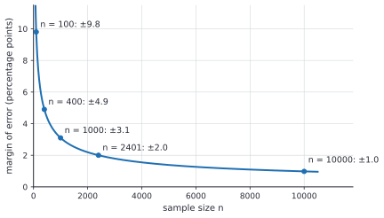
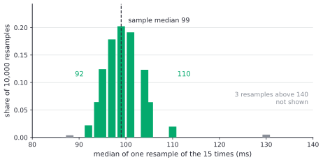
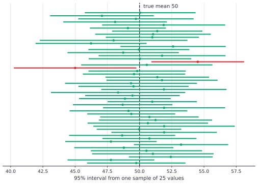

# Confidence intervals

After this lesson you can compute and interpret a confidence interval for a mean (with the z or the t distribution) and for a proportion, say correctly what "95% confident" means and what it doesn't, plan the sample size for a given margin of error, and build a bootstrap interval when no formula is handy.

Before this: [descriptive statistics and study design](01-descriptive-statistics-and-study-design.md) (samples, $s$, sampling distributions), [continuous random variables and the normal distribution](../07-probability/04-continuous-random-variables-and-the-normal.md) (z-scores and $\Phi$) and [joint distributions, covariance and sums](../07-probability/05-joint-distributions-covariance-and-sums.md) (the variance of a sum).

## Quick check

Try these first. If you get all three right, skip to [Practice](#practice).

1. A sample of $n = 25$ values has $\bar{x} = 50$ and $s = 10$. Find the 95% confidence interval for the population mean. For 24 degrees of freedom, $t^* = 2.064$.
2. A poll finds that 540 of 1000 randomly chosen voters support a policy (hypothetical). Find the 95% confidence interval for the proportion of all voters who support it.
3. How many randomly chosen voters must you poll to get a margin of error of 2 percentage points at 95% confidence, whatever the true proportion is?

<details class="solution" markdown>
<summary>Answers</summary>

1. The standard error is $\frac{10}{\sqrt{25}} = 2$, so the interval is $50 \pm 2.064 \times 2 = 50 \pm 4.13$, which is $(45.87, 54.13)$.
2. $\hat{p} = 0.54$ and the standard error is $\sqrt{\frac{0.54 \times 0.46}{1000}} \approx 0.01576$. The margin is $1.96 \times 0.01576 \approx 0.0309$, so the interval is $(0.509, 0.571)$.
3. The worst case is $p = 0.5$. Solve $1.96\sqrt{\frac{0.25}{n}} = 0.02$: $n = \left(\frac{1.96}{0.02}\right)^2 \times 0.25 = 2401$.

</details>

## The idea

A polling firm asks 1000 randomly chosen voters whether they support a policy, and 540 say yes. The sample proportion is 54%, but the firm doesn't claim that exactly 54% of all voters agree. A different 1000 voters would give 52% or 56%. What the firm can say is a range: "between about 51% and 57%". The range is wide enough to be believable and narrow enough to be useful, and the pair "range plus a level of confidence" is a confidence interval.

Where does the range come from? From the sampling distribution of [the last lesson](01-descriptive-statistics-and-study-design.md). The sample proportion varies from sample to sample around the true proportion, and the amount of variation can be computed: it is about 1.6 percentage points for $n = 1000$. About 95% of samples land within 2 of those units of the truth. Turn that around: the truth is within 2 units of the sample result for about 95% of samples. The interval is the sample result plus or minus 2 units.

The same recipe works for a mean, a median, a difference of two means, a regression slope. Estimate, find how much the estimate varies from sample to sample (its standard error), and go out a multiple of that on each side. The multiple sets the confidence level. When there is no formula for the standard error, a computer can find it by resampling, which is the bootstrap at the end of the lesson.

## Definitions

A **point estimate** is a single number computed from the sample as a guess for a parameter, such as $\bar{x}$ for $\mu$ or $\hat{p}$ for the population proportion $p$. The **standard error** (SE) of an estimate is the standard deviation of its sampling distribution: how much the estimate typically varies from sample to sample. In plain words, the standard error is the "plus or minus" of the estimate before you pick a confidence level. When the formula for the SE contains an unknown parameter, the usual practice is to plug in its estimate, and the result is also called the standard error.

A **confidence interval** for a parameter at **confidence level** $C$ (such as 95%) is an interval computed from the sample by a procedure that, over repeated samples, captures the true parameter in a fraction $C$ of them. The common form is

$$
\text{estimate} \pm (\text{critical value}) \times \text{SE}.
$$

The **critical value** is a number from the normal or t distribution, chosen so that the central area is $C$. The product (critical value) $\times$ SE is the **margin of error**, so the interval is the estimate plus or minus the margin of error.

For the normal distribution, the critical value $z^*$ for confidence level $C$ satisfies $P(-z^* < Z < z^*) = C$ for a standard normal $Z$:

| Confidence level | 90% | 95% | 99% |
|---|---|---|---|
| $z^*$ | 1.645 | 1.960 | 2.576 |

The **t distribution** with $k$ degrees of freedom is a bell-shaped, symmetric distribution centred at 0, like the standard normal but with heavier tails: more probability far from the centre. It describes the quantity $\frac{\bar{x} - \mu}{s / \sqrt{n}}$ when the data come from a normal population and $k = n - 1$. In plain words, it is the normal curve made a little wider to pay for not knowing $\sigma$. As $k$ grows, the t distribution approaches the standard normal. Its critical value is written $t^*$, and it depends on $k$.

Here are 95% critical values (two-sided, each tail 2.5%), computed from the t distribution:

| Degrees of freedom | 4 | 9 | 15 | 19 | 24 | 29 | 99 | $\infty$ (z) |
|---|---|---|---|---|---|---|---|---|
| $t^*$ at 95% | 2.776 | 2.262 | 2.131 | 2.093 | 2.064 | 2.045 | 1.984 | 1.960 |

The left panel below draws the curves, and the right panel shows $t^*$ falling towards 1.96 as the degrees of freedom grow.


Both $\bar{x}$ and $\hat{p}$ are unbiased estimators, in the sense of [the last lesson](01-descriptive-statistics-and-study-design.md#definitions): their sampling distributions are centred on the parameter they estimate.

## How to do it

### Where the standard errors come from

*Theorem 1 (standard errors of a mean and a proportion).* Let $X_1, \dots, X_n$ be independent, each with mean $\mu$ and variance $\sigma^2$. Then $\bar{X}$ has mean $\mu$ and standard deviation $\frac{\sigma}{\sqrt{n}}$. If $X$ is the number of successes in $n$ independent trials, each with success probability $p$, then $\hat{p} = \frac{X}{n}$ has mean $p$ and standard deviation $\sqrt{\frac{p(1 - p)}{n}}$.

We know that expectation is linear and that variances of independent variables add ([joint distributions, covariance and sums](../07-probability/05-joint-distributions-covariance-and-sums.md)). We want the spread of an average. The plan is to find the variance of the sum, then divide by $n$, which divides the variance by $n^2$.

*Proof.* By linearity, $E[\bar{X}] = \frac{1}{n}\cdot n\mu = \mu$. By independence, $\operatorname{Var}(X_1 + \dots + X_n) = n\sigma^2$. Since $\operatorname{Var}(aY) = a^2\operatorname{Var}(Y)$, we get $\operatorname{Var}(\bar{X}) = \frac{1}{n^2}\cdot n\sigma^2 = \frac{\sigma^2}{n}$, and the standard deviation is $\frac{\sigma}{\sqrt{n}}$. A proportion is a mean of indicator variables, each equal to 1 for a success and 0 for a failure. Each has mean $p$ and variance $p(1 - p)$, so the first part applies with $\sigma^2 = p(1 - p)$. $\blacksquare$

Look back: the spread of an average shrinks like $\frac{1}{\sqrt{n}}$, not like $\frac{1}{n}$. To halve the standard error you need four times the data. This one fact drives the sample-size rule later in this lesson. In practice $\sigma$ and $p$ are unknown, so the standard error is estimated with $s$ and $\hat{p}$:

$$
\text{SE}(\bar{x}) = \frac{s}{\sqrt{n}}, \qquad \text{SE}(\hat{p}) = \sqrt{\frac{\hat{p}(1 - \hat{p})}{n}}.
$$

### Why the interval has the confidence level it has

*Theorem 2 (the z interval).* Suppose $\bar{X}$ is normally distributed with mean $\mu$ and known standard deviation $\text{SE} = \frac{\sigma}{\sqrt{n}}$. Then the random interval $\bar{X} \pm z^* \cdot \text{SE}$ contains $\mu$ with probability $C$.

We know that $Z = \frac{\bar{X} - \mu}{\text{SE}}$ is standard normal, by [standardizing](../07-probability/04-continuous-random-variables-and-the-normal.md). We want the probability that $\mu$ is inside the interval. The plan is to rewrite the event "$\mu$ is inside" as an event about $Z$.

*Proof.* The event $\bar{X} - z^*\text{SE} \le \mu \le \bar{X} + z^*\text{SE}$ is the same as $-z^*\text{SE} \le \bar{X} - \mu \le z^*\text{SE}$, which divides to $-z^* \le Z \le z^*$. By the definition of $z^*$ this has probability $C$. $\blacksquare$

Look back: the randomness is in $\bar{X}$, so it is the interval that moves from sample to sample while $\mu$ stays fixed. The event "within $z^*$ standard errors" is symmetric, and that symmetry is why the interval is $\bar{x} \pm$ margin. Real data differ from this ideal in two ways. If the population is not normal, the central limit theorem ([the law of large numbers and the CLT](../07-probability/06-law-of-large-numbers-and-clt.md)) makes $\bar{X}$ nearly normal when $n$ is large enough. And if $\sigma$ is replaced by $s$, the ratio is a t variable rather than a normal one, so $z^*$ is replaced by $t^*$.

### A confidence interval for a mean

1. Check the conditions: the sample is random (or can be treated as random), the observations are independent, and the population is roughly normal or $n$ is large (a rough guide: $n \ge 30$, or fewer if the data show no strong skew or outliers).
2. Compute $n$, $\bar{x}$ and $s$.
3. Find the standard error $\text{SE} = \frac{s}{\sqrt{n}}$.
4. Choose the confidence level and find the critical value: $t^*$ with $n - 1$ degrees of freedom. (If $\sigma$ is genuinely known, use $z^*$ and $\text{SE} = \frac{\sigma}{\sqrt{n}}$.)
5. The interval is $\bar{x} \pm t^* \cdot \text{SE}$.
6. State it in context, with units, as a statement about the population mean.

### A confidence interval for a proportion

1. Check the conditions: a random sample, independent observations, and at least about 10 successes and 10 failures in the sample, so that $\hat{p}$ is nearly normal.
2. Compute $\hat{p} = \frac{x}{n}$ and $\text{SE} = \sqrt{\frac{\hat{p}(1 - \hat{p})}{n}}$.
3. The interval is $\hat{p} \pm z^* \cdot \text{SE}$. A proportion has no separate $s$, so the normal critical value is used.
4. State it in context, and say the margin in percentage points.

### Choosing the sample size

The margin of error is $E = z^*\frac{\sigma}{\sqrt{n}}$ for a mean and $E = z^*\sqrt{\frac{p(1 - p)}{n}}$ for a proportion. Solving for $n$:

$$
n = \left(\frac{z^*\sigma}{E}\right)^2 \qquad \text{or} \qquad n = \left(\frac{z^*}{E}\right)^2 p(1 - p).
$$

1. Decide the confidence level and the margin $E$ you can live with.
2. Guess $\sigma$ from a pilot study or past data, or, for a proportion, use the worst case $p = 0.5$, which makes $p(1 - p)$ largest ($\frac{1}{4}$).
3. Compute $n$ and round up, because rounding down would give a margin slightly bigger than the target.

The margin of error for a poll of $n$ voters with $p = 0.5$ is $1.96 \cdot \frac{0.5}{\sqrt{n}}$, shown below. Going from 100 to 400 voters halves the margin, and going from 1000 to 10,000 voters cuts it only from 3.1 to 1.0 points.



### The bootstrap

Some statistics, such as the median or the ratio of two means, have no simple standard error formula. The **bootstrap** gets one by simulation. It treats the sample as a stand-in for the population and draws new samples from it.

1. From the sample of $n$ values, draw $n$ values with replacement. This is one resample, and the same value can appear more than once.
2. Compute the statistic (the median, say) on the resample.
3. Repeat steps 1 and 2 many times, say $B = 10{,}000$.
4. Sort the $B$ values. The values at the 2.5th and 97.5th percentiles are a 95% **percentile interval**.

In plain words: the sample is the best picture of the population you have, so ask how much the statistic would vary if the world looked like the sample. The bootstrap needs no normality and works for almost any statistic, but it can't repair a bad sample: if the sample is biased or tiny, the resamples inherit the problem.

## Worked examples

<div class="example" markdown>

### Example 1: battery life, a t interval

A lab tests 16 laptops and records battery life in hours (hypothetical numbers): 8.2, 7.6, 9.1, 8.8, 7.9, 8.5, 9.4, 8.0, 8.7, 7.4, 8.9, 8.3, 9.0, 7.8, 8.6, 8.1. Find a 95% confidence interval for the mean battery life of this laptop model.

Step 1: the laptops are a random sample from production, and $n = 16$ is small, so check the data for strong skew. The values range from 7.4 to 9.4 with no outliers, so using the t distribution is reasonable.

Step 2: the sum is 134.3, so $\bar{x} = \frac{134.3}{16} \approx 8.394$ hours, and $s \approx 0.574$ hours.

Step 3: $\text{SE} = \frac{0.574}{\sqrt{16}} = \frac{0.574}{4} \approx 0.1436$.

Step 4: there are $n - 1 = 15$ degrees of freedom, so $t^* = 2.131$.

Step 5: the margin of error is $2.131 \times 0.1436 \approx 0.306$, so the interval is $8.394 \pm 0.306$, which is $(8.09, 8.70)$ hours.

<div class="warning" markdown>

Watch out at Step 4: using $z^* = 1.96$ here gives a margin of $0.281$, which is too narrow. With 15 degrees of freedom the t distribution has heavier tails, and ignoring that makes the interval claim more confidence than it has.

</div>

Step 6: we are 95% confident that the mean battery life of the model is between 8.09 and 8.70 hours. The statement is about the mean of all laptops of the model, not about a single laptop: individual batteries vary more than that (the sample's own spread is $s = 0.57$).

Check: the interval is centred at the sample mean, and its half-width, 0.306, is about $2.13$ standard errors. A rough check with "mean plus or minus 2 SE" gives $8.39 \pm 0.29$, close to the answer.

</div>

<div class="example" markdown>

### Example 2: a poll proportion

A poll asks 1000 randomly chosen voters whether they support a policy, and 540 say yes (hypothetical). Find and interpret a 95% interval.

Conditions: 540 successes and 460 failures are both well above 10. Then $\hat{p} = 0.54$ and

$$
\text{SE} = \sqrt{\frac{0.54 \times 0.46}{1000}} = \sqrt{0.0002484} \approx 0.01576.
$$

The margin of error is $1.96 \times 0.01576 \approx 0.0309$, so the interval is $0.54 \pm 0.031$, or $(0.509, 0.571)$. We are 95% confident that between 50.9% and 57.1% of all voters support the policy. News reports would say "54%, plus or minus 3.1 percentage points, 19 times out of 20".

The whole interval lies above 0.5, which suggests that a majority supports the policy. That is the connection to testing in [hypothesis testing](03-hypothesis-testing.md): an interval that excludes 0.5 rejects "exactly half" at the 5% level.

Check: the result $0.54 \pm 0.031$ agrees with the rule of thumb that the margin of error for $n = 1000$ is about $\pm 3$ points, from the figure above.

</div>

<div class="example" markdown>

### Example 3: a bootstrap interval for a median

Fifteen response times of a web service, in milliseconds (hypothetical): 82, 95, 101, 88, 110, 97, 240, 105, 92, 99, 130, 87, 104, 310, 94. The two large values make the data right-skewed. Find a 95% interval for the median response time, and compare with the t interval for the mean.

The sample median is 99 ms (the 8th of the sorted values) and the sample mean is 122.3 ms. There is no easy formula for the standard error of a median, so use the bootstrap. Following the steps above with $B = 10{,}000$ resamples of 15 values (the code below does exactly this), the 2.5th and 97.5th percentiles of the resample medians are 92 and 110. So a 95% bootstrap interval for the median is $(92, 110)$ ms.



For the mean, the t interval is $122.3 \pm 2.145 \times \frac{64.4}{\sqrt{15}}$, which is $(86.6, 157.9)$ ms. It is much wider than the interval for the median, because the two slow requests inflate $s = 64.4$. The mean is also pulled up by those two values, while the median stays near the bulk of the data. Which interval to report depends on the question: the mean tells you about total time over many requests, and the median about a typical request. For skewed data like these, the t interval is also less trustworthy, since its conditions are doubtful with $n = 15$ and strong skew.

Check: the sample median, 99, sits inside $(92, 110)$ and near its centre, and the interval for the median is narrower than the one for the mean, as it should be when the data have outliers.

</div>

<div class="example" markdown>

### Example 4: sample size for a mean (finish it yourself)

A hospital wants to estimate the mean wait time in its emergency room to within 10 minutes, with 95% confidence. A pilot study suggests that the standard deviation is about 40 minutes. How many patients should be sampled?

The formula is $n = \left(\frac{z^*\sigma}{E}\right)^2$ with $z^* = 1.96$, $\sigma = 40$ and $E = 10$. Compute it, and then decide how to round.

<details class="solution" markdown>
<summary>Finish</summary>

$n = \left(\frac{1.96 \times 40}{10}\right)^2 = 7.84^2 = 61.47\ldots$ Round up to $n = 62$.

Check: with $n = 62$ the margin is $1.96 \times \frac{40}{\sqrt{62}} \approx 9.96$ minutes, just under 10. With 61 patients it would be $10.04$, which just misses the target, so rounding down fails. In practice you would take a few more, since $\sigma$ was only a guess and the final interval will use a t critical value, which is a little larger than 1.96.

</details>

</div>

## Edge cases and common mistakes

<div class="warning" markdown>

Watch out: the meaning of 95%. The statement "there is a 95% probability that $\mu$ is in $(8.09, 8.70)$" is wrong in the framework of this lesson. The mean $\mu$ is a fixed number, so it is either in that interval or not. The 95% describes the method: if we repeated the whole study many times, about 95% of the intervals built this way would contain $\mu$. The picture below shows 50 such intervals, each from its own sample of 25 values from a population with true mean 50 (the numbers are simulated, so the truth is known). Two of the 50 intervals, in red, miss the true mean, which is about what 95% predicts. Any single interval is a green one or a red one, and from the data alone you can't tell which.



</div>

<div class="warning" markdown>

Watch out: a 95% interval for the mean is not a range that holds 95% of the data. In Example 1 the interval (8.09, 8.70) is for the average laptop, and individual laptops range from 7.4 to 9.4. The standard error $\frac{s}{\sqrt{n}}$ shrinks as $n$ grows, while the standard deviation $s$ of the data does not. Mixing them up is the most common error with this topic.

</div>

<div class="warning" markdown>

Watch out: two overlapping intervals don't mean there is no difference. Two 95% intervals for two group means can overlap a little while the difference between the means is still nonzero, because the standard error of a difference is smaller than the sum of the two margins (it is $\sqrt{\text{SE}_1^2 + \text{SE}_2^2}$, not $\text{SE}_1 + \text{SE}_2$). Build an interval for the difference itself, as in [hypothesis testing](03-hypothesis-testing.md).

</div>

<div class="warning" markdown>

Watch out: the margin of error covers only random sampling error. A poll with $n = 1000$ and a margin of $\pm 3.1$ points says nothing about bias from who answers the phone, about wording or about people who don't respond. The Literary Digest poll in [the last lesson](01-descriptive-statistics-and-study-design.md#edge-cases-and-common-mistakes) had millions of replies and a tiny formal margin of error, and it was far off.

</div>

The formula for a proportion fails for extreme samples. With 0 successes in 20 trials, $\hat{p} = 0$ and the formula gives the interval $(0, 0)$, as if you were certain that $p = 0$. The Wilson interval, which comes from solving the normal approximation for $p$ rather than plugging in $\hat{p}$, gives about $(0, 0.161)$ here, and for the poll of Example 2 it gives $(0.509, 0.571)$, almost the same as the simple formula. Use it, or a library routine, for small counts. A quick rule for 0 successes in $n$ trials is that the 95% upper bound is about $\frac{3}{n}$, so $0.15$ for $n = 20$ ("the rule of three").

An interval can be one-sided. Sometimes you only care about an upper bound ("the failure rate is at most...") and use a critical value with 5% in one tail, 1.645, for a 95% one-sided bound.

Confidence level and width trade off. A 99% interval is $\frac{2.576}{1.96} \approx 1.31$ times as wide as a 95% interval from the same data. There is no free way to be more confident and more precise at once, other than a larger $n$.

## Tricks and shortcuts

For a quick 95% interval, "estimate plus or minus 2 standard errors" is within a few percent of the exact z interval. For a mean from a sample of 20 or more, $\bar{x} \pm 2\frac{s}{\sqrt{n}}$ is a good back-of-envelope interval.

For a poll with $p$ near 0.5, the margin of error in percentage points is about $\frac{98}{\sqrt{n}}$. For $n = 1000$ that is $3.1$, and for $n = 400$ it is $4.9$. Doubling the precision costs four times the sample.

To compare precision, compare standard errors: $\frac{\sigma}{\sqrt{n}}$ for a mean and $\sqrt{\frac{p(1 - p)}{n}}$ for a proportion. A proportion's variance is largest at $p = 0.5$ and small near 0 or 1, so rare events need fewer people for the same absolute margin, though more for the same relative margin.

The t critical value is nearly 2 once there are 30 degrees of freedom, so for a rough interval you rarely need a table when $n > 30$.

## In code

The code below defines the t distribution's CDF from its density (so that it needs only the standard library), finds $t^*$, builds the intervals of Examples 1 to 3, finds the sample size, and checks the meaning of 95% by simulating 2000 samples. All of it uses a seeded random generator, so the output is reproducible.

<details class="code" markdown>
<summary>In code</summary>

```python
import math
import random
import statistics as st
from statistics import NormalDist

def t_pdf(x, df):
    c = math.exp(math.lgamma((df + 1) / 2) - math.lgamma(df / 2)) / math.sqrt(df * math.pi)
    return c * (1 + x * x / df) ** (-(df + 1) / 2)

def t_cdf(x, df, steps=4000):
    """P(T <= x): Simpson's rule on the density from 0 to |x|."""
    a = abs(x)
    h = a / steps
    total = t_pdf(0, df) + t_pdf(a, df)
    for i in range(1, steps):
        total += (4 if i % 2 else 2) * t_pdf(i * h, df)
    area = total * h / 3
    return 0.5 + area if x >= 0 else 0.5 - area

def t_ppf(p, df):
    """The x with P(T <= x) = p, found by bisection."""
    lo, hi = 0.0, 100.0
    for _ in range(60):
        mid = (lo + hi) / 2
        lo, hi = (mid, hi) if t_cdf(mid, df) < p else (lo, mid)
    return (lo + hi) / 2

print([round(t_ppf(0.975, df), 3) for df in (4, 9, 15, 29)])   # [2.776, 2.262, 2.131, 2.045]
z95 = NormalDist().inv_cdf(0.975)
print(round(z95, 3))                                           # 1.96

# CI for a mean (t interval): battery lives in hours, hypothetical.
life = [8.2, 7.6, 9.1, 8.8, 7.9, 8.5, 9.4, 8.0, 8.7, 7.4, 8.9, 8.3, 9.0, 7.8, 8.6, 8.1]
n, xbar, s = len(life), st.mean(life), st.stdev(life)
se = s / math.sqrt(n)
half = t_ppf(0.975, n - 1) * se
print(round(xbar, 3), round(s, 3), round(se, 3), round(half, 3))   # 8.394 0.574 0.144 0.306
print(round(xbar - half, 2), round(xbar + half, 2))                # 8.09 8.7

# CI for a proportion: 540 of 1000 support.
x, m = 540, 1000
p_hat = x / m
half_p = z95 * math.sqrt(p_hat * (1 - p_hat) / m)
print(round(p_hat - half_p, 3), round(p_hat + half_p, 3))          # 0.509 0.571

# Sample size for a margin of error of 2 points (worst case p = 0.5).
print(math.ceil((z95 / 0.02) ** 2 * 0.25))                          # 2401

# What does 95% mean? Draw 2000 samples of 25 from N(50, 10^2) and count the hits.
random.seed(2)
tstar = t_ppf(0.975, 24)
hits = 0
for _ in range(2000):
    sample = [random.gauss(50, 10) for _ in range(25)]
    mid = st.mean(sample)
    half = tstar * st.stdev(sample) / 5
    hits += mid - half <= 50 <= mid + half
print(hits / 2000)                                                  # 0.941

# Bootstrap interval for the median of 15 response times (ms).
times = [82, 95, 101, 88, 110, 97, 240, 105, 92, 99, 130, 87, 104, 310, 94]
random.seed(1)
B = 10_000
boots = sorted(st.median(random.choices(times, k=len(times))) for _ in range(B))
print(st.median(times), boots[int(0.025 * B)], boots[int(0.975 * B)])   # 99 92 110
```

In the simulation about 94% of the intervals contain the true mean 50, close to the nominal 95%; with 2000 samples the proportion itself has a standard error of about half a percentage point, so 94.1% is a normal result. In practice you would call a library routine such as `scipy.stats.t.ppf(0.975, 15)` for $t^*$, which agrees with the function above.

</details>

## FAQ

### Why is the t distribution wider than the normal?

Because $s$ is itself an estimate. When the sample is small, $s$ can come out far below $\sigma$ by luck, which makes the ratio $\frac{\bar{x} - \mu}{s/\sqrt{n}}$ large, and it can come out above. The result is more extreme values than a normal distribution would give, which means heavier tails. The correction is biggest for small samples and vanishes as $n$ grows, which is why $t^*$ is close to 1.96 once $n$ is large.

### Can I say "95% probability the true value is in my interval"?

Not in this framework, where the parameter is a fixed number and only the interval is random. The statement is natural, though, and it is the correct statement for a different kind of interval, the Bayesian credible interval, which starts from a prior belief about the parameter and uses Bayes' theorem ([conditional probability and Bayes' theorem](../07-probability/02-conditional-probability-and-bayes.md)). For many simple problems the two intervals are numerically close, but they answer different questions.

### What if my data aren't normal and $n$ is small?

Then the t interval can be off, especially with strong skew or outliers, because it assumes a nearly normal sampling distribution. Look at a plot first. Use the bootstrap, or a transformation such as the logarithm for positive skewed data like incomes and response times, or report the median with a bootstrap interval. With $n$ in the hundreds the central limit theorem usually rescues the t interval.

### Why 95%? Is there something special about it?

No. It is a convention, tied to the 5% level that Ronald Fisher popularized in the 1920s, and it balances width against confidence well enough for most purposes. A 99% interval is used when a miss is costly, and 90% when a rough range is enough. Always say which level you used.

## Practice

### Warm-up

1\. Find (a) $z^*$ for 90%, 95% and 99% confidence from the table in [Definitions](#definitions), and (b) the standard error of the mean for $s = 12$ and $n = 36$.

<details class="solution" markdown>
<summary>Solution</summary>

(a) $z^* = 1.645$, $1.960$ and $2.576$. (b) $\text{SE} = \frac{12}{\sqrt{36}} = \frac{12}{6} = 2$.

Check: $z^*$ grows with the confidence level, since a wider interval is needed to capture the truth more often.

</details>

2\. In a random sample of 200 students, 45 say they commute by transit (hypothetical). Find a 95% confidence interval for the proportion of all students who commute by transit.

<details class="solution" markdown>
<summary>Solution</summary>

$\hat{p} = \frac{45}{200} = 0.225$. There are 45 successes and 155 failures, both above 10. The standard error is $\sqrt{\frac{0.225 \times 0.775}{200}} \approx 0.02953$. The margin is $1.96 \times 0.02953 \approx 0.0579$. The interval is $0.225 \pm 0.058$, which is $(0.167, 0.283)$.

Check: the interval is centred at 0.225 and its half-width is about 5.8 percentage points, which is reasonable for $n = 200$ (the quick formula $\frac{98}{\sqrt{200}} \approx 6.9$ is for $p = 0.5$ and is larger).

</details>

3\. A 95% confidence interval for the mean commute is $(24.1, 28.3)$ minutes. Which statements are correct? (a) 95% of students have commutes between 24.1 and 28.3 minutes. (b) If we repeated the study many times, about 95% of the intervals would contain the population mean. (c) The sample mean is 26.2 minutes. (d) There is a 95% probability that the sample mean is in the interval.

<details class="solution" markdown>
<summary>Solution</summary>

(a) Wrong. The interval is for the mean, not for individual students. (b) Correct. That is the meaning of the confidence level. (c) Correct. The sample mean is the midpoint, $\frac{24.1 + 28.3}{2} = 26.2$. (d) Wrong. The sample mean is the centre of the interval, so it is in it with certainty.

Check: for (c), the margin is $\frac{28.3 - 24.1}{2} = 2.1$ and $26.2 \pm 2.1$ gives the endpoints back.

</details>

### Standard

4\. A sample of 20 charging times has mean 3.4 hours and standard deviation 1.1 hours (hypothetical). Find a 95% confidence interval for the population mean. For 19 degrees of freedom, $t^* = 2.093$.

<details class="solution" markdown>
<summary>Solution</summary>

$\text{SE} = \frac{1.1}{\sqrt{20}} \approx 0.246$, and the margin is $2.093 \times 0.246 \approx 0.515$. The interval is $3.4 \pm 0.515$, which is $(2.885, 3.915)$ hours.

Check: with $z^* = 1.96$ the margin would be 0.482, narrower than 0.515, as it should be, since $t^* > z^*$.

</details>

5\. A pilot study suggests that about 30% of users will click a new feature. How many randomly chosen users are needed to estimate the click rate to within 3 percentage points with 95% confidence? How many if you have no idea of the rate?

<details class="solution" markdown>
<summary>Solution</summary>

With $p = 0.3$: $n = \left(\frac{1.96}{0.03}\right)^2 \times 0.3 \times 0.7 = 4268.4 \times 0.21 \approx 896.4$, so round up to 897. With the worst case $p = 0.5$: $4268.4 \times 0.25 \approx 1067.1$, so 1068.

Check: with $n = 897$ and $p = 0.3$ the margin is $1.96\sqrt{\frac{0.21}{897}} \approx 0.02999$, just under 3 points.

</details>

6\. The same data give a 95% interval and a 99% interval. (a) By what factor is the 99% interval wider? (b) By what factor must $n$ increase to bring the 99% interval back to the width of the 95% interval?

<details class="solution" markdown>
<summary>Solution</summary>

(a) The widths are in the ratio of the critical values: $\frac{2.576}{1.960} \approx 1.314$, so about 31% wider.

(b) The width is proportional to $\frac{1}{\sqrt{n}}$. To shrink it by the factor $\frac{1}{1.314}$ you need $\sqrt{n}$ larger by 1.314, so $n$ larger by $1.314^2 \approx 1.727$. You need about 73% more data.

Check: $\frac{2.576^2}{1.96^2} = \frac{6.636}{3.842} \approx 1.727$.

</details>

### Challenge

7\. A researcher builds 20 independent 95% confidence intervals for 20 different parameters. (a) What is the probability that all 20 contain their parameters? (b) What is the probability that at least one misses? (c) What is the expected number of misses?

<details class="solution" markdown>
<summary>Solution</summary>

Each interval misses independently with probability $0.05$. (a) All 20 contain their parameters with probability $0.95^{20} \approx 0.358$. (b) At least one misses with probability $1 - 0.358 = 0.642$. (c) The number of misses is binomial with $n = 20$ and $p = 0.05$, so the expected value is $20 \times 0.05 = 1$.

So with 20 intervals you should expect one miss and are more likely than not to see at least one. The same arithmetic returns as the multiple-testing problem in [hypothesis testing](03-hypothesis-testing.md).

Check: $0.95^{20} = e^{20 \ln 0.95} = e^{-1.026} \approx 0.358$.

</details>

8\. (Reviews [continuous random variables and the normal distribution](../07-probability/04-continuous-random-variables-and-the-normal.md).) A population has $\sigma = 15$. For samples of $n = 36$, find the probability that the sample mean is within 5 of the population mean, assuming the sample mean is normal. Then find the margin of error that makes this probability 95%.

<details class="solution" markdown>
<summary>Solution</summary>

The standard error is $\frac{15}{\sqrt{36}} = 2.5$. Within 5 means within $\frac{5}{2.5} = 2$ standard errors, and $P(\lvert Z \rvert < 2) = 2\Phi(2) - 1 \approx 0.9545$. For exactly 95% the margin is $1.96 \times 2.5 = 4.9$.

Check: 4.9 is a little less than 5, so the probability for a margin of 5 is a little above 95%, which is the 95.45% found.

</details>

## Where this shows up

- [Hypothesis testing](03-hypothesis-testing.md) is the same machinery read the other way: a value is rejected when it falls outside the confidence interval. [Correlation and linear regression](04-correlation-and-linear-regression.md) gives intervals for a slope.
- In CS, error bars on benchmark results are confidence intervals, and the bootstrap is a standard tool for latency and for comparing models because it needs only random sampling with replacement. Monte Carlo estimates come with a standard error that shrinks like $\frac{1}{\sqrt{n}}$.
- In economics and finance, estimates such as an average return or a regression coefficient are reported with standard errors and intervals ([regression and econometrics intuition](../../07-economics-math/04-more-tools/03-regression-and-econometrics-intuition.md), investing returns and risk<!-- link: ../../08-financial-math/06-investing-and-retirement/01-investing-returns-and-risk.md -->). Surveys such as the unemployment rate publish margins of error ([unemployment rate and labour statistics](../../07-economics-math/01-measuring-the-economy/08-unemployment-rate-and-labour-statistics.md)).
