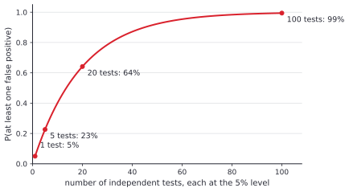

# Hypothesis testing

After this lesson you can set up and carry out a hypothesis test for a mean, a difference of two means and a proportion, say exactly what a p-value is and what it is not, describe type I and II errors and power, connect tests to confidence intervals, and recognize multiple testing, p-hacking and the gap between statistical and practical significance.

Before this: [confidence intervals](02-confidence-intervals.md) (standard errors, t and z critical values), [descriptive statistics and study design](01-descriptive-statistics-and-study-design.md) (sampling distributions, randomized experiments) and [conditional probability and Bayes' theorem](../07-probability/02-conditional-probability-and-bayes.md) (for the section on what a p-value is not).

## Quick check

Try these first. If you get all three right, skip to [Practice](#practice).

1. A poll of 1000 random voters finds 540 in favour. Test whether the true proportion is 0.5, using the standard error computed from 0.5. Give the z statistic and say whether it is beyond $\pm 1.96$.
2. A 95% confidence interval for a mean is $(24.1, 28.3)$. Without further calculation, would a two-sided test at the 5% level reject $H_0 \colon \mu = 30$? And $H_0 \colon \mu = 25$?
3. If a test is run at the 5% level and the null hypothesis is true, what is the probability that the test rejects it?

<details class="solution" markdown>
<summary>Answers</summary>

1. $z = \frac{0.54 - 0.5}{\sqrt{0.5 \times 0.5 / 1000}} = \frac{0.04}{0.01581} \approx 2.53$, which is beyond 1.96, so the result is significant at the 5% level.
2. It rejects 30, which is outside the interval, and doesn't reject 25, which is inside it.
3. 5%. That is what the significance level means: the chance of a false rejection when the null hypothesis is true.

</details>

## The idea

A coffee machine is set to pour 250 mL. You measure 12 cups and get a mean of 248 mL. The machine might be fine and this sample a bit unlucky, or it might be pouring too little. How do you decide?

The logic of a test is a proof by contradiction made probabilistic. Suppose the machine is fine (the null hypothesis). Then ask how likely it is to see a sample mean this far from 250 or farther, just from the variation between samples. If that chance is large, the sample is nothing unusual and there is no reason to doubt the machine. If it is tiny, then either something very unlikely happened or the null hypothesis is false, and we prefer the second explanation. The chance has a name, the p-value.

What a test can and can't do needs care. It can say that the data are hard to explain by chance alone. It can't say how likely the null hypothesis is, how big the effect is, or whether the effect matters. This lesson sets up the mechanics for means and proportions, then spends as much time on the ways tests are misread, because that is where most mistakes in published studies come from.


## Definitions

A **hypothesis test** is a procedure that uses sample data to decide between two claims about a population. The **null hypothesis** $H_0$ is the claim of no effect or no difference, the default that the data must contradict, such as $H_0 \colon \mu = 250$. The **alternative hypothesis** $H_a$ is the claim the data might support instead. It is **two-sided** if it says "different", such as $H_a \colon \mu \ne 250$, and **one-sided** if it names a direction, such as $H_a \colon \mu < 250$.

A **test statistic** is a number computed from the sample that measures how far the data are from what $H_0$ predicts, in units of standard error. The usual form is

$$
\text{test statistic} = \frac{\text{estimate} - \text{value under } H_0}{\text{SE}}.
$$

The **p-value** is the probability, computed assuming $H_0$ is true, of getting a test statistic at least as extreme as the one observed. "At least as extreme" means in the direction(s) of $H_a$: both tails for a two-sided test, one tail for a one-sided test. In plain words, a small p-value says that data like these would be rare if $H_0$ were true.

The **significance level** $\alpha$ is a cutoff chosen before looking at the data, commonly 0.05. The decision rule is: **reject** $H_0$ if the p-value is at most $\alpha$, and otherwise **fail to reject** it. A result that leads to rejection is called statistically significant at level $\alpha$. In plain words, $\alpha$ is how much risk of a false alarm you accept.

Two kinds of mistake are possible:

| | $H_0$ is true | $H_0$ is false |
|---|---|---|
| Reject $H_0$ | type I error (false alarm), probability $\alpha$ | correct, probability $1 - \beta$ |
| Fail to reject $H_0$ | correct | type II error (missed effect), probability $\beta$ |

A **type I error** is rejecting a true null hypothesis, and its probability is $\alpha$ by construction. A **type II error** is failing to reject a false null hypothesis, with probability $\beta$. The **power** of a test is $1 - \beta$, the probability of rejecting $H_0$ when a particular alternative is true. In plain words, power is the chance that the test finds an effect that is really there, and it depends on the size of the effect, the sample size, the variability and $\alpha$.

The tests in this lesson use these statistics. For one mean, the **one-sample t test** uses $t = \frac{\bar{x} - \mu_0}{s/\sqrt{n}}$ with $n - 1$ degrees of freedom, where $\mu_0$ is the value claimed by $H_0$. For two independent groups, the **two-sample t test** (Welch's version) uses

$$
t = \frac{\bar{x}_1 - \bar{x}_2}{\sqrt{\frac{s_1^2}{n_1} + \frac{s_2^2}{n_2}}},
$$

with degrees of freedom $\nu = \frac{(v_1 + v_2)^2}{\frac{v_1^2}{n_1 - 1} + \frac{v_2^2}{n_2 - 1}}$, where $v_1 = \frac{s_1^2}{n_1}$ and $v_2 = \frac{s_2^2}{n_2}$; it is usually not a whole number, and software computes it. A **paired t test**, for before-and-after measurements on the same individuals, is a one-sample t test on the differences. For a proportion, the **one-proportion z test** uses $z = \frac{\hat{p} - p_0}{\sqrt{p_0(1 - p_0)/n}}$, and the **two-proportion z test** uses $z = \frac{\hat{p}_2 - \hat{p}_1}{\sqrt{\hat{p}(1 - \hat{p})\left(\frac{1}{n_1} + \frac{1}{n_2}\right)}}$ with the **pooled** proportion $\hat{p} = \frac{x_1 + x_2}{n_1 + n_2}$, the proportion over both groups together, which is what $H_0$ says both groups share.

Note the difference from the confidence interval for a proportion: the test computes the standard error assuming $H_0$ is true, so it uses $p_0$ (or the pooled value), while the interval has no null value to use and plugs in $\hat{p}$.

## How to do it

### The steps of a test

1. State $H_0$ and $H_a$ in terms of a parameter, in context ("the mean fill volume $\mu$ is 250 mL"). Decide one-sided or two-sided before seeing the data.
2. Choose $\alpha$ (usually 0.05).
3. Check the conditions: a random sample or random assignment, independent observations, and approximate normality of the sampling distribution (for means, a roughly normal population or large $n$; for proportions, expected counts $np_0$ and $n(1 - p_0)$ at least 10).
4. Compute the test statistic.
5. Find the p-value from the t or normal distribution, using the tails that match $H_a$.
6. Decide: reject $H_0$ if $p \le \alpha$, otherwise fail to reject.
7. Say it in context, and report the estimate with a confidence interval so the size of the effect is visible. "Fail to reject" is never "$H_0$ is true".

### Tests and intervals say the same thing

*Theorem 1 (duality).* Let $\hat{\theta}$ be an estimate with standard error $\text{SE}$, and let $t^*$ be the critical value for a two-sided test at level $\alpha$ (which is also the critical value for a $(1 - \alpha)$ confidence interval). Then the two-sided test of $H_0 \colon \theta = \theta_0$ rejects at level $\alpha$ if and only if $\theta_0$ lies outside the $(1 - \alpha)$ confidence interval $\hat{\theta} \pm t^* \cdot \text{SE}$.

We know the test statistic $t = \frac{\hat{\theta} - \theta_0}{\text{SE}}$ and that the test rejects when $\lvert t \rvert > t^*$. We want to compare that with the interval. The plan is to rearrange the inequality.

*Proof.* The test rejects exactly when $\lvert \hat{\theta} - \theta_0 \rvert > t^* \cdot \text{SE}$. This says that the distance from $\theta_0$ to the centre $\hat{\theta}$ of the interval is more than the half-width $t^* \cdot \text{SE}$, which is the same as saying that $\theta_0$ is not in the interval. $\blacksquare$

Look back: so a confidence interval is the set of all null values that the data would not reject. It does everything a test does and also shows the size of the effect and its uncertainty. The duality is exact when the same standard error is used in both. For proportions the test uses $p_0$ in the standard error and the interval uses $\hat{p}$, so the two can disagree when the p-value is very close to $\alpha$.

### What a p-value is not

A p-value of 0.0114 does not mean that the probability that $H_0$ is true is 1.14%. The p-value is $P(\text{data this extreme} \mid H_0)$, and the probability that $H_0$ is true is $P(H_0 \mid \text{data})$. By Bayes' theorem the second needs the prior chance that $H_0$ was true, which no test supplies, and the two conditional probabilities are different in the way that "most cars have four wheels" differs from "most things with four wheels are cars".

A simple picture shows how far apart they can be. Suppose that of 1000 hypotheses tested, only 100 are true effects, the tests have power 0.8 and $\alpha = 0.05$. Then $0.8 \times 100 = 80$ true effects are detected, and $0.05 \times 900 = 45$ true nulls give a false alarm. Of the $80 + 45 = 125$ significant results, 45 (36%) are false, although every one of them has $p \le 0.05$. If true effects are rarer or the tests have lower power, the false share is larger.

The other common misreadings: a p-value is not the probability that the result was "due to chance" (it is computed assuming that chance alone is acting), it is not a measure of the size or importance of an effect, and a large p-value does not show that there is no effect, only that the data don't rule out an effect of zero.

### Power and sample size

For the two-proportion test comparing $p_1$ and $p_2$ with $n$ per group, a standard approximation for the $n$ that gives a two-sided test at level $\alpha$ the power $1 - \beta$ is

$$
n = \frac{(z_{\alpha/2} + z_{\beta})^2 \left(p_1(1 - p_1) + p_2(1 - p_2)\right)}{(p_2 - p_1)^2},
$$

where $z_{\alpha/2}$ is the critical value for $\alpha$ (1.96 for 0.05) and $z_{\beta}$ is the value with area $1 - \beta$ to its left (0.8416 for power 80%). The same structure holds for means: power grows with the effect size and with $n$, and falls with variability. The figure below shows the two distributions of the test statistic for a power of 0.80: when the effect is real the statistic is centred 2.8 standard errors from 0, and the part of that distribution beyond the critical value is the power.


## Worked examples

<div class="example" markdown>

### Example 1: a one-sample t test

The coffee machine is set to 250 mL. Twelve cups measure 248, 252, 245, 249, 247, 251, 246, 250, 244, 248, 247 and 249 mL (hypothetical numbers). Test at the 5% level whether the mean fill differs from 250 mL.

Step 1: $H_0 \colon \mu = 250$ and $H_a \colon \mu \ne 250$, two-sided, because the machine could pour too much or too little.

Step 2: $\alpha = 0.05$. Step 3: the 12 cups are a sample from one machine, the values are close to symmetric with no outliers, and $n = 12$ is small, so the t test is reasonable.

Step 4: the sum is 2976, so $\bar{x} = 248$ mL, and $s \approx 2.374$. Then $\text{SE} = \frac{2.374}{\sqrt{12}} \approx 0.6853$ and

$$
t = \frac{248 - 250}{0.6853} \approx -2.918.
$$

Step 5: with $12 - 1 = 11$ degrees of freedom, the two-sided p-value is $2 \times P(T_{11} \ge 2.918) \approx 0.0140$.

<div class="warning" markdown>

Watch out at Step 5: for a two-sided test, double the one-tail area. Reporting 0.007 would be the one-sided p-value, and using it for a two-sided question makes the evidence look twice as strong as it is.

</div>

Step 6: $0.0140 \le 0.05$, so reject $H_0$. Step 7: there is statistically significant evidence that the mean fill differs from 250 mL. The 95% confidence interval is $248 \pm 2.201 \times 0.6853$, which is $(246.49, 249.51)$ mL. It excludes 250, as Theorem 1 says it must, and it shows the size of the problem: the machine pours about 0.5 to 3.5 mL too little on average.

Check: the critical value for 11 degrees of freedom is $t^* = 2.201$, and $\lvert t \rvert = 2.918 > 2.201$, which agrees with the rejection.

</div>

<div class="example" markdown>

### Example 2: a test for a proportion

A poll finds 540 of 1000 random voters in favour of a policy (hypothetical). Test whether more or fewer than half of all voters are in favour.

Step 1: $H_0 \colon p = 0.5$ and $H_a \colon p \ne 0.5$. Step 2: $\alpha = 0.05$. Step 3: $np_0 = 500$ and $n(1 - p_0) = 500$, both above 10.

Step 4: the standard error uses $p_0$: $\sqrt{\frac{0.5 \times 0.5}{1000}} \approx 0.01581$. Then $z = \frac{0.54 - 0.5}{0.01581} \approx 2.53$.

Step 5: $P(Z \ge 2.53) \approx 0.0057$, so the two-sided p-value is $2 \times 0.0057 = 0.0114$, the shaded area in the first figure of this lesson.

Step 6 and 7: $0.0114 < 0.05$, so reject $H_0$. The poll gives statistically significant evidence that the proportion differs from one half. The confidence interval from [the last lesson](02-confidence-intervals.md), $(0.509, 0.571)$, excludes 0.5 and also shows how far above it the proportion might be.

Check: at $\alpha = 0.01$ the decision would flip, since $0.0114 > 0.01$. The data are not strong evidence at that stricter level.

</div>

<div class="example" markdown>

### Example 3: an A/B test with two proportions

An app shows two versions of a page to 10,000 users each. Version A gets 480 sign-ups (4.8%) and version B gets 540 (5.4%) (hypothetical). Is B better?

$H_0 \colon p_A = p_B$ and $H_a \colon p_A \ne p_B$, with $\alpha = 0.05$. The pooled proportion is $\hat{p} = \frac{480 + 540}{20{,}000} = 0.051$, and

$$
\text{SE} = \sqrt{0.051 \times 0.949 \times \left(\frac{1}{10000} + \frac{1}{10000}\right)} \approx 0.003111.
$$

The statistic is $z = \frac{0.054 - 0.048}{0.003111} \approx 1.93$, and the two-sided p-value is about $0.0538$. That is just above 0.05, so we fail to reject $H_0$. The 95% interval for the difference, with the unpooled standard error $0.003111$, is $0.006 \pm 1.96 \times 0.003111$, which is $(-0.0001, 0.0121)$: from no difference at all to a lift of about 1.2 percentage points.

This is not "B is no better than A". A p-value of 0.054 and one of 0.049 are almost the same evidence, and the interval says that a lift of up to about a point is still plausible. The sensible conclusion is that the test was underpowered. Its power against a true difference of exactly 0.6 points is only about 49%, so even if B really is better, the test would miss the effect about half the time. Using the sample-size formula, detecting 4.8% against 5.4% with 80% power needs

$$
n = \frac{(1.96 + 0.8416)^2 \left(0.048 \times 0.952 + 0.054 \times 0.946\right)}{0.006^2} \approx 21{,}101
$$

users per group, more than twice as many as the test had.

Check: the interval for the difference barely includes 0 and the p-value barely exceeds 0.05, which agree with each other, as duality says.

</div>

<div class="example" markdown>

### Example 4: a two-sample t test

Two study methods are compared on separate groups of students. Method 1 (12 students) has mean quiz mark 78.5 and standard deviation 8.2, and method 2 (10 students) has mean 72.1 and standard deviation 9.6 (hypothetical). Test whether the mean marks differ.

The standard error is $\sqrt{\frac{8.2^2}{12} + \frac{9.6^2}{10}} = \sqrt{5.603 + 9.216} \approx 3.850$, and $t = \frac{78.5 - 72.1}{3.850} \approx 1.66$. The Welch degrees of freedom are $\nu = \frac{(5.603 + 9.216)^2}{\frac{5.603^2}{11} + \frac{9.216^2}{9}} \approx 17.87$. The two-sided p-value is about $0.114$, above 0.05, so we fail to reject $H_0$. The 95% interval for the difference of means, $6.4 \pm 2.102 \times 3.850$, is $(-1.69, 14.49)$ marks. It includes 0, but it also includes large differences, so the data are not conclusive either way.

Check: the interval and the test agree, and the degrees of freedom, 17.87, lie between the smaller sample's $n - 1 = 9$ and the total $n_1 + n_2 - 2 = 20$, as they always do.

</div>

<div class="example" markdown>

### Example 5: a one-sided test (finish it yourself)

A service claims that at most 2% of its requests fail. In 600 requests, 21 fail (3.5%) (hypothetical). Test $H_0 \colon p = 0.02$ against $H_a \colon p > 0.02$ at the 5% level.

Check the conditions: $np_0 = 12$ and $n(1 - p_0) = 588$, both above 10. The standard error is $\sqrt{\frac{0.02 \times 0.98}{600}} \approx 0.005715$, and

$$
z = \frac{0.035 - 0.02}{0.005715} \approx 2.62.
$$

Now find the one-sided p-value and decide.

<details class="solution" markdown>
<summary>Finish</summary>

The alternative is "greater", so the p-value is the upper tail only: $P(Z \ge 2.62) \approx 0.0043$. Since $0.0043 < 0.05$, reject $H_0$: there is statistically significant evidence that the failure rate is above 2%.

Check: a two-sided test would double the p-value to 0.0087, still below 0.05, so the decision doesn't depend on the choice here. In general, choose the direction before looking at the data.

</details>

</div>

## Edge cases and common mistakes

<div class="warning" markdown>

Watch out: "fail to reject" is not "accept". In Example 3 the data didn't reject equal sign-up rates, and they were also consistent with a lift of a full point. Absence of evidence is not evidence of absence when the test has low power. Report the interval, which shows what the data do rule out.

</div>

<div class="warning" markdown>

Watch out: multiple testing. If you run $m$ independent tests at $\alpha = 0.05$ and every null hypothesis is true, the probability of at least one false positive is $1 - 0.95^m$: 23% for 5 tests, 64% for 20, and 99% for 100.



The simplest repair is the Bonferroni correction: test each hypothesis at level $\frac{\alpha}{m}$, which keeps the chance of any false positive at most $\alpha$. It is conservative when $m$ is large. Holm's method (Practice problem 7) is uniformly better, and the Benjamini-Hochberg procedure controls the false discovery rate, the expected share of false positives among the rejections, which suits screening thousands of genes or features.

</div>

<div class="warning" markdown>

Watch out: p-hacking. Trying many outcomes, subgroups, cleanings of the data or analysis choices and reporting the one with $p < 0.05$ is multiple testing in disguise, even if only the final test is shown. The number of tests that matters is the number you could have run. A defence is to state the hypothesis, the outcome and the analysis before collecting data (preregistration), and to report all the tests run. A p-value from an analysis chosen after seeing the data doesn't mean what its label says.

</div>

<div class="warning" markdown>

Watch out: statistical significance is not practical significance. With enough data, any difference, however small, becomes significant. Suppose two versions of a page convert at 5.00% and 5.10% for 2,000,000 users each (hypothetical). Then $z \approx 4.57$ and the p-value is about $0.000005$. The 95% interval for the lift is $0.057$ to $0.143$ percentage points. The result is certainly not chance, but whether a lift of about a tenth of a point is worth shipping, maintaining and explaining depends on what a sign-up is worth, which the p-value can't tell you. The reverse also happens: a large effect from a small study can have a large p-value.

</div>

<div class="warning" markdown>

Watch out: choosing the test after looking. A one-sided test has a p-value half the size of the two-sided one, so switching to one-sided after seeing the direction of the data doubles the false-alarm rate. Use a one-sided test only when an effect in the other direction would be treated the same as no effect, and decide beforehand.

</div>

A test doesn't check its own assumptions. A t test on 12 values with a big outlier, or on observations that are not independent (the same user counted several times), can give a p-value that means little. Plot the data first. And a test of an observational association, however small the p-value, doesn't make it causal: [study design](01-descriptive-statistics-and-study-design.md#judge-a-study) decides that.

## Tricks and shortcuts

A quick significance check for a mean or a difference: a statistic beyond about $\pm 2$ is significant at the 5% level, beyond about $\pm 2.6$ at the 1% level, and beyond about $\pm 3.3$ at the 0.1% level, for large samples. Compare the estimate with twice its standard error.

To get a two-sided p-value from a table or a library, find the tail beyond $\lvert t \rvert$ and double it. To find the rejection decision without the p-value, compare $\lvert t \rvert$ with the critical value, or check whether $\theta_0$ is in the confidence interval.

For a paired design (the same people before and after), take the differences and run a one-sample t test. It removes the variation between people and usually has much more power than treating the two sets as independent groups.

For sample size planning, power rises slowly with $n$: to halve the detectable effect at the same power you need about four times the sample. When a team says "we ran it for a week and it wasn't significant", compute what effect the test could have detected.

## In code

The code below runs the tests of the examples with only the standard library (the t distribution's CDF is built from its density, as in [confidence intervals](02-confidence-intervals.md#in-code)), computes the sample size, and simulates what $\alpha$ and multiple testing mean: when $H_0$ is true, about 5% of tests reject, and among 20 such tests about 64% of the time at least one does.

<details class="code" markdown>
<summary>In code</summary>

```python
import math
import random
import statistics as st
from statistics import NormalDist

N = NormalDist()

def t_pdf(x, df):
    c = math.exp(math.lgamma((df + 1) / 2) - math.lgamma(df / 2)) / math.sqrt(df * math.pi)
    return c * (1 + x * x / df) ** (-(df + 1) / 2)

def t_cdf(x, df, steps=4000):
    a = abs(x)
    h = a / steps
    total = t_pdf(0, df) + t_pdf(a, df)
    for i in range(1, steps):
        total += (4 if i % 2 else 2) * t_pdf(i * h, df)
    area = total * h / 3
    return 0.5 + area if x >= 0 else 0.5 - area

def p_two_sided_t(t, df):
    return 2 * (1 - t_cdf(abs(t), df))

# 1. One-sample t test: is the mean fill 250 mL? (hypothetical data)
fills = [248, 252, 245, 249, 247, 251, 246, 250, 244, 248, 247, 249]
n, xbar, s = len(fills), st.mean(fills), st.stdev(fills)
t = (xbar - 250) / (s / math.sqrt(n))
print(round(xbar, 1), round(s, 3), round(t, 3), round(p_two_sided_t(t, n - 1), 4))
# 248 2.374 -2.918 0.014

# 2. One-proportion z test: 540 of 1000 against p0 = 0.5.
z = (0.54 - 0.5) / math.sqrt(0.5 * 0.5 / 1000)
print(round(z, 3), round(2 * (1 - N.cdf(z)), 4))
# 2.53 0.0114

# 3. Two-proportion z test for an A/B test: 480/10000 against 540/10000.
x1, n1, x2, n2 = 480, 10_000, 540, 10_000
pool = (x1 + x2) / (n1 + n2)
se = math.sqrt(pool * (1 - pool) * (1 / n1 + 1 / n2))
z = (x2 / n2 - x1 / n1) / se
print(round(z, 3), round(2 * (1 - N.cdf(z)), 4))
# 1.928 0.0538

# 4. Welch two-sample t test from summary statistics.
n1, m1, s1, n2, m2, s2 = 12, 78.5, 8.2, 10, 72.1, 9.6
v1, v2 = s1**2 / n1, s2**2 / n2
t = (m1 - m2) / math.sqrt(v1 + v2)
df = (v1 + v2) ** 2 / (v1**2 / (n1 - 1) + v2**2 / (n2 - 1))
print(round(t, 3), round(df, 2), round(p_two_sided_t(t, df), 4))
# 1.663 17.87 0.1139

# 5. Sample size per group to detect 4.8% against 5.4% with 80% power at the 5% level.
p1, p2 = 0.048, 0.054
za, zb = N.inv_cdf(0.975), N.inv_cdf(0.80)
print(math.ceil((za + zb) ** 2 * (p1 * (1 - p1) + p2 * (1 - p2)) / (p2 - p1) ** 2))
# 21101

# 6. Type I errors by simulation: 5000 tests where H0 is true, then 20 tests on pure noise.
random.seed(3)
rejections = 0
for _ in range(5000):
    sample = [random.gauss(0, 1) for _ in range(10)]
    t = st.mean(sample) / (st.stdev(sample) / math.sqrt(10))
    rejections += abs(t) > 2.262          # t* for 9 degrees of freedom
print(rejections / 5000)
# 0.0452

at_least_one = 0
for _ in range(2000):
    hits = 0
    for _ in range(20):                    # 20 unrelated tests, all with H0 true
        sample = [random.gauss(0, 1) for _ in range(10)]
        t = st.mean(sample) / (st.stdev(sample) / math.sqrt(10))
        hits += abs(t) > 2.262
    at_least_one += hits > 0
print(at_least_one / 2000, round(1 - 0.95**20, 3))
# 0.6445 0.642
```

The first simulated rate, 0.0452, is close to the 5% that the test promises. The second, 0.6445, is close to $1 - 0.95^{20} = 0.642$, the multiple-testing formula. In real work, `scipy.stats.ttest_1samp`, `ttest_ind` (with `equal_var=False` for Welch) and `statsmodels.stats.proportion.proportions_ztest` do these computations.

</details>

## FAQ

### Why is the cutoff 0.05?

It is a convention, popularized by Ronald Fisher in the 1920s as a convenient level at which a result is worth a second look. It has no mathematical meaning. A p-value of 0.049 and one of 0.051 give essentially the same evidence, and reporting the exact p-value and the interval is better than reporting only "significant". Fields with costly false alarms, such as particle physics, use far smaller cutoffs.

### Why not just compute the probability that $H_0$ is true?

Because that needs a prior probability that $H_0$ was true before the data, and a test is designed not to need one. Bayesian statistics supplies the prior and answers that question directly, using the machinery of [Bayes' theorem](../07-probability/02-conditional-probability-and-bayes.md). The cost is that the answer depends on the prior. Both approaches are in use, and they agree when the data are strong.

### What is the difference between a one-sided and a two-sided test?

A two-sided test counts evidence in both directions and spends $\frac{\alpha}{2}$ in each tail. A one-sided test spends all of $\alpha$ in one tail, so it has more power in that direction and none in the other. A new drug that turns out to be harmful would be invisible to a one-sided test for benefit. Most journals expect two-sided tests unless there is a strong reason.

### My test isn't significant. Can I collect more data until it is?

Not by stopping when you see $p < 0.05$. Checking repeatedly and stopping at the first small p-value raises the false-alarm rate well above 5%, because every look is another chance for the null hypothesis to produce a fluke. Decide the sample size in advance from a power calculation, or use methods designed for sequential monitoring, which many A/B testing platforms provide.

## Practice

### Warm-up

1\. State $H_0$ and $H_a$ for each question. (a) A bakery claims its loaves weigh 500 g on average, and you suspect they weigh less. (b) You want to know whether a new algorithm changes the mean running time of an old one. (c) A manufacturer says that 1% of its chips are defective, and you want to know whether the rate is higher.

<details class="solution" markdown>
<summary>Solution</summary>

(a) $H_0 \colon \mu = 500$ and $H_a \colon \mu < 500$ (one-sided). (b) $H_0 \colon \mu_{\text{new}} = \mu_{\text{old}}$ and $H_a \colon \mu_{\text{new}} \ne \mu_{\text{old}}$ (two-sided, since "changes" allows faster or slower). (c) $H_0 \colon p = 0.01$ and $H_a \colon p > 0.01$ (one-sided).

Check: $H_0$ always contains the equals sign, and $H_a$ matches the wording of the question.

</details>

2\. In a random sample of 100 users, 56 click a new button. Test $H_0 \colon p = 0.5$ against $H_a \colon p \ne 0.5$ at the 5% level.

<details class="solution" markdown>
<summary>Solution</summary>

The standard error is $\sqrt{\frac{0.5 \times 0.5}{100}} = 0.05$, so $z = \frac{0.56 - 0.5}{0.05} = 1.2$. The two-sided p-value is $2 \times P(Z \ge 1.2) = 2 \times 0.1151 \approx 0.230$. That is above 0.05, so we fail to reject $H_0$: 56 of 100 is not unusual if the true rate is one half.

Check: $\lvert z \rvert = 1.2 < 1.96$, which agrees.

</details>

3\. A study reports $p = 0.03$. Which statements are correct? (a) If there is no effect, data this extreme would occur about 3% of the time. (b) The probability that there is no effect is 3%. (c) The effect is large. (d) The result is significant at the 5% level.

<details class="solution" markdown>
<summary>Solution</summary>

(a) Correct: that is the definition of a p-value. (b) Wrong: it confuses $P(\text{data} \mid H_0)$ with $P(H_0 \mid \text{data})$. (c) Wrong: the p-value says nothing about size. (d) Correct, since $0.03 \le 0.05$.

Check: only (a) and (d) talk about data given a null hypothesis and a pre-set cutoff, which is all a p-value can support.

</details>

### Standard

4\. A sample of 9 measurements has mean 52.4 and standard deviation 3.0. Test $H_0 \colon \mu = 50$ against $H_a \colon \mu \ne 50$ at the 5% level. For 8 degrees of freedom, $t^* = 2.306$.

<details class="solution" markdown>
<summary>Solution</summary>

$\text{SE} = \frac{3.0}{\sqrt{9}} = 1$, so $t = \frac{52.4 - 50}{1} = 2.4$. Since $2.4 > 2.306$, reject $H_0$. The two-sided p-value is about $0.043$, which is below 0.05.

The 95% interval is $52.4 \pm 2.306 \times 1 = (50.09, 54.71)$, which just excludes 50.

Check: the interval and the test agree, and 2.4 is only a little above 2.306, so the result is close to the borderline.

</details>

5\. Version A of an email gets 120 clicks from 400 recipients, and version B gets 150 clicks from 400 (hypothetical). Test whether the click rates differ, at the 5% level, and give the conclusion in context.

<details class="solution" markdown>
<summary>Solution</summary>

The sample rates are $0.30$ and $0.375$. The pooled proportion is $\frac{270}{800} = 0.3375$, and $\text{SE} = \sqrt{0.3375 \times 0.6625 \times \frac{2}{400}} \approx 0.03344$. Then $z = \frac{0.375 - 0.30}{0.03344} \approx 2.24$, and the two-sided p-value is about $0.025$. Since $0.025 < 0.05$, reject $H_0$: there is statistically significant evidence that the two versions have different click rates, with B higher.

Check: the unpooled 95% interval for the difference is $0.075 \pm 1.96 \times 0.03333$, which is about $(0.010, 0.140)$, and it excludes 0, in agreement. At the 1% level the result would not be significant ($0.025 > 0.01$).

</details>

6\. A one-sided z test of $H_0 \colon \mu = 100$ against $H_a \colon \mu > 100$ uses $\sigma = 15$, $n = 36$ and $\alpha = 0.05$. (a) Find the sample mean above which $H_0$ is rejected. (b) Find the power if the true mean is 106. (c) How does the power change if $n$ increases, if $\alpha$ decreases and if the true mean is closer to 100?

<details class="solution" markdown>
<summary>Solution</summary>

(a) $\text{SE} = \frac{15}{6} = 2.5$, and the critical value for a one-sided test at 5% is $z = 1.645$, so reject when $\bar{x} > 100 + 1.645 \times 2.5 = 104.11$.

(b) If $\mu = 106$, the statistic $\frac{\bar{x} - 106}{2.5}$ is standard normal, and the power is $P(\bar{x} > 104.11) = P\left(Z > \frac{104.11 - 106}{2.5}\right) = P(Z > -0.756) \approx 0.775$.

(c) A larger $n$ shrinks the standard error and raises the power. A smaller $\alpha$ moves the critical value out and lowers the power. A true mean closer to 100 lowers the power, since the two distributions overlap more.

Check: if the true mean were exactly 100, the same formula gives $P(Z > 1.645) = 0.05$, the type I error rate, as it should.

</details>

### Challenge

7\. A researcher runs five tests and gets p-values 0.003, 0.012, 0.021, 0.040 and 0.30. (a) Which does the Bonferroni correction reject, at an overall level of 0.05? (b) Holm's method sorts the p-values $p_{(1)} \le \dots \le p_{(m)}$ and rejects $p_{(i)}$ in order as long as $p_{(i)} \le \frac{\alpha}{m - i + 1}$, stopping at the first failure. Which does it reject?

<details class="solution" markdown>
<summary>Solution</summary>

(a) Bonferroni compares each p-value with $\frac{0.05}{5} = 0.01$. Only 0.003 is below it, so one test is rejected.

(b) Holm's thresholds for $i = 1, \dots, 5$ are $\frac{0.05}{5} = 0.01$, $\frac{0.05}{4} = 0.0125$, $\frac{0.05}{3} \approx 0.0167$, $\frac{0.05}{2} = 0.025$ and $0.05$. The first p-value, $0.003 \le 0.01$, is rejected. The second, $0.012 \le 0.0125$, is rejected. The third, $0.021 > 0.0167$, fails, so Holm stops. It rejects two tests, one more than Bonferroni, with the same guarantee on the chance of any false positive.

Check: Holm's first threshold equals Bonferroni's, and later thresholds are larger, so Holm rejects everything Bonferroni does and sometimes more.

</details>

8\. (Reviews [confidence intervals](02-confidence-intervals.md).) A 95% confidence interval for a mean commute is $(24.1, 28.3)$ minutes, from a sample of 40. (a) Does a two-sided 5% test of $H_0 \colon \mu = 30$ reject? Of $H_0 \colon \mu = 25$? (b) Would the 90% interval from the same data be wider or narrower, and could it flip any decision? (c) The sample standard deviation is 6.6. Check the interval, using $t^* = 2.023$ for 39 degrees of freedom.

<details class="solution" markdown>
<summary>Solution</summary>

(a) By duality, 30 is outside the interval, so the test rejects. The value 25 is inside, so it doesn't.

(b) The 90% interval is narrower, since it uses the smaller critical value, and it corresponds to tests at the 10% level. Its endpoints move in, so a value just inside the 95% interval, such as 24.2, could now be rejected, but a value that was already rejected stays rejected.

(c) The standard error is $\frac{6.6}{\sqrt{40}} \approx 1.0436$ and the margin is $2.023 \times 1.0436 \approx 2.11$. The midpoint is $\frac{24.1 + 28.3}{2} = 26.2$, so the interval is $26.2 \pm 2.11 = (24.09, 28.31)$, which matches.

</details>

## Where this shows up

- The same statistics reappear in [correlation and linear regression](04-correlation-and-linear-regression.md), where the t test for a slope asks whether the slope is zero, and the multiple-testing problem returns with many predictors.
- In CS, A/B tests at web companies are hypothesis tests with the sample-size and sequential-testing issues above. Comparing two algorithms or models on test data uses paired tests. Randomized algorithms and hash functions are analyzed with the same tail probabilities ([discrete probability](../../06-cs-math/03-counting-and-discrete-probability/05-discrete-probability.md)).
- In economics, regression results come with t statistics and stars for significance, and the debate over p-hacking and replication has changed practice in the field (regression and econometrics intuition<!-- link: ../../07-economics-math/04-more-tools/03-regression-and-econometrics-intuition.md -->). In finance, testing many strategies on the same data until one "works" is the multiple-testing trap (investing returns and risk<!-- link: ../../08-financial-math/06-investing-and-retirement/01-investing-returns-and-risk.md -->).
