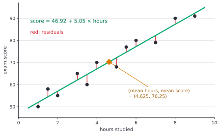
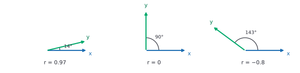
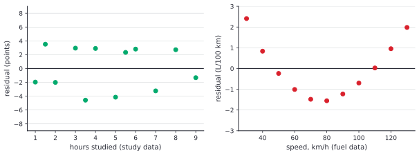
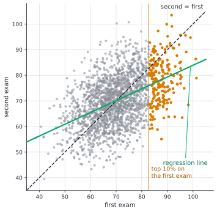
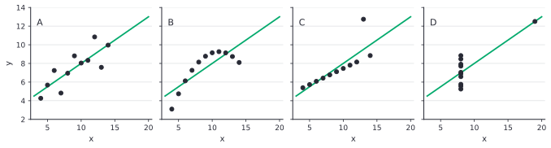
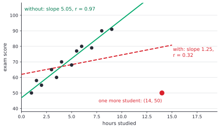

# Correlation and linear regression

After this lesson you can compute and interpret the correlation $r$ and the least-squares line, explain $r$ as the cosine of the angle between centred data vectors and the line as a projection, read $R^2$ and residual plots, spot extrapolation and influential points, explain regression to the mean, test and bound a slope, and describe multiple regression as projection onto more columns.

Before this: [scatter plots and two-way tables](../../02-middle-school/07-statistics-and-probability/03-scatter-plots-and-two-way-tables.md) (the line fitted by eye), [orthogonality, projections and least squares](../06-linear-algebra/07-orthogonality-projections-and-least-squares.md) (the normal equations), [joint distributions, covariance and sums](../07-probability/05-joint-distributions-covariance-and-sums.md) (covariance and $\rho$), and [confidence intervals](02-confidence-intervals.md) and [hypothesis testing](03-hypothesis-testing.md) (for the inference section).

## Quick check

Try these first. If you get all three right, skip to [Practice](#practice).

1. For the points $(1, 2)$, $(2, 3)$, $(3, 5)$, $(4, 6)$, find the correlation $r$ and the least-squares line.
2. Two exams both have mean 70 and standard deviation 10, and the correlation between them is $r = 0.5$. A student scores 90 on the first exam. What does the regression line predict for the second?
3. A regression has $r = 0.8$. What is $R^2$, and what does it say?

<details class="solution" markdown>
<summary>Answers</summary>

1. The means are $\bar{x} = 2.5$ and $\bar{y} = 4$. The deviations are $-1.5, -0.5, 0.5, 1.5$ for $x$ and $-2, -1, 1, 2$ for $y$. Then $S_{xy} = 3 + 0.5 + 0.5 + 3 = 7$, $S_{xx} = 5$ and $S_{yy} = 10$, so $r = \frac{7}{\sqrt{5 \cdot 10}} \approx 0.990$. The slope is $\frac{7}{5} = 1.4$ and the intercept is $4 - 1.4 \cdot 2.5 = 0.5$, so $\hat{y} = 0.5 + 1.4x$.
2. A score of 90 is $z = 2$ standard deviations above the mean. The line predicts $z = r \cdot 2 = 1$ for the second exam, which is a mark of $70 + 10 = 80$.
3. $R^2 = 0.64$. About 64% of the variation in $y$ is accounted for by its linear relationship with $x$; the other 36% is left in the residuals.

</details>

## The idea

Twelve students record their hours of study for an exam and their scores, as in [scatter plots and two-way tables](../../02-middle-school/07-statistics-and-probability/03-scatter-plots-and-two-way-tables.md). The points rise to the right. That lesson drew a line through them by eye and promised two things: a number that measures how strong the pattern is, and the best line. This lesson delivers both.

The number comes from the deviations. Subtract the mean hours from each student's hours, and the mean score from each score. A student above average in both has a positive product of deviations, one below average in both also has a positive product, and a student above in one and below in the other has a negative product. The average of these products is the covariance, positive when the variables rise together. Dividing by the two standard deviations removes the units and gives the correlation $r$, which is always between $-1$ and 1.

The line comes from least squares, which [the linear algebra lesson](../06-linear-algebra/07-orthogonality-projections-and-least-squares.md) derived: choose the line that makes the sum of squared vertical distances to the points as small as possible. Statistics adds a reading of the answer. The slope is $r$ times a ratio of spreads, the line always passes through the point of means, and the share of the variation it explains is $r^2$.



Both ideas are geometry in disguise. Treat the 12 hours as one vector in 12 dimensions and the 12 scores as another. After centring them, the correlation is the cosine of the angle between the two vectors, and the least-squares line is the projection of one onto the other.

## Definitions

For paired data $(x_1, y_1), \dots, (x_n, y_n)$ with means $\bar{x}, \bar{y}$ and standard deviations $s_x, s_y$ (computed with $n - 1$), define $S_{xx} = \sum (x_i - \bar{x})^2$, $S_{yy} = \sum (y_i - \bar{y})^2$ and $S_{xy} = \sum (x_i - \bar{x})(y_i - \bar{y})$. The **sample covariance** is

$$
s_{xy} = \frac{S_{xy}}{n - 1},
$$

and the **correlation coefficient** (or Pearson correlation) is

$$
r = \frac{s_{xy}}{s_x s_y} = \frac{S_{xy}}{\sqrt{S_{xx}\,S_{yy}}} = \frac{1}{n - 1}\sum_{i=1}^{n} z_{x,i}\, z_{y,i},
$$

where $z_{x,i} = \frac{x_i - \bar{x}}{s_x}$ and $z_{y,i}$ are the z-scores. In plain words, $r$ is the average product of z-scores, and it measures the strength and direction of the straight-line relationship. It is the sample version of $\rho$ from [the probability chapter](../07-probability/05-joint-distributions-covariance-and-sums.md).

The **centred data vectors** are $\mathbf{u} = (x_1 - \bar{x}, \dots, x_n - \bar{x})$ and $\mathbf{v} = (y_1 - \bar{y}, \dots, y_n - \bar{y})$ in $\mathbb{R}^n$. Their dot products are $\mathbf{u} \cdot \mathbf{v} = S_{xy}$, $\mathbf{u} \cdot \mathbf{u} = S_{xx}$ and $\mathbf{v} \cdot \mathbf{v} = S_{yy}$.

The **least-squares regression line** is the line $\hat{y} = a + bx$ that minimizes $\sum (y_i - a - bx_i)^2$. The value $\hat{y}_i = a + bx_i$ is the **fitted value** and $e_i = y_i - \hat{y}_i$ is the **residual**. The variable $x$ is the explanatory variable and $y$ the response, as before. The **sum of squares** pieces are $\text{SST} = \sum (y_i - \bar{y})^2$ (total variation in $y$), $\text{SSE} = \sum e_i^2$ (variation left in the residuals) and $\text{SSR} = \text{SST} - \text{SSE}$ (variation explained by the line). The **coefficient of determination** is

$$
R^2 = \frac{\text{SSR}}{\text{SST}} = 1 - \frac{\text{SSE}}{\text{SST}}.
$$

In plain words, $R^2$ is the fraction of the variation in $y$ that the line accounts for. The **residual standard error** is $s_e = \sqrt{\frac{\text{SSE}}{n - 2}}$, the typical size of a residual; the divisor is $n - 2$ because the line has two estimated numbers, as in the FAQ of [the first lesson](01-descriptive-statistics-and-study-design.md#faq).

A **residual plot** graphs the residuals against $x$ (or against the fitted values). A point has high **leverage** if its $x$ value is far from $\bar{x}$, and it is **influential** if removing it changes the fitted line a lot. **Regression to the mean** is the tendency of a value that is extreme on one measurement to be closer to average on a repeat measurement, when the two measurements are not perfectly correlated. **Extrapolation** is predicting for $x$ outside the range of the data.

## How to do it

### Why $r$ is a cosine and the slope is $r\,s_y/s_x$

*Theorem 1 ($r$ is a cosine).* If $\mathbf{u}$ and $\mathbf{v}$ are nonzero, then $r = \cos\theta$, where $\theta$ is the angle between the centred vectors. So $-1 \le r \le 1$, with $r = 1$ exactly when the points lie on a line of positive slope and $r = -1$ for a line of negative slope.

We know the dot product formula $\mathbf{u} \cdot \mathbf{v} = \lVert \mathbf{u} \rVert\lVert \mathbf{v} \rVert\cos\theta$ from [the linear algebra chapter](../06-linear-algebra/01-vectors-dot-product-and-span.md). We want to match it to $r$. The plan is to write $r$ in terms of the dot products of the centred vectors.

*Proof.* The lengths are $\lVert \mathbf{u} \rVert = \sqrt{S_{xx}}$ and $\lVert \mathbf{v} \rVert = \sqrt{S_{yy}}$, so

$$
\cos\theta = \frac{\mathbf{u} \cdot \mathbf{v}}{\lVert \mathbf{u} \rVert\lVert \mathbf{v} \rVert} = \frac{S_{xy}}{\sqrt{S_{xx}S_{yy}}} = r.
$$

A cosine lies between $-1$ and 1. It equals $\pm 1$ exactly when $\mathbf{v}$ is a multiple $c\mathbf{u}$ of $\mathbf{u}$, which says $y_i - \bar{y} = c(x_i - \bar{x})$ for every $i$: all the points lie on one line, with slope $c$. $\blacksquare$

Look back: this is why $r$ measures only the straight-line pattern. It is the cosine of an angle, and it is 0 when the centred vectors are perpendicular, whatever curved relationship they might have. It also explains why $r$ doesn't change when you change units: stretching a variable stretches its centred vector, and the angle stays the same (a negative stretch flips the sign). The figure shows three angles.



*Theorem 2 (the least-squares line).* The least-squares line is $\hat{y} = a + bx$ with

$$
b = \frac{S_{xy}}{S_{xx}} = r\,\frac{s_y}{s_x}, \qquad a = \bar{y} - b\bar{x}.
$$

It passes through $(\bar{x}, \bar{y})$, the residuals add to 0, and $R^2 = r^2$.

We know from [the least-squares lesson](../06-linear-algebra/07-orthogonality-projections-and-least-squares.md) that the best fit is the projection of the data vector $\mathbf{y}$ onto the column space of $A$, whose columns are the all-ones vector $\mathbf{1}$ and $\mathbf{x}$. We want the coefficients and $R^2$. The plan is to replace $\mathbf{x}$ by its centred version $\mathbf{u}$, which is perpendicular to $\mathbf{1}$, so that the projection onto the plane splits into two projections onto perpendicular lines.

*Proof.* The columns $\mathbf{1}$ and $\mathbf{x}$ span the same plane as $\mathbf{1}$ and $\mathbf{u} = \mathbf{x} - \bar{x}\mathbf{1}$. Also $\mathbf{1} \cdot \mathbf{u} = \sum (x_i - \bar{x}) = 0$, so these two vectors are orthogonal, and by the orthogonal decomposition the projection of $\mathbf{y}$ is the sum of its projections on each. The projection onto $\mathbf{1}$ is $\bar{y}\mathbf{1}$, and since $\mathbf{1} \cdot \mathbf{v} = 0$ the projection of $\mathbf{y}$ onto $\mathbf{u}$ is the same as that of $\mathbf{v}$: $\frac{\mathbf{v} \cdot \mathbf{u}}{\mathbf{u} \cdot \mathbf{u}}\mathbf{u} = \frac{S_{xy}}{S_{xx}}\mathbf{u}$. So the fitted vector is $\hat{\mathbf{y}} = \bar{y}\mathbf{1} + b\mathbf{u}$ with $b = \frac{S_{xy}}{S_{xx}}$, that is $\hat{y}_i = \bar{y} + b(x_i - \bar{x})$. This is the line $a + bx$ with $a = \bar{y} - b\bar{x}$, and it passes through $(\bar{x}, \bar{y})$. Since $S_{xy} = r\sqrt{S_{xx}S_{yy}}$, we get $b = r\sqrt{\frac{S_{yy}}{S_{xx}}} = r\frac{s_y}{s_x}$.

The residual vector $\mathbf{e} = \mathbf{y} - \hat{\mathbf{y}}$ is perpendicular to $\mathbf{1}$ and $\mathbf{u}$, so its entries add to 0. The explained part $\hat{\mathbf{y}} - \bar{y}\mathbf{1} = b\mathbf{u}$ and the residual $\mathbf{e}$ are perpendicular, and they add to $\mathbf{v}$, so by the Pythagorean theorem $\text{SST} = \lVert \mathbf{v} \rVert^2 = \lVert b\mathbf{u} \rVert^2 + \lVert \mathbf{e} \rVert^2 = \text{SSR} + \text{SSE}$. The explained part is the projection of $\mathbf{v}$ onto $\mathbf{u}$, whose length is $\lVert \mathbf{v} \rVert\lvert\cos\theta\rvert$, so $\text{SSR} = \text{SST}\cos^2\theta$ and $R^2 = r^2$. $\blacksquare$

Look back: the slope formula says that the slope is the correlation, converted into units of $y$ per unit of $x$ by the ratio of spreads. In z-score units both spreads are 1, so the line is $\hat{z}_y = r\,z_x$, which is the origin of regression to the mean. The identity $\text{SST} = \text{SSR} + \text{SSE}$ is a right triangle: the data vector $\mathbf{v}$ is the hypotenuse, and $R^2 = \cos^2\theta$ is the squared ratio of the adjacent side to the hypotenuse.

### The steps of a regression

1. Plot the data. Check that the pattern is roughly linear and look for outliers and clusters before computing anything.
2. Compute $\bar{x}$, $\bar{y}$, $S_{xx}$, $S_{yy}$ and $S_{xy}$.
3. Find $r = \frac{S_{xy}}{\sqrt{S_{xx}S_{yy}}}$, the slope $b = \frac{S_{xy}}{S_{xx}}$ and the intercept $a = \bar{y} - b\bar{x}$.
4. Compute the residuals $e_i = y_i - (a + bx_i)$. Check that they add to 0, and plot them against $x$. They should show no pattern.
5. Report $R^2 = r^2$ and the residual standard error $s_e$, and interpret the slope in context with units, as a difference in $y$ per unit difference in $x$ among the individuals in the data.
6. Predict only inside the range of $x$, and say so.

### Inference for the slope

The slope $b$ is computed from a sample, so it varies from sample to sample around the true slope $\beta$ of the population line $y = \alpha + \beta x + \text{error}$. If the points scatter around the line with roughly constant spread and independent, roughly normal errors, then

$$
\text{SE}(b) = \frac{s_e}{s_x\sqrt{n - 1}}, \qquad t = \frac{b - 0}{\text{SE}(b)},
$$

and $t$ follows a t distribution with $n - 2$ degrees of freedom when $\beta = 0$. A test of $H_0 \colon \beta = 0$ asks whether there is any linear relationship, and a confidence interval is $b \pm t^* \cdot \text{SE}(b)$, exactly the pattern of [confidence intervals](02-confidence-intervals.md) and [hypothesis testing](03-hypothesis-testing.md). The standard error is smaller when the residuals are smaller, when $n$ is larger and when the $x$ values are more spread out, which is why an experiment that varies $x$ widely estimates the slope better.

### Multiple regression, a preview

With several explanatory variables $x_1, \dots, x_k$, fit $\hat{y} = b_0 + b_1x_1 + \dots + b_kx_k$. In matrix form this is the same problem as before with more columns: $A$ has a column of ones and one column per variable, and the least-squares coefficients solve the normal equations $A^TA\mathbf{b} = A^T\mathbf{y}$. The fitted vector is the projection of $\mathbf{y}$ onto the column space of $A$, a $(k + 1)$-dimensional subspace, and the residual is perpendicular to every column.

The coefficient $b_j$ means the difference in $y$ per unit difference in $x_j$ with the other variables held fixed, and this has an exact geometric form. Take the part of $\mathbf{y}$ left over after projecting off all the other columns, and the part of $\mathbf{x}_j$ left over likewise. Then $b_j$ is the simple regression slope of the first leftover on the second (the Frisch-Waugh-Lovell theorem). In words, the coefficient uses only the variation in $x_j$ that the other variables don't already explain. Adding a column can't make $\text{SSE}$ larger, since the old fit is still available, so $R^2$ never falls when a variable is added, which is why $R^2$ alone can't pick the variables.

## Worked examples

<div class="example" markdown>

### Example 1: the correlation and the line for the study data

The twelve students of [scatter plots and two-way tables](../../02-middle-school/07-statistics-and-probability/03-scatter-plots-and-two-way-tables.md) studied for 1, 1.5, 2, 3, 3.5, 4, 5, 5.5, 6, 7, 8 and 9 hours and scored 50, 58, 55, 65, 60, 70, 68, 77, 80, 79, 90 and 91 (hypothetical numbers). Find $r$, the least-squares line and $R^2$.

Step 1: the plot (the figure above) is linear with no outliers. Step 2: the sums are $\sum x = 55.5$ and $\sum y = 843$, so $\bar{x} = 4.625$ and $\bar{y} = 70.25$. The sums of products of deviations are $S_{xx} = 73.0625$, $S_{yy} = 1968.25$ and $S_{xy} = 368.625$, which gives $s_x \approx 2.577$ and $s_y \approx 13.377$ (divide by $n - 1 = 11$ and take square roots).

Step 3: the correlation is

$$
r = \frac{368.625}{\sqrt{73.0625 \times 1968.25}} = \frac{368.625}{379.21} \approx 0.9721.
$$

The slope is $b = \frac{368.625}{73.0625} \approx 5.045$, and as a check on the second form, $r\frac{s_y}{s_x} = 0.9721 \times \frac{13.377}{2.577} \approx 5.045$. The intercept is $a = 70.25 - 5.045 \times 4.625 \approx 46.92$. The line is $\hat{y} = 46.92 + 5.045x$, the same as the computer's line quoted in [the earlier lesson](../../02-middle-school/07-statistics-and-probability/03-scatter-plots-and-two-way-tables.md#in-code).

Step 4: the residuals are $-1.96$, $3.52$, $-2.01$, $2.95$, $-4.57$, $2.90$, $-4.14$, $2.34$, $2.81$, $-3.23$, $2.72$ and $-1.32$. They add to 0 (up to rounding). Their squares add to $\text{SSE} \approx 108.4$.

Step 5: $R^2 = r^2 \approx 0.9449$, and also $1 - \frac{108.4}{1968.25} \approx 0.9449$. About 94.5% of the variation in these scores is accounted for by the linear relationship with study hours. The residual standard error is $s_e = \sqrt{\frac{108.4}{10}} \approx 3.29$ points.

Check: $r$ is between $-1$ and 1 and positive, as the plot shows, and the line passes through the point of means, since $46.92 + 5.045 \times 4.625 = 70.25$.

</div>

<div class="example" markdown>

### Example 2: reading the line

Interpret the slope and the intercept of Example 1, predict a score and judge the prediction.

The slope: among these students, each extra hour of study goes with about 5.0 more points on the exam. This describes a difference between students, and it does not by itself say that studying one more hour will raise a particular student's mark by 5 points (see the warning on causation below). The intercept, 46.9, is the predicted score for 0 hours of study, but the data start at 1 hour, so it is a mild extrapolation and not much more than the line's starting point.

For a student who studies 6 hours, $\hat{y} = 46.92 + 5.045 \times 6 \approx 77.19$. That is interpolation, between 1 and 9 hours. The student with 6 hours scored 80, so the residual is $80 - 77.19 \approx 2.81$: positive, because this student did better than the line predicts. A typical residual is about $s_e = 3.3$ points, so a prediction is good to roughly plus or minus 7 points (two residual standard errors) for a student like these.

For 20 hours the line gives $46.92 + 5.045 \times 20 \approx 147.8$, on an exam out of 100. That is extrapolation, far beyond 9 hours, and the prediction is impossible: the real relationship must flatten before 100.

Check: the prediction at 6 hours lies between the scores of the students who studied 5.5 and 7 hours (77 and 79), which is where it should be.

</div>

<div class="example" markdown>

### Example 3: is the slope real, and how big is it?

Test whether the true slope in Example 1 is 0, and find a 95% confidence interval for it.

From Example 1, $s_e \approx 3.293$ and $s_x \approx 2.577$ with $n = 12$. The standard error of the slope is

$$
\text{SE}(b) = \frac{3.293}{2.577 \times \sqrt{11}} \approx 0.3852.
$$

The test statistic is $t = \frac{5.045}{0.3852} \approx 13.1$ with $12 - 2 = 10$ degrees of freedom, and the two-sided p-value is about $1.3 \times 10^{-7}$. There is overwhelming evidence of a linear relationship in this population, if the conditions hold (the 12 students behave like a random sample, the residual plot below shows no pattern, and the residuals have similar spread). With $t^* = 2.228$ for 10 degrees of freedom, the 95% interval is $5.045 \pm 2.228 \times 0.3852$, which is $(4.19, 5.90)$ points per hour. So for students like these, an extra hour goes with somewhere between about 4.2 and 5.9 more points.



The left panel above is the residual plot for this fit: points above and below zero with no curve and no fanning. The right panel shows what a failure looks like, for a straight line fitted to the fuel data of [scatter plots and two-way tables](../../02-middle-school/07-statistics-and-probability/03-scatter-plots-and-two-way-tables.md#worked-examples). The U shape says the relationship is curved, whatever $r$ and $R^2$ are, and the line is the wrong model.

Check: the interval excludes 0, as the tiny p-value requires, and its midpoint is the slope, 5.045.

</div>

<div class="example" markdown>

### Example 4: regression to the mean

Two exams have mean 70 and standard deviation 10, with correlation $r = 0.5$. Predict the second mark of a student who scored 90, and of one who scored 50.

The line in z-score form is $\hat{z}_y = r\,z_x$. The student with 90 has $z_x = \frac{90 - 70}{10} = 2$, so $\hat{z}_y = 0.5 \times 2 = 1$ and the predicted second mark is $70 + 1 \times 10 = 80$. The student with 50 has $z_x = -2$, so $\hat{z}_y = -1$ and the prediction is 60. Both predictions are closer to the mean, 70, than the first marks were: by half the distance, because $r = 0.5$.

This isn't a decline in ability. A mark is partly skill, which repeats, and partly luck on the day, which doesn't. Students selected for a very high first mark were selected partly for good luck, so on average they do less well on the repeat. The figure shows 2000 simulated pairs of marks with this kind of correlation (the sample correlation is 0.46). The top 10% on the first exam (orange) averaged 87.8 on the first and 78.2 on the second.



Check: the green regression line is flatter than the dashed line, and the slope of the regression line is $r\frac{s_y}{s_x} = 0.5$ here, since the spreads are equal.

</div>

<div class="example" markdown>

### Example 5: one point can flip a correlation (finish it yourself)

Take the points $(1, 2)$, $(2, 3)$, $(3, 5)$, $(4, 6)$ from the Quick check, which have $r \approx 0.990$ and slope 1.4. Add a fifth point $(10, 2)$, far to the right. The new means are $\bar{x} = 4$ and $\bar{y} = 3.6$. The deviations are $-3, -2, -1, 0, 6$ for $x$ and $-1.6, -0.6, 1.4, 2.4, -1.6$ for $y$. The sums are $S_{xx} = 50$ and $S_{yy} = 13.2$.

Find $S_{xy}$, then $r$ and the slope, and say what happened.

<details class="solution" markdown>
<summary>Finish</summary>

$S_{xy} = (-3)(-1.6) + (-2)(-0.6) + (-1)(1.4) + 0 + 6(-1.6) = 4.8 + 1.2 - 1.4 - 9.6 = -5$. Then $r = \frac{-5}{\sqrt{50 \times 13.2}} = \frac{-5}{25.69} \approx -0.195$ and the slope is $\frac{-5}{50} = -0.1$.

One point turned a near-perfect positive correlation (0.990) into a weak negative one, and the slope from 1.4 to $-0.1$. The point $(10, 2)$ has high leverage, since its $x$ is far from the others, and it is influential, since it also lies far from the line the other four define.

Check: the four original points still lie almost exactly on a line, so the change comes entirely from the new point. The influence figure below shows the same effect for the study data.

</details>

</div>

## Edge cases and common mistakes

<div class="warning" markdown>

Watch out: correlation is not causation. Among children, shoe size and reading ability are strongly correlated, because both increase with age. Buying larger shoes doesn't improve reading. A strong $r$ is compatible with $x$ causing $y$, $y$ causing $x$, a third variable causing both, or coincidence. A regression slope has the same limit: it describes how $y$ differs between individuals with different $x$, not what would happen if you changed $x$. Only random assignment, as in [the first lesson](01-descriptive-statistics-and-study-design.md#judge-a-study), or a convincing argument that confounders are controlled, supports a causal reading.

</div>

<div class="warning" markdown>

Watch out: the same $r$ can come from very different data. The four data sets below, constructed by the statistician Francis Anscombe in 1973 (*The American Statistician* 27, pp. 17-21), all have the same means, the same standard deviations, $r = 0.816$ and the same line $\hat{y} = 3.00 + 0.500x$.



Panel A is an ordinary linear scatter. Panel B is a curve, which the line misses. Panel C is a perfect line spoiled by one outlier. In panel D the whole slope is carried by one point. Always plot the data before trusting $r$, $R^2$ or the line.

</div>

<div class="warning" markdown>

Watch out: influential points. A point far to the left or right of the others can pull the line towards itself. Adding a single student with 14 hours and a score of 50 to the study data, a point far from the pattern, changes the slope from 5.05 to 1.25 and $r$ from 0.97 to 0.32.



Report the fit with and without such a point, and find out whether it is an error or a real, unusual case. Deleting it just because it spoils the fit is not honest.

</div>

<div class="warning" markdown>

Watch out: $r = 0$ doesn't mean there is no relationship, only no linear one. If $x$ is symmetric around 0 and $y = x^2$, then $r = 0$ even though $y$ is determined by $x$. And a high $R^2$ doesn't make a model right: the curved fuel data have a clear pattern in the residuals even though the line explains part of the variation.

</div>

<div class="warning" markdown>

Watch out: the regression line of $y$ on $x$ is not the line of $x$ on $y$. The slope of $x$ on $y$ is $r\frac{s_x}{s_y}$, not $\frac{1}{b}$. For the study data, regressing hours on score gives slope $\frac{368.625}{1968.25} \approx 0.187$ hours per point, while inverting the first line would give $\frac{1}{5.045} \approx 0.198$. The product of the two slopes is $r^2$, which equals 1 only for a perfect line (Practice problem 7). To predict hours from a score, fit hours on score.

</div>

Correlation between averages hides the correlation between individuals. If you average income and education by city, the correlation of the 100 city averages is usually higher than the correlation between individuals, because averaging removes individual scatter. Reading a group-level correlation as an individual-level one is called the ecological fallacy.

A regression line for a categorical or yes/no response (such as pass or fail) is not appropriate as it stands, because it can predict values below 0 or above 1. Logistic regression is the standard model for that case. And when $n$ is small, an apparently strong correlation can easily happen by chance: for 3 unrelated points, $\lvert r \rvert$ exceeds 0.9 in about 29% of random data sets (a simulation with normal values). Use the test for the slope.

## Tricks and shortcuts

To find the line without the full sums, use the summary statistics: $b = r\frac{s_y}{s_x}$, and then $a = \bar{y} - b\bar{x}$. The line always goes through $(\bar{x}, \bar{y})$, so with the slope you can write it as $\hat{y} = \bar{y} + b(x - \bar{x})$.

Predictions in z-scores are one line: $\hat{z}_y = r\,z_x$. A student 2 standard deviations above average on $x$ is predicted to be $2r$ standard deviations above average on $y$.

For a quick sense of $r$, remember the angle: $r = 0.5$ is $60^\circ$, $r = 0.87$ is $30^\circ$, $r = 0.97$ is about $14^\circ$. Correlations of 0.9 and above mean the centred vectors are within about $26^\circ$ of each other.

Strength of a correlation is judged by $r^2$, not by $r$: $r = 0.5$ explains only 25% of the variation, and $r = 0.7$ explains about 49%. In many social and economic data sets, correlations of 0.3 to 0.5 are typical and useful.

A rough check on a residual plot: you should not be able to predict the sign of the next residual from the one before it, and the spread should look the same across $x$.

## In code

The code below uses NumPy to compute the quantities of Examples 1 to 4: $r$ as a cosine, the line, $R^2$, the inference for the slope, a multiple regression with a second variable (hours of sleep, hypothetical), the Frisch-Waugh-Lovell identity and the regression-to-the-mean simulation.

<details class="code" markdown>
<summary>In code</summary>

```python
import math
import random

import numpy as np

hours = np.array([1, 1.5, 2, 3, 3.5, 4, 5, 5.5, 6, 7, 8, 9])
score = np.array([50, 58, 55, 65, 60, 70, 68, 77, 80, 79, 90, 91])
n = len(hours)

# Correlation as a cosine, and the line from r.
xc, yc = hours - hours.mean(), score - score.mean()      # centred data vectors
r = (xc @ yc) / (np.linalg.norm(xc) * np.linalg.norm(yc))
print(round(r, 4), round(math.degrees(math.acos(r)), 1))  # 0.9721 13.6
sx, sy = hours.std(ddof=1), score.std(ddof=1)
slope = r * sy / sx
intercept = score.mean() - slope * hours.mean()
print(round(slope, 3), round(intercept, 2))               # 5.045 46.92

# R squared and the residuals.
resid = score - (intercept + slope * hours)
sse, sst = (resid**2).sum(), (yc**2).sum()
print(round(1 - sse / sst, 4), round(r**2, 4))            # 0.9449 0.9449
print(round(resid.sum(), 8) + 0.0, round(resid @ hours, 8) + 0.0)   # 0.0 0.0

# Inference for the slope.
s_e = math.sqrt(sse / (n - 2))                            # typical size of a residual
se_slope = s_e / (sx * math.sqrt(n - 1))
t_star = 2.228                                            # t table: 97.5th percentile, 10 df
print(round(s_e, 3), round(se_slope, 4), round(slope / se_slope, 1))   # 3.293 0.3852 13.1
print(round(slope - t_star * se_slope, 2), round(slope + t_star * se_slope, 2))   # 4.19 5.9

# Multiple regression: add hours of sleep (hypothetical) as a second column.
sleep = np.array([7, 8, 6, 7.5, 5.5, 7, 6, 8, 5, 6.5, 7.5, 6])
A = np.column_stack([np.ones(n), hours, sleep])
coef, *_ = np.linalg.lstsq(A, score, rcond=None)
print(coef.round(3))                                      # [33.83   5.192  1.861]
fitted = A @ coef
print(round(1 - ((score - fitted) ** 2).sum() / sst, 4))  # 0.9629
print((A.T @ (score - fitted)).round(8) + 0.0)            # [0. 0. 0.]

# The coefficient on hours is the slope of what is left of score on what is left of hours,
# after both are projected off the columns 1 and sleep.
B = np.column_stack([np.ones(n), sleep])
def leftover(v):
    return v - B @ np.linalg.lstsq(B, v, rcond=None)[0]
u, w = leftover(hours), leftover(score)
print(round((u @ w) / (u @ u), 3))                        # 5.192

# Regression to the mean: two exams whose marks have correlation about 0.5.
rng = random.Random(4)
rho = 0.5
first, second = [], []
for _ in range(2000):
    z1 = rng.gauss(0, 1)
    z2 = rho * z1 + math.sqrt(1 - rho**2) * rng.gauss(0, 1)
    first.append(70 + 10 * z1)
    second.append(70 + 10 * z2)
first, second = np.array(first), np.array(second)
top = first >= np.quantile(first, 0.9)
print(round(np.corrcoef(first, second)[0, 1], 2))                  # 0.46
print(round(first[top].mean(), 1), round(second[top].mean(), 1))   # 87.8 78.2
```

Adding sleep raises $R^2$ from 0.9449 to 0.9629, and it changes the coefficient on hours slightly, from 5.045 to 5.192, because sleep and hours are a little correlated ($-0.21$ in these invented numbers). That is the omitted-variable idea in miniature: the simple slope equals $5.192 + 1.861 \times (-0.0787) = 5.045$, where $-0.0787$ is the slope of sleep on hours. Libraries such as `statsmodels` or `scikit-learn` report the same coefficients along with standard errors.

</details>

## FAQ

### Why do we square the errors, and does it matter for the line?

The squares give a smooth problem whose answer is a projection, so there is a formula, and the line passes through the point of means. Minimizing absolute errors is also legitimate and is less pulled by outliers, but it has no closed form. The squares are the reason one extreme point can have so much influence, as in the influence figure: a point 4 residual-sizes away counts 16 times as much as one 1 away.

### What does "controlling for" a variable mean in multiple regression?

It means that the coefficient on $x_1$ uses only the part of $x_1$ that the other variables don't explain, as in the Frisch-Waugh-Lovell statement above. In the sleep example, the coefficient 5.19 for hours compares students with the same amount of sleep. The control only works for variables that are in the model and measured well. A confounder that is left out, as in the omitted-variable identity, biases the slope by (its coefficient) times (the slope of it on $x_1$), and regression can't tell you what is missing.

### What is a "good" $R^2$?

It depends on the field. In physics experiments, 0.99 can be expected, and in a regression that explains individuals' incomes or exam results, 0.2 or 0.3 may be impressive. A high $R^2$ doesn't show the model is right (Anscombe's quartet), and a low $R^2$ doesn't make a slope useless: a slope can be precisely estimated and important even when much of the variation in $y$ is left unexplained.

### Why does the line for predicting $y$ from $x$ differ from the one for predicting $x$ from $y$?

Each line minimizes errors in a different direction: vertical distances for $y$ on $x$, horizontal for $x$ on $y$. Both pass through $(\bar{x}, \bar{y})$, and drawn on the same axes, the line of $x$ on $y$ is steeper than the line of $y$ on $x$ by the factor $\frac{1}{r^2}$ (Practice problem 7). They coincide only when $r = \pm 1$. This is also why regression to the mean is symmetric: the tall sons of tall fathers are shorter than their fathers on average, and the fathers of tall sons are also shorter than their sons on average, because both lines are flatter than the 45-degree line.

## Practice

### Warm-up

1\. For a data set, $S_{xx} = 40$, $S_{yy} = 100$ and $S_{xy} = 60$. Find $r$, the slope of the least-squares line and $R^2$.

<details class="solution" markdown>
<summary>Solution</summary>

$r = \frac{60}{\sqrt{40 \times 100}} = \frac{60}{63.25} \approx 0.949$. The slope is $\frac{S_{xy}}{S_{xx}} = \frac{60}{40} = 1.5$. Also $R^2 = r^2 = \frac{3600}{4000} = 0.9$.

Check: the slope also equals $r\frac{s_y}{s_x}$, and $\frac{s_y}{s_x} = \sqrt{\frac{100}{40}} = 1.581$, so $0.949 \times 1.581 = 1.5$.

</details>

2\. In a made-up data set, $x$ has mean 10 and standard deviation 5, $y$ has mean 100 and standard deviation 20, and the correlation is $r = -0.6$. Find the least-squares line for predicting $y$ from $x$, and predict $y$ at $x = 12$.

<details class="solution" markdown>
<summary>Solution</summary>

The slope is $b = r\frac{s_y}{s_x} = -0.6 \times \frac{20}{5} = -2.4$. The intercept is $a = 100 - (-2.4)(10) = 124$. The line is $\hat{y} = 124 - 2.4x$, and at $x = 12$ it predicts $124 - 28.8 = 95.2$.

Check: the line passes through the means, $124 - 2.4 \times 10 = 100$. Since 12 is above $\bar{x}$ and the correlation is negative, the prediction is below $\bar{y}$, as it is.

</details>

3\. A study reports $r = 0.8$ between hours of exercise and a fitness score. Which statements are correct? (a) 64% of the variation in fitness is accounted for by a linear relationship with exercise. (b) 80% of people who exercise are fit. (c) Exercise causes fitness to rise. (d) If we measured exercise in minutes instead of hours, $r$ would still be 0.8.

<details class="solution" markdown>
<summary>Solution</summary>

(a) Correct, $R^2 = 0.8^2 = 0.64$. (b) Wrong: $r$ is not a proportion of people. (c) Not supported by a correlation alone. (d) Correct: $r$ is unchanged by positive rescaling, since it is the cosine of the angle between the centred vectors.

Check: only (a) and (d) are statements about the data's linear pattern.

</details>

### Standard

4\. Find the correlation, the least-squares line and $R^2$ for $(0, 1)$, $(1, 3)$, $(2, 4)$, $(3, 4)$, and check against the normal equations of the linear algebra lesson.

<details class="solution" markdown>
<summary>Solution</summary>

The means are $\bar{x} = 1.5$ and $\bar{y} = 3$. The deviations are $-1.5, -0.5, 0.5, 1.5$ and $-2, 0, 1, 1$, so $S_{xy} = 3 + 0 + 0.5 + 1.5 = 5$, $S_{xx} = 5$ and $S_{yy} = 4 + 0 + 1 + 1 = 6$. Then $r = \frac{5}{\sqrt{30}} \approx 0.913$, $b = \frac{5}{5} = 1$, $a = 3 - 1.5 = 1.5$ and $R^2 = \frac{25}{30} \approx 0.833$. The line is $\hat{y} = 1.5 + x$.

Check: this is the line found in [Practice problem 6 of the least-squares lesson](../06-linear-algebra/07-orthogonality-projections-and-least-squares.md#standard) by the normal equations, with residuals $-0.5, 0.5, 0.5, -0.5$. Their squares add to $1$, and $\text{SST}(1 - R^2) = 6 \times \frac{1}{6} = 1$.

</details>

5\. Fit a line to $(1, 1), (2, 4), (3, 9), (4, 16), (5, 25), (6, 36)$, which lie exactly on $y = x^2$. Give $r$, the line, and the signs of the residuals. What does the pattern say?

<details class="solution" markdown>
<summary>Solution</summary>

The means are $\bar{x} = 3.5$ and $\bar{y} = \frac{91}{6} \approx 15.17$. The sums are $S_{xx} = 17.5$, $S_{xy} = 122.5$ and $S_{yy} \approx 894.83$. So $b = \frac{122.5}{17.5} = 7$, $a = 15.17 - 7 \times 3.5 = -9.33$ and $r = \frac{122.5}{\sqrt{17.5 \times 894.83}} \approx 0.979$. The residuals are $3.33, -0.67, -2.67, -2.67, -0.67, 3.33$, with signs $+, -, -, -, -, +$.

The correlation is very high, but the signs form a U shape: positive at both ends and negative in the middle. The line misses a perfect curve, and a high $r$ doesn't make a line the right model. Fit $y$ on $x^2$ instead, a regression with a different column.

Check: the residuals add to $3.33 - 0.67 - 2.67 - 2.67 - 0.67 + 3.33 = 0$ (up to rounding).

</details>

6\. A test is given twice to the same group, with mean 65, standard deviation 12 and correlation $r = 0.6$ between the two sittings. A student scores 1.5 standard deviations below the mean on the first sitting. Predict the second mark, and explain why it is not as low.

<details class="solution" markdown>
<summary>Solution</summary>

The predicted z-score is $r \cdot z_x = 0.6 \times (-1.5) = -0.9$. The first mark was $65 - 1.5 \times 12 = 47$, and the prediction is $65 - 0.9 \times 12 = 54.2$.

The second mark is predicted to be closer to the mean because part of a low first score is bad luck, which doesn't repeat. That is regression to the mean, not improvement caused by anything the student did.

Check: $54.2$ is between 47 and the mean 65.

</details>

### Challenge

7\. Let $b_{yx}$ be the slope of the regression of $y$ on $x$ and $b_{xy}$ the slope of $x$ on $y$. (a) Show that $b_{yx}\,b_{xy} = r^2$. (b) Check with the study data. (c) Why can't the line of $y$ on $x$ be solved for $x$ to predict $x$ from $y$?

<details class="solution" markdown>
<summary>Solution</summary>

(a) By Theorem 2, $b_{yx} = r\frac{s_y}{s_x}$, and swapping the roles gives $b_{xy} = r\frac{s_x}{s_y}$. The product is $r^2\frac{s_y}{s_x}\cdot\frac{s_x}{s_y} = r^2$.

(b) For the study data, $b_{yx} = \frac{368.625}{73.0625} \approx 5.0453$ and $b_{xy} = \frac{368.625}{1968.25} \approx 0.18729$. The product is about $0.9449 = r^2$.

(c) Solving $\hat{y} = a + bx$ for $x$ gives the slope $\frac{1}{b_{yx}} = \frac{1}{5.045} \approx 0.198$ hours per point, which is larger than the correct $b_{xy} = 0.187$ by the factor $\frac{1}{r^2}$. The first line minimizes vertical errors, and predicting $x$ requires minimizing horizontal errors, a different line. The two coincide only if $r^2 = 1$.

Check: $r^2 \le 1$ forces $b_{xy} \le \frac{1}{b_{yx}}$ when the slopes are positive, consistent with $0.187 < 0.198$.

</details>

8\. (Reviews [orthogonality, projections and least squares](../06-linear-algebra/07-orthogonality-projections-and-least-squares.md).) For the data of problem 4, take the centred vectors $\mathbf{u} = (-1.5, -0.5, 0.5, 1.5)$ and $\mathbf{v} = (-2, 0, 1, 1)$. (a) Project $\mathbf{v}$ onto $\mathbf{u}$ and find the residual. (b) Show the residual is perpendicular to $\mathbf{u}$. (c) Find the angle between $\mathbf{u}$ and $\mathbf{v}$.

<details class="solution" markdown>
<summary>Solution</summary>

(a) $\mathbf{v} \cdot \mathbf{u} = 3 + 0 + 0.5 + 1.5 = 5$ and $\mathbf{u} \cdot \mathbf{u} = 5$, so the projection is $\frac{5}{5}\mathbf{u} = \mathbf{u} = (-1.5, -0.5, 0.5, 1.5)$. The residual is $\mathbf{v} - \mathbf{u} = (-0.5, 0.5, 0.5, -0.5)$, the residuals of the regression line.

(b) $(-0.5)(-1.5) + (0.5)(-0.5) + (0.5)(0.5) + (-0.5)(1.5) = 0.75 - 0.25 + 0.25 - 0.75 = 0$.

(c) $\cos\theta = \frac{5}{\sqrt{5}\sqrt{6}} = \frac{5}{\sqrt{30}} \approx 0.913 = r$, so $\theta \approx 24.1^\circ$.

Check: $\lVert \mathbf{u} \rVert^2 + \lVert \text{residual} \rVert^2 = 5 + 1 = 6 = \lVert \mathbf{v} \rVert^2$, the Pythagorean identity $\text{SST} = \text{SSR} + \text{SSE}$.

</details>

## Where this shows up

- In economics, regression is the main empirical tool: demand curves, returns to education, the effect of a policy. The central difficulty is the one from this lesson, confounding, and the standard response is multiple regression with controls and, when possible, natural or randomized experiments ([regression and econometrics intuition](../../07-economics-math/04-more-tools/03-regression-and-econometrics-intuition.md)). In finance, the slope of a stock's returns on the market's is its beta ([investing returns and risk](../../08-financial-math/06-investing-and-retirement/01-investing-returns-and-risk.md)).
- In CS, linear regression is the first machine-learning model: the normal equations of [the linear algebra lesson](../06-linear-algebra/07-orthogonality-projections-and-least-squares.md) are its training, gradient descent approximates them, and overfitting is what happens when too many columns are added and $R^2$ looks wonderful on the training data and poor on new data. Correlation of features is also why a model's coefficients can be unstable.
- Index numbers, price indices and inflation are built from data collected and summarized with these tools ([index numbers](../../07-economics-math/01-measuring-the-economy/04-index-numbers.md) and [CPI and inflation](../../07-economics-math/01-measuring-the-economy/07-cpi-and-inflation.md)), and the probability behind them is in [the probability chapter](../07-probability/05-joint-distributions-covariance-and-sums.md).
