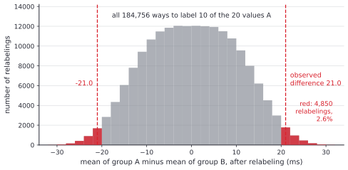

# The bootstrap and permutation tests

After this lesson you can build a percentile bootstrap interval for a mean or a median, run a permutation test for a difference between two groups, compare both with the t methods, and say when resampling can't be trusted: tiny samples, dependent data, and statistics such as the maximum.

Before this: [confidence intervals](02-confidence-intervals.md#the-bootstrap) (the bootstrap steps and the response-time data), [hypothesis testing](03-hypothesis-testing.md) (p-values and the two-sample t test) and [descriptive statistics and study design](01-descriptive-statistics-and-study-design.md#judge-a-study) (random assignment).

## Quick check

Try these first. If you get all three right, skip to [Practice](#practice).

1. A bootstrap resample is drawn from the five values 3, 8, 8, 12 and 20. Which of these can be a resample? (a) 8, 8, 8, 3, 20. (b) 3, 8, 12, 20. (c) 12, 12, 12, 12, 12. (d) 3, 8, 8, 12, 15.
2. Ten users are split into group A (5 users) and group B (5 users). In how many ways can 5 of the 10 users be labelled A? If the real labelling gave a larger difference of means than every one of those ways, what is the smallest possible one-sided p-value?
3. Why must a bootstrap resample be drawn with replacement?

<details class="solution" markdown>
<summary>Answers</summary>

1. (a) and (c) can. A resample has the same size as the data (so (b) is out) and uses only the data's values (so (d) is out, since 15 is not in the data), and values can repeat.
2. $\binom{10}{5} = 252$ ways. If the real labelling beat all the others, only itself reaches that difference, so the smallest one-sided p-value is $\frac{1}{252} \approx 0.004$.
3. Without replacement, drawing all $n$ of the $n$ values only reorders the sample, so every resample would give the same statistic and there would be no variation to measure.

</details>

## The idea

[Confidence intervals](02-confidence-intervals.md#the-bootstrap) ended with a bootstrap interval for the median of 15 response times, found by treating the sample as a stand-in for the population and drawing new samples from it. This lesson looks harder at why that works, uses it for the mean as well and compares it with the t interval, and adds its twin for testing: the permutation test.

The same 15 times (in milliseconds) are 82, 95, 101, 88, 110, 97, 240, 105, 92, 99, 130, 87, 104, 310 and 94. The mean is 122.3 ms, and the t interval for the mean is (86.6, 157.9). That interval assumes that the sampling distribution of the mean is close to normal, which is doubtful when two of 15 values are far above the rest. The bootstrap doesn't assume a shape. It lets the computer replay the data collection many times using the sample itself as the population.

The permutation test asks a different question: do two groups differ at all? Suppose a team measures 10 requests on build A and 10 on build B. If the build makes no difference, then the labels "A" and "B" are arbitrary, and any other way of dividing the same 20 numbers into two groups of 10 was as likely as the real one. So shuffle the labels, recompute the difference of means, and see how often a shuffle produces a difference as large as the real one. That fraction is the p-value. If the requests were assigned to builds at random, shuffling the labels replays exactly the randomization that was done.

## Definitions

The **empirical distribution** of a sample $x_1, \dots, x_n$ puts probability $\frac{1}{n}$ on each observed value. In plain words, it is the sample treated as if it were the whole population: draw from it and each of your $n$ values is equally likely to come up. A **bootstrap resample** is $n$ independent draws from the empirical distribution, which is the same as drawing $n$ values with replacement from the data.

The statistic computed on one resample is a **bootstrap replicate**. The **bootstrap distribution** is the distribution of the replicates over all possible resamples (in practice, over $B$ simulated ones, with $B = 10{,}000$ in this lesson), and the **bootstrap standard error** is its standard deviation. In plain words, it estimates how much the statistic would vary if the world looked like the sample. The percentile interval of [confidence intervals](02-confidence-intervals.md#the-bootstrap) takes the 2.5th and 97.5th percentiles of the replicates as a 95% interval.

A **permutation test** compares two groups, of sizes $n_1$ and $n_2$, by a statistic $T$ such as the difference of means. The null hypothesis is that the group labels carry no information, which means that the values are **exchangeable**: every way of splitting the $n_1 + n_2$ values into groups of those sizes is equally likely. The **permutation distribution** of $T$ is its value over all those splits. The two-sided **permutation p-value** is the fraction of splits whose $\lvert T \rvert$ is at least as large as the observed $\lvert T \rvert$, counting the real split itself as one of them.

The number of splits is $\binom{n_1 + n_2}{n_1}$, which is 184,756 for 10 and 10 and grows quickly. With more than a few hundred thousand, the test shuffles the labels $B$ times instead, and the **Monte Carlo p-value** is $\frac{1 + k}{B + 1}$, where $k$ is the number of shuffles at least as extreme as the real split. The $+1$ in the numerator and the denominator counts the real split, because it is one of the possible splits, so the p-value can't be 0.

## How to do it

### A bootstrap interval

1. Compute the statistic on the data.
2. Draw $B$ resamples of size $n$, with replacement.
3. Compute the statistic on each resample.
4. The 2.5th and 97.5th percentiles of the $B$ replicates are a 95% percentile interval, and their standard deviation is the bootstrap standard error.
5. Plot the replicates. A histogram that is lumpy, has a spike, or looks very unlike the shape you expected is a warning that the method may not suit this statistic.

### Why resampling gives the right spread, for a mean

For a mean the bootstrap standard error can be found exactly, so the simulation can be checked against a formula.

*Theorem 1 (the bootstrap standard error of a mean).* Let $x_1, \dots, x_n$ be the data, with mean $\bar{x}$ and $\hat{\sigma}^2 = \frac{1}{n}\sum (x_i - \bar{x})^2$ (divided by $n$, not $n - 1$). The mean of a bootstrap resample has mean $\bar{x}$ and standard deviation $\frac{\hat{\sigma}}{\sqrt{n}}$.

We know that a resample is $n$ independent draws from the empirical distribution. We want the spread of their average. The plan is to find the mean and variance of one draw, then use the rule for an average of independent values from [confidence intervals](02-confidence-intervals.md#where-the-standard-errors-come-from).

*Proof.* One draw $X^*$ equals each $x_i$ with probability $\frac{1}{n}$. So $E[X^*] = \frac{1}{n}\sum x_i = \bar{x}$ and $\operatorname{Var}(X^*) = \frac{1}{n}\sum (x_i - \bar{x})^2 = \hat{\sigma}^2$. The $n$ draws are independent, so the variance of their sum is $n\hat{\sigma}^2$, and the variance of their average is $\frac{n\hat{\sigma}^2}{n^2} = \frac{\hat{\sigma}^2}{n}$. $\blacksquare$

Look back: this is the usual standard error, $\frac{s}{\sqrt{n}}$, with $\hat{\sigma}$ in place of $s$. The two differ by the factor $\sqrt{\frac{n-1}{n}}$, which is 0.966 for $n = 15$ and nearly 1 for large $n$. So for a mean the bootstrap only reproduces what algebra already gives. Its value is for statistics such as the median, a ratio or a correlation, where there is no easy formula but the recipe stays the same: resample, recompute, look at the spread.

### The steps of a permutation test

1. State $H_0$: the labels carry no information (the two groups have the same distribution). Choose the statistic $T$, such as the difference of means, and $\alpha$.
2. Compute $T$ on the real split.
3. Shuffle the pooled values and split them into groups of the original sizes. Compute $T$. Repeat $B$ times, or go through all the splits if there are few.
4. Count the shuffles with $\lvert T \rvert \ge \lvert T_{\text{observed}} \rvert$, and compute $\frac{1 + k}{B + 1}$ (or the exact fraction, if you used every split).
5. Decide, and report the size of the difference with an interval. A bootstrap interval for the difference resamples within each group.

### Why a permutation p-value is a real p-value

*Theorem 2.* Suppose all $M$ possible splits are equally likely, as $H_0$ says. Let $p$ be the exact permutation p-value of the observed split. Then $P(p \le \alpha) \le \alpha$ for every $\alpha$.

We know that the observed split is one of the $M$ splits, each equally likely under $H_0$. We want the chance that its p-value is small. The plan is to count how many splits can have a small p-value.

*Proof.* Let $S$ be the set of splits whose p-value is at most $\alpha$, and let $s_0$ be the split in $S$ with the smallest $\lvert T \rvert$. Every split in $S$ has $\lvert T \rvert \ge \lvert T(s_0) \rvert$. The p-value of $s_0$ is the fraction of all splits with $\lvert T \rvert \ge \lvert T(s_0) \rvert$, and it is at most $\alpha$, so at most $\alpha M$ splits have that property. All of $S$ is among them, so $\lvert S \rvert \le \alpha M$. The observed split is equally likely to be any of the $M$, so $P(p \le \alpha) = \frac{\lvert S \rvert}{M} \le \alpha$. $\blacksquare$

Look back: the guarantee needs no normal curve and no formula for a standard error. It uses only that the splits are equally likely under $H_0$, which holds exactly when the groups were formed by random assignment. It says nothing about power, and it holds for any statistic $T$ you choose before looking at the data, such as the difference of medians. The Monte Carlo version with the $+1$ keeps the guarantee.

## Worked examples

<div class="example" markdown>

### Example 1: bootstrap intervals for a mean and a median

Find 95% percentile bootstrap intervals for the mean and the median of the 15 response times above, and compare the interval for the mean with the t interval.

Steps 1 and 2: the sample mean is 122.3 ms and the sample median is 99 ms. Draw $B = 10{,}000$ resamples of 15 values with replacement (the code below does this with `numpy.random.default_rng(1)`).

Steps 3 and 4: the 2.5th and 97.5th percentiles of the 10,000 resample means are 96.4 and 157.3, so the 95% interval for the mean is $(96.4, 157.3)$ ms. For the medians they are 92 and 105, so the interval for the median is $(92, 105)$ ms. The standard deviation of the resample means is 15.9, which is close to Theorem 1's exact value $\frac{62.22}{\sqrt{15}} = 16.07$. The gap is simulation noise.

Step 5 and the comparison: the figure shows the replicates. The bootstrap interval for the mean sits 25.9 below the sample mean and 35.0 above it, while the t interval is symmetric, 35.7 on each side. The asymmetry comes from the data. About 11.7% of resamples, $\left(\frac{13}{15}\right)^{15}$, contain neither of the two slow requests (240 and 310), and their means fall near 99. Resamples that draw one or both of those values several times give means far above 122. The t interval, built from a symmetric curve, can't show this. The median is much steadier than the mean (its bootstrap standard error is about 4.6 ms, against 15.9 for the mean) because it ignores how large the two slow requests are.


The median interval is $(92, 105)$ here and $(92, 110)$ in [confidence intervals](02-confidence-intervals.md#example-3-a-bootstrap-interval-for-a-median), which used a different random number generator. A median of 15 values can only be one of the data values, so the endpoints are data values and a small change in the random draws can move one to the next. Quote one or two significant digits, and state the seed.

Check: the sample median 99 is inside $(92, 105)$ and the sample mean 122.3 is inside $(96.4, 157.3)$. The bootstrap distribution is centred on the sample statistic, as it must be, since it was built from the sample.

</div>

<div class="example" markdown>

### Example 2: do two builds differ? A permutation test

A team measures 10 requests on build A and 10 on build B, in milliseconds (hypothetical numbers). Build A gives 214, 202, 236, 228, 207, 245, 219, 231, 212 and 290, with mean 228.4. Build B gives 201, 211, 189, 225, 205, 194, 210, 198, 238 and 203, with mean 207.4. Test at the 5% level whether the mean response times differ.

Step 1: $H_0$ says the labels carry no information. The statistic is $T = \bar{x}_A - \bar{x}_B$, and $\alpha = 0.05$. Step 2: the real split gives $T = 21.0$ ms.

Step 3: there are $\binom{20}{10} = 184{,}756$ ways to choose which 10 of the 20 values are labelled A, few enough to try every one. Step 4: 4,850 of them have $\lvert T \rvert \ge 21.0$, so the exact p-value is $\frac{4850}{184756} = 0.0263$. The figure shows all 184,756 differences, with the 4,850 in red.



With 10,000 random shuffles instead, 273 are at least as extreme, and the Monte Carlo p-value is $\frac{1 + 273}{10001} = 0.0274$, close to the exact value. Step 5: reject $H_0$ at 5%. Welch's t test on the same data gives $t = 2.26$ on 14.4 degrees of freedom and $p = 0.0401$, the same conclusion with a somewhat larger p-value. The two tests compare the statistic with different reference distributions, a t curve and the relabelings of these 20 values, so they needn't agree exactly.

The p-value says that the builds differ, not by how much. A bootstrap interval for the difference of means, resampling within each group, is $(5.1, 39.9)$ ms. Welch's 95% interval is $(1.1, 40.9)$. Both are wide: the data say that build B is faster by somewhere between a few milliseconds and about 40.

Check: the exact and Monte Carlo p-values are within 0.002 of each other, and a Monte Carlo standard error, $\sqrt{\frac{0.0263 \times 0.9737}{10000}} = 0.0016$, says that is expected. The difference of group means, $228.4 - 207.4 = 21.0$, is the same number that the figure marks.

</div>

<div class="example" markdown>

### Example 3: a statistic with no formula, the difference of medians

The same two builds, but now compare medians, which the 290 ms request can't distort. The medians are 223.5 for build A and 204.0 for build B, a difference of 19.5 ms.

The permutation test needs no new idea. Reuse the same 10,000 shuffles and compute the difference of medians on each. Of them, 485 are at least as extreme as 19.5, and the Monte Carlo p-value is $\frac{1 + 485}{10001} = 0.0486$. Going through all 184,756 splits gives the exact p-value 0.0458.

Both are under 0.05, only just. The result for the means was clearer (0.0263), because comparing medians throws away information about how far the values are from the middle. Choose the statistic before looking at the data. Trying both and reporting whichever is smaller is the kind of choice that [Multiple testing and p-hacking](07-multiple-testing-and-p-hacking.md) is about.

Check: the two p-values, 0.0486 and 0.0458, differ by 0.003, which is about what the Monte Carlo standard error $\sqrt{\frac{0.0486 \times 0.9514}{10000}} = 0.0022$ allows.

</div>

<div class="example" markdown>

### Example 4: when the bootstrap fails, the maximum

A sample of 20 values is drawn from the uniform distribution on 0 to 100, so the true maximum is 100. The sample maximum is 95.0. Find a 95% bootstrap interval for the population maximum.

Resample 10,000 times and take the maximum of each. The 2.5th and 97.5th percentiles are 78.8 and 95.0, so the interval is $(78.8, 95.0)$. It can't contain 100, and it never can: no resample contains a value larger than the sample maximum, so the top of the interval is at most 95.0.

The histogram shows why. A resample contains the sample maximum unless all 20 draws miss it, which has probability $\left(1 - \frac{1}{20}\right)^{20} = 0.358$. So 64.2% of the resamples have the sample maximum as their maximum, and the 10,000 resamples gave 64.0%. The bootstrap distribution is a spike with a few small steps below it, while the true sampling distribution of a maximum is smooth and reaches all the way up to 100. The interval misses the true maximum in every repeated experiment, because the sample maximum is always below 100.


Check: $1 - 0.358 = 0.642$ matches the 64.0% found by simulation, and the same number comes from the formula in Practice problem 7.

</div>

<div class="example" markdown>

### Example 5: how many shuffles are enough? (finish it yourself)

A permutation test on two groups uses $B = 10{,}000$ random shuffles, and 183 of them give a statistic at least as extreme as the observed one (hypothetical). Find the Monte Carlo p-value and its standard error, and decide at the 5% level.

The p-value is $\frac{1 + k}{B + 1}$ with $k = 183$, and the standard error of a proportion estimated from $B$ shuffles is $\sqrt{\frac{p(1 - p)}{B}}$.

<details class="solution" markdown>
<summary>Finish</summary>

$p = \frac{1 + 183}{10001} = 0.0184$, and the standard error is $\sqrt{\frac{0.0184 \times 0.9816}{10000}} = 0.0013$. The true p-value is very probably between 0.015 and 0.022, well under 0.05, so reject $H_0$. The decision doesn't depend on the random shuffles.

If the count had been 500, then $p = 0.0501$ with a standard error of 0.0022, and the decision at 5% would be a coin flip. When the p-value is close to $\alpha$, rerun with $B = 100{,}000$ or more, which divides the standard error by about 3.

Check: the real split is counted in $k + 1 = 184$, so $p > 0$ for every $k \ge 0$, which is why the $+1$ is there.

</details>

</div>

## Edge cases and common mistakes

<div class="warning" markdown>

Watch out: resamples must be drawn with replacement and have the size of the data. Without replacement, the resample is the sample in a new order. With a different size, the spread of the replicates has the wrong scale, since the standard error depends on $n$.

</div>

<div class="warning" markdown>

Watch out: the bootstrap distribution is centred on the sample statistic, not on the true parameter. Its spread is the information, its centre is not, and a biased or tiny sample gives a bootstrap distribution that is wrong in the same way as the sample. In Example 1 two of the 15 times are slow. If slow requests are rarer than that in real traffic, every resample overstates them, and if they are more common, every resample understates them.

</div>

<div class="warning" markdown>

Watch out: tiny samples. The percentile interval is built from the sample alone, and a small sample doesn't show its own tails. In a simulation of 5,000 samples from a skewed (exponential) population with true mean 1, the 95% t interval contained the true mean 89.8% of the time for $n = 10$, 92.8% for $n = 30$ and 94.9% for $n = 100$. The percentile bootstrap interval did slightly worse, 85.6%, 92.1% and 94.1%. Neither is reliable at $n = 10$ with this much skew, and the bootstrap is not a fix for small samples.

</div>

<div class="warning" markdown>

Watch out: statistics at the edge of the data, such as the maximum, the minimum or a very high percentile. The bootstrap can't produce a value beyond the sample, so it can't see the part of the distribution you haven't observed (Example 4). The 99th percentile of 50 latencies is the largest or second-largest value, and its bootstrap interval is as unreliable as the maximum's.

</div>

<div class="warning" markdown>

Watch out: dependent data. Resampling single values assumes that each is independent of the others. In a time series, where each value leans on the one before it, this destroys the dependence, and the standard error comes out too small. In a simulation of 1,000 series of 200 values with each value equal to 0.7 times the previous one plus noise, the mean of a series varied with a standard deviation of 0.231 from series to series. The ordinary bootstrap estimated 0.098, and its 95% intervals contained the true mean 59% of the time. The **block bootstrap** resamples runs of consecutive values (here blocks of 20) and keeps the dependence inside each block. It estimated 0.201, and its intervals contained the true mean 87% of the time. It is better, not perfect.

The same applies to clusters. If each user contributes 20 requests, resample users, not requests, and in a permutation test shuffle labels between users, not between requests.

</div>

<div class="warning" markdown>

Watch out: a permutation test of means tests more than equal means. Its null hypothesis is that the two groups have the same distribution, spread included. With true means equal but spreads different, and especially when the smaller group is the noisier one, it can reject far too often. In a simulation with 5 values of standard deviation 4 against 25 values of standard deviation 1, both with mean 0, the permutation test rejected 34% of the time at the 5% level, while Welch's test rejected 5.4%. The permutation test is exact for randomly assigned groups, where $H_0$ is "the treatment did nothing at all".

</div>

Two small points. With few observations the p-value has a floor, because there are few splits: groups of 4 and 4 have $\binom{8}{4} = 70$ splits, so a two-sided p-value can't be below $\frac{2}{70} = 0.029$, and groups of 3 and 3 have 20 splits and a floor of 0.10. And a bootstrap interval and a permutation test answer different questions. The first estimates how large an effect or a statistic is, and the second asks whether there is any difference at all. Report both when you can.

## Tricks and shortcuts

Build all the resamples at once: `data[rng.integers(0, n, size=(B, n))]` is a $B$ by $n$ array, and `.mean(axis=1)` or `np.median(..., axis=1)` gives all the replicates. For large $n$ or $B$, work in chunks.

Use `rng = numpy.random.default_rng(seed)`, and report the seed and $B$. The sequence of numbers a seed gives is not guaranteed to stay identical across numpy versions, so the last digits of the results in this lesson may differ on your machine, while the pattern stays.

The Monte Carlo standard error of a p-value is $\sqrt{\frac{p(1 - p)}{B}}$. For $p$ near 0.05 and $B = 10{,}000$ it is about 0.002. Use more shuffles when the decision is close.

Compare the bootstrap standard error of a mean with $\frac{s}{\sqrt{n}}$. They should differ by about $\sqrt{\frac{n-1}{n}}$ and nothing more. A big gap means that a few values have too much influence or there is a bug.

If the number of splits is below a few hundred thousand, list them all, as in Example 2, and the p-value is exact. SciPy's `scipy.stats.bootstrap` uses the BCa method by default, a refinement of the percentile interval, so pass `method="percentile"` to get this lesson's interval, and `scipy.stats.permutation_test` does the test of Example 2.

## In code

The code below does everything above with numpy (and SciPy for the t interval and a cross-check): the intervals of Example 1, the tests of Examples 2 and 3 with the exact version, the bootstrap interval for a difference, and the three failures. It takes several seconds to run. Install SciPy once with `pip install scipy`.

<details class="code" markdown>
<summary>In code</summary>

```python
import itertools
import numpy as np
from scipy import stats            # pip install scipy

B = 10_000

# 1. Percentile bootstrap intervals for the mean and the median of 15 response times (ms).
times = np.array([82, 95, 101, 88, 110, 97, 240, 105, 92, 99, 130, 87, 104, 310, 94])
n = len(times)
rng = np.random.default_rng(1)
resamples = times[rng.integers(0, n, size=(B, n))]       # B rows, each one resample of n values
means, medians = resamples.mean(axis=1), np.median(resamples, axis=1)
print(np.percentile(means, [2.5, 97.5]).round(1), np.percentile(medians, [2.5, 97.5]))
# [ 96.4 157.3] [ 92. 105.]
print(round(means.std(ddof=1), 2), round(times.std() / np.sqrt(n), 2))
# 15.88 16.07
print(np.round(stats.t.interval(0.95, n - 1, loc=times.mean(), scale=stats.sem(times)), 1))
# [ 86.6 157.9]

# 2. Permutation test: do two builds have the same mean response time?
a = np.array([214, 202, 236, 228, 207, 245, 219, 231, 212, 290])
b = np.array([201, 211, 189, 225, 205, 194, 210, 198, 238, 203])
observed = a.mean() - b.mean()
pooled = np.concatenate([a, b])
rng = np.random.default_rng(2)
shuffled = rng.permuted(np.tile(pooled, (B, 1)), axis=1)    # B independent shuffles of the 20 values
diffs = shuffled[:, :10].mean(axis=1) - shuffled[:, 10:].mean(axis=1)
extreme = np.abs(diffs) >= abs(observed) - 1e-9              # the tolerance guards against rounding
print(round(observed, 1), extreme.sum(), round((1 + extreme.sum()) / (B + 1), 4))
# 21.0 273 0.0274

# The same shuffles work for any statistic, such as the difference of medians.
med_diffs = np.median(shuffled[:, :10], axis=1) - np.median(shuffled[:, 10:], axis=1)
med_obs = np.median(a) - np.median(b)
print(med_obs, round((1 + np.sum(np.abs(med_diffs) >= abs(med_obs) - 1e-9)) / (B + 1), 4))
# 19.5 0.0486

# The exact version: all 184,756 ways to choose which 10 of the 20 values get the label A.
combos = np.array(list(itertools.combinations(range(20), 10)))
sums = pooled[combos].sum(axis=1)
exact = np.abs(sums / 10 - (pooled.sum() - sums) / 10) >= abs(observed) - 1e-9
print(len(combos), exact.sum(), round(exact.mean(), 4))
# 184756 4850 0.0263
print(round(stats.ttest_ind(a, b, equal_var=False).pvalue, 4))
# 0.0401
res = stats.permutation_test((a, b), lambda x, y: x.mean() - y.mean(), n_resamples=9999, rng=np.random.default_rng(3))
print(round(res.pvalue, 4))
# 0.0268

# 3. A bootstrap interval for the difference of means: resample within each group.
rng = np.random.default_rng(4)
boot_diff = a[rng.integers(0, 10, (B, 10))].mean(axis=1) - b[rng.integers(0, 10, (B, 10))].mean(axis=1)
print(np.percentile(boot_diff, [2.5, 97.5]).round(1))
# [ 5.1 39.9]

# 4. A statistic the bootstrap handles badly: the maximum.
rng = np.random.default_rng(1)
x = rng.uniform(0, 100, 20)                                  # the true maximum is 100
max_boot = x[rng.integers(0, 20, (B, 20))].max(axis=1)
print(round(x.max(), 1), np.percentile(max_boot, [2.5, 97.5]).round(1), (max_boot == x.max()).mean())
# 95.0 [78.8 95. ] 0.6403

# 5. Dependent data: an AR(1) series, where each value leans on the one before it.
rng = np.random.default_rng(5)
reps, N, phi, L = 1000, 200, 0.7, 20
e = rng.standard_normal((reps, N + 100))
series = np.zeros_like(e)
for t in range(1, N + 100):
    series[:, t] = phi * series[:, t - 1] + e[:, t]
series = series[:, 100:]                                     # drop the warm-up; the true mean is 0
iid_se, block_se, iid_hit, block_hit = [], [], 0, 0
for x in series:
    m_iid = x[rng.integers(0, N, (500, N))].mean(axis=1)
    starts = rng.integers(0, N - L + 1, (500, N // L))       # random blocks of L consecutive values
    m_block = x[(starts[:, :, None] + np.arange(L)).reshape(500, N)].mean(axis=1)
    iid_se.append(m_iid.std(ddof=1))
    block_se.append(m_block.std(ddof=1))
    lo, hi = np.percentile(m_iid, [2.5, 97.5])
    iid_hit += lo <= 0 <= hi
    lo, hi = np.percentile(m_block, [2.5, 97.5])
    block_hit += lo <= 0 <= hi
print(round(series.mean(axis=1).std(ddof=1), 3), round(np.mean(iid_se), 3), round(np.mean(block_se), 3))
print(iid_hit / reps, block_hit / reps)
# 0.231 0.098 0.201
# 0.591 0.87

# 6. Small samples: how often do 95% intervals for a mean of skewed data contain the truth (1)?
rng = np.random.default_rng(6)
for n in (10, 30, 100):
    tstar, hit_t, hit_b = stats.t.ppf(0.975, n - 1), 0, 0
    for _ in range(5000):
        x = rng.exponential(1.0, n)
        hit_t += abs(x.mean() - 1) <= tstar * x.std(ddof=1) / np.sqrt(n)
        lo, hi = np.percentile(x[rng.integers(0, n, (1000, n))].mean(axis=1), [2.5, 97.5])
        hit_b += lo <= 1 <= hi
    print(n, hit_t / 5000, hit_b / 5000)
# 10 0.898 0.8564
# 30 0.9276 0.9208
# 100 0.9488 0.9408
```

The shuffles and the exact enumeration agree (0.0274 against 0.0263), and SciPy's own `permutation_test` gives 0.0268 from its own shuffles. Older SciPy versions call the `rng` argument `random_state`. The last three blocks are the failures of this lesson in numbers: the bootstrap maximum is a spike at the sample maximum, the ordinary bootstrap's standard error is far too small for the dependent series while the block bootstrap's is close, and for a skewed population at $n = 10$ both intervals fall below 95%.

</details>

## FAQ

### How many resamples do I need?

For an interval, 10,000 is the usual choice, and 1,000 is enough for a rough look. The endpoints are percentiles, which need more resamples than a mean does. For a permutation p-value, the standard error is $\sqrt{\frac{p(1-p)}{B}}$, so choose $B$ from how close the p-value is to the cutoff.

### If I resample the same data over and over, how can it tell me anything new?

It doesn't tell you anything new about the centre. It tells you how sensitive the statistic is to which values happened to be drawn, which is the spread. That is exactly the information a standard error carries, and the data alone contain it: a statistic that jumps around when one or two values are swapped is uncertain.

### Should I use the bootstrap or the t interval for a mean?

For a mean with a few dozen values or more and mild skew, they agree closely, and the t interval is quicker. When the shape is doubtful (strong skew with $n$ in the tens), the bootstrap shows the asymmetry that the t interval hides, as in Example 1, but the simulation above shows that neither is reliable at $n = 10$ with strong skew. For a median, a ratio, a correlation or a difference of medians, the bootstrap is the usual tool, since there is no easy formula.

### What is the difference between a permutation test and a t test?

Both ask whether two groups differ. The t test relies on a normal approximation to the distribution of the statistic. The permutation test builds the distribution from the data by relabelling, so it needs no normality, and its guarantee (Theorem 2) is exact for randomly assigned groups. The two usually give similar p-values, as in Example 2. The permutation test is the more natural choice when the groups were randomized and the statistic is awkward.

## Practice

### Warm-up

1\. Groups of 6 and 6 are compared with a permutation test. How many splits are there, and what is the smallest possible two-sided p-value?

<details class="solution" markdown>
<summary>Solution</summary>

There are $\binom{12}{6} = 924$ splits. The real split and its mirror image (A and B swapped) are the two with the largest $\lvert T \rvert$ if the groups are completely separated, so the smallest two-sided p-value is $\frac{2}{924} \approx 0.0022$. The smallest one-sided p-value is $\frac{1}{924} \approx 0.0011$.

Check: with 10 and 10 in Example 2 there are 184,756 splits, so the floor there is about $10^{-5}$, far below any cutoff in use.

</details>

2\. A permutation test uses 9,999 random shuffles, and 312 of them have a statistic at least as extreme as the real one. Find the Monte Carlo p-value.

<details class="solution" markdown>
<summary>Solution</summary>

$p = \frac{1 + 312}{9999 + 1} = \frac{313}{10000} = 0.0313$. The real split is counted once, in both the numerator and the denominator.

Check: leaving out the $+1$ would give $\frac{312}{9999} = 0.0312$, almost the same here. The $+1$ matters when the count is small: with $k = 0$ it gives $\frac{1}{10000}$ instead of the impossible 0.

</details>

3\. A bootstrap resample of $n$ values leaves out a particular value with probability $\left(1 - \frac{1}{n}\right)^n$. Compute it for $n = 5$, $n = 20$ and $n = 100$, and compare with $e^{-1}$.

<details class="solution" markdown>
<summary>Solution</summary>

$0.8^5 = 0.3277$, $0.95^{20} = 0.3585$ and $0.99^{100} = 0.3660$. The number $e^{-1} = 0.3679$. The values increase towards $e^{-1}$ as $n$ grows, so a resample leaves out about 36.8% of the original values and contains about 63.2% of the distinct ones.

Check: each of the $n$ draws misses a given value with probability $1 - \frac{1}{n}$, and the draws are independent, so the probability that all $n$ miss it is the $n$-th power.

</details>

### Standard

4\. Two build A values are 4 and 7, and three build B values are 9, 12 and 14. List all splits of the five values into a group of 2 and a group of 3, find the difference of means (group of 2 minus group of 3) for each, and find the exact two-sided permutation p-value of the real split.

<details class="solution" markdown>
<summary>Solution</summary>

There are $\binom{5}{2} = 10$ splits. If the group of 2 has sum $s$, the other three have sum $46 - s$, and the difference of means is $\frac{s}{2} - \frac{46 - s}{3} = \frac{5s - 92}{6}$. The ten pairs and their sums are $\{4,7\}$: 11, $\{4,9\}$: 13, $\{4,12\}$: 16, $\{4,14\}$: 18, $\{7,9\}$: 16, $\{7,12\}$: 19, $\{7,14\}$: 21, $\{9,12\}$: 21, $\{9,14\}$: 23 and $\{12,14\}$: 26. The differences are $-6.17, -4.5, -2.0, -0.33, -2.0, 0.5, 2.17, 2.17, 3.83$ and $6.33$.

The real split $\{4, 7\}$ has $T = -6.17$. Two splits have $\lvert T \rvert \ge 6.17$: the real one and $\{12, 14\}$ with $6.33$. So $p = \frac{2}{10} = 0.2$.

Check: with a group of 2 and a group of 3 there are only 10 splits, so even a complete separation gives $p = 0.2$ two-sided. The data can't show significance at 5%, however far apart the groups are.

</details>

5\. The five values 4, 6, 8, 10 and 12 are a sample. Find the standard error of a bootstrap resample mean from Theorem 1, and compare it with $\frac{s}{\sqrt{n}}$.

<details class="solution" markdown>
<summary>Solution</summary>

The mean is 8 and the squared deviations are $16, 4, 0, 4, 16$, which add to 40. So $\hat{\sigma}^2 = \frac{40}{5} = 8$ and the bootstrap standard error is $\sqrt{\frac{8}{5}} = 1.265$. The sample variance is $s^2 = \frac{40}{4} = 10$, so $\frac{s}{\sqrt{n}} = \sqrt{\frac{10}{5}} = 1.414$.

Check: the ratio is $\frac{1.265}{1.414} = 0.894 = \sqrt{\frac{4}{5}} = \sqrt{\frac{n-1}{n}}$, as the look back after Theorem 1 says.

</details>

6\. For each situation, say whether a percentile bootstrap interval is a reasonable tool and why. (a) The mean of 40 independent page load times. (b) The maximum of 30 independent load times. (c) The mean daily sales over 90 consecutive days, which follow a weekly pattern. (d) The median of 12 independent values.

<details class="solution" markdown>
<summary>Solution</summary>

(a) Reasonable: the values are independent and $n$ is moderate. It will agree closely with the t interval unless the times are very skewed, and then the bootstrap shows the asymmetry.

(b) Not reasonable: the maximum is at the edge of the data, and resamples can't go beyond the sample maximum (Example 4).

(c) Not as it stands: consecutive days are dependent, so resampling single days gives a standard error that is too small. Use a block bootstrap with blocks of at least 7 days, or a method for time series.

(d) Usable with care: a median is a statistic the bootstrap handles, but 12 values is a small sample, so the interval will be rough and its endpoints will be data values. Say that it is approximate.

Check: the problems in (b) and (c) both come from breaking the assumptions behind the resampling, an edge of the data and dependence.

</details>

### Challenge

7\. Show that the probability that the sample maximum appears in a bootstrap resample (when it occurs once in the sample) is $1 - \left(1 - \frac{1}{n}\right)^n$. Evaluate it for $n = 10$, 20 and 100, give the limit, and explain why a 95% percentile interval for the true maximum has no chance of covering it.

<details class="solution" markdown>
<summary>Solution</summary>

A draw misses the maximum with probability $1 - \frac{1}{n}$, and the $n$ draws are independent, so all of them miss it with probability $\left(1 - \frac{1}{n}\right)^n$. The resample contains it with probability $1 - \left(1 - \frac{1}{n}\right)^n$. The values are $0.651$ for $n = 10$, $0.642$ for $n = 20$ and $0.634$ for $n = 100$, and the limit is $1 - e^{-1} \approx 0.632$.

Whenever the resample contains the sample maximum $m$, its maximum is $m$, so at least 63% of the replicates equal $m$ and the rest are smaller. The 97.5th percentile is therefore $m$ itself. The true maximum is at least $m$ (and above it, with probability 1 for a continuous population), so the interval's upper end is below the truth every time and the coverage is 0.

Check: for $n = 20$, $1 - 0.95^{20} = 0.6415$, and the simulation in Example 4 found 64.0%.

</details>

8\. (Reviews [confidence intervals](02-confidence-intervals.md).) In Example 1, the bootstrap interval for the mean of the response times is $(96.4, 157.3)$ and the t interval is $(86.6, 157.9)$. (a) How far is each endpoint of the bootstrap interval from the sample mean 122.3, and what does the difference say about the data? (b) The t interval is $\bar{x} \pm t^* \frac{s}{\sqrt{n}}$. Find its half-width from $s = 64.4$ and $t^* = 2.145$, and say why it can't be asymmetric.

<details class="solution" markdown>
<summary>Solution</summary>

(a) The lower endpoint is $122.3 - 96.4 = 25.9$ below the mean and the upper is $157.3 - 122.3 = 35.0$ above it. The interval stretches further up than down because the data are right-skewed: a few resamples with the slow requests repeated give high means, while the typical resample drops them and falls closer to 100.

(b) The half-width is $2.145 \times \frac{64.4}{\sqrt{15}} = 2.145 \times 16.63 = 35.7$, so the interval is $122.3 \pm 35.7$. It is symmetric because it is built from a symmetric t distribution and one standard error, whatever the shape of the data.

Check: $122.3 - 35.7 = 86.6$ and $122.3 + 35.7 = 158.0$, matching $(86.6, 157.9)$ up to rounding.

</details>

## Where this shows up

- In this chapter, [Chi-square tests](05-chi-square-tests.md) need a simulation when the expected counts are too small, and a permutation test is that simulation. The next lesson, [Multiple testing and p-hacking](07-multiple-testing-and-p-hacking.md), is about what happens when you run many of these tests, or the same one many ways.
- In CS, a bootstrap interval for a test-set accuracy or a latency percentile is a standard way to say how far a model or a benchmark result can be trusted. Bagging and random forests train each tree on a bootstrap sample, so each tree sees about 63% of the distinct rows and the rest, about 37%, give a free error estimate. Permutation feature importance shuffles one column and measures how much the score drops. A/B platforms use bootstrap and permutation methods for metrics that have no tidy formula, such as revenue per user.
- In economics and finance, standard errors for regression estimates are often bootstrapped, and returns are dependent over time, so the block bootstrap is the version used ([regression and econometrics intuition](../../07-economics-math/04-more-tools/03-regression-and-econometrics-intuition.md), [investing returns and risk](../../08-financial-math/06-investing-and-retirement/01-investing-returns-and-risk.md)).
