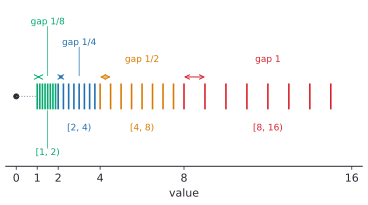

# Floating point basics

After this lesson you can decode and encode an IEEE 754 number by hand, explain why 0.1 + 0.2 is not 0.3, use machine epsilon and the spacing of floats to judge rounding error, spot catastrophic cancellation and rewrite around it, and compare floats safely.

Before this: [number bases and conversions](01-number-bases-and-conversions.md), [bits and information](02-bits-and-information.md) and [scientific notation](../../02-middle-school/04-powers-roots-and-real-numbers/02-scientific-notation.md).

## Quick check

Try these first. If you get all three right, skip to [Practice](#practice).

1. Write 6.5 in the form $1.f \times 2^e$, with $f$ in binary.
2. In Python, `0.1 + 0.2 == 0.3` is `False`. Is the cause that Python is sloppy, or something else?
3. Is `2.0**53 + 1 == 2.0**53` true or false in Python, and why?

<details class="solution" markdown>
<summary>Answers</summary>

1. We have $6.5 = 110.1_2 = 1.101_2 \times 2^2$, so $f = 101$ and $e = 2$.
2. Something else. The decimal numbers 0.1, 0.2 and 0.3 have no finite binary form, so each is stored as the nearest double, and the stored values don't satisfy the sum.
3. True. Doubles have 53 significant bits, so from $2^{53}$ up the spacing is 2, and $2^{53} + 1$ is exactly halfway between two doubles. It rounds to the even one, $2^{53}$.

</details>

## The idea

In [scientific notation](../../02-middle-school/04-powers-roots-and-real-numbers/02-scientific-notation.md), $6.02 \times 10^{23}$ keeps a fixed number of digits (the coefficient) and a separate exponent that says how far to shift the decimal point. A calculator with 10 digits can show a distance to the Sun and a width of an atom with the same relative care, because the exponent does the scaling. The price is that most numbers are rounded to the 10 digits.

Computers do the same in base 2. A floating point number stores a sign, an exponent and a fixed number of significant bits, and its value is $\pm 1.f \times 2^e$. The point "floats" because the exponent decides where it sits. With 53 significant bits in a double, there are about 16 decimal digits of care, from the size of an atom to the size of the universe.

The same design forces a surprise. A fixed number of bits means only finitely many numbers can be stored, and each number between them has to be rounded to a neighbour. Worse, the stored numbers are fractions with a power of 2 in the denominator, so 0.1 isn't one of them. Every `0.1` in a program is a slightly different number, and the errors show up when you add, compare or subtract. This lesson shows exactly what is stored, how big the errors are, and how to write code that works anyway.

## Definitions

### Binary scientific notation

A positive real number $x$ is in **normalized binary form** when $x = 1.f \times 2^e$, where $e$ is an integer and $1.f$ is a binary number with 1 before the point and the fraction bits $f$ after it, so $1 \le 1.f < 2$. The number $1.f$ is the **significand** and $e$ is the exponent.

In plain words, it is scientific notation with 2 in place of 10. For example, $6.5 = 110.1_2 = 1.101_2 \times 2^2$: the point moved two places left, so the exponent is 2. The number $0.15625 = 0.00101_2 = 1.01_2 \times 2^{-3}$, since the point moved three places right. A leading 1 is always present, so it doesn't need to be stored.

### The IEEE 754 formats

The **IEEE 754** standard fixes how floats are stored. A **binary32** number (single precision, Python's `struct` code `f`) has 32 bits, and a **binary64** number (double precision, code `d`) has 64. Python's `float` is a C `double`, which is binary64 on every mainstream platform. Each format splits its bits into three fields:

| | Sign | Exponent field | Fraction field | Bias |
|---|---|---|---|---|
| binary32 | 1 bit | 8 bits | 23 bits | 127 |
| binary64 | 1 bit | 11 bits | 52 bits | 1,023 |

Reading the sign bit $s$, the exponent field as an unsigned integer $E$, and the fraction field as an unsigned integer $F$ with $m$ bits ($m = 23$ or 52), a **normal** number, with $E$ neither all 0s nor all 1s, has the value

$$
(-1)^s \times \left(1 + \frac{F}{2^m}\right) \times 2^{E - \text{bias}}.
$$

The exponent is stored with a **bias**: the stored $E$ is the true exponent plus the bias, so the field is an ordinary unsigned number even when the true exponent is negative. In plain words, the field is the bits of $1.f$ after the point, the exponent field is the exponent shifted up by 127 or 1,023, and the leading 1 is implied.

| | binary32 | binary64 |
|---|---|---|
| Significant bits (with the implied 1) | 24 | 53 |
| Decimal digits of care | about 7 | about 15 to 16 |
| Largest finite value | $(2 - 2^{-23}) \cdot 2^{127} \approx 3.4 \times 10^{38}$ | $(2 - 2^{-52}) \cdot 2^{1023} \approx 1.8 \times 10^{308}$ |
| Smallest normal value | $2^{-126} \approx 1.18 \times 10^{-38}$ | $2^{-1022} \approx 2.23 \times 10^{-308}$ |
| Smallest subnormal | $2^{-149} \approx 1.4 \times 10^{-45}$ | $2^{-1074} \approx 4.9 \times 10^{-324}$ |

### Special values

The two extreme exponent fields are reserved. When $E = 0$ the number is **subnormal**, with value $(-1)^s \times \frac{F}{2^m} \times 2^{1 - \text{bias}}$: there is no implied leading 1, so numbers can be smaller than the smallest normal one, and $F = 0$ gives zero. There are two zeros, $+0$ and $-0$, which compare equal. When $E$ is all 1s, $F = 0$ means **infinity** ($+\infty$ or $-\infty$), and $F \ne 0$ means **NaN** ("not a number"), the result of an undefined operation such as $\infty - \infty$.

In plain words, subnormals fill the gap between 0 and the smallest normal number so that the spacing doesn't jump, infinity is what an overflow gives, and NaN is what nonsense gives. A NaN is never equal to anything, including itself.

### Rounding, epsilon and spacing

Most real numbers have no float. A float operation computes the exact result and then **rounds to nearest, ties to even**: it picks the nearest float, and if the exact result is exactly halfway between two floats, it picks the one whose last fraction bit is 0. (Compare the decimal rule in [place value and rounding](../../01-elementary/01-place-value-and-rounding.md), where ties round up. Always rounding ties the same way would add a small bias to long sums, and "to even" balances out.)

The **spacing** of the floats at a number $x$, written $\operatorname{ulp}(x)$ for "unit in the last place", is the gap between $x$ and the next float above it. The **machine epsilon** $\varepsilon$ is the spacing at 1, which is the gap between 1 and the next float: $\varepsilon = 2^{-m}$. That is $2^{-52} \approx 2.22 \times 10^{-16}$ for doubles and $2^{-23} \approx 1.19 \times 10^{-7}$ for singles. Python gives it as `sys.float_info.epsilon`.

In plain words, $\varepsilon$ says how finely floats resolve numbers near 1. Some books define epsilon as half this value, $2^{-53}$, which is the largest relative rounding error. Check which one a source means.

## How to do it

### Decode a float by hand

1. Split the bits into sign, exponent field and fraction field (1, 8, 23 for single; 1, 11, 52 for double). Writing the hex digits as bits first makes this easy.
2. Read the exponent field as an unsigned integer $E$. If it is all 0s or all 1s, the number is special (zero, subnormal, infinity or NaN). Otherwise the true exponent is $e = E - \text{bias}$.
3. Put a 1 and a point in front of the fraction bits to get $1.f$.
4. Shift the point $e$ places (right if $e > 0$, left if $e < 0$) and convert to decimal.
5. Apply the sign. Check by re-encoding.

### Encode a number as a float

1. Write the sign bit: 0 for positive and 1 for negative. Work with the absolute value.
2. Write the number in binary and normalize it to $1.f \times 2^e$.
3. Add the bias to $e$ and write the sum as the exponent field.
4. Take the first $m$ bits of $f$ as the fraction field. If more bits follow, round: up if the dropped part is more than half of the last kept place, down if less, and to even on an exact tie.
5. Join the three fields and group in 4s for hex. Check by decoding.

### Compare floats

1. Don't test two computed floats for exact equality unless both sides are results of the same exact steps.
2. Choose a relative tolerance, such as $10^{-9}$ for doubles, and test $\lvert a - b \rvert \le \text{tol} \cdot \max(\lvert a \rvert, \lvert b \rvert)$.
3. When one side can be exactly 0, add an absolute tolerance too, since relative closeness to 0 is impossible.
4. In Python, `math.isclose(a, b, rel_tol=1e-9, abs_tol=0.0)` does this. Set `abs_tol` for comparisons with 0.

### Theorems with proofs

*Theorem 1.* The fraction $\frac{1}{10}$ has no finite binary expansion. More generally, a fraction $\frac{a}{b}$ in lowest terms has a finite binary expansion exactly when $b$ is a power of 2.

What we know: a finite binary expansion $0.d_1 d_2 \dots d_k$ means $\frac{N}{2^k}$ for an integer $N$. What we want: to show that $\frac{1}{10}$ is not of that form. The plan is a proof by contradiction.

*Proof.* Suppose $\frac{1}{10} = \frac{N}{2^k}$ for integers $N$ and $k \ge 0$. Then $2^k = 10 N = 2 \cdot 5 \cdot N$, so 5 divides $2^k$. But the only prime factor of $2^k$ is 2 (unique factorization), so 5 doesn't divide it. This is a contradiction. For the general statement, if $\frac{a}{b} = \frac{N}{2^k}$ in lowest terms then $b$ divides $2^k$, so $b$ is a power of 2; conversely if $b = 2^j$ the fraction is $\frac{a}{2^j}$, which is finite in binary. $\blacksquare$

Look back: $\frac{1}{3}$ has no finite decimal expansion because 3 doesn't divide any $10^k$; $\frac{1}{10}$ has no finite binary one because 5 doesn't divide any $2^k$. Expanding it gives the repeating pattern
$0.1 = 0.0001\,1001\,1001\,1001\ldots_2 = 1.1001\,1001\ldots_2 \times 2^{-4}$, where the block 1001 repeats forever. The first 52 fraction bits keep 13 copies of 1001, and the next bits are 1001 again, so the dropped part is more than half and the last kept block rounds up from 1001 to 1010. That is why the double nearest to 0.1 has the hex fraction `999999999999a`.

*Theorem 2.* Let $x$ be a real number with $2^e \le \lvert x \rvert < 2^{e+1}$ in the normal range of binary64. (a) The floats in $[2^e, 2^{e+1})$ are spaced exactly $2^{e-52}$ apart. (b) Rounding $x$ to the nearest float $\mathrm{fl}(x)$ gives a relative error of at most $2^{-53}$:

$$
\frac{\lvert \mathrm{fl}(x) - x \rvert}{\lvert x \rvert} \le 2^{-53}.
$$

*Proof.* (a) In this range the exponent is fixed at $e$, and the floats are $(1 + \frac{F}{2^{52}}) \cdot 2^e$ for $F = 0, 1, \dots, 2^{52} - 1$. Consecutive values differ by $\frac{1}{2^{52}} \cdot 2^e = 2^{e-52}$. (b) Rounding to nearest moves $x$ by at most half a gap, so $\lvert \mathrm{fl}(x) - x \rvert \le 2^{e-53}$. Since $\lvert x \rvert \ge 2^e$, the relative error is at most $\frac{2^{e-53}}{2^e} = 2^{-53}$. $\blacksquare$

Look back: the gap doubles each time $e$ goes up by 1, as in the figure. The absolute error grows with the size of the number, and the relative error stays near $10^{-16}$. Doubles are very precise near 0 and coarse near $10^{16}$, where the gap is 2.



The figure uses a toy format with 3 fraction bits so that the spacing is visible. Each block between powers of 2 holds the same number of floats, 8 here and $2^{52}$ for doubles, so the gap doubles from block to block. Real doubles work the same way, only with a vastly finer grid.

### Catastrophic cancellation

Subtracting two nearly equal numbers cancels their leading digits and leaves the rounding errors in the last ones. Each input was rounded with a relative error near $10^{-16}$, and the difference is much smaller than the inputs, so the same absolute error is a large relative error in the answer. The subtraction itself is exact (when the numbers are within a factor of 2 of each other, the difference is exactly representable); what is lost is the information the earlier roundings already threw away.

The fix is to rewrite the formula so that no subtraction of close numbers happens. Two standard rewrites:

$$
1 - \cos x = 2 \sin^2 \frac{x}{2}, \qquad \sqrt{x + 1} - \sqrt{x} = \frac{1}{\sqrt{x + 1} + \sqrt{x}}.
$$

The first is the half-angle form of the cosine double-angle identity ([trig identities and inverse trig](../../03-high-school/09-trigonometry/04-trig-identities-and-inverse-trig.md)). The second multiplies the top and bottom by the conjugate $\sqrt{x+1} + \sqrt{x}$, and the numerator becomes $(x + 1) - x = 1$. The new forms add and square, which don't cancel.

## Worked examples

<div class="example" markdown>

### Example 1: decode $\mathrm{C2ED4000}_{16}$ as a single

Step 1: write the hex as bits, $1100\,0010\,1110\,1101\,0100\,0000\,0000\,0000$, and split it 1, 8, 23: sign $1$, exponent field $10000101$, fraction field $11011010100000000000000$.

Step 2: the exponent field is $128 + 4 + 1 = 133$, which is neither 0 nor 255, so the number is normal and $e = 133 - 127 = 6$.

Step 3: the fraction field starts $110110101$ and then has only 0s, so $1.f = 1.110110101_2$.

Step 4: shift the point 6 places right: $1110110.101_2$. The whole part is $64 + 32 + 16 + 4 + 2 = 118$ and the part after the point is $\frac{1}{2} + \frac{1}{8} = 0.625$, so the magnitude is 118.625.

Step 5: the sign bit is 1, so the number is $-118.625$.

Check by re-encoding: $118.625 = 1110110.101_2 = 1.110110101_2 \times 2^6$, the exponent field is $6 + 127 = 133 = 10000101_2$, and the pieces join into $\mathrm{C2ED4000}_{16}$. Python agrees: `struct.unpack(">f", bytes.fromhex("C2ED4000"))` returns `-118.625`.

<div class="warning" markdown>

Watch out at step 2: the true exponent is $E - 127$, not $E$. Reading the field 133 as the exponent would give a number around $2^{133}$.

</div>

</div>

<div class="example" markdown>

### Example 2: why $0.1 + 0.2 \ne 0.3$

Each decimal is stored as the nearest double. Exactly, the doubles are

$$
\begin{aligned}
\text{stored } 0.1 &= \tfrac{3602879701896397}{2^{55}} = 0.1000000000000000055511\ldots \\
\text{stored } 0.2 &= \tfrac{3602879701896397}{2^{54}} = 0.2000000000000000111022\ldots \\
\text{stored } 0.3 &= \tfrac{5404319552844595}{2^{54}} = 0.2999999999999999888977\ldots
\end{aligned}
$$

The stored 0.2 is exactly twice the stored 0.1, since doubling only changes the exponent. Adding the first two exactly:

$$
\frac{3602879701896397}{2^{55}} + \frac{7205759403792794}{2^{55}} = \frac{10808639105689191}{2^{55}} = \frac{5404319552844595.5}{2^{54}}.
$$

In $[\frac{1}{4}, \frac{1}{2})$ the floats are the multiples of $2^{-54}$, so the exact sum is exactly halfway between $\frac{5404319552844595}{2^{54}}$ and $\frac{5404319552844596}{2^{54}}$. A tie rounds to the even numerator, 5404319552844596, so the computed sum is $\frac{5404319552844596}{2^{54}}$, which prints as 0.30000000000000004. The stored 0.3 has numerator ...595. They are neighbours, one spacing $2^{-54} \approx 5.55 \times 10^{-17}$ apart, and neighbours aren't equal.

Check: in Python, `(0.1 + 0.2 - 0.3)` is `5.551115123125783e-17`, which is $2^{-54}$.

</div>

<div class="example" markdown>

### Example 3: where adding 1 stops working

For doubles with $2^{52} \le x < 2^{53}$ the spacing is $2^{52-52} = 1$, so every integer there is a double. In $[2^{53}, 2^{54})$ the spacing is 2, so only the even integers are doubles. Then $2^{53} + 1$ is exactly halfway between $2^{53}$ and $2^{53} + 2$, and the tie goes to the even fraction, which is $2^{53}$. So `2.0**53 + 1 == 2.0**53` is true, while $2^{53} + 3$ is halfway between $2^{53} + 2$ and $2^{53} + 4$ and rounds to $2^{53} + 4$.

This is why a double can't count integers past 9,007,199,254,740,992 (and why JavaScript, which has only doubles, has `Number.MAX_SAFE_INTEGER` $= 2^{53} - 1$). For singles the limit is $2^{24} = 16{,}777{,}216$.

Check in Python: `float(2**53 + 1)` is `9007199254740992.0` and `float(2**53 + 3)` is `9007199254740996.0`.

</div>

<div class="example" markdown>

### Example 4: encode 0.15625 as a single (finish it yourself)

Step 1: the number is positive, so the sign bit is 0. Step 2: $0.15625 = \frac{5}{32} = 0.00101_2 = 1.01_2 \times 2^{-3}$, so $e = -3$ and $f = 01$. Now finish steps 3 to 5: find the exponent field, write the 23 fraction bits, join the fields and give the hex.

<details class="solution" markdown>
<summary>Finish</summary>

Step 3: $E = -3 + 127 = 124 = 01111100_2$. Step 4: the fraction is $01$ followed by 21 zeros, with nothing to round. Step 5: the bits are $0\,01111100\,01000000000000000000000$, which group as $0011\,1110\,0010\,0000\,0000\,0000\,0000\,0000$, so the hex is $\mathrm{3E200000}_{16}$.

Check: decoding gives $(1 + \frac{1}{4}) \cdot 2^{-3} = 1.25 \cdot 0.125 = 0.15625$, and Python's `struct.pack(">f", 0.15625).hex()` gives `3e200000`.

</details>

</div>

## Edge cases and common mistakes

<div class="warning" markdown>

Watch out: don't test floats for equality after arithmetic. `0.1 + 0.2 == 0.3` is false, and `0.1 * 3 == 0.3` is false too. Compare with a tolerance (`math.isclose`), or avoid fractions altogether, as below.

</div>

<div class="warning" markdown>

Watch out when you add many numbers or add numbers of very different sizes. Adding $0.1$ ten times in a loop gives `0.9999999999999999`, not 1. Adding 1 to $10^{16}$ does nothing, since the spacing there is 2. Use `math.fsum` for sums, or add the small numbers first.

</div>

<div class="warning" markdown>

Watch out: a relative tolerance can't compare with 0. `math.isclose(1e-10, 0.0)` is `False`, because the allowed error is a fraction of 0. If 0 is a legitimate value, give an absolute tolerance too: `math.isclose(1e-10, 0.0, abs_tol=1e-9)` is `True`.

</div>

<div class="warning" markdown>

Watch out for money. Prices such as \$19.99 are not stored exactly, and the errors add up over many transactions. Store whole cents in integers, or use Python's `decimal.Decimal` or `fractions.Fraction`, which do exact decimal and rational arithmetic. Interest calculations in the finance chapter, such as [the loan amortization formula](../../08-financial-math/03-time-value-of-money/03-loan-amortization-formula.md), round to cents on purpose and at stated steps.

</div>

Floats overflow to infinity and don't raise an error in arithmetic: `1e308 * 10` is `inf` and `-1e308 * 10` is `-inf`. Python does raise an exception in some library calls, such as `math.exp(1000)` (`OverflowError`) and `10.0**400`, and for `1 / 0.0` (`ZeroDivisionError`). Underflow goes the other way: results below the smallest subnormal become 0, so `5e-324 / 2` is `0.0`, and the numbers between $2.2 \times 10^{-308}$ and $5 \times 10^{-324}$ lose bits of precision gradually, which is called gradual underflow.

NaN breaks equality and order: `nan == nan` is `False`, every comparison with it is false, and `nan != nan` is `True`. Test with `math.isnan(x)`. Infinities behave sensibly: `inf > 1e308` is true, and `inf - inf` is `nan`.

Single precision is much coarser. `struct` can round a double to a single, and then $0.1$ becomes $0.100000001490116\ldots$ and $16{,}777{,}217$ becomes $16{,}777{,}216$. The machine learning formats `float16` (5 exponent bits, 10 fraction bits) and `bfloat16` (8 exponent bits, 7 fraction bits) trade more precision for range or memory.

## Tricks and shortcuts

- A float's value is determined by its three fields, so reading hex is quick: `3F800000` is 1.0, `40000000` is 2.0, `00000000` is 0, `7F800000` is infinity. A single with exponent field $127$ (hex `3F8...` to `3FF...`) is in $[1, 2)$.
- To estimate error, use relative error $\approx 10^{-16}$ for doubles and $10^{-7}$ for singles. A chain of $n$ operations loses at most about $n$ times that, and often about $\sqrt{n}$ times.
- Integers up to $2^{53}$ are exact in doubles, and so are fractions whose denominator is a power of 2, such as 0.5, 0.25 and 0.375. Sums and products of these stay exact as long as they fit in 53 bits.
- When subtracting, look for two close numbers. If you see $\sqrt{a} - \sqrt{b}$, $1 - \cos x$, $e^x - 1$ for small $x$, or $x - y$ with $x \approx y$, look for an algebraic rewrite or a library function (`math.expm1(x)` computes $e^x - 1$ accurately, and `math.log1p(x)` computes $\ln(1 + x)$).
- To see exactly what a float holds, use `Fraction(x)` or `x.hex()`. They show the stored value, not the shortest decimal that prints it.

## In code

The `struct` module packs a float into bytes, so you can see the fields; `float.hex`, `math.ulp` and `math.nextafter` show the exact value and the spacing. The last lines show cancellation and its rewrite. Every comment is real output.

<details class="code" markdown>
<summary>In code</summary>

```python
import math
import struct
import sys
from fractions import Fraction

def fields32(x):
    """Sign, exponent and fraction bits of x stored as a 32-bit float."""
    u = struct.unpack(">I", struct.pack(">f", x))[0]
    b = format(u, "032b")
    return b[0], b[1:9], b[9:], hex(u)

def fields64(x):
    u = struct.unpack(">Q", struct.pack(">d", x))[0]
    b = format(u, "064b")
    return b[0], b[1:12], b[12:], hex(u)

print(fields32(-118.625))   # ('1', '10000101', '11011010100000000000000', '0xc2ed4000')
print(fields64(0.1)[:2], fields64(0.1)[3])  # ('0', '01111111011') 0x3fb999999999999a

# decode a double by hand: (-1)^s * (1 + f / 2^52) * 2^(e - 1023)
s, e, f, _ = fields64(0.1)
value = (-1) ** int(s) * (1 + Fraction(int(f, 2), 2**52)) * Fraction(2) ** (int(e, 2) - 1023)
print(value == Fraction(0.1), value)       # True 3602879701896397/36028797018963968

print(0.1 + 0.2, 0.1 + 0.2 == 0.3)         # 0.30000000000000004 False
print((0.1).hex(), (0.3).hex(), (0.1 + 0.2).hex())  # 0x1.999999999999ap-4 0x1.3333333333333p-2 0x1.3333333333334p-2
print(Fraction(0.1) + Fraction(0.2))       # 10808639105689191/36028797018963968 (the exact sum)
print(Fraction(0.3) * 2**54, Fraction(0.1 + 0.2) * 2**54)  # 5404319552844595 5404319552844596

print(sys.float_info.epsilon == 2**-52, math.ulp(1.0), math.ulp(0.3))  # True 2.220446049250313e-16 5.551115123125783e-17
print(math.nextafter(1.0, 2.0) - 1.0)      # 2.220446049250313e-16
print(math.ulp(2.0**53), 2.0**53 + 1 == 2.0**53)          # 2.0 True
print(float(2**53 + 1), float(2**53 + 3))  # 9007199254740992.0 9007199254740996.0

print(sys.float_info.max, sys.float_info.min, math.ulp(0.0))  # 1.7976931348623157e+308 2.2250738585072014e-308 5e-324
print(1e308 * 10, -1e308 * 10, 5e-324 / 2)  # inf -inf 0.0
inf, nan = math.inf, math.nan
print(inf - inf, nan == nan, math.isnan(nan), inf > 1e308)  # nan False True True

total = 0.0
for _ in range(10):
    total += 0.1
print(total, total == 1.0, math.fsum([0.1] * 10))  # 0.9999999999999999 False 1.0

x = 1e-8
print((1 - math.cos(x)) / x**2)            # 0.0
print(2 * math.sin(x / 2) ** 2 / x**2)     # 0.5
x = 1e15
print(math.sqrt(x + 1) - math.sqrt(x))     # 1.862645149230957e-08
print(1 / (math.sqrt(x + 1) + math.sqrt(x)))  # 1.5811388300841893e-08

print(math.isclose(0.1 + 0.2, 0.3))        # True
print(math.isclose(1e-10, 0.0), math.isclose(1e-10, 0.0, abs_tol=1e-9))  # False True
```

At $x = 10^{-8}$ the cosine rounds to exactly 1, so the naive formula returns 0 where the true limit is $\frac{1}{2}$, a total loss. The rewrite gives 0.5. At $10^{15}$ the naive square-root difference is wrong in the second digit, 1.86e-08 against the correct 1.58e-08. The explicit loop for the sum is needed: since Python 3.12 the built-in `sum` of floats uses compensated summation, so `sum([0.1] * 10)` happens to give 1.0.

</details>

## FAQ

### Why not use decimal floating point so that 0.1 is exact?

Decimal floats exist (IEEE 754 defines them, and Python's `decimal` module implements one) and they are what you want for money. They are slower, and they have the same kind of problem for $\frac{1}{3}$. Hardware speed and compactness are why binary is the default for science, graphics and machine learning, where small relative errors don't matter.

### Why does Python print `0.1` and not `0.1000000000000000055511151231257827`?

Python prints the shortest decimal string that rounds back to the same double. The stored value is still the long one; `Fraction(0.1)` or `Decimal(0.1)` shows it. Printing 17 significant digits always identifies a double uniquely, and the shortest string is the friendliest such digit string.

### Is floating point arithmetic random or unpredictable?

No. IEEE 754 fixes the result of each basic operation (add, subtract, multiply, divide, square root) as the correctly rounded exact result, so the same inputs give the same outputs on any compliant machine. Surprises come from the order of operations: floats are not associative, so $(0.1 + 0.2) + 0.3$ is `0.6000000000000001` while $0.1 + (0.2 + 0.3)$ is `0.6`.

### How many digits can I trust?

For doubles, about 15 decimal digits survive a round trip from decimal to double and back, and 17 are enough to identify a double. After many operations, fewer. Cancellation can destroy all of them, as in the code above.

## Practice

### Warm-up

1\. Decode $\mathrm{41200000}_{16}$ as a single. Then encode $-0.5$ as a single.

<details class="solution" markdown>
<summary>Solution</summary>

In bits, $\mathrm{41200000}_{16} = 0\,10000010\,01000000000000000000000$. The sign is 0, the exponent field is $128 + 2 = 130$, so $e = 130 - 127 = 3$, and the significand is $1.01_2 = 1.25$. The value is $1.25 \cdot 2^3 = 10$.

For $-0.5$: the sign bit is 1, and $0.5 = 1.0 \times 2^{-1}$, so $E = -1 + 127 = 126 = 01111110_2$ and the fraction is all 0s. The bits are $1\,01111110\,000\ldots$, which is $1011\,1111\,0000\,0000\ldots = \mathrm{BF000000}_{16}$.

Check: Python's `struct.unpack(">f", bytes.fromhex("41200000"))` is `(10.0,)`, and the decoding of BF000000 is $-1 \cdot 1 \cdot 2^{-1} = -0.5$.

</details>

2\. Write each in the form $1.f \times 2^e$: (a) 12, (b) 0.375, (c) 1,000.

<details class="solution" markdown>
<summary>Solution</summary>

- (a) $12 = 1100_2 = 1.1_2 \times 2^3$.
- (b) $0.375 = 0.011_2 = 1.1_2 \times 2^{-2}$.
- (c) $1000 = 1111101000_2 = 1.11110100_2 \times 2^9$, since $512 \le 1000 < 1024$.

Check: $1.5 \cdot 8 = 12$, $1.5 \cdot \frac{1}{4} = 0.375$, and $1.953125 \cdot 512 = 1000$.

</details>

3\. Which of these are exactly representable as doubles? (a) 0.75, (b) 0.2, (c) 100, (d) $2^{60}$, (e) $\frac{1}{3}$.

<details class="solution" markdown>
<summary>Solution</summary>

A number is exact when it is an integer times a power of 2 with at most 53 significant bits (Theorem 1).

- (a) Yes: $0.75 = \frac{3}{4} = 1.1_2 \times 2^{-1}$.
- (b) No: $0.2 = \frac{1}{5}$ and 5 is not a power of 2.
- (c) Yes: 100 is a small integer, $1.5625 \times 2^6$.
- (d) Yes: it is $1.0 \times 2^{60}$, one significant bit.
- (e) No: 3 is not a power of 2.

Check (b): `(0.2).as_integer_ratio()` is `(3602879701896397, 18014398509481984)`, not $(1, 5)$.

</details>

### Standard

4\. In Python, `0.1 + 0.7 == 0.8` is false. Explain it, and say what `0.1 + 0.7` prints. Then use a tolerance to write a correct comparison.

<details class="solution" markdown>
<summary>Solution</summary>

None of 0.1, 0.7 and 0.8 is a dyadic fraction (a fraction with a power of 2 in the denominator), so each is stored as a nearby double. The exact sum of the stored 0.1 and 0.7 is not the stored 0.8, and rounding it gives the neighbour just below. The print is `0.7999999999999999`.

A correct test is `math.isclose(0.1 + 0.7, 0.8)`, which is `True`: the difference is about $1.1 \times 10^{-16}$, far below the default relative tolerance of $10^{-9}$.

Check: `0.8 - (0.1 + 0.7)` is about $1.1 \times 10^{-16}$, which is one spacing at 0.8 ($\operatorname{ulp}(0.8) = 2^{-53}$).

</details>

5\. Find $\operatorname{ulp}$ for doubles near (a) $1$, (b) $10^6$, (c) $10^{15}$, and say at what size a double can no longer tell $x$ from $x + 1$.

<details class="solution" markdown>
<summary>Solution</summary>

Use $\operatorname{ulp}(x) = 2^{e-52}$ where $2^e \le x < 2^{e+1}$.

- (a) $e = 0$, so $2^{-52} \approx 2.2 \times 10^{-16}$.
- (b) $2^{19} = 524{,}288 \le 10^6 < 2^{20}$, so $e = 19$ and the spacing is $2^{-33} \approx 1.16 \times 10^{-10}$.
- (c) $2^{49} \approx 5.6 \times 10^{14} \le 10^{15} < 2^{50}$, so $e = 49$ and the spacing is $2^{-3} = 0.125$.

The spacing reaches 1 at $x = 2^{52}$ and 2 at $2^{53}$, so from $2^{53} \approx 9 \times 10^{15}$ on, adding 1 can be lost entirely (Example 3).

Check: `math.ulp(1e6)` is `1.1641532182693481e-10` and `math.ulp(1e15)` is `0.125`.

</details>

6\. Rewrite $\sqrt{x + 1} - \sqrt{x}$ to avoid cancellation, and evaluate both forms at $x = 10^{12}$ to see the difference.

<details class="solution" markdown>
<summary>Solution</summary>

Multiply top and bottom by the conjugate:

$$
\sqrt{x + 1} - \sqrt{x} = \frac{(x + 1) - x}{\sqrt{x + 1} + \sqrt{x}} = \frac{1}{\sqrt{x + 1} + \sqrt{x}}.
$$

At $x = 10^{12}$ we have $\sqrt{x + 1} \approx 1{,}000{,}000.0000005$, so the second form is $\frac{1}{2{,}000{,}000.0000005} \approx 4.99999999999875 \times 10^{-7}$. The first form subtracts two numbers near $10^6$, and in doubles it gives `5.00003807246685e-07`, correct to only about 5 digits.

Check: the two forms are algebraically equal, and the rewritten one is close to $\frac{1}{2\sqrt{x}} = 5 \times 10^{-7}$, the value for large $x$.

</details>

### Challenge

7\. Show that for $\frac{a}{b}$ in lowest terms, with $b$ not a power of 2, the stored double is never exactly $\frac{a}{b}$, but that its relative error is at most $2^{-53}$. Use it to bound the error of the stored 0.1.

<details class="solution" markdown>
<summary>Solution</summary>

Every double is an integer multiple of a power of 2, so it equals $\frac{N}{2^k}$ for integers $N$ and $k$. By Theorem 1 the fraction $\frac{a}{b}$ is not of that form when $b$ is not a power of 2, so the stored value differs from it. Theorem 2 bounds the relative error of rounding by $2^{-53}$.

For 0.1: the stored value is within $0.1 \cdot 2^{-53} \approx 1.11 \times 10^{-17}$ of 0.1. The actual error is $5.55 \times 10^{-18}$, about half the bound, so the bound holds.

Check: `float(Fraction(0.1) - Fraction(1, 10))` is `5.551115123125783e-18`, and $5.55 \times 10^{-18} \le 1.11 \times 10^{-17}$.

</details>

8\. (Reviews [logarithms](../../03-high-school/07-exponentials-and-logarithms/02-logarithms.md) and [scientific notation](../../02-middle-school/04-powers-roots-and-real-numbers/02-scientific-notation.md).) Avogadro's number is $6.02 \times 10^{23}$. Find its exponent $e$ in $1.f \times 2^e$, and say whether it fits in a single and in a double.

<details class="solution" markdown>
<summary>Solution</summary>

The exponent is $e = \lfloor \log_2 (6.02 \times 10^{23}) \rfloor$. Now $\log_2 (6.02 \times 10^{23}) = 23 \log_2 10 + \log_2 6.02 \approx 23 \cdot 3.3219 + 2.5897 = 78.99$, so $e = 78$ and the number is about $1.99 \times 2^{78}$.

A single reaches $2^{127}$ and a double $2^{1023}$, so it fits in both. The single holds it to about 7 digits and the double to about 16.

Check: `math.frexp(6.02e23)` returns `(0.9959254575138453, 79)`, which means $0.9959 \times 2^{79} = 1.9918 \times 2^{78}$.

</details>

## Where this shows up

- The next lesson, [bitwise operations and masks](05-bitwise-operations-and-masks.md), works on the bits of integers, and the same tricks can read a float's fields (`struct` plus shifts and masks). [Boolean algebra and logic gates](06-boolean-algebra-and-logic-gates.md) closes the chapter with the circuits that do the adding.
- Numerical computing and machine learning depend on rounding error analysis: stable formulas such as `log1p` and softmax with the maximum subtracted, loss scaling in `float16`, and reproducibility when a sum's order changes. Graphics uses singles, and games turn on the 24-bit limit when coordinates get big.
- Money should not be in floats. The finance chapters use exact decimal or integer cents, and round on purpose; see [tips, discounts and HST](../../08-financial-math/01-everyday-money/01-tips-discounts-and-hst.md) for the rounding rules.
