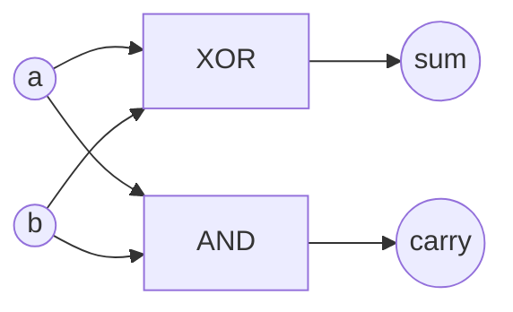
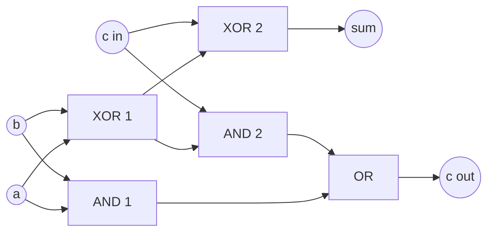
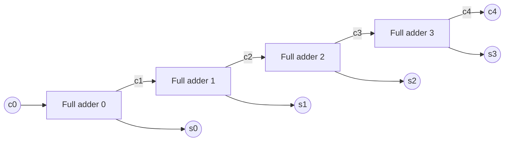

# Boolean algebra and logic gates

After this lesson you can prove Boolean identities by truth table and by algebra, write any function as a sum of products or a product of sums, simplify a three-variable function with a Karnaugh map, show that NAND gates alone can build every function, and build a ripple-carry adder from half adders and full adders.

Before this: [truth tables and logical equivalence](../../04-proofs-and-logic/02-logic-and-sets/03-truth-tables-and-logical-equivalence.md), [binary arithmetic and two's complement](03-binary-arithmetic-and-twos-complement.md) and [bitwise operations and masks](05-bitwise-operations-and-masks.md).

## Quick check

Try these first. If you get all three right, skip to [Practice](#practice).

1. Simplify $(P \wedge Q) \vee (P \wedge \neg Q)$ using the laws of logical equivalence.
2. Write $P \oplus Q$ as an OR of AND terms, reading the terms off its truth table.
3. A full adder receives the bits $a = 1$, $b = 1$ and carry-in $c = 1$. What are its sum bit and carry-out?

<details class="solution" markdown>
<summary>Answers</summary>

1. By the distributive law, $(P \wedge Q) \vee (P \wedge \neg Q) \equiv P \wedge (Q \vee \neg Q)$, and $Q \vee \neg Q \equiv \mathbf{T}$ by the complement law, so the result is $P \wedge \mathbf{T} \equiv P$.
2. The function is 1 on the rows $(P, Q) = (0, 1)$ and $(1, 0)$, so $P \oplus Q = (\neg P \wedge Q) \vee (P \wedge \neg Q)$.
3. The three bits add to $1 + 1 + 1 = 3 = 11_2$, so the sum bit is 1 and the carry-out is 1.

</details>

## The idea

Inside a processor, a number is a row of wires, each at one of two voltages, and a gate is a small circuit that takes some wires in and puts one wire out. An AND gate outputs a high voltage only if both inputs are high, and an OR gate if at least one is. That is exactly the truth tables of $\wedge$ and $\vee$, with high as 1 and low as 0. So everything you know about statements applies to circuits: a simplification of a logical condition is a smaller circuit.

The plan of this lesson is to go from the algebra to the hardware in three steps. First, the laws of logical equivalence, read as an algebra of 0 and 1, let you rewrite and simplify expressions. Second, any function given by a truth table has a standard expression, which means a circuit for it can always be built, and one kind of gate is enough. Third, the binary addition of the earlier lesson, a column at a time, is a function of three input bits with two output bits, so it can be built, and chaining such circuits adds numbers of any width.

## Definitions

### Boolean algebra

A **Boolean function** of $n$ variables is a rule that gives 0 or 1 for each assignment of 0 or 1 to the variables. In plain words, it is a truth table: $2^n$ rows, each with an output. Since each of the $2^n$ rows has 2 possible outputs, there are $2^{2^n}$ Boolean functions of $n$ variables: 16 for $n = 2$, 256 for $n = 3$.

The **Boolean algebra** of 0 and 1 has the operations AND ($\wedge$), OR ($\vee$) and NOT ($\neg$), with 0 for F and 1 for T. Its laws are the standard equivalences from [truth tables and logical equivalence](../../04-proofs-and-logic/02-logic-and-sets/03-truth-tables-and-logical-equivalence.md). Each one can be checked by a truth table, and each one holds when letters are replaced by whole expressions.

| Law | AND form | OR form |
|---|---|---|
| Commutative | $P \wedge Q = Q \wedge P$ | $P \vee Q = Q \vee P$ |
| Associative | $(P \wedge Q) \wedge R = P \wedge (Q \wedge R)$ | $(P \vee Q) \vee R = P \vee (Q \vee R)$ |
| Distributive | $P \wedge (Q \vee R) = (P \wedge Q) \vee (P \wedge R)$ | $P \vee (Q \wedge R) = (P \vee Q) \wedge (P \vee R)$ |
| Identity | $P \wedge 1 = P$ | $P \vee 0 = P$ |
| Domination | $P \wedge 0 = 0$ | $P \vee 1 = 1$ |
| Complement | $P \wedge \neg P = 0$ | $P \vee \neg P = 1$ |
| Idempotent | $P \wedge P = P$ | $P \vee P = P$ |
| Absorption | $P \wedge (P \vee Q) = P$ | $P \vee (P \wedge Q) = P$ |
| De Morgan | $\neg(P \wedge Q) = \neg P \vee \neg Q$ | $\neg(P \vee Q) = \neg P \wedge \neg Q$ |

Double negation, $\neg\neg P = P$, completes the list. The columns come in pairs: swapping $\wedge$ with $\vee$ and 0 with 1 in any law gives another law, called **duality**. So every proof has a dual proof for free.

In plain words, this is ordinary algebra with two differences. Both operations distribute over each other, and there is no subtraction or division: $P \vee Q = P \vee R$ doesn't let you cancel $P$ to get $Q = R$ (take $P = 1$). Digital logic books write AND as a product, OR as a sum, and NOT as a bar, as in $PQ + \overline{P}R$. This lesson keeps $\wedge$, $\vee$ and $\neg$ so it matches the logic chapter.

### Normal forms

A **literal** is a variable or its negation. A **minterm** of $n$ variables is an AND of $n$ literals, one for each variable, and it is 1 on exactly one row of the truth table. A **maxterm** is an OR of $n$ literals, and it is 0 on exactly one row. An expression that is an OR of ANDs of literals is in **disjunctive normal form** (DNF, "sum of products"), and an AND of ORs of literals is in **conjunctive normal form** (CNF, "product of sums").

For example, with three variables, $\neg P \wedge Q \wedge R$ is the minterm that is 1 only on the row $(0, 1, 1)$, and $P \vee \neg Q \vee R$ is the maxterm that is 0 only on the row $(0, 1, 0)$. In plain words, a minterm says "the inputs are exactly this row" and a maxterm says "the inputs are anything but this row".

### Gates

A **logic gate** is a circuit that computes one Boolean function of its inputs. The standard gates are:

| Gate | Expression | Output for inputs 00, 01, 10, 11 |
|---|---|---|
| NOT | $\neg P$ | (one input) 1, 0 |
| AND | $P \wedge Q$ | 0, 0, 0, 1 |
| OR | $P \vee Q$ | 0, 1, 1, 1 |
| NAND | $\neg(P \wedge Q)$ | 1, 1, 1, 0 |
| NOR | $\neg(P \vee Q)$ | 1, 0, 0, 0 |
| XOR | $P \oplus Q$ | 0, 1, 1, 0 |
| XNOR | $\neg(P \oplus Q)$ | 1, 0, 0, 1 |

A set of gates is **universal** (also called functionally complete) when every Boolean function can be built using only gates from the set, with each gate's output free to feed the inputs of others and an input free to feed many gates.

### Adders

A **half adder** adds two bits $a$ and $b$ and outputs a sum bit and a carry bit. A **full adder** adds three bits, $a$, $b$ and a carry-in $c$. A **ripple-carry adder** chains $n$ full adders, the carry-out of each feeding the carry-in of the next one up. In plain words, they are the column steps of binary addition ([binary arithmetic and two's complement](03-binary-arithmetic-and-twos-complement.md)): a half adder is the first column, where no carry comes in, and a full adder is every other column.

A **Karnaugh map** (K-map) is a truth table drawn as a grid, with the rows and columns ordered so that neighbouring cells differ in exactly one variable. It is a picture for simplifying functions of 3 or 4 variables.

## How to do it

### Prove an identity

1. By truth table: list all $2^n$ rows, evaluate both sides, and compare the columns. If they match in every row, the identity holds, and if you find one row that differs it doesn't.
2. By algebra: start from one side and apply one law at a time, writing the law beside each line, until you reach the other side. Look first for the complement law, absorption and De Morgan, which shrink expressions.
3. Check an algebraic proof on one or two rows of the truth table.

### Read a normal form off a truth table

For the DNF:

1. Find each row where the function is 1.
2. For each such row, write the minterm that is 1 on that row alone: use the variable itself where the row has 1, and its negation where the row has 0.
3. OR the minterms together.

For the CNF:

1. Find each row where the function is 0.
2. For each such row, write the maxterm that is 0 on that row alone: use the variable's negation where the row has 1, and the variable itself where the row has 0. (This is the opposite of the DNF rule.)
3. AND the maxterms together.
4. Check both forms against the table.

*Theorem 1.* Every Boolean function equals the OR of its minterms over the rows where it is 1, and the AND of its maxterms over the rows where it is 0.

What we know: a minterm is 1 on exactly one row. What we want: the OR of the chosen minterms has the same table as the function. The plan is to compare the two row by row.

*Proof.* Take any row $x$. If the function is 1 at $x$, then the minterm for $x$ is among those ORed, and it is 1 at $x$, so the OR is 1. If the function is 0 at $x$, then no minterm for a row where the function is 1 can be 1 at $x$ (each is 1 only on its own row, and $x$ is not one of them), so the OR is 0. So the two have the same value on every row. If the function is 1 on no row, the empty OR is 0, which is right. For the maxterms, apply the same argument to $\neg f$: the DNF of $\neg f$ is an OR of minterms, and De Morgan's laws turn $\neg(\text{OR of minterms})$ into an AND of maxterms, which is the CNF of $f$. $\blacksquare$

Look back: every function has a circuit, namely a layer of NOT gates, a layer of AND gates (one per minterm) and one big OR gate. It is rarely the smallest circuit, which is why simplification matters.

### Simplify with a Karnaugh map (three variables)

1. Draw a grid with $P$ on the rows (0, 1) and the pair $QR$ on the columns in the order $00, 01, 11, 10$. This is Gray code order ([bitwise operations and masks](05-bitwise-operations-and-masks.md)), not binary order, so that neighbouring columns differ in one variable.
2. Fill in the function's value in each cell: the cell for row $(P, Q, R)$ holds $f(P, Q, R)$.
3. Circle the 1s in rectangles with 1, 2, 4 or 8 cells (a power of 2). Make each rectangle as big as possible. The left and right edges count as neighbours, so a rectangle may wrap around, and so do the top and bottom edges in bigger maps. Every 1 must be in at least one rectangle, and rectangles may overlap.
4. For each rectangle, write the AND of the variables that don't change inside it, with a negation where the variable is 0 throughout. A bigger rectangle means fewer variables.
5. OR the products together. Check against the truth table.

Why it works: two neighbouring cells are rows that differ in one variable, say $R$. Their two minterms combine with the distributive and complement laws: $(X \wedge R) \vee (X \wedge \neg R) = X \wedge (R \vee \neg R) = X$, so the variable that differs drops out. A rectangle of 4 cells drops two variables, and one of 8 drops three.

### Build the adders

*Theorem 2 (NAND is universal).* Every Boolean function can be computed by a circuit of NAND gates only.

*Proof.* By Theorem 1, every function can be written with NOT, AND and OR, so it is enough to build those three from NAND, where $P \uparrow Q = \neg(P \wedge Q)$. For NOT, $P \uparrow P = \neg(P \wedge P) = \neg P$ by the idempotent law. For AND, $\neg(P \uparrow Q) = \neg\neg(P \wedge Q) = P \wedge Q$, so a NAND followed by a NOT does it: $(P \uparrow Q) \uparrow (P \uparrow Q)$. For OR, De Morgan gives $P \vee Q = \neg(\neg P \wedge \neg Q) = \neg P \uparrow \neg Q$, which is $(P \uparrow P) \uparrow (Q \uparrow Q)$. $\blacksquare$

Look back: a chip maker needs to make only one kind of gate. The same argument works for NOR, by duality. XOR takes 4 NANDs: with $n = P \uparrow Q$, we get $P \oplus Q = (P \uparrow n) \uparrow (Q \uparrow n)$, which Example 4 checks.

*Theorem 3 (the full adder).* For bits $a$, $b$ and $c$, the sum bit is $s = a \oplus b \oplus c$ and the carry-out is $c_{\text{out}} = (a \wedge b) \vee (c \wedge (a \oplus b))$, which is 1 exactly when at least two of the three inputs are 1.

What we know: $a + b + c$ is an integer from 0 to 3, so it is written as $2 c_{\text{out}} + s$ with $s$ and $c_{\text{out}}$ bits. What we want: formulas for $s$ and $c_{\text{out}}$.

*Proof.* The sum bit is the remainder of $a + b + c$ divided by 2, and XOR is addition modulo 2 in each position (the XOR rules in the last lesson), so $s = a \oplus b \oplus c$, which is 1 when an odd number of inputs are 1. The carry-out is 1 exactly when $a + b + c \ge 2$, which is when at least two inputs are 1. To see that the formula gives this, chain two half adders. The first gives $s_1 = a \oplus b$ and $c_1 = a \wedge b$, so $a + b = 2c_1 + s_1$. The second adds $s_1$ and $c$ and gives $s_2 = s_1 \oplus c$ and $c_2 = s_1 \wedge c$, so $s_1 + c = 2 c_2 + s_2$. Together, $a + b + c = 2(c_1 + c_2) + s_2$. The two carries are never both 1: if $c_1 = 1$ then $a = b = 1$, so $s_1 = 0$ and $c_2 = 0$. So $c_1 + c_2$ is the same as $c_1 \vee c_2$, and the sum is $s = s_2$ with carry-out $c_1 \vee c_2$, which is the formula. $\blacksquare$

The half adder, with the sum $a \oplus b$ and the carry $a \wedge b$, is the first column, where there is no carry-in.



The full adder is two half adders and an OR gate:



*Theorem 4 (the ripple-carry adder is correct).* Let $x = \sum x_i 2^i$ and $y = \sum y_i 2^i$ be $n$-bit numbers, and chain $n$ full adders so that stage $i$ adds $x_i$, $y_i$ and the carry $c_i$ from stage $i - 1$, with $c_0$ the carry-in, giving a sum bit $s_i$ and a carry $c_{i+1}$. Then $x + y + c_0 = \sum_{i<n} s_i 2^i + c_n 2^n$.

*Proof.* We show by induction on $k$ that $\sum_{i<k} x_i 2^i + \sum_{i<k} y_i 2^i + c_0 = \sum_{i<k} s_i 2^i + c_k 2^k$. For $k = 0$ both sides are $c_0$. Suppose it holds for $k$. Add $(x_k + y_k) 2^k$ to both sides. The left side becomes the left side for $k + 1$. The right side becomes $\sum_{i<k} s_i 2^i + 2^k (x_k + y_k + c_k)$, and stage $k$ gives $x_k + y_k + c_k = s_k + 2 c_{k+1}$ (Theorem 3), so it is $\sum_{i \le k} s_i 2^i + c_{k+1} 2^{k+1}$, the right side for $k + 1$. With $k = n$ this is the claim. $\blacksquare$

Look back: the last carry $c_n$ is the carry out of the top column. Dropping it leaves the sum modulo $2^n$, which is the adder of [binary arithmetic and two's complement](03-binary-arithmetic-and-twos-complement.md) (Theorem 3 there). The carry has to travel through all $n$ stages one after another, so the delay grows with $n$; faster adders compute the carries in parallel, but the logic is the same.



Each stage $i$ also receives $x_i$ and $y_i$ (not drawn). To subtract, feed $y$ through XOR gates controlled by a "subtract" line and send the same line into $c_0$: this computes $x + \mathrm{NOT}(y) + 1 = x - y$ (practice 7 of the two's complement lesson). The overflow flag of a signed addition is $c_{n-1} \oplus c_n$, the carry into the sign bit XOR the carry out of it, which is one more XOR gate.

## Worked examples

<div class="example" markdown>

### Example 1: the consensus theorem by algebra

Show that $(P \wedge Q) \vee (\neg P \wedge R) \vee (Q \wedge R) = (P \wedge Q) \vee (\neg P \wedge R)$. The right side is shorter, so the plan is to make the extra term disappear.

Step 1: multiply the extra term by $P \vee \neg P$, which is 1 (complement and identity laws): $Q \wedge R = (Q \wedge R) \wedge (P \vee \neg P)$. Step 2: distribute: $= (P \wedge Q \wedge R) \vee (\neg P \wedge Q \wedge R)$. Step 3: the first piece is absorbed by $P \wedge Q$, since $(P \wedge Q) \vee (P \wedge Q \wedge R) = P \wedge Q$ (absorption, with the associative and commutative laws), and the second by $\neg P \wedge R$ the same way. So the left side equals $(P \wedge Q) \vee (\neg P \wedge R)$.

Check by truth table, or in one row: for $P = 1$, $Q = 1$, $R = 0$ the left side is $1 \vee 0 \vee 0 = 1$ and the right side is $1 \vee 0 = 1$. For $P = 0$, $Q = 1$, $R = 1$ both sides are 1, and for $P = 0$, $Q = 1$, $R = 0$ both are 0. The code below checks all eight rows.

</div>

<div class="example" markdown>

### Example 2: normal forms and a K-map for the majority function

The majority function $\text{maj}(P, Q, R)$ is 1 when at least two inputs are 1. It is the carry-out of the full adder, with $R$ the carry-in.

| $P$ | $Q$ | $R$ | maj |
|---|---|---|---|
| 0 | 0 | 0 | 0 |
| 0 | 0 | 1 | 0 |
| 0 | 1 | 0 | 0 |
| 0 | 1 | 1 | 1 |
| 1 | 0 | 0 | 0 |
| 1 | 0 | 1 | 1 |
| 1 | 1 | 0 | 1 |
| 1 | 1 | 1 | 1 |

The DNF uses the 1-rows $(0,1,1)$, $(1,0,1)$, $(1,1,0)$ and $(1,1,1)$:

$$
(\neg P \wedge Q \wedge R) \vee (P \wedge \neg Q \wedge R) \vee (P \wedge Q \wedge \neg R) \vee (P \wedge Q \wedge R).
$$

The CNF uses the 0-rows $(0,0,0)$, $(0,0,1)$, $(0,1,0)$ and $(1,0,0)$, with each variable negated where the row has a 1:

$$
(P \vee Q \vee R) \wedge (P \vee Q \vee \neg R) \wedge (P \vee \neg Q \vee R) \wedge (\neg P \vee Q \vee R).
$$

For the K-map, the 1s are in the cells for $(0,1,1)$, $(1,0,1)$, $(1,1,0)$ and $(1,1,1)$. The cell $(1,1,1)$ is next to each of the other three: it joins $(0,1,1)$ in a pair where $P$ changes, $(1,0,1)$ in a pair where $Q$ changes, and $(1,1,0)$ in a pair where $R$ changes. The three pairs give $Q \wedge R$, $P \wedge R$ and $P \wedge Q$. So $\text{maj} = (P \wedge Q) \vee (P \wedge R) \vee (Q \wedge R)$, which needs three 2-input ANDs and one OR, and no NOT gates, against four 3-input ANDs, three NOTs and one big OR for the DNF.

Check: at $(1, 0, 1)$ the simplified form is $0 \vee 1 \vee 0 = 1$, and at $(0, 0, 1)$ it is 0, as in the table. The code below checks all eight rows against the DNF, the CNF and the simplified form.

</div>

<div class="example" markdown>

### Example 3: a K-map with wrap-around

Simplify $f(P, Q, R)$, which is 1 on the rows numbered 0, 2, 3, 4 and 6 (the row $(P, Q, R)$ is the binary number $4P + 2Q + R$).


Steps 1 and 2: the map has the 1s in the left column ($QR = 00$, both rows), the right column ($QR = 10$, both rows) and the top cell of $QR = 11$. Step 3: the left and right columns are neighbours across the edge, so together they form one group of 4. Inside it, $R$ is 0 throughout, while $P$ and $Q$ take both values, so Step 4 gives $\neg R$. The remaining 1, in the cell $(0, 1, 1)$, joins the cell $(0, 1, 0)$ in a group of 2 where $P = 0$ and $Q = 1$ throughout, which gives $\neg P \wedge Q$. Step 5: $f = \neg R \vee (\neg P \wedge Q)$.

Check on two rows. At $(1, 0, 1)$, which is row 5, the formula is $0 \vee 0 = 0$, and the function is 0 there. At $(0, 1, 1)$, row 3, the formula is $0 \vee 1 = 1$, and the function is 1.

<div class="warning" markdown>

Watch out at step 3: a group of 3 is not allowed, and neither is an L shape. Groups are rectangles with 1, 2, 4 or 8 cells. The three 1s in the top row of this map can't be one group of 3; they belong to the 4-cell group and the pair.

</div>

</div>

<div class="example" markdown>

### Example 4: finish it yourself, NAND gates and a two-bit addition

(a) Check that $(P \uparrow n) \uparrow (Q \uparrow n)$ with $n = P \uparrow Q$ is XOR. The row $(1, 0)$: $n = 1 \uparrow 0 = 1$, then $P \uparrow n = 1 \uparrow 1 = 0$ and $Q \uparrow n = 0 \uparrow 1 = 1$, so the output is $0 \uparrow 1 = 1$, which is $1 \oplus 0$. Do the rows $(0, 0)$, $(0, 1)$ and $(1, 1)$.

(b) Add $11_2$ and $01_2$ with two full adders and $c_0 = 0$. Stage 0 is done: $1 + 1 + 0 = 10_2$, so $s_0 = 0$ and $c_1 = 1$. Do stage 1.

<details class="solution" markdown>
<summary>Finish</summary>

(a) Row $(0, 0)$: $n = 1$, then $0 \uparrow 1 = 1$ twice, and $1 \uparrow 1 = 0$, which is $0 \oplus 0$. Row $(0, 1)$: $n = 1$, then $P \uparrow n = 0 \uparrow 1 = 1$ and $Q \uparrow n = 1 \uparrow 1 = 0$, so the output is $1 \uparrow 0 = 1$. Row $(1, 1)$: $n = 0$, then $1 \uparrow 0 = 1$ twice, and $1 \uparrow 1 = 0$. The outputs 0, 1, 1, 0 are those of XOR.

(b) Stage 1 adds $x_1 = 1$, $y_1 = 0$ and $c_1 = 1$: the sum is $10_2$, so $s_1 = 0$ and $c_2 = 1$. The result is $c_2 s_1 s_0 = 100_2 = 4$.

Check: $3 + 1 = 4$.

</details>

</div>

## Edge cases and common mistakes

<div class="warning" markdown>

Watch out when reading a CNF off a table: the literals are the opposite of the DNF rule. For the 0-row $(0, 1, 0)$ the maxterm is $P \vee \neg Q \vee R$, which is 0 only there. Using $\neg P \vee Q \vee \neg R$, the natural-looking choice, gives a term that is 0 on the row $(1, 0, 1)$ instead.

</div>

<div class="warning" markdown>

Watch out: Boolean algebra is not ordinary algebra. $P \vee P = P$, not $2P$, and you can't cancel. From $P \wedge Q = P \wedge R$ it doesn't follow that $Q = R$: take $P = 0$. Distributing $\vee$ over $\wedge$ is also allowed, which is false for numbers.

</div>

<div class="warning" markdown>

Watch out when using K-maps: the columns are in Gray code order $00, 01, 11, 10$, not $00, 01, 10, 11$. In binary order the columns $01$ and $10$ would be next to each other, but those rows differ in two variables and can't merge. Forgetting that the edges wrap also leaves terms bigger than necessary.

</div>

<div class="warning" markdown>

Watch out: the most compact K-map answer is not always unique. Two different groupings can give two different, equally small, correct expressions. A K-map answer is correct if it matches the table, and it is minimal if no group can be bigger and no group is redundant.

</div>

A circuit isn't a program. In a program, `a & b` runs once and finishes; in a circuit, the AND gate computes continuously, and all gates in a layer work at the same time. So the time of a circuit is its depth, the longest chain of gates from an input to an output, not the number of gates. The ripple-carry adder has depth about $2n$ (an AND and an OR per stage on the carry path), which is why wide adders use carry-lookahead.

For three variables a K-map is easy, and for four it still works with a 4 by 4 grid. Beyond about 6 variables people use algorithms (Quine-McCluskey, and Espresso in practice), because the pictures stop being useful.

## Tricks and shortcuts

- To count the functions of $n$ variables, use $2^{2^n}$: 65,536 for $n = 4$.
- An XOR of several bits is 1 exactly when an odd number of them are 1, and a chain of XORs doesn't need brackets.
- Push negations inwards with De Morgan: "break the bar, change the sign". $\neg(P \wedge \neg Q) = \neg P \vee Q$.
- In a K-map, count 1s first: if all 8 cells are 1, the function is the constant 1, and a single 1 gives a minterm that can't be shortened.
- The majority function is the carry of a full adder, and XOR of three bits is the sum. Remember the pair and you remember the adder.

## In code

Each gate is a one-line function on 0 and 1. The checks run every row of the truth tables, build NOT, AND, OR and XOR from NAND, and simulate the adders. The last lines connect to the earlier lessons: an 8-bit ripple adder gives the sum modulo 256 and the carry out, and subtraction uses the inverted bits and a carry-in of 1.

<details class="code" markdown>
<summary>In code</summary>

```python
from itertools import product

def NOT(a): return 1 - a
def AND(a, b): return a & b
def OR(a, b): return a | b
def XOR(a, b): return a ^ b
def NAND(a, b): return 1 - (a & b)

rows = list(product([0, 1], repeat=3))

# truth-table proof of a law: the consensus theorem
lhs = lambda p, q, r: OR(OR(AND(p, q), AND(NOT(p), r)), AND(q, r))
rhs = lambda p, q, r: OR(AND(p, q), AND(NOT(p), r))
print(all(lhs(*t) == rhs(*t) for t in rows))               # True

# the majority function, and the normal forms read off its table
maj = lambda p, q, r: int(p + q + r >= 2)
print([t for t in rows if maj(*t)])                        # [(0, 1, 1), (1, 0, 1), (1, 1, 0), (1, 1, 1)]
print([t for t in rows if not maj(*t)])                    # [(0, 0, 0), (0, 0, 1), (0, 1, 0), (1, 0, 0)]

def dnf(t):    # one product (minterm) per row where the function is 1
    return lambda *x: int(any(all(xi == ti for xi, ti in zip(x, row)) for row in t))
def cnf(zeros):  # one sum (maxterm) per row where the function is 0
    return lambda *x: int(all(any(xi != zi for xi, zi in zip(x, row)) for row in zeros))

ones = [t for t in rows if maj(*t)]
zeros = [t for t in rows if not maj(*t)]
print(all(dnf(ones)(*t) == maj(*t) == cnf(zeros)(*t) for t in rows))   # True
simplified = lambda p, q, r: OR(OR(AND(p, q), AND(p, r)), AND(q, r))
print(all(simplified(*t) == maj(*t) for t in rows))        # True

# NAND is universal
not_ = lambda a: NAND(a, a)
and_ = lambda a, b: not_(NAND(a, b))
or_ = lambda a, b: NAND(not_(a), not_(b))
def xor_(a, b):
    n = NAND(a, b)
    return NAND(NAND(a, n), NAND(b, n))
pairs = list(product([0, 1], repeat=2))
print(all(not_(a) == NOT(a) for a in (0, 1)),
      all(and_(a, b) == AND(a, b) and or_(a, b) == OR(a, b) and xor_(a, b) == XOR(a, b) for a, b in pairs))  # True True

# half and full adders
def half_adder(a, b): return XOR(a, b), AND(a, b)          # (sum, carry)
def full_adder(a, b, c):
    s1, c1 = half_adder(a, b)
    s2, c2 = half_adder(s1, c)
    return s2, OR(c1, c2)

for t in rows:
    s, c = full_adder(*t)
    assert 2 * c + s == sum(t) and c == maj(*t)
print("full adder ok")                                      # full adder ok

def ripple_add(x, y, n, carry_in=0):
    """Add two n-bit numbers with n full adders; returns (sum bits as int, carry out)."""
    total, carry = 0, carry_in
    for i in range(n):
        s, carry = full_adder((x >> i) & 1, (y >> i) & 1, carry)
        total |= s << i
    return total, carry

print(ripple_add(0b0110_1101, 0b0011_1011, 8))              # (168, 0)
print(ripple_add(200, 100, 8))                              # (44, 1)
print(all(ripple_add(x, y, 4) == ((x + y) % 16, (x + y) // 16) for x in range(16) for y in range(16)))  # True
print(ripple_add(45, ~27 & 0xFF, 8, carry_in=1))            # (18, 1)

# a Karnaugh map example: f = m(0, 2, 3, 4, 6) is the same as (not r) or (not p and q)
f = lambda p, q, r: int((p * 4 + q * 2 + r) in {0, 2, 3, 4, 6})
g = lambda p, q, r: OR(NOT(r), AND(NOT(p), q))
print(all(f(*t) == g(*t) for t in rows))                    # True
```

The line `ripple_add(200, 100, 8)` gives 44 with a carry out of 1, the unsigned overflow of the previous lessons. The line with `carry_in=1` computes $45 - 27 = 18$ as $45 + \mathrm{NOT}(27) + 1$, where the carry out of 1 is dropped.

</details>

## FAQ

### Why does it matter that NAND alone is enough?

It lets a chip be built from one repeated cell, which is simpler to design and make. In CMOS technology a NAND gate is also one of the simplest gates to build. In practice designers use many gate types for speed and size, but the theory says nothing is lost by using one.

### Is Boolean algebra the same thing as the logic from the proofs chapter?

Yes. The laws are the same, with T and F written as 1 and 0, and the connectives $\wedge$, $\vee$ and $\neg$ as the gates AND, OR and NOT. Sets give a third copy of the same laws, with $\cap$, $\cup$ and complement ([sets and set operations](../../04-proofs-and-logic/02-logic-and-sets/06-sets-and-set-operations.md)), which is why bit masks can stand for sets.

### Why does a K-map use Gray code order?

Because merging two cells only works when they differ in one variable, by the complement law. Gray code puts each column next to the ones that differ in exactly one variable, including the wrap-around from the last column to the first. Binary order puts $01$ next to $10$, which differ in both.

### Can the same function have different circuits?

Yes. A function has many expressions and many circuits, and simplification looks for a small one. The truth table is the one thing that is the same. Two circuits compute the same function exactly when their truth tables agree, which is the equivalence test of the logic chapter.

## Practice

### Warm-up

1\. Simplify $(P \wedge Q) \vee (P \wedge \neg Q) \vee (\neg P \wedge Q)$ with the laws, and check with a truth table.

<details class="solution" markdown>
<summary>Solution</summary>

The first two terms combine: $(P \wedge Q) \vee (P \wedge \neg Q) = P \wedge (Q \vee \neg Q) = P$. Then $P \vee (\neg P \wedge Q) = (P \vee \neg P) \wedge (P \vee Q) = P \vee Q$, by the distributive law and the complement law.

Check: the original is 1 on the rows $(1,1)$, $(1,0)$ and $(0,1)$, and 0 on $(0,0)$, which is the table of $P \vee Q$.

</details>

2\. Write the DNF and the CNF of $P \oplus Q$ from its truth table.

<details class="solution" markdown>
<summary>Solution</summary>

The function is 1 on $(0, 1)$ and $(1, 0)$, so the DNF is $(\neg P \wedge Q) \vee (P \wedge \neg Q)$. It is 0 on $(0, 0)$ and $(1, 1)$, so the CNF is $(P \vee Q) \wedge (\neg P \vee \neg Q)$.

Check at $(1, 1)$: the DNF is $0 \vee 0 = 0$ and the CNF is $1 \wedge 0 = 0$. At $(0, 1)$ the DNF is $1$, and the CNF is $1 \wedge 1 = 1$.

</details>

3\. Give the sum and carry of a half adder for each input pair $(a, b)$, and the sum and carry-out of a full adder for $(a, b, c) = (1, 0, 1)$.

<details class="solution" markdown>
<summary>Solution</summary>

The half adder gives $(\text{sum}, \text{carry}) = (a \oplus b, a \wedge b)$: $(0,0) \to (0,0)$, $(0,1) \to (1,0)$, $(1,0) \to (1,0)$, $(1,1) \to (0,1)$. For the full adder, $1 + 0 + 1 = 10_2$, so the sum is 0 and the carry-out is 1: $s = 1 \oplus 0 \oplus 1 = 0$ and two inputs are 1.

Check: in each case $2 \cdot \text{carry} + \text{sum}$ equals the total of the inputs.

</details>

### Standard

4\. Prove the absorption law $P \wedge (P \vee Q) = P$ by algebra, using only the laws in the table.

<details class="solution" markdown>
<summary>Solution</summary>

$$
\begin{aligned}
P \wedge (P \vee Q) &= (P \vee 0) \wedge (P \vee Q) && \text{identity law} \\
&= P \vee (0 \wedge Q) && \text{distributive law, right to left} \\
&= P \vee 0 && \text{domination law} \\
&= P && \text{identity law}
\end{aligned}
$$

Check: at $P = 1$, $Q = 0$ the left side is $1 \wedge 1 = 1 = P$, and at $P = 0$, $Q = 1$ it is $0 \wedge 1 = 0 = P$.

</details>

5\. Simplify $f(P, Q, R)$, which is 1 on the rows numbered 1, 3, 4, 5 and 7, with a K-map.

<details class="solution" markdown>
<summary>Solution</summary>

The rows 1, 3, 5 and 7 are exactly those with $R = 1$, and in the map they fill the columns $QR = 01$ and $QR = 11$, a group of 4 where only $R$ is constant. This group gives $R$. The remaining 1 is row 4, $(1, 0, 0)$, which has a neighbour in row 5, $(1, 0, 1)$, a group of 2 where $P = 1$ and $Q = 0$, giving $P \wedge \neg Q$. So $f = R \vee (P \wedge \neg Q)$.

Check: row 4 gives $0 \vee (1 \wedge 1) = 1$, row 2 $(0, 1, 0)$ gives $0 \vee 0 = 0$, and row 6 $(1, 1, 0)$ gives $0 \vee (1 \wedge 0) = 0$, all matching the function.

</details>

6\. Show that $P \oplus Q$ can be built from four NAND gates, and count the NAND gates for a half adder.

<details class="solution" markdown>
<summary>Solution</summary>

Let $n = P \uparrow Q$. Then $(P \uparrow n) \uparrow (Q \uparrow n)$ is $P \oplus Q$, which takes 4 NANDs ($n$, the two in the middle, and the last one). The rows $(0,0)$, $(0,1)$, $(1,0)$ and $(1,1)$ give 0, 1, 1, 0, as in Example 4.

The half adder also needs $P \wedge Q$. But $n = \neg(P \wedge Q)$ is already there, so the carry is $n \uparrow n = \neg n = P \wedge Q$, one more gate. The half adder takes $4 + 1 = 5$ NAND gates.

Check: the carry for $P = Q = 1$ is $n = 0$, then $0 \uparrow 0 = 1$, which is right.

</details>

### Challenge

7\. Add $0111_2$ and $0001_2$ with a 4-bit ripple-carry adder. List the carries $c_1$ to $c_4$ and the sum bits, and use $c_3 \oplus c_4$ to decide whether the signed addition overflowed. Explain the result in terms of two's complement.

<details class="solution" markdown>
<summary>Solution</summary>

Stage 0 adds $1 + 1 + 0 = 10_2$: $s_0 = 0$, $c_1 = 1$. Stage 1 adds $1 + 0 + 1 = 10_2$: $s_1 = 0$, $c_2 = 1$. Stage 2 adds $1 + 0 + 1 = 10_2$: $s_2 = 0$, $c_3 = 1$. Stage 3 adds $0 + 0 + 1 = 01_2$: $s_3 = 1$, $c_4 = 0$. The sum bits are $s_3 s_2 s_1 s_0 = 1000$.

The overflow flag is $c_3 \oplus c_4 = 1 \oplus 0 = 1$, so the signed addition overflowed. In two's complement, $0111 = 7$ and $0001 = 1$ are both non-negative and the result $1000$ is $-8$, the sign change that Theorem 4 of the two's complement lesson says marks an overflow. The true sum 8 is not in the range $-8$ to 7.

Check: unsigned, $7 + 1 = 8 = 1000_2$ is correct, and $c_4 = 0$ says there was no unsigned overflow.

</details>

8\. (Reviews [truth tables and logical equivalence](../../04-proofs-and-logic/02-logic-and-sets/03-truth-tables-and-logical-equivalence.md).) Show that NOR is universal too. Build NOT, OR and AND from NOR gates, using De Morgan's laws, and say how duality gives this from Theorem 2.

<details class="solution" markdown>
<summary>Solution</summary>

Let $P \downarrow Q = \neg(P \vee Q)$. Then $P \downarrow P = \neg(P \vee P) = \neg P$, which is NOT. For OR, $\neg(P \downarrow Q) = P \vee Q$, so OR is a NOR followed by a NOT. For AND, De Morgan gives $P \wedge Q = \neg(\neg P \vee \neg Q) = \neg P \downarrow \neg Q$, which is $(P \downarrow P) \downarrow (Q \downarrow Q)$. By Theorem 1, NOT, AND and OR give every function.

Duality: swapping $\wedge$ with $\vee$ in the NAND construction gives the NOR construction, since NAND and NOR are duals of each other.

Check by table: $(P \downarrow P) \downarrow (Q \downarrow Q)$ at $(1, 0)$ is $0 \downarrow 1 = 0$, and $1 \wedge 0 = 0$. At $(1, 1)$ it is $0 \downarrow 0 = 1$, and $1 \wedge 1 = 1$.

</details>

## Where this shows up

- This closes the chapter: bits and numbers ([number bases and conversions](01-number-bases-and-conversions.md), [two's complement](03-binary-arithmetic-and-twos-complement.md), [floating point](04-floating-point-basics.md)) are what the gates here store and add. The next chapter, number theory, treats the wrap-around of $n$-bit arithmetic as arithmetic modulo $2^n$ ([divisibility and modular arithmetic](../02-number-theory/01-divisibility-and-modular-arithmetic.md)).
- A digital logic or computer architecture course builds from these gates a multiplier, a multiplexer, flip-flops and finally a processor. SAT solvers, which decide whether a Boolean expression can be made true, work on CNF formulas, and satisfiability is the starting point of [P, NP and NP-completeness](../06-theory-of-computation/07-p-np-and-np-completeness.md).
- Compilers and database query planners simplify Boolean conditions with the same laws, and Boolean search (AND, OR, NOT) is De Morgan's laws in use.
