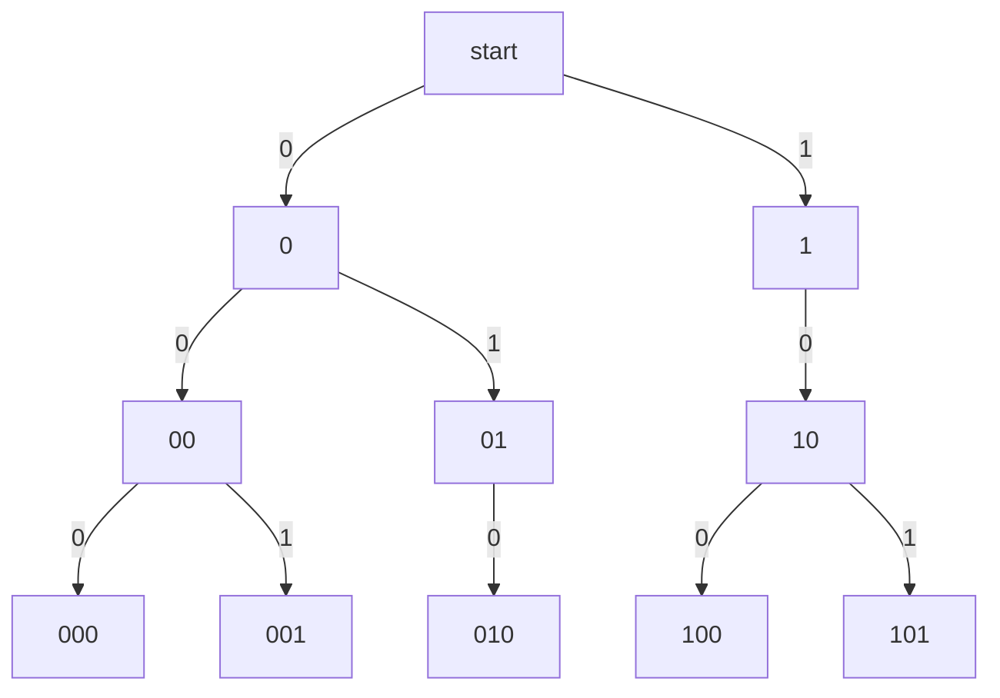

# Counting rules

After this lesson you can count a finite set without listing it, using the sum, product, bijection, division and complement rules, explain why each rule works, and prove that an $n$-element set has $2^n$ subsets by matching subsets with bit strings.

Before this: [sets and set operations](../../04-proofs-and-logic/02-logic-and-sets/06-sets-and-set-operations.md), [injective, surjective and bijective](../../04-proofs-and-logic/06-relations-and-functions/05-injective-surjective-bijective.md) and [counting: permutations and combinations](../../03-high-school/11-sequences-series-and-counting/03-counting-permutations-combinations.md), which uses these rules without proving them. This chapter proves them and goes further.

## Quick check

Try these first. If you get all three right, skip to [Practice](#practice).

1. A password has 6 characters, each a lowercase letter or a digit (36 symbols in all). The first character must be a letter, and the password must contain at least one digit. How many passwords are there?
2. How many functions are there from a set with 4 elements to a set with 6 elements? How many subsets does a set with 10 elements have?
3. Ten people at a party each shake hands once with every other person. How many handshakes happen?

<details class="solution" markdown>
<summary>Answers</summary>

1. Count the passwords that start with a letter, then remove the ones with no digit. There are $26 \cdot 36^5$ that start with a letter and $26 \cdot 26^5$ that are all letters, so $26 \cdot 36^5 - 26 \cdot 26^5 = 1{,}263{,}204{,}800$.
2. Each of the 4 inputs picks one of 6 outputs, so $6^4 = 1{,}296$. Each of the 10 elements is in or out, so $2^{10} = 1{,}024$.
3. There are $10 \cdot 9 = 90$ ordered pairs of different people, and each handshake appears as two ordered pairs, so $\frac{90}{2} = 45$.

</details>

## The idea

How many bit strings of length 20 are there? Nobody lists a million of them. A bit string is built by choosing 20 bits one after another, each with 2 choices, so there are $2^{20} = 1{,}048{,}576$. That one move, building the object in stages and multiplying the number of choices, answers most counting questions in computing.

Counting is the art of showing that every object in a set is produced exactly once by some description. Three moves cover almost everything. Split the set into pieces that don't overlap and add the sizes. Build each object in stages and multiply. Match the set one-to-one with a set you can already count. Two more rules are these moves in disguise: when a description produces every object the same number of times, divide, and when the set you want is a big set with a few objects removed, subtract.

A count is not a formula to remember. It is an argument, and a wrong count is nearly always an argument in which some object is produced twice or not at all. The tests in this lesson, and the habit of checking a small case by listing it, are there to catch exactly that.

## Definitions

A set $A$ is **finite** with **size** $n$, written $\lvert A \rvert = n$, if there is a bijection from $A$ to $\{1, 2, \dots, n\}$. In plain words, counting the elements of $A$ means pairing them off with $1, 2, 3, \dots$ with none left over, and the size is the last number used. The empty set has size 0.

The **sum rule**. If $A_1, A_2, \dots, A_m$ are finite sets and no element belongs to two of them, then

$$
\lvert A_1 \cup A_2 \cup \cdots \cup A_m \rvert = \lvert A_1 \rvert + \lvert A_2 \rvert + \cdots + \lvert A_m \rvert.
$$

In plain words, if a task is done in one of several ways and no outcome comes from two of the ways, add the counts. Sets with no element in common are **disjoint**, and disjoint pieces whose union is a set $A$ form a **partition** of $A$.

The **product rule**. For finite sets $A$ and $B$, the set $A \times B$ of ordered pairs $(a, b)$ with $a \in A$ and $b \in B$ has size

$$
\lvert A \times B \rvert = \lvert A \rvert \cdot \lvert B \rvert.
$$

In plain words, if you choose from $A$ and then from $B$, and the choices don't affect each other, multiply. The version for stages is more useful. Suppose each outcome of a procedure is built in $k$ stages, stage $i$ can be done in $n_i$ ways whatever the earlier stages gave, and different sequences of choices give different outcomes. Then the number of outcomes is $n_1 n_2 \cdots n_k$.

The product rule follows from the sum rule. The set $A \times B$ is the disjoint union, over $a \in A$, of the sets $\{a\} \times B$. Each has size $\lvert B \rvert$, because $b \mapsto (a, b)$ is a bijection from $B$ onto it, and there are $\lvert A \rvert$ such pieces, so the sum is $\lvert A \rvert \cdot \lvert B \rvert$. Induction on $k$ gives the version with $k$ stages.

The **bijection rule**. If there is a bijection $f \colon A \to B$ between finite sets, then $\lvert A \rvert = \lvert B \rvert$. In plain words, two sets that can be paired off exactly have the same size, so to count a hard set you can count an easy one that matches it. The rule is close to the definition of size: composing $f$ with a bijection from $B$ to $\{1, \dots, n\}$ gives a bijection from $A$ to $\{1, \dots, n\}$.

The **division rule**. A function $f \colon A \to B$ between finite sets is **$k$-to-1** if each element of $B$ is the output of exactly $k$ elements of $A$. If $f$ is $k$-to-1, then $\lvert A \rvert = k\,\lvert B \rvert$, so $\lvert B \rvert = \lvert A \rvert / k$. In plain words, if every object you want is counted exactly $k$ times by a bigger count, divide the bigger count by $k$. The proof is the sum rule: $A$ is the disjoint union of the sets $f^{-1}(b)$, one for each $b \in B$, and each has $k$ elements.

The **complement rule**. If $A$ is a subset of a finite universe $U$, then $\lvert A \rvert = \lvert U \rvert - \lvert A^c \rvert$, where $A^c$ is the set of elements of $U$ not in $A$. In plain words, count everything and subtract the objects that don't qualify. The sets $A$ and $A^c$ are disjoint with union $U$, so the sum rule gives $\lvert A \rvert + \lvert A^c \rvert = \lvert U \rvert$.

A **tree diagram** draws the stages of a procedure. The root is the start, each stage adds a layer of branches, one for each choice, and each leaf is an outcome. In plain words, a tree is the product rule you can see: when every node of a layer has the same number of branches, the number of leaves is the product, and when it doesn't, you count the leaves.

A **bit string** of length $n$ is a sequence of $n$ symbols, each 0 or 1, and $\{0, 1\}^n$ is the set of them. The empty string has length 0, and there is one of it.

## How to do it

1. Say in a sentence what one object looks like ("a list of 6 characters", "a subset of the toppings") and what set you are counting.
2. Decide whether the objects split into cases (sum rule) or are built in stages (product rule). Cases must not overlap, and the number of choices at each stage must not depend on the earlier choices.
3. If the set has an awkward condition, count the universe and subtract the complement, or find an easier set that matches it one-to-one.
4. If your description lists each object more than once, find how many times, and divide.
5. Check on a tiny version that you can list by hand, or with a short program. The test is that every object appears once.

### Counting functions and subsets

*Theorem 1.* If $\lvert A \rvert = m$ and $\lvert B \rvert = n$, then the number of functions from $A$ to $B$ is $n^m$.

We know the product rule. We want the number of functions $f \colon A \to B$. The plan is to build a function by choosing the output for each input in turn.

*Proof.* Write $A = \{a_1, \dots, a_m\}$. A function $f$ is determined by the list $(f(a_1), \dots, f(a_m))$, and every list of $m$ elements of $B$ is the list of exactly one function. So functions match lists, which are built in $m$ stages with $n$ choices each. By the product rule there are $n \cdot n \cdots n = n^m$ of them. $\blacksquare$

Look back: with $B = \{0, 1\}$ this says there are $2^m$ functions from an $m$-element set to $\{0, 1\}$, which is also the number of bit strings of length $m$. Each function, such as $a_1 \mapsto 1$, $a_2 \mapsto 0$, $a_3 \mapsto 1$, is a bit string 101 written differently. The count $n^m$, with $n$ for the size of the codomain and $m$ for the domain, is the one people reverse. Counting functions from a 2-element set to a 5-element set gives $5^2 = 25$, not $2^5 = 32$.

*Theorem 2.* A set with $n$ elements has exactly $2^n$ subsets.

We know the bijection rule and the product rule. We want $\lvert \mathcal{P}(A) \rvert$ for $\lvert A \rvert = n$. The plan is to match each subset with a bit string that records which elements it contains.

*Proof.* Write $A = \{a_1, \dots, a_n\}$. For a subset $S \subseteq A$, let $f(S)$ be the bit string whose $i$-th bit is 1 if $a_i \in S$ and 0 if $a_i \notin S$. This is a bijection from $\mathcal{P}(A)$ to $\{0, 1\}^n$. It is injective: if $f(S) = f(T)$, the sets have the same elements, so $S = T$. It is surjective: for a given bit string, the set of the $a_i$ whose bit is 1 maps to it. By the bijection rule, $\lvert \mathcal{P}(A) \rvert = \lvert \{0, 1\}^n \rvert$. Each of the $n$ bits has 2 choices, so by the product rule there are $2^n$ bit strings. $\blacksquare$

Look back: the string 1010 stands for the subset $\{a_1, a_3\}$ of $\{a_1, a_2, a_3, a_4\}$. The empty set is the all-zeros string and $A$ itself is the all-ones string. For $n = 0$ the claim is that $\emptyset$ has $2^0 = 1$ subset, namely $\emptyset$, which is right.

*Corollary.* For $n \ge 1$, exactly $2^{n-1}$ bit strings of length $n$ have an even number of ones.

*Proof.* Let $E$ be the set of strings with an even number of ones and $O$ the set with an odd number. Flipping the last bit of a string changes its number of ones by exactly 1, so it maps $E$ to $O$. Flipping it again maps $O$ back to $E$, so the flip is a bijection from $E$ to $O$ and $\lvert E \rvert = \lvert O \rvert$. Every string is in exactly one of $E$ and $O$, so $\lvert E \rvert + \lvert O \rvert = 2^n$ and each has size $2^{n-1}$. $\blacksquare$

### Passwords and bit strings

Counting policies is the product rule applied to a character set. A password of length $L$ from an alphabet of $s$ symbols, with no other rule, has $s^L$ possibilities. Requiring that the first character be a letter changes only the first factor, from $s$ to the number of letters. A rule such as "at least one digit" is not a stage, so it is handled with the complement: count all passwords of the allowed shape, and subtract those with no digit.

Longer passwords and larger alphabets grow the count very differently. Adding one character multiplies the count by $s$, while adding one symbol to the alphabet changes the base:

| Rule | Count |
|---|---|
| 6 lowercase letters | $26^6 = 308{,}915{,}776$ |
| 6 lowercase letters or digits | $36^6 = 2{,}176{,}782{,}336$ |
| 8 lowercase letters | $26^8 = 208{,}827{,}064{,}576$ |
| 8 letters or digits, both cases | $62^8 = 218{,}340{,}105{,}584{,}896$ |

These counts assume the password is chosen uniformly at random. Passwords people choose are far from uniform, so the counts bound what a guesser must try only for random passwords. The number of bits in a count, $\log_2$ of it, is the subject of [bits and information](../01-number-representation/02-bits-and-information.md).

## Worked examples

<div class="example" markdown>

### Example 1: a password with two conditions

A password has 6 characters from the 26 lowercase letters and 10 digits. The first character must be a letter and the password must contain at least one digit. Count the passwords (this is Quick check 1).

Step 1: an object is a list of 6 characters, so the set is the lists of 6 characters, from a 36-symbol alphabet, whose first entry is a letter and that contain a digit.

Step 2: the condition on the first character fits the stages. Choose the first character in 26 ways, then each of the other 5 characters in 36 ways, whatever came before. The condition "at least one digit" is not a stage: the number of choices for the last character would depend on whether a digit has appeared yet.

Step 3: use the complement. Let $U$ be the passwords that start with a letter, so $\lvert U \rvert = 26 \cdot 36^5$. The complement is the set of passwords in $U$ with no digit, that is, all six characters are letters, so its size is $26 \cdot 26^5$. Then

$$
26 \cdot 36^5 - 26 \cdot 26^5 = 26 \cdot (60{,}466{,}176 - 11{,}881{,}376) = 1{,}263{,}204{,}800.
$$

Step 4 isn't needed here, since each password is built once. Step 5, the check: shrink the problem to length 3 over the alphabet $\{a, b, 1, 2\}$, with the first character in $\{a, b\}$ and at least one digit. The formula gives $2 \cdot 4^2 - 2 \cdot 2^2 = 32 - 8 = 24$, and listing all 64 strings of length 3 that start with a letter and counting those with a digit gives 24 too. About 80% of the passwords that start with a letter contain a digit, since $1 - \left(\frac{26}{36}\right)^5 \approx 0.80$.

</div>

<div class="example" markdown>

### Example 2: two formats, added

A code is either 2 letters followed by 3 digits, or 3 letters followed by 2 digits (a hypothetical format; letters are the 26 capitals). How many codes are there?

The codes split into two cases, and no code has both shapes, since the third character is a digit in one format and a letter in the other. So the sum rule applies. Each case is a product:

$$
26^2 \cdot 10^3 + 26^3 \cdot 10^2 = 676{,}000 + 1{,}757{,}600 = 2{,}433{,}600.
$$

Check with a smaller alphabet of 2 letters and 2 digits: the formula gives $2^2 \cdot 2^3 + 2^3 \cdot 2^2 = 32 + 32 = 64$, and listing the strings of both shapes gives 64 with no repeats.

</div>

<div class="example" markdown>

### Example 3: a tree, where the product rule fails

How many bit strings of length 3 have no two 1s next to each other? Build the string a bit at a time. After a 1, only a 0 may come next, but after a 0 either bit may. The number of choices depends on the earlier choices, so the product rule does not apply, and the tree shows what to do instead: count the leaves.



The leaves are 000, 001, 010, 100 and 101, so there are 5. Branches such as 11 are left out, since they break the rule.

The tree also shows how to count longer strings. Let $c_n$ be the number of valid strings of length $n$. A valid string of length $n$ ends in 0 or ends in 1. If it ends in 0, the first $n - 1$ bits are any valid string of length $n - 1$. If it ends in 1, the bit before it must be 0, so it ends in 01 and the first $n - 2$ bits are any valid string of length $n - 2$. The two cases don't overlap, so $c_n = c_{n-1} + c_{n-2}$ by the sum rule, and with $c_1 = 2$ and $c_2 = 3$ the counts run

$$
2, 3, 5, 8, 13, 21, 34, 55, 89, 144,
$$

for lengths 1 to 10. These are Fibonacci numbers, and [recurrences](../04-sums-recurrences-and-algorithms/02-recurrences.md) solves the pattern in general. Check: for length 4 the recurrence gives $c_4 = 5 + 3 = 8$, and a brute-force listing of all 16 strings of length 4 finds 8 with no two adjacent 1s.

</div>

<div class="example" markdown>

### Example 4: a bijection and a division

(a) How many bit strings of length 8 have an even number of ones? (b) Ten people shake hands pairwise, as in Quick check 3. Why does the division rule give 45?

(a) By the corollary, flipping the last bit is a bijection between the even-weight and odd-weight strings, so each kind is half of $2^8$: $2^7 = 128$ strings.

(b) Let $A$ be the set of ordered pairs of different people, so $\lvert A \rvert = 10 \cdot 9 = 90$ by the product rule (10 choices for the first person, then 9 for the second). Let $B$ be the set of handshakes, which are unordered pairs. The function $f \colon A \to B$ sending $(x, y)$ to the handshake between $x$ and $y$ is 2-to-1: the handshake of $x$ and $y$ comes from exactly $(x, y)$ and $(y, x)$. By the division rule, $\lvert B \rvert = \frac{90}{2} = 45$.

Check (a) against a table of the counts of strings with $k$ ones, $\binom{8}{k}$ for $k = 0, \dots, 8$: $1, 8, 28, 56, 70, 56, 28, 8, 1$. The even positions add to $1 + 28 + 70 + 28 + 1 = 128$. Check (b) by listing the pairs for 4 people: $\binom{4}{2} = 6$ and $\frac{4 \cdot 3}{2} = 6$.

</div>

<div class="example" markdown>

### Example 5: finish it yourself

Five different letters $a, b, c, d, e$ are written in a row, and two rows count as the same if one is a rotation of the other, such as $abcde$ and $cdeab$. How many different rows are there, up to rotation?

The first two steps are done. A row is a list of the five letters in some order, and there are $5 \cdot 4 \cdot 3 \cdot 2 \cdot 1 = 120$ lists. Map each list to its class, the set of its rotations. A list has 5 rotations (shift by 0, 1, 2, 3 or 4 places), and they are different lists because the letters are all different.

Finish: say what kind of function the map from lists to classes is, apply the division rule, and check the answer another way.

<details class="solution" markdown>
<summary>Finish</summary>

Every class contains exactly 5 lists, so the map is 5-to-1. By the division rule the number of classes is $\frac{120}{5} = 24$.

Check: each class has exactly one list that starts with $a$ (rotate until $a$ comes first). So the classes match the lists that start with $a$, and these have $4 \cdot 3 \cdot 2 \cdot 1 = 24$ ways to fill the other four places. This is the bijection rule giving the same answer, and a program that lists all 120 lists and keeps one from each class also finds 24.

</details>

</div>

## Edge cases and common mistakes

<div class="warning" markdown>

Watch out at step 2: the sum rule needs disjoint cases. Counting the bit strings of length 8 that start with 1 or end with 00 as $2^7 + 2^6$ counts the strings that do both twice. Add the counts only after checking that no object lies in two cases. When cases overlap, the correction is [inclusion-exclusion](04-inclusion-exclusion-and-pigeonhole.md).

</div>

<div class="warning" markdown>

Watch out at step 2: the product rule needs the number of choices at each stage to be the same whatever happened before. It is fine if the options differ, as when you choose a different set of toppings after each size of pizza, as long as there are always the same number of them. It fails in Example 3, where one option after a 1 and two after a 0 give different counts. Draw a small tree when in doubt.

</div>

<div class="warning" markdown>

Watch out at step 4: a description that puts the objects in an order counts each unordered object several times. "Pick a first person and a second person" counts a handshake twice. Divide by the number of times each object is counted, and make sure it is the same for every object. The division rule needs $k$-to-1 for one fixed $k$.

</div>

<div class="warning" markdown>

Watch out: the complement is taken inside a stated universe. The complement of "contains a digit" among all passwords is not the same set as among passwords that start with a letter. Example 1 removes the digit-free passwords from the passwords that start with a letter, and removing $26^6$ instead would be wrong.

</div>

Some small cases. A product with a stage that has 0 choices is 0, and an empty product is 1, so there is one bit string of length 0. The sum rule with a single set says the union has the size of that set. For $n = 0$ the formula for functions gives $n^m = 0^m$, which is 0 for $m \ge 1$ (no function from a non-empty set to the empty set) and 1 for $m = 0$ (the empty function). A stage can also split into cases: "choose a vowel or a consonant" is a sum inside a product.

## Tricks and shortcuts

The words in a problem help. "And", "then" and "followed by" suggest multiplying, "or" and "either" suggest adding, "at least one" suggests the complement, and "unordered" or "the same up to" suggests dividing.

Test any count on the smallest version of the problem that still has the same shape: 3 bits instead of 20, 4 people instead of 10. If listing gives a different number than your formula, the formula has an overcount or an undercount, and the small case usually shows which object is miscounted.

Use powers of two to size a count: $2^{10} = 1{,}024 \approx 10^3$, so $2^{20} \approx 10^6$ and $2^{30} \approx 10^9$. A search over all subsets of a 30-element set has about a billion cases.

To count something about subsets, think of bit strings, and the other way round. A condition such as "contains $a_1$ and not $a_2$" fixes two bits and leaves $n - 2$ free, so $2^{n-2}$ subsets.

## In code

The program lists the objects, so that every count above can be confirmed on a small case.

<details class="code" markdown>
<summary>In code</summary>

```python
from itertools import product, combinations

# Theorem 1: functions from a 4-element set to a 6-element set.
print(len(list(product(range(6), repeat=4))), 6**4)                # 1296 1296

# Theorem 2: subsets match bit strings.
n = 5
subsets = [set(c) for r in range(n + 1) for c in combinations(range(n), r)]
strings = list(product([0, 1], repeat=n))
as_string = lambda s: tuple(1 if i in s else 0 for i in range(n))
print(len(subsets), len(strings), len({as_string(s) for s in subsets}))   # 32 32 32

# Corollary: even-weight strings are half of all strings.
print(sum(1 for s in strings if sum(s) % 2 == 0), 2**(n - 1))      # 16 16

# Example 1 on a small alphabet, then the real count.
small = [s for s in product("ab12", repeat=3) if s[0] in "ab" and any(c in "12" for c in s)]
print(len(small), 2 * 4**2 - 2 * 2**2)                             # 24 24
print(26 * 36**5 - 26 * 26**5)                                     # 1263204800

# Example 3: no two adjacent ones follows the Fibonacci pattern.
def count(n):
    return sum(1 for s in product([0, 1], repeat=n)
               if not any(s[i] == s[i + 1] == 1 for i in range(n - 1)))
print([count(n) for n in range(1, 11)])    # [2, 3, 5, 8, 13, 21, 34, 55, 89, 144]

# Example 5: lists of 5 letters up to rotation.
def canonical(s):
    return min(s[i:] + s[:i] for i in range(len(s)))
from itertools import permutations
print(len({canonical(p) for p in permutations("abcde")}))          # 24
```

Each line prints the count from the list and the count from the formula, and they agree. Brute force works only for small sizes: the list of all strings in Example 1 at length 6 has $36^6$, about $2 \times 10^9$, entries, which is why the formula matters.

</details>

## FAQ

### Why does the product rule need the number of choices to be the same, and not the choices themselves?

The proof adds up the sizes of the pieces $\{a\} \times B$, and these pieces are the same size only if each first choice leaves the same number of second choices. The second choices may be different sets. Choosing a president from 8 people and then a vice-president from the 7 others gives $8 \cdot 7$, even though the set of possible vice-presidents changes with the president. If the numbers differ, the proof still works with unequal pieces, but the answer is a sum, not a product.

### Is the bijection rule obvious?

For finite sets it nearly is, since size is defined by bijections. Its value is as a method: you can prove that two sets have the same size without knowing the size. The even-weight and odd-weight strings of length $n$ have the same size because flipping the last bit pairs them off, and no count was needed to see that. The same idea defines "same size" for infinite sets in [cardinality and countability](../../04-proofs-and-logic/06-relations-and-functions/06-cardinality-and-countability.md).

### Why does the empty set have one subset?

The empty set has no elements, so a subset is a choice of nothing, and there is one way to make it. Every set, including $\emptyset$, has $\emptyset$ as a subset. This agrees with $2^0 = 1$ and with the single empty bit string.

### When do I add and when do I multiply?

Ask what the counted object is. If it belongs to one of several different kinds, add the counts of the kinds. If it is made of several parts, one from each of several sets of options, multiply. A password that is either 8 letters or 10 digits has $26^8 + 10^{10}$ possibilities. A password with 8 letters and then 10 digits has $26^8 \cdot 10^{10}$.

## Practice

### Warm-up

1\. A restaurant offers 3 appetizers, 5 mains and 4 desserts. How many meals have an appetizer, a main and a dessert? How many are there if the dessert is optional?

<details class="solution" markdown>
<summary>Solution</summary>

With all three courses, the meal is built in three stages: $3 \cdot 5 \cdot 4 = 60$. If the dessert is optional, there are two cases that don't overlap, a meal with a dessert (60) and a meal without one ($3 \cdot 5 = 15$), so $60 + 15 = 75$. Equivalently, the dessert stage has $4 + 1 = 5$ options, and $3 \cdot 5 \cdot 5 = 75$.

Check: $75 = 3 \cdot 5 \cdot 5$ both ways.

</details>

2\. How many bit strings of length 12 are there? How many of them start with 101? How many are palindromes (they read the same forwards and backwards)?

<details class="solution" markdown>
<summary>Solution</summary>

There are $2^{12} = 4{,}096$ strings. A string that starts with 101 has 3 bits fixed and 9 free, so $2^9 = 512$. A palindrome is determined by its first 6 bits, since the last 6 are those bits in reverse order. The first half can be any bit string of length 6, so palindromes match the strings of length 6 and there are $2^6 = 64$ of them.

Check with length 4, where the palindromes are determined by 2 bits: 0000, 0110, 1001 and 1111, which is $2^2 = 4$.

</details>

3\. How many subsets of $\{1, 2, \dots, 8\}$ contain 1 but not 2? How many have an even number of elements?

<details class="solution" markdown>
<summary>Solution</summary>

In the bit-string picture, the bit for 1 is fixed at 1 and the bit for 2 at 0, and the other six bits are free: $2^6 = 64$ subsets. For an even number of elements, the corollary gives $2^{8-1} = 128$.

Check: the sizes of the subsets of an 8-element set are counted by the row $1, 8, 28, 56, 70, 56, 28, 8, 1$, and the even sizes add to $1 + 28 + 70 + 28 + 1 = 128$.

</details>

### Standard

4\. A password has 8 characters from the 62 symbols made of 26 lowercase letters, 26 capital letters and 10 digits. How many passwords contain at least one capital letter?

<details class="solution" markdown>
<summary>Solution</summary>

Use the complement. All passwords: $62^8 = 218{,}340{,}105{,}584{,}896$. Passwords with no capital letter use only the 36 lowercase letters and digits: $36^8 = 2{,}821{,}109{,}907{,}456$. The difference is

$$
62^8 - 36^8 = 215{,}518{,}995{,}677{,}440.
$$

Check: the same formula for 2-character passwords over the alphabet $\{a, A, 1\}$ is $3^2 - 2^2 = 5$, and listing the 9 strings finds 5 with a capital: Aa, aA, AA, A1 and 1A.

</details>

5\. How many integers from 1 to 9,999 have at least one digit equal to 7?

<details class="solution" markdown>
<summary>Solution</summary>

Write each number with four digits, padding with zeros, so the numbers 0000 to 9999 are all the lists of four digits. The lists with no 7 have 9 choices for each position, so $9^4 = 6{,}561$ of them, and the list 0000 is one of them. Removing 0000 leaves 6,560 numbers from 1 to 9,999 with no 7, so $9{,}999 - 6{,}560 = 3{,}439$ have at least one 7.

Check: counting by the position of the first 7 gives the same total, $1000 + 900 + 810 + 729$. The first 7 is in the first digit in 1,000 lists, in the second digit with a non-7 first digit in $9 \cdot 100 = 900$, then $81 \cdot 10 = 810$, then $729$, and these add to 3,439.

</details>

6\. A convex polygon with 10 vertices has some diagonals, which are segments joining two vertices that are not neighbours. How many are there? Use the division rule.

<details class="solution" markdown>
<summary>Solution</summary>

Take ordered pairs of vertices that are different and not neighbours. The first vertex has 10 choices, and the second can't be it or either of its 2 neighbours, so 7 choices: $10 \cdot 7 = 70$ ordered pairs. Each diagonal corresponds to two ordered pairs, one for each order of its ends, so the map from ordered pairs to diagonals is 2-to-1 and the number of diagonals is $\frac{70}{2} = 35$.

Check: all $\binom{10}{2} = 45$ segments between vertices, minus the 10 sides, give 35.

</details>

### Challenge

7\. Let $c_n$ be the number of bit strings of length $n$ with no two adjacent 1s. Prove that $c_n = c_{n-1} + c_{n-2}$ for $n \ge 3$ and find $c_{12}$.

<details class="solution" markdown>
<summary>Solution</summary>

What we know: the sum rule and the bijection rule. What we want: a recurrence. The plan is to split the valid strings by their last bit, and match each case with a smaller set.

*Proof.* Let $V_n$ be the set of valid strings of length $n$. Strings in $V_n$ that end in 0 match the strings in $V_{n-1}$ by deleting the final 0, and appending a 0 to a valid string always gives a valid string, so this is a bijection. A string in $V_n$ that ends in 1 must have a 0 just before the 1, so it ends in 01. Deleting the final 01 is a bijection to $V_{n-2}$, since appending 01 to a valid string always gives a valid string. The two cases don't overlap, so $c_n = c_{n-1} + c_{n-2}$. $\blacksquare$

With $c_1 = 2$ and $c_2 = 3$ the values are $5, 8, 13, 21, 34, 55, 89, 144, 233, 377$ for $n = 3, \dots, 12$, so $c_{12} = 377$.

Check: a brute-force count over the $2^{12} = 4{,}096$ strings gives 377.

</details>

8\. (Reviews [injective, surjective and bijective](../../04-proofs-and-logic/06-relations-and-functions/05-injective-surjective-bijective.md).) For a set $A$ with $n$ elements, let $f(S) = A \setminus S$ be the complement of $S$. (a) Prove that $f$ is a bijection from $\mathcal{P}(A)$ to itself. (b) For odd $n$, use $f$ to show that exactly $2^{n-1}$ subsets have fewer than $\frac{n}{2}$ elements.

<details class="solution" markdown>
<summary>Solution</summary>

(a) For $S \subseteq A$, $f(f(S)) = A \setminus (A \setminus S) = S$. So $f$ is its own inverse, and a function with an inverse is a bijection. Directly: if $A \setminus S = A \setminus T$ then $S = T$ (injective), and every $T$ is the output of its own complement (surjective).

(b) Since $\lvert A \setminus S \rvert = n - \lvert S \rvert$, the map $f$ sends a subset with $k$ elements to one with $n - k$ elements. For odd $n$, no subset has exactly $\frac{n}{2}$ elements, so each subset has fewer than $\frac{n}{2}$ or more than $\frac{n}{2}$ elements. The map $f$ is a bijection from the first group to the second, so the two groups have the same size, and together they hold all $2^n$ subsets. Each group has $2^{n-1}$ subsets.

Check with $n = 5$: subsets with 0, 1 or 2 elements number $1 + 5 + 10 = 16 = 2^4$.

</details>

## Where this shows up

- The next lesson, [permutations and combinations](02-permutations-and-combinations.md), counts ordered and unordered selections with the product and division rules of this lesson. Binary representation uses Theorem 2: $n$ bits hold $2^n$ values, as in [number bases and conversions](../01-number-representation/01-number-bases-and-conversions.md).
- In algorithms, a brute-force search over all subsets of $n$ items has $2^n$ cases and one over all orderings has $n!$, which is why the counts in this lesson give the running times in [algorithm analysis](../04-sums-recurrences-and-algorithms/04-asymptotic-notation.md). The recurrence $c_n = c_{n-1} + c_{n-2}$ is the first of many that come from splitting a set by its last element.
- In economics, a bidder in an auction for $n$ items may value every bundle of items separately, and a bundle is a subset, so there are $2^n - 1$ non-empty bundles to value. In probability, counting rules turn "all outcomes equally likely" into a ratio of sizes ([discrete probability](05-discrete-probability.md)).
