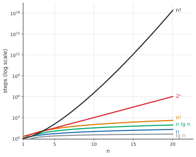
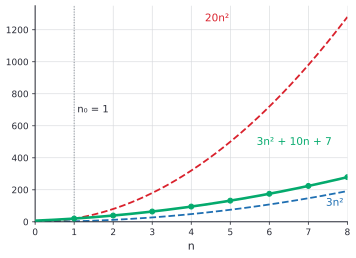

# Asymptotic notation

After this lesson you can define big-O, big-Omega and big-Theta with quantifiers and witnesses, prove or disprove a bound from the definition, use the limit test, place the standard growth rates in order with proofs, avoid the usual notation mistakes, and read the growth rate off a piece of code.

Before this: [sums and closed forms](01-sums-and-closed-forms.md), [recurrences](02-recurrences.md), [quantifiers](../../04-proofs-and-logic/02-logic-and-sets/04-quantifiers.md) and [limits](../../05-university-core/01-limits-and-continuity/01-limits-intuition-and-limit-laws.md). The growth-rate facts from [linear approximation and L'Hopital's rule](../../05-university-core/03-applications-of-derivatives/02-linear-approximation-and-lhopitals-rule.md) are proved here again without calculus.

## Quick check

Try these first. If you get all three right, skip to [Practice](#practice).

1. Find numbers $c$ and $n_0$ such that $5n + 20 \le c\,n$ for every $n \ge n_0$.
2. Put these in order from slowest-growing to fastest-growing: $n^2$, $2^n$, $\lg n$, $n!$, $n \lg n$, $\sqrt{n}$, $n^3$.
3. Is $2^{n+1}$ at most a constant times $2^n$? Is $2^{2n}$?

<details class="solution" markdown>
<summary>Answers</summary>

1. For $n \ge 20$ we have $20 \le n$, so $5n + 20 \le 6n$: take $c = 6$ and $n_0 = 20$. (Another choice is $c = 25$ and $n_0 = 1$.)
2. $\lg n$, $\sqrt{n}$, $n \lg n$, $n^2$, $n^3$, $2^n$, $n!$.
3. Yes for $2^{n+1} = 2 \cdot 2^n$, with constant 2. No for $2^{2n} = 4^n$: the ratio $\frac{4^n}{2^n} = 2^n$ grows without bound, so no constant works.

</details>

## The idea

How long does a program take? The honest answer depends on the machine, the language and the input, and it changes every time the hardware does. To compare algorithms we want a statement that survives these changes. The standard choice is to count basic steps as a function of the input size $n$, and then to ignore two things: constant factors, and what happens for small $n$.

Here is why that is sensible. Suppose algorithm A takes $1000n$ steps and algorithm B takes $n^2$ steps. For $n = 100$, B is ten times faster. At $n = 1000$ they tie, and for every larger $n$ A wins, by a margin that keeps growing: at $n = 10^6$ the steps are $10^9$ against $10^{12}$. Whatever constant you put in front of $n$, a quadratic function eventually overtakes it. The constant decides where the crossover is, and the exponent decides who wins in the end.

Asymptotic notation is the language for "who wins in the end". It says that a function is at most, at least or about the same size as another, up to a constant factor, once $n$ is large enough. The figure shows the common growth rates on a log scale. Each step up the ladder, from $\lg n$ to $n$ to $n \lg n$ to $n^2$ to $2^n$ to $n!$, is out of reach of the one below it.



## Definitions

In this lesson $f$ and $g$ are functions from the whole numbers to the nonnegative real numbers, such as running times, and $\lg n$ means $\log_2 n$.

We say $f(n)$ is **big-O** of $g(n)$, and write $f(n) = O(g(n))$, if there exist a constant $c > 0$ and a whole number $n_0$ such that

$$
f(n) \le c\,g(n) \qquad \text{for every } n \ge n_0.
$$

In quantifiers: there exist $c > 0$ and $n_0$ such that for every $n \ge n_0$, $f(n) \le c\,g(n)$. The numbers $c$ and $n_0$ are the **witnesses**. In plain words, from some point on, $f$ stays below a constant multiple of $g$. The order of the quantifiers matters: $c$ and $n_0$ are chosen first and can't depend on $n$. If they could, then $n^2 = O(n)$ would be "true" by taking $c = n$.

We say $f(n)$ is **big-Omega** of $g(n)$, written $f(n) = \Omega(g(n))$, if there exist $c > 0$ and $n_0$ such that $f(n) \ge c\,g(n)$ for every $n \ge n_0$. In plain words, from some point on, $f$ stays above a constant multiple of $g$.

We say $f(n)$ is **big-Theta** of $g(n)$, written $f(n) = \Theta(g(n))$, if both $f = O(g)$ and $f = \Omega(g)$. Equivalently, there exist $c_1, c_2 > 0$ and $n_0$ with $c_1 g(n) \le f(n) \le c_2 g(n)$ for every $n \ge n_0$. In plain words, $f$ is squeezed between two constant multiples of $g$: they grow at the same rate.

We say $f(n)$ is **little-o** of $g(n)$, written $f(n) = o(g(n))$, if for every constant $c > 0$ there is an $n_0$ such that $f(n) < c\,g(n)$ for every $n \ge n_0$. When $g(n) > 0$ this says $\frac{f(n)}{g(n)} \to 0$. In plain words, $f$ grows strictly slower than $g$: it ends up below every constant multiple, however small. Little-omega, $f = \omega(g)$, is the reverse, $g = o(f)$. We also write $f \ll g$ for $f = o(g)$.

The notation hides a quirk. Strictly, $O(g(n))$ is the **set** of all functions $f$ satisfying the definition, and "$f(n) = O(g(n))$" means $f$ is a member of the set. The equals sign is traditional and a little dishonest: it is not symmetric. $n = O(n^2)$ is true and $O(n^2) = n$ is meaningless. A statement such as $O(n) = O(n^2)$ is read left to right as "every function in the first set is in the second", which is true, and the reverse is false. An $O(\cdot)$ inside a formula, as in $T(n) = 2T(n/2) + O(n)$, stands for some unnamed function in that set.

## How to do it

### Proving a bound from the definition

To prove $f = O(g)$ you must produce witnesses $c$ and $n_0$ and show the inequality for every $n \ge n_0$.

1. Write down what you need: $f(n) \le c\,g(n)$ for all $n \ge n_0$.
2. Pick an $n_0$ that makes the algebra easy, often $n_0 = 1$, so that $1 \le n \le n^2 \le \cdots$ holds.
3. Bound each term of $f(n)$ above by a multiple of $g(n)$, using the facts that hold for $n \ge n_0$.
4. Add the multiples to get $c$.
5. State the witnesses and check them at one or two values of $n$, including $n_0$.

For $\Omega$ you bound $f$ below, usually by dropping terms that are nonnegative. For $\Theta$ you do both. To prove that $f$ is **not** $O(g)$, negate the definition: for every $c > 0$ and every $n_0$ there is some $n \ge n_0$ with $f(n) > c\,g(n)$. You are given $c$ and $n_0$, and you must find an $n$ that beats them.

### Rules

*Theorem.* For functions $f, g, h, f_1, f_2, g_1, g_2$ as above:

- (reflexive) $f = \Theta(f)$.
- (transitive) if $f = O(g)$ and $g = O(h)$, then $f = O(h)$. The same holds for $\Omega$ and $\Theta$.
- (symmetry) $f = \Theta(g)$ if and only if $g = \Theta(f)$, and $f = O(g)$ if and only if $g = \Omega(f)$.
- (sums) if $f_1 = O(g_1)$ and $f_2 = O(g_2)$, then $f_1 + f_2 = O(\max(g_1, g_2))$.
- (products) if $f_1 = O(g_1)$ and $f_2 = O(g_2)$, then $f_1 f_2 = O(g_1 g_2)$.
- (constants) for each constant $a > 0$, $a f = \Theta(f)$.

*Proof.* We prove transitivity and sums; the others are the same kind of argument. Suppose $f(n) \le c_1 g(n)$ for $n \ge n_1$ and $g(n) \le c_2 h(n)$ for $n \ge n_2$. For $n \ge \max(n_1, n_2)$ both hold, so $f(n) \le c_1 c_2\,h(n)$, and the witnesses are $c_1 c_2$ and $\max(n_1, n_2)$.

For sums, suppose $f_1 \le c_1 g_1$ for $n \ge n_1$ and $f_2 \le c_2 g_2$ for $n \ge n_2$. For $n \ge \max(n_1, n_2)$, $f_1 + f_2 \le c_1 g_1 + c_2 g_2 \le (c_1 + c_2)\max(g_1, g_2)$. $\blacksquare$

In plain words, after a "for large enough $n$", you can take the larger of two thresholds and add or multiply the constants. These rules are why you can drop lower-order terms: $n^2 + n = O(n^2)$, since $n = O(n^2)$ and the sum rule applies.

### Polynomials

*Theorem.* If $f(n) = a_d n^d + a_{d-1} n^{d-1} + \cdots + a_0$ with $a_d > 0$, then $f(n) = \Theta(n^d)$.

We know each term $a_i n^i$ is at most $\lvert a_i \rvert n^d$ when $n \ge 1$. We want both bounds. The plan is to bound above by adding the absolute values, and to bound below by showing the top term dominates for large $n$.

*Proof.* Upper bound: for $n \ge 1$, $f(n) \le (\lvert a_d \rvert + \cdots + \lvert a_0 \rvert)\,n^d$, since $n^i \le n^d$ for $i \le d$. Lower bound: $\frac{f(n)}{n^d} = a_d + \frac{a_{d-1}}{n} + \cdots + \frac{a_0}{n^d}$, which tends to $a_d > 0$ as $n \to \infty$, so for large $n$ it is above $\frac{a_d}{2}$. Hence $f(n) \ge \frac{a_d}{2}\,n^d$ from some point on. $\blacksquare$

### The limit test

*Theorem.* Let $f$ and $g$ be positive for large $n$, and suppose $L = \lim_{n \to \infty} \frac{f(n)}{g(n)}$ exists (it may be $\infty$). Then:

- if $L = 0$, then $f = o(g)$, so $f = O(g)$ and $f \ne \Omega(g)$,
- if $0 < L < \infty$, then $f = \Theta(g)$,
- if $L = \infty$, then $f = \omega(g)$, so $f = \Omega(g)$ and $f \ne O(g)$.

We know the definition of a limit of a sequence. We want to turn it into witnesses. The plan is to use the limit definition with a well-chosen tolerance.

*Proof.* Case $L = 0$: given any $c > 0$, the limit definition with tolerance $c$ gives $n_0$ with $\frac{f(n)}{g(n)} < c$ for $n \ge n_0$, which is $f(n) < c\,g(n)$. That is $f = o(g)$.

Case $0 < L < \infty$: take the tolerance $\frac{L}{2}$. For large $n$, $\frac{L}{2} < \frac{f(n)}{g(n)} < \frac{3L}{2}$, so $\frac{L}{2}\,g(n) < f(n) < \frac{3L}{2}\,g(n)$, and the witnesses are $c_1 = \frac{L}{2}$ and $c_2 = \frac{3L}{2}$.

Case $L = \infty$: the ratio exceeds any chosen constant eventually, so $g = o(f)$. $\blacksquare$

Look back: the test is one-directional. If the limit doesn't exist the functions may still be related: $f(n) = n(2 + \sin n)$ and $g(n) = n$ have a ratio that oscillates between 1 and 3, so there is no limit, and still $f = \Theta(g)$ with $c_1 = 1$ and $c_2 = 3$. For functions of a real variable that are differentiable, [L'Hopital's rule](../../05-university-core/03-applications-of-derivatives/02-linear-approximation-and-lhopitals-rule.md) is the usual way to compute the limit.

### The hierarchy of growth rates

*Theorem.* For every constant $p > 0$, every constant $k$ and every constant $b > 1$,

$$
\lg n \ll n^p \ll b^n \ll n! \ll n^n, \qquad \text{and also} \qquad n^k \ll b^n.
$$

In plain words: logarithms grow slower than every positive power of $n$, powers grow slower than every exponential, exponentials grow slower than the factorial, and the factorial grows slower than $n^n$.

We prove each comparison with an elementary argument, with no calculus.

*Proof that $\lg n \ll n^p$.* For every $x > 0$, $\ln x \le x - 1 < x$. Apply it to $x = n^{p/2}$: $\frac{p}{2} \ln n = \ln n^{p/2} < n^{p/2}$, so $\ln n < \frac{2}{p}\,n^{p/2}$. Dividing by $n^p$ gives $\frac{\ln n}{n^p} < \frac{2}{p}\,n^{-p/2}$, which tends to 0. Since $\lg n = \frac{\ln n}{\ln 2}$, the same holds for $\lg n$.

*Proof that $n^k \ll b^n$.* Let $a_n = \frac{n^k}{b^n}$. Then $\frac{a_{n+1}}{a_n} = \left(\frac{n+1}{n}\right)^k \cdot \frac{1}{b}$. As $n \to \infty$, $\left(\frac{n+1}{n}\right)^k \to 1$, so the ratio tends to $\frac{1}{b} < 1$. Choose $q$ with $\frac{1}{b} < q < 1$. For $n \ge N$ (some $N$) the ratio is at most $q$, so $a_n \le a_N q^{n-N}$, which tends to 0 because $q < 1$.

*Proof that $b^n \ll n!$.* With $a_n = \frac{b^n}{n!}$, $\frac{a_{n+1}}{a_n} = \frac{b}{n+1} \to 0$. For $n \ge N$ the ratio is at most $\frac{1}{2}$, so $a_n \le a_N 2^{-(n-N)} \to 0$.

*Proof that $n! \ll n^n$.* $\frac{n!}{n^n} = \frac{1}{n} \cdot \frac{2}{n} \cdots \frac{n}{n}$. Every factor is at most 1, and the first is $\frac{1}{n}$, so the product is at most $\frac{1}{n} \to 0$. $\blacksquare$

Look back: two warnings come with the hierarchy. First, bases matter for exponentials: $2^n \ll 3^n$ since $\frac{3^n}{2^n} = 1.5^n \to \infty$, so $\Theta(2^n)$ and $\Theta(3^n)$ are different classes. Second, "eventually" can be far away. The comparison $n^{100}$ against $1.01^n$ is true, and for $n \ge 2$ the exponential first exceeds the power at $n = 117{,}309$. Below that point, the "slower" function is ahead.

Two more facts help. A change of logarithm base is a constant: $\log_a n = \frac{\log_b n}{\log_b a}$, so $\log_a n = \Theta(\log_b n)$ and the base inside $O(\log n)$ doesn't matter. And from [sums and closed forms](01-sums-and-closed-forms.md), $\ln n! \ge n \ln n - n + 1$ and $n! \le n^n$, which together give $\lg n! = \Theta(n \lg n)$ (Example 5).

### Analysing code

1. Choose the input size $n$ and the basic step you count (a comparison, an assignment, a call).
2. A sequence of blocks costs the sum of their costs, so by the sum rule it is $O$ of the largest.
3. A loop costs the number of passes times the cost of one pass, if each pass costs the same. If the cost of a pass depends on the loop variable, write the cost as a sum, using [sums and closed forms](01-sums-and-closed-forms.md).
4. A recursive function gives a [recurrence](02-recurrences.md); solve it or use the master theorem.
5. Give the answer as $\Theta$ when you can show both bounds, and say which case (worst, best, average) it describes.

<div class="warning" markdown>

Watch out at step 5: $\Theta$ describes a function, and an algorithm has a different running time function for each case. Insertion sort takes $\Theta(n)$ steps on a sorted list and $\Theta(n^2)$ on a reversed one. "Insertion sort is $O(n^2)$" is true of every input. "Insertion sort is $\Theta(n^2)$" is true only of its worst case.

</div>

## Worked examples

<div class="example" markdown>

### Example 1: $3n^2 + 10n + 7 = \Theta(n^2)$ from the definition

Step 1: for the upper bound we need $3n^2 + 10n + 7 \le c\,n^2$ for all $n \ge n_0$.

Step 2: choose $n_0 = 1$. For $n \ge 1$ we have $n \le n^2$ and $1 \le n^2$.

Step 3: bound each term: $3n^2 = 3n^2$, $10n \le 10n^2$ and $7 \le 7n^2$.

Step 4: add: $3n^2 + 10n + 7 \le (3 + 10 + 7)\,n^2 = 20n^2$, so $c = 20$ works.

For the lower bound, drop the nonnegative terms: $3n^2 + 10n + 7 \ge 3n^2$ for every $n \ge 0$, so $c_1 = 3$ works. Therefore $3n^2 \le f(n) \le 20n^2$ for $n \ge 1$, and $f = \Theta(n^2)$ with $n_0 = 1$.

Step 5, the check: at $n = 1$, $f(1) = 20 = 20 \cdot 1^2$ (the upper bound is tight there). At $n = 2$, $f(2) = 39$ and $3 \cdot 4 = 12 \le 39 \le 80$. The figure shows the squeeze.



</div>

<div class="example" markdown>

### Example 2: disproving a bound

Claim: $n^2$ is not $O(n)$.

Suppose it were. Then there would be witnesses $c$ and $n_0$ with $n^2 \le c\,n$ for every $n \ge n_0$. Given any such $c$ and $n_0$, take $n = \max(n_0, \lceil c \rceil + 1)$. Then $n > c$, so $n^2 = n \cdot n > c\,n$, which contradicts the inequality at this $n$. So no witnesses exist.

A second claim: $2^{2n}$ is not $O(2^n)$. The ratio $\frac{2^{2n}}{2^n} = 2^n$ exceeds any constant $c$ once $n > \lg c$, so for no choice of $c$ does $2^{2n} \le c\,2^n$ hold for all large $n$.

Check: with $c = 100$ the inequality $n^2 \le 100n$ holds up to $n = 100$ and fails at $n = 101$, whatever $n_0$ you chose.

</div>

<div class="example" markdown>

### Example 3: the limit test

Compare $n \lg n$ with $n^{1.5}$. The ratio is $\frac{n \lg n}{n^{1.5}} = \frac{\lg n}{\sqrt{n}}$, which tends to 0 by the hierarchy theorem (with $p = \frac{1}{2}$). So $n \lg n = o(n^{1.5})$. The values $\frac{\ln n}{\sqrt{n}}$ at $n = 10, 100, 10^4, 10^6$ are $0.728, 0.461, 0.092, 0.014$: they rise at first, then fall slowly.

Now $n^3$ against $2^n$: the ratio $\frac{n^3}{2^n}$ is $0.977$ at $n = 10$, $0.0076$ at $n = 20$ and $0.0000$ (to four places) at $n = 40$, tending to 0. So $n^3 = o(2^n)$.

Check: at $n = 20$, $20^3 = 8000$ and $2^{20} = 1{,}048{,}576$, a ratio of $0.0076$.

</div>

<div class="example" markdown>

### Example 4: reading the growth off code

```python
for i in range(n):                 # loop A
    for j in range(i, n):
        work()

for i in range(n):                 # loop B
    j = 1
    while j < n:
        j *= 2
        work()

d = 2                              # loop C, input is a number N
while d * d <= N:
    if N % d == 0:
        break
    d += 1
```

Loop A calls `work()` $\sum_{i=0}^{n-1}(n - i) = \frac{n(n+1)}{2}$ times, which is $\Theta(n^2)$ by the polynomial theorem. Doubling $n$ multiplies the count by about 4: the ratios of the counts for $n = 100, 200$ and $200, 400$ are $3.98$ and $3.99$.

Loop B: the inner loop doubles `j` from 1 until it reaches $n$, which takes $\lceil \lg n \rceil$ passes, and the outer loop repeats it $n$ times. The total is $n\lceil \lg n \rceil$, which is $\Theta(n \lg n)$. For $n = 100$ the count is $100 \cdot 7 = 700$.

Loop C tries divisors $d$ up to $\sqrt{N}$ and takes at most about $\sqrt{N}$ passes. Counted in the value $N$ it is $O(\sqrt{N})$. But the input size is the length of $N$ in digits, say $m$ digits, and $\sqrt{N}$ is about $10^{m/2}$. So the loop is exponential in the size of its input, which is why trial division is hopeless on the numbers used in cryptography.

Check: loop A with $n = 4$ gives $4 + 3 + 2 + 1 = 10 = \frac{4 \cdot 5}{2}$.

</div>

<div class="example" markdown>

### Example 5: $\lg n! = \Theta(n \lg n)$ (finish it yourself)

For the upper bound, $n! = 1 \cdot 2 \cdots n \le n^n$, so $\lg n! \le n \lg n$ for every $n \ge 1$. That is $O(n \lg n)$ with $c = 1$ and $n_0 = 1$.

For the lower bound, [sums and closed forms](01-sums-and-closed-forms.md) gives $\ln n! \ge n \ln n - n + 1$. Show that this is at least $\frac{1}{2}\,n \ln n$ once $n \ge 8$, and conclude.

<details class="solution" markdown>
<summary>Finish</summary>

We need $n \ln n - n + 1 \ge \frac{1}{2}\,n \ln n$, that is, $\frac{1}{2}\,n \ln n \ge n - 1$. This holds when $\frac{1}{2}\ln n \ge 1$, that is, $n \ge e^2 \approx 7.39$, because then $\frac{1}{2}\,n \ln n \ge n > n - 1$. So for $n \ge 8$, $\ln n! \ge \frac{1}{2}\,n \ln n$. Dividing both sides by $\ln 2$ turns natural logarithms into base-2 ones: $\lg n! \ge \frac{1}{2}\,n \lg n$.

So $\frac{1}{2}\,n \lg n \le \lg n! \le n \lg n$ for $n \ge 8$, and $\lg n! = \Theta(n \lg n)$.

Check: $n = 10$ gives $\lg 10! = 21.79$, between $\frac{1}{2} \cdot 33.22 = 16.61$ and $33.22$. For $n = 1000$ it is $8529.4$, between $4982.9$ and $9965.8$.

</details>

</div>

## Edge cases and common mistakes

<div class="warning" markdown>

Watch out: big-O is only an upper bound. $n = O(n^2)$ is true, and so is $n = O(2^n)$, and neither tells you how fast $n$ really grows. "The algorithm takes at least $O(n^2)$ time" is meaningless, since $O$ gives no lower bound. If you mean "at least a constant times $n^2$", say $\Omega(n^2)$, and if you mean "about $n^2$", say $\Theta(n^2)$.

</div>

<div class="warning" markdown>

Watch out for the equals sign. $O(n) = O(n^2)$ is true read as "the first set is inside the second", and $O(n^2) = O(n)$ is false. Don't chain these equations backwards, and never conclude that $n^2 = n$ from $n = O(n^2)$ and $n^2 = O(n^2)$.

</div>

<div class="warning" markdown>

Watch out for a hidden growing constant. The "proof" that $\sum_{i=1}^{n} i = O(n)$, since each term is $O(n)$ and so is their sum, is wrong. The witness constant for the sum is the number of terms, which grows with $n$. The sum is $\frac{n(n+1)}{2} = \Theta(n^2)$. A constant has to be fixed before $n$.

</div>

<div class="warning" markdown>

Watch out for exponents and bases. $2^{n+1} = \Theta(2^n)$ since it is $2 \cdot 2^n$, but $2^{2n} = 4^n$ is not $O(2^n)$, and $3^n$ is not $O(2^n)$. Constants in the base matter, because they are exponentiated. Constants in front of a logarithm, and the base of the logarithm, don't matter.

</div>

<div class="warning" markdown>

Watch out when comparing at small $n$. An algorithm with running time $100n$ loses to one with $n^2$ for every $n < 100$. The notation says what happens after the crossover, not where it is. For input sizes below the crossover, or when constants differ a lot, measure the code.

</div>

Edge cases of the definition: the witnesses $c$ and $n_0$ are not unique, and if some pair works then larger ones do too. The functions must be nonnegative, or you need absolute values, as in $f = O(g)$ meaning $\lvert f(n) \rvert \le c\,g(n)$ for general functions. A constant function is $\Theta(1)$, and $O(1)$ means bounded. And $\log(n^k) = k\log n$, so $\lg(n^{100}) = \Theta(\lg n)$.

## Tricks and shortcuts

- To compare two functions, take the limit of the ratio, or take $\lg$ of both: $n^{\lg n}$ against $2^{\sqrt{n}}$ becomes $(\lg n)^2$ against $\sqrt{n}$, and the second wins.
- Polylogarithms lose to every power: $(\lg n)^{100} \ll n^{0.01}$. So $n \lg^3 n = o(n^{1.1})$.
- In a sum of terms of different growth rates, the fastest one decides: $n^3 + 2^n + n! = \Theta(n!)$.
- To estimate a running time experimentally, double $n$ and compute the ratio $\frac{T(2n)}{T(n)}$. A ratio near 2 suggests $n$ (or $n \lg n$, a little above 2), near 4 suggests $n^2$, near 8 suggests $n^3$, and a ratio that keeps growing suggests an exponential.
- $\sqrt{n} = n^{1/2}$ and $\lg n$ are the usual neighbours: $\lg n \ll \sqrt{n} \ll n$.

## In code

The code counts the steps of loop A and loop B, prints the doubling ratios, and checks the witnesses of Example 1 and the crossover of $n^{100}$ and $1.01^n$.

<details class="code" markdown>
<summary>In code</summary>

```python
import math

def loop_a(n):
    count = 0
    for i in range(n):
        for j in range(i, n):
            count += 1
    return count

def loop_b(n):
    count = 0
    for i in range(n):
        j = 1
        while j < n:
            j *= 2
            count += 1
    return count

print([round(loop_a(2 * n) / loop_a(n), 2) for n in (50, 100, 200)])   # [3.96, 3.98, 3.99]
print(loop_b(100), 100 * math.ceil(math.log2(100)))                    # 700 700

f = lambda n: 3 * n * n + 10 * n + 7
print(all(3 * n * n <= f(n) <= 20 * n * n for n in range(1, 10_000)))  # True

n = next(n for n in range(2, 10**6) if n * math.log(1.01) > 100 * math.log(n))
beats = lambda m: m * math.log(1.01) > 100 * math.log(m)               # compare logs, no overflow
print(n, beats(n), beats(n - 1))                                       # 117309 True False

for n in (10, 100, 1000):
    print(n, round(math.log2(math.factorial(n)), 1), round(n * math.log2(n), 1))
# 10 21.8 33.2
# 100 524.8 664.4
# 1000 8529.4 9965.8
```

The ratio for $n = 50$ is below 4 because of the lower-order term in $\frac{n(n+1)}{2}$, and it creeps up towards 4. The search for the crossover compares the logarithms of the two sides, because $1.01^n$ is too large for a floating-point number at $n = 117{,}309$.

</details>

## FAQ

### Why throw away constants? A program that is 100 times slower matters.

It does, and asymptotic notation doesn't claim otherwise. It answers a different question: how the cost scales when the input grows. A factor of 100 is a fixed price, while a change from $n^2$ to $n \lg n$ gets better and better as $n$ grows. Use the notation to choose the algorithm, and use measurement to tune the code.

### Why do we need $n_0$? Why not require the inequality for all $n$?

Because many natural bounds fail for a few small $n$. Take $n^2 \le 2^n$: it is false at $n = 3$ ($9 > 8$) and true from $n = 4$ on. Requiring it for all $n$ would force a larger constant to cover the early cases, and that says nothing useful about growth. The threshold $n_0$ lets the notation talk only about the long run.

### Can a function be $O(g)$ and not $\Omega(g)$?

Yes: $n = O(n^2)$, but $n$ is not $\Omega(n^2)$, since $\frac{n}{n^2} \to 0$. In that case $f = o(g)$. The only way for $f$ to be both is to be $\Theta(g)$.

### Is $\Theta(\log n)$ the same whatever the base of the logarithm?

Yes. Changing the base multiplies by a constant, $\log_a n = \frac{1}{\log_b a}\,\log_b n$, and constants are absorbed. This is why $O(\log n)$ is written with no base. It is not true for exponentials, where changing the base is a different growth rate.

## Practice

### Warm-up

1\. Prove from the definition that $7n + 100 = O(n)$ and that $7n + 100 = \Omega(n)$. Give the witnesses.

<details class="solution" markdown>
<summary>Solution</summary>

Upper bound: for $n \ge 100$ we have $100 \le n$, so $7n + 100 \le 8n$. Witnesses: $c = 8$ and $n_0 = 100$. (Also $c = 107$ and $n_0 = 1$ work, since $100 \le 100n$ for $n \ge 1$.)

Lower bound: $7n + 100 \ge 7n$ for every $n \ge 0$. Witnesses: $c = 7$ and $n_0 = 0$.

So $7n + 100 = \Theta(n)$.

Check: at $n = 100$ the value is 800, which is $8 \cdot 100$ exactly, and $800 \ge 700$.

</details>

2\. Decide whether each statement is true: (a) $n^2 + n = O(n^2)$, (b) $n^2 = O(n^2 + n)$, (c) $2^{n+3} = \Theta(2^n)$, (d) $\lg(n^5) = \Theta(\lg n)$, (e) $n^2 = O(n \lg n)$.

<details class="solution" markdown>
<summary>Solution</summary>

(a) True: $n \le n^2$ for $n \ge 1$, so $n^2 + n \le 2n^2$. (b) True: $n^2 \le n^2 + n$ for all $n$. (c) True: $2^{n+3} = 8 \cdot 2^n$. (d) True: $\lg(n^5) = 5 \lg n$. (e) False: $\frac{n^2}{n \lg n} = \frac{n}{\lg n} \to \infty$, so $n^2$ is $\omega(n \lg n)$.

Check (e) numerically: at $n = 1024$, $n^2 = 1{,}048{,}576$ and $n \lg n = 10{,}240$, a ratio of about 102.

</details>

3\. Give a $\Theta$ bound for the number of times `work()` runs, as a function of $n$: (a) `for i in range(n): work()`, (b) `for i in range(n): for j in range(n): work()`, (c) `i = n` and `while i > 1: work(); i //= 2`.

<details class="solution" markdown>
<summary>Solution</summary>

(a) $n$ calls, so $\Theta(n)$. (b) $n \cdot n = n^2$ calls, so $\Theta(n^2)$. (c) The value of `i` is halved each pass, so the loop runs $\lfloor \lg n \rfloor$ times, which is $\Theta(\log n)$.

Check for $n = 16$: (a) 16, (b) 256, (c) the values of `i` are $16, 8, 4, 2$, so 4 calls, and $\lg 16 = 4$.

</details>

### Standard

4\. Prove from the definition that $n^3 - 5n^2 + 20 = \Theta(n^3)$. Find witnesses for both bounds.

<details class="solution" markdown>
<summary>Solution</summary>

Upper bound: $n^3 - 5n^2 + 20 \le n^3 + 20 \le 21n^3$ for $n \ge 1$. Witnesses: $c = 21$ and $n_0 = 1$.

Lower bound: we want $n^3 - 5n^2 + 20 \ge c\,n^3$. For $n \ge 10$, $5n^2 \le \frac{1}{2}n^3$ (since $5 \le \frac{n}{2}$), so $n^3 - 5n^2 + 20 \ge \frac{1}{2}n^3 + 20 \ge \frac{1}{2}n^3$. Witnesses: $c = \frac{1}{2}$ and $n_0 = 10$.

Check: at $n = 10$ the value is $1000 - 500 + 20 = 520$, and $\frac{1}{2} \cdot 1000 = 500 \le 520 \le 21000$.

</details>

5\. Use the limit test or the hierarchy to order these by growth rate, slowest first, and say which pairs are $\Theta$ of each other: $n^2$, $n^2 \lg n$, $3n^2 + n$, $2^{n/2}$, $n^{10}$, $\lg^5 n$.

<details class="solution" markdown>
<summary>Solution</summary>

The polylogarithm $\lg^5 n$ is slowest, since it is $o(n^p)$ for every $p > 0$. Next come $n^2$ and $3n^2 + n$, which are $\Theta$ of each other (the polynomial theorem). Then $n^2 \lg n$, since $\frac{n^2 \lg n}{n^2} \to \infty$ but $\frac{n^2 \lg n}{n^3} \to 0$. Then $n^{10}$. The exponential $2^{n/2} = (\sqrt{2})^n$ has base $\sqrt{2} \approx 1.414 > 1$, so it beats every power, and it is fastest.

Order: $\lg^5 n \ll n^2 = \Theta(3n^2 + n) \ll n^2 \lg n \ll n^{10} \ll 2^{n/2}$.

Check: at $n = 200$, $2^{100} \approx 1.3 \times 10^{30}$ against $200^{10} \approx 1.0 \times 10^{23}$, so the exponential is already ahead.

</details>

6\. A function does the following for a list of $n$ numbers: it sorts a copy with a $\Theta(n \lg n)$ sort, then for each item does a binary search in the sorted copy, which takes $\Theta(\lg n)$ steps. Give a $\Theta$ bound for the total, with the sum and product rules.

<details class="solution" markdown>
<summary>Solution</summary>

The $n$ searches cost $n \cdot \Theta(\lg n) = \Theta(n \lg n)$ by the product rule. The two phases run one after the other, so the cost is $\Theta(n \lg n) + \Theta(n \lg n) = \Theta(n \lg n)$ by the sum rule.

Check: for $n = 1024$ the sort costs about $10{,}240$ steps and the searches about $10{,}240$ more, so about $20{,}480$ in all, against $n^2 = 1{,}048{,}576$ for comparing every pair.

</details>

### Challenge

7\. (a) Prove that $\max(f, g) = \Theta(f + g)$ for nonnegative functions. (b) Use it to show that $\max(n^2, 2^n) = \Theta(2^n)$.

<details class="solution" markdown>
<summary>Solution</summary>

(a) For every $n$, $\max(f(n), g(n)) \le f(n) + g(n)$, and $f(n) + g(n) \le 2\max(f(n), g(n))$. So $\frac{1}{2}(f + g) \le \max(f, g) \le f + g$, which is the definition of $\Theta$ with $c_1 = \frac{1}{2}$, $c_2 = 1$ and $n_0 = 0$.

(b) By (a), $\max(n^2, 2^n) = \Theta(n^2 + 2^n)$. Since $n^2 = o(2^n)$, we have $n^2 \le 2^n$ for large $n$ (it holds from $n = 4$), so $2^n \le n^2 + 2^n \le 2 \cdot 2^n$ for $n \ge 4$. So $n^2 + 2^n = \Theta(2^n)$, and by transitivity of $\Theta$ the maximum is $\Theta(2^n)$.

Check: at $n = 10$, $\max(100, 1024) = 1024$, which is $2^{10}$.

</details>

8\. (Reviews [sums and closed forms](01-sums-and-closed-forms.md).) Show that $\sum_{k=1}^{n} \frac{1}{k} = \Theta(\lg n)$ and $\sum_{k=1}^{n} k^2 = \Theta(n^3)$.

<details class="solution" markdown>
<summary>Solution</summary>

First sum: $\ln(n+1) \le H_n \le 1 + \ln n$. The lower bound gives $H_n \ge \ln n$. For $n \ge 3$ we have $\ln n \ge 1$ (since $e < 3$), so the upper bound gives $H_n \le 1 + \ln n \le 2\ln n$. So $\ln n \le H_n \le 2\ln n$ for $n \ge 3$, and since $\ln n = (\ln 2)\lg n$, we get $H_n = \Theta(\lg n)$.

Second sum: $\sum_{k=1}^{n} k^2 = \frac{n(n+1)(2n+1)}{6}$ is a polynomial of degree 3 with positive leading coefficient $\frac{1}{3}$, so it is $\Theta(n^3)$ by the polynomial theorem. Directly, $\sum k^2 \le n \cdot n^2 = n^3$, and the terms with $k \ge n/2$ are at least $\frac{n}{2}$ in number and each is at least $\frac{n^2}{4}$, so the sum is at least $\frac{n^3}{8}$.

Check: $H_{1000} = 7.485$ and $\ln 1000 = 6.908$, between $\ln n$ and $2\ln n$. And $\sum_{k=1}^{100} k^2 = 338{,}350$ against $\frac{100^3}{3} = 333{,}333$.

</details>

## Where this shows up

- The next lesson, [divide and conquer and the master theorem](05-divide-and-conquer-and-master-theorem.md), solves recurrences in this notation. Every algorithms course uses it for running times and space, and complexity theory builds on it: P, NP and NP-completeness<!-- link: ../06-theory-of-computation/07-p-np-and-np-completeness.md --> is about polynomial against exponential growth, the gap in the hierarchy above.
- In calculus, the same comparisons are limits at infinity, and [L'Hopital's rule](../../05-university-core/03-applications-of-derivatives/02-linear-approximation-and-lhopitals-rule.md) is the tool for them. Taylor series use a close relative of big-O, "error of order $h^2$".
- In economics and finance, growth rates play the same role: a quantity growing exponentially eventually beats every polynomial, which is why compound interest on a long horizon dominates linear saving.
