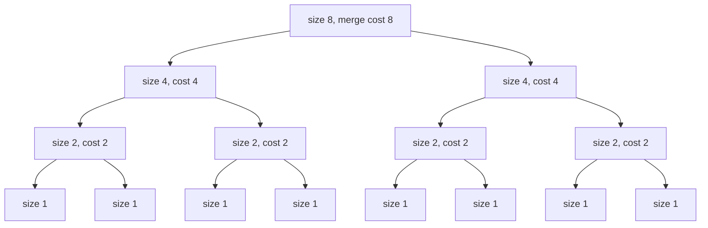

# Divide and conquer and the master theorem

After this lesson you can write the recurrence of a divide-and-conquer algorithm, solve it with a recursion tree, apply the three cases of the master theorem (including the regularity condition), recognise a recurrence it can't handle, and prove a bound such as $T(n) = O(n \lg n)$ by substitution.

Before this: [recurrences](02-recurrences.md), [asymptotic notation](04-asymptotic-notation.md), [sums and closed forms](01-sums-and-closed-forms.md) and [strong induction and well-ordering](../../04-proofs-and-logic/05-induction/02-strong-induction-and-well-ordering.md). The geometric series is from [summation notation and series](../../03-high-school/11-sequences-series-and-counting/02-summation-notation-and-series.md).

## Quick check

Try these first. If you get all three right, skip to [Practice](#practice).

1. Let $T(1) = 1$ and $T(n) = 2T(n/2) + n$ for $n = 2, 4, 8, \dots$. Find $T(8)$.
2. For $T(n) = 3T(n/4) + n$, compare $n$ with $n^{\log_4 3}$, using $\log_4 3 \approx 0.79$.
3. Binary search looks at the middle item and then searches half the list. Write its recurrence and say what it solves to.

<details class="solution" markdown>
<summary>Answers</summary>

1. $T(2) = 2 \cdot 1 + 2 = 4$, $T(4) = 2 \cdot 4 + 4 = 12$ and $T(8) = 2 \cdot 12 + 8 = 32$. (This equals $n \lg n + n = 24 + 8$.)
2. Since $0.79 < 1$, the function $n$ is much larger than $n^{0.79}$. The work outside the recursive calls dominates, so the answer is $\Theta(n)$ (the master theorem's third case).
3. $T(n) = T(n/2) + 1$, which solves to $\Theta(\lg n)$: halving takes $\lg n$ steps to reach 1.

</details>

## The idea

Suppose you must sort $n$ numbers. Sorting a list of one number is free. Otherwise, split the list into two halves, sort each half, and merge the two sorted halves into one sorted list. Merging is cheap: you look at the front items of the two halves, take the smaller, and repeat, so merging $n$ items takes at most $n$ steps. This is merge sort, and it is an example of a design pattern: **divide** the problem into smaller copies of itself, **conquer** the small ones by recursion, and **combine** their answers.

How much does it cost? The picture is a tree. The top node is the whole list, and merging its halves costs $n$. Below it are two nodes of size $\frac{n}{2}$, each costing $\frac{n}{2}$ to merge, so this level also costs $n$. Below that, four nodes of size $\frac{n}{4}$ cost $n$ again. Every level costs $n$, and halving $n$ down to 1 takes $\lg n$ levels, so the total is about $n \lg n$.



| Level | Nodes | Size of each | Cost of each | Cost of the level |
|---|---|---|---|---|
| 0 | 1 | 8 | 8 | 8 |
| 1 | 2 | 4 | 4 | 8 |
| 2 | 4 | 2 | 2 | 8 |
| 3 (leaves) | 8 | 1 | 1 | 8 |

The four levels cost 8 each, so $T(8) = 32$, matching Quick check 1. This lesson turns the picture into a method. The master theorem is the result of doing the same count for every recurrence of the form "$a$ copies of size $\frac{n}{b}$, plus some work to combine".

## Definitions

A **divide-and-conquer recurrence** has the form

$$
T(n) = a\,T\!\left(\frac{n}{b}\right) + f(n),
$$

where $a \ge 1$ is the number of subproblems, $b > 1$ is the factor by which each subproblem is smaller, and $f(n)$ is the cost of dividing and combining, with a constant cost $T(1)$ at the base. In plain words, you make $a$ recursive calls on inputs $\frac{1}{b}$ of the size, and do $f(n)$ other work. In real code $\frac{n}{b}$ is rounded, as in $\lfloor n/b \rfloor$ or $\lceil n/b \rceil$. This changes nothing about the growth rate, as the master theorem below confirms.

The **recursion tree** for the recurrence shows one node per call, labelled with the work $f$ done at that call outside its recursive calls. The root has size $n$, its $a$ children have size $\frac{n}{b}$, and so on down to size 1. In plain words, the tree is a picture of all the calls, and $T(n)$ is the sum of all the labels.

The **critical exponent** of the recurrence is $p = \log_b a$, and the function $n^{p}$ is the **watershed function**. In plain words, $n^p$ is the number of leaves of the tree, as the next section shows, and comparing $f(n)$ with it decides which part of the tree does most of the work.

## How to do it

### The recursion tree method

1. Draw the first three levels. Write the size of each node and the cost $f$ of its own work.
2. Find the cost of level $i$. There are $a^i$ nodes, each of size $\frac{n}{b^i}$, so the level costs $a^i f\!\left(\frac{n}{b^i}\right)$.
3. Find the number of levels. The sizes reach 1 when $b^i = n$, so $i = \log_b n$ and the tree has $\log_b n + 1$ levels, the last one being the leaves.
4. Find the cost of the leaves. There are $a^{\log_b n}$ leaves, and $a^{\log_b n} = n^{\log_b a} = n^p$ (take $\log_b$ of both sides to see they agree). Each leaf costs $T(1)$, a constant.
5. Add the levels:

$$
T(n) = \sum_{i=0}^{\log_b n - 1} a^i f\!\left(\frac{n}{b^i}\right) + \Theta(n^p).
$$

6. Evaluate the sum, usually a geometric series, and compare it with the leaves.

### The master theorem

*Theorem (master theorem).* Let $a \ge 1$ and $b > 1$ be constants, let $f(n)$ be a nonnegative function, and let $T(n) = a\,T(n/b) + f(n)$, where $n/b$ means $\lfloor n/b \rfloor$ or $\lceil n/b \rceil$. Let $p = \log_b a$. Then:

1. If $f(n) = O(n^{p - \varepsilon})$ for some constant $\varepsilon > 0$, then $T(n) = \Theta(n^p)$.
2. If $f(n) = \Theta(n^p)$, then $T(n) = \Theta(n^p \lg n)$.
3. If $f(n) = \Omega(n^{p + \varepsilon})$ for some constant $\varepsilon > 0$, and if $a\,f(n/b) \le c\,f(n)$ for some constant $c < 1$ and all large $n$ (the **regularity condition**), then $T(n) = \Theta(f(n))$.

This is the standard form (as in Cormen, Leiserson, Rivest and Stein, *Introduction to Algorithms*). In plain words, compare the work $f(n)$ at the root with the leaf count $n^p$. If the leaves win by a polynomial factor, the leaves decide. If they tie, every level costs about the same, and the $\lg n$ levels multiply the cost. If the root wins by a polynomial factor, and the work shrinks geometrically down the tree (regularity), the root decides.

A remark on case 2. Many textbooks and lecture notes state a wider version: if $f(n) = \Theta(n^p \lg^k n)$ for a constant $k \ge 0$, then $T(n) = \Theta(n^p \lg^{k+1} n)$. The case stated above is $k = 0$, and the recursion tree method below gets the case $k = 1$ without any new theorem.

We prove the theorem for the case where $f(n) = n^q$ for a constant $q \ge 0$ and $n$ is a power of $b$, since the argument shows where the three cases come from. The textbook proof handles general $f$ and the rounding.

*Proof (for $f(n) = n^q$, $n = b^L$, $T(1) = 1$).* The cost of level $i$ is $a^i \left(\frac{n}{b^i}\right)^q = n^q \left(\frac{a}{b^q}\right)^i$. Put $r = \frac{a}{b^q}$. Adding the levels $0$ to $L - 1$ and the leaves, whose number is $a^L = n^p$:

$$
T(n) = n^q \sum_{i=0}^{L-1} r^i + n^p.
$$

Now compare $q$ with $p$. Since $r = \frac{a}{b^q}$ and $a = b^p$, we have $r = b^{p - q}$. So $r > 1$ when $q < p$, $r = 1$ when $q = p$, and $r < 1$ when $q > p$.

If $q < p$ (case 1), then $r > 1$, and the geometric sum is $\frac{r^L - 1}{r - 1}$, where $r^L = b^{L(p-q)} = n^{p-q}$. So the sum is $\Theta(n^{p-q})$ and $T(n) = \Theta(n^q \cdot n^{p-q}) + n^p = \Theta(n^p)$.

If $q = p$ (case 2), then $r = 1$ and the sum is $L = \log_b n$, so $T(n) = n^p \log_b n + n^p = \Theta(n^p \lg n)$.

If $q > p$ (case 3), then $r < 1$ and the sum is less than $\frac{1}{1 - r}$, a constant, and at least 1 (its first term). So $T(n) = \Theta(n^q) + n^p = \Theta(n^q)$, because $n^p = o(n^q)$. The regularity condition holds here automatically: $a\,(n/b)^q = r\,n^q$ with $r < 1$. $\blacksquare$

Look back: the three cases are the three behaviours of a geometric series. If the ratio $r$ of one level to the previous is above 1, the last level (the leaves) dominates; if it is 1, all levels are equal; if it is below 1, the first level dominates. The regularity condition says the same thing for a general $f$: the root's work is at least the combined work of its children by a constant factor.

### Substitution

The recursion tree gives a guess. The **substitution method** proves it by strong induction, as in [strong induction and well-ordering](../../04-proofs-and-logic/05-induction/02-strong-induction-and-well-ordering.md).

1. Guess the form of the answer, with an unknown constant: $T(n) \le c\,g(n)$.
2. Assume the bound for all smaller inputs (strong induction), and substitute it into the recurrence.
3. Do the algebra until you reach $c\,g(n)$ on the right, and find what condition on $c$ makes it work.
4. Check the base cases directly, and choose $c$ large enough for them. The base cases are the inputs that the step can't reach.

*Theorem.* Let $T(1) = 1$ and $T(n) = 2T(\lfloor n/2 \rfloor) + n$ for $n \ge 2$. Then $T(n) \le 2n \lg n$ for every $n \ge 2$.

We know the recurrence, and the recursion tree suggests $n \lg n$. We want an explicit constant. The plan is strong induction with the step for $n \ge 4$, where $\lfloor n/2 \rfloor \ge 2$ falls inside the claim, and the base cases $n = 2$ and $n = 3$ done by hand.

*Proof.* Base cases: $T(2) = 2T(1) + 2 = 4 \le 2 \cdot 2 \cdot \lg 2 = 4$, and $T(3) = 2T(1) + 3 = 5 \le 2 \cdot 3 \cdot \lg 3 \approx 9.5$.

Step: let $n \ge 4$ and suppose the claim holds for all $m$ with $2 \le m < n$. Since $2 \le \lfloor n/2 \rfloor < n$, the hypothesis gives $T(\lfloor n/2 \rfloor) \le 2\lfloor n/2 \rfloor \lg \lfloor n/2 \rfloor$. The function $x \lg x$ is increasing for $x \ge 1$, so $\lfloor n/2 \rfloor \lg \lfloor n/2 \rfloor \le \frac{n}{2}\lg\frac{n}{2}$. Then

$$
T(n) \le 2 \cdot 2 \cdot \frac{n}{2}\lg\frac{n}{2} + n = 2n(\lg n - 1) + n = 2n \lg n - n \le 2n \lg n.
$$

By strong induction, $T(n) \le 2n \lg n$ for every $n \ge 2$. $\blacksquare$

Look back: why are the base cases 2 and 3 and not 1? At $n = 1$ the claim says $T(1) = 1 \le 2 \cdot 1 \cdot \lg 1 = 0$, which is false. The step for $n = 2$ or $3$ would use the claim at $\lfloor n/2 \rfloor = 1$, which fails, so those two are checked by hand. This is the standard trap of $n \lg n$ bounds. The constant 2 was forced by the base case $n = 2$: with $c = 1$ we would need $4 \le 2$.

Two warnings about substitution. First, the bound must come out in exactly the form that was assumed. The "proof" that $T(n) = 2T(\lfloor n/2 \rfloor) + n$ is $O(n)$ goes: assume $T(m) \le cm$ for $m < n$, so $T(n) \le 2c\lfloor n/2 \rfloor + n \le cn + n = (c+1)n = O(n)$. It is wrong, because the induction needs $T(n) \le cn$ with the same $c$, and $(c + 1)n$ is not $cn$. The recurrence really is $\Theta(n \lg n)$. Second, sometimes a true bound can only be proved after strengthening it. For $T(1) = 1$ and $T(n) = 2T(\lfloor n/2 \rfloor) + 1$, the guess $T(n) \le cn$ fails the step, because $2c\lfloor n/2 \rfloor + 1 \le cn + 1$ is not at most $cn$. The stronger claim $T(n) \le 2n - 1$ works: $T(n) \le 2(2\lfloor n/2 \rfloor - 1) + 1 \le 2n - 1$, and $T(1) = 1 = 2 \cdot 1 - 1$. Subtracting a lower-order term makes the induction go through.

### When the master theorem doesn't apply

Three situations are outside the theorem:

- $f$ falls in a gap between the cases: it is close to $n^p$ but not by a polynomial factor, such as $n^p / \lg n$ or $n^p \lg n$.
- Case 3's regularity condition fails, or $f$ is not nonnegative.
- The recurrence isn't of the form $a\,T(n/b) + f(n)$ with constants $a$ and $b$: subproblems of different sizes, as in $T(n) = T(n/3) + T(2n/3) + n$, or $a$ and $b$ that vary with $n$.

For the first two, return to the recursion tree and add up the levels. For the third, the tree still works if the level costs can be bounded, and substitution can then prove the guess.

## Worked examples

<div class="example" markdown>

### Example 1: merge sort, and a table of standard cases

Merge sort splits a list of $n$ items into two halves of about $\frac{n}{2}$, sorts both recursively, and merges in at most $n$ steps. So $T(n) = 2T(n/2) + n$, with $a = 2$, $b = 2$ and $f(n) = n$.

Step 1 of the master theorem: the critical exponent is $p = \log_2 2 = 1$. Step 2: $f(n) = n = \Theta(n^1)$, which equals the watershed function, so case 2 applies. Step 3: $T(n) = \Theta(n \lg n)$.

Check: the recursion tree for $n = 2^k$ has $k + 1$ levels, each costing $n$, so $T(n) = n \lg n + n$ exactly. For $n = 8$ this is $24 + 8 = 32$ (Quick check 1), and for $n = 1024$ it is $10{,}240 + 1024 = 11{,}264$.

The same three-step procedure handles the standard algorithms:

| Algorithm | Recurrence | $a, b$ | $p = \log_b a$ | $f(n)$ against $n^p$ | Case | Result |
|---|---|---|---|---|---|---|
| binary search | $T(n/2) + 1$ | 1, 2 | 0 | $1 = \Theta(n^0)$ | 2 | $\Theta(\lg n)$ |
| merge sort | $2T(n/2) + n$ | 2, 2 | 1 | $n = \Theta(n^1)$ | 2 | $\Theta(n \lg n)$ |
| Karatsuba | $3T(n/2) + n$ | 3, 2 | $\lg 3 \approx 1.585$ | $n$ is smaller | 1 | $\Theta(n^{\lg 3})$ |
| block matrix multiply | $8T(n/2) + n^2$ | 8, 2 | 3 | $n^2$ is smaller | 1 | $\Theta(n^3)$ |
| Strassen | $7T(n/2) + n^2$ | 7, 2 | $\lg 7 \approx 2.807$ | $n^2$ is smaller | 1 | $\Theta(n^{\lg 7})$ |
| a root-heavy example | $2T(n/2) + n^2$ | 2, 2 | 1 | $n^2$ is larger | 3 | $\Theta(n^2)$ |

</div>

<div class="example" markdown>

### Example 2: Karatsuba multiplication

Multiplying two $n$-digit numbers the way you learned in school takes $n^2$ one-digit multiplications. To split the problem, write each number as a high half and a low half, with $B = 10^m$ for half the digits: $x = x_1 B + x_0$ and $y = y_1 B + y_0$. Then

$$
xy = x_1 y_1\,B^2 + (x_1 y_0 + x_0 y_1)\,B + x_0 y_0.
$$

This takes four multiplications of half-size numbers, which gives $T(n) = 4T(n/2) + \Theta(n)$ and, by case 1 ($p = 2$), $\Theta(n^2)$ again. No gain. Karatsuba's idea is to get the middle term from one multiplication instead of two:

$$
x_1 y_0 + x_0 y_1 = (x_1 + x_0)(y_1 + y_0) - x_1 y_1 - x_0 y_0.
$$

Now only three half-size products are needed, $z_2 = x_1 y_1$, $z_0 = x_0 y_0$ and $(x_1 + x_0)(y_1 + y_0)$, and the rest is additions and shifts, which cost $\Theta(n)$. So $T(n) = 3T(n/2) + \Theta(n)$.

Step 1: $a = 3$, $b = 2$, so $p = \log_2 3 \approx 1.585$. Step 2: $f(n) = n = O(n^{1.585 - \varepsilon})$ with $\varepsilon = 0.5$, so this is case 1. Step 3: $T(n) = \Theta(n^{\lg 3}) = \Theta(n^{1.585})$.

Check with $1234 \times 5678$: take $x_1 = 12$, $x_0 = 34$, $y_1 = 56$, $y_0 = 78$ and $B = 100$. Then $z_2 = 12 \cdot 56 = 672$, $z_0 = 34 \cdot 78 = 2652$, and $(12 + 34)(56 + 78) = 46 \cdot 134 = 6164$, so the middle term is $6164 - 672 - 2652 = 2840$. The product is $672 \cdot 10^4 + 2840 \cdot 10^2 + 2652 = 6{,}720{,}000 + 284{,}000 + 2{,}652 = 7{,}006{,}652$, and direct multiplication gives the same. For $n = 1024$ digits, the school method uses $1024^2 = 1{,}048{,}576$ one-digit products and Karatsuba's recurrence unrolls to $3^{10} = 59{,}049$.

</div>

<div class="example" markdown>

### Example 3: Strassen, and regularity in case 3

Multiplying two $n \times n$ matrices from the definition takes $n^3$ multiplications of numbers. Split each matrix into four blocks of size $\frac{n}{2}$. The block formula $C_{11} = A_{11}B_{11} + A_{12}B_{21}$ and its three companions need 8 block multiplications and four block additions, so $T(n) = 8T(n/2) + \Theta(n^2)$. Here $p = \log_2 8 = 3$ and $f(n) = n^2$ is smaller, so case 1 gives $\Theta(n^3)$. No gain.

Strassen's method does the same job with 7 block multiplications:

$$
\begin{aligned}
M_1 &= (A_{11} + A_{22})(B_{11} + B_{22}), & M_5 &= (A_{11} + A_{12})B_{22}, \\
M_2 &= (A_{21} + A_{22})B_{11}, & M_6 &= (A_{21} - A_{11})(B_{11} + B_{12}), \\
M_3 &= A_{11}(B_{12} - B_{22}), & M_7 &= (A_{12} - A_{22})(B_{21} + B_{22}), \\
M_4 &= A_{22}(B_{21} - B_{11}), &&
\end{aligned}
$$

and then $C_{11} = M_1 + M_4 - M_5 + M_7$, $C_{12} = M_3 + M_5$, $C_{21} = M_2 + M_4$ and $C_{22} = M_1 - M_2 + M_3 + M_6$. The additions cost $\Theta(n^2)$, so $T(n) = 7T(n/2) + \Theta(n^2)$. Then $p = \lg 7 \approx 2.807$, and $n^2 = O(n^{2.807 - \varepsilon})$ with $\varepsilon = 0.8$, so case 1 gives $T(n) = \Theta(n^{\lg 7}) \approx \Theta(n^{2.81})$. A computer check on $2 \times 2$ matrices (where the blocks are numbers) confirms that the seven products rebuild the product matrix.

For case 3, take $T(n) = 2T(n/2) + n^2$. Here $p = 1$ and $f(n) = n^2 = \Omega(n^{1+\varepsilon})$ with $\varepsilon = 1$. The regularity condition: $2f(n/2) = 2 \cdot \frac{n^2}{4} = \frac{1}{2}\,n^2 = \frac{1}{2}f(n)$, so $c = \frac{1}{2} < 1$ works. Hence $T(n) = \Theta(n^2)$: the root does most of the work. Another one: $T(n) = 3T(n/4) + n$ has $p = \log_4 3 \approx 0.79$, $f(n) = n$ is polynomially larger, and $3f(n/4) = \frac{3}{4}\,n$, so $c = \frac{3}{4}$ and $T(n) = \Theta(n)$.

Check: unrolling $T(n) = 2T(n/2) + n^2$ with $T(1) = 1$ for $n = 2^k$ gives $T(n) = 2n^2 - n$, which is $\Theta(n^2)$. The recurrence gives $T(2) = 2 + 4 = 6$, $T(4) = 12 + 16 = 28$ and $T(8) = 56 + 64 = 120$, and the formula gives $2 \cdot 64 - 8 = 120$ at $n = 8$.

</div>

<div class="example" markdown>

### Example 4: when the theorem does not apply, $T(n) = 2T(n/2) + n/\lg n$

Here $a = 2$, $b = 2$ and $p = 1$. The function $f(n) = \frac{n}{\lg n}$ is smaller than $n^p = n$, but not by a polynomial factor: it is not $O(n^{1-\varepsilon})$ for any $\varepsilon > 0$, since $\frac{n/\lg n}{n^{1-\varepsilon}} = \frac{n^{\varepsilon}}{\lg n} \to \infty$. It isn't $\Theta(n)$ either. It falls in the gap between case 1 and case 2, so the master theorem says nothing.

Use the recursion tree for $n = 2^k$, with $T(1) = 1$. At level $i$ there are $2^i$ nodes of size $\frac{n}{2^i}$, whose $\lg$ is $\lg n - i = k - i$, so each costs $\frac{n/2^i}{k - i}$ and the level costs $\frac{n}{k - i}$. Adding levels $0$ to $k - 1$ and writing $j = k - i$:

$$
\sum_{i=0}^{k-1} \frac{n}{k - i} = n\sum_{j=1}^{k} \frac{1}{j} = n\,H_k.
$$

This is a harmonic number from [sums and closed forms](01-sums-and-closed-forms.md), and $H_k = \Theta(\ln k)$. The $n$ leaves add $n$. So $T(n) = n\,H_{\lg n} + n = \Theta(n \lg \lg n)$.

Check: the recurrence gives $T(2) = 2 + 2 = 4$ and $T(4) = 8 + 2 = 10$, and the formula gives $2H_1 + 2 = 4$ and $4H_2 + 4 = 4 \cdot 1.5 + 4 = 10$. For $n = 1024$ ($k = 10$): $T = 1024 \cdot 2.929 + 1024 = 4023.3$, which is much less than $n \lg n = 10{,}240$.

The other gap function, $f(n) = n \lg n$, works the same way. The level costs are $n(k - i)$, so the sum is $n(k + (k-1) + \cdots + 1) = \frac{n\,k(k+1)}{2}$, and $T(n) = \Theta(n \lg^2 n)$, which is the $k = 1$ case of the wider case 2 above. Check at $n = 16$: the recurrence gives $T(2) = 2 + 2 \cdot 1 = 4$, then $T(4) = 8 + 8 = 16$, $T(8) = 32 + 24 = 56$, $T(16) = 112 + 64 = 176$, and $16 \cdot 10 + 16 = 176$.

</div>

<div class="example" markdown>

### Example 5: unequal pieces (finish it yourself)

A quicksort whose pivot always splits the list in the ratio 1 to 2 has $T(n) = T(n/3) + T(2n/3) + n$. The master theorem doesn't apply, since the two calls have different sizes. Use the tree. The root costs $n$. Its children, of sizes $\frac{n}{3}$ and $\frac{2n}{3}$, cost $n$ together, and so do the four grandchildren, as long as every branch is still going. The shortest path to a leaf (always taking the $\frac{n}{3}$ branch) has $\log_3 n$ levels, and the longest (always $\frac{2n}{3}$) has $\log_{3/2} n$ levels.

Use this to find upper and lower bounds on $T(n)$, and say what you can conclude.

<details class="solution" markdown>
<summary>Finish</summary>

Every level that is complete costs exactly $n$, and no level costs more than $n$. All levels up to depth $\log_3 n$ are complete, so $T(n) \ge n \log_3 n$. There are at most $\log_{3/2} n + 1$ levels, so $T(n) \le n(\log_{3/2} n + 1)$. Both are constant multiples of $n \lg n$ (changing the base of a logarithm multiplies by a constant), so $T(n) = \Theta(n \lg n)$. Unbalanced splits cost only a constant factor, as long as the ratio is fixed.

Check: for $n = 3^{10} = 59{,}049$ the lower bound is $10n$ and the upper bound is $n(\log_{1.5} 59049 + 1) \approx 28.1n$. A substitution proof of $T(n) \le c\,n \lg n$ goes through with $c \ge 1.09$, because $\frac{n}{3}\lg\frac{n}{3} + \frac{2n}{3}\lg\frac{2n}{3} = n \lg n - n\left(\lg 3 - \frac{2}{3}\right)$ and $\lg 3 - \frac{2}{3} \approx 0.918$.

</details>

</div>

## Edge cases and common mistakes

<div class="warning" markdown>

Watch out for the direction of the logarithm. The critical exponent is $\log_b a$, the logarithm of the number of subproblems to the base of the shrink factor. For $T(n) = 8T(n/2) + n^2$ it is $\log_2 8 = 3$, not $\log_8 2 = \frac{1}{3}$. A quick test: $a$ subproblems, each a $\frac{1}{b}$ the size, at depth $L$ give $a^L$ leaves with $b^L = n$, so the leaf count is $n^{\log_b a}$.

</div>

<div class="warning" markdown>

Watch out for "almost bigger". Case 1 and case 3 need a polynomial gap, $n^{\varepsilon}$ for a fixed $\varepsilon > 0$. The function $n \lg n$ is larger than $n$, but only by a factor of $\lg n$, and $\lg n < n^{\varepsilon}$ eventually for every $\varepsilon > 0$. So $T(n) = 2T(n/2) + n \lg n$ is not case 3, and $T(n) = 2T(n/2) + \frac{n}{\lg n}$ is not case 1.

</div>

<div class="warning" markdown>

Watch out for forgetting the regularity condition in case 3. It is true for the usual polynomial $f$, and the examples above check it in one line. But the theorem does not hold without it for some strange $f$ that oscillates, so state the check each time: find $c < 1$ with $a\,f(n/b) \le c\,f(n)$.

</div>

<div class="warning" markdown>

Watch out for a recurrence whose "$a$" and "$b$" are not constants. In $T(n) = 2T(n-1) + 1$ the subproblem is only one smaller, not a fraction of $n$, and the master theorem doesn't apply. That one is the Hanoi recurrence, solved in [recurrences](02-recurrences.md) as $2^n - 1$.

</div>

Smaller points. The base case $T(1)$ only changes the constant in the answer, as long as it is a constant; it matters in a substitution proof, as the $n = 1$ case showed. Rounding in $T(\lfloor n/2 \rfloor)$ and $T(\lceil n/2 \rceil)$ doesn't change the growth rate in any of the three cases. A recurrence with $a < 1$ or $b \le 1$ is outside the theorem. And the answer $\Theta(n \lg n)$ for merge sort is for the number of steps, not memory: merge sort also needs $\Theta(n)$ extra space for merging.

## Tricks and shortcuts

- Compute $p = \log_b a$ as a decimal first: $\log_2 3 = 1.585$, $\log_2 7 = 2.807$, $\log_3 5 = 1.465$. Then compare the exponent of $f$ with it, as numbers. If they are equal, it is case 2.
- A mnemonic: leaves win, tie, or root wins. If $f$ has a smaller exponent than $p$, the leaves win (case 1). If it is equal, it ties and gains a factor $\lg n$ (case 2). If it is larger, the root wins (case 3).
- For $f(n) = n^q$ the regularity condition is automatic in case 3, since $a(n/b)^q = \frac{a}{b^q}\,n^q$, and $\frac{a}{b^q} < 1$ exactly when $q > p$.
- When the theorem fails, sum the levels. A level cost of the form $\frac{n}{k - i}$ gives a harmonic sum, a cost $n(k - i)$ gives a sum of integers, and a cost that doubles gives a geometric sum.
- Check any answer by unrolling the recurrence for $n = 2^k$, $k = 1, 2, 3$, and comparing with the formula.

## In code

The code counts the comparisons of merge sort, checks the recurrences and the closed forms of this lesson for powers of 2, and counts the one-digit multiplications that Karatsuba's method uses.

<details class="code" markdown>
<summary>In code</summary>

```python
import math
import random
from fractions import Fraction

def merge_sort(a, count):
    if len(a) <= 1:
        return a
    mid = len(a) // 2
    left = merge_sort(a[:mid], count)
    right = merge_sort(a[mid:], count)
    out, i, j = [], 0, 0
    while i < len(left) and j < len(right):
        count[0] += 1                              # one comparison
        if left[i] <= right[j]:
            out.append(left[i])
            i += 1
        else:
            out.append(right[j])
            j += 1
    return out + left[i:] + right[j:]

random.seed(1)
for n in (8, 64, 1024):
    data = list(range(n))
    random.shuffle(data)
    count = [0]
    assert merge_sort(data, count) == sorted(data)
    print(n, count[0], round(n * math.log2(n) - n + 1))
# 8 17 17
# 64 299 321
# 1024 8940 9217

def T(n, a, b, f):                                 # T(1) = 1, n a power of b
    return 1 if n == 1 else a * T(n // b, a, b, f) + f(n)

print([T(2**k, 2, 2, lambda n: n) for k in range(1, 6)])        # [4, 12, 32, 80, 192]
print([T(2**k, 3, 2, lambda n: n) for k in range(1, 5)])        # [5, 19, 65, 211]
print([3**(k + 1) - 2**(k + 1) for k in range(1, 5)])           # [5, 19, 65, 211]

def T_gap(n):                                      # T(n) = 2 T(n/2) + n / lg n
    return 1 if n == 1 else 2 * T_gap(n // 2) + Fraction(n, int(math.log2(n)))

H = lambda m: sum(Fraction(1, j) for j in range(1, m + 1))
print(all(T_gap(2**k) == 2**k * H(k) + 2**k for k in range(1, 12)))   # True

def karatsuba(x, y, count):
    if x < 10 or y < 10:
        count[0] += 1                              # one single-digit multiplication
        return x * y
    m = max(len(str(x)), len(str(y))) // 2
    B = 10**m
    x1, x0 = divmod(x, B)
    y1, y0 = divmod(y, B)
    z2 = karatsuba(x1, y1, count)
    z0 = karatsuba(x0, y0, count)
    z1 = karatsuba(x1 + x0, y1 + y0, count) - z2 - z0
    return z2 * B * B + z1 * B + z0

count = [0]
print(karatsuba(1234, 5678, count), count[0])       # 7006652 11
```

Merge sort's measured comparisons stay below $n \lg n - n + 1$ in these runs. The `karatsuba` function splits at the middle digit and recurses on the three products. For 4-digit numbers it makes 11 one-digit multiplications, against 16 for the school method.

</details>

## FAQ

### Why does the master theorem compare $f(n)$ with $n^{\log_b a}$?

Because $n^{\log_b a}$ is the number of leaves of the recursion tree, and so the total cost of the leaves. The tree has $a^i$ nodes at depth $i$, and depth $\log_b n$ is reached when sizes hit 1, so there are $a^{\log_b n} = n^{\log_b a}$ leaves. The root costs $f(n)$. The theorem asks whether the root, the leaves, or all the levels together dominate.

### Does the rounding of $n/2$ matter?

Not for the growth rate. For $n$ that is not a power of $b$ the real calls have sizes $\lfloor n/b \rfloor$ and $\lceil n/b \rceil$, and the general proof of the master theorem shows that the three cases still hold. The recurrences in this lesson are solved exactly only for powers of $b$, which is why substitution is the tool for the rounded versions.

### Can a recurrence with $T(n/2) + T(n/2)$ be different from $2T(n/2)$?

No. They are the same recurrence with $a = 2$. The difference appears only when the subproblem sizes differ, as in $T(n/3) + T(2n/3)$, which the theorem does not cover.

### Is divide and conquer always faster?

No. Splitting costs something, and if the combine step is expensive or the pieces overlap, it can be slower. The recursion for Fibonacci numbers splits into two overlapping subproblems and takes exponential time. Divide and conquer pays when the subproblems are independent and the combine step is cheap relative to the work saved.

## Practice

### Warm-up

1\. Apply the master theorem: (a) $T(n) = 4T(n/2) + n$, (b) $T(n) = 4T(n/2) + n^2$, (c) $T(n) = 4T(n/2) + n^3$, (d) $T(n) = 9T(n/3) + n$.

<details class="solution" markdown>
<summary>Solution</summary>

(a) $p = \log_2 4 = 2$, and $n = O(n^{2-1})$: case 1, $\Theta(n^2)$.

(b) $p = 2$ and $f(n) = n^2 = \Theta(n^2)$: case 2, $\Theta(n^2 \lg n)$.

(c) $p = 2$ and $f(n) = n^3 = \Omega(n^{2+1})$. Regularity: $4\left(\frac{n}{2}\right)^3 = \frac{n^3}{2}$, so $c = \frac{1}{2}$. Case 3: $\Theta(n^3)$.

(d) $p = \log_3 9 = 2$ and $n = O(n^{2-1})$: case 1, $\Theta(n^2)$.

Check (b) for $n = 8$ with $T(1) = 1$: $T(2) = 4 + 4 = 8$, $T(4) = 32 + 16 = 48$, $T(8) = 192 + 64 = 256$, and $n^2 \lg n + n^2 = 64 \cdot 3 + 64 = 256$.

</details>

2\. Draw the recursion tree levels for $T(n) = 3T(n/3) + n$ with $T(1) = 1$ and $n = 81$. Give the number of nodes and the cost of each level, and the total.

<details class="solution" markdown>
<summary>Solution</summary>

Level 0 has 1 node of size 81 and cost 81. Level 1 has 3 nodes of size 27, costing 27 each, so 81. Level 2 has 9 nodes of size 9, so 81. Level 3 has 27 nodes of size 3, so 81. Level 4 has 81 leaves of size 1, each costing $T(1) = 1$, so 81. Five levels cost 81 each, a total of $405$.

Check by the recurrence: $T(3) = 3 + 3 = 6$, $T(9) = 18 + 9 = 27$, $T(27) = 81 + 27 = 108$, $T(81) = 324 + 81 = 405$. In general this is $n \log_3 n + n$, which is $\Theta(n \lg n)$.

</details>

3\. Write the recurrence for ternary search (compare with two probes and keep a third of the sorted list), assuming each step costs 2 comparisons, and solve it with the master theorem.

<details class="solution" markdown>
<summary>Solution</summary>

Each step does 2 comparisons and recurses on one third of the list, so $T(n) = T(n/3) + 2$. Here $a = 1$, $b = 3$, $p = \log_3 1 = 0$, and $f(n) = 2 = \Theta(n^0)$, so it is case 2 and $T(n) = \Theta(\lg n)$.

Check: for $n = 3^k$ the recurrence gives $T(n) = 2k + T(1)$, and $k = \log_3 n$. Binary search does 1 comparison per halving, about $\lg n$ in all, and ternary search does about $2\log_3 n \approx 1.26 \lg n$, which is more. Splitting more ways did not help here.

</details>

### Standard

4\. Solve $T(n) = 5T(n/3) + n$, and compare with Karatsuba's $n^{1.585}$.

<details class="solution" markdown>
<summary>Solution</summary>

$p = \log_3 5 \approx 1.465$, and $f(n) = n = O(n^{1.465 - 0.4})$, so case 1 gives $T(n) = \Theta(n^{\log_3 5}) \approx \Theta(n^{1.465})$. Since $1.465 < 1.585$, this would beat Karatsuba. It is the recurrence of splitting each number in three and using 5 multiplications of one-third-size numbers (Toom-Cook), which has a larger overhead for the extra additions in practice.

Check: $3^{1.465} \approx 5.0$, since $\log_3 5 = 1.4650$.

</details>

5\. Use a recursion tree to solve $T(n) = 4T(n/2) + \frac{n^2}{\lg n}$ for $n = 2^k$, $T(1) = 1$.

<details class="solution" markdown>
<summary>Solution</summary>

At level $i$ there are $4^i$ nodes of size $\frac{n}{2^i}$, each costing $\frac{(n/2^i)^2}{k - i}$, so the level costs $4^i \cdot \frac{n^2}{4^i (k - i)} = \frac{n^2}{k - i}$. Adding levels $0$ to $k-1$ gives $n^2 H_k$. The leaves number $4^k = n^2$ and cost 1 each. So $T(n) = n^2 H_k + n^2 = \Theta(n^2 \lg\lg n)$.

Check: $T(2) = 4 + \frac{4}{1} = 8$, and $2^2 H_1 + 2^2 = 8$. Also $T(4) = 32 + \frac{16}{2} = 40$, and $16 H_2 + 16 = 24 + 16 = 40$.

</details>

6\. Prove by substitution that $T(n) = T(\lfloor n/2 \rfloor) + n$ with $T(1) = 1$ satisfies $T(n) \le 2n$ for every $n \ge 1$.

<details class="solution" markdown>
<summary>Solution</summary>

Base case: $T(1) = 1 \le 2$. Step: let $n \ge 2$ and suppose $T(m) \le 2m$ for every $m < n$. Since $\lfloor n/2 \rfloor < n$, $T(n) \le 2\lfloor n/2 \rfloor + n \le n + n = 2n$. By strong induction the claim holds for all $n \ge 1$.

Check: the recurrence gives $T(2) = 1 + 2 = 3$, $T(4) = 3 + 4 = 7$ and $T(8) = 7 + 8 = 15 \le 16$, and in general $T(2^k) = 2^{k+1} - 1$. Master theorem: $a = 1$, $b = 2$, $p = 0$, $f(n) = n$, case 3 with $c = \frac{1}{2}$, so $\Theta(n)$.

</details>

### Challenge

7\. Show that $T(n) = T(n/3) + T(2n/3) + n$ has $T(n) = \Theta(n \lg n)$, and compute the constant that makes the substitution step $T(n) \le c\,n \lg n$ work, treating $n$ as a real number and ignoring the base cases.

<details class="solution" markdown>
<summary>Solution</summary>

Tree argument: every complete level costs exactly $n$, the shortest branch has $\log_3 n$ levels, and the longest has $\log_{3/2} n$ levels, so $n\log_3 n \le T(n) \le n(\log_{3/2} n + 1)$, and $T(n) = \Theta(n \lg n)$, as in Example 5.

Substitution step: assume $T(m) \le c\,m \lg m$ for the smaller sizes. Then

$$
T(n) \le c\,\frac{n}{3}\lg\frac{n}{3} + c\,\frac{2n}{3}\lg\frac{2n}{3} + n = c\,n \lg n - c\,n\left(\frac{1}{3}\lg 3 + \frac{2}{3}\lg\frac{3}{2}\right) + n.
$$

The bracket is $\frac{1}{3}\lg 3 + \frac{2}{3}(\lg 3 - 1) = \lg 3 - \frac{2}{3} \approx 0.918$. So $T(n) \le c\,n\lg n - (0.918\,c - 1)\,n$, which is at most $c\,n \lg n$ when $0.918\,c \ge 1$, that is, $c \ge 1.09$.

Check: $\lg 3 = 1.58496$, and $1.58496 - 0.66667 = 0.91830$, and $\frac{1}{0.9183} = 1.089$.

</details>

8\. (Reviews [summation notation and series](../../03-high-school/11-sequences-series-and-counting/02-summation-notation-and-series.md).) Unroll $T(n) = 3T(n/2) + n$ with $T(1) = 1$ for $n = 2^k$, using the geometric series, and find the exact formula.

<details class="solution" markdown>
<summary>Solution</summary>

Level $i$ costs $3^i \cdot \frac{n}{2^i} = n\left(\frac{3}{2}\right)^i$, for $i = 0, \dots, k - 1$, and the $3^k$ leaves cost 1 each. So

$$
T(n) = n\sum_{i=0}^{k-1}\left(\frac{3}{2}\right)^i + 3^k = n \cdot \frac{(3/2)^k - 1}{1/2} + 3^k = 2n\left(\frac{3^k}{2^k} - 1\right) + 3^k.
$$

With $n = 2^k$ this is $2 \cdot 3^k - 2 \cdot 2^k + 3^k = 3^{k+1} - 2^{k+1}$.

Check: $k = 1$ gives $9 - 4 = 5$, and $T(2) = 3 \cdot 1 + 2 = 5$. $k = 2$ gives $27 - 8 = 19$, and $T(4) = 15 + 4 = 19$. Since $3^k = n^{\lg 3}$, the answer is $3n^{\lg 3} - 2n$, which is $\Theta(n^{\lg 3})$, the case 1 prediction.

</details>

## Where this shows up

- Divide and conquer is behind merge sort, quicksort, binary search, fast multiplication, the fast Fourier transform and the closest pair of points. The master theorem is the standard tool for their running times in an algorithms course.
- Earlier ideas come back here: unrolling from [recurrences](02-recurrences.md), harmonic sums from [sums and closed forms](01-sums-and-closed-forms.md) and the geometric series from the summation lesson. [Invariants and algorithm correctness](03-invariants-and-algorithm-correctness.md) proves such algorithms correct, and for recursive ones the proof is strong induction on the input size.
- The next chapter starts with graph basics<!-- link: ../05-graphs/01-graph-basics.md -->, and the analysis of a graph algorithm is a sum over vertices and edges, in the same notation. In matrix computations such as the ones in [linear algebra](../../05-university-core/06-linear-algebra/index.md), Strassen's exponent $\lg 7$ is the reason that matrix multiplication is studied as its own problem.
