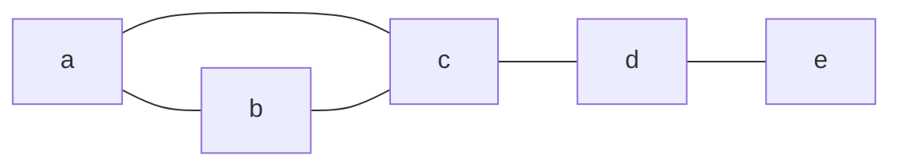
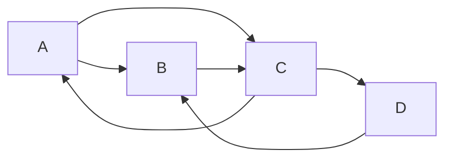
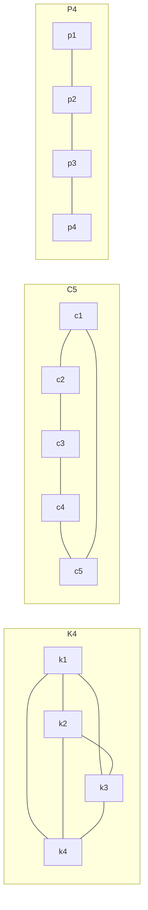
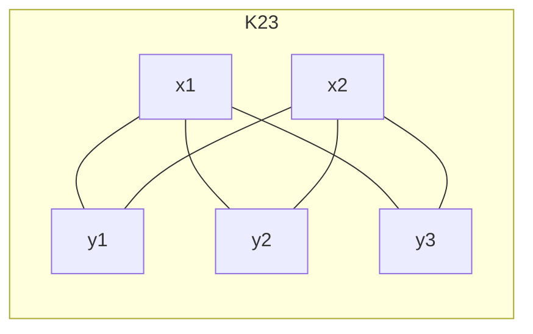
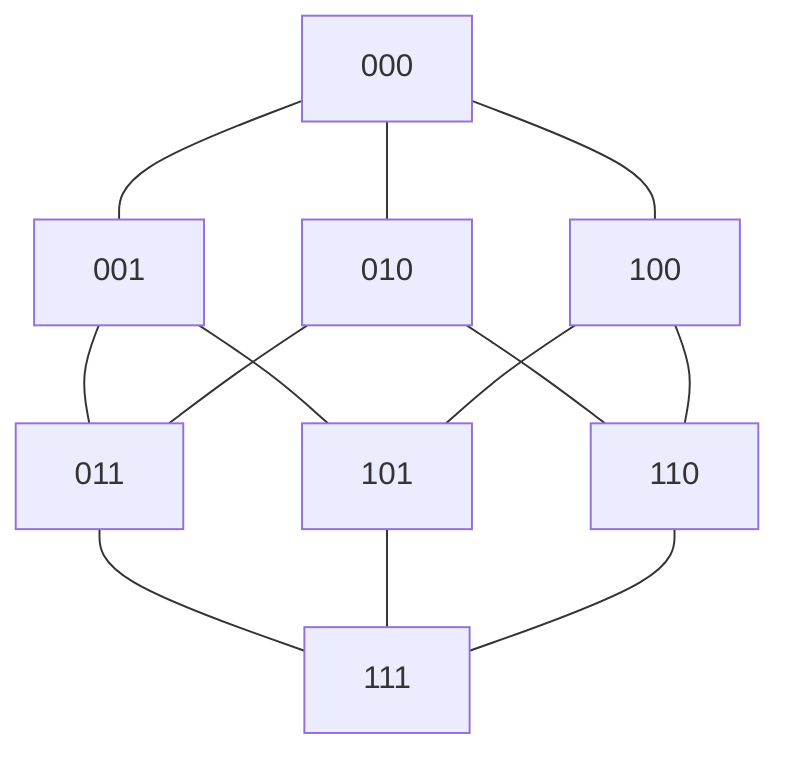
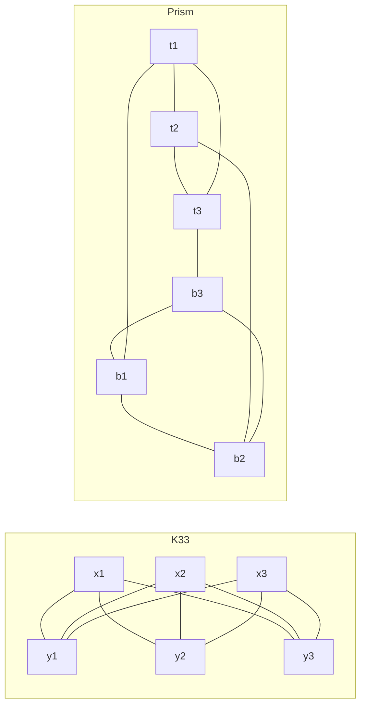
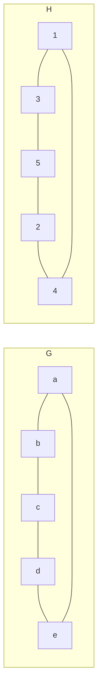

# Graph basics

After this lesson you can read and draw simple, directed and multi-graphs, compute degrees, use the handshake lemma, recognize the standard graphs $K_n$, $C_n$, $P_n$, $K_{m,n}$ and $Q_n$, decide whether two graphs are isomorphic, and choose between an adjacency matrix and an adjacency list.

Before this: [relations and their properties](../../04-proofs-and-logic/06-relations-and-functions/01-relations-and-their-properties.md#ways-to-show-a-relation) (digraphs), [direct proof](../../04-proofs-and-logic/03-core-proof-methods/01-direct-proof.md) and [number bases and conversions](../01-number-representation/01-number-bases-and-conversions.md) (bit strings, for the cube graphs).

## Quick check

Try these first. If you get all three right, skip to [Practice](#practice).

1. Can a simple graph on 7 vertices have every vertex of degree 3?
2. How many edges do $K_6$, $K_{3,4}$ and $Q_3$ have?
3. Two graphs on 6 vertices both have 6 edges and every vertex of degree 2. One is the 6-cycle $C_6$ and the other is two separate triangles. Are they isomorphic?

<details class="solution" markdown>
<summary>Answers</summary>

1. No. The degrees would add up to $7 \cdot 3 = 21$, but the degrees of a graph add up to twice the number of edges, which is even.
2. $K_6$ has $\binom{6}{2} = 15$ edges. $K_{3,4}$ has $3 \cdot 4 = 12$. $Q_3$ has 8 vertices of degree 3, so $8 \cdot 3 \div 2 = 12$ edges.
3. No. Two triangles contain a triangle and $C_6$ doesn't, and "contains a triangle" is a property that every isomorphic copy must share.

</details>

## The idea

Take a subway map. The distances on it are wrong and the stations are not where they really are, yet you can still plan a trip with it, because the only information that matters is which stations are joined by a line. A graph keeps exactly that: a set of dots and a set of connections between them, and nothing else.

The same structure shows up all over computing. Cities and roads, users and friendships, web pages and links, courses and prerequisites, tasks and the tasks they depend on, computers and cables. The questions are also similar: is there a route from here to there, what is the shortest one, can the tasks be split into groups with no conflicts, can the network be laid out on a chip without wires crossing? Those questions are the next two lessons. This one sets up the vocabulary, the first counting theorem, and the two ways a program stores a graph.

A word of warning about the word "graph". This is not the graph of a function, and a graph has no axes. The picture is one drawing of a graph, in the way that a map is one picture of a city. Two quite different drawings can show the same graph.

## Definitions

### Simple graphs

A **simple graph** $G = (V, E)$ consists of a finite nonempty set $V$ of **vertices** (singular: vertex, also called nodes) and a set $E$ of **edges**, where each edge is a set $\{u, v\}$ of two different vertices. We write the edge as $uv$, which is the same as $vu$. If $uv$ is an edge, the vertices $u$ and $v$ are **adjacent**, they are the **endpoints** of the edge, and the edge is **incident** to each of them. The **neighbours** of $v$ are all vertices adjacent to it, a set written $N(v)$.

In plain words, a simple graph is a set of dots with some pairs of dots joined by a line. Because an edge is a set of two different vertices, there are no loops (an edge from a vertex to itself), and because $E$ is a set, there is at most one edge between a given pair. We write $\lvert V \rvert$ for the number of vertices (the order of the graph) and $\lvert E \rvert$ for the number of edges (its size).

For example, take $V = \{a, b, c, d, e\}$ and $E = \{ab, ac, bc, cd, de\}$. This is the graph drawn below. Moving a vertex around the page changes the drawing and leaves the graph the same.



Compare this with a relation on $V$ from [relations and their properties](../../04-proofs-and-logic/06-relations-and-functions/01-relations-and-their-properties.md#ways-to-show-a-relation). A simple graph is a relation "is adjacent to" that is symmetric (if $u$ is adjacent to $v$ then $v$ is adjacent to $u$) and irreflexive (no vertex is adjacent to itself). Every symmetric, irreflexive relation on a finite set is a simple graph, and the other way round.

### Multigraphs and directed graphs

A **multigraph** allows more than one edge between the same two vertices (parallel edges), and often allows loops. A **directed graph**, or **digraph**, has edges with a direction: each edge is an ordered pair $(u, v)$, drawn as an arrow from $u$, the tail, to $v$, the head. In a digraph, an edge from $u$ to $v$ doesn't give an edge from $v$ to $u$.

In plain words, a multigraph lets two roads join the same pair of towns, and a digraph treats every road as one-way. A digraph is the same thing as a relation on $V$, with the arrow $(u, v)$ standing for $u \mathrel{R} v$; that is exactly the digraph of the relations lesson. A simple graph is the special case where every arrow comes with its return arrow, drawn as one line.



This digraph has the edges $AB$, $AC$, $BC$, $CA$, $CD$ and $DB$, each read as an arrow from the first letter to the second. Note that $A \to C$ and $C \to A$ are two different edges. Unless a page says otherwise, "graph" in this chapter means a simple undirected graph.

### Degree

The **degree** of a vertex $v$ in a simple graph, written $\deg(v)$, is the number of edges incident to it, which is $\lvert N(v) \rvert$. In a multigraph, a loop counts twice, so that each edge contributes 2 to the total. The largest degree in $G$ is written $\Delta(G)$, and the list of all degrees in decreasing order is the **degree sequence**. A graph is **regular** if all degrees are equal, and **$k$-regular** if they all equal $k$.

In plain words, the degree counts how many lines touch a dot. In the five-vertex graph above, the degrees are $\deg(a) = 2$, $\deg(b) = 2$, $\deg(c) = 3$, $\deg(d) = 2$ and $\deg(e) = 1$, so the degree sequence is $(3, 2, 2, 2, 1)$ and $\Delta = 3$. The letter $\Delta$ is also used in the book for "change in"; here it always has a graph as its argument.

In a digraph there are two counts. The **out-degree** $\deg^+(v)$ is the number of edges that leave $v$, and the **in-degree** $\deg^-(v)$ is the number that enter it. In the digraph above:

| Vertex | $A$ | $B$ | $C$ | $D$ |
|---|---|---|---|---|
| out-degree | 2 | 1 | 2 | 1 |
| in-degree | 1 | 2 | 2 | 1 |

### Special graphs

Five families come up so often that they have names. Each one is a simple graph.

The **complete graph** $K_n$ has $n$ vertices and an edge between every pair. The **cycle** $C_n$, for $n \ge 3$, has vertices $v_1, \dots, v_n$ and edges $v_1 v_2, v_2 v_3, \dots, v_{n-1} v_n, v_n v_1$. The **path** $P_n$ has $n$ vertices $v_1, \dots, v_n$ and the $n - 1$ edges $v_1 v_2, \dots, v_{n-1} v_n$. (Some books let $P_n$ mean the path with $n$ edges, so check the convention before comparing formulas.) The **complete bipartite graph** $K_{m,n}$ has two groups of vertices, one of $m$ and one of $n$, with an edge between each vertex of one group and each vertex of the other and no edges inside a group. The **hypercube** $Q_n$ has the $2^n$ bit strings of length $n$ as vertices, with two strings adjacent exactly when they differ in one position.







The last drawing is $Q_3$, the cube: 000 is joined to 001, 010 and 100, the strings that differ from it in one bit. The counts are below, with $\binom{n}{2} = \frac{n(n-1)}{2}$ meaning the number of ways to choose 2 of $n$ things (see [permutations and combinations](../03-counting-and-discrete-probability/02-permutations-and-combinations.md)).

| Graph | Vertices | Edges | Degrees |
|---|---|---|---|
| $K_n$ | $n$ | $\frac{n(n-1)}{2}$ | all $n - 1$ |
| $C_n$ | $n$ | $n$ | all 2 |
| $P_n$ | $n$ | $n - 1$ | 1, 1 and the rest 2 (for $n \ge 3$) |
| $K_{m,n}$ | $m + n$ | $mn$ | $n$ for the first group, $m$ for the second |
| $Q_n$ | $2^n$ | $n \cdot 2^{n-1}$ | all $n$ |

The edge counts for $K_n$ and $Q_n$ come from the handshake lemma below, which is the quickest way to get them.

### Subgraphs

A graph $H = (V', E')$ is a **subgraph** of $G = (V, E)$ if $V' \subseteq V$ and $E' \subseteq E$ (and so every edge of $H$ has both endpoints in $V'$). It is an **induced subgraph** if $E'$ contains every edge of $G$ that has both endpoints in $V'$. It is a **spanning subgraph** if $V' = V$.

In plain words, a subgraph is what is left after deleting some vertices and some edges, and an induced subgraph is what is left after deleting vertices only. Deleting a vertex removes every edge at it. In the five-vertex graph above, the triangle on $a$, $b$, $c$ is an induced subgraph: those three vertices keep all three of their edges. The subgraph with vertices $a, b, c, d$ and only the edges $ac$ and $cd$ is not induced, because $ab$ and $bc$ are edges of $G$ between kept vertices and are missing from it.

### Isomorphism

Two simple graphs $G$ and $H$ are **isomorphic**, written $G \cong H$, if there is a bijection $f \colon V(G) \to V(H)$ such that $uv$ is an edge of $G$ if and only if $f(u) f(v)$ is an edge of $H$. The function $f$ is an **isomorphism**. A property is a **graph invariant** if every two isomorphic graphs share it.

In plain words, two graphs are isomorphic when one is the other with its vertices renamed. The "if and only if" matters: $f$ must send edges to edges and also non-edges to non-edges. The bijection is a [bijective function](../../04-proofs-and-logic/06-relations-and-functions/05-injective-surjective-bijective.md), one new name for each old vertex with none left over.

*Theorem.* The number of vertices, the number of edges and the degree sequence are graph invariants.

What we know: an isomorphism $f \colon V(G) \to V(H)$ is a bijection that preserves edges and non-edges. What we want: $G$ and $H$ have the same number of vertices, the same number of edges, and the same degrees. The plan: a bijection gives the first at once; for the degrees, show $f$ matches up the neighbours of $v$ with the neighbours of $f(v)$.

*Proof.* A bijection between $V(G)$ and $V(H)$ gives $\lvert V(G) \rvert = \lvert V(H) \rvert$. Fix a vertex $v$ of $G$. If $w \in N(v)$ then $vw$ is an edge, so $f(v)f(w)$ is an edge and $f(w) \in N(f(v))$. Conversely, each neighbour $x$ of $f(v)$ is $f(w)$ for some $w$ (since $f$ is onto), and $f(v)f(w)$ being an edge forces $vw$ to be an edge. So $f$ maps $N(v)$ one-to-one onto $N(f(v))$, and $\deg(v) = \deg(f(v))$. Each degree in $G$ therefore appears in $H$ the same number of times, and since the degrees add up to twice the edge count (proved below), the edge counts agree. $\blacksquare$

Look back: any property defined only by adjacency is preserved, which gives more invariants for free, such as "contains a triangle", "contains a cycle of length 5", "is connected" and "is bipartite". Properties that depend on the drawing (where the vertices sit, how long the lines are) or on the names of the vertices are not invariants.

### Two ways to store a graph

Take a graph with vertices numbered $1, \dots, \lvert V \rvert$. Its **adjacency matrix** is the $\lvert V \rvert \times \lvert V \rvert$ array $A$ with $A_{uv} = 1$ if $uv$ is an edge and $0$ otherwise. Its **adjacency list** stores, for each vertex, the list of its neighbours. The matrix is the one from the relations lesson: row $u$ shows what $u$ points to. For a simple graph the matrix is symmetric with zeros on the diagonal, and the sum of row $v$ is $\deg(v)$. For the five-vertex graph (order $a, b, c, d, e$):

$$
A = \begin{bmatrix} 0 & 1 & 1 & 0 & 0 \\ 1 & 0 & 1 & 0 & 0 \\ 1 & 1 & 0 & 1 & 0 \\ 0 & 0 & 1 & 0 & 1 \\ 0 & 0 & 0 & 1 & 0 \end{bmatrix}
\qquad
\begin{aligned}
a &: b, c \\ b &: a, c \\ c &: a, b, d \\ d &: c, e \\ e &: d
\end{aligned}
$$

For a digraph the matrix is not symmetric: row $u$ holds the edges leaving $u$ (row sums are out-degrees) and column $v$ the edges entering $v$ (column sums are in-degrees). The costs, with $\lvert V \rvert$ vertices and $\lvert E \rvert$ edges, are these. The symbol $\Theta$ means "grows at the same rate as"; [asymptotic notation](../04-sums-recurrences-and-algorithms/04-asymptotic-notation.md) explains it.

| Operation | Matrix | List |
|---|---|---|
| Space | $\Theta(\lvert V \rvert^2)$ | $\Theta(\lvert V \rvert + \lvert E \rvert)$ |
| Is $uv$ an edge? | $\Theta(1)$ | $\Theta(\deg(u))$, searching the list |
| List the neighbours of $u$ | $\Theta(\lvert V \rvert)$, scanning the row | $\Theta(\deg(u))$ |
| Add an edge | $\Theta(1)$ | $\Theta(1)$ with a hash set |

In plain words, the matrix reserves a cell for every pair whether or not it is an edge, so it answers "is $u$ joined to $v$?" instantly and wastes space on a graph with few edges. The list spends memory only on the edges that exist. A graph is **sparse** if $\lvert E \rvert$ is far below $\lvert V \rvert^2$ and **dense** if it is close. Road maps and social networks are sparse; a graph where almost every pair is related is dense. Most graph algorithms, such as breadth-first search in the next lesson, need to walk through each vertex's neighbours, and that is cheap with lists.

## How to do it

### The handshake lemma

At a party, count the handshakes by asking each person how many hands they shook, and add up the answers. Every handshake involves two people, so it is counted twice.

*Lemma (handshake lemma).* In every graph $G = (V, E)$,

$$
\sum_{v \in V} \deg(v) = 2 \lvert E \rvert.
$$

What we know: the definition of degree, and that each edge has two endpoints. What we want: the sum of all degrees equals twice the number of edges. The plan: count the pairs (vertex, edge) with the vertex on the edge in two ways, by vertex and by edge.

*Proof.* Let $S$ be the number of pairs $(v, e)$ with $v$ a vertex and $e$ an edge incident to $v$. Counting by vertex, each vertex $v$ is in $\deg(v)$ pairs, so $S = \sum_v \deg(v)$. Counting by edge, each edge has exactly two endpoints and so is in exactly 2 pairs, so $S = 2\lvert E \rvert$. Both are $S$, so the sum of the degrees is $2\lvert E \rvert$. $\blacksquare$

Look back: the proof counts one set of pairs two ways, and the same **double counting** trick appears in counting arguments throughout the book. The statement also holds for multigraphs (with loops counted twice in the degree). For a digraph each edge has one tail and one head, so $\sum_v \deg^+(v) = \sum_v \deg^-(v) = \lvert E \rvert$.

*Corollary.* In every graph, the number of vertices of odd degree is even.

What we know: the handshake lemma. What we want: an even count of odd-degree vertices. The plan: split the sum into odd and even degrees, and see what is left.

*Proof.* Let $O$ be the set of vertices of odd degree and $W$ the set of the rest, whose degrees are even. By the handshake lemma,

$$
\sum_{v \in O} \deg(v) = 2\lvert E \rvert - \sum_{v \in W} \deg(v).
$$

The right side is even, since it is an even number minus a sum of even numbers. So the left side, a sum of $\lvert O \rvert$ odd numbers, is even. A sum of odd numbers is even only when there is an even number of terms, so $\lvert O \rvert$ is even. $\blacksquare$

Look back: this is why 7 vertices can't all have degree 3, and why 15 people can't each have exactly 3 friends among themselves. The condition is necessary but not sufficient: Practice 4 gives a list of degrees with an even sum that no simple graph has.

### Edge counts of $K_n$ and $Q_n$

Each of the $n$ vertices of $K_n$ is adjacent to the other $n - 1$, so the degrees add up to $n(n-1)$ and $\lvert E \rvert = \frac{n(n-1)}{2}$. In $Q_n$, a string has exactly $n$ neighbours, one for each position to flip. So the degrees add up to $n \cdot 2^n$ and $\lvert E \rvert = n \cdot 2^{n-1}$. For $K_{m,n}$, count directly: each of the $m$ vertices in one group has $n$ edges, and every edge has exactly one end there, so $\lvert E \rvert = mn$.

### Deciding whether two graphs are isomorphic

To show two graphs are not isomorphic you need one invariant that differs. To show they are, you need an actual bijection. Neither is a computation that always comes out quickly; no fast algorithm for isomorphism is known in general.

1. Compare the number of vertices and the number of edges.
2. Compare the degree sequences.
3. Compare other invariants: the number of triangles, the lengths of cycles, whether the degree-2 vertices are adjacent, and so on. If any invariant differs, the graphs are not isomorphic, and you are done.
4. If everything agrees, build a bijection. Match vertices of the same degree, extend through their neighbours, and use any unusual vertex as an anchor.
5. Check the bijection against every edge of one graph, and compare the edge counts so that no edge of the other graph is left over.

<div class="warning" markdown>

Watch out at step 3: agreeing on all the invariants you tried doesn't prove the graphs are isomorphic. Example 1 has two graphs with the same number of vertices, the same number of edges and the same degrees, which are still different.

</div>

## Worked examples

<div class="example" markdown>

### Example 1: same degrees, not isomorphic

Is $K_{3,3}$ isomorphic to the triangular prism, which is two triangles $t_1 t_2 t_3$ and $b_1 b_2 b_3$ joined by the edges $t_i b_i$?



Step 1: both have 6 vertices and 9 edges. Step 2: in both, every vertex has degree 3, so the degree sequences are $(3,3,3,3,3,3)$. These invariants agree, so we go to step 3.

Step 3: the prism contains a triangle, $t_1 t_2 t_3$. $K_{3,3}$ contains none: a triangle needs three vertices that are pairwise adjacent, but with only two groups, two of the three vertices fall in the same group and there is no edge between them. Having a triangle is an invariant, so the two graphs are not isomorphic.

Check: counting all triples of vertices by computer finds 0 triangles in $K_{3,3}$ and 2 in the prism, and a brute-force search over all 6-vertex graphs with 9 edges and all degrees 3 finds exactly two graphs up to isomorphism, which are these.

</div>

<div class="example" markdown>

### Example 2: isomorphic, with a different drawing

Let $G$ be the 5-cycle $a b c d e$ with edges $ab, bc, cd, de, ea$. Let $H$ be the "pentagram" on $1, \dots, 5$ with edges $13, 35, 52, 24, 41$. Show $G \cong H$.



Steps 1 to 3: both have 5 vertices and 5 edges, and every degree is 2. Nothing separates them.

Step 4: $G$ is a cycle, so walk around it and walk around $H$ in step. Send $a \mapsto 1$ and then follow $H$'s cycle $1, 3, 5, 2, 4$: $b \mapsto 3$, $c \mapsto 5$, $d \mapsto 2$, $e \mapsto 4$.

Step 5: the edges of $G$ map to $13, 35, 52, 24, 41$, which are exactly the five edges of $H$. Five edges map onto five edges, so none of $H$ is left over.

</div>

<div class="example" markdown>

### Example 3: degrees in a digraph, and its matrix

For the digraph above with edges $AB, AC, BC, CA, CD, DB$, write the adjacency matrix and read off the degrees.

Order the vertices $A, B, C, D$. Row $A$ has 1s in columns $B$ and $C$, because $A$ points to $B$ and $C$. Doing the same for each row:

$$
\begin{bmatrix} 0 & 1 & 1 & 0 \\ 0 & 0 & 1 & 0 \\ 1 & 0 & 0 & 1 \\ 0 & 1 & 0 & 0 \end{bmatrix}
$$

The row sums $2, 1, 2, 1$ are the out-degrees. The column sums $1, 2, 2, 1$ are the in-degrees. The matrix is not symmetric, since $A_{AB} = 1$ and $A_{BA} = 0$.

Check: both lists add up to 6, the number of edges, as the handshake lemma for digraphs says.

</div>

<div class="example" markdown>

### Example 4: finish it yourself

A graph is stored as the adjacency list below. Find its degree sequence and its number of edges.

$$
\begin{aligned}
1 &: 2, 3, 5 \\ 2 &: 1, 3 \\ 3 &: 1, 2, 4, 5 \\ 4 &: 3, 5 \\ 5 &: 1, 3, 4
\end{aligned}
$$

The degrees of vertices 1 and 2 are done: $\deg(1) = 3$ and $\deg(2) = 2$. Finish the other three degrees, the sequence and the edge count, and check the answer with the handshake lemma.

<details class="solution" markdown>
<summary>Finish</summary>

The lengths of the other lists give $\deg(3) = 4$, $\deg(4) = 2$ and $\deg(5) = 3$. In decreasing order the degree sequence is $(4, 3, 3, 2, 2)$. The degrees add up to $3 + 2 + 4 + 2 + 3 = 14$, so there are $14 \div 2 = 7$ edges.

Check: list the edges once each: $12, 13, 15, 23, 34, 35, 45$. That is 7 edges, and exactly two odd-degree vertices (1 and 5), an even number as the corollary requires.

</details>

</div>

## Edge cases and common mistakes

<div class="warning" markdown>

Watch out: the degrees add up to $2\lvert E \rvert$, not $\lvert E \rvert$. A graph with degrees $3, 3, 2, 2$ has 5 edges, not 10.

</div>

<div class="warning" markdown>

Watch out: a drawing is not the graph. Two lines that cross in a drawing don't create a vertex there, and the same graph can be drawn with crossings or without. The pentagram in Example 2 crosses itself and is still just a 5-cycle.

</div>

<div class="warning" markdown>

Watch out: counting edges in $K_n$ as $n^2$ or $n(n-1)$. The first counts loops and the second counts each edge once from each end. Each edge is counted once in $\frac{n(n-1)}{2}$.

</div>

<div class="note" markdown>

A loop adds 2 to the degree of its vertex, so that the handshake lemma still holds. A graph with no edges at all (but at least one vertex) is still a graph. A graph with no vertices is excluded by this chapter's definition; some books allow it.

In a digraph, the in-degrees and the out-degrees are different lists, and a vertex with out-degree 0 is a sink while one with in-degree 0 is a source. Dependency graphs for build tools and course prerequisites are digraphs with sources (things that depend on nothing) and sinks (things nothing depends on).

</div>

## Tricks and shortcuts

- Check any degree list against the handshake lemma first: the sum must be even. It is quick and rules out many wrong answers.
- A simple graph on $n$ vertices has between 0 and $\frac{n(n-1)}{2}$ edges, and each of those possible edges is either present or absent. That gives $2^{n(n-1)/2}$ graphs with the vertices named, which is 64 for $n = 4$. Up to isomorphism there are only 11, since many of the 64 are renamings of each other.
- To test isomorphism by hand, compare neighbour degrees too: if a vertex of degree 3 has neighbours of degrees $(3, 2, 2)$ in one graph and $(3, 3, 1)$ in the other, those vertices can't correspond.
- In $Q_n$, the neighbours of a string are the $n$ strings you get by flipping one bit. In code, flipping bit $k$ of the number `v` is `v ^ (1 << k)`.

## In code

The standard Python graph is a dictionary mapping each vertex to a set of neighbours, which is an adjacency list with an $O(1)$ edge test. The code builds one, checks the handshake lemma, converts to a matrix, counts degrees in a digraph, and tests isomorphism by trying every bijection (feasible only for tiny graphs).

<details class="code" markdown>
<summary>In code</summary>

```python
from itertools import permutations

def make_graph(vertices, edges):
    """Adjacency list: each vertex maps to the set of its neighbours."""
    g = {v: set() for v in vertices}
    for u, v in edges:
        g[u].add(v)          # an undirected edge is stored in both directions
        g[v].add(u)
    return g

def degrees(g):
    return {v: len(nbrs) for v, nbrs in g.items()}

def edge_list(g):
    return {frozenset((u, v)) for u in g for v in g[u]}

g = make_graph("abcde", ["ab", "ac", "bc", "cd", "de"])
print(degrees(g))                    # {'a': 2, 'b': 2, 'c': 3, 'd': 2, 'e': 1}
print(sum(degrees(g).values()), 2 * len(edge_list(g)))   # 10 10  (handshake lemma)

def to_matrix(g):
    order = sorted(g)
    return [[1 if w in g[v] else 0 for w in order] for v in order]

for row in to_matrix(g):
    print(row)                       # row sums are the degrees 2, 2, 3, 2, 1
# [0, 1, 1, 0, 0]
# [1, 0, 1, 0, 0]
# [1, 1, 0, 1, 0]
# [0, 0, 1, 0, 1]
# [0, 0, 0, 1, 0]

# A directed graph stores each arrow once, from tail to head.
d = {"A": {"B", "C"}, "B": {"C"}, "C": {"A", "D"}, "D": {"B"}}
out_deg = {v: len(heads) for v, heads in d.items()}
in_deg = {v: sum(v in heads for heads in d.values()) for v in d}
print(out_deg, in_deg)               # {'A': 2, 'B': 1, 'C': 2, 'D': 1} {'A': 1, 'B': 2, 'C': 2, 'D': 1}

def isomorphic(g, h):
    """Brute force: try every bijection. Fine for about 8 vertices, hopeless beyond."""
    if len(g) != len(h) or sorted(degrees(g).values()) != sorted(degrees(h).values()):
        return False                 # quick invariant check first
    gv, hv = sorted(g), sorted(h)
    for p in permutations(hv):
        f = dict(zip(gv, p))
        if all((f[v] in h[f[u]]) for u in g for v in g[u]):
            return True              # same degree sums, so checking g's edges is enough
    return False

c5 = make_graph("abcde", ["ab", "bc", "cd", "de", "ea"])
star = make_graph("12345", ["13", "35", "52", "24", "41"])
print(isomorphic(c5, star))          # True: the pentagram is a 5-cycle in disguise
k33 = make_graph("123456", ["14", "15", "16", "24", "25", "26", "34", "35", "36"])
prism = make_graph("123456", ["12", "23", "13", "45", "56", "46", "14", "25", "36"])
print(isomorphic(k33, prism))        # False, though both are 3-regular on 6 vertices
```

</details>

## FAQ

### Can a simple graph have two edges between the same pair of vertices?

No. $E$ is a set of 2-element sets, and a set can't contain the same element twice. If you need parallel edges, as in a road map with two roads between two towns, use a multigraph. Which one to use is a modelling choice: a social network of "is friends with" is simple, while a flight network with several flights per day between two airports is a multigraph.

### Why is the matrix so much worse for big sparse graphs?

It stores a cell for every ordered pair of vertices, which is $\lvert V \rvert^2$ cells however few edges there are. A graph of 10,000 vertices and 50,000 edges needs $10^8$ matrix cells, but only $2 \cdot 50{,}000 + 10{,}000 = 110{,}000$ list entries. The matrix is the better choice when the graph is dense, when you need $\Theta(1)$ edge tests, or when you want matrix algebra, such as counting walks with matrix powers.

### If two graphs have the same degree sequence, are they isomorphic?

Not always, as Example 1 shows. The degree sequence is a quick filter that rules graphs out, and it can't confirm that two graphs match. Up to isomorphism there are exactly two 3-regular graphs on 6 vertices, and they are the two graphs of that example.

### Is a tree a graph?

Yes, it is a special graph: connected and with no cycles. The next lesson, [paths, connectivity and trees](02-paths-connectivity-and-trees.md), takes this up, and it is why rooted trees in data structures are a special case of the graphs here.

## Practice

### Warm-up

1\. How many edges do $K_5$, $K_{4,6}$ and $Q_5$ have?

<details class="solution" markdown>
<summary>Solution</summary>

$K_5$ has $\frac{5 \cdot 4}{2} = 10$ edges. $K_{4,6}$ has $4 \cdot 6 = 24$. $Q_5$ has $5 \cdot 2^4 = 80$.

Check: in $Q_5$ there are 32 vertices of degree 5, and $32 \cdot 5 \div 2 = 80$.

</details>

2\. In a class of 25 students, can every student be friends with exactly 5 others in the class?

<details class="solution" markdown>
<summary>Solution</summary>

Model friendships as a simple graph with 25 vertices, all of degree 5. The degrees would add up to $25 \cdot 5 = 125$, which is odd, but by the handshake lemma the sum is $2\lvert E \rvert$ and must be even. So it is impossible.

Check: the corollary agrees. There would be 25 vertices of odd degree, and 25 is not even.

</details>

3\. Write the adjacency list and the adjacency matrix of the graph with vertices $1, 2, 3, 4$ and edges $12, 23, 34, 41, 13$. What are the degrees?

<details class="solution" markdown>
<summary>Solution</summary>

The list is $1: 2, 3, 4$; $2: 1, 3$; $3: 2, 4, 1$; $4: 3, 1$. The matrix, with rows and columns in the order $1, 2, 3, 4$, is

$$
\begin{bmatrix} 0 & 1 & 1 & 1 \\ 1 & 0 & 1 & 0 \\ 1 & 1 & 0 & 1 \\ 1 & 0 & 1 & 0 \end{bmatrix}
$$

The row sums give the degrees $3, 2, 3, 2$.

Check: they add up to 10, which is twice the 5 edges.

</details>

### Standard

4\. Show that no simple graph has the degree sequence $(4, 4, 3, 2, 1)$, even though the degrees add up to 14, an even number.

<details class="solution" markdown>
<summary>Solution</summary>

A simple graph with 5 vertices has at most 4 neighbours per vertex. So each vertex of degree 4 is adjacent to every other vertex. There are two such vertices, so every other vertex is adjacent to both of them and has degree at least 2. But the sequence contains a vertex of degree 1. That is a contradiction.

Check: a brute-force search over all $2^{10} = 1{,}024$ graphs on 5 labelled vertices finds none with this degree sequence.

</details>

5\. Tree $T_1$ has the edges $cx, cy, cz, zw, wu$. Tree $T_2$ has the edges $cx, cy, cz, xw, yu$. Both have the degree sequence $(3, 2, 2, 1, 1, 1)$. Show they are not isomorphic.

<details class="solution" markdown>
<summary>Solution</summary>

In $T_1$ the degree-2 vertices are $z$ and $w$, and they are joined by the edge $zw$. In $T_2$ the degree-2 vertices are $x$ and $y$, and there is no edge $xy$. An isomorphism maps degree-2 vertices to degree-2 vertices and keeps edges as edges and non-edges as non-edges, so it would have to map the adjacent pair in $T_1$ to an adjacent pair of degree-2 vertices in $T_2$. There is none.

Check: both trees have 6 vertices, 5 edges and the same degrees, so those invariants can't separate them. The adjacent pair of degree-2 vertices is what does.

</details>

6\. A social network has 2,000,000 users, each with 150 friends on average. Compare the number of entries stored by an adjacency matrix and by an adjacency list.

<details class="solution" markdown>
<summary>Solution</summary>

The matrix has $2{,}000{,}000^2 = 4 \times 10^{12}$ cells. The list stores each friendship twice (once at each end), which by the handshake lemma is the sum of the degrees: $2{,}000{,}000 \cdot 150 = 3 \times 10^8$ entries, plus 2,000,000 vertex headers. The matrix is about $\frac{4 \times 10^{12}}{3 \times 10^8} \approx 13{,}000$ times bigger.

Check: at one bit per cell the matrix would still need $4 \times 10^{12}$ bits, which is 500 gigabytes, while $3 \times 10^8$ four-byte entries is about 1.2 gigabytes.

</details>

### Challenge

7\. Prove that in every group of at least two people there are two who have the same number of friends within the group. (Friendship is mutual and nobody is their own friend.)

<details class="solution" markdown>
<summary>Solution</summary>

What we know: a simple graph with $n \ge 2$ vertices, with each degree between 0 and $n - 1$. What we want: two vertices of equal degree. The plan: show that only $n - 1$ different degree values can occur, and use the [pigeonhole principle](../03-counting-and-discrete-probability/04-inclusion-exclusion-and-pigeonhole.md).

Suppose a vertex has degree 0 and another has degree $n - 1$. The one with degree $n - 1$ is adjacent to every other vertex, including the one with degree 0, which is a contradiction. So the degrees avoid 0 or avoid $n - 1$. In either case the $n$ vertices take values in a set of at most $n - 1$ numbers, and two of them must share a value.

Check: for $n = 2$, the vertices have degrees $(0, 0)$ or $(1, 1)$. A brute-force check of every graph with up to 6 vertices finds no graph with all degrees different.

</details>

8\. This one reviews relations. Let $R = \{(1,2), (2,1), (2,3), (3,2), (3,4), (4,3), (4,1), (1,4)\}$ on $\{1, 2, 3, 4\}$. (a) Which of reflexive, symmetric, antisymmetric and transitive does $R$ have? (b) Which simple graph is it?

<details class="solution" markdown>
<summary>Solution</summary>

(a) $R$ is not reflexive: $(1,1) \notin R$. It is symmetric, since every pair has its reverse in $R$. It is not antisymmetric: both $(1,2)$ and $(2,1)$ are in $R$ and $1 \ne 2$. It is not transitive: $(1,2)$ and $(2,3)$ are in $R$, but $(1,3)$ is not. (It is irreflexive, as no pair $(a, a)$ appears.)

(b) A symmetric irreflexive relation is a simple graph with one edge for each pair of arrows: the edges are $12, 23, 34, 41$, which is the 4-cycle $C_4$.

Check: the graph has $8 \div 2 = 4$ edges, and each vertex has degree 2.

</details>

## Where this shows up

- The next lesson, [paths, connectivity and trees](02-paths-connectivity-and-trees.md), adds walks, shortest paths and trees. After it, [bipartite graphs, colouring and planar graphs](03-bipartite-coloring-and-planar-graphs.md) uses the handshake lemma for edge counts and the invariants for telling graphs apart.
- In an algorithms course the first choice is adjacency list or matrix, and the running times of breadth-first search, depth-first search and Dijkstra's algorithm are stated in $\lvert V \rvert$ and $\lvert E \rvert$ for exactly that reason.
- Relational databases, web crawlers, dependency solvers in package managers, and social networks all store a graph. In economics, networks of trade, lending between banks and supply chains are modelled as (often directed, weighted) graphs.
- Hypercubes $Q_n$ appear in Gray codes, in the layout of parallel computers, and in error-correcting codes, where the distance between two bit strings is the number of positions they differ in.
