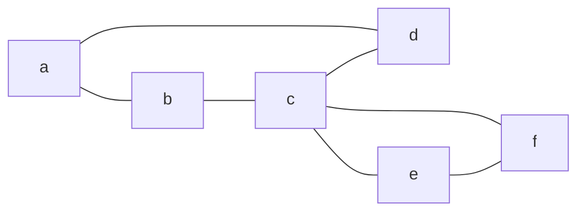
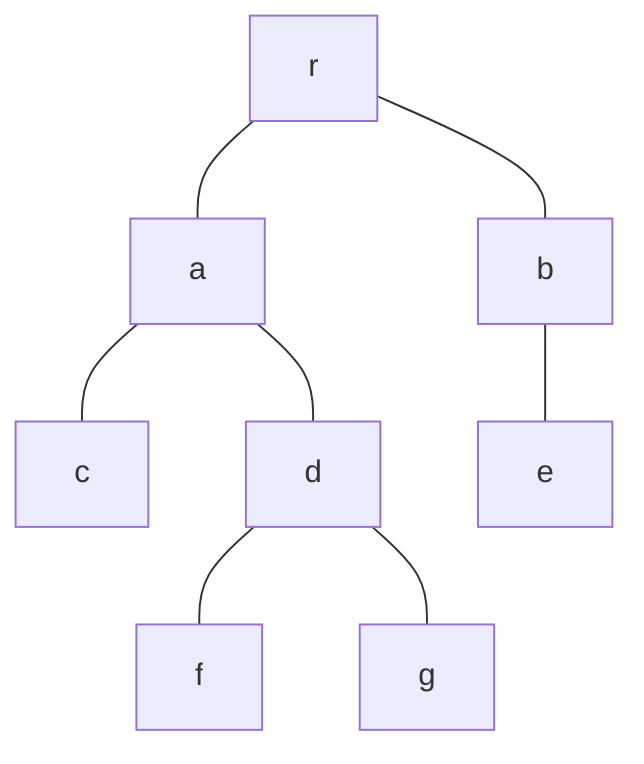
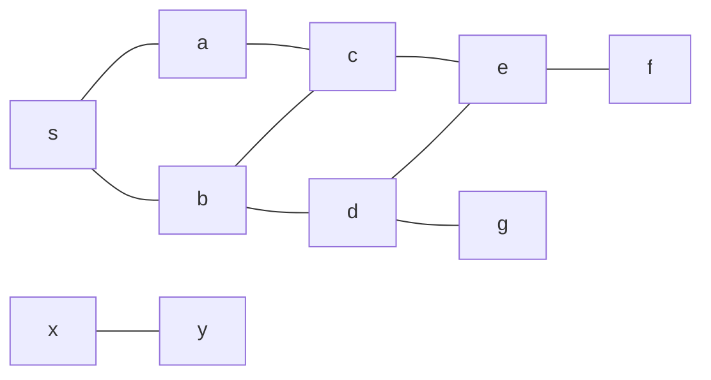
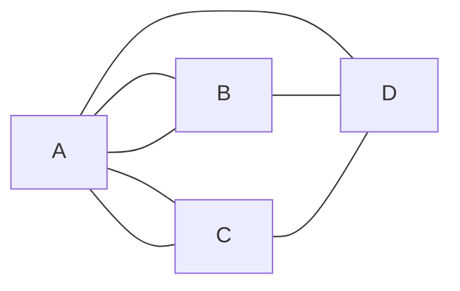
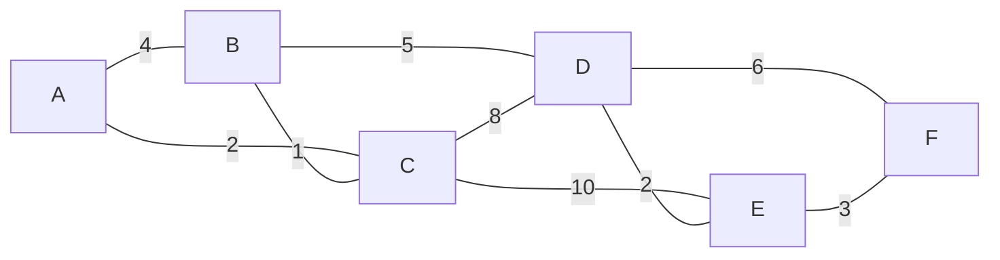

# Paths, connectivity and trees

After this lesson you can tell walks, trails, paths and cycles apart, find the connected components and shortest path lengths of a graph with breadth-first search, decide whether a graph has an Euler circuit, prove that a tree on $n$ vertices has $n - 1$ edges, and build a minimum spanning tree with Kruskal's algorithm.

Before this: [graph basics](01-graph-basics.md), [equivalence relations and partitions](../../04-proofs-and-logic/06-relations-and-functions/02-equivalence-relations-and-partitions.md), [mathematical induction](../../04-proofs-and-logic/05-induction/01-mathematical-induction.md) and [strong induction and well-ordering](../../04-proofs-and-logic/05-induction/02-strong-induction-and-well-ordering.md). The proof of the shortest-walk lemma is a [proof by contradiction](../../04-proofs-and-logic/03-core-proof-methods/06-proof-by-contradiction.md).

## Quick check

Try these first. If you get all three right, skip to [Practice](#practice). Let $G$ have the vertices $a, b, c, d, e, f$ and the edges $ab, bc, cd, da, ce, ef, fc$.

1. Give a path from $a$ to $e$ of length 3. How far is $a$ from $e$?
2. A tree has 12 vertices. How many edges does it have?
3. A connected graph has 6 vertices and 5 edges. Can it contain a cycle?

<details class="solution" markdown>
<summary>Answers</summary>

1. The path $a, b, c, e$ has length 3 (three edges). No shorter walk exists, because $a$ isn't adjacent to $e$ and no vertex is adjacent to both, so the distance is 3.
2. 11, because a tree on $n$ vertices has $n - 1$ edges.
3. No. A connected graph on 6 vertices with 5 edges is a tree, and trees have no cycles.

</details>

## The idea

A route on a map is a sequence of towns where each is joined to the next by a road. The questions people ask about routes are the questions this lesson answers. Can you get from here to there at all? If so, what is the fewest number of roads on the way? Can a delivery truck use every road exactly once and end where it started? What is the cheapest set of roads that keeps all the towns connected?

The first question splits a graph into separate pieces: towns you can reach from each other and towns you can't. The second is breadth-first search. The third was the first theorem of graph theory. The fourth leads to trees, which are connected graphs with no wasted edges, and to the algorithm that finds the cheapest one.

Trees get their own treatment because they show up everywhere in computing: file systems, parse trees, heaps, search trees, the call tree of a recursive function. They are also the simplest graphs for proofs, since you can pull a leaf off a tree and induct on what is left.

## Definitions

### Walks, trails, paths and cycles

Let $G$ be a simple graph. A **walk** of length $k$ from $u$ to $v$ is a sequence of vertices $u = x_0, x_1, \dots, x_k = v$ in which each $x_{i-1} x_i$ is an edge. It is **closed** if $x_0 = x_k$. A **trail** is a walk that uses no edge twice. A **path** is a walk that uses no vertex twice. A **cycle** is a closed walk of length $k \ge 3$ in which $x_0, \dots, x_{k-1}$ are all different.

In plain words, a walk is a way of moving along edges, with repeats allowed. A trail never repeats an edge, a path never repeats a vertex (and so never repeats an edge either), and a cycle is a path that comes back to its start. The length counts edges, so a path with 4 vertices has length 3. A single vertex is a path of length 0.

| Walk | Repeats a vertex? | Repeats an edge? | Closed? |
|---|---|---|---|
| walk | allowed | allowed | maybe |
| trail | allowed | no | maybe |
| path | no | no | no |
| closed trail ("circuit") | the start only, or more | no | yes |
| cycle | no, except start = end | no | yes |

A closed walk of length 3 or more with different vertices (apart from start and end) is a cycle, and the condition $k \ge 3$ rules out walking along one edge and back, which is not a cycle in a simple graph. Terms differ between books: some use "path" for what is called a walk here, and some use "simple path" for what is called a path. Check the definitions before comparing results.

For example, in the graph $G$ of the quick check,



the sequence $a, b, c, e$ is a path, $b, c, e, f, c, d$ is a trail that is not a path (it visits $c$ twice), $a, b, a, d$ is a walk that is not a trail (it uses $ab$ twice), and $c, e, f, c$ is a cycle of length 3.

### Connectivity and components

Two vertices $u$ and $v$ are **connected** if there is a walk from $u$ to $v$. A graph is **connected** if every two vertices are connected. A **connected component** of a graph is a maximal set of vertices that are all connected to each other, together with the edges among them.

In plain words, a graph is connected if it is all one piece, and the components are the separate pieces. In the graph drawn for Example 2 below, the vertices $x$ and $y$ form a component of their own.

It doesn't matter whether we ask for a walk or a path. A walk can be shortened to a path, which is the first lemma below.

*Lemma 1.* If there is a walk from $u$ to $v$, then there is a path from $u$ to $v$ (using only vertices that the walk visits).

What we know: a walk from $u$ to $v$ exists. What we want: one with no repeated vertex. The plan is a proof by contradiction applied to a shortest walk. By the well-ordering principle, the lengths of walks from $u$ to $v$ have a smallest value, so a shortest walk exists, and we show it can't repeat a vertex.

*Proof.* Let $x_0, x_1, \dots, x_k$ be a shortest walk from $u$ to $v$. Suppose a vertex repeats, say $x_i = x_j$ with $i < j$. Delete the part between the two visits:

$$
x_0, \dots, x_i, x_{j+1}, \dots, x_k.
$$

This is still a walk: $x_i = x_j$ is adjacent to $x_{j+1}$. It runs from $u$ to $v$ and its length is $k - (j - i)$, which is less than $k$. That contradicts the choice of a shortest walk. So no vertex repeats, and the shortest walk is a path. $\blacksquare$

Look back: the proof also shows that a shortest walk is always a path. That is why distance, below, can be defined by paths or by walks with the same answer.

*Theorem 2.* "Is connected to" is an equivalence relation on the vertices of a graph, and its equivalence classes are the vertex sets of the connected components.

What we know: the definition of a walk, and the three properties from [equivalence relations and partitions](../../04-proofs-and-logic/06-relations-and-functions/02-equivalence-relations-and-partitions.md). What we want: reflexive, symmetric and transitive. The plan: build the walks needed in each case.

*Proof.* Reflexive: the single vertex $v$ is a walk of length 0 from $v$ to $v$. Symmetric: if $x_0, \dots, x_k$ is a walk from $u$ to $v$, then $x_k, \dots, x_0$ is a walk from $v$ to $u$. Transitive: if there is a walk from $u$ to $v$ and a walk from $v$ to $w$, then writing the first and then the second (sharing the vertex $v$) is a walk from $u$ to $w$. So the relation is an equivalence relation, and its classes partition the vertex set. Two vertices are in the same class exactly when they are connected, which is what it means to lie in one component. $\blacksquare$

Look back: this is why the picture of "separate pieces" is right: every vertex lies in exactly one component, and no vertex lies in two. The number of components is written $c(G)$. A graph is connected exactly when $c(G) = 1$.

### Distance

The **distance** $d(u, v)$ between two vertices is the length of a shortest path from $u$ to $v$, and is $\infty$ if there is no path. In plain words, it is the fewest edges you need to get there. The distance is $0$ only when $u = v$, and $d(u, v) = d(v, u)$.

### Euler circuits

An **Euler circuit** is a closed trail that uses every edge of the graph exactly once. An **Euler trail** is a trail (not necessarily closed) that uses every edge exactly once. In plain words, you can draw the whole graph without lifting the pen and without going over any line twice; for a circuit you end where you started. These definitions work for multigraphs too, and the vertices with no edges are ignored.

### Trees

A **tree** is a connected graph with no cycles. A graph with no cycles, connected or not, is a **forest**, so each component of a forest is a tree. A **leaf** is a vertex of degree 1.

In plain words, a tree is a graph that is connected with no spare edges: take any edge out and it falls into two pieces, and put any edge in and you make a cycle. The path $P_n$ and the star $K_{1,m}$ are trees. The cycle $C_n$ is not.

A **rooted tree** is a tree with one vertex chosen as the **root** $r$. For every vertex $v \ne r$, its **parent** is the neighbour of $v$ on the path from $v$ to $r$, and $v$ is a **child** of that vertex. The **depth** of a vertex is its distance from the root, and the **height** of the tree is the largest depth. The **ancestors** of $v$ are the vertices on the path from $v$ to $r$, and a vertex with no children is a leaf of the rooted tree. A **binary tree** is a rooted tree in which every vertex has at most 2 children.



With $r$ as the root, the depths are $r$: 0; $a$ and $b$: 1; $c$, $d$ and $e$: 2; $f$ and $g$: 3. The height is 3, the parent of $f$ is $d$, and the ancestors of $f$ are $d$, $a$ and $r$. The leaves of the rooted tree are $c$, $e$, $f$ and $g$. A root with exactly one child has degree 1 but is not a leaf of the rooted tree.

### Spanning trees and weights

A **spanning tree** of a connected graph $G$ is a subgraph that contains every vertex of $G$ and is a tree. In plain words, it keeps all the vertices connected using as few edges as possible. A **weighted graph** gives each edge $e$ a number $w(e)$, its weight (a cost or a length), and the weight of a spanning tree is the sum of the weights of its edges. A **minimum spanning tree** (MST) is a spanning tree of the smallest possible weight.

## How to do it

### Breadth-first search

Breadth-first search (BFS) finds the distance from a start vertex $s$ to every other vertex by exploring in layers: first $s$, then its neighbours, then their neighbours, and so on.

1. Put $s$ in a queue (first in, first out) and set $d(s) = 0$.
2. Take the vertex $u$ at the front of the queue.
3. For each neighbour $w$ of $u$ not seen before, set $d(w) = d(u) + 1$, record $u$ as the parent of $w$, and put $w$ at the back of the queue.
4. Repeat steps 2 and 3 until the queue is empty.
5. Every vertex that has a $d$ value is reachable from $s$ and $d$ is its distance; the others are in other components. To read off a shortest path to $t$, follow parents from $t$ back to $s$.
6. Check one answer by finding a path of that length and arguing that no shorter one exists.

Why it works: BFS handles every vertex at distance $k$ before any vertex at distance $k + 1$, because the queue holds the layers in order. We can state this without the queue. Define layers $L_0 = \{s\}$ and, for each $k \ge 0$, let $L_{k+1}$ be the set of vertices that lie in none of $L_0, \dots, L_k$ and have a neighbour in $L_k$.

*Theorem 3.* For each $k \ge 0$, the layer $L_k$ is exactly the set of vertices at distance $k$ from $s$.

What we know: the definition of the layers. What we want: $L_k = \{v : d(s, v) = k\}$. The plan: strong induction on $k$.

*Proof.* For $k = 0$, only $s$ has distance 0, and $L_0 = \{s\}$. Assume the claim for all layers up to $L_k$.

Let $d(s, v) = k + 1$, and take a shortest path from $s$ to $v$. The vertex $w$ just before $v$ on it has $d(s, w) \le k$, and in fact $d(s, w) = k$, since a smaller value would give $d(s, v) \le k$. By the hypothesis $w \in L_k$. Also $v$ is in none of $L_0, \dots, L_k$, because those hold exactly the vertices at distance at most $k$. So $v \in L_{k+1}$.

Conversely, let $v \in L_{k+1}$. It has a neighbour in $L_k$, so $d(s, v) \le k + 1$. It is in none of $L_0, \dots, L_k$, which hold all the vertices at distance at most $k$, so $d(s, v) > k$. Hence $d(s, v) = k + 1$. $\blacksquare$

Look back: the queue version produces these layers one after another. Each vertex is put in the queue once, and each edge is looked at twice (once from each end), so with an adjacency list the running time is $\Theta(\lvert V \rvert + \lvert E \rvert)$. The parent edges form a spanning tree of the component (the BFS tree), which shows up again below. BFS counts edges, so it finds the fewest roads and not the shortest total length; with road lengths you need Dijkstra's algorithm.

### Finding components

1. Pick any unvisited vertex and run BFS from it.
2. The vertices reached form one component. Mark them visited.
3. Repeat from step 1 while some vertex is unvisited.
4. The number of times you started a BFS is $c(G)$.

### Euler's theorem

*Theorem 4 (Euler).* Let $G$ be a connected graph (multigraphs allowed). Then $G$ has an Euler circuit if and only if every vertex has even degree. It has an Euler trail that is not closed if and only if exactly two vertices have odd degree, and the trail must start at one of them and end at the other.

What we know: degrees, and that a trail uses each edge at most once. What we want: both directions. The plan: for "only if", pair up the edges at each vertex; for "if", build a closed trail and splice in what it missed. The second half is a proof sketch.

*Proof (only if).* Follow an Euler circuit. Each time it passes through a vertex $v$ that is not the start, it arrives on one edge and leaves on another. The start vertex is left on the first edge and entered on the last. So the edges at every vertex come in pairs, and each edge is in exactly one pair. Hence every degree is even.

*Proof sketch (if).* Use induction on the number of edges. Start at any vertex and keep walking along unused edges. Whenever we enter a vertex other than the start, we have used an odd number of its edges (it has an even number in total), so there is an unused edge to leave by. So the walk can only get stuck at the start, which gives a closed trail $T$. If $T$ uses every edge, we are done. If not, remove the edges of $T$. Every vertex still has even degree, and because $G$ is connected, some vertex $x$ of $T$ still has an unused edge. The component of the leftover graph that contains $x$ is connected with all degrees even and fewer edges, so it has an Euler circuit by the induction hypothesis. Splice that circuit into $T$ at $x$. Repeat for any other leftover component. $\square$

For an Euler trail from $u$ to $v$ add an edge $uv$ and apply the theorem: the new graph has an Euler circuit exactly when the old one has an Euler trail between $u$ and $v$. The new edge changes only the degrees of $u$ and $v$, so the old degrees of $u$ and $v$ are odd and all others even.

Look back: the theorem turns a search over all possible trails into a check of degrees, which takes one pass over the graph. The bridges of Königsberg are the standard example, in Example 3. A Hamilton cycle, which visits every *vertex* once, sounds like a close cousin, but no degree test is known for it.

### Trees: facts and characterisations

*Lemma 5.* A tree with at least 2 vertices has at least two leaves.

What we know: a tree is connected and has no cycles. What we want: two vertices of degree 1. The plan: take a longest path; its two ends can't have other neighbours.

*Proof.* A tree with at least 2 vertices is connected, so it has an edge, and so a path of length at least 1. Take a longest path $v_0, v_1, \dots, v_k$. Suppose $v_0$ has a neighbour $w$ other than $v_1$. If $w$ is on the path, say $w = v_i$ with $i \ge 2$, then $v_0, v_1, \dots, v_i, v_0$ is a cycle, which a tree doesn't have. If $w$ is not on the path, then $w, v_0, \dots, v_k$ is a longer path, a contradiction. So $v_0$ has degree 1. The same argument applies to $v_k$, and $v_0 \ne v_k$. $\blacksquare$

*Lemma 6.* If $v$ is a leaf of a tree $T$, then $T - v$ (delete $v$ and its edge) is a tree.

*Proof.* $T - v$ has no cycles, since $T$ has none. It is connected: take two vertices $x, y$ other than $v$ and a path between them in $T$. A vertex in the middle of a path has two neighbours on it, but $v$ has only one neighbour, so $v$ is not in the middle. It isn't an end either, since $x$ and $y$ are not $v$. So the path avoids $v$ and lies in $T - v$. $\blacksquare$

*Theorem 7.* A tree with $n$ vertices has exactly $n - 1$ edges.

What we know: Lemmas 5 and 6. What we want: the edge count $n - 1$ for every $n \ge 1$. The plan: induction on $n$, removing a leaf.

*Proof.* Let $P(n)$ say "every tree with $n$ vertices has $n - 1$ edges". Base case: a tree with 1 vertex has 0 edges, and $1 - 1 = 0$. Step: assume $P(k)$ for some $k \ge 1$ and let $T$ be a tree with $k + 1$ vertices. Since $k + 1 \ge 2$, Lemma 5 gives a leaf $v$. By Lemma 6, $T - v$ is a tree with $k$ vertices, so it has $k - 1$ edges by $P(k)$. The tree $T$ has one more edge, the one at $v$, so $k = (k + 1) - 1$ edges. So $P(k + 1)$ holds, and $P(n)$ is true for all $n \ge 1$. $\blacksquare$

Look back: the proof is the pattern for almost every induction on trees: delete a leaf, apply the hypothesis, put it back. Adding up the degrees shows the other form of the fact: the degrees of a tree add up to $2(n - 1)$.

*Theorem 8.* For a graph $G$ with $n$ vertices, these four statements are equivalent:

- (a) $G$ is a tree (connected with no cycles).
- (b) For every two vertices there is exactly one path between them.
- (c) $G$ is connected and has $n - 1$ edges.
- (d) $G$ has no cycles and has $n - 1$ edges.

What we know: the definition and Theorem 7. What we want: that each statement implies the others. The plan: show (a) is equivalent to each of the other three; the equivalence of (b), (c) and (d) then follows.

*Proof.* (a) implies (c) and (d) by Theorem 7, because a tree is connected, has no cycles, and has $n - 1$ edges.

(a) implies (b). A connected graph has at least one path between any two vertices. Suppose two different paths $p_0, \dots, p_k$ and $q_0, \dots, q_l$ run from $u$ to $v$. Let $i$ be the first index at which they differ, so they agree up to $p_i = q_i$ and $p_{i+1} \ne q_{i+1}$. Let $p_j$ be the first vertex after $p_i$ on the first path that also lies on the second path (it exists, since $v$ is on both), say $p_j = q_m$. The two pieces from $p_i$ to $p_j$, one along each path, share no vertices except their ends. They can't both be the single edge $p_i p_j$, as that would make $p_{i+1} = p_j = q_{i+1}$. So together they form a cycle, which a tree doesn't have. So the path is unique.

(b) implies (a). By (b), any two vertices are joined by a path, so $G$ is connected. If $G$ had a cycle, two adjacent vertices $x, y$ on it would be joined by the edge $xy$ and also by the rest of the cycle, a path of length at least 2. Two different paths contradict (b).

(c) implies (a). Suppose $G$ is connected with $n - 1$ edges and has a cycle. Deleting an edge of a cycle keeps $G$ connected, because any walk that used the edge can go around the rest of the cycle instead. Delete cycle edges until none are left. The result is connected with no cycles, a tree with $n$ vertices, so it has $n - 1$ edges by Theorem 7. But at least one edge was deleted from $G$'s $n - 1$, a contradiction. So $G$ has no cycles, and it is a tree.

(d) implies (a). Suppose $G$ has no cycles and $n - 1$ edges, and has $c$ components. Each component is a tree, so with $n_i$ vertices it has $n_i - 1$ edges. The edge total is $\sum (n_i - 1) = n - c$. So $n - c = n - 1$, which gives $c = 1$, and $G$ is connected. $\blacksquare$

Look back: (c) and (d) say a tree is a connected graph with the fewest edges possible, and also an acyclic graph with the most edges possible. A graph with $n - 1$ edges isn't a tree by that fact alone: a triangle plus an isolated vertex has 4 vertices and 3 edges, and it fails both (a), by having a cycle, and (b).

### Spanning trees and the minimum spanning tree

*Theorem 9.* Every connected graph has a spanning tree.

*Proof.* If $G$ has a cycle, delete one edge of it. The graph stays connected and keeps all its vertices. Repeat. Each step removes an edge, and there are finitely many, so the process stops, and it stops only when there are no cycles. The result is a connected graph with no cycles that contains every vertex, which is a spanning tree. $\blacksquare$

Look back: the BFS tree is another spanning tree, and by Theorem 7 every spanning tree of a connected graph with $n$ vertices has $n - 1$ edges. This also shows that a connected graph has at least $n - 1$ edges. The number of spanning trees can be large: $K_n$ has $n^{n-2}$ of them (Cayley's formula, stated here without proof), which is 16 for $K_4$ and 125 for $K_5$, and the cycle $C_n$ has $n$.

For weights, **Kruskal's algorithm** builds a minimum spanning tree greedily:

1. Sort the edges by weight, from lightest to heaviest.
2. Start with a forest $F$ that has every vertex and no edges.
3. Go through the edges in order. For each edge $uv$, if $u$ and $v$ are in different components of $F$, add $uv$ to $F$. Otherwise skip it, since it would close a cycle.
4. Stop after $n - 1$ edges have been added, or when the edges run out.
5. Check by adding up the weights and by confirming that $F$ is connected with $n - 1$ edges.

Why step 3 is safe is the cut property. A **cut** of a graph is a split of the vertices into a nonempty set $S$ and the rest $V \setminus S$, and an edge **crosses** the cut if one end is in $S$ and the other is not.

*Cut property.* Let $F$ be a set of edges that is contained in some minimum spanning tree. Let $S$ be a set of vertices with no edge of $F$ crossing between $S$ and $V \setminus S$, and let $e$ be a lightest edge crossing the cut. Then $F \cup \{e\}$ is also contained in some minimum spanning tree.

*Proof.* Let $T$ be a minimum spanning tree containing $F$. If $e \in T$ we are done. If not, $T$ has a path between the two ends of $e$, and since the ends are on opposite sides of the cut, some edge $f$ of this path crosses the cut. Then $f \notin F$, since no edge of $F$ crosses. Swap: $T' = T - f + e$. It has $n - 1$ edges and is connected (anything that used $f$ can go around through $e$ and the rest of the path), so it is a spanning tree by Theorem 8. Its weight is $w(T) - w(f) + w(e) \le w(T)$ because $e$ is a lightest crossing edge. So $T'$ is also a minimum spanning tree, and it contains $F \cup \{e\}$. $\blacksquare$

Kruskal's algorithm fits this exactly. When it adds $uv$, take $S$ to be the component of $F$ containing $u$. Every edge crossing the cut was either considered later than $uv$ (so it's at least as heavy) or earlier and skipped, which could only happen if its ends were already in one component, so it doesn't cross. So $uv$ is a lightest crossing edge, and the cut property keeps $F$ inside a minimum spanning tree at every step. At the end $F$ is a spanning tree inside a minimum spanning tree, so it is that tree. In a program, "are $u$ and $v$ in different components?" is answered by a union-find structure, which maintains the equivalence classes of Theorem 2 as edges are added.

## Worked examples

<div class="example" markdown>

### Example 1: classifying walks

In the graph $G$ of the quick check, classify each sequence as a walk, trail, path, circuit or cycle (the most specific word that applies): (a) $a, d, c, e, f$, (b) $b, c, e, f, c, b$, (c) $c, e, f, c$, (d) $a, b, c, b, a$.

First check that every consecutive pair is an edge, since otherwise it is not a walk at all. Then check for repeated edges (trail) and repeated vertices (path) using the table in the definitions.

(a) The edges are $ad, dc, ce, ef$, all different, and the vertices $a, d, c, e, f$ are all different. It's a path of length 4.

(b) The edges are $bc, ce, ef, fc, cb$. The edge $cb$ is the same as $bc$, used twice, so it is a walk but not a trail.

(c) The edges are $ce, ef, fc$, all different. It is closed, its length is 3 and the vertices $c, e, f$ are different. It's a cycle.

(d) The edges are $ab, bc, cb, ba$, so $ab$ and $bc$ are each used twice. It is a closed walk, but not a trail, so not a cycle.

Check: a cycle needs length at least 3 with no repeated edge, and only (c) has both. Sequence (d) goes along edges and straight back, which is why cycles are required to have length 3 or more.

</div>

<div class="example" markdown>

### Example 2: BFS and components

Run BFS from $s$ in the graph with edges $sa, sb, ac, bc, bd, ce, de, ef, dg, xy$.



Step 1: the queue is $s$ with $d(s) = 0$. Steps 2 and 3: take $s$ and give its unseen neighbours $a$ and $b$ the distance 1. Take $a$: its unseen neighbour is $c$, with distance 2. Take $b$: its unseen neighbours are $d$ (distance 2) and $c$ is already seen. Take $c$: $e$ gets 3. Take $d$: $g$ gets 3. Take $e$: $f$ gets 4. The rest add nothing.

| Layer | $L_0$ | $L_1$ | $L_2$ | $L_3$ | $L_4$ |
|---|---|---|---|---|---|
| Vertices | $s$ | $a, b$ | $c, d$ | $e, g$ | $f$ |

Step 5: $d(s, f) = 4$. Following parents back from $f$ gives the path $s, a, c, e, f$. Another shortest path is $s, b, d, e, f$, so shortest paths need not be unique. The vertices $x$ and $y$ were never reached, so they are in another component and $d(s, x) = \infty$. The graph has $c(G) = 2$ components.

Check: no path of length 3 from $s$ to $f$ exists, since the only neighbour of $f$ is $e$ and $d(s, e) = 3$ (the neighbours of $e$ are $c, d, f$, at distances 2, 2, 4).

</div>

<div class="example" markdown>

### Example 3: Euler circuits

Does the graph $G$ of the quick check have an Euler circuit? Do the seven bridges of Königsberg allow a walk crossing each bridge once?

The degrees in $G$ are $a$: 2, $b$: 2, $c$: 4, $d$: 2, $e$: 2, $f$: 2, all even, and $G$ is connected. By Theorem 4 there is an Euler circuit. To find one, follow the proof: walk $a, b, c, e, f, c, d, a$. It uses $ab, bc, ce, ef, fc, cd, da$, which is all seven edges once each.

For Königsberg, the four land masses $A, B, C, D$ are vertices and the seven bridges are edges (a multigraph):



The degrees are $A$: 5, $B$: 3, $C$: 3, $D$: 3. All four are odd, but an Euler trail allows at most two odd vertices, so there is no such walk.

Check: the degrees add up to $5 + 3 + 3 + 3 = 14 = 2 \cdot 7$, matching the seven bridges.

</div>

<div class="example" markdown>

### Example 4: finish it yourself, Kruskal's algorithm

Find a minimum spanning tree of this weighted graph on $A, \dots, F$.



Step 1: sorted, the edges are $BC\,(1)$, $AC\,(2)$, $DE\,(2)$, $EF\,(3)$, $AB\,(4)$, $BD\,(5)$, $DF\,(6)$, $CD\,(8)$, $CE\,(10)$. Step 3: add $BC$. Add $AC$ ($A$ is not yet connected to $C$). Add $DE$. Add $EF$. Now $F$ has the components $\{A, B, C\}$ and $\{D, E, F\}$. The next edge is $AB$ at weight 4. Decide for it and the rest, and give the total weight.

<details class="solution" markdown>
<summary>Finish</summary>

The edge $AB$ joins $A$ and $B$, which are already in the same component $\{A, B, C\}$ (through $C$), so skip it. The edge $BD$ joins $\{A, B, C\}$ to $\{D, E, F\}$, so add it. That makes 5 edges for 6 vertices, so stop.

The tree is $BC, AC, DE, EF, BD$ with weight $1 + 2 + 2 + 3 + 5 = 13$.

Check: it has $n - 1 = 5$ edges and is connected, so it is a spanning tree. A computer check of every set of 5 edges that forms a spanning tree finds no weight below 13, and only this tree reaches 13.

</details>

</div>

## Edge cases and common mistakes

<div class="warning" markdown>

Watch out: $n - 1$ edges alone doesn't make a tree. You need either connected or no cycles as well (Theorem 8). A triangle with an isolated vertex has 4 vertices and 3 edges and is not a tree.

</div>

<div class="warning" markdown>

Watch out: a cycle needs at least 3 edges in a simple graph. Going along an edge and straight back is a closed walk, not a cycle, and a graph that is a single edge is a tree.

</div>

<div class="warning" markdown>

Watch out at step 3 of Kruskal's algorithm: the test is whether the two ends are in different components, not whether the edge touches a vertex already in $F$. Edge $BD$ in Example 4 touches vertices already in $F$ at both ends, and is still the right edge to add.

</div>

<div class="warning" markdown>

Watch out: BFS finds the path with the fewest edges, not the smallest total weight. In a weighted graph a path with more edges can be cheaper. The minimum spanning tree is a different object again: it connects everything cheaply, and the path between two vertices in it need not be a cheapest path in the graph.

</div>

<div class="note" markdown>

The distance to a vertex in another component is $\infty$, not 0 and not "undefined". The empty graph walk (a single vertex) is a path of length 0, which is why $d(v, v) = 0$.

A rooted tree's leaf means "no children", and an unrooted tree's leaf means "degree 1". They differ only at the root: a root with one child has degree 1 but is not a leaf of the rooted tree.

</div>

## Tricks and shortcuts

- To count the pieces of a graph with no cycles, use $c = \lvert V \rvert - \lvert E \rvert$. In general, $c(G) \ge \lvert V \rvert - \lvert E \rvert$, with equality exactly for forests. A graph on 20 vertices with 15 edges has at least 5 components.
- If a question gives you $\lvert E \rvert = \lvert V \rvert - 1$, ask which of connected or acyclic you can show; with either one, the graph is a tree.
- The degrees of a tree add up to $2(n - 1)$, which is the handshake lemma plus Theorem 7. If every vertex has degree 1 or 3, with $k$ leaves and $t$ vertices of degree 3, then $k + 3t = 2(k + t - 1)$, which gives $t = k - 2$.
- Euler checks need only the degree list: zero odd vertices means a circuit, two means a trail, anything else means neither (once the graph is connected).
- The entry in row $u$, column $v$ of the $k$-th power of the adjacency matrix counts the walks of length $k$ from $u$ to $v$. For the graph $G$ of the quick check, the $(a, b)$ entry of $A^3$ is 4: $a b a b$, $a d a b$, $a b c b$ and $a d c b$.
- In a binary tree, depth $d$ has at most $2^d$ vertices (each vertex has at most 2 children, so the count at most doubles each level). So a binary tree of height $h$ has at most $1 + 2 + \dots + 2^h = 2^{h+1} - 1$ vertices, and a binary tree with $n$ vertices has height at least $\log_2(n + 1) - 1$.

## In code

BFS with a queue, shortest paths from parents, components, a tree test, an Euler degree test and Kruskal with union-find, on the graphs from the examples.

<details class="code" markdown>
<summary>In code</summary>

```python
from collections import deque

def make_graph(vertices, edges):
    g = {v: set() for v in vertices}
    for u, v in edges:
        g[u].add(v)
        g[v].add(u)
    return g

def bfs(g, s):
    """Distances and parents from s. Visits each vertex and edge once: O(V + E)."""
    dist, parent = {s: 0}, {}
    queue = deque([s])
    while queue:
        u = queue.popleft()
        for w in sorted(g[u]):              # sorted only to make the output repeatable
            if w not in dist:               # first time we reach w, so this is the shortest way
                dist[w] = dist[u] + 1
                parent[w] = u
                queue.append(w)
    return dist, parent

def path_to(parent, s, t):
    path = [t]
    while path[-1] != s:
        path.append(parent[path[-1]])       # walk back along the parents
    return path[::-1]

def components(g):
    seen, comps = set(), []
    for s in sorted(g):
        if s not in seen:
            dist, _ = bfs(g, s)
            seen |= set(dist)               # everything reachable from s is one component
            comps.append(sorted(dist))
    return comps

def is_tree(g):
    edges = sum(len(n) for n in g.values()) // 2
    return len(components(g)) == 1 and edges == len(g) - 1   # connected with V - 1 edges

def has_euler_circuit(g):
    nonisolated = {v: n for v, n in g.items() if n}
    return all(len(n) % 2 == 0 for n in g.values()) and len(components(nonisolated)) <= 1

def kruskal(vertices, weighted_edges):
    parent = {v: v for v in vertices}       # union-find: each vertex starts as its own component
    def find(x):
        while parent[x] != x:
            parent[x] = parent[parent[x]]   # path halving keeps the trees shallow
            x = parent[x]
        return x
    chosen = []
    for w, u, v in sorted(weighted_edges):  # lightest edge first
        ru, rv = find(u), find(v)
        if ru != rv:                        # different components, so no cycle is created
            parent[ru] = rv
            chosen.append((u, v, w))
    return chosen

g = make_graph("sabcdefgxy", ["sa", "sb", "ac", "bc", "bd", "ce", "de", "ef", "dg", "xy"])
dist, parent = bfs(g, "s")
print(dist)                     # {'s': 0, 'a': 1, 'b': 1, 'c': 2, 'd': 2, 'e': 3, 'g': 3, 'f': 4}
print(path_to(parent, "s", "f"))  # ['s', 'a', 'c', 'e', 'f']
print(components(g))            # [['a', 'b', 'c', 'd', 'e', 'f', 'g', 's'], ['x', 'y']]

tree = make_graph("rabcdefg", ["ra", "rb", "ac", "ad", "be", "df", "dg"])
print(is_tree(tree), is_tree(g))   # True False

quick = make_graph("abcdef", ["ab", "bc", "cd", "da", "ce", "ef", "fc"])
print(has_euler_circuit(quick))    # True: every degree is even

edges = [(4, "A", "B"), (2, "A", "C"), (1, "B", "C"), (5, "B", "D"), (8, "C", "D"),
         (10, "C", "E"), (2, "D", "E"), (6, "D", "F"), (3, "E", "F")]
mst = kruskal("ABCDEF", edges)
print(mst, sum(w for _, _, w in mst))
# [('B', 'C', 1), ('A', 'C', 2), ('D', 'E', 2), ('E', 'F', 3), ('B', 'D', 5)] 13
```

</details>

## FAQ

### What is the difference between BFS and depth-first search?

Depth-first search goes as deep as it can along one path before backing up, using a stack (or recursion) in place of a queue. It finds the same components in the same time, and it is the tool for cycle detection and for ordering tasks. Only BFS finds fewest-edge distances, because it handles vertices in order of distance.

### Why does Kruskal's algorithm work when it always takes the cheapest edge? Greedy methods usually fail.

They do fail on many problems, such as choosing coins or colouring a graph. For spanning trees the cut property is the proof that greedy works: the cheapest edge leaving any part of the forest can always be added without losing the chance of an optimal answer. A greedy algorithm is safe only when there is such an argument.

### Is the minimum spanning tree unique?

Not when weights tie. A triangle with all three edges of weight 1 has three minimum spanning trees. If all the weights are different, the minimum spanning tree is unique.

### What is the difference between an Euler circuit and a Hamilton cycle?

An Euler circuit uses every edge once and may pass through a vertex many times. A Hamilton cycle visits every vertex exactly once. Euler circuits have the simple degree test of Theorem 4. For Hamilton cycles no fast test is known, and the problem is one of the standard hard problems of computer science (it is NP-complete). The theory of computation chapter explains what that means.

## Practice

### Warm-up

1\. In the graph $G$ of the quick check, classify each as a walk, trail, path or cycle (most specific): (a) $a, b, c, e$, (b) $c, e, f, c, d$, (c) $b, c, d, a, b$, (d) $a, b, a$.

<details class="solution" markdown>
<summary>Solution</summary>

(a) Edges $ab, bc, ce$ are different and no vertex repeats: a path. (b) Edges $ce, ef, fc, cd$ are different, but $c$ repeats: a trail, not a path. (c) Edges $bc, cd, da, ab$ are different, it is closed, and $b, c, d, a$ are different: a cycle of length 4. (d) The edge $ab$ is used twice: a walk, not a trail.

Check: each sequence uses only edges of $G$, and only (a) and (c) have no repeated vertex apart from the end of the closed one.

</details>

2\. A graph has the edges $12, 23, 34, 41, 35, 56$. Run BFS from vertex 1. What are the distances, and what is a shortest path from 1 to 6?

<details class="solution" markdown>
<summary>Solution</summary>

Layer 0 is $\{1\}$. Its neighbours 2 and 4 make layer 1. The neighbours of 2 and 4 that are new are 3 (from either), so layer 2 is $\{3\}$. The new neighbour of 3 is 5 (layer 3), and then 6 (layer 4). So $d(1, \cdot) = 0, 1, 2, 1, 3, 4$ for the vertices $1, \dots, 6$, and a shortest path from 1 to 6 is $1, 2, 3, 5, 6$ with length 4.

Check: $1, 4, 3, 5, 6$ is another path of length 4, and no path of length 3 exists, because 6 is joined only to 5 and $d(1, 5) = 3$.

</details>

3\. (a) A tree has 20 vertices. How many edges? (b) A connected graph has 20 vertices and 25 edges. How many edges must be deleted to get a spanning tree? (c) A graph with 20 vertices and 15 edges has no cycles. How many components does it have?

<details class="solution" markdown>
<summary>Solution</summary>

(a) $20 - 1 = 19$. (b) A spanning tree has 19 edges, so delete $25 - 19 = 6$ edges, each from some cycle. (c) A forest with $c$ components has $20 - c$ edges, so $20 - c = 15$ and $c = 5$.

Check for (c): five trees with $n_i$ vertices each have $\sum (n_i - 1) = 20 - 5 = 15$ edges.

</details>

### Standard

4\. Which of $K_5$, $K_6$, $K_{2,4}$, $K_{3,4}$, $Q_3$ and $Q_4$ have an Euler circuit? For which $n$ does $K_n$ have an Euler trail that is not closed?

<details class="solution" markdown>
<summary>Solution</summary>

All of these graphs are connected, so the test is that every degree is even. In $K_5$ every degree is 4: yes. In $K_6$ every degree is 5: no. In $K_{2,4}$ the two vertices in the small group have degree 4 and the four in the big group have degree 2: yes. In $K_{3,4}$ the four vertices in the big group have degree 3: no. $Q_3$ is 3-regular: no. $Q_4$ is 4-regular: yes.

In $K_n$ every degree is $n - 1$. For an open Euler trail exactly two vertices must have odd degree. If $n - 1$ is odd, all $n$ vertices have odd degree, so $n = 2$ is the only case: $K_2$, a single edge.

Check: $K_5$ has 10 edges, and the circuit has to be a closed trail of length 10; a search finds one.

</details>

5\. A tree has $k$ leaves and every other vertex has degree 3. Show that it has $k - 2$ vertices of degree 3. How many vertices does it have if $k = 6$?

<details class="solution" markdown>
<summary>Solution</summary>

Let $t$ be the number of vertices of degree 3, so $n = k + t$. The degrees add up to $k \cdot 1 + 3t$, and by Theorem 7 and the handshake lemma they add up to $2(n - 1) = 2(k + t - 1)$. So $k + 3t = 2k + 2t - 2$, which gives $t = k - 2$. For $k = 6$ this is $t = 4$ and $n = 10$.

Check: the tree with a centre of degree 3 and three leaves has $k = 3$, $t = 1 = k - 2$ and $n = 4$, which agrees.

</details>

6\. Use Kruskal's algorithm on the weighted graph with vertices $P, Q, R, S, T$ and edges $PQ\,(7)$, $PR\,(3)$, $QR\,(5)$, $QS\,(2)$, $RS\,(6)$, $RT\,(4)$, $ST\,(8)$. Give the tree and its weight.

<details class="solution" markdown>
<summary>Solution</summary>

Sorted: $QS\,(2)$, $PR\,(3)$, $RT\,(4)$, $QR\,(5)$, $RS\,(6)$, $PQ\,(7)$, $ST\,(8)$. Add $QS$. Add $PR$. Add $RT$; now $\{P, R, T\}$ and $\{Q, S\}$ are the components. Add $QR$, which joins them. That is 4 edges for 5 vertices, so stop. The tree is $QS, PR, RT, QR$ with weight $2 + 3 + 4 + 5 = 14$.

Check: skipping $RS$ was right, since $R$ and $S$ were already connected through $Q$. Trying every set of 4 edges by computer finds 14 is the smallest weight of a spanning tree.

</details>

### Challenge

7\. Prove that a graph with $n$ vertices and at least $n$ edges contains a cycle.

<details class="solution" markdown>
<summary>Solution</summary>

What we know: a graph with no cycles is a forest, and Theorem 7 gives the edges of each tree in it. What we want: a cycle. The plan: prove the contrapositive, that a graph with no cycles has at most $n - 1$ edges.

Suppose $G$ has no cycles and has $c \ge 1$ components. Each is a tree, so a component with $n_i$ vertices has $n_i - 1$ edges, and in total there are $\sum (n_i - 1) = n - c \le n - 1$ edges. So a graph with at least $n$ edges has a cycle. $\blacksquare$

Check: $K_3$ has $n = 3$ edges and is a cycle, and any tree on 3 vertices has only 2 edges.

</details>

8\. This one reviews relations. In the path $P_3$ with edges $ab$ and $bc$, let $u \mathrel{R} v$ mean "$u = v$ or $u$ is adjacent to $v$". Which of reflexive, symmetric and transitive does $R$ have? Compare with "is connected to".

<details class="solution" markdown>
<summary>Solution</summary>

$R$ is reflexive, since $u = u$. It is symmetric, since adjacency is. It is not transitive: $a \mathrel{R} b$ and $b \mathrel{R} c$, but $a$ and $c$ are neither equal nor adjacent. So $R$ is not an equivalence relation.

"Is connected to" is transitive, since walks can be joined: $a, b$ and $b, c$ give $a, b, c$. It is an equivalence relation and has one class, $\{a, b, c\}$, so $P_3$ is connected. The connected-to relation is what you get by chaining $R$ as often as needed.

Check: $R$ has the pairs $(a,a), (b,b), (c,c), (a,b), (b,a), (b,c), (c,b)$, which is 7 pairs, and the connected-to relation has all 9 pairs of $\{a, b, c\}^2$.

</details>

## Where this shows up

- Breadth-first search is the first graph algorithm in an algorithms course; its layers underlie shortest paths in unweighted graphs (the fewest hops in a network), web crawling and social-network distance. Dijkstra's algorithm generalizes it to weighted edges.
- Trees are the data structures of computing: binary search trees, heaps, tries, syntax trees of programs and the recursion tree used to analyze [divide and conquer](../04-sums-recurrences-and-algorithms/05-divide-and-conquer-and-master-theorem.md). Spanning trees are also how switches avoid loops in a network (the spanning tree protocol), and minimum spanning trees are used to plan the cheapest cable or road network that links every site.
- The next lesson, [bipartite graphs, colouring and planar graphs](03-bipartite-coloring-and-planar-graphs.md), uses the lemma that a closed walk contains a cycle, and trees are the planar graphs with exactly one face.
- In economics, networks of trade, lending and supply chains are studied through connectivity and shortest paths; breaking a link can split the network into components, which is the logic behind stress tests of the banking system.
