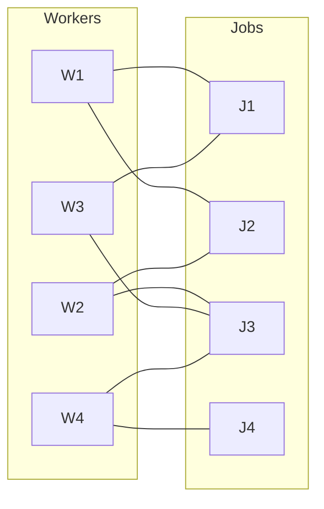
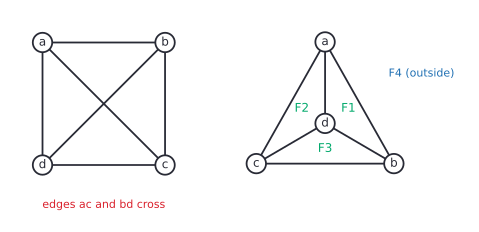
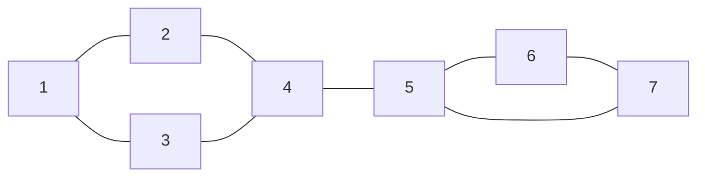
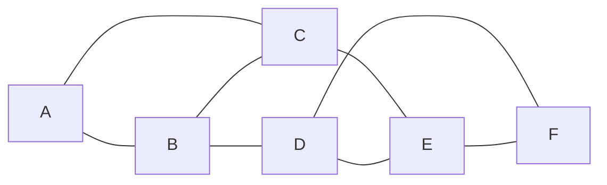

# Bipartite graphs, colouring and planar graphs

After this lesson you can test whether a graph is bipartite and prove the odd-cycle criterion, use Hall's theorem to decide whether a matching exists, colour a graph and bound its chromatic number, and use Euler's formula to show that a graph such as $K_5$ or $K_{3,3}$ can't be drawn without crossings.

Before this: [graph basics](01-graph-basics.md) and [paths, connectivity and trees](02-paths-connectivity-and-trees.md). The proofs use [strong induction](../../04-proofs-and-logic/05-induction/02-strong-induction-and-well-ordering.md) and [if and only if proofs](../../04-proofs-and-logic/04-more-proof-methods/01-if-and-only-if-proofs.md).

## Quick check

Try these first. If you get all three right, skip to [Practice](#practice).

1. Is the cycle $C_6$ bipartite? Is $C_5$?
2. What is the smallest number of colours needed to colour the vertices of $K_4$ with an edge removed, so that adjacent vertices get different colours?
3. Could a connected planar graph have 10 vertices and 28 edges?

<details class="solution" markdown>
<summary>Answers</summary>

1. $C_6$ is bipartite: colour its vertices alternately and every edge joins the two colours. $C_5$ is not, because going around an odd cycle forces two adjacent vertices to share a colour.
2. Three. $K_4$ minus an edge still contains a triangle, whose three vertices need three different colours, and three colours are enough.
3. No. A connected planar graph with $V \ge 3$ has at most $3V - 6 = 24$ edges, and $28 > 24$.

</details>

## The idea

A university has to schedule exams. Two exams can share a time slot only if no student sits both. Draw a dot for each course and a line between two courses that have a student in common. Giving every course a time slot so that joined courses get different slots is a colouring of the graph, and the fewest slots needed is its chromatic number.

Two simpler versions of the same question come first. If only two slots are allowed, when is that possible? Exactly when the graph is bipartite, and there is a clean test for it. A related problem is assigning each worker a job they can do, with no job given to two workers, which is a matching.

The last topic is drawing. A circuit board or a road map is a graph drawn in the plane, and the wires or roads must not cross. Some graphs can be drawn that way and some can't, and a counting argument built on Euler's formula shows why.

## Definitions

### Bipartite graphs

A graph $G$ is **bipartite** if its vertices can be split into two sets $X$ and $Y$, with $X \cap Y = \emptyset$ and $X \cup Y = V$, so that every edge has one end in $X$ and the other in $Y$. The sets $X$ and $Y$ are the **parts**.

In plain words, you can colour the vertices with two colours so that no edge joins two vertices of the same colour. The complete bipartite graph $K_{m,n}$, every even cycle, every path, every tree and the cube graphs $Q_n$ are bipartite. A triangle is not: whichever part holds the first vertex, one of the other two must share a part with a neighbour.



### Matchings

A **matching** in a graph is a set of edges, no two of which share a vertex. A matching is **perfect** if every vertex is an endpoint of one of its edges. In a bipartite graph with parts $X$ and $Y$, a matching **saturates** $X$ if every vertex of $X$ is an endpoint of one of its edges. For a set $S$ of vertices, $N(S)$ is the set of all vertices adjacent to at least one member of $S$.

In plain words, a matching is a way of pairing up vertices along edges with nobody used twice. In the graph above, the edges $W1\,J1$, $W2\,J2$, $W3\,J3$ and $W4\,J4$ are a perfect matching: each worker gets a job they can do and each job goes to one worker. The set $N(S)$ is "every job that at least one worker in $S$ can do".

### Vertex colouring

A **proper $k$-colouring** of a graph is a function $c$ that gives each vertex one of the colours $1, \dots, k$ so that $c(u) \ne c(v)$ whenever $uv$ is an edge. The **chromatic number** $\chi(G)$ (chi, a Greek letter) is the smallest $k$ for which a proper $k$-colouring exists. A graph with at least one vertex has $\chi(G) \ge 1$, and a graph with at least one edge has $\chi(G) \ge 2$.

In plain words, colour the dots so that joined dots differ, using as few colours as possible. A graph is bipartite exactly when it can be coloured with at most two colours. Some values to know:

| Graph | $\chi$ | Why |
|---|---|---|
| $K_n$ | $n$ | all vertices are pairwise adjacent, so all need different colours |
| $C_n$, $n$ even | 2 | alternate two colours |
| $C_n$, $n$ odd | 3 | two colours fail on an odd cycle (proved below), three work |
| a tree with an edge | 2 | trees are bipartite |
| $K_{m,n}$ | 2 | one colour per part |

To prove that $\chi(G) = k$ you need two separate things: a proper $k$-colouring (an upper bound) and a reason that $k - 1$ colours can't work (a lower bound). The usual reason is a copy of $K_k$ inside $G$, since its $k$ vertices are pairwise adjacent and need $k$ different colours, or an odd cycle for $k = 3$.

### Planar graphs and faces

A graph is **planar** if it can be drawn in the plane with vertices as points and edges as curves so that no two edges cross (they meet only at shared endpoints). Such a drawing is a **plane graph**. A plane graph divides the rest of the plane into regions called **faces**, and the unbounded region outside the drawing counts as one face.

In plain words, a planar graph is one for which some drawing has no crossings. The word "some" matters: a drawing with crossings doesn't show a graph is not planar, because a different drawing may avoid them. The figure shows $K_4$ drawn twice. The left drawing has the two diagonals crossing. The right drawing puts $d$ inside the triangle $abc$, with no crossings, so $K_4$ is planar. It has four faces: $F_1$, $F_2$ and $F_3$ inside, and the outside $F_4$.



## How to do it

### Testing for bipartite, and the odd-cycle theorem

The test is breadth-first search with two colours.

1. In each component, pick a start vertex and give it colour 0.
2. Run BFS, giving each newly reached vertex the opposite colour from the vertex that reached it. This is the same as colouring by the parity of the distance.
3. If you ever meet an edge whose two ends have the same colour, the graph is not bipartite. Stop.
4. If BFS finishes with no such edge, the colours give the two parts.
5. Check any answer by looking at every edge once.

*Lemma 1.* A closed walk of odd length contains a cycle of odd length.

What we know: a closed walk $x_0, x_1, \dots, x_k = x_0$ with $k$ odd, in a simple graph. What we want: an odd cycle among its edges. The plan: strong induction on the odd number $k$, splitting the walk at a repeated vertex.

*Proof.* Since the graph is simple, a closed walk has length at least 3 unless it is a single vertex, so $k \ge 3$. Suppose the claim holds for all odd lengths less than $k$. If $x_0, \dots, x_{k-1}$ are all different, the walk is a cycle of odd length $k$, and we are done. Otherwise some vertex repeats, say $x_i = x_j$ with $0 \le i < j \le k - 1$. Then $x_i, \dots, x_j$ is a closed walk of length $j - i$, and the rest, $x_0, \dots, x_i, x_{j+1}, \dots, x_k$, is a closed walk of length $k - (j - i)$. Both lengths are less than $k$ and positive, and they add up to $k$, which is odd, so one of them is odd. By the induction hypothesis that closed walk contains an odd cycle. $\blacksquare$

*Theorem 2.* A graph is bipartite if and only if it contains no cycle of odd length.

What we know: the definitions, and Lemma 1. What we want: both directions. The plan: for "only if", go around the cycle and watch the parts alternate. For "if", split each component by the parity of distance from a root, and use Lemma 1 on any edge that breaks the split.

*Proof (only if).* Let $G$ be bipartite with parts $X$ and $Y$, and let $v_1, \dots, v_k$ be a cycle, with $v_1 \in X$ say. Each edge goes between the parts, so $v_2 \in Y$, $v_3 \in X$, and so on: the vertex $v_i$ is in $X$ when $i$ is odd and in $Y$ when $i$ is even. The edge $v_k v_1$ joins $v_k$ to $v_1 \in X$, so $v_k \in Y$ and $k$ is even.

*Proof (if).* Suppose $G$ has no odd cycle. It is enough to find a split of each component, since the parts of different components can be combined freely. In a component, pick a vertex $r$ and let $X$ be the vertices at even distance from $r$ and $Y$ those at odd distance. Suppose an edge $uv$ had both ends in the same part. Then $d(r, u)$ and $d(r, v)$ have the same parity, so $d(r, u) + d(r, v) + 1$ is odd. A shortest path from $r$ to $u$, then the edge $uv$, then a shortest path from $v$ back to $r$ is a closed walk of that odd length. By Lemma 1 it contains an odd cycle, which contradicts the assumption. So every edge goes between $X$ and $Y$. $\blacksquare$

Look back: the proof of "if" is the BFS test in disguise, and when the test fails, Lemma 1 explains how to find an odd cycle: it is hiding in the closed walk through the offending edge. In Example 1 the walk is long and the odd cycle is a triangle inside it.

### Hall's theorem

*Theorem 3 (Hall).* Let $G$ be a bipartite graph with parts $X$ and $Y$. There is a matching that saturates $X$ if and only if $\lvert N(S) \rvert \ge \lvert S \rvert$ for every subset $S \subseteq X$.

In plain words, every group of workers must, taken together, be able to do at least as many different jobs as there are workers in the group, and that is the only obstacle. The condition on $S$ is called Hall's condition.

The "only if" half is easy. Suppose a matching saturates $X$ and let $S \subseteq X$. The matching gives each vertex of $S$ its own partner, and the partners are different vertices that all lie in $N(S)$. So $\lvert N(S) \rvert \ge \lvert S \rvert$. The "if" half is harder: it says that when no group is short of options, a matching exists. It is proved by induction on $\lvert X \rvert$ and is stated here without proof; Practice 8 uses the theorem.

Hall's condition is a certificate in both directions. If a matching exists, show it. If it doesn't, one bad set $S$ with $\lvert N(S) \rvert < \lvert S \rvert$ proves it. A consequence is a clean result for regular graphs.

*Corollary.* If every vertex of a bipartite graph has degree exactly $k \ge 1$, the graph has a perfect matching.

*Proof.* Count the edges from each side. Each vertex of $X$ has $k$ edges and each of $Y$ has $k$, so $k\lvert X \rvert = \lvert E \rvert = k\lvert Y \rvert$ and $\lvert X \rvert = \lvert Y \rvert$. For $S \subseteq X$ there are $k\lvert S \rvert$ edges leaving $S$, and they all end in $N(S)$, where each vertex receives at most $k$ edges. So $k\lvert N(S) \rvert \ge k\lvert S \rvert$, and Hall's condition holds. A matching saturating $X$ then uses $\lvert X \rvert = \lvert Y \rvert$ vertices of $Y$, which is all of them. $\blacksquare$

### Greedy colouring

*Greedy colouring* takes the vertices in some order $v_1, \dots, v_n$ and gives each one the smallest colour not already used on one of its neighbours.

*Theorem 4.* Greedy colouring uses at most $\Delta(G) + 1$ colours, whatever the order of the vertices. So $\chi(G) \le \Delta(G) + 1$.

What we know: each vertex has at most $\Delta$ neighbours. What we want: no colour above $\Delta + 1$ is ever used. The plan: count the colours that can be blocked at the moment a vertex is coloured.

*Proof.* When the algorithm reaches $v_i$, it has at most $\deg(v_i) \le \Delta$ neighbours that are already coloured, and they block at most $\Delta$ colours. Among the $\Delta + 1$ colours $1, \dots, \Delta + 1$, at least one is free, so the smallest free colour is at most $\Delta + 1$. The colouring is proper because each vertex differs from the neighbours coloured before it, and any two adjacent vertices have one before the other. $\blacksquare$

Look back: the bound is met by $K_n$ ($\chi = n = \Delta + 1$) and by odd cycles ($\chi = 3 = \Delta + 1$), and Brooks' theorem (stated, not proved here) says these are the only connected graphs where it is met. Greedy is not always optimal, as the warning below shows: the answer depends on the order.

### Euler's formula

*Theorem 5 (Euler's formula).* For a connected plane graph with $V$ vertices, $E$ edges and $F$ faces,

$$
V - E + F = 2.
$$

What we know: a connected plane graph. What we want: the alternating sum is 2 whatever the graph. The plan: induction on the number of edges $E$. A tree is the base case, and for a graph with a cycle we delete a cycle edge, which merges two faces.

*Proof.* Let $P(E)$ say that the formula holds for every connected plane graph with $E$ edges. For $E = 0$ the graph is one vertex with one face: $1 - 0 + 1 = 2$. Now take a connected plane graph $G$ with $E \ge 1$ edges and assume $P(E - 1)$.

If $G$ has no cycle, it is a tree, so $E = V - 1$ by the previous lesson. A drawing of a tree has one face, since there is no cycle to enclose a region. Then $V - (V - 1) + 1 = 2$.

If $G$ has a cycle, delete one edge $e$ of the cycle. The graph stays connected, and it now has $E - 1$ edges, the same $V$, and one fewer face: the cycle separates the plane into an inside and an outside, so the two sides of $e$ lie in different faces, and removing $e$ merges them into one. By $P(E - 1)$, $V - (E - 1) + (F - 1) = 2$. The left side equals $V - E + F$, so $V - E + F = 2$. $\blacksquare$

Look back: the proof uses two facts about drawings in the plane that we have not proved, that a cycle splits the plane into an inside and an outside (the Jordan curve theorem) and that a drawing of a tree has one face. Both are intuitive and have rigorous proofs. Check on $K_4$ in the figure: $V = 4$, $E = 6$, $F = 4$, and $4 - 6 + 4 = 2$. A cube has $8 - 12 + 6 = 2$. The same count works for every drawing of the same graph: all drawings of a connected planar graph have the same number of faces, $2 - V + E$.

*Theorem 6.* A simple connected planar graph with $V \ge 3$ vertices has $E \le 3V - 6$. If it also has no triangles, then $E \le 2V - 4$.

What we know: Euler's formula. What we want: an upper bound on $E$. The plan: count pairs of an edge and a face it borders in two ways.

*Proof.* Define the degree of a face as the number of edges along its boundary, counting an edge twice if the face lies on both of its sides. Each edge has two sides, so the face degrees add up to $2E$. In a simple graph with $V \ge 3$, every face has degree at least 3: a degree-1 face would need a loop, a degree-2 face would need two parallel edges or a graph with a single edge. So $3F \le 2E$. Euler's formula gives $F = 2 - V + E$, so

$$
3(2 - V + E) \le 2E \quad\Longrightarrow\quad E \le 3V - 6.
$$

If there are no triangles, every face has degree at least 4, so $4F \le 2E$, and $4(2 - V + E) \le 2E$ gives $E \le 2V - 4$. $\blacksquare$

*Corollary.* $K_5$ and $K_{3,3}$ are not planar.

*Proof.* $K_5$ has $V = 5$ and $E = 10$, but $3V - 6 = 9 < 10$. $K_{3,3}$ has $V = 6$ and $E = 9$ and no triangle (it is bipartite), but $2V - 4 = 8 < 9$. Both break the bound, so neither can be drawn without crossings. $\blacksquare$

The bound is only a necessary condition. A graph that satisfies $E \le 3V - 6$ may still be non-planar. Kuratowski's theorem (stated only) gives the full answer: a graph is planar if and only if it contains no subdivision of $K_5$ or $K_{3,3}$, where a subdivision replaces edges by paths.

### Colouring planar graphs

*Corollary.* Every simple planar graph has a vertex of degree at most 5.

*Proof.* If every degree were at least 6, the handshake lemma would give $2E \ge 6V$, so $E \ge 3V$. But planar graphs have $E \le 3V - 6$ (for $V \ge 3$, and graphs with $V \le 2$ have degrees at most 1). $\blacksquare$

*Theorem 7.* Every planar graph can be coloured with 6 colours.

*Proof.* Induct on $V$. A graph with one vertex needs one colour. For $V > 1$, take a vertex $v$ of degree at most 5. The graph $G - v$ is planar with fewer vertices, so it has a proper 6-colouring. Put $v$ back: it has at most 5 neighbours, so at least one of the 6 colours is unused among them, and $v$ takes that colour. $\blacksquare$

The **four colour theorem** says that 4 colours always suffice for a planar graph, the colouring of a map with no two bordering regions sharing a colour. It was proved in 1976 by Appel and Haken with the help of a computer search, and is stated here without proof. The step from 6 colours down to 4 is much harder than the argument above.

## Worked examples

<div class="example" markdown>

### Example 1: bipartite test

Is the graph with edges $12, 13, 24, 34, 45, 56, 67, 57$ bipartite?



Steps 1 and 2: colour vertex 1 with 0. BFS reaches 2 and 3 (distance 1, colour 1), then 4 (distance 2, colour 0), then 5 (distance 3, colour 1), then 6 and 7 (distance 4, colour 0).

Step 3: look at each edge. Edge 12 goes $0 \to 1$, 13 goes $0 \to 1$, 24 and 34 go $1 \to 0$, 45 goes $0 \to 1$, 56 and 57 go $1 \to 0$. But edge 67 joins two vertices of colour 0. So the graph is not bipartite.

To find the odd cycle, join shortest paths from 1 to 6 and from 7 to 1 with the edge 67: the closed walk $1, 2, 4, 5, 6, 7, 5, 4, 2, 1$ has length 9, which is odd. It repeats 5 (and 4 and 2), and splitting at the repeat gives the triangle $5, 6, 7$.

Check: the triangle $5, 6, 7$ has edges $56, 67, 57$, all in the graph, and a triangle is an odd cycle.

</div>

<div class="example" markdown>

### Example 2: Hall's condition

Four workers can do these jobs: W1 can do J1 or J2, W2 can do J2 or J3, W3 can do J1 or J3, W4 can do J3 or J4. Can every worker get a job? What if the lists are W1: J1; W2: J1, J2; W3: J1, J2; W4: J3, J4?

For the first lists, a matching exists, so we just show one. Put W4 on J4 (the only worker who can do J4). Then W1 takes J1, W2 takes J2 and W3 takes J3. Each worker gets a job they can do and all four jobs are different.

For the second lists, take $S = \{\text{W1}, \text{W2}, \text{W3}\}$. Together they can do only J1 and J2, so $N(S) = \{\text{J1}, \text{J2}\}$ and $\lvert N(S) \rvert = 2 < 3 = \lvert S \rvert$. Hall's condition fails, so no matching saturates the workers. Three workers are competing for two jobs.

Check: for the first lists, the 4 chosen edges are in the graph and share no vertex. For the second, an exhaustive check of all assignments of jobs to workers finds none.

</div>

<div class="example" markdown>

### Example 3: scheduling exams as colouring

Six exams $A, \dots, F$ have conflicts $AB, AC, BC, BD, CE, DE, DF, EF$. What is the fewest number of time slots?



Lower bound: $A, B, C$ are pairwise in conflict, which is a triangle, so $\chi \ge 3$.

Upper bound: colour greedily in the order $A, B, C, D, E, F$. $A$ gets 1. $B$ is adjacent to $A$ and gets 2. $C$ is adjacent to $A$ and $B$ and gets 3. $D$ is adjacent to $B$ (2) and gets 1. $E$ is adjacent to $C$ (3) and $D$ (1) and gets 2. $F$ is adjacent to $D$ (1) and $E$ (2) and gets 3. That is a proper colouring with 3 colours. So $\chi = 3$, and the slots are $\{A, D\}$, $\{B, E\}$ and $\{C, F\}$.

Check: the maximum degree is 3, so Theorem 4 only promises 4 colours, and greedy did better. No conflict pair lies inside a slot: $AD$, $BE$ and $CF$ are not edges.

</div>

<div class="example" markdown>

### Example 4: finish it yourself, planarity counts

(a) A connected plane graph has 7 vertices and 10 edges. How many faces does it have? (b) A simple connected graph has 8 vertices and 19 edges. Can it be planar?

For (a), use $V - E + F = 2$: here $7 - 10 + F = 2$. For (b), compare $E$ with $3V - 6$. Finish both.

<details class="solution" markdown>
<summary>Finish</summary>

(a) $F = 2 - 7 + 10 = 5$ faces.

(b) The bound is $3 \cdot 8 - 6 = 18$, and $19 > 18$, so the graph can't be planar.

Check: for (a), a tree on 7 vertices has 6 edges and 1 face, and each of the 4 extra edges closes a cycle and adds a face, giving $1 + 4 = 5$. For (b), the complete graph $K_8$ has 28 edges, so 19 is possible for a simple graph and the bound is what rules planarity out.

</details>

</div>

## Edge cases and common mistakes

<div class="warning" markdown>

Watch out: greedy colouring depends on the order. Take the graph with vertices $a_1, a_2, a_3, b_1, b_2, b_3$ where $a_i$ is adjacent to $b_j$ whenever $i \ne j$. It is bipartite, so 2 colours suffice. Colouring in the order $a_1, b_1, a_2, b_2, a_3, b_3$ gives $a_1$ and $b_1$ the colour 1, $a_2$ and $b_2$ the colour 2, and then $a_3$ and $b_3$ both need colour 3. Colouring all the $a$'s first and then all the $b$'s uses 2. Theorem 4 is an upper bound, not a promise of the best answer.

</div>

<div class="warning" markdown>

Watch out: $E \le 3V - 6$ doesn't prove a graph is planar. It can only prove one is not. The Petersen graph, with 10 vertices and 15 edges, passes the bound ($15 \le 24$) and is still non-planar.

</div>

<div class="warning" markdown>

Watch out: a drawing with crossings doesn't show non-planarity. The right drawing of $K_4$ in the figure shows that the left one, with its crossing, was just a bad drawing. To prove non-planarity you need an argument over all drawings, such as the edge bound.

</div>

<div class="warning" markdown>

Watch out: Euler's formula needs the graph to be connected. A plane graph with $c$ components satisfies $V - E + F = 1 + c$. Two separate triangles have $V = 6$, $E = 6$ and $F = 3$ (inside each, and the outside), so $6 - 6 + 3 = 3 = 1 + 2$.

</div>

<div class="note" markdown>

A graph with no edges has $\chi = 1$. A graph with edges but no odd cycle has $\chi = 2$. Hall's condition is about subsets of one part, $X$, and a bipartite graph with $\lvert X \rvert > \lvert Y \rvert$ never satisfies it. A perfect matching needs $\lvert X \rvert = \lvert Y \rvert$.

</div>

## Tricks and shortcuts

- For a quick bipartite check, look for a triangle or a 5-cycle first. A graph with no odd cycle at all is bipartite, but by hand the BFS colouring is the fastest test.
- A lower bound on $\chi$ is any complete subgraph $K_k$ inside the graph. Look for the biggest group of mutually conflicting items first.
- To show Hall's condition fails, look for a small group of vertices that share a small set of neighbours, as in Example 2.
- In planar problems, run the counts before the pictures: $F = 2 - V + E$, then $E \le 3V - 6$ (or $2V - 4$ with no triangles).
- A planar graph satisfies $E \le 3V - 6$, so its average degree is below 6, which is why one vertex always has degree at most 5.

## In code

A bipartite test that returns the colouring or an offending edge, a matching by augmenting paths, Hall's condition by brute force, greedy colouring and the planarity edge bound.

<details class="code" markdown>
<summary>In code</summary>

```python
from collections import deque
from itertools import combinations

def make_graph(vertices, edges):
    g = {v: set() for v in vertices}
    for u, v in edges:
        g[u].add(v)
        g[v].add(u)
    return g

def two_colour(g):
    """Return (True, colouring) if bipartite, else (False, an edge inside one layer)."""
    colour = {}
    for s in sorted(g):
        if s in colour:
            continue
        colour[s] = 0
        queue = deque([s])
        while queue:
            u = queue.popleft()
            for w in sorted(g[u]):
                if w not in colour:
                    colour[w] = 1 - colour[u]       # alternate with the layer parity
                    queue.append(w)
                elif colour[w] == colour[u]:
                    return False, (u, w)            # an edge inside a part: odd cycle nearby
    return True, colour

def max_matching(adj):
    """adj maps each left vertex to its right neighbours. Augmenting paths (Kuhn)."""
    match = {}                                      # right vertex -> left vertex
    def try_assign(x, seen):
        for y in sorted(adj[x]):
            if y in seen:
                continue
            seen.add(y)
            if y not in match or try_assign(match[y], seen):   # y free, or its partner can move
                match[y] = x
                return True
        return False
    for x in sorted(adj):
        try_assign(x, set())
    return {x: y for y, x in match.items()}

def hall_violation(adj):
    """Return a set S of left vertices with fewer than |S| neighbours, or None."""
    left = sorted(adj)
    for r in range(1, len(left) + 1):
        for S in combinations(left, r):
            if len(set().union(*(adj[x] for x in S))) < r:
                return S
    return None

def greedy_colouring(g, order):
    colour = {}
    for v in order:
        used = {colour[w] for w in g[v] if w in colour}
        c = 1
        while c in used:                            # smallest colour no neighbour has
            c += 1
        colour[v] = c
    return colour

g = make_graph(range(1, 8), [(1, 2), (1, 3), (2, 4), (3, 4), (4, 5), (5, 6), (6, 7), (5, 7)])
print(two_colour(g))               # (False, (6, 7)): 6 and 7 get the same colour but are adjacent
c6 = make_graph(range(6), [(i, (i + 1) % 6) for i in range(6)])
print(two_colour(c6)[0])           # True

jobs = {"W1": {"J1", "J2"}, "W2": {"J2", "J3"}, "W3": {"J1", "J3"}, "W4": {"J3", "J4"}}
print(max_matching(jobs))          # {'W3': 'J1', 'W1': 'J2', 'W2': 'J3', 'W4': 'J4'}
bad = {"W1": {"J1"}, "W2": {"J1", "J2"}, "W3": {"J1", "J2"}, "W4": {"J3", "J4"}}
print(len(max_matching(bad)), hall_violation(bad))   # 3 ('W1', 'W2', 'W3')

exams = make_graph("ABCDEF", ["AB", "AC", "BC", "BD", "CE", "DE", "DF", "EF"])
col = greedy_colouring(exams, "ABCDEF")
print(col, max(col.values()))      # {'A': 1, 'B': 2, 'C': 3, 'D': 1, 'E': 2, 'F': 3} 3
delta = max(len(n) for n in exams.values())
print(delta + 1)                   # 4, the guaranteed upper bound

# The order matters: a bipartite graph (2 colours suffice) can make greedy use 3.
crown = make_graph(["a1", "a2", "a3", "b1", "b2", "b3"],
                   [(f"a{i}", f"b{j}") for i in (1, 2, 3) for j in (1, 2, 3) if i != j])
print(max(greedy_colouring(crown, ["a1", "b1", "a2", "b2", "a3", "b3"]).values()))  # 3
print(max(greedy_colouring(crown, ["a1", "a2", "a3", "b1", "b2", "b3"]).values()))  # 2

def may_be_planar(v, e):
    """Necessary test only: E <= 3V - 6 (for V >= 3). Passing it does not prove planarity."""
    return e <= 3 * v - 6

print(may_be_planar(5, 10), may_be_planar(6, 9), may_be_planar(8, 19))   # False True False
```

</details>

## FAQ

### If the four colour theorem is true, why does the book prove the six colour theorem?

The six colour proof is short and uses only Theorem 6. The four colour theorem has no short proof: the original used a computer to check a long list of configurations, and later proofs still rely on computers. It is the best-known example of a theorem proved with heavy computer help.

### How do you actually find a maximum matching?

Start with any matching and look for an augmenting path: a path that alternates between non-matching and matching edges and starts and ends at unmatched vertices. Flipping the edges along it makes the matching one edge bigger. When no such path exists, the matching is maximum. The code above does this with a recursive search; it is the basis of the Hopcroft-Karp algorithm and of flow-based methods.

### Is finding the chromatic number easy?

No. Deciding whether a graph can be coloured with 2 colours is easy (BFS), but for 3 colours the problem is NP-complete, which means no fast algorithm is known. Greedy colouring is fast and gives a valid answer, just not always the best one. Compilers use greedy-style colouring to assign registers.

### Why do two different drawings of a planar graph have the same number of faces?

Euler's formula fixes $F = 2 - V + E$ from the graph alone, whatever drawing you use. So $F$ is a property of the graph and not of the picture, as long as the graph is connected.

## Practice

### Warm-up

1\. Which of these are bipartite: $C_7$, $C_8$, $K_{3,5}$, $K_4$, the path $P_6$?

<details class="solution" markdown>
<summary>Solution</summary>

$C_7$ is an odd cycle: not bipartite. $C_8$ is an even cycle: bipartite. $K_{3,5}$ is bipartite by definition. $K_4$ contains triangles: not bipartite. $P_6$ is a tree: bipartite.

Check: by Theorem 2, the non-bipartite ones are exactly those with an odd cycle: $C_7$ itself and the triangles in $K_4$.

</details>

2\. Find $\chi$ for $C_9$, $K_{2,7}$ and $K_5$.

<details class="solution" markdown>
<summary>Solution</summary>

$C_9$ is an odd cycle, so $\chi = 3$ (two colours fail, three work: alternate 1 and 2 around eight vertices and give the ninth colour 3). $K_{2,7}$ is bipartite with edges, so $\chi = 2$. $K_5$ has five pairwise adjacent vertices, so $\chi = 5$.

Check: $C_9$ has $\Delta = 2$, and $\Delta + 1 = 3$ matches. $K_5$ has $\Delta + 1 = 5$ too.

</details>

3\. A connected plane graph has 9 vertices and 14 edges. How many faces does it have?

<details class="solution" markdown>
<summary>Solution</summary>

$F = 2 - V + E = 2 - 9 + 14 = 7$.

Check: $9 - 14 + 7 = 2$. Also $14 \le 3 \cdot 9 - 6 = 21$, so the numbers are consistent with planarity.

</details>

### Standard

4\. Four students (Ana, Ben, Cy, Dee) apply for four tutoring slots. Ana can do slots 1 and 2, Ben can do 1 and 2, Cy can do 1 and 2, and Dee can do 3. Does everyone get a slot? Name a set that shows the answer.

<details class="solution" markdown>
<summary>Solution</summary>

No. Take $S = \{\text{Ana}, \text{Ben}, \text{Cy}\}$. Between them they can only do slots 1 and 2, so $\lvert N(S) \rvert = 2 < 3 = \lvert S \rvert$, and Hall's condition fails. Three students compete for two slots.

Check: Dee gets slot 3, and then the slots 1 and 2 serve at most two of the other three students.

</details>

5\. A university schedules six courses with these shared students: $P$-$Q$, $P$-$R$, $Q$-$R$, $R$-$S$, $S$-$T$, $T$-$U$, $S$-$U$. Find the fewest time slots and a schedule.

<details class="solution" markdown>
<summary>Solution</summary>

$P, Q, R$ form a triangle, so at least 3 slots are needed. A 3-colouring: $P = 1$, $Q = 2$, $R = 3$. Then $S$ is adjacent to $R$ (3), $T$ and $U$, so it can take 1. Then $T$ is adjacent to $S$ (1) and $U$, so it takes 2, and $U$ is adjacent to $S$ (1) and $T$ (2), so it takes 3. The slots are $\{P, S\}$, $\{Q, T\}$ and $\{R, U\}$, and $\chi = 3$.

Check: none of $PS$, $QT$ and $RU$ is an edge, and each of the seven conflict pairs puts its two courses in different slots.

</details>

6\. Show that a simple graph with 12 vertices and 31 edges can't be drawn without crossings. Can one with 12 vertices and 28 edges be?

<details class="solution" markdown>
<summary>Solution</summary>

A connected simple planar graph with 12 vertices has at most $3 \cdot 12 - 6 = 30$ edges, and $31 > 30$. If the graph were disconnected, we could join its components by extra edges drawn in the outer face, which keeps it planar and only adds edges, so the bound would still be broken. So no such graph is planar.

With 28 edges the bound gives no contradiction, since $28 \le 30$. That fails to rule planarity out and doesn't prove it. Whether a graph with 28 edges is planar depends on the graph. The icosahedron has 12 vertices and 30 edges and is planar, and deleting any 2 of its edges leaves a planar graph with 28.

Check: the icosahedron is 5-regular, so it has $12 \cdot 5 \div 2 = 30$ edges, matching the bound exactly.

</details>

### Challenge

7\. Prove that every tree is bipartite and that a bipartite graph with $n$ vertices has at most $\lfloor n^2 / 4 \rfloor$ edges.

<details class="solution" markdown>
<summary>Solution</summary>

Trees have no cycles at all, so no odd cycle, and Theorem 2 gives bipartite.

For the edge bound, let the parts have $a$ and $n - a$ vertices. Every edge goes between them, so $\lvert E \rvert \le a(n - a)$. The product $a(n - a)$ is largest when $a$ is as close to $n/2$ as possible: $a(n-a) = \frac{n^2}{4} - \left(a - \frac{n}{2}\right)^2$, so it is at most $\frac{n^2}{4}$. Since $\lvert E \rvert$ is an integer, $\lvert E \rvert \le \lfloor n^2 / 4 \rfloor$.

Check: $K_{3,3}$ has $n = 6$ and 9 edges, equal to $\lfloor 36 / 4 \rfloor = 9$. And $K_{2,3}$ has $n = 5$ and 6 edges, equal to $\lfloor 25 / 4 \rfloor = 6$.

</details>

8\. This one reviews relations. A relation $R$ on a set $A$ is symmetric and irreflexive. (a) Explain why the graph of $R$ is a simple graph. (b) Use Hall's theorem to show that a 3-regular bipartite graph has a perfect matching.

<details class="solution" markdown>
<summary>Solution</summary>

(a) Symmetric means each pair $(a, b)$ comes with $(b, a)$, so the two arrows can be drawn as one undirected edge $ab$. Irreflexive means no pair $(a, a)$, so there are no loops. A set of pairs has no repeats, so there are no parallel edges. That is a simple graph.

(b) Let each vertex have degree 3. Counting edges from both sides gives $3\lvert X \rvert = 3\lvert Y \rvert$, so $\lvert X \rvert = \lvert Y \rvert$. For $S \subseteq X$, there are $3\lvert S \rvert$ edges leaving $S$, all ending in $N(S)$, and each vertex in $N(S)$ takes at most 3 of them, so $3\lvert N(S) \rvert \ge 3\lvert S \rvert$. Hall's condition holds, so a matching saturates $X$, and since $\lvert X \rvert = \lvert Y \rvert$ it is perfect.

Check: $K_{3,3}$ is 3-regular and bipartite, and pairing the $i$-th vertex of one part with the $i$-th of the other is a perfect matching.

</details>

## Where this shows up

- Scheduling, timetabling and register allocation are colouring problems: classes or variables are vertices, conflicts are edges and colours are time slots or CPU registers. Frequency assignment for radio towers works the same way.
- Matchings assign jobs to workers, students to projects and donors to recipients. Hall's theorem is the reason the assignment problem has a clean answer, and in economics the same structure appears in matching markets such as school placement and kidney exchange.
- Planar graphs matter for map drawing, circuit layout and networks laid out on a surface. Euler's formula is the first theorem of topological graph theory. In the theory of computation chapter, deciding 3-colourability is a standard NP-complete problem.
- The next topics in a discrete mathematics course are usually counting and probability on graphs, and in an algorithms course, flows and matchings built on the augmenting-path idea above.
