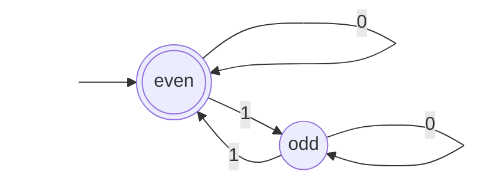
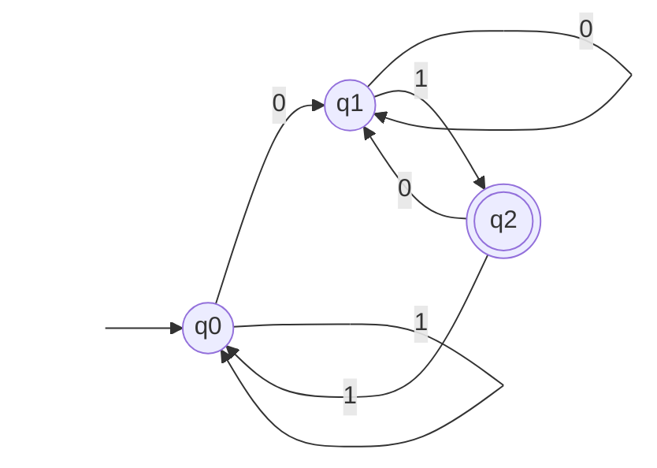
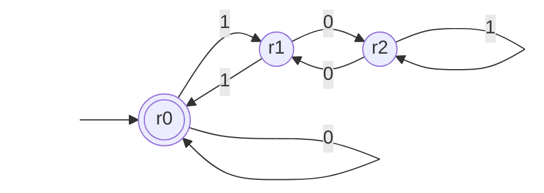
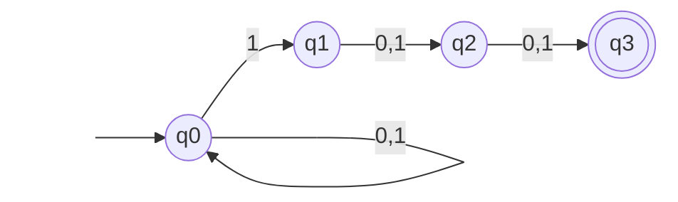
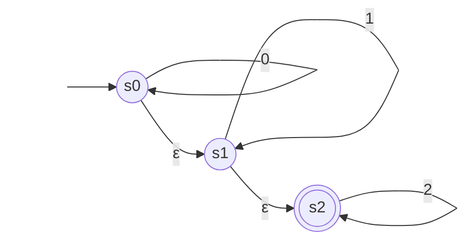

# Finite automata: DFA and NFA

After this lesson you can describe a deterministic finite automaton (DFA) as a 5-tuple and trace it on an input, design a DFA for a simple language, turn a nondeterministic finite automaton (NFA) into a DFA with the subset construction, and prove that the regular languages are closed under union, concatenation and star.

Before this: [sets and set operations](../../04-proofs-and-logic/02-logic-and-sets/06-sets-and-set-operations.md) (tuples and power sets), [recursive definitions and structural induction](../../04-proofs-and-logic/05-induction/03-recursive-definitions-and-structural-induction.md) (strings and length), and [number bases and conversions](../01-number-representation/01-number-bases-and-conversions.md) (reading a binary number from left to right).

## Quick check

Try these first. If you get all three right, skip to [Practice](#practice).

1. A machine has two states, $q_0$ (the start state) and $q_1$ (the only accepting state). On the symbol 0 it stays where it is, and on the symbol 1 it switches state. Does it accept $0110$?
2. Which of these languages contain the empty string $\varepsilon$? (a) strings of even length, (b) strings that end in 1, (c) $\{\varepsilon\}$, (d) $\emptyset$.
3. Over the alphabet $\{a, b\}$, how many strings have length exactly $n$? List them for $n = 2$.

<details class="solution" markdown>
<summary>Answers</summary>

1. No. The machine goes $q_0 \to q_0 \to q_1 \to q_0 \to q_0$, and it ends in $q_0$, which is not accepting. It accepts exactly the strings with an odd number of 1s, and $0110$ has two.
2. (a) and (c). The empty string has length 0, which is even, so it is in (a). It has no last symbol, so it is not in (b). The set $\{\varepsilon\}$ contains it by definition, and $\emptyset$ contains nothing.
3. There are $2^n$ of them, since each of the $n$ positions has 2 choices. For $n = 2$: $aa$, $ab$, $ba$, $bb$.

</details>

## The idea

Picture a turnstile in a subway station. It has two states, locked and unlocked. A coin moves it from locked to unlocked, a push moves it from unlocked to locked, and a push on a locked turnstile or a coin on an unlocked one changes nothing. The turnstile does not remember the history of coins and pushes. It remembers one thing, which state it is in, and that is enough to do its job.

A finite automaton is that idea made precise. It reads a string one symbol at a time, from left to right. After each symbol it moves to a new state, chosen by the current state and the symbol just read. When the string ends, it accepts if it is in one of the accepting states and rejects otherwise. Here is a machine that accepts the binary strings with an even number of 1s. It needs to remember one bit, whether the count so far is even or odd, and it never needs the count itself.



The arrow from nowhere marks the start state, and the double circle marks an accepting state. This book draws automata this way.

The limit is in the name: the number of states is finite, so the memory is finite. A machine with 100 states can't count to 101. That is the reason the pumping lemma in the next lesson exists, and the reason the later lessons need stronger machines: pushdown automata with a stack, and Turing machines with an unbounded tape. This lesson builds the base. The rest of the chapter climbs from here.

## Definitions

### Strings and languages

An **alphabet** is a finite, nonempty set of symbols, written $\Sigma$ (capital sigma). A **string** over $\Sigma$ is a finite sequence of symbols from $\Sigma$. The **length** of a string $w$ is the number of symbols it has, written $\lvert w \rvert$. The **empty string** $\varepsilon$ is the string of length 0. The set of all strings over $\Sigma$ is $\Sigma^*$, and $\Sigma^n$ is the set of strings of length $n$.

In plain words: with $\Sigma = \{0, 1\}$, the strings are $\varepsilon, 0, 1, 00, 01, 10, 11, 000, \dots$, and there are $2^n$ of length $n$. Writing two strings next to each other, $xy$, is concatenation, and $\varepsilon$ is its identity: $x\varepsilon = \varepsilon x = x$. The notation $a^n$ means the symbol $a$ repeated $n$ times, so $0^3 = 000$ and $a^0 = \varepsilon$. These are the strings of the [recursive definition](../../04-proofs-and-logic/05-induction/03-recursive-definitions-and-structural-induction.md#definitions), where $\lvert wa \rvert = \lvert w \rvert + 1$.

A **language** over $\Sigma$ is a set of strings, that is, a subset of $\Sigma^*$. In plain words, a language is a yes-or-no question about strings, written as the set of strings whose answer is yes: "the strings that end in 01" is the language $\{w \in \{0, 1\}^* : w \text{ ends in } 01\}$. Languages are sets, so they have the usual operations: union $A \cup B$, intersection $A \cap B$ and complement $\overline{A} = \Sigma^* \setminus A$. There are two more, which only make sense for strings:

$$
\begin{aligned}
A \circ B &= \{xy : x \in A \text{ and } y \in B\} \\
A^* &= \{x_1 x_2 \cdots x_k : k \ge 0 \text{ and each } x_i \in A\}
\end{aligned}
$$

The first is the **concatenation** of $A$ and $B$ and the second is the **star** of $A$. The case $k = 0$ in the star gives $\varepsilon$, so $\varepsilon \in A^*$ for every language $A$, even when $A = \emptyset$. For example, if $A = \{01, 1\}$ and $B = \{0, 00\}$, then $A \circ B = \{010, 0100, 10, 100\}$ and $A^*$ contains $\varepsilon$, $01$, $1$, $011$, $101$, $0101$ and so on.

<div class="warning" markdown>

Watch out: three different empty things appear in this chapter. The string $\varepsilon$ has no symbols. The language $\emptyset$ has no strings, and rejects every input. The language $\{\varepsilon\}$ has exactly one string, the empty one. They are not interchangeable: a machine for $\{\varepsilon\}$ accepts the empty input, and a machine for $\emptyset$ accepts nothing.

</div>

### Deterministic finite automata

A **deterministic finite automaton** (DFA) is a 5-tuple $M = (Q, \Sigma, \delta, q_0, F)$ where

1. $Q$ is a finite set of **states**,
2. $\Sigma$ is the alphabet,
3. $\delta \colon Q \times \Sigma \to Q$ is the **transition function**,
4. $q_0 \in Q$ is the **start state**, and
5. $F \subseteq Q$ is the set of **accepting states**.

In plain words: a DFA is a finite set of states with one arrow out of each state for each symbol. The value $\delta(q, a)$ is the state you land in when you are in state $q$ and read $a$. "Deterministic" means there is no choice anywhere: for each state and symbol, exactly one next state. The machine in the idea section is $Q = \{\text{even}, \text{odd}\}$, $\Sigma = \{0, 1\}$, start state even, $F = \{\text{even}\}$, and

| $\delta$ | 0 | 1 |
|---|---|---|
| even | even | odd |
| odd | odd | even |

The **extended transition function** $\delta^* \colon Q \times \Sigma^* \to Q$ says where the machine ends up after reading a whole string. It is defined by recursion on the string, in the style of the [recursive definitions](../../04-proofs-and-logic/05-induction/03-recursive-definitions-and-structural-induction.md) lesson:

$$
\delta^*(q, \varepsilon) = q, \qquad \delta^*(q, wa) = \delta\bigl(\delta^*(q, w), a\bigr) \quad \text{for } w \in \Sigma^* \text{ and } a \in \Sigma.
$$

In plain words: reading nothing leaves you where you are, and reading $wa$ means reading $w$ first and then taking one more step on $a$. The machine $M$ **accepts** $w$ if $\delta^*(q_0, w) \in F$, and the **language recognized by** $M$ is

$$
L(M) = \{ w \in \Sigma^* : \delta^*(q_0, w) \in F \}.
$$

A language is **regular** if some DFA recognizes it. In plain words, a regular language is one that a machine with a fixed, finite amount of memory can decide. Two machines are **equivalent** if they recognize the same language.

One fact is used in the proofs below: reading $x$ and then $y$ is the same as reading $xy$, that is, $\delta^*(q, xy) = \delta^*(\delta^*(q, x), y)$ for all strings $x$ and $y$. It follows from the definition by induction on $\lvert y \rvert$, and Practice 8 asks for the proof.

### Nondeterministic finite automata

In a **nondeterministic finite automaton** (NFA), a state may have several arrows for the same symbol, or none, and there are arrows labelled with $\varepsilon$ that the machine can take without reading anything. Write $\Sigma_\varepsilon = \Sigma \cup \{\varepsilon\}$. An NFA is a 5-tuple $N = (Q, \Sigma, \delta, q_0, F)$ where $Q$, $\Sigma$, $q_0$ and $F$ are as for a DFA, and

$$
\delta \colon Q \times \Sigma_\varepsilon \to \mathcal{P}(Q),
$$

where $\mathcal{P}(Q)$ is the [power set](../../04-proofs-and-logic/02-logic-and-sets/06-sets-and-set-operations.md#power-sets) of $Q$. In plain words, $\delta(q, a)$ is now a set of states: all the places the machine may go from $q$ on $a$. The set may be empty (the machine has no move and that branch dies) or have several members (the machine may take any).

The NFA $N$ **accepts** $w$ if $w$ can be written as $y_1 y_2 \cdots y_m$ with each $y_i \in \Sigma_\varepsilon$, and there are states $r_0, r_1, \dots, r_m$ with

- $r_0 = q_0$,
- $r_{i+1} \in \delta(r_i, y_{i+1})$ for $i = 0, \dots, m - 1$, and
- $r_m \in F$.

The number $m$ can be larger than $\lvert w \rvert$, because some of the $y_i$ may be $\varepsilon$. In plain words: $N$ accepts $w$ if there exists some way to read $w$, choosing among the options at each step and using $\varepsilon$-arrows freely, that ends in an accepting state. One successful path is enough, and every other path can fail. $L(N)$ is the set of strings $N$ accepts.

Two ways to picture an NFA work equally well. In the guessing picture, the machine guesses the right choice at every fork, and accepts if some sequence of guesses works. In the parallel picture, the machine is in a set of states at once. On each symbol, every state in the set takes all its arrows, and the new set is everything reached. The second picture is the one the subset construction turns into a DFA.

For a set of states $R \subseteq Q$, let $E(R)$ be the **$\varepsilon$-closure** of $R$: the set of states reachable from a state in $R$ by following zero or more $\varepsilon$-arrows. It always contains $R$ itself.

## How to do it

### Designing a DFA

1. Decide what the machine needs to remember about the part of the input already read. It should not remember the whole input, only what decides the final answer.
2. Give each different thing to remember its own state, and name the state by its meaning ("last two symbols were 01"), not by a bare number.
3. The start state is the meaning of the empty input. The accepting states are the meanings for which the answer is yes.
4. For each state and each symbol, work out the new meaning after reading that symbol. Draw an arrow for it. Every state needs an arrow for every symbol, with none missing.
5. Test the machine on short strings, always including $\varepsilon$ and the shortest strings that should be accepted or rejected.

Step 4 is where machines go wrong. A state is a summary of the past, and the transition has to update the summary correctly using only the old summary and the new symbol.

### Converting an NFA to a DFA

The **subset construction** builds a DFA whose states are sets of NFA states, following the parallel picture.

1. Start with the DFA state $E(\{q_0\})$: the NFA states it can be in before reading anything.
2. Take a DFA state $R$ that has been built and a symbol $a$. Compute $\delta'(R, a)$ as the union of $E(\delta(r, a))$ over all $r \in R$: every NFA state you can reach by reading $a$ from some state of $R$, plus anything reachable from there by $\varepsilon$-arrows.
3. Do step 2 for every symbol, and for every new set that appears, until no new sets appear. Only the sets that actually appear are needed. There are at most $2^{\lvert Q \rvert}$ possible ones.
4. A DFA state is accepting if it contains at least one accepting state of the NFA.
5. Check the answer on short strings against the NFA.

If the empty set shows up, it is a legitimate DFA state, the dead state: once there, every symbol leads back to it, and it never accepts.

<div class="warning" markdown>

Watch out at step 4: "contains an accepting state" is the rule, not "consists only of accepting states". One accepting NFA state among the possible ones means some path accepts, which is all an NFA needs.

</div>

## Theorems

*Theorem 1.* Every NFA has an equivalent DFA. So a language is regular if and only if some NFA recognizes it.

What we know: an NFA $N = (Q, \Sigma, \delta, q_0, F)$. What we want: a DFA $M$ with $L(M) = L(N)$. The plan: build $M$ by the subset construction, and prove that after reading $w$, the state of $M$ is exactly the set of states $N$ could be in.

*Proof.* Define $M = (\mathcal{P}(Q), \Sigma, \delta', E(\{q_0\}), F')$ where

$$
\delta'(R, a) = \bigcup_{r \in R} E\bigl(\delta(r, a)\bigr) \quad \text{and} \quad F' = \{R \subseteq Q : R \cap F \ne \emptyset\}.
$$

For a string $w$, let $S_w$ be the set of states $q$ such that $N$ has a path from $q_0$ to $q$ that reads exactly $w$, with any number of $\varepsilon$-arrows allowed between symbols. We show by induction on $\lvert w \rvert$ that $\delta'^*(E(\{q_0\}), w) = S_w$.

For $w = \varepsilon$, the paths that read nothing use only $\varepsilon$-arrows, so $S_\varepsilon = E(\{q_0\})$, which is the start state of $M$. For $w = ua$, a path that reads $ua$ is a path that reads $u$ and ends at some $r \in S_u$, then one arrow labelled $a$ to a state in $\delta(r, a)$, then zero or more $\varepsilon$-arrows. So $S_{ua} = \bigcup_{r \in S_u} E(\delta(r, a))$. By the induction hypothesis, $\delta'^*(E(\{q_0\}), u) = S_u$, so $\delta'^*(E(\{q_0\}), ua) = \delta'(S_u, a) = S_{ua}$.

Now $N$ accepts $w$ exactly when $S_w$ contains an accepting state, that is, when $S_w \in F'$. So $M$ accepts $w$ exactly when $N$ does. In the other direction, each DFA is an NFA with one-element sets and no $\varepsilon$-arrows. $\blacksquare$

Look back: the proof is the table of Example 3 in general form. The price is the number of states: $\mathcal{P}(Q)$ has $2^{\lvert Q \rvert}$ members, and Example 3 shows this can't always be avoided.

*Theorem 2.* If $A$ and $B$ are regular languages, then so are $A \cup B$, $A \circ B$, $A^*$, $\overline{A}$ and $A \cap B$.

What we know: NFAs $N_1$ and $N_2$ for $A$ and $B$ (Theorem 1 lets us use NFAs), with state sets $Q_1$ and $Q_2$ taken to be disjoint. What we want: a machine for each new language. The plan: connect the machines with $\varepsilon$-arrows, one construction for each operation.

*Proof.* Union. Make a new state $s$ with $\varepsilon$-arrows to $q_1$ and to $q_2$, the start states of $N_1$ and $N_2$, and let it be the start state. The accepting states are those of $N_1$ together with those of $N_2$. A path that accepts $w$ takes one of the two $\varepsilon$-arrows first and is then a path inside $N_1$ or inside $N_2$, so $w \in A \cup B$. Conversely, an accepting path of $N_1$ or of $N_2$ extends by the first arrow.

Concatenation. Keep both machines, make $q_1$ the start state, make the accepting states of $N_2$ the accepting states, and add an $\varepsilon$-arrow from each accepting state of $N_1$ to $q_2$. If $x \in A$ and $y \in B$, the path for $x$ ends in an accepting state of $N_1$, an $\varepsilon$-arrow leads to $q_2$, and the path for $y$ ends in an accepting state of $N_2$. Conversely, an accepting path of the new machine must cross from $N_1$ to $N_2$, and the only arrows that do so are the new ones, so it reads some $x$ that $N_1$ accepts and then some $y$ that $N_2$ accepts, and $w = xy \in A \circ B$.

Star. Make a new start state $s$ that is also accepting, with an $\varepsilon$-arrow to $q_1$, and add an $\varepsilon$-arrow from each accepting state of $N_1$ back to $q_1$. The new start state accepts $\varepsilon$, which belongs to $A^*$. An accepting path that is not empty leaves $s$ for $q_1$ and returns to $q_1$ each time it passes an accepting state and continues. Cutting the path at its returns writes $w$ as $x_1 \cdots x_k$ with each $x_i$ accepted by $N_1$. Conversely, a string $x_1 \cdots x_k$ with each $x_i \in A$ follows these arrows piece by piece.

Complement. Take a DFA $M$ for $A$ and swap the accepting and non-accepting states. Since $M$ reaches exactly one state on each input, $\delta^*(q_0, w) \notin F$ exactly when $\delta^*(q_0, w) \in Q \setminus F$.

Intersection. Take DFAs $M_1$ and $M_2$ and build the product machine with state set $Q_1 \times Q_2$, start state $(q_1, q_2)$, transition $\delta\bigl((r_1, r_2), a\bigr) = \bigl(\delta_1(r_1, a), \delta_2(r_2, a)\bigr)$, and accepting set $F_1 \times F_2$. It runs both machines side by side, so after reading $w$ it is in the pair $(\delta_1^*(q_1, w), \delta_2^*(q_2, w))$, which is accepting exactly when both machines accept. $\blacksquare$

Look back: using the accepting set $\{(r_1, r_2) : r_1 \in F_1 \text{ or } r_2 \in F_2\}$ instead gives a DFA for the union, with no $\varepsilon$-arrows. The new start states in the union and star constructions are not decoration; the warning about stars below explains why the star needs one.

## Worked examples

<div class="example" markdown>

### Example 1: strings that end in 01

The language is $A = \{w \in \{0, 1\}^* : w \text{ ends in } 01\}$.

Step 1: what must the machine remember? Only how much of the pattern 01 the input ends with. There are three cases: the input ends in neither 0 nor 01 (so a 01 could not start here), it ends in 0, or it ends in 01. Step 2: call the states $q_0$ (no progress), $q_1$ (the last symbol is 0) and $q_2$ (the last two symbols are 01).

Step 3: the start state is $q_0$, since the empty input has made no progress. The only accepting state is $q_2$.

Step 4: work out each transition. From $q_0$, a 0 starts a new match, so $\delta(q_0, 0) = q_1$, and a 1 makes no progress, so $\delta(q_0, 1) = q_0$. From $q_1$, a 0 gives the last symbol 0 again, so $\delta(q_1, 0) = q_1$, and a 1 completes 01, so $\delta(q_1, 1) = q_2$. From $q_2$, a 0 is a fresh start of the pattern, so $\delta(q_2, 0) = q_1$, and a 1 ends in 11, so $\delta(q_2, 1) = q_0$.

| $\delta$ | 0 | 1 |
|---|---|---|
| $q_0$ | $q_1$ | $q_0$ |
| $q_1$ | $q_1$ | $q_2$ |
| $q_2$ | $q_1$ | $q_0$ |



Step 5, the check. On $1101$ the machine goes $q_0 \to q_0 \to q_0 \to q_1 \to q_2$ and accepts. On $0110$ it goes $q_0 \to q_1 \to q_2 \to q_0 \to q_1$ and rejects, which is right because the string ends in 10. A computer check of all 8,191 strings of length up to 12 agrees with "ends in 01" on every one.

</div>

<div class="example" markdown>

### Example 2: binary numbers divisible by 3

The language is the set of binary strings whose value is a multiple of 3. The empty string has value 0 here, so it is accepted, and leading zeros are allowed.

Step 1: what to remember? The number so far, but only modulo 3. Appending a bit $b$ to a string with value $v$ gives the value $2v + b$, as in [number bases and conversions](../01-number-representation/01-number-bases-and-conversions.md), and $(2v + b) \bmod 3$ depends only on $v \bmod 3$. So three states are enough, one for each remainder. Step 2: name them $r_0$, $r_1$, $r_2$.

Step 3: the start state is $r_0$ (the empty string has value 0), and it is the only accepting state. Step 4: $\delta(r_i, b) = r_{(2i + b) \bmod 3}$.

| $\delta$ | 0 | 1 |
|---|---|---|
| $r_0$ | $r_0$ | $r_1$ |
| $r_1$ | $r_2$ | $r_0$ |
| $r_2$ | $r_1$ | $r_2$ |



Step 5, the check. For $1100 = 12$ the states are $r_0, r_1, r_0, r_0, r_0$, so it is accepted, and $12 = 3 \cdot 4$. For $10110 = 22$ the states are $r_0, r_1, r_2, r_2, r_2, r_1$, so it is rejected, and $22 = 3 \cdot 7 + 1$ ends in remainder 1, matching $r_1$. The final state always equals the remainder. Checking all binary strings of length up to 14 confirms it.

</div>

<div class="example" markdown>

### Example 3: the subset construction, with an exponential blow-up

The language is the set of strings over $\{0, 1\}$ whose third symbol from the end is 1. It is easy to describe with an NFA: stay in $q_0$ reading anything, guess that the current 1 is the third from the end, and then read exactly two more symbols.



Step 1: the NFA has no $\varepsilon$-arrows, so the start state is $\{q_0\}$. Step 2: from $\{q_0\}$, reading 0 gives $\{q_0\}$ and reading 1 gives $\{q_0, q_1\}$. From $\{q_0, q_1\}$, reading 0 gives $\{q_0\} \cup \{q_2\} = \{q_0, q_2\}$, and reading 1 gives $\{q_0, q_1\} \cup \{q_2\} = \{q_0, q_1, q_2\}$. Step 3: repeat for each new set. All eight subsets that contain $q_0$ appear.

| DFA state | on 0 | on 1 | accepting |
|---|---|---|---|
| $\{q_0\}$ | $\{q_0\}$ | $\{q_0, q_1\}$ | no |
| $\{q_0, q_1\}$ | $\{q_0, q_2\}$ | $\{q_0, q_1, q_2\}$ | no |
| $\{q_0, q_2\}$ | $\{q_0, q_3\}$ | $\{q_0, q_1, q_3\}$ | no |
| $\{q_0, q_3\}$ | $\{q_0\}$ | $\{q_0, q_1\}$ | yes |
| $\{q_0, q_1, q_2\}$ | $\{q_0, q_2, q_3\}$ | $\{q_0, q_1, q_2, q_3\}$ | no |
| $\{q_0, q_1, q_3\}$ | $\{q_0, q_2\}$ | $\{q_0, q_1, q_2\}$ | yes |
| $\{q_0, q_2, q_3\}$ | $\{q_0, q_3\}$ | $\{q_0, q_1, q_3\}$ | yes |
| $\{q_0, q_1, q_2, q_3\}$ | $\{q_0, q_2, q_3\}$ | $\{q_0, q_1, q_2, q_3\}$ | yes |

Step 4: the accepting states are the four rows that contain $q_3$. The first row of the table is the start state.

Step 5, the check. The string $100$ should be accepted (its third symbol from the end is 1). In the table, $\{q_0\} \xrightarrow{1} \{q_0, q_1\} \xrightarrow{0} \{q_0, q_2\} \xrightarrow{0} \{q_0, q_3\}$, which is accepting. The string $010$ should be rejected: $\{q_0\} \to \{q_0\} \to \{q_0, q_1\} \to \{q_0, q_2\}$, not accepting. A computer check of all strings up to length 12 agrees.

The table has 8 states for an NFA with 4. The same language with "$n$-th symbol from the end" needs an NFA with $n + 1$ states and a DFA with $2^n$. A DFA must remember the last $n$ symbols, and there are $2^n$ possibilities. So the blow-up of the subset construction is sometimes unavoidable, and the Myhill-Nerode argument in [the next lesson](02-regular-expressions-and-pumping-lemma.md#myhill-nerode-a-second-tool) proves it.

</div>

<div class="example" markdown>

### Example 4: an NFA with $\varepsilon$-arrows (finish it yourself)

The NFA below recognizes $0^*1^*2^*$ over $\{0, 1, 2\}$: any number of 0s, then any number of 1s, then any number of 2s. The state $s_0$ loops on 0, $s_1$ loops on 1, $s_2$ loops on 2, and $\varepsilon$-arrows lead from $s_0$ to $s_1$ and from $s_1$ to $s_2$. Only $s_2$ is accepting.



Step 1: the start state is $E(\{s_0\}) = \{s_0, s_1, s_2\}$, because the machine can slide along the $\varepsilon$-arrows before reading anything. This is why the empty string and $2$ are accepted without any 0 or 1. Step 2 on this state: reading 0 reaches $\delta(s_0, 0) = \{s_0\}$ and then $E(\{s_0\}) = \{s_0, s_1, s_2\}$. Reading 1 reaches $\{s_1\}$ and then $\{s_1, s_2\}$. Reading 2 reaches $\{s_2\}$.

Finish steps 2 to 5: compute the transitions of the new sets $\{s_1, s_2\}$ and $\{s_2\}$ and the empty set, mark the accepting states, and check $0012$ and $102$.

<details class="solution" markdown>
<summary>Finish</summary>

| DFA state | on 0 | on 1 | on 2 | accepting |
|---|---|---|---|---|
| $\{s_0, s_1, s_2\}$ (start) | $\{s_0, s_1, s_2\}$ | $\{s_1, s_2\}$ | $\{s_2\}$ | yes |
| $\{s_1, s_2\}$ | $\emptyset$ | $\{s_1, s_2\}$ | $\{s_2\}$ | yes |
| $\{s_2\}$ | $\emptyset$ | $\emptyset$ | $\{s_2\}$ | yes |
| $\emptyset$ | $\emptyset$ | $\emptyset$ | $\emptyset$ | no |

From $\{s_1, s_2\}$, reading 1 goes to $s_1$ and its closure $\{s_1, s_2\}$, and reading 0 has no arrow, so the result is $\emptyset$. The empty set is the dead state: it is reached when the string leaves the pattern, such as a 0 after a 1, and it never accepts. Every other state contains $s_2$, so it is accepting.

Check: $0012$ goes $\{s_0, s_1, s_2\} \to \{s_0, s_1, s_2\} \to \{s_0, s_1, s_2\} \to \{s_1, s_2\} \to \{s_2\}$, accepted, and it matches $0^2 1^1 2^0$. The string $102$ goes $\{s_0, s_1, s_2\} \to \{s_1, s_2\} \to \emptyset$, then stays at $\emptyset$, rejected, and a 0 after a 1 is outside $0^*1^*2^*$.

</details>

</div>

## Edge cases and common mistakes

<div class="warning" markdown>

Watch out: a DFA needs an arrow for every state and every symbol. If a state has no arrow for some symbol, you have drawn a partial machine, which is legal for an NFA and wrong for a DFA. The fix is a dead state: add a state with arrows to itself on every symbol, and send every missing arrow there. The DFA for "starts with $a$" over $\{a, b\}$ has three states for this reason: a start state, an accepting state that loops, and a dead state for strings that start with $b$.

</div>

<div class="warning" markdown>

Watch out when building the star: do not turn the old start state into an accepting state. For the DFA of Example 1, making $q_0$ accepting and adding an $\varepsilon$-arrow from $q_2$ to $q_0$ accepts $\varepsilon$, which is correct, but it also accepts $1$, since $q_0$ loops on 1 and is now accepting. The string $1$ doesn't end in 01 and can't be a concatenation of strings that do. A new start state that has only an $\varepsilon$-arrow to the old one avoids the problem, because nothing can ever return to it.

</div>

<div class="warning" markdown>

Watch out: swapping accepting and non-accepting states complements the language of a DFA, but not of an NFA. An NFA accepts when some path accepts. After the swap, it accepts when some path ends in a state that used to be non-accepting, and a string can have paths of both kinds, so it could be accepted by both the original and the swapped machine. Convert to a DFA first with the subset construction, then swap.

</div>

<div class="warning" markdown>

Watch out in the subset construction: do not forget the $\varepsilon$-closure of the start state, and do not forget to close each result under $\varepsilon$ again after reading a symbol. Skipping the first makes the machine reject strings it should accept without reading anything. Skipping the second loses states reached by sliding along $\varepsilon$-arrows after the symbol.

</div>

<div class="note" markdown>

Two corners to remember. A DFA with one state that is accepting recognizes $\Sigma^*$, and the same state non-accepting recognizes $\emptyset$. The start state is accepting exactly when $\varepsilon$ belongs to the language. And $\varepsilon$ plays two roles that look alike: it is a string (the input with nothing in it) and a transition label (a move that reads nothing). Only an NFA may use the second.

</div>

## Tricks and shortcuts

- To design a DFA that tracks a remainder, as in Example 2, take one state per remainder and ask how reading one more symbol changes the remainder. For binary numbers the new value is $2v + b$. For decimal strings read left to right it is $10v + d$.
- To design a DFA that has to satisfy two conditions at once, build one machine for each condition and run both with the product construction of Theorem 2, instead of inventing a joint set of states from scratch.
- When a language is hard to describe as a DFA but easy to describe as a guess, write the NFA first (Example 3) and let the subset construction produce the DFA.
- Strings that contain a pattern, like "contains 11", can be tracked by remembering the longest suffix of the input that is a prefix of the pattern. That idea is the core of the Knuth-Morris-Pratt string-search algorithm.
- A language that depends on the last $n$ symbols of the input needs up to $2^n$ states over $\{0, 1\}$, one for each possible ending. Expect a big machine, and look for a smaller summary before you draw it.

## In code

A DFA is a dictionary and a loop; an NFA is the same with sets, and the subset construction follows the table method above. The program checks the three machines of Examples 1 to 3 against direct definitions on every short string.

<details class="code" markdown>
<summary>In code</summary>

```python
from itertools import product

def strings(alphabet, max_len):
    for n in range(max_len + 1):
        for t in product(alphabet, repeat=n):
            yield "".join(t)

def dfa_accepts(delta, start, accepting, w):
    q = start
    for a in w:
        q = delta[(q, a)]            # exactly one move per symbol
    return q in accepting

# Example 1: ends in 01
ends01 = {("q0", "0"): "q1", ("q0", "1"): "q0",
          ("q1", "0"): "q1", ("q1", "1"): "q2",
          ("q2", "0"): "q1", ("q2", "1"): "q0"}
print(all(dfa_accepts(ends01, "q0", {"q2"}, w) == w.endswith("01")
          for w in strings("01", 12)))                         # True

# Example 2: divisible by 3, one state per remainder
div3 = {(r, b): (2 * r + int(b)) % 3 for r in range(3) for b in "01"}
print(all(dfa_accepts(div3, 0, {0}, w) == ((int(w, 2) if w else 0) % 3 == 0)
          for w in strings("01", 14)))                         # True

# NFA: delta maps (state, symbol) to a set; "" is the epsilon label
def closure(delta, states):
    seen, stack = set(states), list(states)
    while stack:
        q = stack.pop()
        for p in delta.get((q, ""), ()):
            if p not in seen:
                seen.add(p)
                stack.append(p)
    return frozenset(seen)

def step(delta, R, a):
    moved = set()
    for r in R:
        moved |= set(delta.get((r, a), ()))
    return closure(delta, moved)

def nfa_accepts(delta, start, accepting, w):
    R = closure(delta, {start})
    for a in w:
        R = step(delta, R, a)
    return bool(R & accepting)

third = {("q0", "0"): {"q0"}, ("q0", "1"): {"q0", "q1"},
         ("q1", "0"): {"q2"}, ("q1", "1"): {"q2"},
         ("q2", "0"): {"q3"}, ("q2", "1"): {"q3"}}
print(all(nfa_accepts(third, "q0", {"q3"}, w) == (len(w) >= 3 and w[-3] == "1")
          for w in strings("01", 12)))                         # True

# Subset construction: only the reachable subsets are built
def subset_construction(delta, start, accepting, alphabet):
    s0 = closure(delta, {start})
    table, todo = {}, [s0]
    while todo:
        R = todo.pop()
        if R in table:
            continue
        table[R] = {a: step(delta, R, a) for a in alphabet}
        todo.extend(table[R].values())
    return s0, table, {R for R in table if R & accepting}

s0, table, acc = subset_construction(third, "q0", {"q3"}, "01")
print(len(table), len(acc))                                    # 8 4

ok = True
for w in strings("01", 12):
    R = s0
    for a in w:
        R = table[R][a]
    ok = ok and ((R in acc) == nfa_accepts(third, "q0", {"q3"}, w))
print(ok)                                                      # True
```

</details>

## FAQ

### Why study a machine that can't even count?

Because a surprising amount of everyday computing is finite-state. Lexers split source code into tokens with automata, regular-expression engines compile patterns to them, network protocols and user-interface flows are state machines, and digital circuits with memory are automata. The model is small enough to analyze completely, which makes it the best place to learn how the questions of this chapter are asked: what a machine can recognize, what it can't, and how to prove either.

### Is an NFA a real machine?

No. A real computer can't guess. An NFA is a design tool: it states a language as "there exists a way to read the string" and leaves the search to the construction. Theorem 1 says it adds no power, so anything an NFA recognizes a DFA can too, maybe with more states. NFAs matter because they are far easier to write down and to combine, as the closure proofs show.

### Is the DFA from the subset construction the smallest one?

Not always. Two states can be merged when no string can tell them apart: from either one, the same continuations lead to acceptance. Every regular language has a smallest DFA, unique up to renaming the states, and the subset construction can produce a larger one. In Example 3 the 8 states are all needed, and in Example 4 the 4 states are too, since a string of length 1 or less separates every pair (the empty string separates the dead state from the rest, 0 separates the first two states, and 1 separates the middle two). Nondeterminism keeps coming back later in the chapter, in pushdown automata and in the class NP.

### What if the input contains a symbol that isn't in the alphabet?

Then it isn't an input at all. The machine is defined for strings over $\Sigma$, so a transition for other symbols is never needed. A program that scans a file with a DFA either treats unexpected characters as part of a larger alphabet or sends them to the dead state.

## Practice

### Warm-up

1\. Trace the machine of Example 1 on $0101$, $0100$ and $\varepsilon$. Which does it accept?

<details class="solution" markdown>
<summary>Solution</summary>

For $0101$: $q_0 \to q_1 \to q_2 \to q_1 \to q_2$, accepted. For $0100$: $q_0 \to q_1 \to q_2 \to q_1 \to q_1$, rejected. For $\varepsilon$ the machine stays in $q_0$, which is not accepting, so $\varepsilon$ is rejected.

Check: $0101$ ends in 01, while $0100$ and $\varepsilon$ do not.

</details>

2\. A DFA over $\{a, b\}$ has states $s_0$ (start), $s_1$ (accepting) and $s_2$. Its transitions are $\delta(s_0, a) = s_1$, $\delta(s_0, b) = s_2$, $\delta(s_1, a) = s_1$, $\delta(s_1, b) = s_1$, $\delta(s_2, a) = s_2$ and $\delta(s_2, b) = s_2$. Describe its language in words.

<details class="solution" markdown>
<summary>Solution</summary>

From the start state, an $a$ leads to $s_1$, where every later symbol keeps the machine, and a $b$ leads to $s_2$, where every later symbol keeps the machine and which is not accepting. So the first symbol decides everything: the language is the set of nonempty strings that start with $a$.

Check: $a$, $ab$ and $aab$ are accepted, and $\varepsilon$, $b$ and $ba$ are rejected.

</details>

3\. An NFA over $\{0, 1\}$ has start state $q_0$, accepting state $q_2$, and arrows $q_0 \xrightarrow{0,1} q_0$, $q_0 \xrightarrow{0} q_1$ and $q_1 \xrightarrow{1} q_2$. Does it accept $0110$? Does it accept $1001$? Give the path when it does.

<details class="solution" markdown>
<summary>Solution</summary>

For $0110$: the only arrow into $q_2$ is $q_1 \xrightarrow{1} q_2$, and the machine reaches $q_1$ only by reading a 0 from $q_0$. To end in $q_2$ the last symbol must be the 1 of that arrow. The string $0110$ ends in 0, so no path ends in $q_2$ at the end of the string, and it is rejected.

For $1001$: the path $q_0 \xrightarrow{1} q_0 \xrightarrow{0} q_0 \xrightarrow{0} q_1 \xrightarrow{1} q_2$ reads $1001$ and ends in $q_2$, so it is accepted. The machine recognizes the strings that end in 01.

Check: a computer check of all strings up to length 12 gives the same answers.

</details>

### Standard

4\. Design a DFA over $\{0, 1\}$ for the strings that contain 11 as a substring.

<details class="solution" markdown>
<summary>Solution</summary>

What to remember: whether 11 has been seen, and if not, whether the last symbol was a 1. Three states: $s_0$ (no 11 yet, and the last symbol is not a 1), $s_1$ (no 11 yet, the last symbol is a 1) and $s_2$ (11 has been seen). The start state is $s_0$, and the accepting state is $s_2$.

| $\delta$ | 0 | 1 |
|---|---|---|
| $s_0$ | $s_0$ | $s_1$ |
| $s_1$ | $s_0$ | $s_2$ |
| $s_2$ | $s_2$ | $s_2$ |

Once the machine reaches $s_2$ it stays there, because a string that contains 11 still contains it after more symbols.

Check: $0110$ goes $s_0, s_0, s_1, s_2, s_2$, accepted. $1010$ goes $s_0, s_1, s_0, s_1, s_0$, rejected. A computer check of all strings up to length 12 against "11 is in the string" agrees.

</details>

5\. Design a DFA for the binary numbers divisible by 5. Give its transition table and trace $10100$ (which is 20).

<details class="solution" markdown>
<summary>Solution</summary>

As in Example 2, keep the remainder modulo 5: states $r_0, \dots, r_4$, start $r_0$, accepting $r_0$, and $\delta(r_i, b) = r_{(2i + b) \bmod 5}$.

| $\delta$ | 0 | 1 |
|---|---|---|
| $r_0$ | $r_0$ | $r_1$ |
| $r_1$ | $r_2$ | $r_3$ |
| $r_2$ | $r_4$ | $r_0$ |
| $r_3$ | $r_1$ | $r_2$ |
| $r_4$ | $r_3$ | $r_4$ |

On $10100$ the states are $r_0, r_1, r_2, r_0, r_0, r_0$: the value so far has remainder 1 after the first bit (1), 2 after $10$ (2), 0 after $101$ (5), 0 after $1010$ (10) and 0 after $10100$ (20). It ends in $r_0$, so it is accepted.

Check: $20 = 5 \cdot 4$. On $1101$ (13), the states are $r_0, r_1, r_3, r_1, r_3$, rejected, and $13 \bmod 5 = 3$, matching $r_3$.

</details>

6\. Convert this NFA over $\{a, b\}$ to a DFA with the subset construction. States are $A$, $B$, $C$, with start state $A$ and accepting state $A$. The arrows are $A \xrightarrow{a} B$, $A \xrightarrow{\varepsilon} C$, $B \xrightarrow{b} B$, $B \xrightarrow{b} C$ and $C \xrightarrow{a} A$.

<details class="solution" markdown>
<summary>Solution</summary>

The start state is $E(\{A\}) = \{A, C\}$, since $A$ has an $\varepsilon$-arrow to $C$.

From $\{A, C\}$: reading $a$ moves $A$ to $B$ and $C$ to $A$, giving $\{B, A\}$, and the closure adds $C$, so the result is $\{A, B, C\}$. Reading $b$: neither $A$ nor $C$ has a $b$-arrow, so the result is $\emptyset$.

From $\{A, B, C\}$: reading $a$ gives $\{B\} \cup \{A\}$ and the closure gives $\{A, B, C\}$. Reading $b$ gives $\{B, C\}$ from the $b$-arrows of $B$.

From $\{B, C\}$: reading $a$ gives $\{A\}$ from $C$ and nothing from $B$, and the closure gives $\{A, C\}$. Reading $b$ gives $\{B, C\}$ from $B$ and nothing from $C$.

| DFA state | on $a$ | on $b$ | accepting |
|---|---|---|---|
| $\{A, C\}$ (start) | $\{A, B, C\}$ | $\emptyset$ | yes |
| $\{A, B, C\}$ | $\{A, B, C\}$ | $\{B, C\}$ | yes |
| $\{B, C\}$ | $\{A, C\}$ | $\{B, C\}$ | no |
| $\emptyset$ | $\emptyset$ | $\emptyset$ | no |

A state is accepting when it contains $A$. Check: $\varepsilon$ is accepted by both, and so is $a$ ($\{A, C\} \to \{A, B, C\}$, and in the NFA $A \xrightarrow{\varepsilon} C \xrightarrow{a} A$). The string $b$ is rejected by both, and so is $ab$ (the DFA ends in $\{B, C\}$). The string $aba$ is accepted by both. A computer check of all strings up to length 10 agrees.

</details>

### Challenge

7\. Prove that if $A$ is regular, then so is its reversal $A^R = \{w^R : w \in A\}$, where $w^R$ is $w$ written backwards.

<details class="solution" markdown>
<summary>Solution</summary>

What we know: an NFA $N = (Q, \Sigma, \delta, q_0, F)$ for $A$ (Theorem 1 lets us start from an NFA, since a DFA is one). What we want: an NFA for $A^R$. The plan: run $N$ backwards by reversing every arrow, exchange the roles of the start and accepting states, and add a new start state because there may be several accepting states.

*Proof.* Define $N^R$ with states $Q \cup \{s\}$, where $s$ is a new start state, and accepting set $\{q_0\}$. For each arrow $p \xrightarrow{y} q$ of $N$ (with $y \in \Sigma_\varepsilon$), put an arrow $q \xrightarrow{y} p$ in $N^R$. Add an $\varepsilon$-arrow from $s$ to each state of $F$.

Suppose $w = y_1 \cdots y_m \in A$ with an accepting path $q_0 = r_0, r_1, \dots, r_m \in F$. Reversing it, $N^R$ goes $s \xrightarrow{\varepsilon} r_m \xrightarrow{y_m} r_{m-1} \to \cdots \xrightarrow{y_1} r_0 = q_0$, which reads $y_m \cdots y_1 = w^R$ and ends in the accepting state. Conversely, an accepting path of $N^R$ starts with an $\varepsilon$-arrow from $s$ to some state of $F$ (the only arrows out of $s$), then follows reversed arrows to $q_0$. Reversing it gives an accepting path of $N$ on the reversed string. So $L(N^R) = A^R$, and $A^R$ is regular. $\blacksquare$

Check: for $A$ = the strings that end in 01 (Example 1), the construction gives an NFA for the strings that start with 10, and a computer check of all strings up to length 10 confirms it.

</details>

8\. (Reviews [recursive definitions and structural induction](../../04-proofs-and-logic/05-induction/03-recursive-definitions-and-structural-induction.md).) Prove that $\delta^*(q, xy) = \delta^*(\delta^*(q, x), y)$ for all states $q$ and all strings $x$ and $y$.

<details class="solution" markdown>
<summary>Solution</summary>

What we know: the recursive definition $\delta^*(q, \varepsilon) = q$ and $\delta^*(q, wa) = \delta(\delta^*(q, w), a)$. What we want: the identity for all $x$ and $y$. The plan: fix $q$ and $x$, and use induction on the length of $y$, since the definition peels off the last symbol.

*Proof.* Base case, $y = \varepsilon$: $\delta^*(q, x\varepsilon) = \delta^*(q, x)$, and $\delta^*(\delta^*(q, x), \varepsilon) = \delta^*(q, x)$ by the first clause of the definition. Step: let $y = ua$ for a string $u$ and a symbol $a$, and suppose the identity holds for $u$. Then

$$
\begin{aligned}
\delta^*(q, xua) &= \delta\bigl(\delta^*(q, xu), a\bigr) && \text{second clause, for the string } xu \\
&= \delta\bigl(\delta^*(\delta^*(q, x), u), a\bigr) && \text{hypothesis for } u \\
&= \delta^*\bigl(\delta^*(q, x), ua\bigr) && \text{second clause, for the string } u.
\end{aligned}
$$

By induction on $\lvert y \rvert$, the identity holds for every $y$. $\blacksquare$

Check: in Example 2, $\delta^*(r_0, 11) = r_0$ and $\delta^*(r_0, 0) = r_0$, so $\delta^*(r_0, 110)$ should be $\delta^*(r_0, 0) = r_0$, and the value $110 = 6$ is a multiple of 3.

</details>

## Where this shows up

- The next lesson, [regular expressions and the pumping lemma](02-regular-expressions-and-pumping-lemma.md), shows that regular expressions describe exactly the languages of this lesson, and gives a tool for proving that a language is not regular. After that, [context-free grammars and pushdown automata](03-context-free-grammars-and-pushdown-automata.md) add a stack to the machine.
- In practice, automata are inside lexers, regular-expression libraries, network protocol implementations and the control logic of hardware, which is built from the gates of [boolean algebra and logic gates](../01-number-representation/06-boolean-algebra-and-logic-gates.md). The decidability questions about DFAs (does this machine accept anything, do these two machines agree) are answered in [decidability and the halting problem](05-decidability-and-the-halting-problem.md).
- Closure and the subset construction are the model for the later reductions: build one machine out of another, then prove the new machine does what you claimed.
