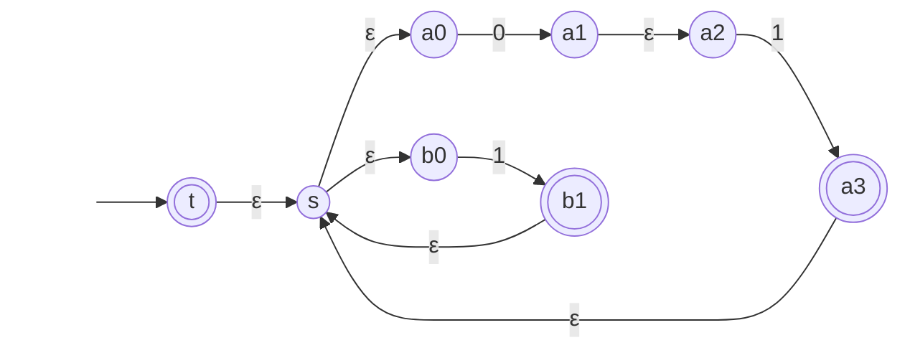

# Regular expressions and the pumping lemma

After this lesson you can read and write regular expressions, convert one to an NFA, state and prove the pumping lemma, and use it as a game against an adversary to show that a language such as $\{0^n 1^n\}$ or $\{ww\}$ is not regular.

Before this: [finite automata: DFA and NFA](01-finite-automata-dfa-and-nfa.md), [proof by contradiction](../../04-proofs-and-logic/03-core-proof-methods/06-proof-by-contradiction.md), and the [pigeonhole principle](../03-counting-and-discrete-probability/04-inclusion-exclusion-and-pigeonhole.md).

## Quick check

Try these first. If you get all three right, skip to [Practice](#practice).

1. Describe the language of the regular expression $(0 \cup 1)^* 1$ over $\{0, 1\}$ in words, and say whether $\varepsilon$ is in it.
2. Write a regular expression for the binary strings with exactly two 1s.
3. A DFA has 5 states and reads a string of length 7. Why must it visit some state twice?

<details class="solution" markdown>
<summary>Answers</summary>

1. The strings that end in 1. The string $\varepsilon$ is not in it, because every string in the language has a last symbol, which is 1.
2. $0^* 1 0^* 1 0^*$: any number of 0s, a 1, any number of 0s, a 1, and any number of 0s.
3. Reading 7 symbols visits 8 states counting the start. With only 5 states, two of the 8 visits are the same state, by the pigeonhole principle.

</details>

## The idea

A DFA says how to check a string. A regular expression says what the strings look like. You already write these: a search pattern like `colou?r` or `[0-9]+\.[0-9]*` describes a set of strings by saying what to concatenate, what to choose between and what to repeat. This lesson makes that precise, then shows that regular expressions and finite automata describe exactly the same languages.

The second half goes the other way. Finite automata have finite memory, so some languages must be out of reach. The language $\{0^n 1^n : n \ge 0\}$ needs a counter that is unbounded: after the 0s, the machine has to remember how many there were. The pumping lemma turns that intuition into a proof. If a DFA has $p$ states and reads a string longer than $p$, it must revisit a state, and the loop between the two visits can be repeated any number of times. A language where repeating a piece of a long string breaks membership can't be regular.

## Definitions

### Regular expressions

Let $\Sigma$ be an alphabet. A **regular expression** over $\Sigma$ is defined recursively:

1. $a$ is a regular expression for each $a \in \Sigma$;
2. $\varepsilon$ is a regular expression;
3. $\emptyset$ is a regular expression;
4. if $R_1$ and $R_2$ are regular expressions, so are $(R_1 \cup R_2)$, $(R_1 \circ R_2)$ and $(R_1^*)$.

Nothing else is a regular expression. Each regular expression $R$ describes a language $L(R)$, defined by the same recursion:

| Expression $R$ | Language $L(R)$ |
|---|---|
| $a$ | $\{a\}$ |
| $\varepsilon$ | $\{\varepsilon\}$ |
| $\emptyset$ | $\emptyset$ |
| $R_1 \cup R_2$ | $L(R_1) \cup L(R_2)$ |
| $R_1 \circ R_2$ | $L(R_1) \circ L(R_2)$ |
| $R_1^*$ | $L(R_1)^*$ |

In plain words: $\cup$ means "or", concatenation means "followed by", and star means "any number of times, including none". The right-hand sides are the operations on languages from the [previous lesson](01-finite-automata-dfa-and-nfa.md#strings-and-languages). Practical tools write $\cup$ as `|` or `+`; this book follows the usual textbook notation, with $\cup$.

To save brackets, star binds tightest, then concatenation, then union, and the $\circ$ is dropped. So $01^* \cup 1$ means $(0(1^*)) \cup 1$. Two shorthands: $R^+ = R R^*$ means "one or more", and $\Sigma$ inside an expression stands for the union of all the symbols, so over $\{0, 1\}$ the expression $\Sigma^*$ is $(0 \cup 1)^*$ and describes every string.

A few identities help with simplifying: $R \cup \emptyset = R$, $R \circ \varepsilon = R$, $R \circ \emptyset = \emptyset$, and $\emptyset^* = \varepsilon^* = \{\varepsilon\}$. The last one is a surprise at first: zero copies of anything is the empty string, so $\varepsilon \in L(R^*)$ for every $R$.

### The equivalence

*Theorem 1.* A language is regular if and only if some regular expression describes it.

In plain words: regular expressions and finite automata have the same power. The two directions are proved below.

### The pumping lemma

*Theorem 2 (the pumping lemma).* If $A$ is a regular language, then there is a number $p$ (the **pumping length**) such that every string $s \in A$ with $\lvert s \rvert \ge p$ can be written as $s = xyz$ where

1. $x y^i z \in A$ for every $i \ge 0$,
2. $\lvert y \rvert > 0$, and
3. $\lvert x y \rvert \le p$.

In plain words: every long enough string in a regular language has a piece $y$, not empty and near the front, that can be repeated any number of times (or deleted, with $i = 0$) without leaving the language. Here $y^i$ is $y$ written $i$ times, and $y^0 = \varepsilon$.

## How to do it

### Writing a regular expression

1. Say the language in words, and split it into parts that follow each other, choices between alternatives, and repeated pieces.
2. Write each part, then join them: concatenation for "followed by", $\cup$ for "or", star for "any number of".
3. Look for the edge cases: does the language contain $\varepsilon$? Does your expression? Is the first or last symbol constrained?
4. Check by listing the shortest strings of the language and the shortest strings that are just outside it.

### Turning a regular expression into an NFA

Build the NFA by following the structure of the expression, using the constructions from the previous lesson's Theorem 2.

1. For a symbol $a$, use two states and one arrow labelled $a$. For $\varepsilon$, use one accepting start state. For $\emptyset$, use one non-accepting start state.
2. For $R_1 \cup R_2$, add a new start state with $\varepsilon$-arrows to the two machines.
3. For $R_1 \circ R_2$, add $\varepsilon$-arrows from the accepting states of the first machine to the start of the second, which makes only the second machine's accepting states accepting.
4. For $R_1^*$, add a new accepting start state with an $\varepsilon$-arrow to the old start, and $\varepsilon$-arrows from the accepting states back to the old start.
5. Check on short strings.

### Turning a DFA into a regular expression

The idea is state elimination. Draw the DFA with a new start state and a new accepting state, and label each arrow with a regular expression (a union when several symbols share an arrow). Remove the other states one at a time. To remove a state $q$, for every pair of states $u, v$ with arrows $u \to q$ (labelled $R_1$), $q \to v$ (labelled $R_3$) and a loop at $q$ (labelled $R_2$), replace the route by the arrow $u \to v$ labelled $R_1 R_2^* R_3$, joined by $\cup$ to any arrow $u \to v$ already there. When only the new start and the new accepting state remain, the label on the arrow between them is the answer. Example 2 does this on a small machine.

### Playing the pumping lemma game

To show that a language $A$ is not regular, assume it is and play against an adversary who must supply the numbers that the lemma promises.

1. The adversary picks the pumping length $p$. You don't know it, so it stays a letter in your argument.
2. You pick a string $s \in A$ with $\lvert s \rvert \ge p$. The string must be written in terms of $p$.
3. The adversary picks any split $s = xyz$ with $\lvert y \rvert > 0$ and $\lvert xy \rvert \le p$. You don't get to choose it, so you must handle every possible split.
4. You pick $i \ge 0$. Show that $xy^i z \notin A$, for every split the adversary could have chosen.

If you can always win, the lemma's conclusion fails, so $A$ is not regular (proof by contradiction). Condition 3 is the weapon: it forces $y$ to lie inside the first $p$ symbols of $s$, so you choose $s$ so that those symbols are all of one kind.

<div class="warning" markdown>

Watch out at step 4: the adversary's choice of split is not yours. A proof that says "let $y$ be the first 0" has picked a split, which proves nothing. You must cover every $x$ and $y$ that obey conditions 2 and 3, usually by saying exactly what they must look like ("$y = 0^k$ for some $k \ge 1$").

</div>

## Proofs

*Proof of Theorem 1, regular expression to NFA.* What we want: an NFA for $L(R)$, for every regular expression $R$. The plan: structural induction on $R$, in the style of [recursive definitions and structural induction](../../04-proofs-and-logic/05-induction/03-recursive-definitions-and-structural-induction.md).

Basis: the languages $\{a\}$, $\{\varepsilon\}$ and $\emptyset$ have the one-arrow, one-state and one-state machines of step 1. Recursive step: if $R_1$ and $R_2$ have NFAs, then the union, concatenation and star constructions of the previous lesson's Theorem 2 give NFAs for $L(R_1) \cup L(R_2)$, $L(R_1) \circ L(R_2)$ and $L(R_1)^*$, which are $L(R_1 \cup R_2)$, $L(R_1 \circ R_2)$ and $L(R_1^*)$. By structural induction every regular expression has an NFA, and by the previous lesson's Theorem 1 a DFA. $\blacksquare$

*Proof of Theorem 1, DFA to regular expression (sketch).* The state-elimination procedure above keeps the language the same at each step: a path through the removed state $q$ enters by an arrow, goes around the loop at $q$ any number of times, and leaves by an arrow, which is what $R_1 R_2^* R_3$ describes. After each removal the machine has one fewer state, so the procedure ends with a single arrow from the new start to the new accepting state, and its label describes the language. A full proof formalizes this by induction on the number of states. $\blacksquare$

*Proof of Theorem 2 (pumping lemma).* What we know: $A$ is regular, so a DFA $M = (Q, \Sigma, \delta, q_0, F)$ recognizes it. What we want: a number $p$ and the split. The plan: take $p$ to be the number of states of $M$. A string of length at least $p$ makes $M$ visit $p + 1$ states, so some state repeats (the pigeonhole principle), and the loop between the repeats is the piece $y$.

*Proof.* Let $p = \lvert Q \rvert$, and let $s = s_1 s_2 \cdots s_n$ be a string in $A$ with $n \ge p$. Let $r_1 = q_0$ and $r_{k+1} = \delta(r_k, s_k)$ for $k = 1, \dots, n$ be the states $M$ visits on $s$, so $r_{n+1} \in F$. Look at the first $p + 1$ of them, $r_1, \dots, r_{p+1}$. There are only $p$ states, so two are equal: $r_j = r_l$ for some $j < l \le p + 1$.

Split $s$ as $x = s_1 \cdots s_{j-1}$, $y = s_j \cdots s_{l-1}$ and $z = s_l \cdots s_n$. Then $x$ takes $M$ from $r_1$ to $r_j$, the string $y$ takes it from $r_j$ to $r_l = r_j$, and $z$ takes it from $r_l$ to $r_{n+1} \in F$. Since $y$ loops from $r_j$ back to $r_j$, repeating it $i$ times keeps $M$ at $r_j$, so $x y^i z$ ends in $r_{n+1}$ for every $i \ge 0$ (for $i = 0$, $x$ leads directly to $r_j = r_l$ and then $z$ finishes). Hence $x y^i z \in A$, which is condition 1. The loop has $l - j \ge 1$ symbols, which is condition 2, and $\lvert xy \rvert = l - 1 \le p$, which is condition 3. $\blacksquare$

Look back: the lemma says nothing about which state repeats or which string is chosen; it only says a repeat exists in the first $p$ steps. That is why the pumping length can be taken as the number of states. Check with the DFA for "ends in 01" from the previous lesson, which has 3 states: the string $1101$ visits $q_0, q_0, q_0, q_1, q_2$, the first repeat is $q_0$ at positions 1 and 2, so $x = \varepsilon$, $y = 1$, $z = 101$, and $1^i 101$ ends in 01 for every $i$.

## Worked examples

<div class="example" markdown>

### Example 1: writing regular expressions

Over $\{0, 1\}$, write expressions for (a) strings with exactly one 1, (b) strings that contain 001, (c) strings of even length, and (d) nonempty strings that start and end with the same symbol.

Step 1, split into parts. For (a), the 1 is preceded and followed by any number of 0s, so $0^* 1 0^*$. For (b), anything, then 001, then anything, so $\Sigma^* 001 \Sigma^*$. For (c), pairs of symbols repeated any number of times: $(\Sigma\Sigma)^*$. For (d), the string starts and ends with 0, or starts and ends with 1, or is a single symbol: $0 \Sigma^* 0 \cup 1 \Sigma^* 1 \cup 0 \cup 1$.

Step 3, the edge cases. Expression (c) contains $\varepsilon$ (zero pairs), which has even length 0, correct. Expression (d) needs the two single-symbol terms: without them, the string $0$ would be missing, because $0\Sigma^*0$ needs at least two symbols.

Step 4, the check. Matching each expression against all strings of length up to 11 and comparing with the plain-English condition gives agreement every time.

</div>

<div class="example" markdown>

### Example 2: regular expression to NFA, and DFA to regular expression

Build an NFA for $R = (01 \cup 1)^*$, the strings in which every 0 is followed immediately by a 1.

Step 1 gives a two-state machine for each symbol. Step 3 joins the machines for 0 and 1 with an $\varepsilon$-arrow, giving $a_0 \xrightarrow{0} a_1 \xrightarrow{\varepsilon} a_2 \xrightarrow{1} a_3$ for $01$, and the machine for the single symbol 1 is $b_0 \xrightarrow{1} b_1$. Step 2 adds the start state $s$ for the union. Step 4 adds the new accepting start state $t$ for the star, and $\varepsilon$-arrows from the old accepting states $a_3$ and $b_1$ back to $s$.



Step 5, the check. For $011$: from $t$ the machine reaches $\{t, s, a_0, b_0\}$ by $\varepsilon$-arrows, reading 0 leads to $\{a_1, a_2\}$, reading 1 leads to $\{a_3, s, a_0, b_0\}$ (which is accepting, since it contains $a_3$), and the second 1 leads to a set containing $b_1$, accepting. So 011 is accepted. For $00$: the first 0 leads to $\{a_1, a_2\}$ and the second 0 leads to the empty set, so it is rejected. Comparing with the expression on all strings up to length 12 gives agreement.

Now the other direction, on the DFA from the idea section of the previous lesson, which accepts strings with an even number of 1s. It has the states $e$ (start, accepting) and $o$, with $e \xrightarrow{0} e$, $e \xrightarrow{1} o$, $o \xrightarrow{0} o$ and $o \xrightarrow{1} e$. Add a new start with an $\varepsilon$-arrow to $e$, and a new accepting state with an $\varepsilon$-arrow from $e$. Remove $o$: the route $e \to o \to e$ is $1 \, 0^* \, 1$, so $e$ now has a loop labelled $0 \cup 10^*1$. Remove $e$: the route from the new start to the new accepting state is $\varepsilon (0 \cup 10^*1)^* \varepsilon$. The answer is $(0 \cup 1 0^* 1)^*$.

Check: it accepts $\varepsilon$, $0$, $11$ and $1001$, and rejects $1$ and $10$. All strings up to length 12 agree with the parity of 1s.

</div>

<div class="example" markdown>

### Example 3: $\{0^n 1^n\}$ is not regular

*Claim.* The language $A = \{0^n 1^n : n \ge 0\}$ is not regular.

Step 1: suppose, for contradiction, that $A$ is regular, and let $p$ be the pumping length the lemma gives. Step 2: choose $s = 0^p 1^p$. It is in $A$ and $\lvert s \rvert = 2p \ge p$. Step 3: let $s = xyz$ be any split with $\lvert y \rvert > 0$ and $\lvert xy \rvert \le p$. The first $p$ symbols of $s$ are all 0, and $xy$ lies within them, so $y = 0^k$ for some $k \ge 1$. Step 4: choose $i = 2$. Then $x y^2 z = 0^{p+k} 1^p$ has $p + k$ zeros and $p$ ones, and $k \ge 1$ means they differ, so $xy^2 z \notin A$.

Condition 1 of the lemma fails for every split, so the assumption is false: $A$ is not regular. $\blacksquare$

Look back: the choice of $s$ is what made this work. In $0^p 1^p$ condition 3 pins $y$ inside the block of 0s, and pumping changes the number of 0s but not the number of 1s. Check with $p = 3$: $s = 000111$, and each split has $y \in \{0, 00, 000\}$. Doubling $y$ gives $0^4 1^3$, $0^5 1^3$ or $0^6 1^3$, none in $A$. A computer check does this for $p$ from 1 to 8.

</div>

<div class="example" markdown>

### Example 4: $\{ww\}$ is not regular, and a bad choice of $s$

*Claim.* The language $B = \{ww : w \in \{0, 1\}^*\}$, the strings that are some string written twice, is not regular.

Suppose it is regular, with pumping length $p$. Try $s = 0^p 0^p = 0^{2p}$ first. It is in $B$ (take $w = 0^p$). But the adversary splits it as $x = \varepsilon$, $y = 00$ (allowed when $p \ge 2$), $z = 0^{2p-2}$. Every $x y^i z$ is $0^{2p - 2 + 2i}$, a string of 0s of even length, which is in $B$. The adversary survives, and this choice of $s$ proves nothing.

The fix is to choose $s$ so that the first half has structure the pumping can destroy. Take $s = 0^p 1 0^p 1$, which is $ww$ with $w = 0^p 1$. Let $s = xyz$ be any split with $\lvert y \rvert > 0$ and $\lvert xy \rvert \le p$. Then $y = 0^k$ with $k \ge 1$, lying in the first block of 0s. Pump up: $xy^2z = 0^{p+k} 1 0^p 1$. Suppose this equals $uu$ for some string $u$. It contains exactly two 1s, so each copy of $u$ contains exactly one, and $u = 0^a 1 0^b$. The string ends in 1, so $b = 0$ and $uu = 0^a 1 0^a 1$. Matching $0^{p+k} 1 0^p 1$ with $0^a 1 0^a 1$ forces $a = p + k$ from the first block and $a = p$ from the second, so $k = 0$, which contradicts $k \ge 1$. So $xy^2z \notin B$, and $B$ is not regular. $\blacksquare$

Check: for $p = 3$, $s = 0001\,0001$; the splits give $y \in \{0, 00, 000\}$, and $xy^2z$ is $0^4 1 0^3 1$, $0^5 1 0^3 1$ or $0^6 1 0^3 1$, none of which is a repeated string. The first block of 0s is longer than the second.

</div>

<div class="example" markdown>

### Example 5: pumping down (finish it yourself)

*Claim.* The language $C = \{0^i 1^j : i > j \ge 0\}$, which has more 0s than 1s, is not regular.

Suppose it is, with pumping length $p$. Choose $s = 0^{p+1} 1^p$, which is in $C$ since $p + 1 > p$. Let $s = xyz$ be any split with $\lvert y \rvert > 0$ and $\lvert xy \rvert \le p$. Then $y = 0^k$ for some $k$ with $1 \le k \le p$. Pumping up to $i = 2$ gives $0^{p+1+k} 1^p$, which is still in $C$, so this choice of $i$ doesn't help. Choose a different $i$ and finish the argument.

<details class="solution" markdown>
<summary>Finish</summary>

Choose $i = 0$, which deletes $y$. Then $xz = 0^{p+1-k} 1^p$. Since $k \ge 1$, the number of 0s is $p + 1 - k \le p$, which is not more than the number of 1s, so $xz \notin C$. Condition 1 fails for every split, so $C$ is not regular. $\blacksquare$

Check with $p = 3$: $s = 0000\,111$ and $y \in \{0, 00, 000\}$, giving $xz = 0^3 1^3$, $0^2 1^3$ or $0^1 1^3$, none with more 0s than 1s. Pumping down (taking $i = 0$) is the right move when the language requires "more than", because it removes the surplus.

</details>

</div>

## Edge cases and common mistakes

<div class="warning" markdown>

Watch out: the pumping lemma can only prove that a language is not regular. It is "if regular, then pumpable", and its converse is false. A language can satisfy the three conditions and still be nonregular, so "I found a split that works" proves nothing. An example is $\{a^i b^j c^k : i \ne 1 \text{ or } j = k\}$. Every long string in it can be pumped with $p = 3$ (a computer check of all strings up to length 11 confirms this), but the language is not regular, because intersecting it with the regular language $a b^* c^*$ gives $\{a b^j c^j\}$, which fails by the same argument as Example 3. To prove regularity, build a machine or an expression.

</div>

<div class="warning" markdown>

Watch out: do not choose a string $s$ that the adversary can pump. Example 4 shows $0^{2p}$ in $\{ww\}$. Also don't pick a fixed number such as $s = 0^{100} 1^{100}$: the adversary chooses $p$ first and may choose $p > 100$, so $s$ must depend on $p$. And $s$ must be in the language and at least $p$ symbols long, or the lemma says nothing.

</div>

<div class="warning" markdown>

Watch out: do not check only one split. In Example 3, "let $y$ be the first 0" is one split. The adversary will take another. The argument works because condition 3 forces every split to have $y = 0^k$, so all cases are covered by one calculation.

</div>

<div class="warning" markdown>

Watch out: do not forget that $i = 0$ is allowed. Pumping down is the right choice for "more than" languages (Example 5) and for languages where deleting $y$ breaks a count. Also the pumping length is not the length of $y$ or a bound on $\lvert s \rvert$: it is a lower bound on the strings the lemma covers.

</div>

<div class="note" markdown>

Regular expressions have some edge cases of their own. $\emptyset^* = \{\varepsilon\}$, not $\emptyset$. The expression $\varepsilon$ and the expression $\emptyset$ are different: $L(\varepsilon) = \{\varepsilon\}$ and $L(\emptyset) = \emptyset$. And tools like `grep` and Python's `re` add features that go beyond regular expressions as defined here. A back-reference makes the pattern `(.+)\1` match every nonempty string written twice, which is the language of Example 4, so those patterns are not regular expressions in the sense of this lesson. Regular expressions in this sense describe exactly the finite-automaton languages.

</div>

## Myhill-Nerode: a second tool

Another way to show nonregularity compares strings by what can follow them. Two strings $x$ and $y$ are **distinguishable** by a language $A$ if some string $z$ makes exactly one of $xz$ and $yz$ lie in $A$. In plain words, a suffix $z$ tells them apart.

*Theorem 3 (Myhill-Nerode, one direction).* If a language $A$ has $m$ strings that are pairwise distinguishable by $A$, then every DFA for $A$ has at least $m$ states.

*Proof.* Let $M$ be a DFA for $A$ with fewer than $m$ states, and let $x_1, \dots, x_m$ be the pairwise distinguishable strings. By the pigeonhole principle, two of them, $x_a$ and $x_b$, lead $M$ to the same state. Then $x_a z$ and $x_b z$ lead to the same state for every $z$, so $M$ accepts both or neither, and no $z$ distinguishes them. This is a contradiction. $\blacksquare$

The full theorem says more: $A$ is regular exactly when the number of classes of mutually indistinguishable strings is finite, and that number is the size of the smallest DFA. Two applications:

- For $\{0^n 1^n\}$, the strings $0^i$ and $0^j$ with $i \ne j$ are distinguished by $z = 1^i$: $0^i 1^i$ is in the language and $0^j 1^i$ is not. There are infinitely many pairwise distinguishable strings, so no DFA has enough states.
- For "the third symbol from the end is 1" from the previous lesson, the 8 strings of length 3 are pairwise distinguishable. If $u \ne v$ differ at position $j$ (counting from 1 on the left), then appending $z = 0^{j-1}$ puts the symbol $u_j$ third from the end of $uz$ and $v_j$ third from the end of $vz$, so exactly one of them is accepted. So every DFA needs at least 8 states, and the subset construction's 8 were not wasteful. For "the $n$-th symbol from the end" the same argument gives $2^n$.

## Tricks and shortcuts

- To prove nonregularity, choose $s$ so that its first $p$ symbols are all the same symbol. Condition 3 then makes $y$ a block of that symbol, and the count is easy to track.
- Use closure to shrink the problem. If $A$ were regular, then $A \cap 0^* 1^*$ would be too. For $A$ = strings with equal numbers of 0s and 1s, $A \cap 0^* 1^* = \{0^n 1^n\}$, which is not regular, so $A$ isn't either. This avoids a new pumping argument.
- For "more than", pump down ($i = 0$). For "equal" or a perfect-square length, pump up ($i = 2$) and check that the new length falls strictly between two allowed values.
- Language shape tells you where to look: a language that has to compare two unbounded quantities (counts, a string and its copy, its reverse) is a candidate for nonregular. A language that only needs a bounded summary is regular.
- To write an expression for the complement or the intersection, build the DFA, apply the closure construction, and convert back. Expressions have no direct operator for these.

## In code

The program tests the regular expressions of Example 1 against plain conditions, and plays the pumping game by brute force: for a given $p$ it tries every split of the chosen string and reports whether any split survives pumping with $i$ from 0 to 5.

<details class="code" markdown>
<summary>In code</summary>

```python
import re
from itertools import product

def strings(alphabet, max_len):
    for n in range(max_len + 1):
        for t in product(alphabet, repeat=n):
            yield "".join(t)

# Example 1: the regular expressions, with | for union
checks = {
    "0*10*": lambda w: w.count("1") == 1,
    "(0|1)*001(0|1)*": lambda w: "001" in w,
    "((0|1)(0|1))*": lambda w: len(w) % 2 == 0,
    "0(0|1)*0|1(0|1)*1|0|1": lambda w: len(w) >= 1 and w[0] == w[-1],
}
for pattern, condition in checks.items():
    ok = all(bool(re.fullmatch(pattern, w)) == condition(w) for w in strings("01", 11))
    print(pattern, ok)                     # True for all four

# The even-parity expression from Example 2
print(all(bool(re.fullmatch("(0|10*1)*", w)) == (w.count("1") % 2 == 0)
          for w in strings("01", 12)))     # True

def splits(s, p):
    """All splits s = xyz with |y| > 0 and |xy| <= p."""
    for xl in range(p + 1):
        for yl in range(1, p - xl + 1):
            if xl + yl <= len(s):
                yield s[:xl], s[xl:xl + yl], s[xl + yl:]

def survives(s, p, member, max_i=5):
    """True if some split keeps x y^i z in the language for every i <= max_i."""
    return any(all(member(x + y * i + z) for i in range(max_i + 1))
               for x, y, z in splits(s, p))

anbn = lambda w: re.fullmatch("0*1*", w) is not None and w.count("0") == w.count("1")
ww = lambda w: len(w) % 2 == 0 and w[:len(w) // 2] == w[len(w) // 2:]

for p in (3, 5, 8):
    print(p, survives("0" * p + "1" * p, p, anbn),          # False: the adversary loses
             survives("0" * (2 * p), p, ww),                 # True: a bad choice of s
             survives("0" * p + "1" + "0" * p + "1", p, ww))  # False: a good choice of s
# 3 False True False
# 5 False True False
# 8 False True False
```

</details>

## FAQ

### Why does the pumping lemma start with "there is a $p$"? Can't I just pick it?

The lemma is a promise about every regular language, and the promise is made by the machine: $p$ is its number of states, which you don't control. So in the game the adversary picks $p$. If you could pick $p$ yourself, you would pick one that makes the argument easy, and that would prove nothing.

### Why can I use $s = 0^p 1^p$ if I don't know $p$?

You are not computing with $p$; you are reasoning about every possible value. The string $s = 0^p 1^p$ is a family of strings, one for each $p$, and the argument is the same for all of them. This is the same kind of reasoning as "let $n$ be an integer" in any proof.

### How do I know whether to try the pumping lemma or to build a machine?

Ask whether a finite memory could do the job. If the language needs to count without a bound or to compare two long pieces of the input, expect it to be nonregular and use the lemma or Myhill-Nerode. If a bounded summary of the input read so far is enough, build a DFA, as in the previous lesson. When you can't decide, trying to design the DFA shows you what the machine would need to remember.

### Is Myhill-Nerode better than the pumping lemma?

For nonregularity proofs it is often easier, since there is no adversary and no cases. The full theorem is an if-and-only-if, so it can also prove that a language is regular (find finitely many classes), which the pumping lemma never can. The pumping lemma has the advantage that it is quick on the standard examples and generalizes to context-free languages, as in the [next lesson](03-context-free-grammars-and-pushdown-automata.md#the-pumping-lemma-for-context-free-languages).

## Practice

### Warm-up

1\. Write regular expressions over $\{0, 1\}$ for (a) strings that start with 1, (b) strings with no 1s, (c) strings whose length is a multiple of 3.

<details class="solution" markdown>
<summary>Solution</summary>

(a) $1\Sigma^*$, a 1 followed by anything. (b) $0^*$, which includes $\varepsilon$. (c) $(\Sigma\Sigma\Sigma)^*$, any number of blocks of three, which includes $\varepsilon$ (length 0).

Check: (a) rejects $\varepsilon$ and $01$, accepts $1$ and $10$. (b) accepts $\varepsilon$ and $000$, rejects $010$. (c) accepts $011$ and $\varepsilon$, rejects $01$.

</details>

2\. List the five shortest strings in $L\bigl((0 \cup 1)0^*\bigr)$.

<details class="solution" markdown>
<summary>Solution</summary>

The expression is one symbol (0 or 1) followed by any number of 0s. The strings are $0$, $1$, $00$, $10$, $000$ (and $100$ next). Listing by length and then in order: $0, 1, 00, 10, 000$.

Check: each begins with one symbol and continues with only 0s, and $\varepsilon$ is not in the language, since the first symbol is required.

</details>

3\. In the pumping lemma game for $\{0^n 1^n\}$, the adversary picks $p = 4$ and you pick $s = 0^4 1^4$. The adversary splits it with $x = 0$, $y = 00$, $z = 0^1 1^4$. Which $i$ makes you win, and what string do you get?

<details class="solution" markdown>
<summary>Solution</summary>

The split is allowed: $\lvert y \rvert = 2 > 0$ and $\lvert xy \rvert = 3 \le 4$. With $i = 2$, $xy^2z = 0 \cdot 0000 \cdot 0 1111$, which is $0^6 1^4$. Six 0s and four 1s, so it is not in the language. Any $i \ne 1$ also wins: $i = 0$ gives $0^2 1^4$.

Check: $x y z = 0 \cdot 00 \cdot 0 1111 = 0^4 1^4 = s$.

</details>

### Standard

4\. Prove that $D = \{1^{n^2} : n \ge 0\}$, the strings of 1s whose length is a perfect square, is not regular.

<details class="solution" markdown>
<summary>Solution</summary>

Suppose $D$ is regular with pumping length $p$. Choose $s = 1^{p^2}$, which is in $D$ and has length at least $p$ (when $p \ge 1$). Let $s = xyz$ be a split with $1 \le \lvert y \rvert \le p$ (condition 3 gives $\lvert y \rvert \le \lvert xy \rvert \le p$). Take $i = 2$: the length of $xy^2z$ is $p^2 + \lvert y \rvert$. Then

$$
p^2 < p^2 + \lvert y \rvert \le p^2 + p < p^2 + 2p + 1 = (p + 1)^2.
$$

So the length lies strictly between the consecutive squares $p^2$ and $(p+1)^2$, and it is not a perfect square. Hence $xy^2z \notin D$, for every split, and $D$ is not regular. $\blacksquare$

Check with $p = 3$: $s = 1^9$ and pumping $y$ of length 1, 2 or 3 gives lengths 10, 11 or 12, none a square.

</details>

5\. Use the closure trick to prove that $E = \{w \in \{0, 1\}^* : w \text{ has equally many 0s and 1s}\}$ is not regular. You may use that $\{0^n 1^n\}$ is not regular.

<details class="solution" markdown>
<summary>Solution</summary>

Suppose $E$ is regular. The language $0^* 1^*$ is regular (it is described by a regular expression), and the regular languages are closed under intersection (previous lesson, Theorem 2). So $E \cap 0^* 1^*$ is regular. A string in $0^* 1^*$ is some 0s followed by some 1s, and it is in $E$ when the counts are equal, so $E \cap 0^* 1^* = \{0^n 1^n : n \ge 0\}$. That language is not regular (Example 3), a contradiction. So $E$ is not regular. $\blacksquare$

Check: $0011$ and $0101$ are in $E$, and only $0011$ is also in $0^*1^*$, as the intersection requires.

</details>

6\. Convert the regular expression $0^* 1$ to an NFA by the construction, and say how many states it has before any simplification. Then give an equivalent DFA with two states plus a dead state.

<details class="solution" markdown>
<summary>Solution</summary>

The symbol 0 gives two states and the star adds a new start state, so $0^*$ has 3 states: a new accepting start $t$ with an $\varepsilon$-arrow to $u_0$, an arrow $u_0 \xrightarrow{0} u_1$, and an $\varepsilon$-arrow from $u_1$ back to $u_0$. The symbol 1 gives two states $v_0 \xrightarrow{1} v_1$. Concatenation adds an $\varepsilon$-arrow from the accepting state $t$ and from $u_1$ to $v_0$ (the accepting states of the first machine, which are $t$ and $u_1$), and only $v_1$ is accepting. The total is $3 + 2 = 5$ states.

An equivalent DFA: states $A$ (start), $B$ (accepting) and $D$ (dead), with $A \xrightarrow{0} A$, $A \xrightarrow{1} B$, $B \xrightarrow{0,1} D$ and $D \xrightarrow{0,1} D$.

Check: $1$, $01$ and $0001$ are accepted, and $\varepsilon$, $0$, $10$ and $11$ are rejected, by the expression and by the DFA.

</details>

### Challenge

7\. Prove that the language $F = \{0^a 1^b 0^c : a, b, c \ge 0 \text{ and } b = a + c\}$ is not regular.

<details class="solution" markdown>
<summary>Solution</summary>

The language contains $0^n 1^n$ ($c = 0$), and the pumping argument for that string works for $F$ too. Suppose $F$ is regular with pumping length $p$, and choose $s = 0^p 1^p$, which is in $F$ with $a = p$, $b = p$, $c = 0$. For any split with $\lvert y \rvert > 0$ and $\lvert xy \rvert \le p$, $y = 0^k$ with $k \ge 1$. Then $xy^2z = 0^{p+k} 1^p$. If this were in $F$ it would have the form $0^a 1^b 0^c$ with $b = a + c$. The string has no 0s after its 1s, so $c = 0$, and $a = p + k$, $b = p$, requiring $p = p + k$. That fails for $k \ge 1$. So $xy^2z \notin F$, and $F$ is not regular. $\blacksquare$

Check with $p = 2$: $s = 0011 \in F$; $y \in \{0, 00\}$ gives $00011$ or $000011$, which have more 0s than 1s, and are not in $F$.

</details>

8\. (Reviews [recursive definitions and structural induction](../../04-proofs-and-logic/05-induction/03-recursive-definitions-and-structural-induction.md).) Let $\text{stars}(R)$ count the stars in a regular expression, with $\text{stars}(a) = \text{stars}(\varepsilon) = \text{stars}(\emptyset) = 0$, $\text{stars}(R_1 \cup R_2) = \text{stars}(R_1 \circ R_2) = \text{stars}(R_1) + \text{stars}(R_2)$, and $\text{stars}(R_1^*) = \text{stars}(R_1) + 1$. Prove by structural induction that if $\text{stars}(R) = 0$ then $L(R)$ is finite.

<details class="solution" markdown>
<summary>Solution</summary>

What we want: for every regular expression $R$ with no stars, $L(R)$ is finite. The plan: structural induction on $R$, with one case for each clause.

*Proof.* Basis: $L(a) = \{a\}$, $L(\varepsilon) = \{\varepsilon\}$ and $L(\emptyset) = \emptyset$ are finite. Union: if $\text{stars}(R_1 \cup R_2) = 0$, both parts have no stars, so by the hypothesis $L(R_1)$ and $L(R_2)$ are finite, and a union of two finite sets is finite. Concatenation: $L(R_1) \circ L(R_2)$ has at most $\lvert L(R_1) \rvert \cdot \lvert L(R_2) \rvert$ strings, which is finite. Star: $\text{stars}(R_1^*) \ge 1$, so the statement is vacuous. By structural induction, the claim holds for every $R$. $\blacksquare$

Check: $(0 \cup 1)(0 \cup 1)$ has no stars and $L$ has the 4 strings $00, 01, 10, 11$. The converse is false: $\emptyset^*$ has a star and $L = \{\varepsilon\}$ is finite.

</details>

## Where this shows up

- Regular expressions are in every text-processing tool: `grep`, editors, validation of input fields, and the tokenizer of a compiler, which compiles patterns into a DFA by the steps of this lesson.
- The pumping lemma has a version for the next class of languages, in [context-free grammars and pushdown automata](03-context-free-grammars-and-pushdown-automata.md). The argument pattern (assume, choose a string depending on $p$, cover every split, pump, contradict) is the model for the diagonal and reduction arguments in [decidability and the halting problem](05-decidability-and-the-halting-problem.md).
- The pigeonhole step in the proof is the same one used in [inclusion-exclusion and the pigeonhole principle](../03-counting-and-discrete-probability/04-inclusion-exclusion-and-pigeonhole.md). The REGULAR problem, deciding whether a Turing machine recognizes a regular language, is undecidable ([reductions and undecidability](06-reductions-and-undecidability.md)), and its proof uses the nonregular language of Example 3.
