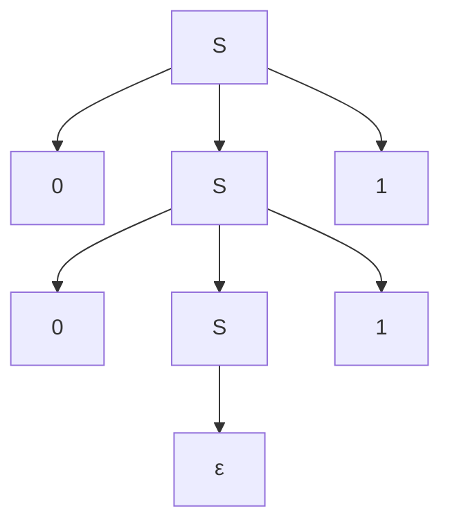
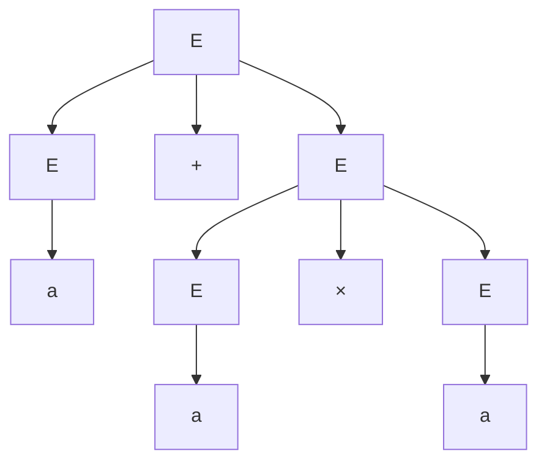
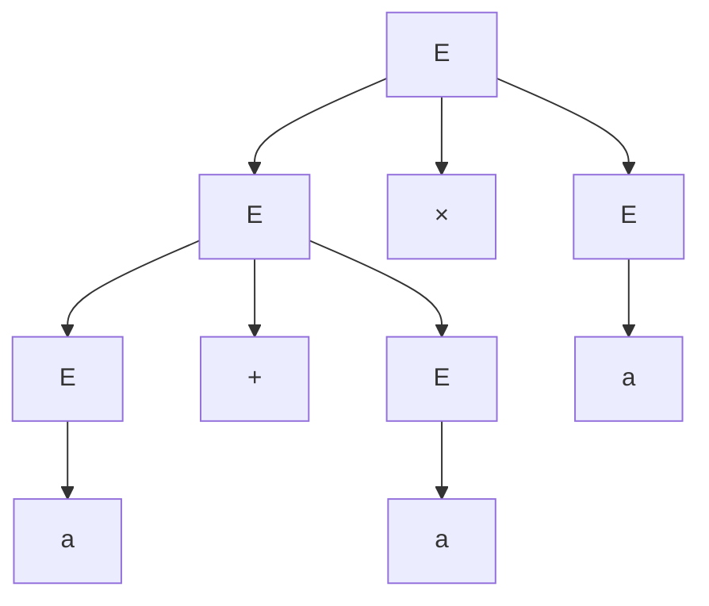
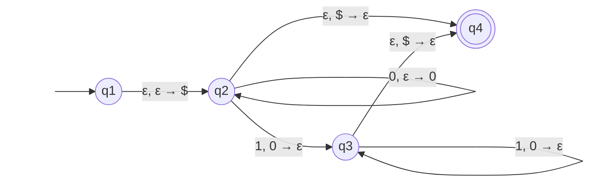

# Context-free grammars and pushdown automata

After this lesson you can derive strings from a context-free grammar and draw their parse trees, spot and remove ambiguity, design and prove correct a grammar for a simple language, convert a grammar to Chomsky normal form, trace a pushdown automaton, and show with the pumping lemma that $\{a^n b^n c^n\}$ is not context-free.

Before this: [finite automata: DFA and NFA](01-finite-automata-dfa-and-nfa.md), [regular expressions and the pumping lemma](02-regular-expressions-and-pumping-lemma.md), and [recursive definitions and structural induction](../../04-proofs-and-logic/05-induction/03-recursive-definitions-and-structural-induction.md).

## Quick check

Try these first. If you get all three right, skip to [Practice](#practice).

1. Using the rules $S \to 0S1$ and $S \to \varepsilon$, write the steps that produce $0011$ from $S$.
2. Which strings does the grammar with rules $S \to aSb$ and $S \to \varepsilon$ generate?
3. A stack starts empty. You push 1, push 0, pop, push 1, pop. What is on the stack?

<details class="solution" markdown>
<summary>Answers</summary>

1. $S \Rightarrow 0S1 \Rightarrow 00S11 \Rightarrow 0011$. The last step uses $S \to \varepsilon$.
2. The strings $a^n b^n$ for $n \ge 0$: $\varepsilon$, $ab$, $aabb$, and so on. Each use of the first rule adds one $a$ on the left and one $b$ on the right.
3. A single 1. The first push put 1 on the stack, the 0 was pushed and popped, and the second 1 was pushed and popped, so only the first 1 is left.

</details>

## The idea

A DFA can't check that brackets match, because the nesting depth is unbounded and its memory is finite. Programming languages are full of nesting: parentheses, blocks, nested expressions, `if` inside `if`. To describe such languages we need rules that can call themselves.

A **grammar** is a set of substitution rules. The rule "an expression can be two expressions joined by a plus sign" says that wherever you see the symbol $E$ you may replace it by $E + E$. Start from a start symbol and substitute until only real symbols are left; the strings you can reach form the language. This is the same idea as a recursive definition of a set: a base case and rules that build bigger objects from smaller ones, which is why proofs about grammars use structural induction.

The machine that goes with grammars is a finite automaton plus a stack. A stack gives unbounded memory with restricted access: you can only look at the top. That is exactly what matching brackets needs: push on each opening bracket, pop on each closing one. The two views, grammars and stack machines, describe the same class of languages. The class sits strictly between the regular languages and the languages a Turing machine can decide.

## Definitions

### Context-free grammars

A **context-free grammar** (CFG) is a 4-tuple $G = (V, \Sigma, R, S)$ where

1. $V$ is a finite set of **variables**,
2. $\Sigma$ is a finite set of **terminals**, disjoint from $V$,
3. $R$ is a finite set of **rules**, each of the form $A \to w$ with $A \in V$ and $w \in (V \cup \Sigma)^*$, and
4. $S \in V$ is the **start variable**.

In plain words: variables are placeholders and terminals are the real symbols of the strings. A rule says that the variable on the left may be replaced by the string on the right. "Context-free" means the left side is a single variable, so the replacement doesn't depend on the symbols around it. Rules with the same left side are abbreviated with a bar: $A \to w_1 \mid w_2$.

If $u, v, w$ are strings of variables and terminals and $A \to w$ is a rule, then $uAv$ **yields** $uwv$, written $uAv \Rightarrow uwv$. We write $u \Rightarrow^* v$ if $v$ can be reached from $u$ in zero or more steps. A **derivation** is such a sequence of steps. The **language of the grammar** is $L(G) = \{w \in \Sigma^* : S \Rightarrow^* w\}$, and a language is **context-free** if some CFG generates it.

A **parse tree** shows a derivation as a tree. The root is the start variable, each internal node is a variable, and its children, read from left to right, are the symbols on the right side of the rule used. The leaves, read from left to right, spell the derived string. In a **leftmost derivation** the variable replaced at each step is the leftmost one.

A grammar is **ambiguous** if some string has two different parse trees. Equivalently, the string has two different leftmost derivations. In plain words: the grammar can't say which structure a string has. A language is **inherently ambiguous** if every grammar for it is ambiguous. Such languages exist but are rare, and the ambiguity in programming languages is the fixable kind.

### Chomsky normal form

A grammar is in **Chomsky normal form** (CNF) if every rule has the form

$$
A \to BC \qquad \text{or} \qquad A \to a,
$$

where $a$ is a terminal and $A, B, C$ are variables, with $B$ and $C$ not the start variable. The one extra rule allowed is $S \to \varepsilon$ for the start variable $S$.

In plain words: every rule either splits a variable into exactly two variables or turns it into one terminal. Parse trees are then binary trees, which makes them easy to count and to search.

### Pushdown automata

A **pushdown automaton** (PDA) is an NFA with a stack. It is a 6-tuple $P = (Q, \Sigma, \Gamma, \delta, q_0, F)$ where $Q$ is the set of states, $\Sigma$ the input alphabet, $\Gamma$ the **stack alphabet** (the symbols that may be on the stack), $q_0 \in Q$ the start state, $F \subseteq Q$ the accepting states, and

$$
\delta \colon Q \times \Sigma_\varepsilon \times \Gamma_\varepsilon \to \mathcal{P}(Q \times \Gamma_\varepsilon).
$$

Recall $\Sigma_\varepsilon = \Sigma \cup \{\varepsilon\}$. In plain words, a transition says: in state $q$, reading input symbol $a$ (or nothing, if $a = \varepsilon$), with $b$ on top of the stack (or ignoring the stack, if $b = \varepsilon$), the machine may move to state $r$ and replace $b$ on the stack by $c$. We draw it as an arrow labelled "$a, b \to c$". Reading $\varepsilon$ means no input is consumed. Popping means $c = \varepsilon$ (and $b \ne \varepsilon$), and pushing means $b = \varepsilon$ (and $c \ne \varepsilon$).

The PDA $P$ **accepts** $w$ if $w$ can be written $w_1 \cdots w_m$ with each $w_i \in \Sigma_\varepsilon$, and there are states $r_0, \dots, r_m$ and stack contents $s_0, \dots, s_m$ (strings over $\Gamma$, with the top at the left) such that $r_0 = q_0$ and $s_0 = \varepsilon$, each step is allowed by $\delta$, and $r_m \in F$. In plain words: some sequence of choices reads the whole input and ends in an accepting state. The stack need not be empty at the end, and many PDAs make it empty on purpose. The stack always starts empty, so PDAs usually push a marker symbol such as $\$$ first, to detect when the stack is empty again.

*Theorem 1.* A language is context-free if and only if some pushdown automaton recognizes it.

This is stated here, with a sketch below. Nondeterminism matters for PDAs: unlike finite automata, deterministic PDAs are strictly weaker. The language of even-length palindromes $\{ww^R\}$ needs the machine to guess where the middle is.

### The pumping lemma for context-free languages

*Theorem 2 (pumping lemma for context-free languages).* If $A$ is a context-free language, then there is a number $p$ such that every string $s \in A$ with $\lvert s \rvert \ge p$ can be written as $s = uvxyz$ where

1. $u v^i x y^i z \in A$ for every $i \ge 0$,
2. $\lvert vy \rvert > 0$, and
3. $\lvert vxy \rvert \le p$.

In plain words: a long string in a context-free language has two pieces $v$ and $y$ that can be repeated together, the same number of times each, and at least one of them is not empty. The two pieces are close together (within a window of $p$ symbols), but unlike the regular case they can be in different places on either side of $x$.

## How to do it

### Designing a grammar

1. Describe the language recursively, as in a recursive definition of a set: the base strings, and the ways to build a longer string from shorter ones in the language.
2. Give a variable to each kind of piece. The start variable generates the whole language.
3. Turn each clause into a rule. A base case is a rule with no variable on the right, often $S \to \varepsilon$.
4. Prove the grammar correct in two directions: everything the grammar generates is in the language (usually by induction on the length of the derivation), and everything in the language can be generated (usually by induction on the length of the string).
5. Check small strings by hand, and check for ambiguity if the grammar is going to be used to parse.

A language that is a union, such as $\{a^i b^j c^k : i = j \text{ or } j = k\}$, is handled by a new start rule $S \to S_1 \mid S_2$ with a grammar for each part.

### Removing ambiguity

Ambiguity in expression grammars usually comes from a missing precedence or associativity rule. Add one variable per level of precedence: the variable for the lowest-precedence operator is built from the next level, and the lowest level holds the atoms and the bracketed expressions. Make the recursion on the left for left-associative operators. Example 2 does this for $+$ and $\times$.

### Converting a grammar to Chomsky normal form

1. Add a new start variable $S_0$ and the rule $S_0 \to S$, so the start variable never appears on a right side.
2. Remove every $\varepsilon$-rule $A \to \varepsilon$ for $A \ne S_0$. For each rule with $A$ on the right, add a copy with that $A$ deleted (every combination, if $A$ occurs several times). Repeat until no such rule is left.
3. Remove every unit rule $A \to B$. For each rule $B \to w$, add $A \to w$ (unless it is a unit rule already removed).
4. Fix the long rules. Replace $A \to u_1 u_2 \cdots u_k$ with $k \ge 3$ by a chain of rules with two symbols on the right, adding new variables. Replace each terminal $a$ that sits in a rule with two or more symbols by a new variable $U_a$ with the rule $U_a \to a$.
5. Check that each rule has one of the allowed forms, and check the language on short strings.

Why bother: the shape of CNF makes every parse tree binary, which gives a clean bound on the length of derivations.

*Theorem 3.* Every context-free grammar can be converted to an equivalent grammar in Chomsky normal form. In such a grammar, each derivation of a string of length $n \ge 1$ takes exactly $2n - 1$ steps.

*Proof of the second sentence.* Start with the one symbol $S_0$. Each rule $A \to BC$ increases the number of symbols in the current string by 1, and each rule $A \to a$ leaves it unchanged. The derivation ends with $n$ symbols, so it uses exactly $n - 1$ rules of the first kind. Each of the $n$ terminals comes from one rule $A \to a$, so it uses exactly $n$ rules of the second kind. The total is $2n - 1$. (The first sentence is the conversion above, and the correctness of each step is a check that the language is unchanged.) $\blacksquare$

This bound is what makes it possible to decide whether a grammar generates a given string: try every derivation of $2n - 1$ steps, and in practice use dynamic programming, as in the CYK algorithm. It returns in [decidability and the halting problem](05-decidability-and-the-halting-problem.md).

### Designing a PDA

1. Decide what the stack should hold. For a language that matches two counts, the stack holds a count in unary: one symbol per unit.
2. Push a marker $\$$ first, so that an empty stack can be detected.
3. Read the first part of the input and push. Switch to the matching phase (by a nondeterministic guess, if the point is not marked in the input) and read the second part, popping.
4. Accept when the input is used up and the marker is the top of the stack (then pop it).
5. Trace the machine on a string in the language, a string that is not, and $\varepsilon$.

### The pumping lemma game

For a context-free language the game is the same as for regular languages, with five pieces instead of three. The adversary picks $p$. You pick $s \in A$ with $\lvert s \rvert \ge p$. The adversary picks any split $s = uvxyz$ with $\lvert vy \rvert > 0$ and $\lvert vxy \rvert \le p$. You pick $i$ and show $uv^i x y^i z \notin A$, for every split. The weapon is condition 3: the window $vxy$ is short, so it can't reach across a long block.

## Proofs

*Theorem 4.* The grammar $S \to 0S1 \mid \varepsilon$ generates exactly $\{0^n 1^n : n \ge 0\}$.

What we want: both inclusions. The plan: induction on the number of steps for one direction, and on $n$ for the other.

*Proof.* We show by induction on the number of steps $k$ that every string reachable from $S$ in $k$ steps has the form $0^n S 1^n$ or $0^n 1^n$. For $k = 0$ the string is $S = 0^0 S 1^0$. If a string $0^n S 1^n$ takes one more step, it becomes $0^{n+1} S 1^{n+1}$ (first rule) or $0^n 1^n$ (second rule). A string $0^n 1^n$ has no variable and takes no more steps. So the terminal strings generated are of the form $0^n 1^n$. Conversely, $0^n 1^n$ is generated: apply the first rule $n$ times, then the second, which gives $S \Rightarrow^* 0^n S 1^n \Rightarrow 0^n 1^n$. $\blacksquare$

*Lemma 1.* Let $B$ be the set of balanced parenthesis strings, defined by $\varepsilon \in B$, if $x \in B$ then $(x) \in B$, and if $x, y \in B$ then $xy \in B$. Every nonempty $w \in B$ can be written $w = (x)y$ with $x, y \in B$.

*Proof.* Structural induction on the clauses. The clause $(x)$ is $(x)\varepsilon$. For a nonempty $xy$ with $x, y \in B$: if $x = \varepsilon$ then $xy = y$, and the hypothesis for $y$ gives the form. Otherwise the hypothesis for $x$ gives $x = (u)v$ with $u, v \in B$, so $xy = (u)(vy)$, and $vy \in B$ by the third clause. $\blacksquare$

*Theorem 5.* The grammar $S \to (S)S \mid \varepsilon$ generates exactly $B$.

*Proof.* Generated strings are balanced: by strong induction on the number of steps in a derivation $S \Rightarrow^* w$ with $w \in \Sigma^*$. If $w$ comes from $S \to \varepsilon$, then $w = \varepsilon \in B$. Otherwise the first step is $S \to (S)S$, and the two copies of $S$ derive independently, so $w = (x)y$ with $S \Rightarrow^* x$ and $S \Rightarrow^* y$ in fewer steps. By the hypothesis $x, y \in B$, so $(x) \in B$ and $(x)y \in B$.

Balanced strings are generated: by strong induction on the length of $w \in B$. If $w = \varepsilon$, use $S \to \varepsilon$. Otherwise Lemma 1 gives $w = (x)y$ with $x, y \in B$, each shorter than $w$, so by the hypothesis $S \Rightarrow^* x$ and $S \Rightarrow^* y$. Then $S \Rightarrow (S)S \Rightarrow^* (x)y = w$. $\blacksquare$

Look back: the proof follows the shape of the grammar. The recursive definition of $B$ and the rules of $G$ line up, which is why these grammars are easy to prove correct. This grammar is also unambiguous, because the decomposition $w = (x)y$ is unique: $x$ is the part between the first "(" and its matching ")". The ambiguous grammar $S \to (S) \mid SS \mid \varepsilon$ generates the same set, and the string $()()()$ has several parse trees under it.

*Sketch of Theorem 1, grammar to PDA.* Given a CFG, the PDA pushes $\$$ and then $S$. Then it repeats: if the top of the stack is a variable $A$, it nondeterministically picks a rule $A \to w$ and replaces $A$ by $w$ (pushing the symbols of $w$ so that its first symbol is on top). If the top is a terminal, it reads the next input symbol and pops the terminal if they match, and otherwise that branch dies. When $\$$ is on top, it moves to the accepting state. The stack always holds the part of the sentential form that is not yet matched, so an accepting run is a leftmost derivation of the input. In the other direction, one builds a grammar with a variable $A_{pq}$ for each pair of states, generating the strings that take the PDA from $p$ with an empty stack to $q$ with an empty stack. The details are in Sipser, Section 2.2. $\blacksquare$

*Sketch of Theorem 2, the pumping lemma.* Let $b$ be the longest right side of a rule in a grammar for $A$, and let $p = b^{\lvert V \rvert + 1}$. A parse tree for a string of length at least $p$ has height more than $\lvert V \rvert$, since a tree of height $h$ with branching at most $b$ has at most $b^h$ leaves. So it has a path longer than $\lvert V \rvert$ and some variable $R$ repeats on it. Take the lowest repeat. The upper $R$ generates a string $vxy$ and the lower generates $x$. Replacing the subtree at the upper $R$ by the one at the lower gives $uxz \in A$, and replacing the lower by the upper again gives $u v^2 x y^2 z$, and so on. Taking the lowest repeat bounds the height of the upper subtree by $\lvert V \rvert + 1$, which gives $\lvert vxy \rvert \le p$. If $v$ and $y$ were both empty, the replacement wouldn't change the string, so the tree could be shortened; choosing a smallest tree gives $\lvert vy \rvert > 0$. $\blacksquare$

## Worked examples

<div class="example" markdown>

### Example 1: a derivation and a parse tree

The grammar is $G = (\{S\}, \{0, 1\}, R, S)$ with $R$: $S \to 0S1 \mid \varepsilon$. Derive $0011$.

Step 1 (start variable): $S$. Step 2: use $S \to 0S1$ to get $0S1$. Step 3: use the same rule again on the $S$ inside, giving $00S11$. Step 4: use $S \to \varepsilon$ to get $0011$. As a derivation:

$$
S \Rightarrow 0S1 \Rightarrow 00S11 \Rightarrow 0011.
$$

There is one variable at each step, so this is also the leftmost derivation. Its parse tree has the start variable at the root; the leaves, left to right, are $0, 0, \varepsilon, 1, 1$.



Check: the leaves read $0, 0, \varepsilon, 1, 1$, which is $0011$ with the empty string dropped. A computer check of all strings up to length 10 confirms that this grammar generates exactly the strings $0^n 1^n$, each with exactly one derivation.

</div>

<div class="example" markdown>

### Example 2: ambiguity in arithmetic, and the fix

Consider $E \to E + E \mid E \times E \mid (E) \mid a$. The string $a + a \times a$ has two parse trees.





The first tree groups the string as $a + (a \times a)$, the second as $(a + a) \times a$. With $a = 2$ these give 6 and 8, so the parse tree changes the meaning, and a compiler needs one answer. A computer count finds 2 trees for $a + a \times a$ and 5 for $a + a \times a + a$.

To fix it, build precedence into the grammar with three levels: expressions are sums of terms, terms are products of factors, and factors are atoms or bracketed expressions.

$$
E \to E + T \mid T \qquad T \to T \times F \mid F \qquad F \to (E) \mid a
$$

Now $a + a \times a$ can only be read with the product inside a term: $E \Rightarrow E + T \Rightarrow T + T \Rightarrow F + T \Rightarrow a + T \Rightarrow a + T \times F \Rightarrow \cdots \Rightarrow a + a \times a$. The recursion on the left in $E \to E + T$ makes $+$ associate to the left, so $a + a + a$ means $(a + a) + a$. The new grammar generates the same language, and a computer check finds exactly one parse tree for each of the strings $a + a \times a$, $a + a + a$, $(a + a) \times a$ and $a \times a \times a$.

Check: the same ambiguity appears in the dangling else. With the rules $S \to \texttt{i}\,S \mid \texttt{i}\,S\,\texttt{e}\,S \mid \texttt{s}$, the string $\texttt{iises}$ has two trees, one attaching the $\texttt{e}$ to the inner $\texttt{i}$ and one to the outer. Languages settle it by a rule: the else belongs to the nearest if.

</div>

<div class="example" markdown>

### Example 3: converting to Chomsky normal form

Convert $S \to 0S1 \mid \varepsilon$ to CNF.

Step 1: add a new start variable: $S_0 \to S$, $S \to 0S1 \mid \varepsilon$.

Step 2: remove $S \to \varepsilon$. The rule $S \to 0S1$ has an $S$ on the right, so add the copy with it deleted, $S \to 01$. The rule $S_0 \to S$ also has an $S$, so add $S_0 \to \varepsilon$, which is allowed for the start variable. Now: $S_0 \to S \mid \varepsilon$ and $S \to 0S1 \mid 01$.

Step 3: remove the unit rule $S_0 \to S$ by copying the rules of $S$ to $S_0$: $S_0 \to 0S1 \mid 01 \mid \varepsilon$ and $S \to 0S1 \mid 01$.

Step 4: new variables $A \to 0$ and $B \to 1$ replace the terminals, and $C \to SB$ splits the three-symbol rule $A S B$:

$$
S_0 \to AC \mid AB \mid \varepsilon, \qquad S \to AC \mid AB, \qquad C \to SB, \qquad A \to 0, \qquad B \to 1.
$$

Check: derive $0011$. We get $S_0 \Rightarrow AC \Rightarrow 0C \Rightarrow 0SB \Rightarrow 0ABB \Rightarrow 00BB \Rightarrow 001B \Rightarrow 0011$, which is 7 steps, equal to $2 \cdot 4 - 1$ as Theorem 3 says. A computer check of all strings up to length 11 shows the new grammar generates exactly $\{0^n 1^n\}$.

</div>

<div class="example" markdown>

### Example 4: a PDA for $\{0^n 1^n\}$, traced

The machine pushes a marker $\$$, pushes one 0 for each 0 it reads, then pops one 0 for each 1. When the marker is on top and the input is used up, it accepts. The label "$a, b \to c$" means: read $a$, pop $b$, push $c$.



The transition at $q_2$ for $\varepsilon, \$ \to \varepsilon$ is there for the empty string, which is $0^0 1^0$. Here is the run on $0011$, with the stack written with its top on the left.

| State | Input left | Stack | Move |
|---|---|---|---|
| $q_1$ | $0011$ | (empty) | push the marker, go to $q_2$ |
| $q_2$ | $0011$ | $\$$ | read 0, push 0 |
| $q_2$ | $011$ | $0\$$ | read 0, push 0 |
| $q_2$ | $11$ | $00\$$ | read 1, pop 0, go to $q_3$ |
| $q_3$ | $1$ | $0\$$ | read 1, pop 0 |
| $q_3$ | (empty) | $\$$ | pop the marker, go to $q_4$ |
| $q_4$ | (empty) | (empty) | accept |

Check: on $001$ the machine reads both 0s, reads the 1 and pops one 0, and is left in $q_3$ with the input used up and the stack $0\$$. The marker is not on top, so the move to $q_4$ is not possible, and no branch accepts. A computer simulation of the machine on all strings up to length 11 agrees with $\{0^n 1^n\}$.

</div>

<div class="example" markdown>

### Example 5: $\{a^n b^n c^n\}$ is not context-free (finish it yourself)

Suppose $A = \{a^n b^n c^n : n \ge 0\}$ is context-free with pumping length $p$, and take $s = a^p b^p c^p$. Let $s = uvxyz$ with $\lvert vy \rvert > 0$ and $\lvert vxy \rvert \le p$.

The window $vxy$ has at most $p$ symbols, but the last $a$ and the first $c$ are $p + 1$ positions apart, with $b^p$ between them. So $vxy$ can't contain both an $a$ and a $c$. It touches at most two of the three kinds of symbol, and it misses at least one kind.

First case: $vxy$ lies inside the block of $a$s. Then $v = a^j$ and $y = a^k$ with $j + k \ge 1$. Take $i = 2$: the string $uv^2xy^2z$ has $p + j + k$ letters $a$ and still $p$ letters $b$ and $p$ letters $c$, so it isn't in $A$.

Do the remaining cases: $vxy$ inside the $b$s, inside the $c$s, spanning the $a$s and $b$s, and spanning the $b$s and $c$s.

<details class="solution" markdown>
<summary>Finish</summary>

All the cases have the same reason. The string $vy$ is nonempty and contains letters of at most two kinds. Pumping up with $i = 2$ adds the letters of $vy$ to $s$, so at least one kind rises above $p$, while the kind that $vxy$ misses stays at exactly $p$. So the three counts are not all equal, and $uv^2xy^2z \notin A$.

Inside the $b$s or the $c$s: the count of $b$ (or $c$) goes above $p$, and the counts of the other two stay $p$. Spanning the $a$s and $b$s: the counts of $a$ or $b$ (or both) rise, and the count of $c$ stays $p$. Spanning the $b$s and $c$s: the count of $a$ stays $p$ while the count of $b$ or $c$ rises.

Every split fails with $i = 2$, so $A$ is not context-free. $\blacksquare$

Check with $p = 3$: $s = aaabbbccc$. A computer check of every split with $\lvert vxy \rvert \le 3$ and $vy \ne \varepsilon$ finds that pumping up with $i = 2$ always leaves $A$, for $p$ from 1 to 5.

</details>

</div>

## Edge cases and common mistakes

<div class="warning" markdown>

Watch out: a regular language is always context-free, but the grammar for it may look odd. Every DFA gives a grammar with a variable $R_q$ for each state $q$, a rule $R_q \to a R_r$ when $\delta(q, a) = r$, and $R_q \to \varepsilon$ for each accepting $q$. So the regular languages are a proper part of the context-free ones: $\{0^n 1^n\}$ is context-free and not regular.

</div>

<div class="warning" markdown>

Watch out: don't mix up what the pumped pieces are. In the context-free lemma, $v$ and $y$ are pumped together, the same number of times, and $x$ stays. Pumping only $v$ is not allowed. In the regular lemma there was one piece $y$ in a prefix window $\lvert xy \rvert \le p$; here the window is $\lvert vxy \rvert \le p$ and it can sit anywhere in the string. So you can't force the window to be in the first block by choosing the string, and the case analysis has more cases, as Example 5 shows.

</div>

<div class="warning" markdown>

Watch out: a correct-looking grammar can generate extra strings. For equal numbers of 0s and 1s in any order, $S \to 0S1 \mid 1S0 \mid \varepsilon$ misses $0110$ (it can only wrap a string, never join two, and $0110$ starts and ends with 0). The grammar $S \to 0S1S \mid 1S0S \mid \varepsilon$ fixes it; a computer check of all strings up to length 8 confirms that it generates exactly the strings with equal counts. Always test a grammar on strings that are in the language but have an unusual shape, and strings that are not in it.

</div>

<div class="warning" markdown>

Watch out: context-free languages are closed under union, concatenation and star, but not under intersection or complement. The languages $\{a^n b^n c^m\}$ and $\{a^m b^n c^n\}$ are both context-free, and their intersection is $\{a^n b^n c^n\}$, which is not (Example 5). Since $A \cap B = \overline{\overline{A} \cup \overline{B}}$ and the class is closed under union, it can't be closed under complement either (Practice 7).

</div>

<div class="note" markdown>

A deterministic PDA picks at most one move at each step. The nondeterministic PDA is stronger: for $\{ww^R\}$, no deterministic machine can know when the middle of the input has been reached. This is a difference from finite automata, where Theorem 1 of the first lesson shows determinism costs nothing. It is also why parsers for programming languages use restricted classes of grammars (such as LL and LR grammars) that a deterministic machine can handle.

</div>

## Tricks and shortcuts

- To check a grammar quickly, list its shortest derivable strings by hand, then the shortest strings that should not be derivable and see whether any rule would produce them.
- A language with two matched blocks, like $\{0^n 1^n\}$ or $\{0^n 1^{2n}\}$, is a rule $S \to 0S1 \mid \varepsilon$ with the right number of symbols on each side: $S \to 0S11 \mid \varepsilon$ for $\{0^n 1^{2n}\}$.
- Inequality languages are two matched blocks plus a free part: $\{0^i 1^j : i \le j\}$ is $S \to 0S1 \mid S1 \mid \varepsilon$, where the second rule adds an unmatched 1.
- To show a language is not context-free, pick $s$ with three or more blocks that depend on $p$, so a short window can't reach all of them. Two-block strings are often context-free.
- For a PDA, guess nondeterministically at the one place where the machine can't tell what to do (the middle of a palindrome, the start of the second part), and let the other branches die.

## In code

A grammar can be run as a recognizer by trying all derivations, and a PDA by following all configurations. The program counts parse trees for the grammars of Example 2, then simulates the PDA of Example 4 against the definition on short strings.

<details class="code" markdown>
<summary>In code</summary>

```python
from functools import lru_cache
from itertools import product

def strings(alphabet, max_len):
    for n in range(max_len + 1):
        for t in product(alphabet, repeat=n):
            yield "".join(t)

def count_trees(rules, start, w):
    """Number of leftmost derivations of w (= number of parse trees)."""
    variables = set(rules)

    @lru_cache(None)
    def go(symbols, rest):
        if not symbols:
            return 1 if rest == "" else 0
        first, tail = symbols[0], symbols[1:]
        if first not in variables:
            return go(tail, rest[len(first):]) if rest.startswith(first) else 0
        total = 0
        for rhs in rules[first]:
            new = tuple(rhs) + tail
            if sum(1 for t in new if t not in variables) <= len(rest):
                total += go(new, rest)
        return total
    return go((start,), w)

ambiguous = {"E": [("E", "+", "E"), ("E", "*", "E"), ("(", "E", ")"), ("a",)]}
layered = {"E": [("E", "+", "T"), ("T",)],
           "T": [("T", "*", "F"), ("F",)],
           "F": [("(", "E", ")"), ("a",)]}
for w in ["a+a*a", "a+a*a+a"]:
    print(w, count_trees(ambiguous, "E", w), count_trees(layered, "E", w))
# a+a*a 2 1
# a+a*a+a 5 1

# The PDA of Example 4. A configuration is (state, input position, stack with top first).
delta = {("q1", "", ""): {("q2", "$")},
         ("q2", "0", ""): {("q2", "0")},
         ("q2", "1", "0"): {("q3", "")},
         ("q3", "1", "0"): {("q3", "")},
         ("q2", "", "$"): {("q4", "")},
         ("q3", "", "$"): {("q4", "")}}

def pda_accepts(w):
    start = ("q1", 0, "")
    seen, todo = {start}, [start]
    while todo:
        q, i, stack = todo.pop()
        if i == len(w) and q == "q4":
            return True
        for read in ("", w[i:i + 1]):
            for pop in ("", stack[:1]):
                for r, push in delta.get((q, read, pop), ()):
                    new = (r, i + len(read), push + stack[len(pop):])
                    if new not in seen:
                        seen.add(new)
                        todo.append(new)
    return False

def in_language(w):
    n = len(w) // 2
    return len(w) % 2 == 0 and w == "0" * n + "1" * n

print(all(pda_accepts(w) == in_language(w) for w in strings("01", 11)))   # True
print(pda_accepts("0011"), pda_accepts("001"))                           # True False
```

</details>

## FAQ

### Why is it called "context-free"?

Because a rule $A \to w$ may replace $A$ wherever it appears, whatever symbols are next to it. A rule in a more general grammar can look at the neighbours, such as $aAb \to awb$, which replaces $A$ only between an $a$ and a $b$. Those context-sensitive grammars are stronger, and the context-free ones are the simple case that stacks can handle.

### Why does a PDA need a stack and not just a counter?

For $\{0^n 1^n\}$ a counter is enough, and a stack that holds only 0s is a counter. For $\{ww^R\}$ you need to remember a sequence of symbols and compare it backwards, which is what a stack does. A counter can't tell $0110$ from $1001$ in the first half.

### Can a grammar be both ambiguous and still useful?

Yes, for generating strings. Ambiguity hurts when you need the structure, as a compiler does. A grammar for generating test data or for checking membership doesn't care. The check "is this string in the language" has the same answer under any grammar for the language.

### Where do real parsers fit?

Programming language syntax is described by a context-free grammar, often with tools that turn the grammar into a deterministic parser. Not everything about a language is context-free: "every variable must be declared before use" is a context-sensitive condition, and compilers check it in a separate pass over the parse tree.

## Practice

### Warm-up

1\. Write the leftmost derivation of $000111$ in $S \to 0S1 \mid \varepsilon$, and say how many steps it takes.

<details class="solution" markdown>
<summary>Solution</summary>

$S \Rightarrow 0S1 \Rightarrow 00S11 \Rightarrow 000S111 \Rightarrow 000111$. That is 4 steps: three uses of the first rule and one of the second.

Check: in general $0^n 1^n$ takes $n + 1$ steps, and $n = 3$ gives 4.

</details>

2\. Trace the PDA of Example 4 on $001$. Where does it get stuck?

<details class="solution" markdown>
<summary>Solution</summary>

It pushes $\$$, then reads 0 and 0, pushing two 0s: the stack is $00\$$. It reads the 1, pops one 0, and moves to $q_3$ with the stack $0\$$ and the input used up. The only way out of $q_3$ is $\varepsilon, \$ \to \varepsilon$, which needs the marker on top, but a 0 is on top. So it is stuck, no branch accepts, and $001$ is rejected.

Check: $001$ has two 0s and one 1, so it isn't of the form $0^n 1^n$.

</details>

3\. A grammar in Chomsky normal form generates a string of length 6. How many steps does the derivation take? How many are of the form $A \to BC$?

<details class="solution" markdown>
<summary>Solution</summary>

By Theorem 3 it takes $2 \cdot 6 - 1 = 11$ steps. Of these, $6 - 1 = 5$ are of the form $A \to BC$ and 6 are of the form $A \to a$.

Check: $5 + 6 = 11$, and the string grows from 1 symbol to $1 + 5 = 6$ symbols.

</details>

### Standard

4\. Design a grammar for $\{0^i 1^j : i \le j\}$ and show how it derives $011$ and $0011$.

<details class="solution" markdown>
<summary>Solution</summary>

Use $S \to 0S1 \mid S1 \mid \varepsilon$. The first rule matches a 0 with a 1, the second adds an unmatched 1, and the third ends.

Derive $011$: $S \Rightarrow 0S1 \Rightarrow 0S11 \Rightarrow 011$ (the second step adds an extra 1, the last uses $\varepsilon$). Derive $0011$: $S \Rightarrow 0S1 \Rightarrow 00S11 \Rightarrow 0011$.

Check: a computer check of all strings up to length 10 shows the grammar generates exactly the strings $0^i 1^j$ with $i \le j$. A string like $01 0$ with a 0 after a 1 can't be generated, because every 0 is added at the left, and every 1 at the right.

</details>

5\. Convert $S \to aSa \mid b$ to Chomsky normal form.

<details class="solution" markdown>
<summary>Solution</summary>

Step 1: add $S_0 \to S$. Steps 2 and 3: there are no $\varepsilon$-rules, and removing the unit rule $S_0 \to S$ copies the rules of $S$ to $S_0$: $S_0 \to aSa \mid b$ and $S \to aSa \mid b$. Step 4: the rule $aSa$ has three symbols, so use $A \to a$ and $C \to SA$, giving $S_0 \to AC \mid b$, $S \to AC \mid b$, $C \to SA$, $A \to a$.

Check: the language is $\{a^n b a^n\}$. The string $aba$ derives as $S_0 \Rightarrow AC \Rightarrow aC \Rightarrow aSA \Rightarrow abA \Rightarrow aba$, 5 steps, equal to $2 \cdot 3 - 1$. A computer check of all strings up to length 11 confirms the two grammars agree.

</details>

6\. Design a PDA for the even-length palindromes $\{ww^R : w \in \{0, 1\}^*\}$ and trace it on $0110$.

<details class="solution" markdown>
<summary>Solution</summary>

Idea: push the first half, guess the middle, and pop to match the second half. States $p_1$ (start), $p_2$ (pushing), $p_3$ (matching) and $p_4$ (accepting). The transitions:

- $p_1 \to p_2$ on $\varepsilon, \varepsilon \to \$$,
- $p_2 \to p_2$ on $0, \varepsilon \to 0$ and on $1, \varepsilon \to 1$,
- $p_2 \to p_3$ on $\varepsilon, \varepsilon \to \varepsilon$ (the guess that the middle is here),
- $p_3 \to p_3$ on $0, 0 \to \varepsilon$ and on $1, 1 \to \varepsilon$,
- $p_3 \to p_4$ on $\varepsilon, \$ \to \varepsilon$.

On $0110$: push $\$$, push 0, push 1 (stack $10\$$), guess the middle, read 1 and pop 1, read 0 and pop 0, pop $\$$ and accept. A wrong guess of the middle fails: guessing after only one symbol, the next input 1 meets the top 0 and the branch dies.

Check: a computer simulation of all strings up to length 11 accepts exactly the even-length palindromes.

</details>

### Challenge

7\. Assume that the context-free languages are closed under union and that $\{a^n b^n c^n\}$ is not context-free. Prove that the context-free languages are not closed under complement.

<details class="solution" markdown>
<summary>Solution</summary>

What we know: $A = \{a^n b^n c^m\}$ and $B = \{a^m b^n c^n\}$ are context-free (each is a grammar for a matched pair followed by a free block), and $A \cap B = \{a^n b^n c^n\}$ is not.

*Proof.* Suppose the context-free languages were closed under complement. Then $\overline{A}$ and $\overline{B}$ are context-free, so $\overline{A} \cup \overline{B}$ is context-free by closure under union, and its complement $\overline{\overline{A} \cup \overline{B}}$ is context-free. By De Morgan's law this is $A \cap B$, which is not context-free. This is a contradiction, so the class is not closed under complement. $\blacksquare$

Check: the string $aabbcc$ is in both $A$ and $B$, so it is in the intersection, and $aabbc$ is in $A$ (with $m = 1$) but not in $B$, so it is not in the intersection.

</details>

8\. (Reviews [recursive definitions and structural induction](../../04-proofs-and-logic/05-induction/03-recursive-definitions-and-structural-induction.md).) Prove that every string derived from $S$ in the grammar $S \to (S)S \mid \varepsilon$ has equally many "(" and ")".

<details class="solution" markdown>
<summary>Solution</summary>

What we want: for every terminal string $w$ with $S \Rightarrow^* w$, the number of "(" equals the number of ")". The plan: strong induction on the number of steps in the derivation.

*Proof.* If the derivation is one step, it is $S \Rightarrow \varepsilon$, and $\varepsilon$ has 0 of each. Otherwise the first step is $S \Rightarrow (S)S$, and the two $S$s derive terminal strings $x$ and $y$ in fewer steps, so $w = (x)y$. By the hypothesis, $x$ and $y$ each have equally many of each bracket, say $m$ and $n$. Then $w$ has $m + n + 1$ of "(" and $m + n + 1$ of ")". $\blacksquare$

Check: $()()$ is derived by $S \Rightarrow (S)S \Rightarrow ()S \Rightarrow ()(S)S \Rightarrow ()()S \Rightarrow ()()$, with 2 of each. The converse is false: $)($ has equal counts and can't be derived.

</details>

## Where this shows up

- Compilers and interpreters parse programs with context-free grammars, and the layered expression grammar of Example 2 is how real languages get precedence. Formats such as JSON and XML are context-free, and so is the nesting of function calls, whose stack is the machine's call stack.
- The next lesson, [Turing machines and the Church-Turing thesis](04-turing-machines-and-church-turing-thesis.md), adds an unbounded tape, which is stronger than a stack. The question of whether a grammar generates a string is decidable (by Theorem 3), and the question of whether two grammars generate the same language is not, as [decidability and the halting problem](05-decidability-and-the-halting-problem.md) and [reductions and undecidability](06-reductions-and-undecidability.md) explain.
- Structural induction (the proofs of Theorems 4 and 5 and Practice 8) is how the correctness of every recursive definition, parser and tree algorithm is proved.
