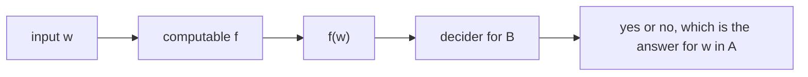

# Reductions and undecidability

After this lesson you can define a mapping reduction, use one in the right direction to prove that a language is undecidable, work through the reductions for $HALT_{\text{TM}}$, $E_{\text{TM}}$, $REGULAR_{\text{TM}}$ and $EQ_{\text{TM}}$, and state Rice's theorem together with its limits.

Before this: [decidability and the halting problem](05-decidability-and-the-halting-problem.md) and [Turing machines and the Church-Turing thesis](04-turing-machines-and-church-turing-thesis.md). The relation $\le_m$ is a [relation](../../04-proofs-and-logic/06-relations-and-functions/01-relations-and-their-properties.md) on languages, and Practice 8 checks which properties it has.

## Quick check

Try these first. If you get all three right, skip to [Practice](#practice).

1. You know that $A_{\text{TM}}$ is undecidable. To prove that a new language $B$ is undecidable, which would you show: that $A_{\text{TM}}$ reduces to $B$, or that $B$ reduces to $A_{\text{TM}}$?
2. A function $f$ takes $\langle M, w \rangle$ and outputs the description of a machine $M'$ that, on every input, ignores the input and runs $M$ on $w$. Does computing $f$ involve running $M$?
3. If $\langle M, w \rangle \in A_{\text{TM}}$ and $f$ is a reduction from $A_{\text{TM}}$ to $B$, is $f(\langle M, w \rangle)$ in $B$? What about when $\langle M, w \rangle \notin A_{\text{TM}}$?

<details class="solution" markdown>
<summary>Answers</summary>

1. That $A_{\text{TM}}$ reduces to $B$. Then a decider for $B$ would give a decider for $A_{\text{TM}}$, which does not exist. The other direction proves nothing: a decidable language can reduce to an undecidable one.
2. No. Computing $f$ only writes down the description of $M'$, which is a piece of text built from $\langle M \rangle$ and $w$. $M'$ is never run during the computation of $f$, so $f$ halts even when $M$ loops on $w$.
3. Yes in the first case, and no in the second. A reduction satisfies "$x \in A$ if and only if $f(x) \in B$", so strings in $A_{\text{TM}}$ go into $B$ and strings outside go outside.

</details>

## The idea

You already know the move from algebra and from programming: solve a new problem by turning it into one you can already solve. To sort a list of names, you might first turn each name into a number and then sort the numbers. To find a path in a maze, you might turn the maze into a graph and use a graph search.

In the theory of computation, the same move works in two directions. If you can turn problem $A$ into problem $B$, and you can solve $B$, then you can solve $A$. Read the other way round, if $A$ is known to be impossible, then $B$ is impossible as well, since a solution for $B$ would give one for $A$. This is how undecidability spreads. The diagonal argument for $A_{\text{TM}}$ was hard and was done once. Every later undecidability proof is a reduction from a problem already known to be undecidable.



The picture shows why direction matters. The reduction $f$ is the arrow from $A$'s inputs to $B$'s inputs, and the decider for $B$ is the machine assumed to exist. The conclusion points back at $A$.

## Definitions

A function $f \colon \Sigma^* \to \Sigma^*$ is a **computable function** if some Turing machine, on every input $w$, halts with just $f(w)$ on its tape. In plain words: an algorithm that always stops and outputs $f(w)$.

A language $A$ is **mapping reducible** to a language $B$, written $A \le_m B$, if there is a computable function $f$ such that for every string $w$,

$$
w \in A \iff f(w) \in B.
$$

The function $f$ is a **reduction** from $A$ to $B$. In plain words: $f$ turns every question "is $w$ in $A$?" into a question "is $f(w)$ in $B$?" with the same answer. The reduction does not have to be onto or one-to-one. It only has to send members of $A$ to members of $B$, and non-members to non-members.

*Theorem 1.* If $A \le_m B$ and $B$ is decidable, then $A$ is decidable. If $A \le_m B$ and $B$ is Turing-recognizable, then $A$ is recognizable.

What we know: a reduction $f$ computed by a machine $F$, and a decider $M$ for $B$. What we want: a decider for $A$. The plan: compute $f(w)$ and ask $M$ about it.

*Proof.* On input $w$, run $F$ to get $f(w)$, then run $M$ on $f(w)$ and output what $M$ outputs. $F$ halts, and $M$ halts, so this halts on every input. It accepts $w$ exactly when $M$ accepts $f(w)$, which happens exactly when $f(w) \in B$, which holds exactly when $w \in A$. The same argument with a recognizer $M$ gives a recognizer for $A$. $\blacksquare$

*Corollary 2.* If $A \le_m B$ and $A$ is undecidable, then $B$ is undecidable. If $A \le_m B$ and $A$ is not recognizable, then $B$ is not recognizable.

This is the contrapositive of Theorem 1, and it is the form used in practice: to prove $B$ undecidable, find an undecidable $A$ and a reduction $A \le_m B$.

A fact that gives more room: $A \le_m B$ if and only if $\overline{A} \le_m \overline{B}$, with the same $f$, since $w \in A \iff f(w) \in B$ is equivalent to $w \notin A \iff f(w) \notin B$. So a reduction from $A$ to the complement of $B$ also shows that $B$ is undecidable, because a language is decidable exactly when its complement is.

## How to do it

### Proving a language undecidable by reduction

1. Pick a language $A$ that is known to be undecidable, usually $A_{\text{TM}}$.
2. Describe a function $f$ that takes $\langle M, w \rangle$ and outputs a string in the format of $B$'s inputs. Usually the output is the description of a new machine $M'$ that you design.
3. Make sure $f$ is computable: it should only write down a description, never run $M$ on $w$, and it should handle inputs that are not valid encodings by sending them to a fixed string outside $B$.
4. Prove both directions: if $\langle M, w \rangle \in A$ then $f(\langle M, w \rangle) \in B$, and if $\langle M, w \rangle \notin A$ then $f(\langle M, w \rangle) \notin B$.
5. Conclude by Corollary 2 that $B$ is undecidable.

Step 3 hides the key idea. The new machine $M'$ may run $M$ on $w$ when $M'$ itself runs, which happens later and inside the question about $B$. The reduction only builds $M'$. That is why $f$ halts even when $M$ loops.

<div class="warning" markdown>

Watch out at step 1: the direction. Reducing the new language to $A_{\text{TM}}$ proves nothing. For example, $A_{\text{DFA}} \le_m A_{\text{TM}}$ holds (turn a DFA into an equivalent Turing machine), and $A_{\text{TM}}$ is undecidable, but $A_{\text{DFA}}$ is decidable. A reduction $B \le_m A_{\text{TM}}$ says that $B$ is no harder than $A_{\text{TM}}$. To say that $B$ is at least as hard, reduce the known hard problem to $B$.

</div>

## Worked examples

<div class="example" markdown>

### Example 1: $A_{\text{TM}} \le_m HALT_{\text{TM}}$

*Claim.* $HALT_{\text{TM}}$ is undecidable (again, by a reduction this time).

Step 1: use $A_{\text{TM}}$. Step 2: the function $f$ takes $\langle M, w \rangle$ and outputs $\langle M', w \rangle$, where $M'$ is the machine

> On input $x$: run $M$ on $x$. If $M$ accepts, accept. If $M$ rejects, loop forever.

Step 3: $f$ writes down $M'$, which is $M$ with a loop added at the reject state. Computing that is a finite edit of a table. (If the input isn't of the form $\langle M, w \rangle$, output a fixed pair that is not in $HALT_{\text{TM}}$, such as the description of a machine that loops on every input.)

Step 4: if $M$ accepts $w$, then $M'$ accepts $w$, so $M'$ halts on $w$, and $\langle M', w \rangle \in HALT_{\text{TM}}$. If $M$ rejects $w$, then $M'$ loops on $w$, so $\langle M', w \rangle \notin HALT_{\text{TM}}$. If $M$ loops on $w$, then $M'$ loops, and again $\langle M', w \rangle \notin HALT_{\text{TM}}$. In all cases $M$ accepts $w$ if and only if $M'$ halts on $w$.

Step 5: $A_{\text{TM}} \le_m HALT_{\text{TM}}$ and $A_{\text{TM}}$ is undecidable, so $HALT_{\text{TM}}$ is undecidable. $\blacksquare$

Check: a computer test on four toy machines (one that accepts after 3 steps, one that rejects after 2, one that loops, one that depends on the input) confirms that $M$ accepts $w$ exactly when $M'$ halts on $w$, for several $w$. The code is in the In code section.

</div>

<div class="example" markdown>

### Example 2: $E_{\text{TM}}$ is undecidable

Let $E_{\text{TM}} = \{\langle M \rangle : L(M) = \emptyset\}$. We reduce $A_{\text{TM}}$ to the complement of $E_{\text{TM}}$.

The function $f$ takes $\langle M, w \rangle$ and outputs $\langle M_w \rangle$, where $M_w$ is the machine

> On input $x$: if $x \ne w$, reject. If $x = w$, run $M$ on $w$, and accept if $M$ accepts.

If $M$ accepts $w$, then $L(M_w) = \{w\}$, which is not empty, so $\langle M_w \rangle \notin E_{\text{TM}}$. If $M$ doesn't accept $w$, then $M_w$ accepts nothing, so $L(M_w) = \emptyset$ and $\langle M_w \rangle \in E_{\text{TM}}$. So $\langle M, w \rangle \in A_{\text{TM}}$ if and only if $f(\langle M, w \rangle) \in \overline{E_{\text{TM}}}$, that is, $A_{\text{TM}} \le_m \overline{E_{\text{TM}}}$.

Hence $\overline{E_{\text{TM}}}$ is undecidable (Corollary 2). A language is decidable if and only if its complement is, so $E_{\text{TM}}$ is undecidable. $\blacksquare$

More is true. The complement $\overline{E_{\text{TM}}}$ is recognizable: given $\langle M \rangle$, run $M$ on all strings in parallel (for $k = 1, 2, \dots$, run $M$ for $k$ steps on each of the first $k$ strings), and accept when one run accepts. So $E_{\text{TM}}$ is not recognizable, by Theorem 6 of the previous lesson.

Check: a toy test shows that $L(M_w)$ is $\{w\}$ when $M$ accepts $w$ and empty when it doesn't, for all four toy machines and several $w$.

</div>

<div class="example" markdown>

### Example 3: $REGULAR_{\text{TM}}$ is undecidable

Let $REGULAR_{\text{TM}} = \{\langle M \rangle : L(M) \text{ is a regular language}\}$. We reduce $A_{\text{TM}}$ to it.

The function $f$ takes $\langle M, w \rangle$ and outputs $\langle M' \rangle$ where $M'$ is the machine

> On input $x$: if $x$ has the form $0^n 1^n$, accept. Otherwise run $M$ on $w$, and accept if $M$ accepts.

If $M$ accepts $w$, then $M'$ accepts every string (those of the form $0^n 1^n$ at once, and the others after $M$ accepts), so $L(M') = \Sigma^*$, which is regular. If $M$ doesn't accept $w$, then $M'$ accepts exactly the strings $0^n 1^n$, so $L(M') = \{0^n 1^n\}$, which is not regular by the [pumping lemma](02-regular-expressions-and-pumping-lemma.md). So $M$ accepts $w$ if and only if $\langle M' \rangle \in REGULAR_{\text{TM}}$, and $A_{\text{TM}} \le_m REGULAR_{\text{TM}}$. $\blacksquare$

Look back: the reduction needs a language on each side of the line between regular and not regular, and it uses $M$'s answer to decide which one $M'$ has. The same recipe works for any property that some languages have and some don't, which is what Rice's theorem below makes precise. Check: the toy test computes $L(M')$ on all strings up to length 8: it is every string when $M$ accepts $w$ and exactly the strings $0^n 1^n$ otherwise.

</div>

<div class="example" markdown>

### Example 4: $EQ_{\text{TM}}$ (finish it yourself)

Let $EQ_{\text{TM}} = \{\langle M_1, M_2 \rangle : L(M_1) = L(M_2)\}$. Reduce $E_{\text{TM}}$ to it. Let $N$ be a machine that rejects every input, so $L(N) = \emptyset$. Define $f(\langle M \rangle) = \langle M, N \rangle$. Prove that $\langle M \rangle \in E_{\text{TM}}$ if and only if $f(\langle M \rangle) \in EQ_{\text{TM}}$, say what $f$ does with a string that isn't an encoding of a machine, and conclude.

<details class="solution" markdown>
<summary>Finish</summary>

If $L(M) = \emptyset$, then $L(M) = L(N)$, so $\langle M, N \rangle \in EQ_{\text{TM}}$. If $L(M) \ne \emptyset$, then $L(M) \ne L(N) = \emptyset$, so $\langle M, N \rangle \notin EQ_{\text{TM}}$. The function $f$ only writes down $M$ next to the fixed description $\langle N \rangle$, so it is computable. For an input that isn't a valid encoding of a machine, let $f$ output the fixed pair $\langle N, M_{\text{all}} \rangle$, where $M_{\text{all}}$ accepts everything. This pair is not in $EQ_{\text{TM}}$, and the invalid input was not in $E_{\text{TM}}$ either, so the two answers agree.

So $E_{\text{TM}} \le_m EQ_{\text{TM}}$. By Example 2, $E_{\text{TM}}$ is undecidable, so $EQ_{\text{TM}}$ is undecidable (Corollary 2). $\blacksquare$

Check: for $M$ that accepts something, $\langle M, N \rangle$ pairs a nonempty language with the empty one, which are different. The toy test confirms that "empty on all strings up to length 6" and "agrees with the reject-all machine on those strings" coincide for all four toy machines.

</details>

</div>

## Rice's theorem

Examples 2 and 3 have the same shape, and so do many other undecidability proofs. Rice's theorem states the pattern once.

*Theorem 3 (Rice's theorem).* Let $P$ be a set of Turing machine descriptions such that

1. $P$ is nontrivial: some machine description is in $P$ and some is not, and
2. membership depends only on the language: if $L(M_1) = L(M_2)$, then $\langle M_1 \rangle \in P$ if and only if $\langle M_2 \rangle \in P$.

Then $P$ is undecidable.

In plain words: no algorithm can decide any non-trivial question about what a program computes, if the question is about the language it accepts and not about the way it is written. The question must be answered the same way for any two machines that accept the same strings.

What we know: $A_{\text{TM}}$ is undecidable. What we want: $A_{\text{TM}}$ reduces to $P$ or to $\overline{P}$. The plan: generalize Example 3. Pick a machine in $P$ and a machine not in $P$, and make $M'$ behave like one or the other depending on whether $M$ accepts $w$.

*Proof.* Let $N$ be a machine that rejects every input, so $L(N) = \emptyset$. Suppose first that $\langle N \rangle \notin P$. By nontriviality, some machine $T$ has $\langle T \rangle \in P$. Define $f(\langle M, w \rangle) = \langle M' \rangle$, where $M'$ is

> On input $x$: run $M$ on $w$. If $M$ rejects, reject (and if $M$ loops, loop). If $M$ accepts, run $T$ on $x$ and accept if $T$ accepts.

If $M$ accepts $w$, then $L(M') = L(T)$, so $\langle M' \rangle \in P$ by condition 2, since $\langle T \rangle \in P$. If $M$ doesn't accept $w$, then $M'$ accepts nothing, so $L(M') = \emptyset = L(N)$, and $\langle M' \rangle \notin P$ by condition 2, since $\langle N \rangle \notin P$. So $A_{\text{TM}} \le_m P$, and $P$ is undecidable.

If $\langle N \rangle \in P$, apply the first case to the complement $\overline{P}$, which is also nontrivial and also depends only on the language, and satisfies $\langle N \rangle \notin \overline{P}$. Then $\overline{P}$ is undecidable, so $P$ is. $\blacksquare$

Examples of properties covered: "$L(M)$ is empty", "$L(M)$ is finite", "$L(M)$ contains $\varepsilon$", "$L(M) = \Sigma^*$", "$L(M)$ is regular", "$L(M)$ is context-free", "$L(M)$ contains at least 10 strings". Each is nontrivial and depends only on $L(M)$, so each is undecidable.

### The limits of Rice's theorem

Rice's theorem is about properties of the language. It says nothing about properties of the machine as a text or of its running behaviour.

- "$M$ has at least 5 states" is a property of the description, and it is decidable: count the states. Two machines with the same language can differ, so condition 2 fails.
- "$M$ halts on every input" is about behaviour, which $L(M)$ doesn't fix: a machine that rejects everything halts, and so does a different machine with the same empty language that loops. Condition 2 fails, so Rice does not apply. This property is undecidable, but it needs its own proof.
- "$M$ accepts $w$ within 100 steps" is decidable: run $M$ for 100 steps. It depends on speed, which the language doesn't record.
- Trivial properties are decidable: "$L(M)$ is a language" is true for all machines, so a decider that always accepts works.

<div class="warning" markdown>

Watch out: Rice's theorem does not say that everything about programs is undecidable. It covers non-trivial questions about what the program computes. Questions about syntax, about bounded runs, and about restricted models such as DFAs (where $E_{\text{DFA}}$ and $EQ_{\text{DFA}}$ are decidable) are untouched.

</div>

## Edge cases and common mistakes

<div class="warning" markdown>

Watch out: the reduction must be a computable function that halts on every input, including inputs that aren't valid encodings. A reduction that says "run $M$ on $w$ and output a yes-instance if it halts" is not a function, because it fails to produce output when $M$ loops. The step "run $M$ on $w$" belongs inside the machine $M'$ that $f$ outputs.

</div>

<div class="warning" markdown>

Watch out: the two directions of "if and only if" both need checking. In Example 1, showing that $M$ accepting $w$ makes $M'$ halt is not enough. If $M$ loops on $w$, $M'$ must not halt, and that is what makes the loop in the reject case necessary. A reduction that handles only the accepting case maps some non-members of $A$ into $B$.

</div>

<div class="warning" markdown>

Watch out: reductions to the complement count. In Example 2 the reduction goes to $\overline{E_{\text{TM}}}$, and the conclusion is about $E_{\text{TM}}$ because decidability is closed under complement. Recognizability is not closed under complement, so for "not recognizable" claims the complement matters, and Corollary 2 is applied to the exact languages in the reduction.

</div>

<div class="note" markdown>

Mapping reducibility is a pre-order: $A \le_m A$ with $f$ the identity function, and $A \le_m B$ and $B \le_m C$ give $A \le_m C$ by composing the functions. It is not symmetric. $A_{\text{DFA}} \le_m A_{\text{TM}}$, but $A_{\text{TM}} \not\le_m A_{\text{DFA}}$, since the first is decidable and the second is not. Some textbooks use a more general reduction, "if $B$ were decidable then so would $A$ be", which allows several calls to a decider for $B$ (a Turing reduction). Mapping reductions use exactly one call and keep the answer unchanged, and they are the kind that works for recognizability too.

</div>

## Tricks and shortcuts

- Look for a reduction that builds a machine $M'$ with two behaviours depending on one yes-or-no fact about $M$ and $w$. Then the property you are studying should be true for one behaviour and false for the other.
- Choose the two behaviours as simple as possible. The empty language and $\Sigma^*$ (a machine that accepts everything) are the usual ones. When the property needs a specific shape, such as "regular", use a language on each side, like $\{0^n 1^n\}$ and $\Sigma^*$.
- If the property is about the language, check Rice's two conditions first. If both hold, you are done in two lines. If not, use a direct reduction.
- To prove that a language is not recognizable, show that its complement is recognizable and undecidable, as for $\overline{A_{\text{TM}}}$ and $E_{\text{TM}}$.

## In code

The toy machines here are Python generators that yield once per step and return `True` or `False`; one that never returns is a loop, and a step budget stands in for waiting forever. The program builds the machines $M'$ of Examples 1 to 3 as the reductions do, without running $M$ while building, and checks the claims.

<details class="code" markdown>
<summary>In code</summary>

```python
from itertools import product

BUDGET = 500

def run(machine, x):
    """'accept', 'reject', or 'loop' (no answer within the step budget)."""
    steps = machine(x)
    for _ in range(BUDGET):
        try:
            next(steps)
        except StopIteration as stop:
            return "accept" if stop.value else "reject"
    return "loop"

def accepts(machine, x): return run(machine, x) == "accept"
def halts(machine, x): return run(machine, x) != "loop"

def accept_after_3(x):
    for _ in range(3): yield
    return True
def reject_after_2(x):
    for _ in range(2): yield
    return False
def loop_forever(x):
    while True: yield
def accept_if_even(x):
    yield
    return len(x) % 2 == 0
toys = [accept_after_3, reject_after_2, loop_forever, accept_if_even]

def strs(n):
    for length in range(n + 1):
        for t in product("01", repeat=length):
            yield "".join(t)

# Example 1: A_TM <= HALT_TM. The result M' is only built here, never run.
def reduce_to_halt(M, w):
    def M_prime(x):
        result = yield from M(x)
        if result:
            return True
        while True: yield                 # reject becomes a loop
    return M_prime, w

print(all(accepts(M, w) == halts(*reduce_to_halt(M, w))
          for M in toys for w in ["", "0", "01"]))                  # True

# Example 2: A_TM <= complement of E_TM. L(M_w) is {w} if M accepts w, else empty.
def reduce_to_nonempty(M, w):
    def M_w(x):
        yield
        if x != w:
            return False
        result = yield from M(w)
        return bool(result)
    return M_w

print(all((any(accepts(reduce_to_nonempty(M, w), x) for x in strs(5)))
          == accepts(M, w) for M in toys for w in ["", "0", "01", "110"]))   # True

# Example 3: A_TM <= REGULAR_TM, with the language {0^n 1^n} on the other side.
def zero_one(x):
    n = len(x) // 2
    return len(x) % 2 == 0 and x == "0" * n + "1" * n

def reduce_to_regular(M, w):
    def M_prime(x):
        yield
        if zero_one(x):
            return True
        result = yield from M(w)
        return bool(result)
    return M_prime

everything = set(strs(8))
only_zero_one = {x for x in everything if zero_one(x)}
ok = True
for M in toys:
    for w in ["", "0", "01"]:
        language = {x for x in everything if accepts(reduce_to_regular(M, w), x)}
        ok = ok and language == (everything if accepts(M, w) else only_zero_one)
print(ok)                                                          # True
```

</details>

## FAQ

### Why can't I just run $M$ on $w$ inside the reduction?

Because the reduction must always halt, and $M$ may loop on $w$. If $f$ ran $M$, then $f$ would be as hard to compute as the original problem. The trick of every example is to write down a new machine that will run $M$ later, as part of its own computation. Whether that new machine halts or accepts is exactly what the other problem asks about.

### Why do the reductions all start from $A_{\text{TM}}$?

Because it is the one problem proved undecidable directly, with the diagonal argument. After that any undecidable problem can be the starting point. $A_{\text{TM}}$ is convenient because a machine $M'$ can be built to depend on "does $M$ accept $w$", which is a yes-or-no fact that can be wired into any behaviour.

### Is a mapping reduction the same as a polynomial-time reduction?

Not quite. A mapping reduction only needs a computable $f$, however long it takes. The polynomial-time version in the [next lesson](07-p-np-and-np-completeness.md) adds the requirement that $f$ runs in polynomial time. The logic is the same: map instances of one problem to instances of another with the same answer.

### What does Rice's theorem mean for software tools?

That no tool can decide a non-trivial question about what programs compute, such as "does this function ever return 0" or "is this function equal to that one", for all programs. Real tools handle those questions by being incomplete: they give up on some programs, give some wrong warnings, or restrict the language. Verified compilers and proof assistants restrict programs to ones that come with proofs.

## Practice

### Warm-up

1\. Which direction proves that $B$ is undecidable: $A_{\text{TM}} \le_m B$ or $B \le_m A_{\text{TM}}$? Explain with one sentence about decidable languages.

<details class="solution" markdown>
<summary>Solution</summary>

$A_{\text{TM}} \le_m B$. If $B$ were decidable, Theorem 1 would make $A_{\text{TM}}$ decidable, which it isn't. The other direction would only show that $B$ is no harder than $A_{\text{TM}}$, which is true of every decidable language, such as $A_{\text{DFA}}$.

Check: $A_{\text{DFA}} \le_m A_{\text{TM}}$ is true, and $A_{\text{DFA}}$ is decidable, so that direction can't prove undecidability.

</details>

2\. Apply the reduction of Example 1 to $\langle M, w \rangle$ for three machines: one that accepts $w$, one that rejects $w$, one that loops on $w$. For each, say what $M'$ does on $w$ and whether $f(\langle M, w \rangle) \in HALT_{\text{TM}}$.

<details class="solution" markdown>
<summary>Solution</summary>

If $M$ accepts $w$: $M'$ accepts, so it halts, and $f(\langle M, w \rangle) \in HALT_{\text{TM}}$. If $M$ rejects $w$: $M'$ enters the loop and never halts, so it is not in $HALT_{\text{TM}}$. If $M$ loops on $w$: $M'$ loops while running $M$, so it is not in $HALT_{\text{TM}}$.

The pair is in $HALT_{\text{TM}}$ exactly in the first case, which is when $\langle M, w \rangle \in A_{\text{TM}}$.

Check: the toy test gives the same three outcomes.

</details>

3\. Which of these properties of a Turing machine $M$ does Rice's theorem show to be undecidable? (a) $L(M)$ has at least 3 strings. (b) $M$ has at most 10 states. (c) $L(M) = \emptyset$. (d) $M$ halts on the empty string. (e) $\varepsilon \in L(M)$.

<details class="solution" markdown>
<summary>Solution</summary>

(a), (c) and (e) are nontrivial properties of the language, so Rice's theorem applies, and each is undecidable. (b) is a property of the description and is decidable: count the states. (d) is about halting and not about the language: a machine that halts on $\varepsilon$ by rejecting has the same language as one that loops on $\varepsilon$, so condition 2 fails and Rice's theorem doesn't apply. (It is undecidable for another reason: the empty-string version of the halting problem, by a reduction like Example 1.)

Check: for (a), the machine that rejects everything and the machine that accepts everything are in and out of the property, so it is nontrivial.

</details>

### Standard

4\. Prove that $ALL_{\text{TM}} = \{\langle M \rangle : L(M) = \Sigma^*\}$ is undecidable by a reduction from $A_{\text{TM}}$.

<details class="solution" markdown>
<summary>Solution</summary>

What we know: $A_{\text{TM}}$ is undecidable. What we want: a computable $f$ with $\langle M, w \rangle \in A_{\text{TM}}$ if and only if $f(\langle M, w \rangle) \in ALL_{\text{TM}}$. The plan: build $M'$ that ignores its input and answers as $M$ does on $w$.

*Proof.* Let $f(\langle M, w \rangle) = \langle M' \rangle$ where $M'$ is: "on input $x$, run $M$ on $w$; accept if $M$ accepts, and reject if $M$ rejects". If $M$ accepts $w$, then $M'$ accepts every $x$, so $L(M') = \Sigma^*$. If $M$ doesn't accept $w$, then $M'$ accepts nothing, so $L(M') = \emptyset \ne \Sigma^*$. The function $f$ only writes down $M'$, so it is computable. So $A_{\text{TM}} \le_m ALL_{\text{TM}}$, and $ALL_{\text{TM}}$ is undecidable. $\blacksquare$

Check: the toy test confirms that $L(M')$ is every string up to length 5 when $M$ accepts $w$, and empty otherwise.

</details>

5\. Prove that $FINITE_{\text{TM}} = \{\langle M \rangle : L(M) \text{ is finite}\}$ is undecidable.

<details class="solution" markdown>
<summary>Solution</summary>

Use the same $f$ as in Practice 4. If $M$ accepts $w$, then $L(M') = \Sigma^*$, which is infinite, so $\langle M' \rangle \notin FINITE_{\text{TM}}$. If $M$ doesn't accept $w$, then $L(M') = \emptyset$, which is finite, so $\langle M' \rangle \in FINITE_{\text{TM}}$. So $\langle M, w \rangle \in A_{\text{TM}}$ if and only if $f(\langle M, w \rangle) \in \overline{FINITE_{\text{TM}}}$. Hence $A_{\text{TM}} \le_m \overline{FINITE_{\text{TM}}}$, so $\overline{FINITE_{\text{TM}}}$ is undecidable, and so is $FINITE_{\text{TM}}$ (a language and its complement are decidable together). $\blacksquare$

Check: this is Rice's theorem for the property "finite", which is nontrivial (the empty language has it, $\Sigma^*$ doesn't) and depends only on the language.

</details>

6\. Prove that $E_{\text{TM}}$ is not Turing-recognizable, using that $\overline{E_{\text{TM}}}$ is recognizable and $E_{\text{TM}}$ is undecidable.

<details class="solution" markdown>
<summary>Solution</summary>

The complement $\overline{E_{\text{TM}}}$ is recognizable by the search in Example 2: for $k = 1, 2, 3, \dots$, run $M$ for $k$ steps on each of the first $k$ strings, and accept if some run accepts. If $L(M) \ne \emptyset$, some string is accepted after some number of steps, and the search finds it when $k$ is large enough. If $L(M) = \emptyset$, nothing is ever accepted.

Suppose $E_{\text{TM}}$ were recognizable. Then $E_{\text{TM}}$ would be recognizable and co-recognizable, so decidable by Theorem 6 of the previous lesson. That contradicts Example 2. So $E_{\text{TM}}$ is not recognizable. $\blacksquare$

Check: the search accepts a machine that accepts only the string $11$ once $k$ reaches the position of $11$ in the list and enough steps, and never accepts the machine that rejects everything.

</details>

### Challenge

7\. In the proof of Rice's theorem the case $\langle N \rangle \in P$ was handled by switching to $\overline{P}$. Check carefully that $\overline{P}$ satisfies the hypotheses of the theorem, and explain why undecidability of $\overline{P}$ gives it for $P$.

<details class="solution" markdown>
<summary>Solution</summary>

Nontrivial: $P$ contains some description and misses some other, so $\overline{P}$ misses the first and contains the second. Depends only on the language: if $L(M_1) = L(M_2)$, then $\langle M_1 \rangle \in P$ if and only if $\langle M_2 \rangle \in P$, which is the same as $\langle M_1 \rangle \in \overline{P}$ if and only if $\langle M_2 \rangle \in \overline{P}$. And $\langle N \rangle \in P$ means $\langle N \rangle \notin \overline{P}$, which is the assumption of the first case. So the first case applies to $\overline{P}$ and shows $\overline{P}$ is undecidable.

If $P$ were decidable, then swapping accept and reject in its decider would decide $\overline{P}$ (Theorem 1 of the Turing machine lesson, the decider halts on every input). That contradicts the first case. So $P$ is undecidable. $\blacksquare$

Check: for $P$ = "$L(M)$ is nonempty" we have $\langle N \rangle \notin P$ already. For $P = ALL_{\text{TM}}$ also. For $P$ = "$L(M)$ is finite", $\langle N \rangle \in P$, so the argument passes to "$L(M)$ is infinite".

</details>

8\. (Reviews [relations and their properties](../../04-proofs-and-logic/06-relations-and-functions/01-relations-and-their-properties.md).) Show that $\le_m$ is reflexive and transitive, and give an example showing it is not symmetric.

<details class="solution" markdown>
<summary>Solution</summary>

Reflexive: the identity function $f(w) = w$ is computable and satisfies $w \in A \iff f(w) \in A$, so $A \le_m A$.

Transitive: let $f$ be a reduction from $A$ to $B$ and $g$ one from $B$ to $C$. Then $g \circ f$ is computable (run the machine for $f$, then the machine for $g$ on its output, and both halt). For every $w$: $w \in A \iff f(w) \in B \iff g(f(w)) \in C$. So $g \circ f$ reduces $A$ to $C$.

Not symmetric: $A_{\text{DFA}} \le_m A_{\text{TM}}$ (turn a DFA into a machine that simulates it). If $A_{\text{TM}} \le_m A_{\text{DFA}}$ also held, then $A_{\text{TM}}$ would be decidable by Theorem 1, which it isn't. $\blacksquare$

Check: a simpler non-symmetric pair is $\Sigma^* \le_m \{\varepsilon\}$ (map every string to $\varepsilon$), while $\{\varepsilon\} \not\le_m \Sigma^*$ for a reduction would have to send the non-member $0$ to a non-member of $\Sigma^*$, and there is none.

</details>

## Where this shows up

- In the last lesson of this chapter, [P, NP and NP-completeness](07-p-np-and-np-completeness.md), the same reduction idea is used with a time limit, and "undecidable" is replaced by "NP-complete". The proof layout (pick a known hard problem, build $f$, prove both directions) is the same.
- In practice, Rice's theorem is behind the limits of static analysis, of automatic equivalence checking of programs, of perfect virus detection and of a compiler that finds all dead code. Each of those tools approximates.
- The idea of building a program that is only run later, as in Examples 1 to 3, is the idea of compilers, interpreters and program generators.
