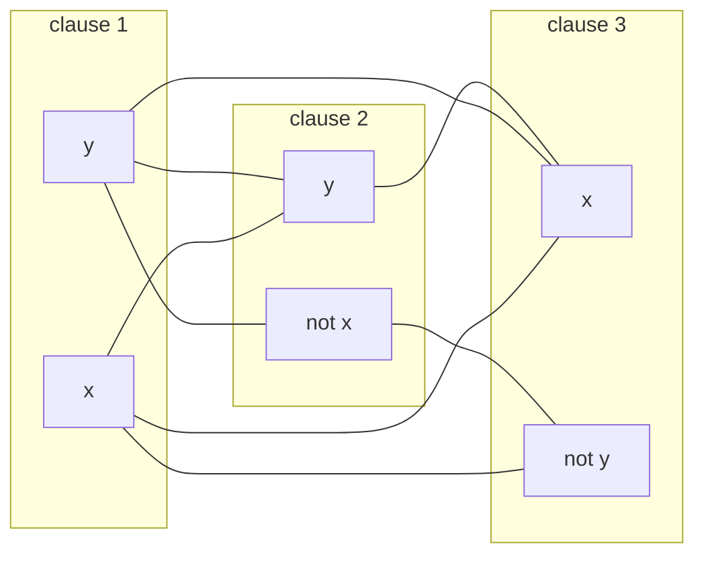

# P, NP and NP-completeness

After this lesson you can define the classes P and NP, show that a language is in NP by giving a certificate and a verifier, define polynomial-time reductions and NP-completeness, carry out the reduction from 3SAT to CLIQUE with its proof, and say what the P versus NP question asks and what an NP-completeness proof tells you in practice.

Before this: [reductions and undecidability](06-reductions-and-undecidability.md), [Turing machines and the Church-Turing thesis](04-turing-machines-and-church-turing-thesis.md) (the nondeterministic machine) and [asymptotic notation](../04-sums-recurrences-and-algorithms/04-asymptotic-notation.md).

## Quick check

Try these first. If you get all three right, skip to [Practice](#practice).

1. Breadth-first search on a graph with $n$ vertices and $m$ edges takes about $n + m$ steps. Is that polynomial in the size of the input?
2. Someone claims that a graph $G$ has a clique of size 4 and hands you four vertices. How do you check the claim, and how many pairs do you look at?
3. A language $A$ reduces to $B$ by a function $f$ that takes polynomial time, and $B$ can be decided in polynomial time. What can you say about $A$?

<details class="solution" markdown>
<summary>Answers</summary>

1. Yes. The size of the input is at least $n + m$ (a list of the vertices and edges), so the running time is linear, which is polynomial.
2. Check that each of the $\binom{4}{2} = 6$ pairs of the four vertices is an edge of $G$. If all six are edges, the claim is true.
3. $A$ can be decided in polynomial time: compute $f(w)$ in polynomial time, which has polynomial length, and run the polynomial-time decider for $B$ on it. The total is polynomial.

</details>

## The idea

The last two lessons asked what can be computed at all. This one asks what can be computed with a reasonable amount of work. A Sudoku solution can be checked in a moment: look at each row, column and box. Finding a solution from scratch seems to need search. The same split appears in scheduling exams without clashes, packing boxes into a van, choosing a route that visits every town once, and breaking a lock whose combination you can test but not deduce.

For each of these, a proposed answer is easy to check, and no fast method of finding an answer is known. The class NP collects the problems whose answers are easy to check. The class P collects the problems whose answers are easy to find. Every problem in P is in NP, since finding an answer also checks it. The great open question, worth \$1,000,000 as one of the Clay Mathematics Institute's Millennium Prize Problems, is whether the two classes are the same: is finding really harder than checking?

NP-complete problems are the hardest problems in NP. If any one of them could be solved quickly, all of NP could. Thousands of problems from graph theory, logic, scheduling and number theory have been shown NP-complete, all by reductions in the style of the last lesson. This lesson defines the classes and does one such reduction in full.

## Definitions

### Running time and P

The **running time** of a decider $M$ is the function $t(n)$ equal to the largest number of steps $M$ takes on any input of length $n$. It is a worst-case count, measured in Turing machine steps, as a function of the length of the input string. Let $\text{TIME}(t(n))$ be the set of languages decided by some Turing machine with running time $O(t(n))$. The class **P** is

$$
\mathrm{P} = \bigcup_{k \ge 1} \text{TIME}(n^k).
$$

In plain words: P is the set of languages that a deterministic algorithm decides in time bounded by some polynomial in the length of the input. The exponent $k$ can be as big as you like, but it is a constant.

The choice of model does not change the class. A multitape machine can be simulated by a single-tape machine with only a squaring of the running time (the previous lesson), and the same holds for RAM models and for programs in a real language, up to a polynomial. A polynomial composed with a polynomial is a polynomial, so "polynomial time" doesn't depend on the details of the model. That is why P is the standard formal stand-in for "efficiently solvable".

The length of the input matters. Numbers are written in binary, so a number $N$ has length about $\log_2 N$, and an algorithm that takes $N$ steps takes time exponential in the length of its input. Checking whether $N$ is prime by trying every divisor up to $\sqrt{N}$ takes about $\sqrt{N} = 2^{(\log_2 N)/2}$ steps, which is exponential in the length. (Primality is nevertheless in P, by a cleverer algorithm of Agrawal, Kayal and Saxena from 2002.)

### Verifiers and NP

A **verifier** for a language $A$ is an algorithm $V$ such that

$$
A = \{ w : V \text{ accepts } \langle w, c \rangle \text{ for some string } c \}.
$$

The string $c$ is called a **certificate** (or proof, or witness) for $w$. A **polynomial-time verifier** runs in time polynomial in the length of $w$ alone, not of $c$; so it can only read a certificate of polynomial length. The class **NP** is the set of languages that have polynomial-time verifiers.

In plain words: a language is in NP if every yes-instance has a short proof that can be checked quickly. There is no promise about finding the proof. And there is nothing about no-instances: if $w \notin A$, then no certificate makes $V$ accept.

*Theorem 1.* A language is in NP if and only if some nondeterministic Turing machine decides it in polynomial time.

*Proof (sketch).* Given a polynomial-time verifier $V$, build a nondeterministic machine that, on input $w$, guesses a certificate $c$ of length at most $\lvert w \rvert^k$ (one symbol at a time, with a branch for each choice) and then runs $V$ on $\langle w, c \rangle$. Some branch accepts if and only if some certificate works. Conversely, given a nondeterministic machine $N$ that runs in polynomial time, a verifier takes as certificate the sequence of choices that $N$ makes along an accepting branch, which has polynomial length, and simulates $N$ following those choices. $\blacksquare$

This is where the "N" in NP comes from: **N**ondeterministic **P**olynomial time. It does not mean "not polynomial".

*Theorem 2.* $\mathrm{P} \subseteq \mathrm{NP} \subseteq \mathrm{EXPTIME}$, where EXPTIME is $\bigcup_k \text{TIME}(2^{n^k})$.

*Proof.* If $A \in \mathrm{P}$, a verifier can ignore its certificate and decide $A$ itself, so $A \in \mathrm{NP}$. If $A \in \mathrm{NP}$ with a verifier whose certificates have length at most $n^k$, a deterministic machine tries all $2^{n^k}$ certificates (over a binary alphabet) and runs the verifier on each, which takes time $2^{n^k}$ times a polynomial, and is in EXPTIME. $\blacksquare$

The two inclusions are the only things known. Whether the first is an equality is the P versus NP question, and nobody has shown that the second is not an equality, or either of them is.

### Some problems

- $\text{PATH} = \{\langle G, s, t \rangle : G \text{ is a directed graph with a path from } s \text{ to } t\}$. In P, by breadth-first search.
- $\text{HAMPATH} = \{\langle G, s, t \rangle : G \text{ is a directed graph with a Hamiltonian path from } s \text{ to } t\}$, a path that visits every vertex exactly once. In NP: the certificate is the path, an ordering of the vertices, and the verifier checks that it starts at $s$, ends at $t$, uses each vertex once, and follows edges. No polynomial-time algorithm is known.
- $\text{SAT} = \{\langle \varphi \rangle : \varphi \text{ is a satisfiable Boolean formula}\}$. A **Boolean formula** is built from variables with $\wedge$ (and), $\vee$ (or) and $\neg$ (not), and it is **satisfiable** if some assignment of true or false to the variables makes it true. In NP: the certificate is the assignment, and the verifier evaluates $\varphi$ on it.
- $\text{3SAT}$ is SAT restricted to formulas in **conjunctive normal form** with three literals per clause: an AND of clauses, each an OR of three literals, where a literal is a variable or a negated variable. For example $(x \vee y \vee z) \wedge (\neg x \vee \neg y \vee z)$.
- $\text{CLIQUE} = \{\langle G, k \rangle : G \text{ is an undirected graph with a clique of } k \text{ vertices}\}$. A clique is a set of vertices with an edge between every two of them. In NP: the certificate is the set of $k$ vertices, and the verifier checks all $\binom{k}{2}$ pairs.

### Polynomial-time reductions and NP-completeness

A language $A$ is **polynomial-time mapping reducible** to $B$, written $A \le_P B$, if there is a function $f \colon \Sigma^* \to \Sigma^*$ computable in polynomial time such that $w \in A \iff f(w) \in B$ for every $w$. This is the mapping reduction of the last lesson with a time limit on $f$.

*Theorem 3.* If $A \le_P B$ and $B \in \mathrm{P}$, then $A \in \mathrm{P}$. If $A \le_P B$ and $B \in \mathrm{NP}$, then $A \in \mathrm{NP}$. Also, $\le_P$ is transitive.

*Proof.* On input $w$, compute $f(w)$ in time $p(\lvert w \rvert)$, a polynomial. Its length is at most $p(\lvert w \rvert)$, since a machine can write only one symbol per step. Run a decider (or verifier) for $B$ on $f(w)$, which takes time $q(p(\lvert w \rvert))$ for a polynomial $q$, and $q \circ p$ is a polynomial. For the verifier case, a certificate for $f(w)$ is a certificate for $w$. For transitivity, compose two polynomial-time functions in the same way. $\blacksquare$

A language $B$ is **NP-hard** if every language $A \in \mathrm{NP}$ satisfies $A \le_P B$. It is **NP-complete** if it is NP-hard and also $B \in \mathrm{NP}$. In plain words: an NP-complete problem is in NP, and as hard as everything in NP.

*Theorem 4.* If $B$ is NP-complete and $B \in \mathrm{P}$, then $\mathrm{P} = \mathrm{NP}$. If $B$ is NP-complete, $C \in \mathrm{NP}$ and $B \le_P C$, then $C$ is NP-complete.

*Proof.* For the first claim, every $A \in \mathrm{NP}$ has $A \le_P B$, so $A \in \mathrm{P}$ by Theorem 3, and $\mathrm{NP} \subseteq \mathrm{P}$; the other inclusion is Theorem 2. For the second, every $A \in \mathrm{NP}$ has $A \le_P B$, and $B \le_P C$, so $A \le_P C$ by transitivity. Together with $C \in \mathrm{NP}$, this makes $C$ NP-complete. $\blacksquare$

The second claim is how NP-completeness spreads, just as undecidability spread in the last lesson. One first problem has to be shown NP-complete directly:

*Theorem 5 (Cook-Levin).* SAT is NP-complete. Hence 3SAT is NP-complete as well.

This is stated here without proof. The idea of the proof: take any $A \in \mathrm{NP}$ with a nondeterministic machine $N$ running in time $n^k$. An accepting computation of $N$ on $w$ is a table with $n^k$ rows (configurations) and $n^k$ columns (tape cells). Write a Boolean formula $\varphi_w$ with a variable for each entry that says "cell $j$ of row $i$ holds symbol $s$", and require that the first row is the start configuration, each row follows from the previous by a legal move of $N$, and some row accepts. Each requirement involves only a few neighbouring cells, so the formula has polynomial size and can be built in polynomial time. The formula is satisfiable if and only if $N$ accepts $w$. That gives $A \le_P \text{SAT}$. Cook (1971) and Levin (1973) found this independently, and Karp (1972) then listed 21 further NP-complete problems.

## How to do it

### Showing that a language is in NP

1. Say what a certificate for a yes-instance looks like, and show that it can be written with a number of symbols polynomial in the length of the input.
2. Describe the verifier: what it checks given the instance and the certificate.
3. Argue that the verifier runs in polynomial time, and that it accepts some certificate exactly for the yes-instances (no certificate works for a no-instance).

### Showing that a language is NP-complete

1. Show that the language $B$ is in NP, as above.
2. Choose a language $A$ already known to be NP-complete (SAT, 3SAT, CLIQUE, or one from the list below).
3. Define a function $f$ that maps each instance of $A$ to an instance of $B$, and show that $f$ is computable in polynomial time.
4. Prove both directions: $w \in A$ implies $f(w) \in B$, and $f(w) \in B$ implies $w \in A$.
5. Conclude by Theorem 4 that $B$ is NP-complete.

<div class="warning" markdown>

Watch out at step 2: the direction is the same as for undecidability. To show that a new problem is hard, reduce a known hard problem to it. A reduction from the new problem to SAT shows only that the new problem is no harder than SAT, which is true of everything in NP.

</div>

## Theorem: 3SAT reduces to CLIQUE

*Theorem 6.* $\text{3SAT} \le_P \text{CLIQUE}$. Hence CLIQUE is NP-complete.

What we know: a 3-CNF formula $\varphi$ with $k$ clauses. What we want: a graph $G$ and a number $k'$ such that $\varphi$ is satisfiable if and only if $G$ has a clique of $k'$ vertices. The plan: make one vertex for each literal in each clause, join two vertices when they could be made true together, and let a clique of size $k$ pick one true literal from each clause.

*Construction.* Let $\varphi = C_1 \wedge C_2 \wedge \cdots \wedge C_k$ where each clause $C_i$ is an OR of literals. The graph $G$ has one vertex for each occurrence of a literal in a clause. Two vertices are joined by an edge if

1. they come from different clauses, and
2. their literals are not contradictory: one is not a variable $x$ and the other its negation $\neg x$.

Set $k' = k$, the number of clauses.

*Proof.* The construction is polynomial. There are at most $3k$ vertices, and deciding the edges means looking at each of the at most $\binom{3k}{2}$ pairs of vertices. The graph and $k'$ are written in time polynomial in the size of $\varphi$.

($\Rightarrow$) Suppose $\varphi$ is satisfiable, and fix a satisfying assignment. Each clause has at least one literal that the assignment makes true. Choose one such literal in each clause, giving $k$ vertices, one from each clause. Any two of them are from different clauses (condition 1), and they are both true under the same assignment, so they are not contradictory (condition 2). So any two of the chosen vertices are joined, and they form a clique of size $k$.

($\Leftarrow$) Suppose $G$ has a clique of $k$ vertices. No two vertices of the same clause are joined, so the $k$ vertices come from $k$ different clauses, which means one from each clause. Define an assignment: for each chosen vertex whose literal is $x$, set $x$ to true, and if it is $\neg x$, set $x$ to false. This is consistent, because two chosen vertices are joined, so they are not contradictory, so the assignment is never asked to set one variable both ways. Variables that were not chosen are set arbitrarily. Under this assignment each clause has a chosen literal that is true, so every clause is true and $\varphi$ is satisfiable.

So $\varphi \in \text{3SAT}$ if and only if $\langle G, k \rangle \in \text{CLIQUE}$. Since CLIQUE is in NP (the certificate is the clique) and 3SAT is NP-complete, CLIQUE is NP-complete by Theorem 4. $\blacksquare$

Look back: each of the two conditions is needed. Without condition 1, a clique could take two literals from one clause and none from another. Without condition 2, a clique could use both $x$ and $\neg x$. The proof never uses that the clauses have three literals, only that there is a bounded number, so the construction works for clauses of any size. A computer check on 300 random small formulas (up to four variables and four clauses, with one to three literals per clause) found that satisfiability and the existence of a $k$-clique agree every time.

## Worked examples

<div class="example" markdown>

### Example 1: PATH is in P

The input is $\langle G, s, t \rangle$ with $n$ vertices and $m$ edges. The algorithm is breadth-first search. Mark $s$. Repeat: for each marked vertex not yet examined, mark every vertex it has an edge to. When no new vertex is marked, accept if $t$ is marked, and reject otherwise.

The algorithm halts: each round marks at least one new vertex or ends, so there are at most $n$ rounds. A round looks at each edge at most once, so the total is at most about $n \cdot m$ steps on a simple implementation, and $n + m$ with a queue. The input has length at least $n + m$. Either bound is a polynomial in the length, so $\text{PATH} \in \mathrm{P}$.

Check: for the graph with edges $1 \to 2$, $2 \to 3$ and $4 \to 1$, the search from 1 marks 2 and then 3, so there is a path from 1 to 3 and none from 3 to 1. A computer run agrees.

</div>

<div class="example" markdown>

### Example 2: certificates and verifiers

SAT. The formula $(x \vee y) \wedge (\neg x \vee y) \wedge (x \vee \neg y)$. A certificate is an assignment, such as $x = \text{true}$, $y = \text{true}$. The verifier evaluates each clause: $(x \vee y)$ is true, $(\neg x \vee y)$ is true because $y$ is, and $(x \vee \neg y)$ is true because $x$ is. All clauses are true, so it accepts. The time is linear in the length of the formula.

CLIQUE. The graph on vertices $\{1, 2, 3, 4, 5\}$ with edges between every pair of $\{1, 2, 3, 4\}$ and the edge $\{4, 5\}$, with $k = 4$. The certificate $\{1, 2, 3, 4\}$ is checked on its $\binom{4}{2} = 6$ pairs, and all are edges, so it accepts. The certificate $\{2, 3, 4, 5\}$ fails on the pair $\{2, 5\}$.

HAMPATH. The graph $1 \to 2 \to 3 \to 4$ with $s = 1$ and $t = 4$. The certificate $1, 2, 3, 4$ is accepted: it begins at $s$, ends at $t$, uses each vertex once and follows edges. The certificate $1, 3, 2, 4$ is rejected, because there is no edge $1 \to 3$.

Check: in each case the verifier takes a number of steps polynomial in the size of the instance (a pass over the formula, a check of $k^2$ pairs, a check of $n$ edges). The In code section runs the three verifiers.

</div>

<div class="example" markdown>

### Example 3: the reduction on a small formula

Let $\varphi = (x \vee y) \wedge (\neg x \vee y) \wedge (x \vee \neg y)$, with three clauses and two literals each. (The construction works for any clause size; two literals keep the picture small.) The graph has $6$ vertices, three groups of two, and $k' = 3$.

Between groups, join every pair except the contradictory ones: $x$ in clause 1 and $\neg x$ in clause 2, $y$ in clause 1 and $\neg y$ in clause 3, $\neg x$ in clause 2 and $x$ in clause 3, and $y$ in clause 2 and $\neg y$ in clause 3. Of the $3 \cdot 4 = 12$ pairs of vertices from different clauses, 4 are contradictory, leaving 8 edges.



The 3-cliques are $\{x_1, y_2, x_3\}$ and $\{y_1, y_2, x_3\}$, where the subscript names the clause. The first corresponds to the assignment $x = \text{true}$, $y = \text{true}$, which satisfies $\varphi$: clause 1 by $x$, clause 2 by $y$, clause 3 by $x$.

Now an unsatisfiable formula: $\psi = (x \vee y) \wedge (x \vee \neg y) \wedge (\neg x \vee y) \wedge (\neg x \vee \neg y)$. Its graph has $8$ vertices and $k' = 4$, and a computer search finds no clique of size 4. This agrees with the fact that no assignment satisfies all four clauses.

Check: a computer count confirms 6 vertices, 8 edges and exactly two triangles for $\varphi$, and no 4-clique for $\psi$.

</div>

<div class="example" markdown>

### Example 4: build the graph yourself

Apply the reduction to $\chi = (x \vee y) \wedge (\neg x \vee \neg y) \wedge (x \vee \neg y)$. Name the vertices, list the edges, find the cliques of size 3, and read off a satisfying assignment.

<details class="solution" markdown>
<summary>Finish</summary>

The vertices are $x_1, y_1$ (clause 1), $\neg x_2, \neg y_2$ (clause 2) and $x_3, \neg y_3$ (clause 3). The pairs from different clauses number 12. The contradictory ones are $x_1$ with $\neg x_2$, $y_1$ with $\neg y_2$, $y_1$ with $\neg y_3$ and $\neg x_2$ with $x_3$. That leaves the 8 edges:

$x_1 \text{--} \neg y_2$, $x_1 \text{--} x_3$, $x_1 \text{--} \neg y_3$, $y_1 \text{--} \neg x_2$, $y_1 \text{--} x_3$, $\neg x_2 \text{--} \neg y_3$, $\neg y_2 \text{--} x_3$, $\neg y_2 \text{--} \neg y_3$.

The 3-cliques are $\{x_1, \neg y_2, x_3\}$ and $\{x_1, \neg y_2, \neg y_3\}$. Reading the first one gives $x = \text{true}$ and $y = \text{false}$. Substituting: $(x \vee y)$ is true by $x$, $(\neg x \vee \neg y)$ is true by $\neg y$, and $(x \vee \neg y)$ is true. So $\chi$ is satisfied.

Check: the second clique gives the same assignment. A computer search over all four assignments confirms that $x = \text{true}$, $y = \text{false}$ is the only one that works.

</details>

</div>

## Edge cases and common mistakes

<div class="warning" markdown>

Watch out: NP does not mean "not polynomial" and does not mean "hard". Every problem in P is in NP. A problem is in NP if its yes-answers have short checkable proofs, and many NP problems are easy. The hard ones are the NP-complete problems, and even they are only conjectured to be hard.

</div>

<div class="warning" markdown>

Watch out: the certificate must be short and the verifier must be fast, both measured against the input $w$ and not the certificate. A verifier that takes exponential time in the length of a certificate that is itself exponentially long does not show membership in NP. For HAMPATH the certificate is a list of $n$ vertices, which is fine. "The set of all paths" is not a certificate.

</div>

<div class="warning" markdown>

Watch out: NP concerns only yes-instances. There is no known short proof that a graph has no Hamiltonian path or that a formula is unsatisfiable. The class of languages whose complements are in NP is called coNP, and whether NP equals coNP is open.

</div>

<div class="warning" markdown>

Watch out: in a reduction, the function must run in polynomial time, and the proof needs both directions. A reduction that builds a graph by trying all assignments takes exponential time, and proves nothing, even if the graph is correct. In Theorem 6, forgetting the direction ($\Leftarrow$) leaves open that $G$ has a clique with a contradictory pair, which would give no assignment.

</div>

<div class="note" markdown>

NP-hard and NP-complete differ. A problem can be NP-hard without being in NP. The halting problem is an example: every $A \in \mathrm{NP}$ reduces to $HALT_{\text{TM}}$ in polynomial time (map $w$ to a machine that runs a decider for $A$ on $w$, halts if it accepts and loops if it rejects), but $HALT_{\text{TM}}$ is undecidable, so it can't be in NP.

</div>

## What P versus NP means

The question is whether every problem with quickly checkable answers also has quickly findable answers: $\mathrm{P} = \mathrm{NP}$ or $\mathrm{P} \ne \mathrm{NP}$. If $\mathrm{P} = \mathrm{NP}$, then the many NP-complete problems all have polynomial-time algorithms, and a search of the kind "find a short proof" would become routine, including searches for proofs of theorems of a given length. If $\mathrm{P} \ne \mathrm{NP}$, then there are problems whose solutions can be verified quickly and not found quickly, and no NP-complete problem has an efficient algorithm. Nobody has a proof either way. In William Gasarch's 2019 poll of researchers, 109 of the 124 who answered thought $\mathrm{P} \ne \mathrm{NP}$ (SIGACT News, "The Third P =? NP Poll"), but a poll is not a proof.

What a proof of NP-completeness tells you in practice: you will probably not find a fast algorithm that is correct on every instance. It doesn't tell you that your instances are hard, or that you must give up. The usual responses are these.

- Solve the instances that actually occur. SAT solvers handle formulas with millions of variables that come from hardware and software verification, though they can't solve all formulas of that size.
- Settle for an approximate answer with a guaranteed bound, for problems where that is available (for example, a route at most 1.5 times the shortest tour in the metric travelling-salesman problem).
- Use a heuristic, such as local search or a greedy rule, with no guarantee.
- Restrict the problem to a special case that is in P, such as graphs that are trees or formulas with two literals per clause (2SAT is in P).
- Accept exponential time for small inputs, and fix a parameter, as with a clique of fixed small size $k$ that takes about $n^k$ time.

## Tricks and shortcuts

- To show a problem is in NP, name the certificate first. If you can say "the proof is a ... " in one phrase (an assignment, a set of vertices, a path, a factor), you are most of the way.
- Look at the form of the problem. Questions of the shape "does there exist a ... of a given size or weight" are usually in NP. Questions of the shape "do all ..." or "is there no ..." are usually coNP.
- To choose a problem to reduce from, pick the one whose structure matches. For a graph problem about choosing vertices, use CLIQUE, VERTEX-COVER or INDEPENDENT-SET (a set of vertices with no edges between them, which is CLIQUE on the complement graph). For a problem about choosing numbers that add up, use SUBSET-SUM. For logic-like constraints, use 3SAT.
- Reductions between the three vertex-selection problems are mostly bookkeeping: $G$ has a clique of size $k$ if and only if the complement graph (edges where $G$ has none) has an independent set of size $k$.

## In code

The program evaluates the three verifiers of Example 2, builds the reduction graph for a formula, and compares satisfiability with the existence of a clique of the right size on random formulas.

<details class="code" markdown>
<summary>In code</summary>

```python
import random
from itertools import product, combinations

# A literal is (variable, True) for x and (variable, False) for "not x".
# A formula is a list of clauses; a clause is a tuple of literals.
def verify_sat(formula, assignment):
    """Verifier for SAT: the certificate is the assignment (a tuple of booleans)."""
    return all(any(assignment[v] == positive for v, positive in clause) for clause in formula)

def verify_clique(edges, k, vertices):
    """Verifier for CLIQUE: the certificate is a list of k vertices."""
    return len(set(vertices)) == k and all(
        (a, b) in edges or (b, a) in edges for a, b in combinations(vertices, 2))

def verify_hampath(edges, n, s, t, order):
    """Verifier for HAMPATH on vertices 1..n: the certificate is an ordering."""
    return (sorted(order) == list(range(1, n + 1)) and order[0] == s and order[-1] == t
            and all((a, b) in edges for a, b in zip(order, order[1:])))

phi = [((0, True), (1, True)), ((0, False), (1, True)), ((0, True), (1, False))]   # x,y = vars 0,1
print(verify_sat(phi, (True, True)), verify_sat(phi, (False, False)))   # True False

K4 = {(a, b) for a, b in combinations([1, 2, 3, 4], 2)} | {(4, 5)}
print(verify_clique(K4, 4, [1, 2, 3, 4]), verify_clique(K4, 4, [2, 3, 4, 5]))   # True False
path_edges = {(1, 2), (2, 3), (3, 4)}
print(verify_hampath(path_edges, 4, 1, 4, [1, 2, 3, 4]),
      verify_hampath(path_edges, 4, 1, 4, [1, 3, 2, 4]))                # True False

def sat_by_search(formula, n_vars):
    return any(verify_sat(formula, bits) for bits in product([False, True], repeat=n_vars))

def to_clique(formula):
    """3SAT <= CLIQUE: one vertex per literal occurrence, edges between compatible ones."""
    vertices = [(i, j) for i, clause in enumerate(formula) for j in range(len(clause))]
    edges = set()
    for (i, j), (a, b) in combinations(vertices, 2):
        (v1, s1), (v2, s2) = formula[i][j], formula[a][b]
        if i != a and not (v1 == v2 and s1 != s2):
            edges.add(((i, j), (a, b)))
    return vertices, edges, len(formula)

def clique_by_search(vertices, edges, k):
    return any(verify_clique(edges, k, list(S)) for S in combinations(vertices, k))

vertices, edges, k = to_clique(phi)
print(len(vertices), len(edges), k)                                      # 6 8 3

rng = random.Random(3)
agree = 0
for _ in range(300):
    n_vars, n_clauses = rng.randint(1, 4), rng.randint(1, 4)
    formula = [tuple((rng.randrange(n_vars), rng.random() < 0.5)
                     for _ in range(rng.randint(1, 3))) for _ in range(n_clauses)]
    agree += sat_by_search(formula, n_vars) == clique_by_search(*to_clique(formula))
print(agree)                                                             # 300
```

</details>

## FAQ

### If P versus NP is open, how can anyone say a problem is "probably" hard?

Because of what is known. Thousands of NP-complete problems have been studied by many people with strong motives, and no one has found a polynomial-time algorithm for any of them. Since they all reduce to each other, one algorithm would solve them all. That is evidence, and not a proof. It is the reason that practitioners treat NP-completeness as a signal to look for something other than an exact fast algorithm.

### Is factoring integers NP-complete?

Nobody knows, and it is not believed to be. Factoring is in NP (and in coNP): the certificate is a factor, or the prime factorization. The best known algorithms are faster than exhaustive search and still slower than any polynomial. [RSA](../02-number-theory/06-rsa-cryptography.md) relies on factoring being hard, while factoring is not known to be as hard as the NP-complete problems.

### Why is the polynomial the dividing line? An $n^{100}$ algorithm is useless.

It is a theoretical line that works well in practice: polynomial times are closed under composition and don't depend on the machine model, and in practice the exponents of natural problems are small, usually between 1 and 4. Exponential times such as $2^n$ become impossible at modest sizes. For $n = 20$, a $2^{20}$ algorithm needs about a million steps, and $20!$ orderings (a brute-force search for a Hamiltonian path) is $2.4 \times 10^{18}$, about 77 years at $10^9$ steps per second.

### What would happen if someone proved P = NP?

If the proof gave a fast algorithm for an NP-complete problem, it would affect optimization, scheduling, verification and cryptography, since a fast search for a short proof or key would break any scheme whose security rests on a hard-to-find, easy-to-check secret. A proof that gave only a slow polynomial algorithm, like $n^{1000}$, would change theory without changing practice. Most researchers expect $\mathrm{P} \ne \mathrm{NP}$, and the proof of that would also be a major result.

## Practice

### Warm-up

1\. A graph has 6 vertices and 9 edges. Roughly how many steps does breadth-first search take with a queue, and why is that polynomial in the size of the input?

<details class="solution" markdown>
<summary>Solution</summary>

About $n + m = 6 + 9 = 15$ steps: each vertex is added to the queue once and each edge is examined once. The input lists the vertices and edges, so its length is at least $n + m$, and the running time is at most proportional to it. A linear function is a polynomial.

Check: with $n = 10^5$ vertices and $m = 10^6$ edges, the search takes about $1.1 \times 10^6$ steps, a fraction of a second.

</details>

2\. A graph has edges $\{1,2\}, \{1,3\}, \{2,3\}, \{3,4\}, \{2,4\}$. Check the certificate $\{1, 2, 3\}$ for $k = 3$ and the certificate $\{1, 2, 4\}$ for $k = 3$ in CLIQUE.

<details class="solution" markdown>
<summary>Solution</summary>

For $\{1, 2, 3\}$ the pairs are $\{1,2\}$, $\{1,3\}$, $\{2,3\}$, and all are edges, so it is a clique and the verifier accepts. For $\{1, 2, 4\}$ the pairs are $\{1,2\}$, $\{1,4\}$, $\{2,4\}$; the pair $\{1,4\}$ is not an edge, so the verifier rejects.

Check: the vertices $\{2, 3, 4\}$ also form a clique, since $\{2,3\}$, $\{3,4\}$ and $\{2,4\}$ are all edges.

</details>

3\. Is each statement known to be true, known to be false, or open? (a) $\mathrm{P} \subseteq \mathrm{NP}$. (b) $\mathrm{NP} \subseteq \mathrm{P}$. (c) PATH is in NP. (d) If some NP-complete problem is in P, then $\mathrm{P} = \mathrm{NP}$.

<details class="solution" markdown>
<summary>Solution</summary>

(a) Known true (Theorem 2). (b) Open: it is the P versus NP question. (c) Known true, because PATH is in P and $\mathrm{P} \subseteq \mathrm{NP}$. (d) Known true (Theorem 4).

Check: (b) and (d) together say that finding a fast algorithm for one NP-complete problem would settle (b) as true.

</details>

### Standard

4\. Show that $\text{COMPOSITES} = \{\langle N \rangle : N \text{ is a composite number written in binary}\}$ is in NP.

<details class="solution" markdown>
<summary>Solution</summary>

The certificate is a divisor $d$ with $1 < d < N$, written in binary. It has at most as many bits as $N$, so its length is polynomial in the length of the input. The verifier divides $N$ by $d$ and accepts if the remainder is 0 and $1 < d < N$. Long division on $b$-bit numbers takes about $b^2$ steps, which is polynomial in the length of the input. A number is composite if and only if it has such a divisor, so some certificate is accepted exactly for composite numbers.

Check: for $N = 91$ the certificate $7$ works ($91 = 7 \cdot 13$). For the prime $N = 97$ no $d$ between 2 and 96 divides it, so no certificate is accepted.

</details>

5\. Show that $\text{INDEPENDENT-SET}$ (is there a set of $k$ vertices with no edge between any two) is NP-complete, using that CLIQUE is NP-complete.

<details class="solution" markdown>
<summary>Solution</summary>

Membership in NP: the certificate is the set of $k$ vertices, and the verifier checks that none of the $\binom{k}{2}$ pairs is an edge, in polynomial time.

Reduction from CLIQUE: map $\langle G, k \rangle$ to $\langle \overline{G}, k \rangle$, where $\overline{G}$ has the same vertices and has an edge exactly where $G$ has none. Writing $\overline{G}$ takes $O(n^2)$ steps, which is polynomial. A set $S$ of vertices is a clique in $G$ if and only if every pair of vertices in $S$ is an edge of $G$, which holds if and only if no pair of vertices in $S$ is an edge of $\overline{G}$, that is, $S$ is an independent set in $\overline{G}$. So $G$ has a clique of size $k$ if and only if $\overline{G}$ has an independent set of size $k$.

By Theorem 4, INDEPENDENT-SET is NP-complete. $\blacksquare$

Check: a path on three vertices $1 - 2 - 3$ has the independent set $\{1, 3\}$ of size 2, and its complement graph has the single edge $\{1, 3\}$, a clique of size 2.

</details>

6\. Use the reduction to decide whether $\varphi = (x \vee y) \wedge (\neg x \vee \neg y)$ is satisfiable: draw the graph, find its cliques of size 2, and extract an assignment.

<details class="solution" markdown>
<summary>Solution</summary>

The vertices are $x_1, y_1$ (clause 1) and $\neg x_2, \neg y_2$ (clause 2), and $k' = 2$. Between the two clauses, the pairs are $x_1 \neg x_2$ (contradictory), $x_1 \neg y_2$, $y_1 \neg x_2$ and $y_1 \neg y_2$ (contradictory). So the edges are $x_1 \text{--} \neg y_2$ and $y_1 \text{--} \neg x_2$. Each edge is a clique of size 2.

The clique $\{x_1, \neg y_2\}$ gives $x = \text{true}$, $y = \text{false}$: clause 1 is true by $x$, and clause 2 is true by $\neg y$. The clique $\{y_1, \neg x_2\}$ gives $y = \text{true}$, $x = \text{false}$. So $\varphi$ is satisfiable.

Check: these are exactly the two assignments that make exactly one of $x$ and $y$ true, which are the satisfying assignments of $\varphi$.

</details>

### Challenge

7\. Prove that if $A \le_P B$ and $B \in \mathrm{NP}$, then $A \in \mathrm{NP}$, and then deduce that if the complement of some NP-complete language is also in NP, then $\mathrm{NP} = \mathrm{coNP}$.

<details class="solution" markdown>
<summary>Solution</summary>

*First part.* Let $f$ be a reduction computable in time $p(n)$, and $V$ a polynomial-time verifier for $B$. A verifier for $A$ on $\langle w, c \rangle$ computes $f(w)$ (time $p(\lvert w \rvert)$, so $\lvert f(w) \rvert \le p(\lvert w \rvert)$) and runs $V$ on $\langle f(w), c \rangle$. The certificate $c$ has length polynomial in $\lvert f(w) \rvert$, hence in $\lvert w \rvert$, and $V$ runs in polynomial time in $\lvert f(w) \rvert$. Then $w \in A \iff f(w) \in B \iff$ some $c$ makes $V$ accept $\langle f(w), c \rangle$. So $A \in \mathrm{NP}$. $\blacksquare$

*Second part.* Suppose a NP-complete $B$ has its complement in NP. For any $A \in \mathrm{NP}$, $A \le_P B$ with the same $f$ gives $\overline{A} \le_P \overline{B}$. Since $\overline{B} \in \mathrm{NP}$, the first part gives $\overline{A} \in \mathrm{NP}$. So $\mathrm{coNP} \subseteq \mathrm{NP}$, and taking complements of $\overline{A} \in \mathrm{NP}$ for $A \in \mathrm{coNP}$ gives $\mathrm{NP} \subseteq \mathrm{coNP}$. So $\mathrm{NP} = \mathrm{coNP}$.

Check: the second part is why nobody expects an NP-complete problem to also have short proofs of non-membership.

</details>

8\. (Reviews [counting rules](../03-counting-and-discrete-probability/01-counting-rules.md).) A brute-force search for a Hamiltonian path in a graph with $n$ vertices tries every ordering of the vertices. How many orderings are there for $n = 10$ and $n = 20$? How long would $n = 20$ take at $10^9$ orderings per second, and how does a polynomial algorithm with $n^3$ steps compare?

<details class="solution" markdown>
<summary>Solution</summary>

The number of orderings is $n!$ by the product rule: $n$ choices for the first vertex, $n - 1$ for the second, and so on. For $n = 10$ it is $10! = 3{,}628{,}800$. For $n = 20$ it is $20! = 2{,}432{,}902{,}008{,}176{,}640{,}000 \approx 2.4 \times 10^{18}$. At $10^9$ per second this takes $2.4 \times 10^9$ seconds, about 77 years (one year is about $3.16 \times 10^7$ seconds). A polynomial algorithm with $n^3 = 8{,}000$ steps for $n = 20$ finishes in microseconds.

Check: $2.43 \times 10^{18} / 10^9 = 2.43 \times 10^9$ seconds, and $2.43 \times 10^9 / 3.156 \times 10^7 \approx 77$.

</details>

## Where this shows up

- In practice, NP-completeness shows up in scheduling, routing, packing, circuit layout, and in the SAT and constraint solvers used to verify software and hardware. Recognizing an NP-complete problem in the wild tells you to reach for the responses listed above.
- In cryptography, security rests on problems that are easy to check and believed hard to solve, like factoring ([RSA](../02-number-theory/06-rsa-cryptography.md)). If P = NP in a strong form, many of those schemes would break.
- The earlier lessons of this chapter fit one picture: regular languages, then context-free languages, then the decidable languages ([decidability and the halting problem](05-decidability-and-the-halting-problem.md)), and inside the decidable languages P and NP, divided by resources and not by what is computable. Algorithm analysis in [asymptotic notation](../04-sums-recurrences-and-algorithms/04-asymptotic-notation.md) supplies the vocabulary of "polynomial" and "exponential".
