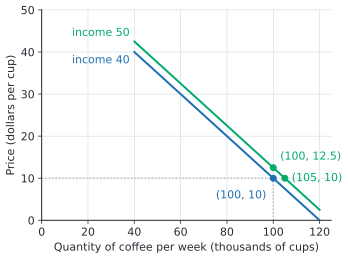
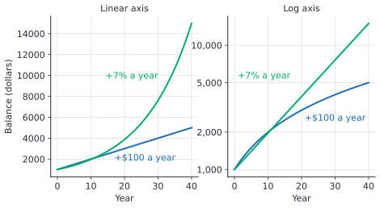

# How economists use math and graphs

After this lesson you can read an economics graph (including why price sits on the vertical axis), find a slope and say what it means in units, separate a move along a curve from a shift of the curve, tell a stock from a flow and a level from a rate, and read a growth series on a log axis.

Before this: [slope and linear equations](../../02-middle-school/05-linear-relationships-and-functions/02-slope-and-linear-equations.md), [percent change and applications](../../02-middle-school/02-ratios-rates-percents/04-percent-change-and-applications.md) and [exponential functions and growth](../../03-high-school/07-exponentials-and-logarithms/01-exponential-functions-and-growth.md).

## Quick check

Try these first. If you get all three right, skip to [Practice](#practice).

1. Two points on a demand graph, written (quantity in thousands, price in dollars), are $(20, 40)$ and $(60, 20)$. What is the slope of the line through them, with units?
2. Say whether each is a stock or a flow: (a) the balance in your chequing account on October 1, (b) the money you deposit during October.
3. A series is 100 in 2000, 200 in 2010 and 400 in 2020. On a graph with a log axis for the values, what does the series look like?

<details class="solution" markdown>
<summary>Answers</summary>

1. The rise is $20 - 40 = -20$ dollars and the run is $60 - 20 = 40$ thousand cups, so the slope is $-0.5$ dollars per thousand cups.
2. (a) A stock: it is an amount measured at one moment. (b) A flow: it is an amount per period of time.
3. A straight line. The value doubles every 10 years, so each step of 10 years adds the same amount, $\log_{10} 2 \approx 0.301$, on a log axis.

</details>

## The idea

A café sells coffee, and the owner notices that when the price is \$10 a cup the shop sells 80 thousand cups a week across its chain, and at \$12 it sells 76 thousand. A table of two rows is already an economic model. It says that quantity depends on price, that the dependence is downward, and (with a little arithmetic) how fast: 4 thousand fewer cups for a \$2 rise in price, which is 2 thousand cups per dollar.

Economics is full of statements of this shape. "When the price rises, the quantity demanded falls." "When the interest rate rises, investment falls." "When income rises, spending rises." Each one is a relationship between two quantities, and each can be written as a function, drawn as a graph and summarised by a slope. This lesson sets up that vocabulary, so that the rest of the chapter (and the rest of the economics folder) can use it without stopping to explain.

A second thread is about how economic data are described. A statement such as "GDP is \$3 trillion" and a statement such as "GDP grew 2%" are different kinds of claim, and mixing them up causes real mistakes. The same goes for amounts measured at a moment and amounts measured over a period. Four small distinctions (stock and flow, level and rate, nominal and real, correlation and causation) do most of the work.

## Definitions

A **variable** is a quantity that can take different values, such as price $P$, quantity $Q$, income $Y$ or time $t$. A **parameter** is a number that is held fixed while you study the relationship, such as the 2 in $Q = 100 - 2P$. In plain words, variables are what moves, and parameters describe the shape of the relationship.

An economic **model** is a simplified description of how some variables are related, built to answer one question. It leaves out most of reality on purpose. A model is judged by whether it predicts or explains the thing you care about, not by whether it is realistic in every detail. A map is a good comparison: a subway map is useless for walking directions and perfect for choosing a line.

A variable the model explains is **endogenous** (determined inside the model), and a variable the model takes as given is **exogenous** (determined outside it). In the demand relationship $Q = 100 - 2P + 0.5Y$, the quantity $Q$ is what we want to explain. We can treat price $P$ and income $Y$ as exogenous inputs. In a fuller model that also explains price, $P$ becomes endogenous.

The Latin phrase **ceteris paribus** means "other things equal". A relationship stated ceteris paribus describes what happens when one variable changes and all other inputs stay fixed. The statement "a higher price lowers the quantity demanded" is meant ceteris paribus: income, tastes and other prices do not change while price does.

A **function** $f$ assigns to each input $x$ exactly one output $f(x)$ ([what is a function](../../03-high-school/03-functions/01-what-is-a-function.md)). In economics the letters are usually mnemonics: $Q_d(P)$ for quantity demanded at price $P$, $C(Q)$ for cost of producing $Q$ units. The variable you choose is the independent variable, and the one that results is the dependent variable.

A **stock** is a quantity measured at a point in time, such as a bank balance, the population on July 1 or the number of people unemployed in a survey week. A **flow** is a quantity measured over a period of time, such as income per month, the number of births in a year or GDP in a quarter. In plain words, a stock is a photograph and a flow is a video. A flow has a time unit built in (dollars per month), and a stock does not (dollars).

A **level** is the amount of a variable at a date, such as GDP in 2025 in dollars or the price level on an index. A **rate** (here, a growth rate or rate of change) is how much the level changes over a period relative to where it started, such as 2% a year. The link between them is the percent change from [the earlier lesson](../../02-middle-school/02-ratios-rates-percents/04-percent-change-and-applications.md).

## How to do it

### Why price goes on the vertical axis

The demand relationship is usually read as "quantity depends on price", so a mathematician would put price on the horizontal axis (the input) and quantity on the vertical axis (the output). Economics textbooks draw it the other way: quantity along the horizontal axis and price up the vertical axis. The reason is historical. Alfred Marshall drew his supply and demand diagrams this way in the 1890s, and it stuck. The practical result is that an economics demand curve is the graph of the inverse function ([composition and inverse functions](../../03-high-school/03-functions/05-composition-and-inverse-functions.md)): you solve $Q = Q_d(P)$ for $P$ and plot $P$ against $Q$.

Take $Q = 100 - 2P$. Solving for $P$ gives $P = 50 - \frac{Q}{2}$. The graph of price against quantity is a line that starts at \$50 when $Q = 0$ and has slope $-\frac{1}{2}$. The slope of the graph the economist draws, $\frac{\Delta P}{\Delta Q} = -0.5$ dollars per unit, is the reciprocal of the slope $\frac{\Delta Q}{\Delta P} = -2$ units per dollar that you get by differentiating quantity with respect to price. The two numbers describe the same line. Always check which one a book or a question means before you use the number.

### Slope as a rate, with units

The slope formula from [slope and linear equations](../../02-middle-school/05-linear-relationships-and-functions/02-slope-and-linear-equations.md) gives the rate of change, in units of the vertical variable per unit of the horizontal one.

1. Name the two variables and their units (dollars per cup, thousands of cups per week).
2. Pick two points on the line and subtract in the same order: rise over run.
3. Write the units: "dollars per thousand cups" for a price-quantity graph, "thousand cups per dollar" for the reverse.
4. Say what the sign means. A negative slope on a demand graph says price and quantity move in opposite directions.
5. For a curve (not a line), the slope changes from point to point, and the slope at one point is a derivative ([the derivative definition](../../05-university-core/02-derivatives/01-the-derivative-definition.md)). Between two points, the rise over run is the average rate of change.

### Reading a graph with a shift

Suppose demand also depends on income $Y$ (in thousands of dollars of average household income), through $Q = 100 - 2P + 0.5Y$. A graph in the $(Q, P)$ plane can only show two variables. Ceteris paribus means picking a value of $Y$ and drawing the curve for that value.

- If price changes and income does not, you move along the curve.
- If income changes, the curve itself moves, because it was drawn for a particular $Y$. That is a shift.



In the figure, at a price of \$10 the quantity is 100 on the income-40 curve and 105 on the income-50 curve. Equivalently, at a quantity of 100 the price consumers will pay is \$10 on the lower curve and \$12.50 on the higher one. A shift to the right and a shift up are the same movement of the curve, described from two directions. A common and useful habit is to ask "is the thing that changed on an axis, or is it somewhere in the equation?"

### Stocks and flows

A stock changes only through flows. In symbols, with a stock $S_t$ at the end of period $t$, an inflow $I_t$ and an outflow $O_t$ during period $t$:

$$
S_t = S_{t-1} + I_t - O_t.
$$

In plain words, this period's ending stock is last period's ending stock plus what came in minus what went out. A bathtub is the standard picture: the water in the tub is a stock, the tap is an inflow and the drain is an outflow. Government debt is a stock, and the yearly deficit is a flow that adds to it. The population is a stock, and births, deaths and migration are flows. The labour force statistics at the end of this chapter ([unemployment rate and labour statistics](08-unemployment-rate-and-labour-statistics.md)) are built this way.

Check the units to tell them apart. A flow always has "per period" attached, even if the period is left out of the sentence. "GDP was \$3 trillion in 2025" really says "\$3 trillion per year". A stock is compared to a stock and a flow to a flow: dividing a flow by a stock gives something per unit of time (a debt-service ratio, say), and dividing a stock by a flow gives a time (debt equal to 1.5 years of income).

### Levels and rates

A level is stated in the variable's own units. A rate is stated relative to the starting level, so it has no units except "per period". Comparing levels across countries or years is misleading when sizes differ, which is why economists divide by population (per capita) or by GDP (a ratio) before they compare. Rates of change are the subject of the next three lessons: [percent change vs percentage points](02-percent-change-vs-percentage-points.md), [growth rates and CAGR](03-growth-rates-and-cagr.md) and [index numbers](04-index-numbers.md).

### Log scales for growth data

Suppose a quantity grows by the same percent each year, so $y = a \cdot b^t$ with $b > 1$ ([exponential functions and growth](../../03-high-school/07-exponentials-and-logarithms/01-exponential-functions-and-growth.md)). On an ordinary axis the graph is a curve that bends upward more and more. Take the logarithm of both sides and use the log rules from [logarithms](../../03-high-school/07-exponentials-and-logarithms/02-logarithms.md):

$$
\log y = \log a + t \log b.
$$

This is a straight line in $t$, with slope $\log b$. So if you draw $t$ on the horizontal axis and $\log y$ on the vertical axis, constant percentage growth shows up as a straight line, and a steeper line means faster growth. A **log scale** (or semi-log graph) is an axis where equal distances stand for equal ratios, not equal differences: from 1,000 to 2,000 is the same distance as from 5,000 to 10,000, because both double the value.



The figure plots the two series from the exponential growth lesson: a balance that starts at \$1,000 and adds \$100 a year, and one that starts at \$1,000 and grows 7% a year. On the left axis the 7% series looks like it takes off. On the right axis it is a straight line (its growth rate never changes), while the \$100-a-year series flattens, because a fixed \$100 is a smaller and smaller percent of a growing balance. Economists draw long data series (GDP over a century, stock indexes) on a log axis for this reason. Equal slopes mean equal growth rates, and a bend means the growth rate changed.

### Correlation and causation

Two variables are **correlated** when they tend to move together. That is a statement about data ([scatter plots and two-way tables](../../02-middle-school/07-statistics-and-probability/03-scatter-plots-and-two-way-tables.md), and the correlation coefficient in [correlation and linear regression](../../05-university-core/08-statistics/04-correlation-and-linear-regression.md)). A **causal** claim says that changing one variable would change the other. Correlation alone doesn't give you causation, for three common reasons.

- Both variables respond to a third one (a confounder). Ice cream sales and sunburn cases both rise in summer, and neither causes the other.
- The causation runs the other way. Cities with more police officers per person tend to have more recorded crime, partly because cities with more crime hire more police.
- Chance. With enough variables, some pairs line up in a sample by luck.

Economists address this with experiments, natural experiments and regression methods that hold other variables fixed, which the lesson on [regression and econometrics intuition](../04-more-tools/03-regression-and-econometrics-intuition.md) introduces. For now, treat each "X is associated with Y" in a news story as a statement about data, and ask what else could produce the pattern.

## Worked examples

<div class="example" markdown>

### Example 1: slope both ways, from a demand relationship

Quantity demanded of coffee, in thousands of cups a week, is $Q = 100 - 2P$ with $P$ in dollars per cup. Find the quantity at $P = 10$ and $P = 12$, the slope of the demand curve as an economist draws it, and the slope the other way.

Step 1: the variables are quantity (thousands of cups per week) and price (dollars per cup).

Step 2: at $P = 10$, $Q = 100 - 20 = 80$. At $P = 12$, $Q = 100 - 24 = 76$. So the two points in the (quantity, price) plane are $(80, 10)$ and $(76, 12)$.

Step 3: the economist's graph has price on the vertical axis, so the rise is $12 - 10 = 2$ dollars and the run is $76 - 80 = -4$ thousand cups. The slope is $\frac{2}{-4} = -0.5$ dollars per thousand cups.

Step 4: the other way, the rise in quantity is $-4$ thousand cups for a run of 2 dollars, a slope of $-2$ thousand cups per dollar. The sign is negative: price and quantity move in opposite directions.

Check: the inverse function is $P = 50 - \frac{Q}{2}$, with slope $-0.5$, and $50 - \frac{80}{2} = 10$ and $50 - \frac{76}{2} = 12$. The two slopes multiply to $(-0.5)(-2) = 1$, as reciprocals do.

<div class="warning" markdown>

Watch out: the slope of the curve on the page and the coefficient of $P$ in the equation $Q = 100 - 2P$ are different numbers. The coefficient $-2$ is $\frac{\Delta Q}{\Delta P}$, and the curve's slope is $\frac{\Delta P}{\Delta Q} = -0.5$.

</div>

</div>

<div class="example" markdown>

### Example 2: a move along the curve against a shift of the curve

Demand is $Q = 100 - 2P + 0.5Y$, with income $Y = 40$ (thousand dollars). Find the quantity at $P = 10$, then what happens if (a) the price rises to \$12, or (b) income rises to $Y = 50$ with the price at \$10.

With $Y = 40$ and $P = 10$, $Q = 100 - 20 + 20 = 100$.

(a) Price rises to \$12, income unchanged: $Q = 100 - 24 + 20 = 96$. The quantity fell by 4, a move along the income-40 curve.

(b) Income rises to 50, price unchanged: $Q = 100 - 20 + 25 = 105$. The quantity rose by 5, because the whole curve moved right. At every price, the quantity is 5 higher.

The inverse forms show the shift as a move up. Solving for $P$: $P = 50 + 0.25Y - \frac{Q}{2}$. For $Y = 40$ that is $P = 60 - \frac{Q}{2}$, and for $Y = 50$ it is $P = 62.5 - \frac{Q}{2}$. The intercept moved up by 2.5, and the slope stayed at $-0.5$.

Check: put $Q = 100$ into the income-50 inverse, $62.5 - 50 = 12.5$, and into the demand equation, $100 - 2(12.5) + 25 = 100$. Both match the point $(100, 12.5)$ in the figure.

</div>

<div class="example" markdown>

### Example 3: a stock built from flows

A household starts the year with \$3,200 in its account (a stock). Each month \$2,500 comes in and \$2,350 goes out (flows). What is the balance at the end of month 6 and month 12?

The net flow is $2500 - 2350 = 150$ dollars per month. Use $S_t = S_{t-1} + 150$, so $S_t = 3200 + 150t$.

At $t = 6$ the balance is $3200 + 900 = 4{,}100$, and at $t = 12$ it is $3200 + 1800 = 5{,}000$. So the stock is \$5,000, and the year's saving, a flow, is \$1,800.

Check: $12 \times 150 = 1800$ and $3200 + 1800 = 5000$. Units also work: dollars per month times months gives dollars, which can be added to a stock in dollars.

Watch the labels: "the household saved \$150" is incomplete (per month), and "its saving is \$5,000" is wrong, since \$5,000 is the balance. If the household made a one-time withdrawal of \$1,000, it would be a flow that happens in one period and lowers the stock by \$1,000 from then on.

</div>

<div class="example" markdown>

### Example 4: growth on a log axis (finish it yourself)

A made-up series is 100 in 2000 and 400 in 2020, growing by the same percent each year. A log-axis graph shows it as a straight line. Find the yearly growth factor and the percent growth rate.

The series multiplies by 4 over 20 years, so $b^{20} = 4$ and $b = 4^{1/20}$ ([exponential functions and growth](../../03-high-school/07-exponentials-and-logarithms/01-exponential-functions-and-growth.md)).

Now compute $4^{1/20}$ and turn it into a percent rate. Also find the slope of the line on a base-10 log axis, in log units per year, and check it by multiplying by 20.

<details class="solution" markdown>
<summary>Finish</summary>

$b = 4^{1/20} \approx 1.0718$, so the series grows about 7.2% a year. The slope on a base-10 log axis is $\log_{10} b = \frac{\log_{10} 4}{20} = \frac{0.6021}{20} \approx 0.0301$ per year.

Check: $1.0718^{20} \approx 4.0$, and $0.0301 \times 20 = 0.602$, which equals $\log_{10} 4$. Over 20 years the log of the value rose by $\log_{10} 400 - \log_{10} 100 = 0.602$.

</details>

</div>

## Edge cases and common mistakes

<div class="warning" markdown>

Watch out for the axes. In a demand graph the economist's horizontal axis is quantity, so "price rises" means moving up the vertical axis. Reading a quantity change from the vertical axis, or taking the equation's coefficient as the picture's slope, reverses the answer.

</div>

<div class="warning" markdown>

Watch out: a shift is not a move along the curve. A change in the variable on an axis (here, price) moves you along the curve. A change in anything else in the equation (income, tastes) shifts the curve. If a question says "price falls because income rose", first ask which of the two actually happened in the model.

</div>

<div class="warning" markdown>

Watch out for stocks and flows in the same sentence. "The debt rose by \$40 billion" is a flow (a change in the stock over a period). "The debt is \$1,200 billion" is a stock. Adding a stock to a flow without a period ($1{,}200 + 40$) mixes units. Always write "per year" or "at the end of the year" beside a number.

</div>

<div class="warning" markdown>

Watch out on a log axis. A straight line means a constant growth rate, not a small one: a steep straight line is fast growth. And a log axis can't show zero or negative values, because the logarithm is defined only for positive numbers. A series that crosses zero (net exports, profits) belongs on a linear axis.

</div>

A graph with a truncated axis, one that starts at 94 and not 0, makes small changes look large. That is acceptable for a series such as an index, if the axis labels are visible, and it is a way to mislead if they are not. Look at the scale before reading the slope.

A model does not need to be realistic to be useful, but you should know what it left out. The demand curve above holds income fixed and says nothing about the price of tea. A prediction that depends on an omitted variable is a prediction outside the model.

## Tricks and shortcuts

To read a growth rate off a log graph, compare the vertical distance with the gridlines. A line that rises one doubling-gridline (from 1,000 to 2,000) in 10 years doubles every 10 years, which is about 7% a year. The next lessons make this precise with the rule of 70.

A fast test for stock or flow: can it be measured with the clock stopped? A balance on October 1 can, so it is a stock. Income cannot, because "income" needs a period, so it is a flow.

For a straight demand curve $Q = a - bP$, the $P$-intercept is $\frac{a}{b}$ (where quantity hits zero) and the slope on the economist's graph is $-\frac{1}{b}$. For $Q = 100 - 2P$ that gives intercept 50 and slope $-0.5$ at a glance.

## In code

This code reproduces the slopes from Example 1, the constant log step from the log-axis figure, and the stock from Example 3.

<details class="code" markdown>
<summary>In code</summary>

```python
import math

# Demand Q = 100 - 2P: slope of Q on P, and of P on Q
p0, p1 = 10, 12
q0, q1 = 100 - 2 * p0, 100 - 2 * p1
print((q1 - q0) / (p1 - p0), (p1 - p0) / (q1 - q0))  # -2.0 -0.5

# Constant 60% growth is a constant step on a log axis
values = [100, 160, 256, 409.6]
steps = [math.log10(b) - math.log10(a) for a, b in zip(values, values[1:])]
print([round(s, 4) for s in steps])  # [0.2041, 0.2041, 0.2041]

# A stock is the opening stock plus the net flow each month
balance = 3200
for month in range(12):
    balance += 2500 - 2350
print(balance)  # 5000
```

</details>

## FAQ

### Why not put price on the horizontal axis, since quantity depends on price?

Marshall's convention is just a convention, and mathematically either choice is fine. Both axes carry a variable, and the curve is the same set of points. The convention matters for reading slopes: the economist's slope $\frac{\Delta P}{\Delta Q}$ is the reciprocal of the "quantity per dollar" slope. In some models price is the outcome (a market finds its price), and then the vertical placement matches "price is what the market determines".

### If models leave out so much, why trust them?

You trust a model for the purpose it was built for. A model with two goods says nothing useful about 10,000 goods, but it can show which effect dominates when a price changes. Economists test models against data, add the missing variable when a model keeps being wrong in the same direction, and drop models that do not survive.

### Does ceteris paribus mean other things really stay equal?

No, in real data they don't. It is a thinking tool, to isolate one effect. In data work, regression and experiments try to recreate "other things equal" by comparing like with like.

### Is a log scale just for exponentials?

It suits any series where percent changes matter more than amounts, which includes most prices, populations and economic output. If the data are not growing exponentially, the line on a log axis simply bends. The bend is itself useful: it shows when the growth rate changed.

## Practice

### Warm-up

1\. Two points on a demand curve, written (quantity, price), are $(30, 24)$ and $(70, 14)$. (a) What is the slope of the line, with units, if quantity is in thousands and price in dollars? (b) Write quantity as a function of price.

<details class="solution" markdown>
<summary>Solution</summary>

(a) The rise (in price) is $14 - 24 = -10$ dollars and the run is $70 - 30 = 40$ thousand units, so the slope is $-\frac{10}{40} = -0.25$ dollars per thousand units.

(b) Quantity changes by $-\frac{1}{0.25} = -4$ thousand units per dollar. Using the point $(30, 24)$: $Q = 30 - 4(P - 24) = 126 - 4P$.

Check: at $P = 14$, $Q = 126 - 56 = 70$, matching the second point, and at $P = 24$, $Q = 30$.

</details>

2\. Say whether each is a stock, a flow, or a ratio of two of them: (a) the number of people employed in the survey week, (b) household savings during 2025, (c) your chequing balance on October 1, (d) rent paid each month, (e) the unemployment rate.

<details class="solution" markdown>
<summary>Solution</summary>

(a) A stock: people employed at one point (the survey week). (b) A flow: money saved over a period, a year. (c) A stock. (d) A flow, dollars per month. (e) A ratio of two stocks, the number unemployed divided by the labour force, so it has no units.

Check with the clock test: only (a), (c) and the two stocks inside (e) can be measured with the clock stopped.

</details>

3\. A model says $Q = 90 - 3P$. Find the price intercept and the slope of the economist's demand curve, and the price at $Q = 45$.

<details class="solution" markdown>
<summary>Solution</summary>

Solve for $P$: $P = 30 - \frac{Q}{3}$. The price intercept is \$30 and the slope is $-\frac{1}{3}$ dollars per unit. At $Q = 45$, $P = 30 - 15 = 15$.

Check: $90 - 3(15) = 45$. Also the intercept $\frac{90}{3} = 30$ matches the shortcut $\frac{a}{b}$.

</details>

### Standard

4\. Demand is $Q = 120 - 4P + 2A$, where $A$ is advertising in thousands of dollars. (a) With $A = 10$, find the quantity at $P = 20$ and at $P = 22$. (b) If $A$ rises to 15 with $P = 20$, what is the quantity? (c) Say which parts of (a) and (b) are moves along a curve and which are shifts. (d) By how much does the economist's curve shift up?

<details class="solution" markdown>
<summary>Solution</summary>

(a) With $A = 10$ the demand is $Q = 140 - 4P$. At $P = 20$, $Q = 60$. At $P = 22$, $Q = 140 - 88 = 52$.

(b) With $A = 15$, $Q = 150 - 4P$, so at $P = 20$, $Q = 70$.

(c) Going from $P = 20$ to $P = 22$ in (a) is a move along the $A = 10$ curve. Going from $A = 10$ to $A = 15$ in (b) is a shift: at the same price the quantity is 10 higher.

(d) Inverse forms: $P = 35 - \frac{Q}{4}$ for $A = 10$ and $P = 37.5 - \frac{Q}{4}$ for $A = 15$. The curve shifts up by \$2.50 (which is the 10-unit rightward shift times the slope magnitude $0.25$).

Check: at $Q = 70$ the new inverse gives $37.5 - 17.5 = 20$, matching (b).

</details>

5\. A household starts with \$3,200, receives \$2,500 a month and spends \$2,350 a month. (a) What is the balance after 12 months? (b) If it also buys a \$900 appliance in month 7, what is the balance after 12 months, and is the appliance a stock or a flow?

<details class="solution" markdown>
<summary>Solution</summary>

(a) Net flow is \$150 a month, so after 12 months the balance is $3200 + 12 \times 150 = 5000$, that is, \$5,000.

(b) The appliance is a flow (an outflow during month 7), and it lowers the stock: $5000 - 900 = 4100$, so \$4,100. The appliance itself, once owned, is part of the household's assets, which is a stock.

Check: total inflow is $12 \times 2500 = 30000$, total outflow is $12 \times 2350 + 900 = 29100$, and $3200 + 30000 - 29100 = 4100$.

</details>

6\. A made-up series is 50 in 2000, 80 in 2010 and 128 in 2020. (a) Show the growth factor is the same in both decades. (b) Find the yearly growth rate. (c) What would the series look like on a log axis?

<details class="solution" markdown>
<summary>Solution</summary>

(a) $\frac{80}{50} = 1.6$ and $\frac{128}{80} = 1.6$, so the series multiplies by 1.6 each decade.

(b) The yearly factor is $1.6^{1/10} = 1.0481\ldots$, so growth is about 4.8% a year.

(c) A straight line, since the log steps are equal: $\log_{10} 80 - \log_{10} 50 = 0.2041$ and $\log_{10} 128 - \log_{10} 80 = 0.2041$.

Check: $1.0481^{10} \approx 1.600$.

</details>

### Challenge

7\. Series A grows 2% a year and series B grows 4% a year, both starting at 100. (a) On a log axis, how do the two lines compare? (b) In what year does B first reach twice the value of A?

<details class="solution" markdown>
<summary>Solution</summary>

(a) Both are straight lines. The slopes are $\ln 1.02 = 0.0198$ and $\ln 1.04 = 0.0392$ (natural log units per year), so B's line is about twice as steep, since $\frac{0.0392}{0.0198} \approx 1.98$.

(b) The ratio $\frac{B}{A} = \left(\frac{1.04}{1.02}\right)^t$ and we want it to equal 2. So $t = \frac{\ln 2}{\ln(1.04/1.02)} = \frac{0.6931}{0.01942} = 35.7$ years. B first reaches twice A in year 36.

Check: at $t = 35$, $\left(\frac{1.04}{1.02}\right)^{35} = 1.973$, below 2, and at $t = 36$ it is 2.012, above 2.

</details>

8\. (Reviews [percent change and applications](../../02-middle-school/02-ratios-rates-percents/04-percent-change-and-applications.md).) In Example 1, the price rises from \$10 to \$12 and the quantity falls from 80 to 76. (a) Find the percent change in each. (b) Divide the percent change in quantity by the percent change in price. What does the sign mean?

<details class="solution" markdown>
<summary>Solution</summary>

(a) Price: $\frac{12 - 10}{10} = 0.20$, a 20% rise. Quantity: $\frac{76 - 80}{80} = -0.05$, a 5% fall.

(b) $\frac{-5}{20} = -0.25$. The negative sign says the two move in opposite directions, and 0.25 says quantity falls 0.25% for each 1% rise in price. This ratio is the (price) elasticity of demand (the lesson on [elasticity](../02-markets/05-elasticity.md)).

Check: the 20% rise has multiplier 1.20 and the 5% fall has multiplier 0.95, and $10 \times 1.2 = 12$, $80 \times 0.95 = 76$.

</details>

## Where this shows up

- The next lesson, [percent change vs percentage points](02-percent-change-vs-percentage-points.md), starts from the "level and rate" distinction here. [Supply and demand equilibrium algebra](../02-markets/03-supply-and-demand-equilibrium-algebra.md) uses the (quantity, price) graph and shifts, and [elasticity](../02-markets/05-elasticity.md) is the ratio of percent changes from Problem 8.
- In computer science, plotting running times on log-log axes is standard, and a straight line on a log axis is the picture of exponential growth in [asymptotic notation](../../06-cs-math/04-sums-recurrences-and-algorithms/04-asymptotic-notation.md). A/B tests are exactly the "ceteris paribus by experiment" idea.
- Finance uses the same stock-and-flow accounting for balances and payments ([compound interest](../../08-financial-math/02-interest-and-growth/02-compound-interest.md)).
