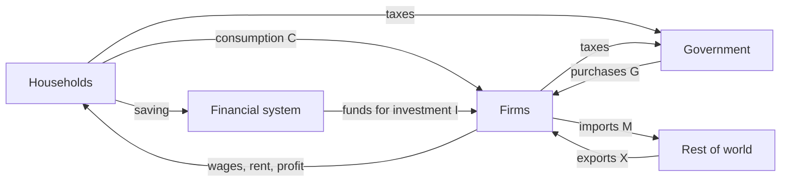

# GDP and the circular flow

After this lesson you can define GDP, compute it three ways (expenditure, income and value added), explain why intermediate goods are not counted twice, say what GDP leaves out, and read Canada's GDP components and GDP per person.

Before this: [how economists use math and graphs](01-how-economists-use-math-and-graphs.md) (stocks and flows), [percent change vs percentage points](02-percent-change-vs-percentage-points.md) and [growth rates and CAGR](03-growth-rates-and-cagr.md).

## Quick check

Try these first. If you get all three right, skip to [Practice](#practice).

1. A wheat farmer sells wheat for \$40 to a miller. The miller sells flour for \$70 to a baker, and the baker sells bread for \$120 to households. What is the contribution of this chain to GDP?
2. In a made-up economy, $C = 1000$, $I = 300$, $G = 400$, $X = 350$ and $M = 380$ (billions of dollars). Find GDP and net exports.
3. Is the sale of a used car in Ontario counted in this year's GDP?

<details class="solution" markdown>
<summary>Answers</summary>

1. \$120, the value of the final good. The wheat and flour are intermediate goods. Value added is $40 + 30 + 50 = 120$ across the three firms, which agrees.
2. $Y = C + I + G + (X - M) = 1000 + 300 + 400 + (350 - 380) = 1670$ billion dollars. Net exports are $350 - 380 = -30$ billion.
3. No. The car was counted when it was produced. Only the dealer's margin or fee for the service of selling it is new production and counts.

</details>

## The idea

Everything that is made and sold in an economy is bought by someone, and the money paid becomes income for someone else. A bakery buys flour, pays its workers and sells bread. The workers spend their pay on bread, rent and phones, and the owners of the bakery spend or save their profit. Picture the whole economy as money going round a loop: households spend on goods and services, the firms that sell them pay wages, rents and profits back to households, and the loop continues.

Gross domestic product (GDP) is the size of that loop for one year: the value of what is produced, which equals the amount spent on it, which equals the income earned making it. The three descriptions are three ways of cutting the same loop, and they must agree. In practice they come from different data sources, so the published figures differ by a small statistical discrepancy.

For Canada in 2025, GDP at market prices was about \$3.245 trillion (Statistics Canada, Table 36-10-0104-01, sum of the four quarters of 2025, current prices; computed from the table as described below). Dividing by the population gives about \$78,000 per person. Numbers like these are the starting point for comparing countries and years, and they raise the questions this lesson answers: what counts, what doesn't, and what the number means.

## Definitions

**Gross domestic product (GDP)** is the market value of all final goods and services produced within a country's borders in a given period (usually a year or a quarter). In plain words, it is the dollar value of the new output of the economy, counted once.

Each word matters. "Market value" means goods are valued at their prices (so a litre of milk and a haircut can be added). "Final" means sold to their last user, not as an input to something else. "Produced" excludes sales of existing goods. "Within a country's borders" makes it domestic: a Canadian factory owned by a foreign company counts in Canada's GDP, and the profit of a Canadian firm's plant abroad doesn't. A period is part of the definition, because GDP is a flow ([the first lesson](01-how-economists-use-math-and-graphs.md#stocks-and-flows)): dollars per year.

An **intermediate good** is a good or service that is used up in producing another good in the same period, such as flour sold to a baker. A **final good** is bought by its end user, such as bread sold to a household, a machine bought by a firm to keep, or a road built by the government. The **value added** of a firm is the value of its output minus the value of the intermediate goods it bought: $\text{value added} = \text{sales} - \text{purchases of intermediate inputs}$. In plain words, value added is what a firm contributes by its own work and capital.

The **circular flow** is the model in which households supply labour, land and capital to firms and receive income, and firms supply goods and services to households and receive spending, so that money circulates. The simplest version has only households and firms. The fuller version adds the government (taxes and spending), the financial system (saving and investment) and the rest of the world (exports and imports).

The **expenditure approach** adds up spending on final goods and services:

$$
Y = C + I + G + (X - M),
$$

where $Y$ is GDP, $C$ is consumption, $I$ is investment, $G$ is government purchases, $X$ is exports and $M$ is imports. The difference $X - M$ is **net exports**, written $NX$. Here:

- $C$ is spending by households on goods and services (and by non-profit institutions that serve households), such as groceries, rent and tuition.
- $I$ is spending on new capital: machinery, buildings, software, new houses and the change in inventories. It does not include buying shares or bonds, which are financial transactions.
- $G$ is government spending on goods and services: salaries of public employees, supplies and public investment such as roads. It excludes transfers (the Canada Child Benefit, pensions, Employment Insurance), which move income and don't buy output.
- $X$ is what foreigners buy from this country and $M$ is what residents buy from abroad.

The **income approach** adds up the income earned in production. For Canada's national accounts: compensation of employees (wages, salaries and employers' contributions), gross operating surplus (profits of corporations and the depreciation of capital), gross mixed income (income of unincorporated businesses and the self-employed), and taxes less subsidies on production and on products and imports. The **value-added approach** adds up the value added by every industry, which equals GDP because the intermediate goods cancel.

**GDP per capita** is GDP divided by the population: $\frac{Y}{N}$. In plain words, it is the average output per person, a ratio of a flow (dollars per year) to a stock (people).

## How to do it

### Adding it up three ways

1. Decide the period and the unit (billions of dollars in a year). GDP is a flow, so use totals for the period.
2. Expenditure approach: add $C$, $I$, $G$ and $X$, then subtract $M$. Subtract imports from the total because the spending on imports was counted in $C$, $I$ or $G$ but it didn't produce anything at home.
3. Income approach: add compensation of employees, gross operating surplus, gross mixed income and taxes less subsidies on production and imports.
4. Value-added approach: for each firm, subtract purchases of intermediate goods from sales and add the results across firms.
5. Compare the three totals. They should agree, up to a small statistical discrepancy.
6. For per capita figures, divide by the population (the same population for the same year, usually at mid-year).

### Why intermediate goods are not counted twice

Suppose we added up the sales of every firm in the chain from the quick check: $40 + 70 + 120 = 230$. That counts the wheat three times (once in its own price, again inside the flour and again inside the bread). The final value, \$120, counts it once.

*Theorem.* For a chain of firms in which each firm's output is the next firm's only input, until the last firm sells to final users, the sum of value added equals the sales of the last firm.

What we know: firm 1 has no inputs and sales $s_1$, and for $k > 1$, firm $k$ buys inputs worth $s_{k-1}$ and sells output worth $s_k$. What we want: $\sum_{k=1}^{n} v_k = s_n$, where $v_k$ is the value added. The plan is to write $v_k = s_k - s_{k-1}$ and watch the sum telescope.

Proof. For firm 1, $v_1 = s_1 - 0$. For $k > 1$, $v_k = s_k - s_{k-1}$. Then

$$
\sum_{k=1}^{n} v_k = s_1 + (s_2 - s_1) + (s_3 - s_2) + \cdots + (s_n - s_{n-1}) = s_n,
$$

because every $s_k$ with $k < n$ appears once with a plus sign and once with a minus sign. $\blacksquare$

Looking back: this is the same telescoping sum as in [growth rates and CAGR](03-growth-rates-and-cagr.md), with levels where logs were. The result holds for any number of steps, and with many inputs per firm the argument adds a term for each input. It is why GDP counts the final price once, and why the value-added approach and the expenditure approach agree.

### Why the three approaches agree

The money a buyer spends on a good is the money the seller receives. The seller uses it to pay for intermediate inputs (counted elsewhere), and what remains is income: wages to workers, profit and depreciation to the owners, and taxes (less subsidies) to the government. So, for the whole economy, total final spending equals total income. This is an accounting identity, true by construction, so no economic assumption is involved. A machine the firm produced but did not sell (inventory) is counted as if the firm bought it itself, so $I$ includes the change in inventories. That keeps spending equal to production.

The circular flow in a picture, with the extra sectors (arrows show the flow of money; goods and services flow the other way):



### What GDP leaves out

GDP measures market production, and many things that matter for well-being lie outside it:

- Unpaid work: housework, caring for children, volunteering. A household that hires a cleaner adds to GDP, and a household that cleans its own home doesn't.
- Underground and illegal activity, which is not reported (though statistical agencies estimate some of it).
- Leisure time and quality of life. A country that works fewer hours, with the same output per hour, has lower GDP and perhaps higher well-being.
- Environmental damage and depletion of resources. Cleaning up an oil spill adds to GDP, and the spill itself is not subtracted.
- The distribution of income. Average output per person says nothing about how it is shared.
- Used goods and financial transactions, which only move existing assets from one owner to another. Transfer payments are also left out, because they don't buy output.
- Quality improvements. A phone that is far better than last year's at the same price contributes the same amount unless statisticians adjust for quality.

These limits are a reason to read GDP as a measure of the size of market production and not as a measure of welfare.

## Worked examples

<div class="example" markdown>

### Example 1: value added in a bread chain

These are made-up numbers. A farmer sells wheat for \$40 to a miller, who sells flour for \$70 to a baker, who sells bread for \$120 to households. Find GDP by the final-goods approach and by the value-added approach.

Step 1: the only final good is the bread sold to households, so GDP is \$120.

Step 2: the farmer's value added is $40 - 0 = 40$ (assume no purchased inputs). The miller's is $70 - 40 = 30$. The baker's is $120 - 70 = 50$.

Step 3: the sum is $40 + 30 + 50 = 120$.

Step 4: both approaches give \$120.

Check: the sum of all sales is $40 + 70 + 120 = 230$, which is not GDP. It counts the wheat three times. In income terms, the \$120 is also the wages and profits of the three firms, because after paying for inputs each keeps its value added as income.

</div>

<div class="example" markdown>

### Example 2: Canada's GDP by expenditure, 2025

Statistics Canada's national accounts report these components for 2025, in millions of current dollars (Table 36-10-0104-01, current prices, sum of the four quarters of 2025; the table lists the pieces below, and the groupings into $C$, $I$ and $G$ here follow the textbook definitions):

| Piece | Millions of dollars |
|---|---|
| Household final consumption expenditure | 1,761,235 |
| Non-profit institutions serving households, consumption | 48,498 |
| General governments final consumption expenditure | 711,033 |
| General governments gross fixed capital formation | 134,858 |
| Business gross fixed capital formation | 603,486 |
| Non-profit institutions serving households, gross fixed capital formation | 4,875 |
| Investment in inventories | 9,009 |
| Exports of goods and services | 1,016,262 |
| Imports of goods and services | 1,045,058 |
| Statistical discrepancy | 1,059 |

Step 1: consumption $C$ is household plus non-profit consumption: $1{,}761{,}235 + 48{,}498 = 1{,}809{,}733$.

Step 2: investment $I$ is business and non-profit fixed capital formation plus inventories: $603{,}486 + 4{,}875 + 9{,}009 = 617{,}370$.

Step 3: government purchases $G$ are government consumption plus government investment: $711{,}033 + 134{,}858 = 845{,}891$.

Step 4: net exports are $1{,}016{,}262 - 1{,}045{,}058 = -28{,}796$. Canada bought more from the world than it sold in 2025.

Step 5: add: $1{,}809{,}733 + 617{,}370 + 845{,}891 - 28{,}796 = 3{,}244{,}198$, and adding the statistical discrepancy of 1,059 gives $3{,}245{,}257$, which is the reported GDP at market prices: about \$3.245 trillion.

As shares of GDP, $C$ is 55.8%, $G$ is 26.1%, $I$ is 19.0% and net exports are $-0.9\%$ (exports are 31.3% and imports 32.2%). Together $55.77 + 26.07 + 19.02 - 0.89 + 0.03 = 100$.

Check: the three reported groupings in the table are consistent: final consumption expenditure (household, non-profit and government consumption) is $1{,}761{,}235 + 48{,}498 + 711{,}033 = 2{,}520{,}766$, and gross fixed capital formation is $134{,}858 + 603{,}486 + 4{,}875 = 743{,}219$. Plugging those in, $2{,}520{,}766 + 743{,}219 + 9{,}009 + 1{,}016{,}262 - 1{,}045{,}058 + 1{,}059 = 3{,}245{,}257$.

</div>

<div class="example" markdown>

### Example 3: Canada's GDP by income, 2025

Statistics Canada's income-based accounts for 2025 (Table 36-10-0103-01, current prices, sum of the four quarters of 2025, millions of dollars) report compensation of employees 1,629,309, gross operating surplus 893,735, gross mixed income 406,937, taxes less subsidies on production 115,169, taxes less subsidies on products and imports 201,167 and a statistical discrepancy of $-1{,}060$.

Step 1: add: $1{,}629{,}309 + 893{,}735 + 406{,}937 + 115{,}169 + 201{,}167 = 3{,}246{,}317$.

Step 2: add the discrepancy: $3{,}246{,}317 - 1{,}060 = 3{,}245{,}257$.

The income approach gives the same GDP as the expenditure approach in Example 2, \$3,245,257 million. The statistical discrepancy has the opposite sign (+1,059 in the expenditure side, $-1{,}060$ in the income side), since each is the amount needed to make its side match the other. About 50.2% of GDP is compensation of employees, 27.5% is gross operating surplus, 12.5% is gross mixed income and 9.7% is taxes less subsidies.

Check: the five items sum to $\frac{3{,}246{,}317}{3{,}245{,}257} = 100.03\%$ of GDP, and the discrepancy of $-0.03\%$ brings the total to exactly 100%. The rounded shares, $50.2 + 27.5 + 12.5 + 9.7 = 99.9$, are a tenth of a point short only because of rounding.

</div>

<div class="example" markdown>

### Example 4: GDP per person (finish it yourself)

Canada's population on July 1, 2025 was 41,608,982 (Statistics Canada, Table 17-10-0009-01). Using GDP of 3,245,257 million dollars from Example 2, find GDP per person in dollars.

The units: millions of dollars is $3{,}245{,}257 \times 10^6$ dollars, and the population is in persons.

Now divide, round to the nearest dollar, and check the order of magnitude. Then say whether this is the income of the average household.

<details class="solution" markdown>
<summary>Finish</summary>

$\frac{3{,}245{,}257 \times 10^6}{41{,}608{,}982} = 77{,}994$, so about \$77,994 per person.

Check: $41.6$ million people times \$78,000 is about \$3.245 trillion, so the order of magnitude is right.

It is not the income of the average household. GDP includes depreciation, business profits that are retained and government purchases, none of which are paid to households as take-home income, and the figure is an average over children and retirees as well as workers.

</details>

</div>

<div class="example" markdown>

### Example 5: an imported phone

A Canadian retailer imports a phone for \$600 and sells it to a consumer for \$900. How much does this sale add to GDP?

Expenditure: consumption rises by \$900 ($C$ up) and imports rise by \$600 ($M$ up), so GDP rises by $900 - 600 = 300$ dollars.

Value added: the retailer's sales are \$900, its purchase of an input (the phone, from abroad) is \$600, and the value added is \$300, the retailer's own contribution (staff, shop, margin).

Check: the two agree at \$300. The foreign producer's value added, the \$600, belongs to the foreign country's GDP. It would be wrong to count the \$900 as Canadian output, and subtracting imports is what prevents that.

</div>

## Edge cases and common mistakes

<div class="warning" markdown>

Watch out: adding the sales of every firm counts intermediate goods many times. Count only final goods, or sum value added. A total of all sales in an economy is far bigger than GDP.

</div>

<div class="warning" markdown>

Watch out: don't add government transfers to $G$. A pension payment or a child benefit moves income from taxpayers to recipients, and buys no output. When the recipient spends it, that spending is counted in $C$. Counting it in $G$ as well would count it twice.

</div>

<div class="warning" markdown>

Watch out: don't forget to subtract imports. Imports are already inside $C$, $I$ and $G$. Writing $Y = C + I + G + X$ overstates GDP by the amount of imports.

</div>

<div class="warning" markdown>

Watch out: "investment" in economics is not buying shares or bonds. It is spending on new capital goods (plus inventories). When you buy shares, you swap money for an asset, and nothing new is produced.

</div>

Net exports can be negative, and Canada's were in 2025 ($-\$28.8$ billion, Example 2). A negative $NX$ means imports exceed exports and doesn't mean the economy is smaller. Consumption can't be negative, but inventory investment can: when firms sell more than they produce, inventories fall and $I$ is lower.

GDP is not GNP or national income. GDP counts production within borders, and gross national product (GNP) counts production by a country's residents wherever it happens. The two differ by net income from abroad.

The three approaches agree for the whole economy, and they may not for one year in real data, because of timing (revenue vs. income received) and measurement. The statistical discrepancy in Examples 2 and 3 is about 0.03% of GDP.

## Tricks and shortcuts

A quick GDP check from shares: in Canada, consumption is a bit over half of GDP, government purchases about a quarter, investment about a fifth, and net exports hover near zero (Example 2, 2025). Imports and exports are each about a third of GDP, a sign of an open economy.

To avoid double counting, ask "is this the last time this thing is sold in this period?" If the answer is no (flour sold to a bakery), it is intermediate. A durable item that a firm buys to keep (an oven) is final: it is investment.

When a problem gives a mixture of data, rearrange to isolate what you need. For example, from $Y = C + I + G + NX$, net exports are $NX = Y - C - I - G$. And a deficit in net exports ($NX < 0$) has to be financed by foreign lending, which links to the financial side of the circular flow.

## In code

The code adds up the 2025 components from Example 2, checks that the income approach agrees, and computes shares and GDP per person.

<details class="code" markdown>
<summary>In code</summary>

```python
# Millions of dollars, Canada 2025 (Statistics Canada Tables 36-10-0104-01 and 36-10-0103-01)
household, npish = 1_761_235, 48_498
gov_consumption, gov_investment = 711_033, 134_858
business_investment, npish_investment, inventories = 603_486, 4_875, 9_009
exports, imports = 1_016_262, 1_045_058
discrepancy = 1_059

C = household + npish
G = gov_consumption + gov_investment
I = business_investment + npish_investment + inventories
NX = exports - imports
gdp = C + I + G + NX + discrepancy
print(C, I, G, NX, gdp)  # 1809733 617370 845891 -28796 3245257

for name, value in [("C", C), ("G", G), ("I", I), ("NX", NX)]:
    print(name, round(value / gdp * 100, 1))  # C 55.8, G 26.1, I 19.0, NX -0.9

income = 1_629_309 + 893_735 + 406_937 + 115_169 + 201_167 - 1_060
print(income == gdp)  # True

population = 41_608_982
print(round(gdp * 1_000_000 / population))  # 77994
```

</details>

## FAQ

### Why does GDP include depreciation (the "gross" in gross domestic product)?

Because it is measured before subtracting the wear and tear on capital. Net domestic product subtracts depreciation (consumption of fixed capital), and it is closer to the income that is really available, but it is harder to measure and less used. In the income approach, gross operating surplus includes depreciation, so the totals match.

### Why are imports subtracted if they are not "bad"?

They are subtracted to keep the measure about domestic production. Imports are bought by households, firms and governments, so they appear in $C$, $I$ and $G$. They are not produced in Canada, so they have to be taken out. Subtracting imports does not mean imports hurt the economy. It is bookkeeping.

### Why does the government's pension payment not count in $G$ but a teacher's salary does?

The teacher's salary pays for a service the government is producing and buying (education). The pension is a transfer: the government hands income to someone who gives nothing in return in that period. The pensioner's later spending is in $C$. Counting both would count the same dollar twice.

### Is more GDP always better?

More output means more goods and services, which usually helps. It is a poor measure of fairness, health, leisure and the environment. Economists use GDP for what it measures well (the size and growth of market production) and look at other measures for the rest.

## Practice

### Warm-up

1\. A lumber mill sells lumber for \$300 to a builder. The builder pays workers \$200 and sells a finished home to a household for \$900. Assume the mill buys no inputs. Find GDP from this chain by final goods and by value added.

<details class="solution" markdown>
<summary>Solution</summary>

By final goods, GDP is \$900, the home sold to the household. By value added: the mill's is $300 - 0 = 300$ and the builder's is $900 - 300 = 600$, so the sum is $300 + 600 = 900$.

Check: the two agree, and the total of sales, $300 + 900 = 1200$, double counts the lumber.

</details>

2\. Say whether each is counted in this year's GDP, and in which component: (a) a new car sold by a Canadian maker to a household, (b) a used car resold privately, (c) the Canada Pension Plan payment to a retiree, (d) a Canadian firm buying a new machine, (e) a Canadian-made bike sold to a buyer in the United States.

<details class="solution" markdown>
<summary>Solution</summary>

(a) Yes, in $C$. (b) No, the car was counted when it was produced; only a dealer's fee for selling it would count. (c) No, it is a transfer, and it is not in $G$. When the retiree spends it, the spending is in $C$. (d) Yes, in $I$. (e) Yes, in $X$.

Check: only (a), (d) and (e) are new production this year, and each falls under a different letter.

</details>

3\. In a made-up economy $C = 900$, $I = 250$, $G = 300$, $X = 420$ and $M = 380$ (billions of dollars). Find GDP and net exports, and the share of GDP that is government purchases.

<details class="solution" markdown>
<summary>Solution</summary>

$NX = 420 - 380 = 40$. GDP is $900 + 250 + 300 + 40 = 1490$ billion dollars. Government purchases are $\frac{300}{1490} = 0.2013$, about 20.1% of GDP.

Check: $1490 - 900 - 250 - 300 = 40$, the net exports.

</details>

### Standard

4\. Using Canada's 2025 components from Example 2 (in millions: $C = 1{,}809{,}733$, $I = 617{,}370$, $G = 845{,}891$, $X = 1{,}016{,}262$, $M = 1{,}045{,}058$, GDP 3,245,257), find each of $C$, $I$, $G$, exports and imports as a percent of GDP, to one decimal place.

<details class="solution" markdown>
<summary>Solution</summary>

Divide each by 3,245,257: $C$ is 55.8%, $I$ is 19.0%, $G$ is 26.1%, exports are 31.3% and imports are 32.2%. Net exports are $31.3 - 32.2 = -0.9$ points of GDP.

Check: $55.8 + 19.0 + 26.1 - 0.9 = 100.0$, matching the 100% total (the discrepancy is 0.03%).

</details>

5\. Canada's population on July 1, 2025 was 41,608,982, and on July 1, 2024 it was 41,162,593 (Statistics Canada, Table 17-10-0009-01). Nominal GDP was 3,245,257 million in 2025 and 3,108,551 million in 2024. Find (a) GDP per person for 2025, (b) the growth of nominal GDP, (c) the growth of population, and (d) the growth of nominal GDP per person, exactly and by the approximation.

<details class="solution" markdown>
<summary>Solution</summary>

(a) $\frac{3{,}245{,}257 \times 10^6}{41{,}608{,}982} = 77{,}994$, about \$77,994.

(b) $\frac{3{,}245{,}257}{3{,}108{,}551} - 1 = 4.40\%$.

(c) $\frac{41{,}608{,}982}{41{,}162{,}593} - 1 = 1.08\%$.

(d) Exactly, $\frac{1.0440}{1.0108} - 1 = 3.28\%$. By the approximation, $4.40 - 1.08 = 3.31\%$.

Check: the exact and approximate answers differ by 0.03 points, as the ratio rule from [growth rates and CAGR](03-growth-rates-and-cagr.md) predicts for rates of a few percent. (These are nominal figures, so they include price increases; the next lesson removes them.)

</details>

6\. Add up Canada's 2025 income-approach components from Example 3 and show that the total equals GDP. What share of GDP was compensation of employees?

<details class="solution" markdown>
<summary>Solution</summary>

$1{,}629{,}309 + 893{,}735 + 406{,}937 + 115{,}169 + 201{,}167 = 3{,}246{,}317$, and $3{,}246{,}317 - 1{,}060 = 3{,}245{,}257$, which is GDP. Compensation of employees is $\frac{1{,}629{,}309}{3{,}245{,}257} = 0.502$, about 50.2%.

Check: the other four items make up the remaining 49.8%.

</details>

### Challenge

7\. A Canadian firm imports parts worth \$30, pays its workers \$50, earns a profit of \$20 and sells a machine for \$100 to another Canadian firm, which keeps it. Find the contribution to GDP by expenditure, by income and by value added.

<details class="solution" markdown>
<summary>Solution</summary>

By expenditure, the machine is an investment good, so $I$ rises by 100 and imports $M$ rise by 30: GDP rises by $100 - 30 = 70$.

By income: wages 50 plus profit 20 is 70.

By value added: sales 100 minus purchased inputs 30 is 70.

Check: all three give \$70. The \$30 of parts is the foreign producer's value added, and it is not part of Canada's GDP.

</details>

8\. (Reviews [growth rates and CAGR](03-growth-rates-and-cagr.md).) Using Canada's nominal GDP of 3,108,551 million in 2024 and 3,245,257 million in 2025, what would the CAGR of nominal GDP be, and in how many years would nominal GDP double at that rate?

<details class="solution" markdown>
<summary>Solution</summary>

The CAGR over one year is the growth rate itself: $\frac{3{,}245{,}257}{3{,}108{,}551} - 1 = 4.40\%$. The doubling time is $\frac{\ln 2}{\ln 1.0440} = 16.1$ years (the rule of 70 gives $\frac{70}{4.4} = 15.9$).

Check: $1.0440^{16.1} = 2.0$. This is a nominal figure, and a doubling of nominal GDP says nothing about real output until prices are removed.

</details>

## Where this shows up

- [Nominal vs real GDP and the deflator](06-nominal-vs-real-gdp-and-the-deflator.md) removes price changes from the GDP figures here, and [CPI and inflation](07-cpi-and-inflation.md) measures the price side. [Multipliers and the AD-AS model](../04-more-tools/02-multipliers-and-the-ad-as-model.md) uses $Y = C + I + G + NX$ as its starting equation.
- In macroeconomics courses, saving, investment and the trade balance are linked by identities from the circular flow: private saving plus government saving plus net foreign borrowing equals investment.
- Present value, NPV and bond prices<!-- link: ../04-more-tools/01-present-value-npv-and-bond-prices.md --> and the finance chapters treat investment as spending today for income later, which is why $I$ is the volatile part of GDP.
