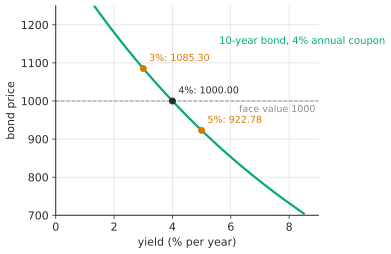

# Present value, NPV and bond prices

After this lesson you can discount a stream of future payments to today's dollars, apply the NPV rule and find an IRR, derive the perpetuity formulas from the geometric series, price a bond from its coupons and face value, and prove that a bond's price falls when interest rates rise.

Before this: [summation notation and series](../../03-high-school/11-sequences-series-and-counting/02-summation-notation-and-series.md) (the finite geometric sum), [infinite series basics](../../05-university-core/05-sequences-and-series/02-infinite-series-basics.md) (the infinite geometric series and its perpetuity example), and [percents](../../02-middle-school/02-ratios-rates-percents/03-percents.md).

## Quick check

Try these first. If you get all three right, skip to [Practice](#practice).

1. What is \$1,000 received in 3 years worth today, if money can earn 5% a year?
2. A project costs \$1,000 now and pays \$400, \$500 and \$600 at the ends of years 1, 2 and 3. Find its NPV at a 10% discount rate. Is it worth doing?
3. A bond has face value \$1,000 and pays a \$40 coupon at the end of each of the next 3 years, along with the face value at the end of year 3. What is its price if the market yield is 5%?

<details class="solution" markdown>
<summary>Answers</summary>

1. Divide by $1.05^3$: $1000 \div 1.157625 = 863.84$, so about \$863.84.
2. Discount each payment: $-1000 + \frac{400}{1.1} + \frac{500}{1.1^2} + \frac{600}{1.1^3} = -1000 + 363.64 + 413.22 + 450.79 = 227.65$. The NPV is positive, so the project is worth doing at 10%.
3. Discount the three coupons and the face value: $\frac{40}{1.05} + \frac{40}{1.05^2} + \frac{1040}{1.05^3} = 38.10 + 36.28 + 898.38 = 972.77$, so about \$972.77.

</details>

## The idea

Someone offers you \$1,000 today or \$1,000 in three years. You take the money today, even if you trust them completely. Today's \$1,000 can go into a savings account or a Government of Canada bond and be worth more than \$1,000 in three years. A dollar now is worth more than a dollar later, and the gap between them is set by the interest rate.

Turn the question around. If the going rate is 5% a year, how much would you have to put away today to have \$1,000 in three years? Growing at 5% a year multiplies by $1.05$ each year, so \$863.84 becomes $863.84 \times 1.05^3 = 1000$. That \$863.84 is the present value of the \$1,000: the amount today that is equivalent to it. Finding it is called discounting, and it is the same arithmetic as compound growth run backwards.

Once every payment is converted into today's dollars, payments at different dates can be added and compared. That is how a firm decides whether a machine is worth buying, how a bond is priced, and why a bond's price moves when interest rates move. The personal-finance version, with Canadian savings accounts and loans, is in present and future value<!-- link: ../../08-financial-math/03-time-value-of-money/01-present-and-future-value.md -->. This lesson is the economics side: investment decisions and bonds.

## Definitions

The **discount rate** $r$ is the rate per period used to convert future money into present money. In plain words, it is the return you could earn elsewhere, so it measures what waiting costs. It is written as a decimal in formulas, so 5% is $r = 0.05$.

The **present value** (PV) of an amount $C$ received $t$ periods from now is

$$
\text{PV} = \frac{C}{(1 + r)^t}.
$$

The factor $\frac{1}{(1 + r)^t}$ is the **discount factor**. For a stream of payments $C_1, C_2, \dots, C_n$ received at the ends of periods $1, 2, \dots, n$, the present value is the sum of the present values of the payments:

$$
\text{PV} = \sum_{t=1}^{n} \frac{C_t}{(1 + r)^t}.
$$

A **cash flow** is a payment, positive if you receive it and negative if you pay it. A project is described by its cash flows $C_0, C_1, \dots, C_n$, where $C_0$ happens today and is usually negative (the cost). The **net present value** (NPV) of the project at discount rate $r$ is

$$
\text{NPV}(r) = \sum_{t=0}^{n} \frac{C_t}{(1 + r)^t} = C_0 + \frac{C_1}{1 + r} + \cdots + \frac{C_n}{(1 + r)^n}.
$$

In plain words, the NPV is what the project is worth today, after paying for it. The **NPV rule** says: do the project if its NPV is positive, skip it if the NPV is negative, and compare projects by their NPVs.

The **internal rate of return** (IRR) of a project is a rate $r$ at which $\text{NPV}(r) = 0$. In plain words, it is the break-even discount rate: the project earns exactly this return on the money tied up in it.

A **perpetuity** is a stream of equal payments $C$ at the end of every period, forever. A **growing perpetuity** has a first payment $C$ at the end of period 1, and each later payment is larger than the one before by the factor $1 + g$, where $g$ is the growth rate.

A **bond** is a loan that you buy: the issuer promises a fixed set of payments. A **coupon bond** with face value $F$, coupon rate $c$ and $n$ periods to maturity pays a **coupon** of $C = cF$ at the end of each period, and also pays the face value $F$ (also called the par value) at the end of period $n$. The **yield to maturity** (YTM, or just yield) $y$ is the discount rate at which the present value of those payments equals the bond's market price. In plain words, it is the return you earn if you buy at the market price and hold to maturity.

## How to do it

### Discounting a stream and applying the NPV rule

1. List the cash flows with their dates. Costs are negative, and today is $t = 0$. Keep the same time unit throughout, such as years.
2. Choose the discount rate: the return available on an alternative of similar risk.
3. Divide each cash flow by $(1 + r)^t$.
4. Add the results to get the NPV.
5. Accept if the NPV is positive. When projects exclude each other, take the one with the highest NPV.
6. Check by computing at a second rate. The NPV should fall when $r$ rises, as the next theorem explains.

### Perpetuities from the geometric series

*Theorem 1.* If $r > 0$, the present value of a perpetuity paying $C$ at the end of each period is

$$
\sum_{t=1}^{\infty} \frac{C}{(1 + r)^t} = \frac{C}{r}.
$$

If also $0 \le g < r$, the present value of a growing perpetuity with first payment $C$ is

$$
\sum_{t=1}^{\infty} \frac{C(1 + g)^{t-1}}{(1 + r)^t} = \frac{C}{r - g}.
$$

We know the infinite geometric series: $\sum_{k=0}^{\infty} a q^k = \frac{a}{1 - q}$ when $\lvert q \rvert < 1$. We want the present value of infinitely many payments. The plan is to recognise the discounted payments as a geometric series, find its first term and ratio, and check that the ratio is below 1.

*Proof.* The first discounted payment is $a = \frac{C}{1 + r}$, and each term is the one before it times $q = \frac{1}{1 + r}$. Since $r > 0$, we have $0 < q < 1$, so the series converges and its sum is

$$
\frac{a}{1 - q} = \frac{C/(1 + r)}{1 - 1/(1 + r)} = \frac{C/(1 + r)}{r/(1 + r)} = \frac{C}{r}.
$$

For the growing case, the first term is still $a = \frac{C}{1 + r}$, and the ratio of consecutive terms is $q = \frac{1 + g}{1 + r}$. Because $g < r$, we have $0 < q < 1$, and

$$
\frac{a}{1 - q} = \frac{C/(1 + r)}{\frac{(1 + r) - (1 + g)}{1 + r}} = \frac{C}{r - g}. \qquad \blacksquare
$$

Look back: the rule is "next payment divided by (discount rate minus growth rate)", and the first rule is the case $g = 0$. If $g \ge r$ the ratio is at least 1, the series diverges, and the formula gives nonsense (a negative or undefined price for something with positive payments). In practice, growth faster than the discount rate can last for a few years but not forever. The formula also puts the value one period before the first payment: if the first payment arrives today instead of in a year, the value is $(1 + r)$ times larger.

### Bond prices

A bond is a short stream of coupons plus one large final payment, so its price is a present value.

*Theorem 2.* A bond with face value $F$, coupon $C = cF$ per period and $n$ periods to maturity, priced at yield $y > 0$ per period, has price

$$
P(y) = \sum_{t=1}^{n} \frac{C}{(1 + y)^t} + \frac{F}{(1 + y)^n} = C \cdot \frac{1 - (1 + y)^{-n}}{y} + \frac{F}{(1 + y)^n}.
$$

We know the finite geometric sum. We want to replace the sum of $n$ coupons by a closed form. The plan is to read off the first term and ratio of the discounted coupons and use the sum formula.

*Proof.* The discounted coupons form a geometric series with first term $a = \frac{C}{1 + y}$, ratio $q = \frac{1}{1 + y}$ and $n$ terms. The finite sum is $a\,\frac{1 - q^n}{1 - q}$, and since $1 - q = \frac{y}{1 + y}$,

$$
\frac{C}{1 + y} \cdot \frac{1 - (1 + y)^{-n}}{y/(1 + y)} = C \cdot \frac{1 - (1 + y)^{-n}}{y}.
$$

Adding the discounted face value gives the formula. $\blacksquare$

Look back: as a check, let $n \to \infty$ with no face value. Then $(1 + y)^{-n} \to 0$ and the coupon part tends to $\frac{C}{y}$, the perpetuity of Theorem 1. A bond is a perpetuity with the payments after year $n$ chopped off and replaced by $F$.

### Why bond prices fall when rates rise

*Theorem 3.* Let a bond have positive payments (coupons $C \ge 0$ and a face value $F > 0$). Then:

- the price $P(y)$ is strictly decreasing in $y$ for $y > 0$,
- if $y$ equals the coupon rate $c$, the price is exactly $F$,
- so if $y > c$ the price is below $F$ (the bond sells at a discount), and if $y < c$ the price is above $F$ (a premium).

We know the price is a sum of terms $\frac{\text{payment}}{(1 + y)^t}$. We want to show that the sum shrinks when $y$ grows. The plan is to show that each term shrinks, then find one yield where the price is known.

*Proof.* Take $y_1 < y_2$, both positive. For each date $t \ge 1$, $(1 + y_1)^t < (1 + y_2)^t$, so $\frac{1}{(1 + y_1)^t} > \frac{1}{(1 + y_2)^t}$. Multiplying by the payment at date $t$, which is positive, keeps the inequality, and the final payment $F + C$ is positive, so at least one term strictly shrinks. Adding all the terms gives $P(y_1) > P(y_2)$.

For the second claim, put $y = c$, so $C = Fc = Fy$. Then the formula from Theorem 2 gives

$$
P(c) = Fc \cdot \frac{1 - (1 + c)^{-n}}{c} + F(1 + c)^{-n} = F - F(1 + c)^{-n} + F(1 + c)^{-n} = F.
$$

Because $P$ is strictly decreasing and $P(c) = F$, a yield above $c$ gives a price below $F$ and a yield below $c$ gives a price above $F$. $\blacksquare$

Look back: the reason is simple. A bond's payments are fixed in dollars, so a higher yield means each fixed payment is discounted more heavily. Another way to see it: if new bonds pay more, nobody will pay full price for an old bond with lower coupons, so its price falls until its yield matches. Calculus says the same thing. Differentiating the sum term by term gives $P'(y) = -\sum_{t} \frac{t\,C_t}{(1 + y)^{t+1}}$, which is negative, using [differentiation rules](../../05-university-core/02-derivatives/02-differentiation-rules.md). The $t$ in the numerator shows that payments far in the future matter most for the slope, so long bonds react more to rate changes than short ones. The slope is also less steep at higher yields, so the price curve is convex.



### The internal rate of return, and when it misleads

The NPV depends on the discount rate you choose. The IRR asks the opposite question: what rate makes the NPV zero? Since there is no formula in general, it is found by trying rates, and the "In code" section does it by bisection.

*Theorem 4.* Suppose a project has one outflow today ($C_0 < 0$), followed only by inflows ($C_1, \dots, C_n \ge 0$), and the inflows add to more than the cost. Then $\text{NPV}(r)$ is strictly decreasing for $r > -1$, the project has exactly one IRR $r^*$ with $r^* > 0$, and $\text{NPV}(r) > 0$ exactly when $r < r^*$. So the NPV rule and the rule "accept if IRR is above the discount rate" agree.

We know that every inflow is positive, so each discounted inflow shrinks as $r$ grows, as in Theorem 3. We want exactly one crossing of zero. The plan is to show that the NPV is decreasing, positive at $r = 0$ and negative for large $r$, and use the intermediate value theorem.

*Proof.* The cost $C_0$ is not discounted, so $\text{NPV}(r) = C_0 + (\text{discounted inflows})$, and the second part strictly decreases in $r$ by the argument of Theorem 3. At $r = 0$ the NPV is the sum of all cash flows, which is positive by assumption. As $r \to \infty$ every discounted inflow tends to 0, so the NPV tends to $C_0 < 0$. The NPV is continuous, so it crosses 0 somewhere (the intermediate value theorem), and since it is strictly decreasing it crosses once. $\blacksquare$

Look back: the assumption "one outflow, then inflows" is what makes the IRR trustworthy. When the sign of the cash flows changes more than once, there can be several IRRs, or none, and the IRR rule can fail. Example 3 shows a project with two IRRs. A second weakness is that the IRR ignores scale: a \$100 project with a 50% IRR adds less value than a \$10 million project with a 15% IRR. Compare projects by NPV.

## Worked examples

<div class="example" markdown>

### Example 1: should the firm buy the machine?

A bakery can buy an oven for \$50,000. It expects the oven to add \$15,000, \$18,000, \$20,000 and \$12,000 to profit at the ends of years 1 to 4, after which it will be worthless. The bakery's alternative use of money earns 8% a year, so $r = 0.08$. (These numbers are made up.)

Step 1: the cash flows are $C_0 = -50000$, $C_1 = 15000$, $C_2 = 18000$, $C_3 = 20000$, $C_4 = 12000$. The inflows add up to \$65,000, which is more than the cost, but that sum ignores timing.

Steps 2 and 3: discount at 8%.

| Year $t$ | Cash flow | Discount factor $1.08^{-t}$ | Present value |
|---|---|---|---|
| 0 | $-50000$ | 1.0000 | $-50000.00$ |
| 1 | 15000 | 0.9259 | 13888.89 |
| 2 | 18000 | 0.8573 | 15432.10 |
| 3 | 20000 | 0.7938 | 15876.64 |
| 4 | 12000 | 0.7350 | 8820.36 |

Step 4: add the last column. $\text{NPV} = 13888.89 + 15432.10 + 15876.64 + 8820.36 - 50000 = 4017.99$, so about \$4,018.

Step 5: the NPV is positive, so the bakery should buy the oven. It is worth \$4,018 more, in today's dollars, than the \$50,000 it costs.

Step 6: check at another rate. At 12% the NPV is $-395.83$, which is lower, as it should be. The NPV changes sign between 8% and 12%, so the IRR is between them: it is about 11.6%. Any bakery that can earn more than 11.6% elsewhere should not buy this oven.

</div>

<div class="example" markdown>

### Example 2: pricing a Government of Canada bond

The Bank of Canada publishes benchmark yields for Government of Canada bonds. On October 20, 2026, the 5-year benchmark yield was 3.62% (source: the [Bank of Canada's benchmark bond yield series](https://www.bankofcanada.ca/rates/interest-rates/canadian-bonds/)). Take a made-up 5-year bond with face value \$100 and a 3% coupon. To keep the arithmetic short, suppose it pays the \$3 coupon once a year. Real Government of Canada bonds pay twice a year, so this is a simplification.

The price is the present value of five \$3 coupons and the \$100 face value, discounted at $y = 0.0362$:

| Year | Payment | Present value at 3.62% |
|---|---|---|
| 1 | 3 | 2.895 |
| 2 | 3 | 2.794 |
| 3 | 3 | 2.696 |
| 4 | 3 | 2.602 |
| 5 | 103 | 86.222 |

The five rows add to \$97.21. Theorem 2 gives the same number in one line:

$$
P = 3 \cdot \frac{1 - 1.0362^{-5}}{0.0362} + \frac{100}{1.0362^5} = 13.499 + 83.711 = 97.21.
$$

The bond sells below its face value, as Theorem 3 predicts, because the 3.62% yield is above the 3% coupon rate. A buyer pays \$97.21 and receives \$3 a year plus \$100 at the end, so the return is more than the coupon alone.

Now move the yield by one percentage point. At 4.62% the price is \$92.91, a fall of 4.4%. At 2.62% it is \$101.76, a rise of 4.7%. The price rises more for a fall in yield than it falls for a rise, the convexity noted after Theorem 3.

Check: at $y = 3\%$, the coupon rate, the formula gives exactly \$100.00. With semiannual coupons of \$1.50 and a semiannual yield of 1.81%, the price is \$97.19, within two cents of the annual version.

</div>

<div class="example" markdown>

### Example 3: a growing perpetuity, and an IRR that misleads

Part (a). A company is expected to pay a dividend of \$100 per share at the end of next year, with dividends growing 2% a year forever. An investor requires a 7% return. By Theorem 1, the value of a share is

$$
\frac{100}{0.07 - 0.02} = 2000.
$$

If dividends did not grow, the value would be $\frac{100}{0.07} = 1428.57$. The 2% growth adds 40% to the price. The price is very sensitive to the gap $r - g$: if the required return falls from 7% to 6%, the value jumps to $\frac{100}{0.04} = 2500$.

Part (b). A mine costs \$100 to open, pays \$230 at the end of year 1, and costs \$132 at the end of year 2 to restore the land. The cash flows are $-100, +230, -132$, and the sign changes twice. The NPV is $-100 + \frac{230}{1+r} - \frac{132}{(1+r)^2}$. At $r = 10\%$ it is $-100 + 209.09 - 109.09 = 0$. At $r = 20\%$ it is $-100 + 191.67 - 91.67 = 0$. So there are two IRRs, 10% and 20%.

Which one is "the" return? Neither. The NPV at $r = 15\%$ is positive (\$0.19), and at $r = 0\%$ it is $-2$, negative. So the mine has positive NPV only for discount rates between 10% and 20%, and the rule "accept if IRR exceeds the discount rate" gives contradictory answers. The NPV at the actual discount rate is the number to use.

Check for (a): the first 3,000 terms of $\sum \frac{100 \times 1.02^{t-1}}{1.07^t}$ add up to \$2,000.00 to the cent.

</div>

<div class="example" markdown>

### Example 4: the yield of a bond (finish it yourself)

A bond with face value \$1,000 and a 5% annual coupon has 2 years to maturity and costs \$980. Find its yield to maturity.

The yield solves the equation

$$
980 = \frac{50}{1 + y} + \frac{1050}{(1 + y)^2}.
$$

Let $x = \frac{1}{1 + y}$. The equation becomes $1050x^2 + 50x - 980 = 0$, a quadratic in $x$. Solve it with the quadratic formula, keep the positive root, and convert back to $y$.

<details class="solution" markdown>
<summary>Finish</summary>

The positive root is $x = \frac{-50 + \sqrt{2500 + 4 \cdot 1050 \cdot 980}}{2100} = \frac{-50 + \sqrt{4118500}}{2100} \approx \frac{-50 + 2029.41}{2100} \approx 0.94258$. Then $1 + y = \frac{1}{0.94258} \approx 1.06092$, so $y \approx 6.09\%$.

The yield is above the 5% coupon rate, and the price is below face value, as Theorem 3 says.

Check: $\frac{50}{1.06092} + \frac{1050}{1.06092^2} = 47.13 + 932.87 = 980.00$.

</details>

</div>

## Edge cases and common mistakes

<div class="warning" markdown>

Watch out for mixing nominal and real rates. If the cash flows are in future dollars, which include inflation, use a nominal discount rate. If they are in today's purchasing power, use a real one. Discounting nominal payments at a real rate overstates the value. Inflation and real returns<!-- link: ../../08-financial-math/02-interest-and-growth/06-inflation-and-real-returns.md --> covers the link between the two.

</div>

<div class="warning" markdown>

Watch out for timing in the perpetuity formula. $\frac{C}{r}$ values the stream one period before the first payment. A stream of \$100 a year at 5% whose first payment arrives today is worth $100 + \frac{100}{0.05} = 2100$, not \$2,000. A stream whose first payment arrives in 3 years is worth $\frac{2000}{1.05^2}$ today, because the formula puts the value at the end of year 2.

</div>

<div class="warning" markdown>

Watch out for the discount rate and the time unit. A 6% annual rate with monthly payments needs a monthly rate, and 6% a year is not 0.5% a month under compounding: $(1.06)^{1/12} - 1 \approx 0.4868\%$. Use the rate that matches the period of the cash flows, and count periods in the same unit.

</div>

<div class="warning" markdown>

Watch out: picking the project with the higher IRR is not the same as picking the higher NPV. Project A turns \$100 into \$150 in one year (IRR 50%). Project B turns \$1,000 into \$1,300 (IRR 30%). At a 10% discount rate A has NPV \$36.36 and B has \$181.82, and if you can do only one, B adds more. The IRR measures the rate of return and not the dollars created.

</div>

Edge cases in the formulas. If $r = 0$ there is no discounting, and the present value is just the sum of the payments (but a perpetuity at $r = 0$ has infinite value, which is why Theorem 1 needs $r > 0$). If $r$ is negative, which has happened to some government bonds, future money is worth more than present money, and every formula above still works as long as $r > -1$, except the perpetuity series, which diverges. A zero-coupon bond has $C = 0$ and price $\frac{F}{(1 + y)^n}$; its yield can be found directly as $y = (F/P)^{1/n} - 1$.

## Tricks and shortcuts

Use the rule of 72 to feel the discount factor: money doubles in about $\frac{72}{r}$ years at $r$ percent, so a payment $\frac{72}{r}$ years away is worth about half its face value today. At 6%, a payment 12 years out is worth about half. See doubling time and the rule of 72<!-- link: ../../08-financial-math/02-interest-and-growth/05-doubling-time-rule-of-72-and-logs.md -->.

Bond prices in your head. A bond priced at par has yield equal to its coupon rate. If the price is below par, the yield is above the coupon rate, and the other way round. For a rough price, a bond with $n$ years left moves about $n$ percent for each percentage point of yield when $n$ is small (Example 2: 5 years, about 4.5%). For long bonds the move is less than $n$ percent, because of convexity. For the 10-year 4% bond in the figure, 1 point up costs 7.7% and 1 point down gains 8.5%.

Test any perpetuity answer by multiplying back: the value times the rate should equal the payment. For Example 3(a), $2000 \times (0.07 - 0.02) = 100$.

To convert a monthly or semiannual payment into a present value, use the periodic rate and the number of periods: a 5-year bond with semiannual coupons has $n = 10$ periods, and $y$ is the annual yield divided by 2.

## In code

The code defines NPV, a bisection search for the IRR, a bond pricer and a yield solver. Bisection works for the yield because the price is strictly decreasing in $y$ (Theorem 3): if the price at the middle yield is too high, the true yield is higher, and the search keeps the upper half.

<details class="code" markdown>
<summary>In code</summary>

```python
def npv(rate, cash_flows):
    """cash_flows[t] is received at the end of year t; cash_flows[0] is today."""
    return sum(c / (1 + rate) ** t for t, c in enumerate(cash_flows))

def irr(cash_flows, lo=-0.99, hi=10.0):
    """Bisection. Needs NPV to change sign between lo and hi."""
    for _ in range(200):
        mid = (lo + hi) / 2
        if npv(lo, cash_flows) * npv(mid, cash_flows) <= 0:
            hi = mid
        else:
            lo = mid
    return (lo + hi) / 2

def bond_price(face, coupon_rate, y, n):
    c = face * coupon_rate
    return sum(c / (1 + y) ** k for k in range(1, n + 1)) + face / (1 + y) ** n

oven = [-50000, 15000, 18000, 20000, 12000]
print(round(npv(0.08, oven), 2), round(npv(0.12, oven), 2))   # 4017.99 -395.83
print(round(irr(oven), 4))                                    # 0.1162

print(round(bond_price(100, 0.03, 0.0362, 5), 2))             # 97.21
print(round(bond_price(100, 0.03, 0.0462, 5), 2))             # 92.91
print(round(bond_price(100, 0.03, 0.0262, 5), 2))             # 101.76

# Yield to maturity is the IRR of: pay the price, receive the payments.
print(round(irr([-980, 50, 1050]), 4))                        # 0.0609

# Perpetuity: partial sums approach C / (r - g).
print(round(sum(100 * 1.02 ** (t - 1) / 1.07 ** t for t in range(1, 3001)), 2))   # 2000.0

# Two IRRs when the signs change twice.
mine = [-100, 230, -132]
print(round(npv(0.10, mine), 6) + 0.0, round(npv(0.20, mine), 6) + 0.0)   # 0.0 0.0

# Longer bonds react more to a rate rise from 4% to 5% (4% coupon, face 1000).
for n in (2, 10, 30):
    p4, p5 = bond_price(1000, 0.04, 0.04, n), bond_price(1000, 0.04, 0.05, n)
    print(n, round(p5, 2), round(100 * (p5 / p4 - 1), 1))
# 2 981.41 -1.9
# 10 922.78 -7.7
# 30 846.28 -15.4
```

The bisection finds the root of $\text{NPV}(r) = 0$ to machine precision in 200 steps. For the mine, `irr(mine)` with the default bracket finds only the 10% root and never reports the 20% one, which is the warning of Theorem 4 in code. Libraries such as `numpy-financial` provide `npv` and `irr`, and spreadsheets have `NPV`, `IRR` and `YIELD`.

</details>

## FAQ

### Why not just add up the payments?

Because a dollar in the future is not worth a dollar today. Adding \$15,000 from year 1 to \$12,000 from year 4 treats them as equal, but you could invest the first for three extra years. In Example 1 the plain sum of inflows is \$65,000, and the discounted sum is \$54,018. Discounting is what makes payments on different dates comparable.

### How do I choose the discount rate?

Use the return on the best alternative with the same risk. For a safe cash flow, that is a Government of Canada bond yield of a matching maturity (3.62% for 5 years in Example 2). A riskier project needs a higher rate, because investors want extra return for risk; how much extra is a question for a finance course. A common mistake is to use the interest rate on the loan you would take out. The discount rate reflects the return on your alternatives, not how you pay for the project.

### Why does the price formula use the yield and not the coupon rate?

The coupon rate sets the payments, and it is fixed when the bond is issued. The yield is what the market demands today, and it changes every day. A bond issued at a 3% coupon still pays \$3 per \$100, but if the market now demands 3.62%, buyers will pay only \$97.21 for it. The yield is the discount rate, and the price adjusts until the two agree.

### What happens to a bond I hold if rates rise?

Its market price falls, as Theorem 3 shows, but if you hold it to maturity you still get every coupon and the face value, so your return is the yield you bought at. The loss is on paper unless you sell early. This is why a rate rise hurts bond funds, which hold bonds with no fixed maturity date of their own and report their market value.

## Practice

### Warm-up

1\. Find the present value of \$5,000 received in 4 years, at a discount rate of 6%.

<details class="solution" markdown>
<summary>Solution</summary>

Divide by the discount factor: $\frac{5000}{1.06^4} = \frac{5000}{1.262477} = 3960.47$, so about \$3,960.47.

Check: $3960.47 \times 1.06^4 = 5000.00$, and the answer is below \$5,000, as a present value should be.

</details>

2\. A stream pays \$100 at the end of each of the next 10 years. Find its present value at 7%.

<details class="solution" markdown>
<summary>Solution</summary>

This is a finite geometric series with first term $\frac{100}{1.07}$, ratio $\frac{1}{1.07}$ and 10 terms, which gives the formula from Theorem 2 without the face value:

$$
100 \cdot \frac{1 - 1.07^{-10}}{0.07} = 100 \times 7.0236 = 702.36.
$$

Check: the perpetuity at 7% would be $\frac{100}{0.07} = 1428.57$, and the 10-year stream is worth less, as it should be. Adding the ten discounted payments in Python gives 702.36.

</details>

3\. A bond with face value \$1,000 and a 6% annual coupon matures in 5 years. Find its price when the yield is (a) 6% and (b) 4%.

<details class="solution" markdown>
<summary>Solution</summary>

The coupon is \$60.

(a) At 6% the yield equals the coupon rate, so the price is the face value, \$1,000. (Theorem 3.)

(b) $60 \cdot \frac{1 - 1.04^{-5}}{0.04} + \frac{1000}{1.04^5} = 60 \times 4.4518 + 821.93 = 267.11 + 821.93 = 1089.04$, so about \$1,089.04.

Check: the yield fell below the coupon rate, so the price is above \$1,000, a premium. Direct discounting of each payment also gives \$1,089.04.

</details>

### Standard

4\. A project costs \$12,000 and pays \$4,000, \$5,000 and \$6,000 at the ends of years 1, 2 and 3. (a) Find the NPV at 9%. (b) Does the project pass the NPV rule at 13%? (c) Is the IRR above or below 13%?

<details class="solution" markdown>
<summary>Solution</summary>

(a) $-12000 + \frac{4000}{1.09} + \frac{5000}{1.09^2} + \frac{6000}{1.09^3} = -12000 + 3669.72 + 4208.40 + 4633.11 = 511.23$.

(b) At 13%: $-12000 + 3539.82 + 3915.73 + 4158.30 = -386.15$, which is negative, so the project fails.

(c) The NPV is positive at 9% and negative at 13%, and it falls steadily as the rate rises (one outflow, then inflows, Theorem 4), so the IRR is between 9% and 13%, below 13%. It is about 11.2%.

Check: the NPV at 11.2% is about 0, and the plain sum of the cash flows, \$3,000, is positive, so Theorem 4 applies.

</details>

5\. A preferred share pays a dividend of \$2.40 per year, starting one year from now, and an investor requires a 6% return. (a) What is the share worth if the dividend never changes? (b) What is it worth if the dividend grows 2% a year?

<details class="solution" markdown>
<summary>Solution</summary>

(a) A perpetuity: $\frac{2.40}{0.06} = 40.00$, so \$40.

(b) A growing perpetuity with $r - g = 0.04$: $\frac{2.40}{0.04} = 60.00$, so \$60.

Check: $40 \times 0.06 = 2.40$ and $60 \times 0.04 = 2.40$. The growing stream pays more than the flat one, so it should be worth more.

</details>

6\. A 3-year bond with face value \$1,000 and a 3% annual coupon sells for \$920. Find its yield to maturity to the nearest 0.1%, and say whether the yield is above or below the coupon rate.

<details class="solution" markdown>
<summary>Solution</summary>

The yield solves $920 = \frac{30}{1 + y} + \frac{30}{(1 + y)^2} + \frac{1030}{(1 + y)^3}$. There is no simple formula, so bracket it. At $y = 5\%$ the price is $28.57 + 27.21 + 889.75 = 945.53$, which is too high, so the yield is higher. At $y = 6\%$ it is $28.30 + 26.70 + 864.80 = 919.80$, just under \$920. So the yield is just under 6%, about 5.99%, which rounds to 6.0%.

The price is below face value, so the yield is above the 3% coupon rate.

Check: at 5.99% the price is \$920.06, and at 6% it is \$919.81, so \$920 lies between them. The `irr` function from the In code section, given the cash flows `[-920, 30, 30, 1030]`, returns 0.0599.

</details>

### Challenge

7\. A project has cash flows $-100$, $+230$, $-132$ at times 0, 1 and 2 (Example 3). (a) Show that $\text{NPV}(r) = 0$ at $r = 10\%$ and $r = 20\%$ by factoring. (b) For which discount rates is the NPV positive?

<details class="solution" markdown>
<summary>Solution</summary>

(a) Let $x = \frac{1}{1 + r}$. Then $\text{NPV} = -100 + 230x - 132x^2$. Setting it to zero and multiplying by $-1$ gives $132x^2 - 230x + 100 = 0$, or $66x^2 - 115x + 50 = 0$. The discriminant is $115^2 - 4 \cdot 66 \cdot 50 = 13225 - 13200 = 25$, so $x = \frac{115 \pm 5}{132}$, that is $x = \frac{10}{11}$ or $x = \frac{5}{6}$. Then $1 + r = \frac{11}{10}$ or $\frac{6}{5}$, so $r = 10\%$ or $20\%$.

(b) $\text{NPV} = -(66 \cdot 2)(x - \frac{10}{11})(x - \frac{5}{6})$ opens downward in $x$, so it is positive between the roots, $\frac{5}{6} < x < \frac{10}{11}$, which is $10\% < r < 20\%$.

Check: at $r = 15\%$ the NPV is $-100 + 200 - 99.81 = 0.19 > 0$, and at $r = 0$ and $r = 30\%$ it is negative ($-2$ and $-100 + 176.92 - 78.11 = -1.18$).

</details>

8\. (Reviews [infinite series basics](../../05-university-core/05-sequences-and-series/02-infinite-series-basics.md).) A perpetuity pays \$60 at the end of each year, but the first payment is at the end of year 3. At a 5% discount rate, find its present value (a) by the geometric series with first term $\frac{60}{1.05^3}$, and (b) by valuing the perpetuity at the end of year 2 and discounting that.

<details class="solution" markdown>
<summary>Solution</summary>

(a) The first term is $a = \frac{60}{1.05^3}$ and the ratio is $q = \frac{1}{1.05}$, which is below 1. The sum is $\frac{a}{1 - q} = \frac{60/1.05^3}{0.05/1.05} = \frac{60}{0.05 \cdot 1.05^2} = \frac{1200}{1.1025} = 1088.44$.

(b) At the end of year 2, the stream is an ordinary perpetuity with first payment one year later, worth $\frac{60}{0.05} = 1200$. Discounting 2 years back gives $\frac{1200}{1.05^2} = 1088.44$.

Check: both give \$1,088.44, and it is less than the \$1,200 of an ordinary perpetuity, because the first two payments are missing.

</details>

## Where this shows up

- Next, [multipliers and the AD-AS model](02-multipliers-and-the-ad-as-model.md) uses the same geometric series for rounds of spending. Cost-benefit analysis in economics uses NPV, and the choice of discount rate is one of its biggest debates: a low rate makes costs far in the future (such as climate damage) matter more today.
- In finance, stock valuation, loan payments and retirement planning are present values (present and future value<!-- link: ../../08-financial-math/03-time-value-of-money/01-present-and-future-value.md -->, annuities and geometric series<!-- link: ../../08-financial-math/03-time-value-of-money/02-annuities-and-geometric-series.md -->). The bond price formula is the engine behind the yield curve that central banks watch, and the Bank of Canada's policy rate (2.25% on October 20, 2026, source: the [Bank of Canada's overnight rate series](https://www.bankofcanada.ca/core-functions/monetary-policy/key-interest-rate/)) feeds into every yield.
- In CS, discounting appears in reinforcement learning, where future rewards are multiplied by a discount factor $\gamma^t$ so that an infinite sum of rewards converges, by the same geometric series. The expected number of retries in a loop ([discrete random variables](../../05-university-core/07-probability/03-discrete-random-variables.md)) is another series of this kind.
