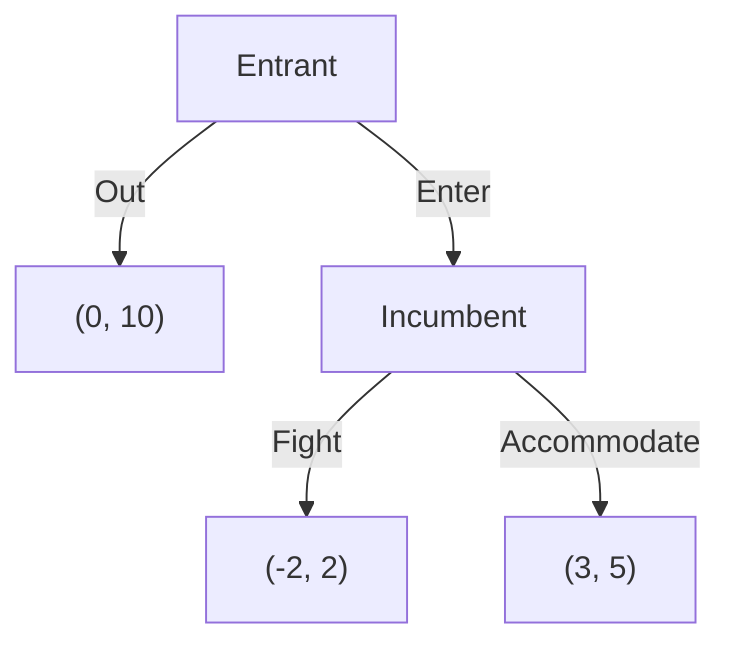

# Game theory and Nash equilibrium

After this lesson you can write a game as a payoff matrix, remove dominated strategies, find pure and mixed Nash equilibria, solve a sequential game by backward induction, and explain why two firms can each do the sensible thing and still end up worse off.

Before this: [expected value](../../05-university-core/07-probability/03-discrete-random-variables.md) (for mixed strategies), [optimization](../../05-university-core/03-applications-of-derivatives/05-optimization.md) (for the duopoly), and the geometric series from [present value, NPV and bond prices](01-present-value-npv-and-bond-prices.md) (for repeated games).

## Quick check

Try these first. If you get all three right, skip to [Practice](#practice).

1. Two players choose Up or Down (row player) and Left or Right (column player). The payoffs (row, column) are: Up-Left (3, 3), Up-Right (1, 2), Down-Left (2, 1), Down-Right (4, 4). Find every pair of strategies from which neither player wants to deviate.
2. The row player's payoffs against the column player's choices Left and Right are: Top (4, 2), Middle (3, 1), Bottom (1, 5). Is any row strategy strictly dominated?
3. In matching pennies, the row player wins \$1 if the two coins match and loses \$1 if they differ. With what probability should the column player show heads so that the row player is indifferent between heads and tails?

<details class="solution" markdown>
<summary>Answers</summary>

1. Check each pair. At Up-Left, the row player would not switch (3 beats 2) and the column player would not switch (3 beats 2), so it is stable. At Down-Right, 4 beats 1 for the row player and 4 beats 1 for the column player, so it is stable too. At Up-Right the column player would switch to Left (3 beats 2), and at Down-Left the row player would switch to Up (3 beats 2). The stable pairs are Up-Left and Down-Right.
2. Middle is strictly dominated by Top: $4 > 3$ against Left and $2 > 1$ against Right. Bottom is not dominated, since it beats Top against Right.
3. If the column player shows heads with probability $q$, the row player's expected payoff from heads is $q - (1 - q) = 2q - 1$ and from tails is $-q + (1 - q) = 1 - 2q$. They are equal when $q = \frac{1}{2}$.

</details>

## The idea

Two coffee shops on the same street each choose a price for their coffee: \$4 (high) or \$3 (low). If both charge the high price, each earns a daily profit of \$100. If both charge the low price, each earns \$60, because they split the same customers at thinner margins. If one undercuts the other, the cheap shop takes most of the customers: it earns \$130 and the shop with the high price earns \$30.

Think from one shop's side. If the rival charges high, you earn \$130 by charging low and \$100 by charging high, so low is better. If the rival charges low, you earn \$60 by charging low and \$30 by charging high, so low is better again. Whatever the rival does, low is best, so both shops charge low and each earns \$60. Both would be better off at \$100, but neither can get there alone: a shop that raises its price while the other stays low drops to \$30.

This is a game: several decision makers whose payoffs depend on what the others do. Game theory is the maths of such situations. It matters in economics because most real markets have a handful of firms, and each firm's best price depends on the others' prices. The central idea is the Nash equilibrium, a combination of choices where no one can do better by changing only their own choice.

## Definitions

A **game** consists of a set of **players**, a set of **strategies** for each player (the choices available), and a **payoff** for each player for every combination of strategies (a number measuring how good the outcome is for them, such as profit). In a **normal-form game** the players choose at the same time, without seeing each other's choice, and the game is written as a **payoff matrix**: rows are one player's strategies, columns are the other's, and each cell lists the payoffs as (row player, column player).

We write $u_i(s_i, s_{-i})$ for player $i$'s payoff when $i$ plays $s_i$ and the others play $s_{-i}$. In plain words, $s_{-i}$ means "everyone except $i$".

A strategy $s_i$ is **strictly dominated** by another strategy $s_i'$ if $s_i'$ gives a strictly higher payoff against every choice of the others: $u_i(s_i', s_{-i}) > u_i(s_i, s_{-i})$ for every $s_{-i}$. A strategy is **strictly dominant** if it strictly dominates every other strategy. In plain words, a dominated strategy is one you would never choose, whatever the others do. **Iterated elimination of strictly dominated strategies** removes a dominated strategy, then looks again in the smaller game, and repeats.

A **best response** of player $i$ to $s_{-i}$ is a strategy that gives $i$ the highest payoff against $s_{-i}$. A **Nash equilibrium** (in pure strategies) is a combination of strategies $(s_1^*, \dots, s_n^*)$ such that each $s_i^*$ is a best response to the others' $s_{-i}^*$. In plain words, it is a combination from which no player can gain by changing only their own strategy.

A **mixed strategy** is a probability distribution over a player's pure strategies, for example "heads with probability $\frac{1}{3}$". The **expected payoff** is the payoff averaged over the probabilities (see [discrete random variables](../../05-university-core/07-probability/03-discrete-random-variables.md)). A **mixed-strategy Nash equilibrium** is a combination of mixed strategies, each a best response to the others.

A **sequential game** is one where players move in turn and later movers see earlier moves. It is drawn as a **game tree**, with decision nodes, branches for choices, and payoffs at the ends. **Backward induction** solves a sequential game by starting at the last decision, choosing the best option for the player who moves there, and working back to the first move. A **credible threat** is a threat the threatener would carry out when the time came, because carrying it out is in their own interest at that point.

## How to do it

### Solving a normal-form game

1. Write the payoff matrix with each cell showing (row payoff, column payoff).
2. Look for a strictly dominated strategy for either player. If you find one, delete that row or column, and repeat on the smaller matrix.
3. Mark best responses. In each column, mark the row player's highest payoff with a star. In each row, mark the column player's highest payoff with a star.
4. A cell with two stars is a pure Nash equilibrium: each player is best-responding to the other.
5. If no cell has two stars, or to find the equilibria where players randomise, use the indifference condition below.
6. Check each equilibrium by testing every deviation: for each player, ask whether switching alone gives a higher payoff.

### Why eliminating dominated strategies is safe

*Theorem 1.* (a) A strategy combination in which every player plays a strictly dominant strategy is a Nash equilibrium. (b) A Nash equilibrium never uses a strictly dominated strategy, so iterated elimination of strictly dominated strategies removes no Nash equilibrium.

We know the definitions of dominance and best response. We want to show that dominance and equilibrium fit together. The plan is to show that a strictly dominated strategy is never a best response, and then use that.

*Proof.* (a) A strictly dominant strategy beats every other strategy against every $s_{-i}$, in particular against the actual $s_{-i}^*$, so it is a best response. (b) Suppose $s_i$ is strictly dominated by $s_i'$. Against any $s_{-i}$, including the equilibrium $s_{-i}^*$, the strategy $s_i'$ pays strictly more, so $s_i$ is not a best response, and a Nash equilibrium requires every strategy to be a best response. For the iteration, an equilibrium of the original game uses no strictly dominated strategy, so it survives the first removal and is an equilibrium of the smaller game, and the same argument applies at each later round. $\blacksquare$

Look back: the elimination can leave one cell, in which case that cell is the unique equilibrium. Or it can leave several cells, and then you search the smaller game with the stars. The theorem is one-directional: a strategy that isn't strictly dominated can still be a bad idea, which is why the stars are needed.

### Mixed strategies and the indifference condition

Some games have no pure Nash equilibrium. In matching pennies, the row player wants the coins to match and the column player wants them to differ, so whatever one does, the other wants to switch, and the stars never land in the same cell. The only equilibrium has both players randomising.

*Theorem 2 (indifference condition).* In a mixed-strategy Nash equilibrium, if a player puts positive probability on two pure strategies, those two strategies give the same expected payoff against the opponent's equilibrium mix.

We know that in equilibrium the player's mix is a best response. We want to show that the strategies in the mix pay equally. The plan is to suppose that one pays more and find a contradiction.

*Proof.* A mixed strategy's expected payoff is the weighted average of the expected payoffs of the pure strategies in it. Suppose strategy $A$ pays more than $B$ against the opponent's mix, and the player puts positive probability on $B$. Moving that probability from $B$ to $A$ raises the weighted average, so the original mix was not a best response, which contradicts equilibrium. So the two must pay the same. $\blacksquare$

Look back: this is the opposite of how you might expect to find a mix. The player's own probabilities are chosen to make the opponent indifferent, not themselves. It works because a player who is indifferent is willing to randomise, and the probabilities that make the opponent indifferent are the ones that stop the opponent from wanting to change. For a 2 by 2 game: let the row player play the first row with probability $p$, and solve for $p$ so that the column player's two strategies have equal expected payoffs. Then let the column player play the first column with probability $q$, and solve for $q$ so that the row player's two strategies pay equally.

For matching pennies, if the row player shows heads with probability $p$, the column player's payoff from heads is $-p + (1 - p) = 1 - 2p$ (the column player loses when the coins match) and from tails is $p - (1 - p) = 2p - 1$. Setting them equal gives $p = \frac{1}{2}$, and by symmetry $q = \frac{1}{2}$. The expected payoff of each player is 0.

### Sequential games and backward induction

*Theorem 3.* In a finite sequential game where every player sees all earlier moves, backward induction gives a Nash equilibrium. At every decision node, the mover's choice is the best one given the choices that follow.

*Proof.* Start at a last decision node. The player there chooses the option with the highest payoff for themselves, and ties aside this choice is determined. Replace that node by the payoffs it leads to. The game is now one step shorter, and the argument repeats until the first node. At the end, every decision node's choice is optimal given later play, so no player can gain by changing a choice at any node while the others follow the plan. In particular no player gains by deviating at the start. $\blacksquare$

Look back: the method says that only credible threats count. A threat that would hurt the threatener when carried out, so that they would choose otherwise when the time came, is removed in the first step of backward induction. The example below shows why a normal-form equilibrium can rest on such an empty threat.

### Duopoly: firms choosing quantities

Two firms sell the same product, with the market price $P = a - Q$ where $Q = q_1 + q_2$ is total output, and each unit costs $c$ to make, with $a > c$. Firm $i$'s profit is $\pi_i = (a - q_i - q_j - c)\,q_i$. This is a game in which each firm's strategy is a quantity (a continuous choice, so there is no matrix).

Firm $i$'s best response to $q_j$ maximises $\pi_i$ over $q_i$. Differentiating, $\frac{\partial \pi_i}{\partial q_i} = a - c - q_j - 2q_i$, which is 0 at

$$
q_i = \frac{a - c - q_j}{2},
$$

and the second derivative is $-2 < 0$, so this is a maximum. This is firm $i$'s **best-response function**: the more the rival makes, the less you do. A Nash equilibrium is where both best-response functions hold at once. By symmetry $q_1 = q_2 = q$, so $q = \frac{a - c - q}{2}$, which gives $q = \frac{a - c}{3}$. This is the **Cournot equilibrium**.

If instead one firm were the only seller, it would choose $q = \frac{a - c}{2}$ (the monopoly output). Two firms that agree to produce half of this each, $\frac{a - c}{4}$, would earn the monopoly profit between them. But, as the figure shows, that agreement is not an equilibrium, because each firm's best response to a rival at $\frac{a - c}{4}$ is more than $\frac{a - c}{4}$.

![The best-response lines of two firms, plotted with firm 1's output on the horizontal axis and firm 2's on the vertical axis. Firm 1's best response is a steep line falling from 90 to 45 on the horizontal axis, and firm 2's is a flatter line falling from 45 on the vertical axis to 90 on the horizontal. They cross at the Nash equilibrium, where each firm makes 30. An orange point at 22.5 and 22.5 marks the shared monopoly output, and a red point at 33.75 and 22.5 marks the output of firm 1 if it cheats on that agreement.](../../assets/figures/07-economics-math/game-theory-and-nash-equilibrium-cournot.svg)

## Worked examples

<div class="example" markdown>

### Example 1: the coffee shop price game

The game from the start of the lesson. Shop A (rows) and shop B (columns) each choose a High or Low price, with daily profits in dollars (made-up numbers):

| | B: High | B: Low |
|---|---|---|
| A: High | (100, 100) | (30, 130) |
| A: Low | (130, 30) | (60, 60) |

Step 1: the matrix is above, with A's profit first in each cell.

Step 2: look for dominated strategies. For A, Low beats High against B's High ($130 > 100$) and against B's Low ($60 > 30$), so High is strictly dominated. By symmetry the same is true for B. Deleting High for both leaves the single cell (Low, Low).

Step 3: mark best responses. In the column "B: High", A's best payoff is 130 (Low), so mark it. In the column "B: Low", A's best is 60 (Low). In the row "A: High", B's best is 130 (Low); in "A: Low", B's best is 60 (Low). Marking with a star:

| | B: High | B: Low |
|---|---|---|
| A: High | (100, 100) | (30, 130\*) |
| A: Low | (130\*, 30) | (60\*, 60\*) |

Step 4: only (Low, Low) has two stars, so it is the unique Nash equilibrium, and each shop earns \$60.

Step 6: check deviations. If A switches to High while B stays Low, A's profit falls from 60 to 30, and likewise for B.

This is the **prisoner's dilemma**: a game where each player has a dominant strategy, and the resulting equilibrium is worse for both than another outcome. Both shops would prefer (High, High) at \$100 each, but it is not stable, since each earns \$130 by undercutting. The same structure appears in advertising wars, arms races and anyone who shares a resource, with the gain from cheating for one and the loss for both.

Check: (High, High) is not an equilibrium, because A earns 130 by switching to Low, more than 100.

</div>

<div class="example" markdown>

### Example 2: coordination, pure and mixed equilibria

Two friends choose between the opera and a football game, and each prefers to be together. She prefers the opera, and he prefers the football game. The payoffs (her, him) are:

| | He: Opera | He: Football |
|---|---|---|
| She: Opera | (2, 1) | (0, 0) |
| She: Football | (0, 0) | (1, 2) |

This is a **coordination game**: both players gain from choosing the same thing, though they disagree about which.

Pure equilibria. Mark the best responses: if he goes to the opera, she gets 2 at the opera and 0 at football, so she goes to the opera. If he goes to football, she prefers football (1 against 0). Likewise he follows her. The stars land on (Opera, Opera) and (Football, Football), so there are two pure equilibria. The game doesn't say which will be played, which is the problem with coordination games.

Mixed equilibrium. Let She go to the opera with probability $p$. His expected payoff from the opera is $1 \cdot p + 0 \cdot (1 - p) = p$, and from football it is $0 \cdot p + 2(1 - p) = 2 - 2p$. By Theorem 2, set $p = 2 - 2p$, so $p = \frac{2}{3}$. Let He go to the opera with probability $q$. Her payoff from the opera is $2q$ and from football is $1 - q$, so $2q = 1 - q$ and $q = \frac{1}{3}$.

In the mixed equilibrium, She goes to the opera two thirds of the time and He one third of the time. They end up together with probability $pq + (1 - p)(1 - q) = \frac{2}{9} + \frac{2}{9} = \frac{4}{9}$, and each gets an expected payoff of $\frac{2}{3}$. That is worse than either pure equilibrium (which gives each at least 1), because they miss each other more than half the time.

Check: with $q = \frac{1}{3}$, She's opera payoff is $\frac{2}{3}$ and her football payoff is $1 - \frac{1}{3} = \frac{2}{3}$, equal as required. With $p = \frac{2}{3}$ he gets $\frac{2}{3}$ from either choice too.

</div>

<div class="example" markdown>

### Example 3: iterated elimination

Rows are the row player's strategies U, M, D and columns are L, C, R. The payoffs (row, column) are:

| | L | C | R |
|---|---|---|---|
| U | (2, 1) | (3, 2) | (3, 0) |
| M | (0, 2) | (0, 5) | (2, 4) |
| D | (3, 1) | (2, 4) | (3, 3) |

Round 1. M is strictly dominated by U for the row player: $2 > 0$, $3 > 0$ and $3 > 2$. Delete M. Next, for the column player, C beats L in every remaining row (2 against 1 in row U, 4 against 1 in row D), and C beats R (2 against 0 and 4 against 3). Delete L and R.

Round 2. Only column C is left, and in it the row player gets 3 from U and 2 from D. So D is now strictly dominated by U. Delete D.

What remains is the cell (U, C), with payoffs (3, 2). It is the unique Nash equilibrium. D could not be removed in the first round, because D beats U against L (3 against 2). It became dominated only after the column player's strategies L and R were gone, so the order of the rounds matters for what you can delete, though not for the final answer.

Check with the stars: in column C, the row player's best payoff is 3 (row U), in row U the column player's best is 2 (column C), so (U, C) has two stars, and no other cell has both.

</div>

<div class="example" markdown>

### Example 4: a market entry game and a credible threat

A new firm (the entrant) decides whether to enter a market held by an incumbent. If it stays out, the entrant earns 0 and the incumbent earns 10. If it enters, the incumbent chooses to fight (a price war) or accommodate. Payoffs are (entrant, incumbent), in millions of dollars (made-up numbers).



Backward induction. At the last node, the incumbent compares Fight (payoff 2) with Accommodate (payoff 5) and chooses Accommodate. The entrant, anticipating that, compares staying out (0) with entering and getting 3. It enters. The solution is (Enter, Accommodate), with payoffs (3, 5).

The normal form has a second equilibrium. If the incumbent's plan is "Fight if they enter", the entrant gets $-2$ by entering and 0 by staying out, so staying out is a best response, and given that the entrant stays out, the incumbent's plan costs it nothing. (Out, Fight) is a Nash equilibrium. But the threat to fight is not credible: if the entrant did enter, the incumbent would earn 5 by accommodating and only 2 by fighting. Backward induction removes the equilibrium that depends on the empty threat.

To make the threat credible, the incumbent would have to change the payoffs ahead of time, for instance by building spare capacity that makes a price war cheap for it. Then fighting pays more than accommodating, and the entrant is deterred.

Check: from (Enter, Accommodate), the entrant gains nothing by staying out (3 against 0), and the incumbent gains nothing by fighting (5 against 2).

</div>

<div class="example" markdown>

### Example 5: Cournot duopoly (finish it yourself)

Two firms face the market price $P = 100 - Q$ with a cost of \$10 per unit, so $a = 100$ and $c = 10$ in the formulas above. The best-response function is $q_i = \frac{90 - q_j}{2}$ and the Cournot equilibrium is $q_1 = q_2 = 30$.

Find the market price and each firm's profit at the equilibrium. Then find the profit each firm would earn if they agreed to produce half the monopoly output each, and the profit that firm 1 would earn by cheating on that agreement while firm 2 stuck to it.

<details class="solution" markdown>
<summary>Finish</summary>

At the equilibrium, $Q = 60$ and $P = 100 - 60 = 40$. Each firm's profit is $(40 - 10) \times 30 = 900$.

The monopoly output is $\frac{a - c}{2} = 45$, so half of it is 22.5 for each firm. Then $Q = 45$, $P = 55$, and each firm's profit is $(55 - 10) \times 22.5 = 1012.50$. That is more than \$900 each, because less output means a higher price.

If firm 2 sticks to 22.5, firm 1's best response is $\frac{90 - 22.5}{2} = 33.75$. Then $Q = 56.25$, $P = 43.75$, and firm 1 earns $(43.75 - 10) \times 33.75 = 1139.06$. Firm 2 earns $(43.75 - 10) \times 22.5 = 759.38$. Cheating pays, so the agreement is not an equilibrium. It is a prisoner's dilemma: each firm's profit at the equilibrium (900) is below the agreed profit (1012.50), but cheating on the agreement pays 1139.06.

Check: at $q_1 = q_2 = 30$, the best response to 30 is $\frac{90 - 30}{2} = 30$, so neither firm gains by changing. The first-order condition $90 - 30 - 2 \times 30 = 0$ holds.

</details>

</div>

## Edge cases and common mistakes

<div class="warning" markdown>

Watch out: a Nash equilibrium is not necessarily good, fair or efficient. In Example 1 the equilibrium gives each shop \$60, while another outcome gives each \$100. Equilibrium says only that no one can gain by acting alone. It does not say the outcome is the best the players could do together.

</div>

<div class="warning" markdown>

Watch out when marking best responses: mark the highest payoff of the player choosing in that line. To find the row player's best response, compare numbers down a column (their first payoffs), and for the column player compare numbers along a row (their second payoffs). Comparing the wrong pair of numbers marks cells that look like equilibria and are not.

</div>

<div class="warning" markdown>

Watch out: in a mixed equilibrium, you choose your probability to make the other player indifferent, not yourself. If you solve for $p$ by equating your own two payoffs, you get the other player's probability instead. A quick check is to confirm that, at the probabilities found, each player's pure strategies pay the same.

</div>

<div class="warning" markdown>

Watch out: a game can have several equilibria, one, or (in pure strategies) none. Example 2 has two pure and one mixed. Matching pennies has only a mixed one. Always finish the stars and the indifference check before you say "the" equilibrium. John Nash proved that every finite game has at least one equilibrium once mixed strategies are allowed, which is why mixed strategies are part of the definition.

</div>

Other limits. Payoffs must be the players' real objectives; a firm that cares about market share and not profit plays a different game. Strict dominance is stronger than "at least as good": with ties, as in Example 3, a strategy may be weakly dominated and not removed. And the model assumes players know the payoff matrix and choose rationally, which real players may not.

### Repeated games

The price game of Example 1 is played every day, not once. If the shops play it forever, they can threaten each other: "I charge High as long as you do, and if you ever charge Low, I charge Low forever." This is a **grim trigger** strategy. Let $\delta$ be the discount factor (the value today of \$1 tomorrow, between 0 and 1, as in the present-value lesson). Cooperating forever pays $100 + 100\delta + 100\delta^2 + \cdots = \frac{100}{1 - \delta}$. Cheating once pays 130 today and then the punishment payoff 60 forever: $130 + \frac{60\delta}{1 - \delta}$. Cooperation lasts if

$$
\frac{100}{1 - \delta} \ge 130 + \frac{60\delta}{1 - \delta}
\quad\text{which simplifies to}\quad
\delta \ge \frac{130 - 100}{130 - 60} = \frac{3}{7} \approx 0.43.
$$

So firms that care enough about the future, with $\delta \ge \frac{3}{7}$, can sustain the high price without any contract. This is why price-fixing is illegal in Canada under the Competition Act: it is a way of escaping the prisoner's dilemma that harms buyers. Practice problem 7 asks you to derive the threshold.

## Tricks and shortcuts

For a 2 by 2 game, the mixed equilibrium comes from two small equations, and the answer is a fraction between 0 and 1. If the solution is outside $[0, 1]$, there is no mixed equilibrium of that kind, which happens when a strategy is dominant.

A fast way to spot a prisoner's dilemma: each player has a dominant strategy, and the outcome where both play their dominant strategies is worse for both than another cell.

In a symmetric game, look for a symmetric equilibrium first, with all players using the same strategy. The Cournot calculation did this, and it reduced two equations to one.

To check an equilibrium, deviate one player at a time: if a single change helps, it is not an equilibrium.

## In code

The code finds pure Nash equilibria by brute force (checking every cell for profitable deviations), solves 2 by 2 mixed equilibria from the indifference condition, and iterates best responses in the duopoly.

<details class="code" markdown>
<summary>In code</summary>

```python
import itertools

def pure_nash(A, B):
    """A[i][j] is the row player's payoff, B[i][j] the column player's payoff."""
    rows, cols = len(A), len(A[0])
    found = []
    for i, j in itertools.product(range(rows), range(cols)):
        row_ok = all(A[i][j] >= A[k][j] for k in range(rows))   # no better row against column j
        col_ok = all(B[i][j] >= B[i][k] for k in range(cols))   # no better column against row i
        if row_ok and col_ok:
            found.append((i, j))
    return found

def mixed_2x2(A, B):
    """Row plays row 0 with probability p, column plays column 0 with probability q."""
    p = (B[1][1] - B[1][0]) / (B[0][0] - B[1][0] - B[0][1] + B[1][1])   # makes the column indifferent
    q = (A[1][1] - A[0][1]) / (A[0][0] - A[0][1] - A[1][0] + A[1][1])   # makes the row indifferent
    return p, q

# Example 1: prices High (0) and Low (1).
A = [[100, 30], [130, 60]]
B = [[100, 130], [30, 60]]
print(pure_nash(A, B))                           # [(1, 1)]

# Example 2: opera (0) and football (1).
A = [[2, 0], [0, 1]]
B = [[1, 0], [0, 2]]
print(pure_nash(A, B))                           # [(0, 0), (1, 1)]
p, q = mixed_2x2(A, B)
print(round(p, 4), round(q, 4))                  # 0.6667 0.3333
print(round(p * q + (1 - p) * (1 - q), 4))       # 0.4444

# Matching pennies has no pure equilibrium.
A = [[1, -1], [-1, 1]]
B = [[-1, 1], [1, -1]]
print(pure_nash(A, B), mixed_2x2(A, B))          # [] (0.5, 0.5)

# Cournot: keep playing best responses and the outputs settle at 30 each.
a, c = 100, 10
q1 = q2 = 0.0
for _ in range(60):
    q1, q2 = (a - c - q2) / 2, (a - c - q1) / 2
print(round(q1, 4), round(q2, 4))                # 30.0 30.0
print((a - q1 - q2 - c) * q1)                    # 900.0 (to rounding)

# Cheating on the shared monopoly output of 22.5 each.
cheat = (a - c - 22.5) / 2
print(cheat, round((a - cheat - 22.5 - c) * cheat, 2))   # 33.75 1139.06

# Repeated game: smallest discount factor that sustains cooperation (payoffs 100, 130, 60).
print(round((130 - 100) / (130 - 60), 4))        # 0.4286
```

The brute-force check is the definition turned into code: a cell is an equilibrium when neither player has a better strategy in their own line. For games with many strategies or players, libraries such as `nashpy` search for mixed equilibria too. The Cournot loop reaches 30 because each best response is a contraction: the slope of the best-response line is $-\frac{1}{2}$, so each step halves the distance to the equilibrium.

</details>

## FAQ

### Why would anyone play a strategy that leaves everyone worse off?

Because each player, taking the others' choices as given, can't improve by changing alone. The better outcome needs both players to move together, which needs a way to trust each other: a contract, repeated play with the threat of punishment, or a regulator. The prisoner's dilemma is the model of what happens when none of these is available.

### Do real people play Nash equilibrium?

Sometimes, and often not exactly. Experiments find that people cooperate more in one-shot prisoner's dilemmas than the theory predicts, and that play often moves toward equilibrium with experience. The equilibrium is best treated as a benchmark: where the outcome would settle if players were rational and had time to learn. It is a good predictor in competitive markets and a weaker one when players have unusual goals.

### What does it mean to play a mixed strategy in real life?

It means being unpredictable, because being predictable gets exploited. A tennis player who always serves to the left will be beaten by an opponent who always waits on the left. Studies of penalty kicks and serves find that professionals mix in proportions close to the equilibrium. In business, a firm may randomise how often it audits or discounts. It does not mean flipping a coin before every decision in a one-off game.

### How is this different from the optimization in earlier lessons?

In an optimization problem, you pick the best choice with the world held fixed. In a game, the world contains other decision makers who are choosing against you, so your best choice depends on theirs. A Nash equilibrium is a set of optimization problems solved at the same time, each taking the others' answers as given. In the duopoly, each firm's problem is the profit maximization of the [marginal analysis lesson](../03-firms-and-consumers/01-marginal-analysis-with-derivatives.md), and the equilibrium is where the two best responses cross.

## Practice

### Warm-up

1\. Two suspects can stay silent (S) or confess (C). The payoffs (years in prison, written as negatives) are (S, S): $(-1, -1)$, (S, C): $(-10, 0)$, (C, S): $(0, -10)$, (C, C): $(-5, -5)$, with the row player's payoff first. Find the dominant strategies and the Nash equilibrium, and say why this is a prisoner's dilemma.

<details class="solution" markdown>
<summary>Solution</summary>

For the row player, C beats S against S ($0 > -1$) and against C ($-5 > -10$), so C is strictly dominant. The game is symmetric, so C is dominant for the column player too. The Nash equilibrium is (C, C), with payoffs $(-5, -5)$.

It is a prisoner's dilemma because both would prefer (S, S), which gives $(-1, -1)$, but each gains by switching to C when the other stays silent.

Check: at (C, C), switching to S makes a suspect's payoff $-10$, worse than $-5$.

</details>

2\. In this game the row player chooses U or D and the column player chooses L, M or R. The payoffs (row, column) are U: $(2, 3)$, $(1, 1)$, $(4, 2)$ and D: $(3, 4)$, $(0, 2)$, $(1, 1)$. Find all pure Nash equilibria with the star method.

<details class="solution" markdown>
<summary>Solution</summary>

Row player's best responses (compare down each column): against L, D gives 3 and U gives 2, so D. Against M, U gives 1 and D gives 0, so U. Against R, U gives 4 and D gives 1, so U. Column player's best responses (compare along each row): in row U, the payoffs are 3, 1, 2, so L. In row D, they are 4, 2, 1, so L.

The stars are at (D, L) for the row player, (U, M), (U, R), and for the column player at (U, L) and (D, L). Only (D, L) has both. So (D, L), with payoffs $(3, 4)$, is the only pure equilibrium.

Check: at (D, L), the row player would get 2 from U, less than 3, and the column player would get 2 from M or 1 from R, less than 4.

</details>

3\. Player 1 chooses Up or Down. After Up, player 2 chooses l (payoffs 2, 1) or r (payoffs 0, 0). After Down, player 2 chooses l (payoffs 1, 0) or r (payoffs 3, 2). Payoffs are written (player 1, player 2). Solve by backward induction.

<details class="solution" markdown>
<summary>Solution</summary>

Work from the end. After Up, player 2 compares 1 (for l) with 0 (for r) and chooses l, giving $(2, 1)$. After Down, player 2 compares 0 (for l) with 2 (for r) and chooses r, giving $(3, 2)$. Player 1 foresees this: Up leads to a payoff of 2 and Down to 3, so player 1 chooses Down.

The solution is Down followed by r, with payoffs $(3, 2)$.

Check: if player 1 deviated to Up, they would get 2, less than 3. If player 2 deviated after Down to l, they would get 0, less than 2.

</details>

### Standard

4\. Use iterated elimination of strictly dominated strategies on this game, with rows T, M, B and columns L, C, R. Payoffs (row, column): T: $(0, 4)$, $(4, 1)$, $(1, 5)$; M: $(2, 2)$, $(2, 5)$, $(0, 5)$; B: $(1, 2)$, $(1, 3)$, $(2, 5)$.

<details class="solution" markdown>
<summary>Solution</summary>

Column L (column player's payoffs 4, 2, 2) is strictly dominated by R (5, 5, 5), so delete L. Now row M (payoffs 2, 0 against C and R) is strictly dominated by T (4, 1): $4 > 2$ and $1 > 0$, so delete M. In the remaining rows T and B, column C pays the column player 1 and 3, and R pays 5 and 5, so R strictly dominates C; delete C. With only column R left, the row player gets 1 from T and 2 from B, so T is dominated; delete T.

The remaining cell is (B, R), with payoffs $(2, 5)$, the unique Nash equilibrium.

Check: in column R the row player's best payoff is 2 (row B), and in row B the column player's best payoff is 5 (column R), so (B, R) has both stars and no other cell does.

</details>

5\. Find all Nash equilibria, including mixed ones, of the game with payoffs (row, column): (U, L) $(3, 2)$, (U, R) $(0, 1)$, (D, L) $(1, 0)$, (D, R) $(2, 3)$. Give the probabilities and the expected payoffs.

<details class="solution" markdown>
<summary>Solution</summary>

Pure equilibria: against L the row player prefers U (3 against 1), against R the row player prefers D (2 against 0). In row U the column player prefers L (2 against 1), in row D the column player prefers R (3 against 0). The cells with two stars are (U, L) and (D, R).

Mixed: let the row player play U with probability $p$. The column player's payoff from L is $2p$ and from R is $1 \cdot p + 3(1 - p) = 3 - 2p$. Setting them equal, $2p = 3 - 2p$, so $p = \frac{3}{4}$. Let the column player play L with probability $q$. The row player's payoff from U is $3q$ and from D is $1 \cdot q + 2(1 - q) = 2 - q$, so $3q = 2 - q$ and $q = \frac{1}{2}$.

The expected payoffs are $3q = 1.5$ for the row player and $2p = 1.5$ for the column player.

Check: with $p = \frac{3}{4}$, the column player gets $1.5$ from either column, and with $q = \frac{1}{2}$ the row player gets 1.5 from either row.

</details>

6\. Two firms face $P = 130 - Q$ and each unit costs \$10. Find the Cournot equilibrium output, the price, and each firm's profit. Compare with the profit if the firms shared the monopoly output equally.

<details class="solution" markdown>
<summary>Solution</summary>

With $a = 130$ and $c = 10$, the equilibrium output per firm is $\frac{a - c}{3} = 40$, so $Q = 80$ and $P = 130 - 80 = 50$. Each firm earns $(50 - 10) \times 40 = 1600$.

The monopoly output is $\frac{120}{2} = 60$, so the price is 70 and total profit is $(70 - 10) \times 60 = 3600$. Shared equally, each firm would earn \$1,800, which is more than \$1,600.

Check: each firm's best response to 40 is $\frac{120 - 40}{2} = 40$, so neither gains by changing, and cheating on a split of 30 each would pay (best response $\frac{120 - 30}{2} = 45$).

</details>

### Challenge

7\. In the repeated price game of Example 1, with payoffs 100 for both High, 130 for undercutting a High price, and 60 for both Low, show that the grim trigger strategy sustains the high price exactly when $\delta \ge \frac{3}{7}$. Use the geometric series.

<details class="solution" markdown>
<summary>Solution</summary>

If a shop cooperates forever, it earns $100(1 + \delta + \delta^2 + \cdots) = \frac{100}{1 - \delta}$, by the geometric series with ratio $\delta < 1$. If it cheats this round, it earns 130 now, and then both charge Low forever, which pays 60 per round: $130 + 60(\delta + \delta^2 + \cdots) = 130 + \frac{60\delta}{1 - \delta}$.

Cooperation is at least as good when $\frac{100}{1 - \delta} \ge 130 + \frac{60\delta}{1 - \delta}$. Multiply by $1 - \delta > 0$: $100 \ge 130(1 - \delta) + 60\delta = 130 - 70\delta$, so $70\delta \ge 30$ and $\delta \ge \frac{3}{7}$.

Check: at $\delta = \frac{3}{7}$ both sides equal $\frac{100}{4/7} = 175$ and $130 + \frac{60 \cdot 3/7}{4/7} = 130 + 45 = 175$.

</details>

8\. (Reviews [discrete random variables](../../05-university-core/07-probability/03-discrete-random-variables.md).) In the mixed equilibrium of Example 2, She plays Opera with probability $\frac{2}{3}$ and He with probability $\frac{1}{3}$, independently. List the four outcomes with their probabilities and payoffs, and compute each player's expected payoff as an expected value.

<details class="solution" markdown>
<summary>Solution</summary>

The probabilities multiply, because the choices are independent:

| Outcome | Probability | Payoffs (her, him) |
|---|---|---|
| (Opera, Opera) | $\frac{2}{3} \cdot \frac{1}{3} = \frac{2}{9}$ | $(2, 1)$ |
| (Opera, Football) | $\frac{2}{3} \cdot \frac{2}{3} = \frac{4}{9}$ | $(0, 0)$ |
| (Football, Opera) | $\frac{1}{3} \cdot \frac{1}{3} = \frac{1}{9}$ | $(0, 0)$ |
| (Football, Football) | $\frac{1}{3} \cdot \frac{2}{3} = \frac{2}{9}$ | $(1, 2)$ |

Her expected payoff is $2 \cdot \frac{2}{9} + 0 + 0 + 1 \cdot \frac{2}{9} = \frac{6}{9} = \frac{2}{3}$. His is $1 \cdot \frac{2}{9} + 2 \cdot \frac{2}{9} = \frac{6}{9} = \frac{2}{3}$.

Check: the four probabilities add to $\frac{2 + 4 + 1 + 2}{9} = 1$, and the answers match the indifference payoffs of Example 2.

</details>

## Where this shows up

- In economics, oligopoly, auctions, bargaining and public goods are all games. The next step in a course is the Bertrand price game (firms choosing prices, which gives the Example 1 logic a precise form), and the related theory of auctions and mechanism design. Cartels, the Competition Act in Canada and the repeated-game logic above go together.
- In CS, games appear in algorithmic game theory (routing and congestion, where each user picks the fastest path and the equilibrium can be slower than the best joint plan), in adversarial machine learning (a generator against a discriminator is a two-player game), in security (attacker and defender mixing strategies), and in the analysis of minimax in game-playing programs, which is backward induction on a game tree.
- In finance and policy, central bank credibility and tariff wars are sequential games, and the question of whether a threat is credible is the question of backward induction. The Government of Canada bond auctions you met in [present value, NPV and bond prices](01-present-value-npv-and-bond-prices.md) are run as auctions, which are games with bidders choosing strategies.
