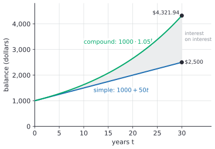

# Compound interest

After this lesson you can derive and use $A = P\left(1 + \frac{r}{n}\right)^{nt}$, compare simple and compound growth, see how the compounding frequency changes the result, and solve for the principal, the rate or the time.

Before this: [simple interest](01-simple-interest.md), [exponential functions and growth](../../03-high-school/07-exponentials-and-logarithms/01-exponential-functions-and-growth.md) and [logarithms](../../03-high-school/07-exponentials-and-logarithms/02-logarithms.md).

## Quick check

Try these first. If you get all three right, skip to [Practice](#practice).

1. Find the amount after 5 years for \$2,000 at 6% a year compounded annually.
2. Find the amount after 3 years for \$1,500 at 4% a year compounded monthly.
3. How much must you deposit now at 5% compounded annually to have \$5,000 in 4 years?

<details class="solution" markdown>
<summary>Answers</summary>

1. $A = 2000 \times 1.06^5 = 2676.45\ldots$, so \$2,676.45.
2. There are $12 \times 3 = 36$ months, each at $\frac{0.04}{12}$: $A = 1500\left(1 + \frac{0.04}{12}\right)^{36} = 1690.91\ldots$, so \$1,690.91.
3. Divide instead of multiply: $P = \dfrac{5000}{1.05^4} = 4113.51\ldots$, so \$4,113.51.

</details>

## The idea

Put \$1,000 in a deposit that pays 5% a year. After one year you have \$1,050, just as with simple interest. In the second year the bank pays 5% on all \$1,050, and not just on the original \$1,000. That is \$52.50, so you have \$1,102.50, and the extra \$2.50 compared with simple interest is interest on the first year's interest. In the third year the interest is 5% of \$1,102.50, which is \$55.13.

That is compound interest: the interest is added to the balance at the end of each period, and the next period's interest is figured on the new, larger balance. The calculation is the repeated multiplication behind exponential growth, and you met the formula in the [exponential functions lesson](../../03-high-school/07-exponentials-and-logarithms/01-exponential-functions-and-growth.md). This lesson adds the vocabulary of banking, the effect of how often interest is added, and the three ways of solving it backwards.

## Definitions

The **compounding period** is the stretch of time after which interest is added to the balance, and $n$ is the number of compounding periods in a year. Annual compounding has $n = 1$, semi-annual $n = 2$, quarterly $n = 4$, monthly $n = 12$, weekly $n = 52$ and daily $n = 365$.

The **nominal annual rate** $r$ is the yearly rate as it is quoted, written as a decimal. The rate used in each compounding period is the **periodic rate** $\frac{r}{n}$. A nominal rate of 6% compounded monthly has a periodic rate of $\frac{0.06}{12} = 0.005$, that is, 0.5% a month.

**Compound interest** is interest calculated on the principal plus the interest already added. The amount after $t$ years is

$$
A = P\left(1 + \frac{r}{n}\right)^{nt}.
$$

In plain words, start with the principal, then multiply by $1 + \frac{r}{n}$ once for every compounding period, and there are $nt$ of them. The letters are the same as in the last lesson: $P$ is the principal, $r$ the annual rate and $t$ the time in years, with $n$ new. The interest earned is $I = A - P$.

## How to do it

### Where the formula comes from

Let us derive it. We know that a period with periodic rate $i = \frac{r}{n}$ adds $i$ times the balance to the balance. We want a formula for the balance after $k$ periods.

The balance $B_0 = P$ at the start. After one period, the balance is the old balance plus $i$ times the old balance, and factoring gives

$$
B_1 = B_0 + iB_0 = B_0(1 + i).
$$

The same step repeats, so $B_2 = B_1(1 + i) = P(1 + i)^2$, then $B_3 = P(1 + i)^3$, and after $k$ periods

$$
B_k = P(1 + i)^k.
$$

In $t$ years there are $k = nt$ periods, and $i = \frac{r}{n}$, which gives $A = P\left(1 + \frac{r}{n}\right)^{nt}$. Each period multiplies by the same factor $1 + i$, which is what makes the growth exponential, where simple interest adds the same amount each time. (A proof by induction would check that $B_{k+1} = B_k(1 + i)$ follows from the formula for $B_k$; the one line above is that step.)

### Using the formula

1. Write down $P$, the nominal annual rate $r$ as a decimal, $t$ in years and $n$.
2. Compute the periodic rate $i = \frac{r}{n}$ and the number of periods $k = nt$.
3. Compute $A = P(1 + i)^k$ on a calculator, keeping all the digits of $1 + i$. Rounding it early changes the answer: $1.0033$ in place of $1.003333\ldots$ is already enough to shift the cents over a few years.
4. Round the money to the cent at the end.
5. Find the interest $I = A - P$ if you want it.
6. Check: the answer must be above $P$, and between the simple-interest answer $P(1 + rt)$ and the answer for continuous compounding from the [later lesson](04-continuous-compounding-and-e.md), $Pe^{rt}$.

### Solving for the other variables

Four of the five letters can be solved for when you know the rest.

| Unknown | Formula | How |
|---|---|---|
| amount $A$ | $A = P\left(1 + \frac{r}{n}\right)^{nt}$ | the formula itself |
| principal $P$ | $P = \dfrac{A}{\left(1 + \frac{r}{n}\right)^{nt}}$ | divide both sides by the growth factor |
| rate $r$ | $r = n\left(\left(\dfrac{A}{P}\right)^{\frac{1}{nt}} - 1\right)$ | take the $nt$-th root, subtract 1, multiply by $n$ |
| time $t$ | $t = \dfrac{\ln(A/P)}{n\ln\left(1 + \frac{r}{n}\right)}$ | take logarithms to bring the exponent down |

For the rate, divide both sides by $P$, take the $nt$-th root and subtract 1: $\left(1 + \frac{r}{n}\right)^{nt} = \frac{A}{P}$ gives $1 + \frac{r}{n} = \left(\frac{A}{P}\right)^{1/(nt)}$, and then multiply the remainder by $n$. For the time, the unknown sits in an exponent, so take the natural log of both sides and use the power rule, exactly as in [exponential and logarithmic equations](../../03-high-school/07-exponentials-and-logarithms/04-exponential-and-logarithmic-equations.md). The result is $nt \cdot \ln(1 + \frac{r}{n}) = \ln\frac{A}{P}$. Divide by $n\ln(1 + \frac{r}{n})$ to get $t$, which comes out in years.

### Simple against compound

Here are \$1,000 at 5% a year, once with simple interest and once with annual compounding:

| Year $t$ | Simple: $1000 + 50t$ | Compound: $1000 \cdot 1.05^t$ | Extra from compounding |
|---|---|---|---|
| 0 | \$1,000.00 | \$1,000.00 | \$0.00 |
| 1 | \$1,050.00 | \$1,050.00 | \$0.00 |
| 2 | \$1,100.00 | \$1,102.50 | \$2.50 |
| 3 | \$1,150.00 | \$1,157.63 | \$7.63 |
| 5 | \$1,250.00 | \$1,276.28 | \$26.28 |
| 10 | \$1,500.00 | \$1,628.89 | \$128.89 |
| 20 | \$2,000.00 | \$2,653.30 | \$653.30 |
| 30 | \$2,500.00 | \$4,321.94 | \$1,821.94 |
| 40 | \$3,000.00 | \$7,039.99 | \$4,039.99 |



The two agree for the first year, then drift apart. The shaded gap in the figure is the interest earned on interest, and it grows faster each year. At year 30 it is \$1,821.94, which is more than the \$1,500 of simple interest alone. The time matters more than the rate here: in the first few years compounding looks like a rounding error, and in the last few it dominates.

### Compounding frequency

Interest added more often starts earning interest sooner. Here are \$1,000 at a nominal 5% for 10 years:

| Compounded | $n$ | Amount |
|---|---|---|
| annually | 1 | \$1,628.89 |
| semi-annually | 2 | \$1,638.62 |
| quarterly | 4 | \$1,643.62 |
| monthly | 12 | \$1,647.01 |
| weekly | 52 | \$1,648.33 |
| daily | 365 | \$1,648.66 |
| continuously (the limit) | | \$1,648.72 |

Going from yearly to twice a year adds \$9.73, from twice a year to quarterly \$5.00, from quarterly to monthly \$3.39, and from monthly to daily only \$1.65. The gains shrink, and they stop at the continuous value of \$1,648.72, which [continuous compounding](04-continuous-compounding-and-e.md) explains. For ordinary rates the frequency matters much less than the rate or the time.

## Worked examples

<div class="example" markdown>

### Example 1: a five-year GIC

A bank offers a 5-year guaranteed investment certificate (GIC) at a rate of 4.5% a year compounded annually. The rate is made up for this example, and real rates change. How much is a \$10,000 GIC worth at maturity, and how does that compare with simple interest at the same rate?

Step 1: $P = 10000$, $r = 0.045$, $t = 5$ and $n = 1$.

Step 2: the periodic rate is $i = 0.045$ and there are $k = 5$ periods.

Step 3: compute the amount. Each year multiplies by 1.045:

| Year | Balance |
|---|---|
| 1 | \$10,450.00 |
| 2 | \$10,920.25 |
| 3 | \$11,411.66 |
| 4 | \$11,925.19 |
| 5 | \$12,461.82 |

In one step, $A = 10000 \times 1.045^5 = 12461.8194\ldots$, so the GIC is worth \$12,461.82 and the interest is \$2,461.82.

Steps 4 to 6: the amount is rounded to the cent and the interest is $A - P$. For the check, compare with simple interest, $10000 \times (1 + 0.045 \times 5) = 12250$. Compounding adds \$211.82. The compound value is above the simple one and below $10000 \times e^{0.225} = 12523.23$, as it must be.

</div>

<div class="example" markdown>

### Example 2: same rate, different frequency

The same \$10,000 at a nominal 4.5% for 5 years, but compounded semi-annually and then monthly. How much more is each than annual compounding?

Semi-annually, $n = 2$: there are 10 periods of $\frac{0.045}{2} = 0.0225$, so $A = 10000 \times 1.0225^{10} = 12492.03$.

Monthly, $n = 12$: there are 60 periods of $\frac{0.045}{12} = 0.00375$, so $A = 10000 \times 1.00375^{60} = 12517.96$.

Against the annual \$12,461.82, semi-annual compounding adds \$30.21 and monthly adds \$56.14. The nominal rate is the same in all three, and the extra comes from the interest being added sooner.

Check: both are between the annual amount \$12,461.82 and the continuous amount \$12,523.13.

</div>

<div class="example" markdown>

### Example 3: working backwards for the principal and the rate

(a) You want \$20,000 in 8 years from an account that pays 6% compounded monthly. How much do you deposit now? (b) A \$5,000 deposit grows to \$6,500 in 5 years with annual compounding. What was the rate?

(a) Solve for $P$. The periodic rate is $\frac{0.06}{12} = 0.005$ and the number of periods is $12 \times 8 = 96$:

$$
P = \frac{20000}{1.005^{96}} = 12390.48\ldots
$$

You deposit \$12,390.48. Check: $12390.48 \times 1.005^{96} = 20000.00$.

(b) Solve for $r$ with $n = 1$ and $nt = 5$:

$$
r = \left(\frac{6500}{5000}\right)^{1/5} - 1 = 1.3^{0.2} - 1 = 0.05387\ldots
$$

The rate is about 5.39% a year. The answer is untidy, and that is normal for a rate. Check: $5000 \times 1.05387^5 = 6500.00$.

</div>

<div class="example" markdown>

### Example 4: how long to grow (finish it yourself)

How many years does it take \$3,000 to grow to \$5,000 at 4% a year compounded monthly?

Step 1: $P = 3000$, $A = 5000$, $r = 0.04$ and $n = 12$.

Step 2: the equation is $3000\left(1 + \frac{0.04}{12}\right)^{12t} = 5000$. Divide by 3000 to get $1.003333\ldots^{12t} = \frac{5}{3}$.

Step 3: take the natural log of both sides and use the power rule: $12t \cdot \ln(1.003333\ldots) = \ln\frac{5}{3}$.

Finish: solve for $t$ and check it.

<details class="solution" markdown>
<summary>Finish</summary>

$t = \dfrac{\ln(5/3)}{12\ln(1.003333\ldots)} = \dfrac{0.510826}{12 \times 0.0033278} = 12.79$ years, about 12 years and 9.5 months.

Check: $3000 \times 1.003333^{12 \times 12.79} = 4999.997$, which rounds to \$5,000. Watch out for the 12 in the denominator. Without it, the quotient 153.5 is the number of months, not years.

</details>

</div>

## Edge cases and common mistakes

<div class="warning" markdown>

Watch out: using the full rate in each period. With monthly compounding at a nominal 6%, each month earns $\frac{6\%}{12} = 0.5\%$, not 6%. Putting $1.06$ in with the exponent $12t$ gives a number that is enormous, which a size check catches: $1.06^{12} = 2.01$, so \$1,000 would double in a year.

</div>

<div class="warning" markdown>

Watch out: forgetting to multiply the exponent by $n$. The exponent is the number of periods, $nt$. For 3 years of monthly compounding it is 36, not 3.

</div>

<div class="warning" markdown>

Watch out: rounding the periodic rate. At 4.5% compounded monthly, the factor is $1.00375$. Rounding it to $1.004$ gives \$12,706.41 for \$10,000 over 5 years, instead of \$12,517.96. Keep the digits, and round the money at the end.

</div>

Real accounts round each period's interest to the cent, so the balance can differ from the formula by a few cents. For \$1,000 at 6% compounded monthly for one year, rounding each month's balance gives \$1,061.68 and the formula gives \$1,061.6778, which rounds to \$1,061.68. A small gap can appear over longer terms, so use the statement amount if there is a difference.

A rate that is negative or zero fits the formula too. At $r = 0$ the factor is 1 and the balance never changes. A negative rate shrinks the balance, which happens in the [inflation lesson](06-inflation-and-real-returns.md) when we measure money by what it can buy.

## Tricks and shortcuts

A quick estimate with the rule of 72 says money at $R\%$ doubles in about $\frac{72}{R}$ years, so at 5% a balance doubles in about 14.4 years. The exact figure is 14.21 years. The [rule of 72 lesson](05-doubling-time-rule-of-72-and-logs.md) explains why.

For a few years at a small rate, the compound amount is close to simple interest plus a small extra: $(1 + i)^k \approx 1 + ki + \binom{k}{2}i^2$. For \$1,000 at 5% for 3 years that is $1000 \times (1 + 0.15 + 3 \times 0.0025) = 1157.50$ against the exact \$1,157.63. The $\binom{k}{2}i^2$ term is the interest on interest.

## In code

A loop that adds interest period by period gives the same number as the formula, and a function with the five letters solves each unknown.

<details class="code" markdown>
<summary>In code</summary>

```python
from math import log

def amount(P, r, n, t):
    return P * (1 + r / n) ** (n * t)

def principal(A, r, n, t):
    return A / (1 + r / n) ** (n * t)

def rate(P, A, n, t):
    return n * ((A / P) ** (1 / (n * t)) - 1)

def years(P, A, r, n):
    return log(A / P) / (n * log(1 + r / n))

print(round(amount(10000, 0.045, 1, 5), 2))     # 12461.82
print(round(amount(10000, 0.045, 12, 5), 2))    # 12517.96
print(round(principal(20000, 0.06, 12, 8), 2))  # 12390.48
print(round(rate(5000, 6500, 1, 5), 5))         # 0.05387
print(round(years(3000, 5000, 0.04, 12), 2))    # 12.79

# adding interest one period at a time gives the same answer
balance = 1000.0
for month in range(12 * 10):
    balance *= 1 + 0.05 / 12
print(round(balance, 2))                        # 1647.01
```

</details>

## FAQ

### Why is the annual rate divided by $n$ and not something else?

A bank that compounds monthly at "6% a year" pays one twelfth of the nominal rate each month. That is the definition of a nominal rate, and it is why the true yearly growth is a little more than 6%. How much more is the subject of the next lesson, [APR, APY and the effective annual rate](03-apr-apy-and-effective-annual-rate.md).

### Does compounding more often always help the saver?

It never hurts the saver, and it hurts a borrower by the same amount. But the benefit is small and shrinks as $n$ grows. On the table above, going from monthly to daily is worth \$1.65 on \$1,000 over 10 years. A higher nominal rate is worth much more than a better frequency.

### Why does the formula give a non-integer number of periods sometimes?

When $t$ is not a multiple of the period, for example 7 months at annual compounding, the formula still works as a model: $A = P(1 + r)^{7/12}$. Banks usually pay interest only at the end of a full period, though, so the actual payout for a part-period can be simple interest on the last stretch. The agreement says which.

## Practice

### Warm-up

1\. Find the amount for \$3,000 at a nominal 3.5% compounded semi-annually for 6 years.

<details class="solution" markdown>
<summary>Solution</summary>

$n = 2$, so there are 12 periods at $\frac{0.035}{2} = 0.0175$: $A = 3000 \times 1.0175^{12} = 3694.32\ldots$, so \$3,694.32.

Check: simple interest would give $3000 \times (1 + 0.035 \times 6) = 3630$, and compounding gives a bit more, as it should.

</details>

2\. Find the amount for \$800 at a nominal 5% compounded daily for 2 years, using 365 days a year.

<details class="solution" markdown>
<summary>Solution</summary>

There are $365 \times 2 = 730$ periods at $\frac{0.05}{365}$: $A = 800\left(1 + \frac{0.05}{365}\right)^{730} = 884.13\ldots$, so \$884.13.

Check: $800 \times e^{0.1} = 884.14$ is the continuous limit, just above.

</details>

3\. Compare simple and annual compound interest on \$5,000 at 6% for 10 years. How much more does compounding give?

<details class="solution" markdown>
<summary>Solution</summary>

Simple: $5000 \times (1 + 0.06 \times 10) = 8000$. Compound: $5000 \times 1.06^{10} = 8954.24$. The difference is $8954.24 - 8000 = 954.24$, so compounding gives \$954.24 more.

Check: the compound interest is \$3,954.24 against \$3,000 of simple interest, and $3954.24 - 3000 = 954.24$.

</details>

### Standard

4\. How much do you need to invest now at a nominal 4.5% compounded quarterly to have \$10,000 in 7 years?

<details class="solution" markdown>
<summary>Solution</summary>

There are $4 \times 7 = 28$ periods at $\frac{0.045}{4} = 0.01125$:

$$
P = \frac{10000}{1.01125^{28}} = 7310.73\ldots
$$

You need \$7,310.73. Check: $7310.73 \times 1.01125^{28} = 10000.00$.

</details>

5\. A \$2,000 deposit becomes \$2,400 in 3 years with annual compounding. (a) What is the rate? (b) What would a simple interest rate need to be for the same result?

<details class="solution" markdown>
<summary>Solution</summary>

(a) $r = \left(\frac{2400}{2000}\right)^{1/3} - 1 = 1.2^{1/3} - 1 = 0.06266$, about 6.27% a year.

(b) Simple interest needs $I = 400$ over 3 years, so $r = \frac{400}{2000 \times 3} = 0.0667$, about 6.67%. The compound rate is lower because the interest earns interest.

Check: $2000 \times 1.0627^3 = 2400.28$, close to 2400 (the rate was rounded).

</details>

6\. How long does it take money to double at 3.5% compounded annually?

<details class="solution" markdown>
<summary>Solution</summary>

Solve $1.035^t = 2$. Then $t = \dfrac{\ln 2}{\ln 1.035} = \dfrac{0.693147}{0.034401} = 20.15$ years.

Check: $1.035^{20.15} = 2.0000$. The rule of 72 estimates $\frac{72}{3.5} = 20.6$ years, close.

</details>

### Challenge

7\. Bank A pays a nominal 4.80% compounded monthly. Bank B pays 4.85% compounded annually. For \$1,000 over one year, which pays more, and by how much?

<details class="solution" markdown>
<summary>Solution</summary>

Bank A: $1000\left(1 + \frac{0.048}{12}\right)^{12} = 1049.07$. Bank B: $1000 \times 1.0485 = 1048.50$. Bank A pays \$0.57 more, although its quoted rate is lower. Quoted rates with different compounding periods can't be compared directly, which is the subject of the next lesson.

Check: Bank A's monthly factor is $1.004$, and $1.004^{12} = 1.04907$.

</details>

8\. (Reviews [percent change](../../02-middle-school/02-ratios-rates-percents/04-percent-change-and-applications.md).) A \$1,000 deposit grows to \$1,628.89 over 10 years at 5% compounded annually. (a) What is the total percent increase? (b) Why is it not $10 \times 5\% = 50\%$? (c) What constant yearly percent increase gives this total?

<details class="solution" markdown>
<summary>Solution</summary>

(a) The percent change is $\frac{1628.89 - 1000}{1000} = 0.62889$, which is 62.9%.

(b) Each year's 5% is taken on a bigger balance, so the increases compound: $1.05^{10} = 1.6289$, more than $1 + 10 \times 0.05 = 1.5$.

(c) That is the 5% already given: $1.6289^{1/10} = 1.05$.

Check: $1000 \times 1.62889 = 1628.89$.

</details>

## Where this shows up

- The [next lesson](03-apr-apy-and-effective-annual-rate.md) turns a nominal rate with any compounding into one yearly number you can compare. Later, [present and future value](../03-time-value-of-money/01-present-and-future-value.md) reads $A = P(1 + i)^k$ in both directions, and [annuities](../03-time-value-of-money/02-annuities-and-geometric-series.md) add regular deposits.
- Computing: any process that grows by a fixed percent per step, such as a cache that doubles or a retry delay that is multiplied each time, follows the same formula with a different factor.
- Everyday money: a GIC, a savings account, the balance on a credit card and a mortgage balance all use $(1 + i)^k$, in one direction or the other.
