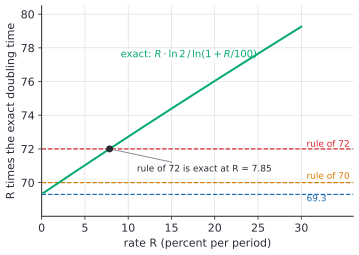

# Doubling time, the rule of 72 and logs

After this lesson you can find an exact doubling or tripling time with logarithms, use the rules of 72, 70 and 69.3 and know how far off each can be, explain why 72 works with the series for $\ln(1 + r)$, and apply the idea to debt and to inflation.

Before this: [compound interest](02-compound-interest.md), [continuous compounding and e](04-continuous-compounding-and-e.md), and [exponential and logarithmic equations](../../03-high-school/07-exponentials-and-logarithms/04-exponential-and-logarithmic-equations.md), which already introduced the rule of 72 with a short table.

## Quick check

Try these first. If you get all three right, skip to [Practice](#practice).

1. How long does money take to double at 6% a year compounded annually? Give the exact time and the rule of 72 estimate.
2. What annual rate doubles money in 10 years?
3. Prices rise 3% a year. About how many years until prices have doubled?

<details class="solution" markdown>
<summary>Answers</summary>

1. Exactly, $\frac{\ln 2}{\ln 1.06} = 11.90$ years. The rule gives $\frac{72}{6} = 12$ years.
2. Solve $(1 + r)^{10} = 2$: $r = 2^{1/10} - 1 = 0.07177$, about 7.18%. The rule gives $\frac{72}{10} = 7.2\%$.
3. $\frac{\ln 2}{\ln 1.03} = 23.45$ years. The rule gives $\frac{72}{3} = 24$ years.

</details>

## The idea

How long does it take money to double? At 6% a year the balance is $1.06^t$ times the start, and we want the $t$ with $1.06^t = 2$. You could try values of $t$: $1.06^{11} = 1.898$ and $1.06^{12} = 2.012$, so the answer is a little under 12 years. A logarithm gives it exactly, as in the [logarithms lesson](../../03-high-school/07-exponentials-and-logarithms/02-logarithms.md): $t = \frac{\ln 2}{\ln 1.06} = 11.90$.

The doubling time does not depend on how much you have. \$100 and \$100,000 each take 11.90 years to double at 6%. So the doubling time is a property of the rate alone, and a rate and a doubling time can be turned into each other. The **rule of 72** is a way of doing that in your head: divide 72 by the rate in percent. At 6% it gives 12, close to the exact 11.90.

This lesson finds the exact formula, shows how good the rule is and where it fails, and uses it for two things that matter in everyday money: how fast a debt grows if you don't pay it, and how fast prices erode what a dollar buys.

## Definitions

The **doubling time** $T_d$ of a quantity growing by the fraction $r$ per period, compounded each period, is the number of periods it takes to become twice as large:

$$
T_d = \frac{\ln 2}{\ln(1 + r)}.
$$

In plain words, it is the $t$ that solves $(1 + r)^t = 2$. For growth by any other factor $F$, the time to multiply by $F$ is

$$
T_F = \frac{\ln F}{\ln(1 + r)}.
$$

For $F = 3$ this is the **tripling time**, and for $F = 4$ the quadrupling time. The unit of time is the compounding period, so a rate per month gives a time in months.

The **rule of 72** says that at $R$ percent per period, $T_d \approx \frac{72}{R}$. Here $R = 100r$ is the rate as a percent, so 6% means $R = 6$, not $0.06$. The **rule of 70** and the **rule of 69.3** replace 72 by 70 and by 69.3. The number 69.3 is $100\ln 2 = 69.31\ldots$ rounded.

If interest is compounded $n$ times a year at a nominal rate $r$, the doubling time in years is $\frac{\ln 2}{n\ln(1 + r/n)}$, and for continuous compounding at the rate $r$ it is exactly $\frac{\ln 2}{r}$.

## How to do it

### Finding a doubling or tripling time

1. Write the growth factor for one period, $1 + r$, using the same period for the rate and for the answer.
2. Pick the target factor: 2 for doubling, 3 for tripling.
3. Take the natural logarithm of both sides of $(1 + r)^t = F$. The power rule brings $t$ down: $t\ln(1 + r) = \ln F$.
4. Divide: $t = \frac{\ln F}{\ln(1 + r)}$.
5. Check by raising $1 + r$ to the answer. It should give $F$.

To go the other way, find the rate that doubles money in $t$ periods: $1 + r = 2^{1/t}$, so $r = 2^{1/t} - 1$. The rule of 72 says $R \approx \frac{72}{t}$.

### Why 72 works

Let us see where the rule comes from. We know the exact formula and want to compare $R \cdot T_d$, the rate in percent times the doubling time, with a constant. We expect it to be close to constant, since the rule says $R \cdot T_d \approx 72$.

*Plan:* replace $\ln(1 + r)$ by its series and divide.

*Argument.* The Taylor series from [power series and Taylor series](../../05-university-core/05-sequences-and-series/04-power-series-and-taylor-series.md) is

$$
\ln(1 + r) = r - \frac{r^2}{2} + \frac{r^3}{3} - \cdots = r\left(1 - \frac{r}{2} + \frac{r^2}{3} - \cdots\right).
$$

Since $R = 100r$, the product is

$$
R \cdot T_d = \frac{100r\ln 2}{\ln(1 + r)} = \frac{100\ln 2}{1 - \frac{r}{2} + \frac{r^2}{3} - \cdots}.
$$

For small $r$, the geometric series $\frac{1}{1 - u} = 1 + u + u^2 + \cdots$ with $u = \frac{r}{2} - \frac{r^2}{3}$ gives $1 + \frac{r}{2} - \frac{r^2}{3} + \frac{r^2}{4} + \cdots$, so

$$
R \cdot T_d \approx 69.31\left(1 + \frac{r}{2} - \frac{r^2}{12}\right).
$$

*Look back:* the product is not constant, but it starts at $69.31$ for tiny rates, which is why 69.3 is exact for continuous compounding, and it rises by about half of $r$ times 69.3, that is, by 0.35 for every percentage point. It reaches 72 when $69.31\left(1 + \frac{r}{2} - \frac{r^2}{12}\right) = 72$, which happens near $R = 7.85$. So 72 is the best single constant for rates around 8%, and 70 is the best around 2%. Both are also easy to divide: 72 has factors 1, 2, 3, 4, 6, 8, 9 and 12, the rates that come up most.

Here is the product exactly, and the same value from the series:

| Rate $R$ | 1 | 2 | 4 | 6 | 8 | 10 | 12 | 20 |
|---|---|---|---|---|---|---|---|---|
| Exact $R \cdot T_d$ | 69.66 | 70.01 | 70.69 | 71.37 | 72.05 | 72.73 | 73.40 | 76.04 |
| Series $69.31(1 + \frac{r}{2} - \frac{r^2}{12})$ | 69.66 | 70.01 | 70.69 | 71.37 | 72.05 | 72.72 | 73.39 | 76.02 |



The figure shows the same thing. If the rule were exact, the green curve would be flat. It crosses the line at 72 once, at $R = 7.85$, and crosses 70 near $R = 2$.

### How good each rule is

The table shows the exact doubling time in periods, and each rule's estimate with its error as a percent of the exact time (positive means the rule is too high):

| Rate $R$ | Exact | $72 \div R$ | $70 \div R$ | $69.3 \div R$ |
|---|---|---|---|---|
| 1 | 69.66 | 72.00 (+3.4%) | 70.00 (+0.5%) | 69.30 (-0.5%) |
| 2 | 35.00 | 36.00 (+2.8%) | 35.00 (0.0%) | 34.65 (-1.0%) |
| 4 | 17.67 | 18.00 (+1.9%) | 17.50 (-1.0%) | 17.33 (-2.0%) |
| 6 | 11.90 | 12.00 (+0.9%) | 11.67 (-1.9%) | 11.55 (-2.9%) |
| 8 | 9.01 | 9.00 (-0.1%) | 8.75 (-2.8%) | 8.66 (-3.8%) |
| 10 | 7.27 | 7.20 (-1.0%) | 7.00 (-3.7%) | 6.93 (-4.7%) |
| 12 | 6.12 | 6.00 (-1.9%) | 5.83 (-4.6%) | 5.78 (-5.6%) |
| 20 | 3.80 | 3.60 (-5.3%) | 3.50 (-7.9%) | 3.47 (-8.9%) |
| 30 | 2.64 | 2.40 (-9.2%) | 2.33 (-11.7%) | 2.31 (-12.6%) |

For rates between about 4% and 12%, the rule of 72 is within 2%. Below 3% the rule of 70 is closer, and past 20% every rule becomes poor. The rules underestimate at high rates because the product $R \cdot T_d$ keeps rising.

### Tripling, quadrupling and other factors

The same series argument applies to any factor $F$: the product $R \cdot T_F$ starts at $100\ln F$ for tiny rates and drifts upward in the same way.

| Factor | Small-rate constant | Value near 8% | Rule |
|---|---|---|---|
| 2 | 69.3 | 72.05 | 72 |
| 3 | 109.9 | 114.2 | 114 |
| 4 | 138.6 | 144.1 | 144 |

So at 8%, money triples in about $\frac{114}{8} = 14.25$ years (exact 14.27) and quadruples in $\frac{144}{8} = 18$ years (exact 18.01). Quadrupling is two doublings, so the quadrupling time is exactly twice the doubling time.

### Debt and inflation

Debt that is not paid grows the same way money does. A balance growing at a yearly rate $r$ doubles in $T_d$ years, and the doubling time is the same for a loan as for a deposit. A debt that compounds monthly at a nominal 20% doubles in $\frac{\ln 2}{12\ln(1 + 0.20/12)} = 3.49$ years if nothing is paid. The rule of 72 on the nominal rate says $\frac{72}{20} = 3.6$, which is a bit high here, because 20% is outside the range where the rule works well, and because the effective rate is 21.94%, higher than the nominal one.

Inflation works against you in the same way. If prices rise $i$ per year, they double in $\frac{\ln 2}{\ln(1 + i)}$ years, and in that time a dollar buys half as much. This is the **half-life of purchasing power**: the time for money to be worth half as much in goods. At 2% a year it is 35.0 years, and at 3% a year it is 23.45 years. The next lesson, [inflation and real returns](06-inflation-and-real-returns.md), uses this to compare savings with prices.

## Worked examples

<div class="example" markdown>

### Example 1: doubling at 7%

How long does money take to double at 7% a year? Compare the exact time with the three rules.

Step 1: the growth factor is $1.07$ and the period is a year.

Step 2: the target factor is 2.

Steps 3 and 4: $t\ln 1.07 = \ln 2$, so

$$
t = \frac{\ln 2}{\ln 1.07} = \frac{0.693147}{0.067659} = 10.245.
$$

The exact time is 10.24 years, a little over 10 years and 3 months.

The rules give $\frac{72}{7} = 10.29$, $\frac{70}{7} = 10.00$ and $\frac{69.3}{7} = 9.90$. The rule of 72 is off by 0.4%.

Step 5: check. $1.07^{10.245} = 2.000$.

</div>

<div class="example" markdown>

### Example 2: the rate to double in 12 years

What annual rate doubles money in 12 years?

$1 + r = 2^{1/12} = 1.05946$, so $r = 5.946\%$. The rule says $\frac{72}{12} = 6\%$, which is close.

Check: $1.05946^{12} = 2.000$. At 6% the doubling time is 11.90 years, a little under 12, which is consistent with 5.946% being a little under 6%.

</div>

<div class="example" markdown>

### Example 3: tripling at 9%

How long does money take to triple at 9% a year?

$t = \dfrac{\ln 3}{\ln 1.09} = \dfrac{1.098612}{0.086178} = 12.75$ years. The rule of 114 says $\frac{114}{9} = 12.67$ years, off by 0.6%.

Check: $1.09^{12.75} = 3.00$. It is also a bit more than the doubling time, 8.04 years, times $\frac{\ln 3}{\ln 2} = 1.585$: $8.04 \times 1.585 = 12.75$.

</div>

<div class="example" markdown>

### Example 4: an unpaid credit card (finish it yourself)

A card balance carries a nominal 20% a year, compounded monthly (an example rate). If you stop paying, how long does the balance take to double?

Step 1: the monthly growth factor is $1 + \frac{0.20}{12} = 1.016667$.

Step 2: the doubling equation is $1.016667^m = 2$, where $m$ counts months.

Step 3: take logs: $m\ln 1.016667 = \ln 2$.

Finish: solve for $m$, then convert to years.

<details class="solution" markdown>
<summary>Finish</summary>

$m = \dfrac{\ln 2}{\ln 1.016667} = \dfrac{0.693147}{0.016529} = 41.94$ months, which is $\frac{41.94}{12} = 3.49$ years.

Check: $1.016667^{41.94} = 2.000$. The estimate $\frac{72}{20} = 3.6$ years is close but a bit high.

</details>

</div>

## Edge cases and common mistakes

<div class="warning" markdown>

Watch out: using the rate as a decimal. The rule says $\frac{72}{R}$ with $R = 6$, not $\frac{72}{0.06}$, which would be 1,200. Likewise the exact formula has $\ln(1.06)$, with the rate as a decimal. The 72 includes a factor of 100.

</div>

<div class="warning" markdown>

Watch out: mixing periods. A rate of 0.5% a month doubles money in $\frac{72}{0.5} = 144$ months, which is 12 years, not 144 years. The answer comes out in the same unit as the rate.

</div>

<div class="warning" markdown>

Watch out: using the rule at a very high rate. At 30% the rule of 72 says 2.4 periods and the exact answer is 2.64, a 9% miss. At 100% the rule says 0.72 and the truth is exactly 1.

</div>

<div class="warning" markdown>

Watch out: forgetting that the rule assumes no deposits and no withdrawals. If you add money regularly, the balance doubles faster, and [annuities](../03-time-value-of-money/02-annuities-and-geometric-series.md) handle that case.

</div>

The rules also assume that the rate stays constant. A quantity growing at 3% for 10 years and then at 6% has no single doubling time. Use the total factor and a logarithm instead: the growth is $1.03^{10} \times 1.06^t = 2$, and $t = \frac{\ln 2 - 10\ln 1.03}{\ln 1.06} = 6.8$ more years.

## Tricks and shortcuts

For a better estimate than the rule of 72 over a wide range of rates, use $\frac{69.3 + R/3}{R}$. It follows from the series above, since the drift is about $\frac{R}{3}$. At 15% it gives $\frac{74.3}{15} = 4.95$, against the exact 4.96 and the rule of 72's 4.8.

To estimate a growth by a larger factor, count doublings. A factor of 1,000 is about 10 doublings, since $2^{10} = 1024$. At 10%, each doubling takes about 7.27 years, so a factor of 1,000 takes about $9.97 \times 7.27 = 72.5$ years.

Pick the rule for the situation: 72 for typical rates of 4% to 12%, 70 for low rates and for inflation near 2%, 69.3 for continuous rates, and divide by the number of years to go from a time to a rate.

## In code

The code computes exact times, compares the rules and finds the rate for a target doubling time.

<details class="code" markdown>
<summary>In code</summary>

```python
from math import log

def doubling_time(R, factor=2, n=1):
    """Periods to multiply by factor at R percent per year, compounded n times a year."""
    return log(factor) / (n * log(1 + R / 100 / n))

for R in [2, 6, 8, 20]:
    exact = doubling_time(R)
    print(R, round(exact, 2), round(72 / R, 2), round(70 / R, 2), round(69.3 / R, 2))
    # 2 35.0 36.0 35.0 34.65, then 6 11.9 12.0 11.67 11.55,
    # then 8 9.01 9.0 8.75 8.66, then 20 3.8 3.6 3.5 3.47

print(round(doubling_time(9, 3), 2))            # 12.75
print(round(doubling_time(20, n=12) * 12, 1))   # 41.9 months for the card at 20% compounded monthly
print(round(2 ** (1 / 12) - 1, 5))              # 0.05946, the rate that doubles in 12 years
```

</details>

## FAQ

### Why does the doubling time not depend on the amount?

The balance after $t$ periods is $P(1 + r)^t$, and doubling means $P(1 + r)^t = 2P$. The $P$ cancels, leaving $(1 + r)^t = 2$. Growth by a fixed percent is growth by a fixed factor, and a factor of 2 takes the same time from any starting point.

### Why is it 72 and not 69.3 if the exact constant is $100\ln 2$?

The exact constant 69.3 is for continuous compounding, or for rates near 0. Ordinary yearly compounding at 6% to 10% needs a bigger number, because $\ln(1 + r)$ is a bit smaller than $r$. The series showed the right number rises with the rate, and 72 matches it at 7.85% and stays within 2% from 4% to 12%.

### Does the rule work for things that shrink?

Yes, with a negative rate, as a half-life: for a quantity that falls $R\%$ a period, the half-life is $\frac{\ln 2}{-\ln(1 - r)}$. The rule of 70 is a fair estimate for small $R$, since $-\ln(1 - r) \approx r + \frac{r^2}{2}$ is a bit larger than $r$, so the half-life is a little shorter than $\frac{69.3}{R}$. At 3% a year the half-life is 22.8 years and $\frac{69.3}{3} = 23.1$.

## Practice

### Warm-up

1\. For rates of 4%, 9% and 12% a year, find the exact doubling time and the rule of 72 estimate.

<details class="solution" markdown>
<summary>Solution</summary>

At 4%: exact $\frac{\ln 2}{\ln 1.04} = 17.67$ years, rule $\frac{72}{4} = 18$. At 9%: exact 8.04, rule 8. At 12%: exact 6.12, rule 6.

Check: $1.09^{8.04} = 2.00$. The rule is high at 4% and low at 12%, as in the table.

</details>

2\. What annual rate doubles money in 8 years? Give the exact rate and the rule of 72 estimate.

<details class="solution" markdown>
<summary>Solution</summary>

$1 + r = 2^{1/8} = 1.0905$, so $r = 9.05\%$. The rule says $\frac{72}{8} = 9\%$.

Check: $1.0905^8 = 2.00$.

</details>

3\. How long does money take to triple at 6% a year? Compare with the rule of 114.

<details class="solution" markdown>
<summary>Solution</summary>

$t = \frac{\ln 3}{\ln 1.06} = \frac{1.098612}{0.058269} = 18.85$ years. The rule gives $\frac{114}{6} = 19$ years.

Check: $1.06^{18.85} = 3.00$.

</details>

### Standard

4\. Prices rise 2.5% a year. (a) How long until a dollar buys half as much as now? (b) What fraction of today's purchasing power remains after 10 years?

<details class="solution" markdown>
<summary>Solution</summary>

(a) Prices double when $1.025^t = 2$, so $t = \frac{\ln 2}{\ln 1.025} = 28.07$ years. The rules give $\frac{70}{2.5} = 28$ and $\frac{72}{2.5} = 28.8$.

(b) After 10 years prices are $1.025^{10} = 1.2801$ times as high, so a dollar buys $\frac{1}{1.2801} = 0.7812$ of what it buys today, about 78%.

Check: $0.7812 \times 1.2801 = 1.0000$.

</details>

5\. A savings account pays a nominal 4.5% compounded monthly. How many years does money take to double? Compare with $\frac{72}{4.5}$.

<details class="solution" markdown>
<summary>Solution</summary>

The monthly factor is $1 + \frac{0.045}{12} = 1.00375$. Then $m = \frac{\ln 2}{\ln 1.00375} = 185.2$ months, which is $\frac{185.2}{12} = 15.43$ years. The rule gives $\frac{72}{4.5} = 16$ years.

Check: $1.00375^{185.2} = 2.00$. The account is faster than the rule suggests because compounding monthly makes the effective rate 4.594%, and $\frac{72}{4.594} = 15.67$ is already closer.

</details>

6\. A \$15,000 balance grows at 8% a year with no payments. (a) After how many years does it reach \$30,000? (b) And \$60,000? (c) How large is it after 9 years?

<details class="solution" markdown>
<summary>Solution</summary>

(a) Doubling takes $\frac{\ln 2}{\ln 1.08} = 9.01$ years.

(b) \$60,000 is 4 times the start, which is two doublings: $2 \times 9.01 = 18.01$ years.

(c) $15000 \times 1.08^9 = 29{,}985.07$, just under \$30,000, as expected since 9 years is just under 9.01.

Check: $15000 \times 1.08^{9.0065} = 30000.07$, which is \$30,000 up to rounding.

</details>

### Challenge

7\. Use the approximation $R \cdot T_d \approx 69.31\left(1 + \frac{r}{2}\right)$ to estimate the doubling time at 15%. Compare it with the exact time and with the rule of 72.

<details class="solution" markdown>
<summary>Solution</summary>

With $r = 0.15$, the factor is $1.075$, so $R \cdot T_d \approx 69.31 \times 1.075 = 74.51$ and $T_d \approx \frac{74.51}{15} = 4.97$ years. The exact time is $\frac{\ln 2}{\ln 1.15} = 4.96$ years, and the rule of 72 gives $\frac{72}{15} = 4.8$, which is 3.2% low. The corrected estimate misses by 0.2%.

Check: $1.15^{4.96} = 2.00$.

</details>

8\. (Reviews [logarithms](../../03-high-school/07-exponentials-and-logarithms/02-logarithms.md).) How many doublings take a quantity from 1 to 1,000? At 10% a year, how many years is that?

<details class="solution" markdown>
<summary>Solution</summary>

The number of doublings is $\log_2 1000 = \frac{\ln 1000}{\ln 2} = 9.97$. Each doubling at 10% takes $\frac{\ln 2}{\ln 1.1} = 7.27$ years, so the total is $9.97 \times 7.27 = 72.5$ years. Directly, $\frac{\ln 1000}{\ln 1.1} = 72.48$ years.

Check: $1.1^{72.48} = 1000$.

</details>

## Where this shows up

- The next lesson, [inflation and real returns](06-inflation-and-real-returns.md), uses the same half-life idea for purchasing power. In economics, [growth rates and CAGR](../../07-economics-math/01-measuring-the-economy/03-growth-rates-and-cagr.md) also uses a rule of 70 for the doubling time of a growing economy.
- Computing: any process that doubles per step, such as a growing data set, a doubling retry delay or $2^n$ running time, follows the same logic with the doubling time as the unit.
- Everyday money: the rule gives a feel for how long investments, debts and prices take to double, and it is a quick check on a spreadsheet answer.
