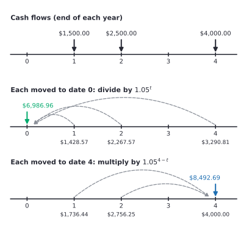

# Present and future value

After this lesson you can move an amount of money forward or backward in time at a given interest rate, choose the right rate per period, compare cash flows that fall on different dates by moving them all to one date, and find how much to put away today to reach a savings goal.

Before this: [percents](../../02-middle-school/02-ratios-rates-percents/03-percents.md), [exponential and logarithmic equations](../../03-high-school/07-exponentials-and-logarithms/04-exponential-and-logarithmic-equations.md), [compound interest](../02-interest-and-growth/02-compound-interest.md) and [mathematical induction](../../04-proofs-and-logic/05-induction/01-mathematical-induction.md).

## Quick check

Try these first. If you get all three right, skip to [Practice](#practice).

1. You put \$2,500 in an account that pays 3.2% a year, compounded annually. How much is in it after 7 years?
2. How much must you put in an account today to have \$15,000 in 6 years, at 4% a year compounded annually?
3. You can take \$900 today or \$1,000 in 2 years. At 5% a year, which is worth more in today's dollars, and by how much?

<details class="solution" markdown>
<summary>Answers</summary>

1. Multiply by $1.032^7$: $2500 \times 1.032^7 = 3116.72$, so about \$3,116.72.
2. Divide by $1.04^6$: $15000 \div 1.04^6 = 11854.72$, so about \$11,854.72.
3. The \$1,000 in 2 years is worth $1000 \div 1.05^2 = 907.03$ today, so waiting is worth \$7.03 more than taking \$900.

</details>

## The idea

Suppose a friend owes you \$1,000 and offers to pay it back in 2 years. You would rather have it now, because \$1,000 today can sit in an account and grow. At 5% a year it becomes \$1,050 after one year and \$1,102.50 after two. So \$1,102.50 in two years is the same amount of money as \$1,000 today, and \$1,000 in two years is worth less than \$1,000 today.

The sentence "is the same as" needs a date. Two sums on different dates can't be added or compared directly, any more than 3 metres and 5 kilograms can. Every question in this chapter has the same first move: pick one date, convert every amount to what it is worth on that date, and only then add or compare. Moving money forward in time is called compounding, and moving it back is called discounting. They are the same calculation run in opposite directions.

A timeline keeps track of which date each amount belongs to. This one holds three payments, \$1,500, \$2,500 and \$4,000, at the ends of years 1, 2 and 4. The second line moves each one back to date 0 at 5% a year, and the third line moves each one forward to date 4. Example 3 below works through the numbers.



## Definitions

A **period** is the length of time between two interest charges, such as a month or a year. The **interest rate per period** $i$ is the fraction of the balance added at the end of each period, written as a decimal, so 0.4% a month is $i = 0.004$. The number of periods is $n$. (Many finance books use $i$ for this rate, and so does this chapter. Earlier lessons wrote $r$. It is not the imaginary unit.)

A **timeline** is a number line of dates measured in periods from now: date 0 is today and date $t$ is the end of period $t$. A **cash flow** is an amount of money on a date, positive when you receive it and negative when you pay it. This chapter puts every payment at the end of a period unless it says otherwise.

The **future value** (FV) of an amount $\text{PV}$ now, after $n$ periods at rate $i$ per period, is

$$
\text{FV} = \text{PV}\,(1 + i)^n.
$$

The **present value** (PV) of an amount $\text{FV}$ due $n$ periods from now is the amount today that grows into it:

$$
\text{PV} = \frac{\text{FV}}{(1 + i)^n} = \text{FV}\,(1 + i)^{-n}.
$$

The number $(1 + i)^{-n}$ is the **discount factor**. In plain words, the future value is what a sum grows to if you leave it alone, the present value is what a future sum is worth today, and the discount factor is the fraction of its face value that a sum due in $n$ periods is worth now. At $i = 0.05$ and $n = 2$ the discount factor is $\frac{1}{1.1025} = 0.907\ldots$, so \$1,000 due in two years is worth about \$907 now.

Since $i$ is a rate per period, the formulas only make sense when $n$ counts periods of the same length. A rate of 4.8% a year with monthly interest means $i = 0.004$ and $n = 36$ for three years, not $i = 0.048$ and $n = 36$.

## How to do it

### Why the formulas are true

*Theorem.* Let $i > -1$ and let a balance start at $B_0 = \text{PV}$. If each period multiplies the balance by $1 + i$, so $B_{k+1} = (1 + i)B_k$, then $B_n = \text{PV}(1 + i)^n$ for every integer $n \ge 0$.

We know the rule for one period: the balance gains $i$ times itself, so it is multiplied by $1 + i$. We want a formula for the balance after $n$ periods. The plan is induction on $n$ ([mathematical induction](../../04-proofs-and-logic/05-induction/01-mathematical-induction.md)), where each step multiplies by $1 + i$ once more.

*Proof.* Base case: for $n = 0$, $B_0 = \text{PV} = \text{PV}(1 + i)^0$. Inductive step: suppose $B_k = \text{PV}(1 + i)^k$ for some $k \ge 0$. Then

$$
B_{k+1} = (1 + i)B_k = (1 + i)\,\text{PV}(1 + i)^k = \text{PV}(1 + i)^{k+1}.
$$

So the formula holds for $k + 1$, and by induction for every $n \ge 0$. $\blacksquare$

Look back: the proof is the compound interest formula with the rate per period made explicit. The present value formula is the same equation solved for $\text{PV}$, since $1 + i$ is not zero. One more consequence is the rule behind this whole chapter. Money at date $t$ is worth $C(1 + i)^{s - t}$ at date $s$, whether $s$ is later than $t$ (a positive exponent) or earlier (a negative exponent). Moving a sum from date $t$ to date $s$ is a multiplication by $(1 + i)^{s-t}$.

### Which date to compare on

Any date works, and the choice doesn't change the answer. Suppose two plans have values $V_0$ and $W_0$ at date 0. At date $s$ both are multiplied by the same positive number $(1 + i)^s$, so $V_s = (1 + i)^s V_0$ and $W_s = (1 + i)^s W_0$, and the plan that is bigger at one date is bigger at every date. Date 0 is the usual choice because present values are in today's dollars, which are easy to picture. Use a later date when the question is about an end goal, such as how much you will have when a loan is due.

### Moving and comparing cash flows

1. Draw the timeline. Mark each cash flow on its date, with a sign.
2. Find the period and the rate per period $i$ that matches it. For a nominal annual rate $j$ compounded $m$ times a year, the period is $\frac{1}{m}$ of a year, $i = \frac{j}{m}$, and $n = m \times (\text{years})$.
3. Choose the comparison date. Date 0 for "what is this worth today", the last date for "what will I have".
4. Move each cash flow to that date by multiplying by $(1 + i)^{s - t}$, which divides by $(1 + i)^t$ when $s = 0$.
5. Add the moved amounts. Keep all digits until the end, and round to the cent once.
6. Check. Move the total to a second date and compare with the same flows moved there directly, or estimate with a simpler rate.

### Choosing the rate per period

The rate in a problem is often quoted per year while the payments are monthly, or the other way round. Two cases come up.

If the period of the problem is the compounding period, as in Step 2, divide the nominal rate by $m$. A GIC at 4.8% compounded monthly has $i = 0.004$ per month.

If the cash flows are on a different schedule, convert to the effective rate for the schedule you need. The **effective annual rate** is the single yearly rate that gives the same growth, $e = \left(1 + \frac{j}{m}\right)^m - 1$ (see [APR, APY and the effective annual rate](../02-interest-and-growth/03-apr-apy-and-effective-annual-rate.md)). A period that is $\frac{1}{p}$ of a year then has the equivalent rate

$$
i_p = (1 + e)^{1/p} - 1.
$$

For annual cash flows, use $e$ itself, with $p = 1$. Dividing the annual rate by 12 and calling it the monthly rate is correct only when interest really is charged monthly. Lesson 2 uses the same conversion for payments that don't match the compounding.

## Worked examples

<div class="example" markdown>

### Example 1: a GIC for a down payment

You want \$20,000 in 4 years toward a down payment. Suppose a guaranteed investment certificate (GIC) pays 4.5% a year, compounded annually. This is an example rate and not a quote. How much do you put in today?

Step 1: the timeline has one cash flow, \$20,000 at date 4.

Step 2: interest is charged once a year, so the period is a year, $i = 0.045$, and $n = 4$.

Step 3: the goal is stated at date 4, but the question asks how much to put in today, so the comparison date is 0.

Step 4: divide by the growth factor, which means multiplying by the discount factor:

$$
\text{PV} = \frac{20000}{1.045^4} = \frac{20000}{1.19251860\ldots} = 16771.2268\ldots
$$

Step 5: round to the cent. The calculation gives \$16,771.2268, and rounding down would leave you a fraction of a cent short, so round up for a savings goal: \$16,771.23.

Step 6: check by growing it forward. $16771.23 \times 1.045^4 = 20000.0037\ldots$, which is \$20,000.00 to the cent. The size also makes sense: four years at about 4.5% should take off roughly $4 \times 4.5\% = 18\%$ of the goal (a bit less, because the interest is itself earning interest), and \$16,771 is 16.1% below \$20,000.

</div>

<div class="example" markdown>

### Example 2: monthly against annual compounding

You put \$8,000 in a GIC for 3 years at 4.8% a year. Find the value at the end when the interest is compounded monthly, and when it is compounded annually. Which is better, and what is the effective annual rate of the monthly version?

For monthly compounding, $i = \frac{0.048}{12} = 0.004$ and $n = 36$ (Step 2):

$$
\text{FV} = 8000 \times 1.004^{36} = 9236.42.
$$

For annual compounding, $i = 0.048$ and $n = 3$: $8000 \times 1.048^3 = 9208.18$. Monthly compounding gives \$28.24 more, because interest earned in January starts earning interest in February instead of waiting for the year to end.

The effective annual rate is $e = 1.004^{12} - 1 = 0.04907\ldots$, or about 4.91%. So an account paying 4.8% compounded monthly grows like one paying 4.91% compounded once a year. Check: $8000 \times 1.04907^3 = 9236.4$, matching the monthly result.

</div>

<div class="example" markdown>

### Example 3: uneven cash flows and a buyout offer

A contract pays you \$1,500 at the end of year 1, \$2,500 at the end of year 2 and \$4,000 at the end of year 4. At 5% a year, what is the contract worth today, and what would it be worth at the end of year 4? A buyer offers \$7,000 today for the contract. Is that a good price?

Move each payment to date 0 by dividing by $1.05^t$ (Steps 3 and 4):

$$
\frac{1500}{1.05} + \frac{2500}{1.05^2} + \frac{4000}{1.05^4} = 1428.57 + 2267.57 + 3290.81 = 6986.96.
$$

(The three rounded pieces add to 6986.95. The exact total, 6986.955, rounds to 6986.96, so rounded pieces and the total can differ by a cent.)

Move each one to date 4 by multiplying by $1.05^{4 - t}$ instead:

$$
1500 \times 1.05^3 + 2500 \times 1.05^2 + 4000 = 1736.44 + 2756.25 + 4000.00 = 8492.69.
$$

These are the totals in the figure. Check: the two answers must differ by the growth factor $1.05^4 = 1.21550625$, and $6986.96 \times 1.2155 = 8492.69$.

The buyer's \$7,000 is \$13.04 more than the contract's present value of \$6,986.96, so at 5% selling is slightly better. At a discount rate below 5% the contract would be worth more than \$7,000, and the offer would be too low. The right rate is whatever you could earn elsewhere on money of similar risk, which is the subject of the FAQ.

</div>

<div class="example" markdown>

### Example 4: a friend pays early (finish it yourself)

A friend owes you \$3,000, due in 18 months. They offer \$2,800 today instead. Suppose your savings account pays 6% a year, compounded monthly. Should you accept?

Step 1: the timeline has \$3,000 at date 18 (in months).

Step 2: the period is a month, $i = \frac{0.06}{12} = 0.005$, and $n = 18$.

Step 3: compare at date 0, since the offer is in today's dollars.

Now do Steps 4 to 6: find the present value of \$3,000, compare it with \$2,800, and check your answer.

<details class="solution" markdown>
<summary>Finish</summary>

Step 4: $\text{PV} = \frac{3000}{1.005^{18}} = \frac{3000}{1.09393\ldots} = 2742.41$.

Step 5: the \$3,000 is worth \$2,742.41 today. The offer of \$2,800 is \$57.59 more, so accept.

Step 6: check by growing the offer forward: $2800 \times 1.005^{18} = 3063.00$, which is more than \$3,000. In 18 months the \$2,800 from the early payment would beat the \$3,000 by about \$63.

</details>

</div>

## Edge cases and common mistakes

<div class="warning" markdown>

Watch out for a rate that doesn't match the periods. Using $i = 0.048$ with $n = 36$ months gives $8000 \times 1.048^{36} = 43{,}260.96$, more than five times the principal. The rate and the number of periods must use the same unit: either $i = 0.004$ with $n = 36$, or $i = 0.048$ with $n = 3$. If the answer looks absurd, check the units first.

</div>

<div class="warning" markdown>

Watch out for adding amounts from different dates. In Example 3 the three payments total $1500 + 2500 + 4000 = 8000$ dollars, which matches neither \$6,986.96 nor \$8,492.69. A plain sum is the value at no date at all.

</div>

<div class="warning" markdown>

Watch out for dividing when you should multiply. Money moves forward by multiplying by $(1 + i)^n$ and backward by dividing. A reliable check: the present value of a future sum is always smaller than the sum, and the future value of a present sum is always larger (for a positive rate).

</div>

<div class="warning" markdown>

Watch out for rounding the rate. In Example 2, writing the monthly rate as 0.4% is exact, but a rate such as $\frac{0.05}{12} = 0.0041666\ldots$ rounded to 0.0042 raises the value of \$100,000 after 25 years by about \$3,484. Keep the full rate and round only the final dollar amount.

</div>

Some edge cases are worth knowing. With $n = 0$ the future value equals the present value, since $(1 + i)^0 = 1$. With $i = 0$ money doesn't change over time, and every date gives the same value. The number $n$ can be a fraction ("6 months at an annual rate" is $n = 0.5$ years), and the formula still holds when the interest rule is compound growth. A negative $i$ is allowed as long as $i > -1$, and it means the balance shrinks, as with a fee larger than the interest or with inflation measured against a savings account. Cash flows dated exactly at the comparison date are not changed at all.

## Tricks and shortcuts

For small rates and few periods, $(1 + i)^n \approx 1 + ni$ is a quick estimate that is always a little low: $1.04^6$ is 1.2653, while $1 + 6 \times 0.04 = 1.24$. The estimate misses the interest on interest. Money roughly doubles in $\frac{72}{100i}$ periods (the rule of 72, in [doubling time, the rule of 72 and logs](../02-interest-and-growth/05-doubling-time-rule-of-72-and-logs.md)), so at 6% a year a present value needs about 12 years to double and a future value loses half of its worth in about 12 years of discounting.

When you need several values at one rate, compute the factor $1 + i$ once and reuse it: the values at $t = 1, 2, 3$ are obtained by repeated multiplication or division by that single number, as in the table of \$1,000 at 5%:

| Years | 0 | 1 | 2 | 3 | 4 | 5 |
|---|---|---|---|---|---|---|
| Value | \$1,000.00 | \$1,050.00 | \$1,102.50 | \$1,157.63 | \$1,215.51 | \$1,276.28 |

Reading the table backward gives present values: \$1,276.28 in 5 years is worth \$1,000 now, and \$1,157.63 in 3 years is worth \$1,000 now.

## In code

Three small functions cover every example above. The last lines show a stream of payments valued at two dates and the rate that turns \$5,000 into \$5,400 in 18 months (Practice problem 6).

<details class="code" markdown>
<summary>In code</summary>

```python
def fv(pv, i, n):
    return pv * (1 + i) ** n

def pv(fv_, i, n):
    return fv_ / (1 + i) ** n

def value_at(flows, i, date):
    # flows is a list of (time, amount); move each one to the given date
    return sum(c * (1 + i) ** (date - t) for t, c in flows)

print(round(fv(2500, 0.032, 7), 2))         # 3116.72
print(round(pv(20000, 0.045, 4), 2))        # 16771.23

flows = [(1, 1500), (2, 2500), (4, 4000)]
now = value_at(flows, 0.05, 0)
later = value_at(flows, 0.05, 4)
print(round(now, 2), round(later, 2))       # 6986.96 8492.69
print(round(now * 1.05**4, 2))              # 8492.69

j, m = 0.048, 12
i = j / m
print(round(fv(8000, i, 36), 2))            # 9236.42
print(round((1 + i)**12 - 1, 5))            # 0.04907

# a monthly rate equivalent to an effective annual rate of 4.907%
e = (1 + i)**12 - 1
print(round((1 + e)**(1/12) - 1, 6))        # 0.004

# the rate that turns 5000 into 5400 in 18 months
print(round((5400 / 5000)**(1/18) - 1, 6))  # 0.004285
```

The `value_at` function uses the rule from the proof: a negative exponent moves a sum back in time. Moving to date 4 and moving to date 0 give totals that differ by exactly $1.05^4$, which the third print line confirms.

</details>

## FAQ

### What interest rate should I use to discount?

Use the return you could earn on the best alternative of similar risk. For money you are sure to receive, that is roughly what a savings account or a government bond pays. For a risky payment, use a higher rate, so that its present value is lower. There is no single correct rate, and different rates can reverse a decision, as the buyout in Example 3 shows. The [present value, NPV and bond prices](../../07-economics-math/04-more-tools/01-present-value-npv-and-bond-prices.md) lesson takes this up for business decisions.

### Why do payments sit at the end of a period?

It is a convention that keeps formulas simple. Interest is charged at the end of the period, so a payment made then has earned nothing yet and is worth its face value at that date. Payments at the start of the period are called annuity due, and the next lesson shows they differ by one factor of $1 + i$.

### Why is the present value always smaller than the future value?

Because waiting costs something. For $i > 0$ the factor $(1 + i)^{-n}$ is below 1. The present value is the smaller number you would swap for the larger one, given that you can grow the smaller one at rate $i$. At a rate of 0 the two would be equal, and at a negative rate waiting would have a benefit.

### Does inflation belong in this?

It can. The rates in this lesson are nominal, meaning they are measured in dollars. A rate that has inflation taken out is a real rate, and the lesson on [inflation and real returns](../02-interest-and-growth/06-inflation-and-real-returns.md) shows how to move between them. The present-value method is the same either way, as long as the cash flows and the rate use the same kind.

## Practice

### Warm-up

1\. You invest \$3,000 at 3.5% a year, compounded annually. What is it worth after 10 years?

<details class="solution" markdown>
<summary>Solution</summary>

Here $i = 0.035$ and $n = 10$, so $\text{FV} = 3000 \times 1.035^{10} = 3000 \times 1.41060 = 4231.80$, about \$4,231.80.

Check: the estimate $1 + 10 \times 0.035 = 1.35$ is a little low, as it should be, and 1.4106 is a little above it.

</details>

2\. How much must you deposit today at 4% a year, compounded annually, to have \$8,000 in 5 years?

<details class="solution" markdown>
<summary>Solution</summary>

Divide by the growth factor: $\text{PV} = \frac{8000}{1.04^5} = \frac{8000}{1.21665} = 6575.42$, so deposit about \$6,575.42.

Check: $6575.42 \times 1.04^5 = 8000.0$ to the cent.

</details>

3\. An account pays 6% a year, compounded monthly. State the rate per period and the number of periods for 2 years, and find the value of \$1,000 after 2 years.

<details class="solution" markdown>
<summary>Solution</summary>

The period is a month, so $i = \frac{0.06}{12} = 0.005$ and $n = 12 \times 2 = 24$. Then $\text{FV} = 1000 \times 1.005^{24} = 1127.16$, about \$1,127.16.

Check: annual compounding at 6% would give $1000 \times 1.06^2 = 1123.60$, and monthly compounding should be a little higher, which it is.

</details>

### Standard

4\. Would you rather have \$1,000 today or \$1,200 in 3 years, if you can earn 5.5% a year, compounded annually? Compare at date 0 and at date 3, and confirm that both dates agree.

<details class="solution" markdown>
<summary>Solution</summary>

At date 0, the \$1,200 is worth $\frac{1200}{1.055^3} = 1021.94$, which is \$21.94 more than \$1,000. At date 3, the \$1,000 grows to $1000 \times 1.055^3 = 1174.24$, which is \$25.76 less than \$1,200. Both dates say the \$1,200 in 3 years is better.

Check: the two gaps are linked by the growth factor, $21.94 \times 1.055^3 = 25.76$.

</details>

5\. You will receive \$800, \$900 and \$1,000 at the ends of years 1, 2 and 3. (a) What is this stream worth today at 4% a year? (b) What is it worth at the end of year 3? (c) You are offered \$2,500 today for it. Which is better?

<details class="solution" markdown>
<summary>Solution</summary>

(a) $\frac{800}{1.04} + \frac{900}{1.04^2} + \frac{1000}{1.04^3} = 769.23 + 832.10 + 888.99$. The exact total is \$2,490.33 (the rounded pieces add to 2,490.32).

(b) $800 \times 1.04^2 + 900 \times 1.04 + 1000 = 865.28 + 936.00 + 1000 = 2801.28$, so \$2,801.28.

(c) The offer is \$2,500, which is \$9.67 more than \$2,490.33, so take the offer (at 4%).

Check: $2490.33 \times 1.04^3 = 2801.28$.

</details>

6\. A friend borrows \$5,000 and promises to repay \$5,400 in 18 months. What interest rate per month does this imply, what is the nominal annual rate compounded monthly, and what is the effective annual rate?

<details class="solution" markdown>
<summary>Solution</summary>

Solve $5000(1 + i)^{18} = 5400$. Divide by 5000 and take the 18th root: $1 + i = 1.08^{1/18} = 1.0042848$, so $i = 0.42848\%$ a month. The nominal annual rate compounded monthly is $12 \times 0.42848\% = 5.14\%$. The effective annual rate is $1.0042848^{12} - 1 = 5.26\%$.

Check: $5000 \times 1.0042848^{18} = 5400.00$.

</details>

### Challenge

7\. (Reviews [exponential and logarithmic equations](../../03-high-school/07-exponentials-and-logarithms/04-exponential-and-logarithmic-equations.md).) How many months does it take \$5,000 to grow to \$8,000 at 4.8% a year compounded monthly? Give the exact number and say what a bank would do with it.

<details class="solution" markdown>
<summary>Solution</summary>

Here $i = 0.004$. Solve $5000 \times 1.004^n = 8000$, so $1.004^n = 1.6$. Take logs and divide:

$$
n = \frac{\ln 1.6}{\ln 1.004} = 117.74 \text{ months}.
$$

Interest is credited at the end of each month, so the balance passes \$8,000 only at month 118, which is just under 9.8 years.

Check: $5000 \times 1.004^{117} = 7976.54$ is still short and $5000 \times 1.004^{118} = 8008.44$ is over.

</details>

8\. (Reviews [percent change](../../02-middle-school/02-ratios-rates-percents/04-percent-change-and-applications.md).) A \$2,000 savings account earns 2% in year 1, 3% in year 2 and then loses 1% in year 3 after a fee. (a) What is the balance after 3 years? (b) What single yearly rate would give the same result? (c) Why isn't it the plain average, $\frac{2 + 3 - 1}{3}\%$?

<details class="solution" markdown>
<summary>Solution</summary>

(a) Multiply the multipliers: $2000 \times 1.02 \times 1.03 \times 0.99 = 2080.19$, so \$2,080.19.

(b) Solve $(1 + i)^3 = 1.02 \times 1.03 \times 0.99 = 1.040094$, so $1 + i = 1.040094^{1/3}$ and $i = 1.319\%$ a year.

(c) The plain average is $1.333\%$, a little bigger. At $1.333\%$ the balance would be $2000 \times 1.013333^3 = 2081.07$, which is 88 cents too high. Growth multiplies, so the right average of the three rates is the geometric one, the cube root of the product of the multipliers.

Check: $2000 \times 1.01319^3 = 2080.19$.

</details>

## Where this shows up

- The next lesson, [annuities and geometric series](02-annuities-and-geometric-series.md), adds up streams of equal payments, and [the loan amortization formula](03-loan-amortization-formula.md) applies it to borrowing.
- Economics calls the same method discounting. [Present value, NPV and bond prices](../../07-economics-math/04-more-tools/01-present-value-npv-and-bond-prices.md) uses it to price investments and bonds.
- Every savings goal, every loan and every "pay now or pay later" choice is a present value question, and spreadsheets have the PV, FV and RATE functions built in ([spreadsheet finance functions](../07-taxes-insurance-and-planning/03-spreadsheet-finance-functions-and-capstone.md)).
