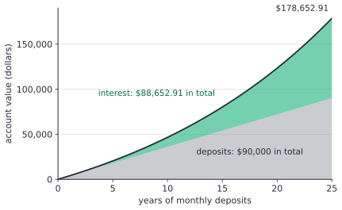

# Annuities and geometric series

After this lesson you can derive the future and present value of a stream of equal payments from the geometric series, find the payment, the number of payments or the rate that meets a goal, handle payments that fall at the start of the period or don't match the compounding, and value a perpetuity.

Before this: [present and future value](01-present-and-future-value.md) and [summation notation and series](../../03-high-school/11-sequences-series-and-counting/02-summation-notation-and-series.md) (the geometric series).

## Quick check

Try these first. If you get all three right, skip to [Practice](#practice).

1. You deposit \$200 at the end of each month for 3 years into an account that pays 0.5% a month. What is the balance right after the last deposit?
2. A lender charges 0.75% a month. How much can you borrow if you will pay \$400 at the end of each month for 4 years?
3. A fund pays \$50 at the end of every year forever. What is it worth today at 4% a year?

<details class="solution" markdown>
<summary>Answers</summary>

1. The balance is $200 \times \frac{1.005^{36} - 1}{0.005} = 7867.22$, about \$7,867.22.
2. The amount is $400 \times \frac{1 - 1.0075^{-48}}{0.0075} = 16073.91$, about \$16,073.91.
3. A perpetuity is worth the payment divided by the rate: $\frac{50}{0.04} = 1250$, so \$1,250.

</details>

## The idea

Most money doesn't move in one lump. You save \$300 a month, you pay a car loan of \$450 a month, a pension pays you the same amount every month. The previous lesson moved one amount from one date to another. A stream of equal payments is a sum of many such moves, and because every payment is the same and the dates are evenly spaced, the sum is a geometric series with a short closed form.

Here is the savings case. You deposit \$200 at the end of each month. The first deposit sits in the account for 35 more months, the second for 34, and the last one not at all. Each deposit grows by its own factor $(1.004)^{\text{months left}}$, and the balance at the end is the sum of those growths. Adding 36 terms by hand is tedious, but the terms are $200 \times 1.004^{35}, 200 \times 1.004^{34}, \dots, 200$, each the next one times a fixed ratio. That is exactly what the geometric series formula adds up.

A picture of a long plan shows what the formula says. This figure follows \$300 a month for 25 years at an example return of 5% a year, compounded monthly. Early on the deposits (gray) are most of the balance. Later the interest (green) is bigger than the deposits.



## Definitions

An **annuity** is a finite sequence of equal payments made at equal time intervals. The amount of each is the **payment** $\text{PMT}$, the time between payments is the **payment interval**, and the number of payments is $n$. An **ordinary annuity** has each payment at the end of its interval, and an **annuity due** has each payment at the start. In plain words, rent is usually an annuity due, since you pay at the start of the month, and a loan payment or a deposit at month end is an ordinary annuity.

The **future value of an annuity** is the total of its payments, each moved to the date of the last payment (ordinary) or the end of the last interval (due). The **present value of an annuity** is the total of its payments moved to the start of the first interval. A **perpetuity** is an annuity that never ends: equal payments at the end of every period, forever.

Throughout, $i$ is the rate per payment interval. The first few sections assume the interest period matches the payment interval, as in monthly deposits into an account that compounds monthly. The last section handles the case that doesn't match. Textbooks that cover actuarial math write the two factors below as $s_{\overline{n}|i}$ and $a_{\overline{n}|i}$. This lesson writes them out.

## How to do it

### The future value of an ordinary annuity

*Theorem.* For $i \ne 0$ and $n \ge 1$, the future value of an ordinary annuity of $n$ payments of $\text{PMT}$ at rate $i$ per period, valued at the date of the last payment, is

$$
\text{FV} = \text{PMT}\,\frac{(1 + i)^n - 1}{i}.
$$

We know that a payment made at the end of period $k$ is moved to date $n$ by multiplying by $(1 + i)^{n - k}$, from the previous lesson. We want the total of those for $k = 1, \dots, n$ in one expression. The plan is to see the total as a geometric series and apply the formula from the [summation lesson](../../03-high-school/11-sequences-series-and-counting/02-summation-notation-and-series.md#the-geometric-series).

*Proof.* The payment at the end of period $k$ has $n - k$ periods left to grow, so

$$
\text{FV} = \sum_{k=1}^{n} \text{PMT}\,(1 + i)^{n-k} = \text{PMT}\,\bigl(1 + (1 + i) + (1 + i)^2 + \cdots + (1 + i)^{n-1}\bigr).
$$

(The last payment, $k = n$, is the term 1, and the first, $k = 1$, is the term $(1 + i)^{n-1}$.) The bracket is a geometric series with first term 1, ratio $1 + i \ne 1$ and $n$ terms. Its sum is $\frac{(1 + i)^n - 1}{(1 + i) - 1}$, and the denominator is $i$. $\blacksquare$

Look back: the formula has the same shape as the geometric series, with $r = 1 + i$ and $a = \text{PMT}$. The exponent is the number of terms, $n$, and not the last exponent $n - 1$. When $i = 0$ the formula is not defined, and the answer is $n\,\text{PMT}$, because nothing earns interest.

The same formula can be checked a second way, by following the account one deposit at a time. Let $F_k$ be the balance right after the $k$-th deposit. The balance is multiplied by $1 + i$ and then a deposit is added, so

$$
F_0 = 0, \qquad F_k = (1 + i)F_{k-1} + \text{PMT}.
$$

The formula $F_k = \text{PMT}\,\frac{(1 + i)^k - 1}{i}$ gives $F_0 = 0$, and it satisfies the recurrence:

$$
(1 + i)\,\text{PMT}\,\frac{(1 + i)^{k-1} - 1}{i} + \text{PMT} = \text{PMT}\,\frac{(1 + i)^k - (1 + i) + i}{i} = \text{PMT}\,\frac{(1 + i)^k - 1}{i}.
$$

So induction on $k$ shows the formula matches the recurrence at every step, the same argument as in [mathematical induction](../../04-proofs-and-logic/05-induction/01-mathematical-induction.md) and the one the next lesson uses for loans.

### The present value of an ordinary annuity

*Theorem.* For $i \ne 0$, the present value of an ordinary annuity of $n$ payments of $\text{PMT}$ is

$$
\text{PV} = \text{PMT}\,\frac{1 - (1 + i)^{-n}}{i}.
$$

We know the future value at date $n$, and that moving a sum from date $n$ to date 0 divides it by $(1 + i)^n$. The plan is to do exactly that, then confirm by adding the discounted payments directly.

*Proof.* Divide the future value by $(1 + i)^n$:

$$
\text{PV} = \frac{\text{FV}}{(1 + i)^n} = \text{PMT}\,\frac{(1 + i)^n - 1}{i\,(1 + i)^n} = \text{PMT}\,\frac{1 - (1 + i)^{-n}}{i}. \qquad \blacksquare
$$

Look back: a second derivation adds the discounted payments. Write $v = \frac{1}{1 + i}$ for the discount factor. Then

$$
\text{PV} = \sum_{k=1}^{n} \text{PMT}\,v^k = \text{PMT}\,v\,(1 + v + \cdots + v^{n-1}) = \text{PMT}\,v\,\frac{1 - v^n}{1 - v}.
$$

Now $\frac{v}{1 - v} = \frac{1}{1/v - 1} = \frac{1}{(1 + i) - 1} = \frac{1}{i}$, so $\text{PV} = \text{PMT}\,\frac{1 - v^n}{i}$, the same formula. The two answers agree because $\text{PV}(1 + i)^n = \text{FV}$.

### Annuity due

Each payment of an annuity due is made one period earlier than in the ordinary annuity with the same dates, so each has one more period to grow, or one fewer to be discounted. Everything is therefore multiplied by $1 + i$:

$$
\text{FV}_{\text{due}} = (1 + i)\,\text{PMT}\,\frac{(1 + i)^n - 1}{i}, \qquad \text{PV}_{\text{due}} = (1 + i)\,\text{PMT}\,\frac{1 - (1 + i)^{-n}}{i}.
$$

An equivalent view is that an annuity due starts with a payment today and then continues as an ordinary annuity of $n - 1$ payments. Practice problem 7 shows the two views agree.

### Solving for the payment, the time and the rate

Each formula has four quantities: $\text{PMT}$, $i$, $n$ and one of $\text{FV}$ or $\text{PV}$. Given any three, you can find the fourth.

The payment that reaches a savings goal $\text{FV}$ is called a sinking fund payment. Solve the future value formula for $\text{PMT}$:

$$
\text{PMT} = \frac{\text{FV}\cdot i}{(1 + i)^n - 1}, \qquad \text{and for a loan} \qquad \text{PMT} = \frac{\text{PV}\cdot i}{1 - (1 + i)^{-n}}.
$$

The number of payments needs logarithms, since $n$ is in an exponent ([exponential and logarithmic equations](../../03-high-school/07-exponentials-and-logarithms/04-exponential-and-logarithmic-equations.md)). From the future value formula, multiply by $\frac{i}{\text{PMT}}$ and add 1: $(1 + i)^n = 1 + \frac{\text{FV}\cdot i}{\text{PMT}}$. Take logs:

$$
n = \frac{\ln\left(1 + \dfrac{\text{FV}\cdot i}{\text{PMT}}\right)}{\ln(1 + i)}.
$$

From the present value formula, the same steps give $(1 + i)^{-n} = 1 - \frac{\text{PV}\cdot i}{\text{PMT}}$, so

$$
n = \frac{-\ln\left(1 - \dfrac{\text{PV}\cdot i}{\text{PMT}}\right)}{\ln(1 + i)}.
$$

The second formula needs $\frac{\text{PV}\cdot i}{\text{PMT}} < 1$, that is, $\text{PMT} > \text{PV}\cdot i$. The right side is one period of interest on the whole amount. If the payment is no larger than that, the payments never catch up with the interest and no finite $n$ exists. The result is usually not a whole number. For deposits, round up to the next whole payment. The last payment can then be a little smaller.

There is no formula for $i$. The unknown sits inside a polynomial of degree $n$, and for $n \ge 5$ polynomial equations have no general solution in radicals. Solve it numerically. Let $f(i) = \text{PMT}\,\frac{(1 + i)^n - 1}{i} - \text{FV}$. Each term $\text{PMT}(1 + i)^{n-k}$ of the future value increases with $i$, so $f$ is increasing and has at most one root for $i > 0$. Two simple methods follow.

1. Bisection. Find $a$ with $f(a) < 0$ and $b$ with $f(b) > 0$. Evaluate $f$ at the midpoint. Replace $a$ or $b$ by the midpoint so that the sign change stays between them. Each step halves the interval.
2. Newton's method. From a guess $x$, move to $x - \frac{f(x)}{f'(x)}$, where $f'$ is the derivative of $f$ ([the derivative](../../05-university-core/02-derivatives/01-the-derivative-definition.md)). It needs fewer steps, but needs a starting guess near the root.

Both appear in the code section. A spreadsheet's RATE function does the same job.

### The perpetuity as a limit

Take the present value formula and let $n$ grow. For $i > 0$ the factor $(1 + i)^{-n}$ shrinks toward 0, so $\text{PV}$ approaches $\frac{\text{PMT}}{i}$. This is the infinite geometric series with $a = \text{PMT}\,v$ and ratio $v = \frac{1}{1 + i}$, whose sum is $\frac{a}{1 - v} = \frac{\text{PMT}}{i}$ ([infinite series basics](../../05-university-core/05-sequences-and-series/02-infinite-series-basics.md)). So

$$
\text{PV of a perpetuity} = \frac{\text{PMT}}{i}.
$$

There is also a direct reason. Put $\frac{\text{PMT}}{i}$ in an account and withdraw the interest, $i \times \frac{\text{PMT}}{i} = \text{PMT}$, at the end of each period. The balance is back to $\frac{\text{PMT}}{i}$ and the withdrawals can go on forever. The formula is the present value of the stream. Business uses of perpetuities, with growth, are in [present value, NPV and bond prices](../../07-economics-math/04-more-tools/01-present-value-npv-and-bond-prices.md).

### When the payments don't match the compounding

If deposits are monthly but interest is compounded semi-annually, the formulas above can't be used with a single $i$, since there is no interest charge between the payments. Convert the rate to the payment interval. From the previous lesson, if the nominal annual rate $j$ is compounded $m$ times a year and there are $p$ payments a year, the equivalent rate per payment interval is

$$
i_p = \left(1 + \frac{j}{m}\right)^{m/p} - 1.
$$

Then use $i_p$ in every formula with $n$ equal to the number of payments. For $j = 3\%$ compounded semi-annually ($m = 2$) and monthly payments ($p = 12$), $i_p = 1.015^{1/6} - 1 = 0.24845\%$ a month. Dividing by 12 would give 0.25%, a slightly larger rate.

## Worked examples

<div class="example" markdown>

### Example 1: a savings plan, ordinary and due

You deposit \$200 a month for 3 years. Suppose the account pays 4.8% a year, compounded monthly. This is an example rate. What is the balance after the last deposit if the deposits are at the end of each month, and if they are at the start of each month?

Interest and deposits are both monthly, so $i = \frac{0.048}{12} = 0.004$ and $n = 36$.

For the ordinary annuity, use the future value formula:

$$
\text{FV} = 200 \times \frac{1.004^{36} - 1}{0.004} = 200 \times 38.6381\ldots = 7727.62.
$$

The deposits total $200 \times 36 = 7200$, so the interest is $7727.62 - 7200 = 527.62$.

For the annuity due, multiply by $1.004$: $7727.62 \times 1.004 = 7758.53$. Each deposit earns one more month of interest, which adds \$30.91.

Check: follow the account month by month in code (below), where $F_k = 1.004\,F_{k-1} + 200$, and the balance after 36 months is \$7,727.62. By hand, the last deposit is \$200.00 and the first has grown to $200 \times 1.004^{35} = 229.99$.

</div>

<div class="example" markdown>

### Example 2: a lump sum for a stream of payments

A settlement pays \$1,000 at the end of each month for 5 years. Suppose money earns 4.8% a year, compounded monthly. What lump sum today is equivalent? How does that compare with the perpetuity that pays the same amount forever?

With $i = 0.004$ and $n = 60$, use the present value formula:

$$
\text{PV} = 1000 \times \frac{1 - 1.004^{-60}}{0.004} = 1000 \times 53.2489\ldots = 53248.87.
$$

The payments total \$60,000, but a payment in 5 years is worth only about 79 cents on the dollar today, since $1.004^{-60} = 0.787$. If the payments were at the start of each month, the lump sum would be $53248.87 \times 1.004 = 53461.86$.

The perpetuity that pays \$1,000 a month forever has present value $\frac{1000}{0.004} = 250{,}000$. The five-year stream is worth 21.3% of it, which is $1 - 1.004^{-60}$, the fraction of the perpetuity that the first 60 payments make up.

Check: adding $\frac{1000}{1.004^k}$ for $k = 1$ to 60 directly gives \$53,248.87.

</div>

<div class="example" markdown>

### Example 3: monthly TFSA contributions

You contribute \$300 at the end of each month for 25 years to a Tax-Free Savings Account (TFSA, see [retirement accounts](../06-investing-and-retirement/03-retirement-accounts.md)). Suppose the investments return 5% a year, compounded monthly. This is an example and not a forecast. (a) What is the account worth at the end? (b) What if you start 10 years later and contribute for 15 years? (c) What monthly contribution reaches \$100,000 in 25 years?

(a) Here $i = \frac{0.05}{12} = 0.0041667\ldots$ and $n = 300$:

$$
\text{FV} = 300 \times \frac{(1 + 0.05/12)^{300} - 1}{0.05/12} = 178652.91.
$$

You paid in $300 \times 300 = 90{,}000$, and the other \$88,652.91 is growth, as the figure shows.

(b) With $n = 180$ the same formula gives \$80,186.68. Starting 10 years later costs \$98,466.23. Those 10 extra years add only \$36,000 of deposits but \$98,466.23 of value, because early deposits have the longest to grow.

(c) Solve for the payment: $\text{PMT} = \frac{100000 \times i}{(1 + i)^{300} - 1} = 167.92\ldots$ A payment of \$167.92 leaves you \$2.01 short, so the plan needs \$167.93 a month. For comparison, to reach \$100,000 in 15 years takes \$374.13 a month.

Check: $167.93 \times 595.51 = 100003.95$, where $595.51$ is the factor $\frac{(1+i)^{300}-1}{i}$. All three results agree with adding the deposits up in code.

<div class="note" markdown>

The TFSA contribution room for 2026 is \$7,000 a year ([CRA table of limits](https://www.canada.ca/en/revenue-agency/services/tax/registered-plans-administrators/pspa/mp-rrsp-dpsp-tfsa-limits-ympe.html)), so the \$3,600 a year in this plan fits within it. These figures are for 2026 and change every year. Check the linked pages before using them for real decisions.

</div>

</div>

<div class="example" markdown>

### Example 4: monthly deposits, semi-annual compounding

You deposit \$150 at the end of each month for 10 years into an account that pays 3% a year, compounded semi-annually. This is an example rate. What is the balance?

The payments are monthly but the interest is semi-annual, so convert. Here $m = 2$ and $p = 12$:

$$
i_p = 1.015^{2/12} - 1 = 0.0024845\ldots
$$

With $n = 120$ payments, $\text{FV} = 150 \times \frac{(1 + i_p)^{120} - 1}{i_p} = 20940.99$. The deposits total \$18,000.

If you had divided by 12 and used $i = 0.0025$, you would get \$20,961.21, which is \$20.22 too high. The mistake is small here but would be larger at a higher rate.

Check: twelve months at $i_p$ multiply a balance by $1.0024845^{12} = 1.030225 = 1.015^2$, the growth of two semi-annual periods at 1.5%, as the account actually pays.

</div>

<div class="example" markdown>

### Example 5: how long to save (finish it yourself)

You can save \$400 at the end of each month, at 4.8% a year compounded monthly (an example rate). How many months to reach \$25,000?

Here $i = 0.004$, $\text{PMT} = 400$ and $\text{FV} = 25000$. The number of payments is

$$
n = \frac{\ln\left(1 + \frac{25000 \times 0.004}{400}\right)}{\ln 1.004} = \frac{\ln 1.25}{\ln 1.004}.
$$

Finish: find $n$, say how many deposits you actually make, and check.

<details class="solution" markdown>
<summary>Finish</summary>

$\ln 1.25 = 0.223144$ and $\ln 1.004 = 0.003992$, so $n = 55.90$. Deposits are whole, so you need 56 months. After 55 deposits the balance is \$24,553.00, which is short. After a 56th deposit of the full \$400 it would be \$25,051.22, a bit over the goal. A final deposit of \$348.78 makes the balance exactly \$25,000.00.

Check: $24553.00 \times 1.004 + 348.78 = 25000.00$.

</details>

</div>

## Edge cases and common mistakes

<div class="warning" markdown>

Watch out for the number of terms. Ten years of monthly deposits is $n = 120$ terms, and the exponent in the formula is $n$, not $n - 1$. Check with $n = 1$: the formula gives $\text{PMT}\,\frac{(1 + i) - 1}{i} = \text{PMT}$, one deposit and no interest yet.

</div>

<div class="warning" markdown>

Watch out for the date of the value. The ordinary annuity formula gives the value on the date of the last payment, and the present value formula gives the value one period before the first payment. Asking for the balance one year after the last deposit means multiplying by another $(1 + i)^{12}$. Don't use an annuity formula for a value on some other date without moving it.

</div>

<div class="warning" markdown>

Watch out for annual rate with monthly payments. Plugging $i = 0.06$ into the formula with $n = 120$ months treats 6% as the monthly rate. Always write down "per what period" next to $i$ before computing.

</div>

<div class="warning" markdown>

Watch out for a payment smaller than the interest. A \$1,000 loan at 1% a month with a payment of \$10 never shrinks, and with a payment of \$8 it grows. The formula for $n$ then takes the logarithm of zero or a negative number. That is the formula telling you there is no answer.

</div>

Check the edge values. For $n = 0$ the annuity has no payments and both values are 0. For $i \to 0$ the formulas approach $n\,\text{PMT}$, since $\frac{(1 + i)^n - 1}{i} \to n$, for example $\frac{1.0001^{36} - 1}{0.0001} = 36.06$. A negative $i$ above $-1$ works in the formulas without change. A perpetuity needs $i > 0$, since for $i \le 0$ the payments don't shrink in value and the series diverges.

## Tricks and shortcuts

For a quick estimate of the interest in a savings plan, note that the average deposit earns interest for about $\frac{n}{2}$ periods, so the interest is roughly $n\,\text{PMT} \times \frac{n}{2} \times i$. With 36 deposits of \$200 at 0.4% a month, that is $7200 \times 18 \times 0.004 = 518.40$, close to the true \$527.62.

The perpetuity value $\frac{\text{PMT}}{i}$ is an upper bound on the present value of any finite annuity with the same payment and rate, which gives a fast sanity check on a PV answer. In Example 2 the \$53,248.87 is under \$250,000, as it should be.

A growth table for the annuity factor $\frac{(1 + i)^n - 1}{i}$ at $i = 0.004$ saves recomputing: at $n = 12, 24, 36, 60$ it is 12.3, 25.1, 38.6 and 67.7 (rounded). Each is a little above $n$, and the gap measures the interest earned.

## In code

The functions below give the formulas, check them by simulating the account, and solve for the payment, the number of payments and the rate by bisection and Newton's method. The last lines show present values of longer and longer annuities approaching the perpetuity value.

<details class="code" markdown>
<summary>In code</summary>

```python
import math

def fv_annuity(pmt, i, n, due=False):
    f = pmt * ((1 + i) ** n - 1) / i
    return f * (1 + i) if due else f

def pv_annuity(pmt, i, n, due=False):
    p = pmt * (1 - (1 + i) ** -n) / i
    return p * (1 + i) if due else p

# check against simulating the account month by month
def simulate(pmt, i, n):
    balance = 0.0
    for _ in range(n):
        balance = balance * (1 + i) + pmt
    return balance

i = 0.048 / 12
print(round(fv_annuity(200, i, 36), 2), round(simulate(200, i, 36), 2))   # 7727.62 7727.62
print(round(fv_annuity(200, i, 36, due=True), 2))                          # 7758.53
print(round(pv_annuity(1000, i, 60), 2))                                   # 53248.87

# the payment that reaches a goal, and the number of payments
j = 0.05 / 12
print(round(100000 * j / ((1 + j) ** 300 - 1), 2))                         # 167.92
n = math.log(1 + 25000 * 0.004 / 400) / math.log(1.004)
print(round(n, 2))                                                         # 55.9

# solving for the rate: 300 a month for 60 months should reach 20000
def f(i):
    return fv_annuity(300, i, 60) - 20000

def bisect(f, lo, hi, tol=1e-12):
    while hi - lo > tol:
        mid = (lo + hi) / 2
        if f(lo) * f(mid) <= 0:
            hi = mid
        else:
            lo = mid
    return (lo + hi) / 2

r = bisect(f, 1e-6, 0.05)
print(round(r, 6), round(12 * r, 4))                                       # 0.003515 0.0422

def fprime(i, pmt=300, n=60):
    return pmt * (n * i * (1 + i) ** (n - 1) - ((1 + i) ** n - 1)) / i**2

x = 0.01
for _ in range(6):
    x = x - f(x) / fprime(x)
print(round(x, 6))                                                         # 0.003515

# perpetuity as a limit
for n in (60, 240, 600):
    print(n, round(pv_annuity(1000, i, n), 2))
# 60 53248.87
# 240 154093.3
# 600 227211.68
print(1000 / i)                                                            # 250000.0
```

Bisection needs about 40 halvings to reach 12 digits, and Newton's method needs about 6 steps from a rough guess. The rate found is 0.3515% a month, a nominal 4.22% a year compounded monthly.

</details>

## FAQ

### Why does the future value formula divide by $i$?

Because the sum is a geometric series with ratio $1 + i$, and $(1 + i) - 1 = i$ is the denominator of the series formula. In words, $(1 + i)^n - 1$ is the growth of one dollar left alone for $n$ periods, and dividing by $i$ converts that into the growth of a stream of deposits, one per period.

### What if I deposit at the start of each month?

That is an annuity due, and the answer is the ordinary annuity value times $1 + i$. If the question asks for the balance at the end of the last month, it is $\text{FV}_{\text{due}}$. If it asks for the balance just after the last deposit at the start of the last month, it is the ordinary value for the same payments.

### Why can't I solve for $i$ with algebra?

The equation is a polynomial of degree $n$ in $1 + i$, and for large $n$ it can't be rearranged into a formula for $i$. Calculators and spreadsheets use iterations like bisection or Newton's method, as in the code above. The solution is unique for positive payments, because the value of the annuity is increasing in $i$.

### Is a perpetuity realistic?

Some are close: a Government of Canada consol, a scholarship fund that pays out only its interest, or a pension modelled as lasting a very long time. The formula is also a good approximation for long annuities. The code above shows that 600 monthly payments are already worth 91% of the perpetuity.

## Practice

### Warm-up

1\. You deposit \$100 at the end of each month for 5 years at 0.25% a month (3% a year, compounded monthly, as an example). Find the balance and the interest earned.

<details class="solution" markdown>
<summary>Solution</summary>

With $i = 0.0025$ and $n = 60$: $\text{FV} = 100 \times \frac{1.0025^{60} - 1}{0.0025} = 6464.67$. The deposits total \$6,000, so the interest is \$464.67.

Check: simulating $F_k = 1.0025\,F_{k-1} + 100$ for 60 months gives \$6,464.67.

</details>

2\. What is the present value of \$250 paid at the end of each month for 4 years, at 0.5% a month? How much less than the total paid is it?

<details class="solution" markdown>
<summary>Solution</summary>

With $n = 48$: $\text{PV} = 250 \times \frac{1 - 1.005^{-48}}{0.005} = 10645.08$. The total paid is $250 \times 48 = 12000$, so the present value is \$1,354.92 less.

Check: the answer is below \$12,000 and below the perpetuity value $\frac{250}{0.005} = 50000$.

</details>

3\. A perpetuity pays \$3,000 a year at 6% a year. (a) Find its present value. (b) How much of that comes from the first 20 payments, and how much from the rest?

<details class="solution" markdown>
<summary>Solution</summary>

(a) $\frac{3000}{0.06} = 50000$, so \$50,000.

(b) The first 20 payments are worth $3000 \times \frac{1 - 1.06^{-20}}{0.06} = 34409.76$. The payments after year 20 are worth the remaining $50000 - 34409.76 = 15590.24$.

Check: the later payments are themselves a perpetuity of \$50,000 as of year 20, discounted 20 years: $50000 \times 1.06^{-20} = 15590.24$.

</details>

### Standard

4\. You want \$30,000 in 8 years by depositing the same amount at the end of each year at 4% a year, compounded annually. What is the annual deposit? How much of the \$30,000 is interest?

<details class="solution" markdown>
<summary>Solution</summary>

Use the sinking fund payment with $i = 0.04$ and $n = 8$: $\text{PMT} = \frac{30000 \times 0.04}{1.04^8 - 1} = 3255.835\ldots$, so deposit \$3,255.84 (rounding up, so you don't fall short). The deposits total $8 \times 3255.84 = 26046.72$, so about \$3,953.28 of the goal is interest.

Check: $3255.84 \times \frac{1.04^8 - 1}{0.04} = 30000.05$, five cents over the goal because of the rounding up. The unrounded payment gives exactly \$30,000.

</details>

5\. You borrow \$12,000 at 0.5% a month and pay \$500 at the end of each month. How many payments does it take, and what is the last payment?

<details class="solution" markdown>
<summary>Solution</summary>

First check that $\text{PV}\cdot i = 12000 \times 0.005 = 60 < 500$. Then

$$
n = \frac{-\ln\left(1 - \frac{60}{500}\right)}{\ln 1.005} = \frac{-\ln 0.88}{\ln 1.005} = 25.63.
$$

So 26 payments are needed. After 25 payments of \$500 the balance is \$313.99, and with a month of interest it is \$315.56, which is the 26th and final payment.

Check: $\text{PV}$ of 25 payments of \$500 is \$11,722.82 (below \$12,000), and of 26 payments is \$12,162.01 (above), so the answer is between 25 and 26.

</details>

6\. A plan puts \$200 at the end of each month for 5 years and ends with \$13,500. Find the monthly rate by bisection or a spreadsheet, and the nominal annual rate compounded monthly.

<details class="solution" markdown>
<summary>Solution</summary>

Let $f(i) = 200\,\frac{(1 + i)^{60} - 1}{i} - 13500$. At $i \to 0$ the value is $12000 < 13500$, so $f < 0$, and at $i = 0.05$ it is much larger than 13,500, so $f > 0$. Bisecting this interval, in code or by hand, converges to $i = 0.00392245\ldots$, a monthly rate of about 0.392%. The nominal annual rate is $12 \times 0.00392245 = 4.71\%$.

Check: $200 \times \frac{1.00392245^{60} - 1}{0.00392245} = 13500.00$.

</details>

### Challenge

7\. Prove that the present value of an annuity due equals $\text{PMT}\left(1 + \frac{1 - (1 + i)^{-(n-1)}}{i}\right)$, and check it for $\text{PMT} = 100$, $i = 0.005$ and $n = 24$.

<details class="solution" markdown>
<summary>Solution</summary>

We know the annuity due formula $\text{PV}_{\text{due}} = (1 + i)\,\text{PMT}\,\frac{1 - (1 + i)^{-n}}{i}$. We want to show it is the first payment plus an ordinary annuity of $n - 1$ payments. The plan is to compute $(1 + i)\bigl(1 - (1 + i)^{-n}\bigr)$.

Multiplying out, $(1 + i)\bigl(1 - (1 + i)^{-n}\bigr) = (1 + i) - (1 + i)^{-(n-1)}$. Write $(1 + i) = i + 1$, so this is $i + 1 - (1 + i)^{-(n-1)} = i + \bigl(1 - (1 + i)^{-(n-1)}\bigr)$. Divide by $i$ and multiply by $\text{PMT}$:

$$
\text{PV}_{\text{due}} = \text{PMT}\,\frac{i + 1 - (1 + i)^{-(n-1)}}{i} = \text{PMT}\left(1 + \frac{1 - (1 + i)^{-(n-1)}}{i}\right). \qquad \blacksquare
$$

Look back: the identity says an annuity due is one payment today plus an ordinary annuity of $n - 1$ payments, which is how you would value it without the factor $1 + i$.

Check with numbers: the annuity due formula gives $100 \times 1.005 \times \frac{1 - 1.005^{-24}}{0.005} = 2267.57$. The other form gives $100\,\bigl(1 + 21.6757\ldots\bigr) = 2267.57$, since $\frac{1 - 1.005^{-23}}{0.005} = 21.6757\ldots$.

</details>

8\. (Reviews [infinite series](../../05-university-core/05-sequences-and-series/02-infinite-series-basics.md).) A scholarship fund pays \$5,000 at the start of every year forever. At 5% a year, how much must the fund hold today? Answer by the annuity due idea and by the geometric series, and compare.

<details class="solution" markdown>
<summary>Solution</summary>

Annuity due idea: the first payment is made today, \$5,000, and the later ones form an ordinary perpetuity worth $\frac{5000}{0.05} = 100000$. The total is \$105,000.

Geometric series: the payments are worth $5000 + \frac{5000}{1.05} + \frac{5000}{1.05^2} + \cdots$, with $a = 5000$ and ratio $\frac{1}{1.05}$, so the sum is $\frac{5000}{1 - 1/1.05} = \frac{5000}{0.047619} = 105000$.

Check: the perpetuity due is $(1 + i)\frac{\text{PMT}}{i} = 1.05 \times 100000 = 105000$.

</details>

## Where this shows up

- The next lesson, [the loan amortization formula](03-loan-amortization-formula.md), uses the same recurrence with the sign of the payment flipped.
- Retirement saving ([retirement accounts](../06-investing-and-retirement/03-retirement-accounts.md)) and car loans ([car loans and total cost](../04-borrowing/02-car-loans-and-total-cost.md)) are annuities.
- In economics, bond pricing is an annuity of coupons plus a lump sum ([present value, NPV and bond prices](../../07-economics-math/04-more-tools/01-present-value-npv-and-bond-prices.md)), and the spending multiplier is a geometric series too ([multipliers and the AD-AS model](../../07-economics-math/04-more-tools/02-multipliers-and-the-ad-as-model.md)).
