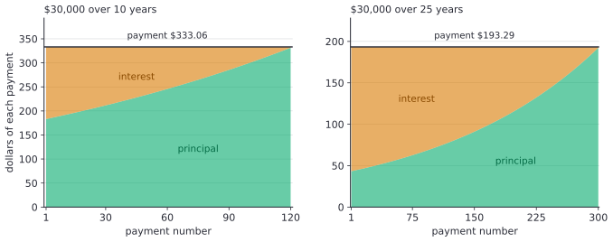

# The loan amortization formula

After this lesson you can find the payment on a loan from its amount, rate and term, prove the balance formula behind it, split any payment into interest and principal, find the balance after any number of payments, and measure what extra payments or a shorter term save.

Before this: [annuities and geometric series](02-annuities-and-geometric-series.md), [sequences and recursion](../../03-high-school/11-sequences-series-and-counting/01-sequences-and-recursion.md) (the loan recurrence) and [mathematical induction](../../04-proofs-and-logic/05-induction/01-mathematical-induction.md).

## Quick check

Try these first. If you get all three right, skip to [Practice](#practice).

1. A loan of \$10,000 charges 1% a month and you pay \$500 at the end of the month. What do you owe right after the first payment?
2. Find the monthly payment on a loan of \$18,000 at 0.5% a month over 48 months.
3. How much of the first payment in problem 2 is interest?

<details class="solution" markdown>
<summary>Answers</summary>

1. Interest is $0.01 \times 10000 = 100$, so you owe $10000 + 100 - 500 = 9600$, that is, \$9,600.
2. $\text{PMT} = \frac{18000 \times 0.005}{1 - 1.005^{-48}} = 422.73$, about \$422.73.
3. The first month's interest is $0.005 \times 18000 = 90$, so \$90.00 of the \$422.73 is interest and \$332.73 reduces the loan.

</details>

## The idea

A lender hands you \$30,000 and you agree to repay it in equal monthly payments over 10 years. Each month the lender charges interest on what you still owe, and your payment first covers that interest. Whatever is left over pays down the loan. Because the loan shrinks, the interest charge shrinks too, so a growing share of the same payment goes to the loan. Paying a loan off this way, in equal instalments that clear it exactly at the end, is called amortizing it.

Two questions follow. What payment makes the balance reach exactly zero after the last payment? And what do you still owe after any number of payments? Both come from one recurrence. The previous lesson found the value of a stream of payments, and a loan is the same thing seen from the other side. The amount lent must equal the present value of the payments, and the amount still owed must equal the present value of those still to come.

This figure shows where the money goes for \$30,000 at an example rate of 6% a year, charged monthly, once over 10 years and once over 25. Each payment is the same height. The orange part is interest and the green part is principal. In the 25-year loan interest is the bigger part of every payment until payment 163.



## Definitions

A **loan** of amount $\text{PV}$ (the **principal**) is repaid in $n$ equal payments of $\text{PMT}$ at the end of each period. The rate per period is $i$, and interest is charged on the balance owed at the start of the period. In this lesson the payment interval equals the compounding period, as for most car, student and personal loans. (Canadian mortgages follow a different compounding rule, covered in [Canadian mortgage compounding](../05-housing/04-canadian-mortgage-compounding.md).)

The **balance** $B_k$ is the amount owed right after the $k$-th payment, so $B_0 = \text{PV}$. In plain words, it is what you would have to pay at that moment to clear the loan. The **interest portion** of payment $k$ is $I_k = i\,B_{k-1}$, the interest charged since the last payment. The **principal portion** is $P_k = \text{PMT} - I_k$, the part of the payment that reduces the balance. (The letter $P$ here is a part of a payment and not the principal of the loan, which is called $\text{PV}$.)

An **amortization schedule** is a table with one row per payment, showing the payment, the interest portion, the principal portion and the new balance. The **amortization period** is the number of periods $n$ over which the loan is scheduled to be repaid.

## How to do it

### The balance recurrence and its solution

The balance changes by a rule each period: interest is added, then the payment is subtracted.

$$
B_0 = \text{PV}, \qquad B_{k+1} = (1 + i)B_k - \text{PMT}.
$$

This is the recurrence of [sequences and recursion](../../03-high-school/11-sequences-series-and-counting/01-sequences-and-recursion.md), with $r$ written as $i$. To find the formula, unroll it. Substituting repeatedly gives $B_1 = (1 + i)\text{PV} - \text{PMT}$, then $B_2 = (1 + i)^2\text{PV} - (1 + i)\text{PMT} - \text{PMT}$, and in general

$$
B_k = (1 + i)^k\,\text{PV} - \text{PMT}\,\bigl(1 + (1 + i) + \cdots + (1 + i)^{k-1}\bigr).
$$

The bracket is the geometric series with ratio $1 + i$ and $k$ terms, which has the sum $\frac{(1 + i)^k - 1}{i}$. Unrolling is a pattern, not yet a proof, so here is the proof.

*Theorem 1.* For $i \ne 0$ and every integer $k \ge 0$, the balance satisfies

$$
B_k = \text{PV}\,(1 + i)^k - \text{PMT}\,\frac{(1 + i)^k - 1}{i}.
$$

We know the recurrence and the starting balance. We want the closed form for every $k$. The plan is induction on $k$, with the recurrence supplying the step.

*Proof.* Base case: for $k = 0$ the right side is $\text{PV} - \text{PMT}\cdot 0 = \text{PV} = B_0$. Inductive step: suppose the formula holds for some $k \ge 0$. By the recurrence,

$$
B_{k+1} = (1 + i)B_k - \text{PMT} = \text{PV}(1 + i)^{k+1} - \text{PMT}\left[(1 + i)\,\frac{(1 + i)^k - 1}{i} + 1\right].
$$

The bracket simplifies, since $(1 + i)\bigl((1 + i)^k - 1\bigr) + i = (1 + i)^{k+1} - (1 + i) + i = (1 + i)^{k+1} - 1$:

$$
(1 + i)\,\frac{(1 + i)^k - 1}{i} + 1 = \frac{(1 + i)^{k+1} - 1}{i}.
$$

So the formula holds for $k + 1$, and by induction for every $k \ge 0$. $\blacksquare$

Look back: the first term is what the principal alone would grow to, and the second is what the payments have paid off, valued the same way as the future value of an annuity. The balance is the first minus the second. When $i = 0$ the closed form isn't defined, and the balance is simply $\text{PV} - k\,\text{PMT}$.

### The payment formula

A loan is paid off when the balance is zero after the last payment. Put $B_n = 0$ in Theorem 1 and solve for $\text{PMT}$:

$$
\text{PV}(1 + i)^n = \text{PMT}\,\frac{(1 + i)^n - 1}{i}.
$$

Dividing both sides by $(1 + i)^n$ gives $\text{PV} = \text{PMT}\,\frac{1 - (1 + i)^{-n}}{i}$, so

$$
\text{PMT} = \frac{\text{PV}\cdot i}{1 - (1 + i)^{-n}} = \text{PV}\,\frac{i\,(1 + i)^n}{(1 + i)^n - 1}.
$$

The second form follows by multiplying the top and bottom by $(1 + i)^n$. This is the same equation as the present value of an ordinary annuity from the last lesson, so there are two views of one fact. Seen as a recurrence, the payment is the one that makes the balance hit zero. Seen as discounting, it is the payment whose present value equals the amount lent, which is what a lender who can earn $i$ elsewhere would accept. Rounding, as lenders do, to the cent gives a payment that is off by a fraction of a cent, which the last payment absorbs.

### Interest and principal in each payment

*Theorem 2.* In a loan of $n$ payments, the principal portions satisfy $P_{k+1} = (1 + i)P_k$ for $1 \le k < n$, so $P_k = P_1(1 + i)^{k-1}$ with $P_1 = \text{PMT} - i\,\text{PV}$. The principal portions add up to $\text{PV}$, and the total interest is $n\,\text{PMT} - \text{PV}$.

We know $I_k = i B_{k-1}$, $P_k = \text{PMT} - I_k$ and $B_k = B_{k-1} - P_k$. We want the pattern in $P_k$. The plan is to compare consecutive principal portions.

*Proof.* Since $B_k = B_{k-1} - P_k$,

$$
P_{k+1} = \text{PMT} - iB_k = \text{PMT} - iB_{k-1} + iP_k = P_k + iP_k = (1 + i)P_k.
$$

So the principal portions form a geometric sequence with ratio $1 + i$, and $P_1 = \text{PMT} - i\,\text{PV}$ because $B_0 = \text{PV}$. Their sum is $P_1\,\frac{(1 + i)^n - 1}{i}$. From $B_n = 0$ we have $\text{PMT}\,\frac{(1 + i)^n - 1}{i} = \text{PV}(1 + i)^n$, so

$$
\sum_{k=1}^{n} P_k = (\text{PMT} - i\,\text{PV})\,\frac{(1 + i)^n - 1}{i} = \text{PV}(1 + i)^n - \text{PV}\bigl((1 + i)^n - 1\bigr) = \text{PV}.
$$

All $n$ payments total $n\,\text{PMT}$, of which $\text{PV}$ is principal, so the interest is $n\,\text{PMT} - \text{PV}$. $\blacksquare$

Look back: the principal portion grows by the factor $1 + i$ every month, the same growth rate as a deposit. In the 10-year loan at 0.5% a month, the first principal portion is \$183.06 and the last is $183.06 \times 1.005^{119} = \$331.40$. Paying a little more principal early reduces all later interest, which the next sections use.

### The remaining balance

*Proposition 3.* After $k$ payments of a loan with $n$ payments, the balance is

$$
B_k = \text{PMT}\,\frac{1 - (1 + i)^{-(n-k)}}{i}.
$$

In words, the amount you owe is the present value of the payments you still have to make. To see it from Theorem 1, write $\text{PV} = \text{PMT}\,\frac{1 - v^n}{i}$ with $v = (1 + i)^{-1}$. Then

$$
B_k = \frac{\text{PMT}}{i}\Bigl[(1 + i)^k(1 - v^n) - (1 + i)^k + 1\Bigr] = \frac{\text{PMT}}{i}\Bigl[1 - (1 + i)^{k - n}\Bigr],
$$

because $(1 + i)^k v^n = (1 + i)^{k-n}$. This is the formula. It needs only $\text{PMT}$, $i$ and the number of payments left, not the original amount.

### Making a schedule

1. Write down the loan amount $\text{PV}$, the rate per period $i$ and the number of payments $n$. Make sure the rate and the payments use the same period.
2. Compute $\text{PMT}$ from the formula and round it to the cent.
3. For each row, the interest is the balance times $i$, rounded to the cent. The principal portion is the payment minus the interest. The new balance is the old one minus the principal portion.
4. In the last row, set the payment equal to the balance plus its interest, so the balance ends at exactly \$0.00. Rounding makes this last payment a few cents different from the others.
5. Check: the principal column adds to the loan amount, and the balance after $k$ payments agrees with the closed form.

### Extra payments and shorter terms

Paying $E$ extra every month means paying $\text{PMT} + E$. The interest rule is unchanged, so the same formula for $n$ from the last lesson gives the new number of payments:

$$
n' = \frac{-\ln\left(1 - \dfrac{\text{PV}\cdot i}{\text{PMT} + E}\right)}{\ln(1 + i)}.
$$

An extra dollar in month 1 goes entirely to principal, so it saves interest every month after that. An extra dollar paid late saves little. A shorter amortization has the same effect from the start, because the payment is larger. The payment doesn't fall in proportion to the term, so halving the term raises the payment by far less than double and saves a large part of the interest. The table in Example 3 shows how.

## Worked examples

<div class="example" markdown>

### Example 1: a \$30,000 loan over 10 years

You borrow \$30,000 for 10 years at 6% a year, charged monthly (an example rate). Find the monthly payment, the first three rows of the schedule, the total interest, and the balance after 5 years.

Step 1: $\text{PV} = 30000$, the period is a month, $i = \frac{0.06}{12} = 0.005$, and $n = 120$.

Step 2: the payment is

$$
\text{PMT} = \frac{30000 \times 0.005}{1 - 1.005^{-120}} = \frac{150}{0.4504\ldots} = 333.0615\ldots
$$

which rounds to \$333.06.

Step 3: the first row has interest $0.005 \times 30000 = 150.00$, so the principal portion is $333.06 - 150.00 = 183.06$ and the new balance is \$29,816.94. In row 2, the interest is $0.005 \times 29816.94 = 149.08$ (to the cent), the principal portion is \$183.98 and the balance is \$29,632.96. Row 3 gives interest \$148.16, principal \$184.90 and balance \$29,448.06.

| Payment | Interest | Principal | Balance |
|---|---|---|---|
| 1 | \$150.00 | \$183.06 | \$29,816.94 |
| 2 | \$149.08 | \$183.98 | \$29,632.96 |
| 3 | \$148.16 | \$184.90 | \$29,448.06 |

Total interest: without rounding, $120 \times 333.0615 - 30000 = 9967.38$. The balance after 5 years (60 payments) by Proposition 3 is $333.0615 \times \frac{1 - 1.005^{-60}}{0.005} = 17227.79$.

Step 5, check: Theorem 1 gives the same balance, $30000 \times 1.005^{60} - 333.0615 \times \frac{1.005^{60} - 1}{0.005} = 17227.79$. The first principal portion plus 119 rounds of growth gives $183.0615 \times 1.005^{119} = 331.40$ for the last one, and the last interest is \$1.66. Building the whole schedule in cents (in code below) gives a last payment of \$333.29 and total interest of \$9,967.43, five cents off the unrounded total, because the payment was rounded down.

</div>

<div class="example" markdown>

### Example 2: how much is still owed at the halfway point

For the loan in Example 1, find how much interest and how much principal were paid in the first 5 years, and what fraction of the loan is still owed.

After 60 payments you have paid $60 \times 333.0615 = 19983.69$. The balance is \$17,227.79 (Example 1), so the principal repaid is $30000 - 17227.79 = 12772.21$ and the interest paid is $19983.69 - 12772.21 = 7211.48$.

Half the payments have been made, but 57.4% of the loan is still owed, because $\frac{17227.79}{30000} = 0.574$. The early payments are mostly interest. In the 25-year loan of the figure the effect is stronger: after 150 payments the balance is \$20,363.14, still 67.9% of the loan.

Check: the interest paid in the first 60 payments is the sum of $0.005\,B_{k-1}$, and Proposition 3 says $B_{60}$ is the present value of the last 60 payments, \$17,227.79, matching the closed form above.

</div>

<div class="example" markdown>

### Example 3: \$100 extra a month, and shorter terms

On the loan of Example 1, you pay \$100 extra each month. How long does the loan last, and how much interest is saved? Then compare other amortization periods.

The payment is $333.0615 + 100 = 433.0615$. Using the formula for $n'$:

$$
n' = \frac{-\ln\left(1 - \frac{150}{433.0615}\right)}{\ln 1.005} = \frac{-\ln 0.65363}{\ln 1.005} = 85.26.
$$

So the loan needs 86 payments, which is 34 fewer than 120. The last payment is smaller than the others. Building the schedule in cents gives a total interest of \$6,921.09 instead of \$9,967.43, a saving of \$3,046.34.

Check: the balance after 85 payments of \$433.06 is \$110.32, and with a month of interest the last payment is about \$110.99, much less than \$433.06, as expected from $n' = 85.26$.

Changing the amortization period instead (the payment from the formula at $i = 0.005$):

| Amortization | Payments | Monthly payment | Total interest |
|---|---|---|---|
| 5 years | 60 | \$579.98 | \$4,799.04 |
| 7 years | 84 | \$438.26 | \$6,813.56 |
| 10 years | 120 | \$333.06 | \$9,967.38 |
| 15 years | 180 | \$253.16 | \$15,568.27 |
| 20 years | 240 | \$214.93 | \$21,583.04 |
| 25 years | 300 | \$193.29 | \$27,987.13 |

Going from 10 years to 5 raises the payment by \$246.92 a month (74%) and cuts the interest by more than half. Going from 25 years to 20 raises the payment by only \$21.64 a month and saves \$6,404.09. The longer the term, the less a month of extra payment buys.

</div>

<div class="example" markdown>

### Example 4: a loan with no interest

A store offers \$12,000 of financing at 0% over 36 months. What is the payment? Does the formula still work?

The formula $\frac{\text{PV}\cdot i}{1 - (1 + i)^{-n}}$ has $0$ on top and on the bottom at $i = 0$, so it can't be used directly. With no interest the balance falls by the payment every month, so the payment is $\frac{12000}{36} = 333.33$. The formula agrees in the limit. For smaller and smaller rates:

| Monthly rate $i$ | Payment from the formula |
|---|---|
| 1% | \$398.57 |
| 0.1% | \$339.54 |
| 0.01% | \$333.95 |
| 0.0001% | \$333.34 |

The payments approach $\frac{12000}{36} = 333.33$ as $i \to 0$. A second edge case: a payment equal to the interest, here $iB$, never reduces the balance, and a payment smaller than it makes the balance grow. In the \$30,000 loan, any payment of \$150 or less is interest only or less.

Check: for $\text{PMT} = 333.33$ and $i = 0$, the recurrence gives $B_{36} = 12000 - 36 \times 333.33 = 0.12$, which is zero after the cents are rounded.

</div>

<div class="example" markdown>

### Example 5: a three-year loan (finish it yourself)

You borrow \$12,000 for 36 months at 9% a year, charged monthly (an example rate). Find the payment, the split of the first payment, and the total interest.

Step 1: $\text{PV} = 12000$, $i = \frac{0.09}{12} = 0.0075$ and $n = 36$.

Now do Step 2 to find the payment, Step 3 for the first row, and then the total interest. Check with the balance after payment 1.

<details class="solution" markdown>
<summary>Finish</summary>

Step 2: $\text{PMT} = \frac{12000 \times 0.0075}{1 - 1.0075^{-36}} = \frac{90}{0.2359\ldots} = 381.5968\ldots$, which rounds to \$381.60.

Step 3: the first payment has interest $0.0075 \times 12000 = 90.00$ and principal $381.60 - 90.00 = 291.60$, so the new balance is \$11,708.40.

Total interest: $36 \times 381.5968 - 12000 = 1737.48$, so about \$1,737.48.

Check: Theorem 1 with $k = 1$ gives $12000 \times 1.0075 - 381.5968 = 11708.40$. The interest is 14.5% of the amount borrowed.

</details>

</div>

## Edge cases and common mistakes

<div class="warning" markdown>

Watch out for the wrong period. A loan at 6% a year with monthly payments uses $i = 0.005$ and $n = 120$ for 10 years. Using $i = 0.06$ with $n = 120$ gives a payment of about \$1,802 a month, which is nonsense. Always write the period next to $i$ and $n$.

</div>

<div class="warning" markdown>

Watch out for the principal portion going the wrong way. The interest is charged on the balance after the last payment, so it falls over time. A common mistake is to charge the interest on the original amount every month, which makes the payments look like interest only and gives a loan that never ends. Compute $I_k = iB_{k-1}$ from the current balance.

</div>

<div class="warning" markdown>

Watch out when you round the payment and keep rounding along the schedule. Each row rounds to the cent, so the final balance is a few cents off \$0.00, which is why the last payment is adjusted. Don't round the payment and then use the formula for the balance with the rounded value over a long term: for a 25-year loan the balance after 300 payments is a few cents, not zero.

</div>

<div class="warning" markdown>

Watch out for reading the payment as the whole cost. The loan in Example 1 costs \$9,967.38 in interest on top of the \$30,000, which is 33% of the amount borrowed. A lower payment from a longer term raises the total interest, as the table in Example 3 shows.

</div>

Other edge cases: with $n = 1$ the payment is $\text{PV}(1 + i)$, the whole loan plus one period of interest. With $i = 0$ the payment is $\frac{\text{PV}}{n}$, as in Example 4. A payment at the start of the period (an annuity due) multiplies the formula for the present value by $1 + i$, so the payment falls by that factor.

## Tricks and shortcuts

The payment for a loan scales with the amount. At 0.5% a month for 10 years the payment is \$11.10 for each \$1,000 borrowed ($333.06 \div 30$). So \$18,000 over the same term costs about $18 \times 11.10 = 199.80$ a month, and the exact value is \$199.83.

The first month's interest is always $i \times \text{PV}$, which gives a quick check on a quoted payment. If a lender quotes \$400 a month on \$30,000 at 0.5% a month, the first row splits as \$150 interest and \$250 principal, and any payment below \$150 isn't enough.

The total interest can be estimated as the payment times the number of payments minus the amount borrowed. For a payment quote, multiply it by $n$ in your head and subtract the loan: \$333.06 times 120 is about \$39,967, so the interest is about \$9,967.

## In code

A schedule is a loop that applies the recurrence one row at a time, working in whole cents. The last payment absorbs the rounding. The last lines compare the schedule with and without an extra payment, and several amortization periods.

<details class="code" markdown>
<summary>In code</summary>

```python
import math

def payment(pv, i, n):
    return pv * i / (1 - (1 + i) ** -n)

def balance(pv, i, pmt, k):
    return pv * (1 + i) ** k - pmt * ((1 + i) ** k - 1) / i

def schedule(pv, i, pmt, extra=0.0, n=None):
    # a table in cents; the last payment is whatever clears the balance
    rows, b, k = [], round(pv, 2), 0
    while b > 0:
        k += 1
        interest = round(b * i, 2)
        pay = min(round(pmt + extra, 2), round(b + interest, 2))
        if k == n:
            pay = round(b + interest, 2)   # the last payment absorbs the rounding
        principal = round(pay - interest, 2)
        b = round(b - principal, 2)
        rows.append((k, pay, interest, principal, b))
    return rows

pv, i, n = 30000, 0.005, 120
p = payment(pv, i, n)
print(round(p, 4), round(p * n - pv, 2))        # 333.0615 9967.38
print(round(balance(pv, i, p, 60), 2))          # 17227.79
print(abs(balance(pv, i, p, 120)) < 1e-6)       # True

rows = schedule(pv, i, round(p, 2), n=n)
for r in rows[:3] + rows[-2:]:
    print(r)
# (1, 333.06, 150.0, 183.06, 29816.94)
# (2, 333.06, 149.08, 183.98, 29632.96)
# (3, 333.06, 148.16, 184.9, 29448.06)
# (119, 333.06, 3.31, 329.75, 331.63)
# (120, 333.29, 1.66, 331.63, 0.0)
print(round(sum(r[2] for r in rows), 2))        # 9967.43

# $100 extra a month
rows2 = schedule(pv, i, round(p, 2), extra=100)
print(len(rows2), round(sum(r[2] for r in rows2), 2))   # 86 6921.09
print(rows2[-1])                                          # (86, 110.99, 0.55, 110.44, 0.0)

# shorter amortizations
for years in (5, 7, 10, 15, 20, 25):
    m = payment(pv, i, 12 * years)
    print(years, round(m, 2), round(m * 12 * years - pv, 2))
# 5 579.98 4799.04
# 7 438.26 6813.56
# 10 333.06 9967.38
# 15 253.16 15568.27
# 20 214.93 21583.04
# 25 193.29 27987.13
```

The schedule works in cents, so its total interest, \$9,967.43, differs by 5 cents from the formula's \$9,967.38. That is the effect of rounding the payment and the interest on every row.

</details>

## FAQ

### Why is so much of the early payment interest?

Interest is charged on the balance, and the balance is largest at the start. In the first month of the 25-year loan the balance is \$30,000, the interest is \$150.00, and the payment is \$193.29, so only \$43.29 reduces the loan. The principal portion grows by 0.5% each month, so it takes 163 payments to pass the interest portion.

### Does it matter which payment is the extra one?

Yes. An extra dollar saves interest at rate $i$ for every month it would have stayed in the balance, so extra dollars early are worth the most. A dollar extra in month 1 of the 120-month loan saves about $1.005^{119} - 1 = 81\%$ of itself by the end, while a dollar extra in the last 12 months saves at most about 6 cents. Check the loan's terms too: some loans charge a penalty for paying early.

### Why is the payment the same every month if the interest changes?

The payment is chosen once to make the balance reach zero at the end. Interest falls and principal rises by exactly the same amount each month, as Theorem 2 shows, so the total stays at $\text{PMT}$. Loans with equal principal portions instead have payments that fall over time. Both exist, but equal payments are the common kind.

### What if the compounding doesn't match the payments?

Convert the rate to the payment interval first, as in the previous lesson: $i_p = (1 + j/m)^{m/p} - 1$. Canadian fixed-rate mortgages are the main case where this matters, and [Canadian mortgage compounding](../05-housing/04-canadian-mortgage-compounding.md) covers the rule.

## Practice

### Warm-up

1\. Find the monthly payment and the total interest on \$9,000 at 0.5% a month over 24 months.

<details class="solution" markdown>
<summary>Solution</summary>

$\text{PMT} = \frac{9000 \times 0.005}{1 - 1.005^{-24}} = 398.89$. The payments total $24 \times 398.8855 = 9573.25$, so the interest is $9573.25 - 9000 = 573.25$.

Check: the first month's interest is $0.005 \times 9000 = 45$, which is less than the payment, so the balance does fall.

</details>

2\. A loan of \$20,000 charges 0.6% a month and has 60 payments. Find the payment and split the first payment into interest and principal.

<details class="solution" markdown>
<summary>Solution</summary>

$\text{PMT} = \frac{20000 \times 0.006}{1 - 1.006^{-60}} = 397.91$. The first interest is $0.006 \times 20000 = 120.00$, so the principal portion is $397.91 - 120.00 = 277.91$.

Check: $120.00 + 277.91 = 397.91$, and the principal portion is positive, so the loan shrinks.

</details>

3\. A loan of \$1,000 at 1% a month is paid with 3 payments of \$340.02. Use the recurrence to find the balance after each payment.

<details class="solution" markdown>
<summary>Solution</summary>

$B_1 = 1.01 \times 1000 - 340.02 = 669.98$. $B_2 = 1.01 \times 669.98 - 340.02 = 336.66$ (more exactly 336.6598). $B_3 = 1.01 \times 336.6598 - 340.02 = 0.0064$, which is less than a cent.

Check: the payment formula gives $\frac{1000 \times 0.01}{1 - 1.01^{-3}} = 340.022\ldots$, so \$340.02 clears the loan to within a fraction of a cent.

</details>

### Standard

4\. Compare borrowing \$15,000 at 0.5% a month over 36 months and over 60 months: the payments and the total interest.

<details class="solution" markdown>
<summary>Solution</summary>

Over 36 months, $\text{PMT} = \frac{15000 \times 0.005}{1 - 1.005^{-36}} = 456.33$ and the interest is $36 \times 456.329 - 15000 = 1427.85$. Over 60 months, $\text{PMT} = 289.99$ and the interest is $60 \times 289.992 - 15000 = 2399.52$.

The longer loan has a payment \$166.34 lower and costs \$971.67 more in interest.

Check: the first-month interest is \$75 in both, and both payments are above it.

</details>

5\. A \$25,000 loan at 0.5% a month has 60 payments. Find the payment, and the balance after 24 payments in two ways.

<details class="solution" markdown>
<summary>Solution</summary>

The payment is $\frac{25000 \times 0.005}{1 - 1.005^{-60}} = 483.32$. By Theorem 1, $B_{24} = 25000 \times 1.005^{24} - 483.3200 \times \frac{1.005^{24} - 1}{0.005} = 15887.22$. By Proposition 3, the present value of the 36 payments left is $483.3200 \times \frac{1 - 1.005^{-36}}{0.005} = 15887.22$.

Check: the two answers agree, and \$15,887.22 is 63.5% of the loan after 40% of the payments.

</details>

6\. On the loan of problem 5 you add \$75 a month. How many payments does it take, and how much interest do you save?

<details class="solution" markdown>
<summary>Solution</summary>

The new payment is $483.32 + 75 = 558.32$. Then $n' = \frac{-\ln\left(1 - \frac{125}{558.32}\right)}{\ln 1.005} = 50.82$, so 51 payments, 9 fewer than 60.

The interest without extra payments is $60 \times 483.32 - 25000 = 3999.20$. Building the schedule with the extra payments gives \$3,372.79 of interest, a saving of \$626.41.

Check: the first-month interest is \$125, and the new payment of \$558.32 is well above it.

</details>

### Challenge

7\. (Reviews [geometric series](../../03-high-school/11-sequences-series-and-counting/02-summation-notation-and-series.md).) Show that the interest portion of payment $k$ is $I_k = \text{PMT}\bigl(1 - (1 + i)^{-(n-k+1)}\bigr)$, and use it to add up the total interest.

<details class="solution" markdown>
<summary>Solution</summary>

We know $I_k = iB_{k-1}$ and Proposition 3, $B_{k-1} = \text{PMT}\,\frac{1 - (1 + i)^{-(n-k+1)}}{i}$, because $n - (k - 1)$ payments remain. Multiply by $i$:

$$
I_k = \text{PMT}\bigl(1 - (1 + i)^{-(n-k+1)}\bigr).
$$

For the total, put $v = (1 + i)^{-1}$ and sum over $k = 1, \dots, n$. The exponents $n - k + 1$ run over $1, \dots, n$, so $\sum_{k=1}^{n} v^{n-k+1} = v + v^2 + \cdots + v^n = \frac{1 - v^n}{i}$ (using $\frac{v}{1 - v} = \frac{1}{i}$). Then

$$
\sum_{k=1}^{n} I_k = n\,\text{PMT} - \text{PMT}\,\frac{1 - v^n}{i} = n\,\text{PMT} - \text{PV}.
$$

This matches Theorem 2.

Check with the \$30,000 loan: $I_1 = 333.0615\bigl(1 - 1.005^{-120}\bigr) = 150.00$, and the total is $120 \times 333.0615 - 30000 = 9967.38$.

</details>

8\. After 12 payments on the loan of Example 1, you make a one-time extra payment of \$5,000 and keep paying \$333.06 a month. How many more payments are needed, and about how much interest does it save?

<details class="solution" markdown>
<summary>Solution</summary>

The balance after 12 payments is $B_{12} = \$27,741.83$ (Theorem 1). After the extra \$5,000 it is \$22,741.83. The number of further payments of \$333.0615 is

$$
\frac{-\ln\left(1 - \frac{0.005 \times 22741.83}{333.0615}\right)}{\ln 1.005} = 83.74,
$$

so 84 more payments, which is 96 in all instead of 120. The total interest is $12 \times 333.0615 + 5000 + 83.74 \times 333.0615 - 30000 \approx 6886.88$ (using the fractional count for the last payment), compared with \$9,967.38 without the extra, so the saving is about \$3,080.50.

Check: simulating the loan month by month after the prepayment gives 84 more payments and \$6,886.88 of interest in all.

</details>

## Where this shows up

- Car loans, student loans and credit cards are all this recurrence with different rules ([car loans and total cost](../04-borrowing/02-car-loans-and-total-cost.md), [student loans](../04-borrowing/01-student-loans.md)). A credit card with a minimum payment is the case where the payment is too small, as in Edge cases.
- Mortgages use the same formula with Canadian compounding, and a schedule over 25 years ([mortgage amortization schedules](../05-housing/03-mortgage-amortization-schedules.md)). The next chapter, borrowing, applies this lesson to real loan decisions.
- In CS the recurrence $B_{k+1} = (1 + i)B_k - \text{PMT}$ is a linear recurrence, solved the same way as in [recurrences](../../06-cs-math/04-sums-recurrences-and-algorithms/02-recurrences.md): unroll, sum the geometric series, prove by induction.
