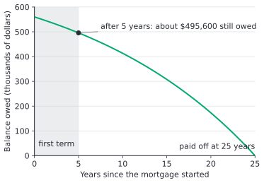
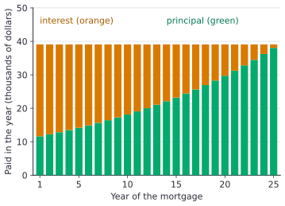

# Mortgage amortization schedules

After this lesson you can build a mortgage's payment schedule month by month, find the balance owed at renewal, and compare the effect of a new rate, accelerated biweekly payments and extra payments on the total interest.

Before this: [mortgage basics](02-mortgage-basics.md), [the loan amortization formula](../03-time-value-of-money/03-loan-amortization-formula.md) and [summation notation and series](../../03-high-school/11-sequences-series-and-counting/02-summation-notation-and-series.md).

## Quick check

Try these first. If you get all three right, skip to [Practice](#practice).

A \$560,000 mortgage has a monthly payment of \$3,256.99 and a monthly interest rate of $i = 0.0041239$ (about 0.41239% a month).

1. How much interest is in the first payment?
2. How much of the first payment reduces the loan?
3. What is the balance after the first payment?

<details class="solution" markdown>
<summary>Answers</summary>

1. Interest is the rate times the balance: $0.0041239 \times 560000 = 2309.39$, so \$2,309.39.
2. The rest of the payment: $3256.99 - 2309.39 = 947.60$, so \$947.60.
3. The balance falls by that amount: $560000 - 947.60 = 559052.40$, so \$559,052.40.

</details>

## The idea

Take a \$560,000 mortgage with a fixed payment of \$3,256.99 a month. In the first month the lender charges interest on the whole loan, about \$2,309. The rest of the payment, about \$948, pays down the loan. In the second month the balance is a little lower, so the interest is a little lower, and a little more of the same payment goes to the loan. The payment never changes, but its split between interest and principal slowly tips.

An **amortization schedule** is the table that records this month by month: the payment, the interest part, the principal part and the balance left. It is the same loop as a bank account in reverse. A savings balance grows by interest each period and you add deposits. A loan balance grows by interest each period and you subtract payments.

The schedule answers practical questions. How much do you still owe when the 5-year term ends? How much of what you have paid so far was interest? What happens if the renewal rate is higher? How much does an extra payment save? Each one is a read-off from the schedule or a small change to it.

This lesson uses a made-up quoted rate of 5% (an example, not a market rate) with the Canadian convention for fixed-rate mortgages: the rate is compounded semi-annually, so the monthly rate is $i = (1 + 0.05 \div 2)^{1/6} - 1 = 0.0041239$. The reason for that convention, and how to derive it, comes in [Canadian mortgage compounding](04-canadian-mortgage-compounding.md). Here the monthly rate is just a number given to you.

## Definitions

An **amortization schedule** lists, for each payment, the interest charged, the part of the payment that reduces the loan, and the balance afterwards.

The **interest portion** of payment $k$ is the periodic rate times the balance just before the payment, $I_k = i \cdot B_{k-1}$, where $i$ is the rate per payment period. The **principal portion** is the rest of the payment, $P_k = \text{PMT} - I_k$. The **balance** $B_k$ is the amount still owed after payment $k$, so $B_k = B_{k-1} - P_k$ and $B_0 = L$ is the original loan.

In plain words, each month the lender takes its interest first, and whatever is left of the payment reduces the loan.

The **equity** in a home is its market value minus the balance owed (defined in [renting vs buying a home](01-renting-vs-buying-a-home.md)). **Renewal** is the signing of a new contract at the end of the term, on the balance then owed, at the rate on offer. An **accelerated** payment schedule makes weekly or biweekly payments that add up to more than the monthly schedule. A **lump-sum prepayment** is an extra amount paid on top of the regular payments.

## How to do it

### Build the schedule

The payment comes from the loan formula in [the loan amortization formula](../03-time-value-of-money/03-loan-amortization-formula.md):

$$
\text{PMT} = L \cdot \frac{i}{1 - (1+i)^{-n}},
$$

where $L$ is the loan, $i$ the rate per payment period and $n$ the number of payments. The steps are:

1. Find the periodic rate $i$. For monthly payments on a fixed-rate Canadian mortgage with a quoted rate $j$, it is $i = (1 + j/2)^{1/6} - 1$.
2. Find the payment from the formula above, with $n = 12 \times$ the years of amortization.
3. For each payment, compute the interest $I_k = i \cdot B_{k-1}$, the principal $P_k = \text{PMT} - I_k$ and the new balance $B_k = B_{k-1} - P_k$.
4. Repeat until the balance reaches zero. The last payment is adjusted by a few cents because the payment was rounded to the cent.
5. Check: the principal portions add up to $L$, and the total interest is $n \cdot \text{PMT} - L$.

Here are the first three and the last three payments of the first term, for the \$560,000 loan over 25 years:

| Payment | Interest | Principal | Balance after |
|---|---|---|---|
| 1 | \$2,309.39 | \$947.60 | \$559,052.40 |
| 2 | \$2,305.48 | \$951.51 | \$558,100.90 |
| 3 | \$2,301.56 | \$955.43 | \$557,145.47 |
| 58 | \$2,058.87 | \$1,198.12 | \$498,053.12 |
| 59 | \$2,053.93 | \$1,203.06 | \$496,850.06 |
| 60 | \$2,048.97 | \$1,208.02 | \$495,642.04 |

(The amounts in the table are rounded to the cent for display, so a few of them differ by a cent from the differences of the rounded numbers next to them.) Each row has one more dollar-and-a-bit of principal than the last: the principal portions grow by the factor $1 + i$ each month, because the interest falls by $i$ times the previous principal.

### Skip ahead with a formula

To find the balance after $k$ payments without building every row, note that each month the balance grows by the factor $(1+i)$ and then the payment comes off: $B_k = (1+i)B_{k-1} - \text{PMT}$. Applying that $k$ times gives

$$
B_k = L(1+i)^k - \text{PMT}\,\bigl(1 + (1+i) + \cdots + (1+i)^{k-1}\bigr) = L(1+i)^k - \text{PMT} \cdot \frac{(1+i)^k - 1}{i}.
$$

The bracket is a geometric series with ratio $1+i$ (see [summation notation and series](../../03-high-school/11-sequences-series-and-counting/02-summation-notation-and-series.md)). In plain words, the balance is what the original loan would have grown to, minus what the payments would have grown to if you had deposited them instead. The second term is the future value of the payments, the idea of [annuities and geometric series](../03-time-value-of-money/02-annuities-and-geometric-series.md).



The balance curve bends: it falls slowly at first, because most of each payment is interest, and faster later. After 5 years, 20% of the amortization has passed but only $64,358 \div 560000 = 11.5\%$ of the loan has been repaid.



Every bar is the same height, because the payment is fixed. What changes is the split: in year 1 the interest is \$27,451 and the principal is \$11,633; in year 25 the interest is \$1,028 and the principal is \$38,056.

### Renewal

At the end of the 5-year term the lender and borrower sign a new contract. The balance that carries forward is $B_{60}$, and the remaining amortization is 20 years. The steps are:

1. Find the balance after 60 payments, from the table or the formula.
2. Choose a new quoted rate and find the new payment with the loan formula, using $L = B_{60}$ and $n = 240$.
3. Compare the new payment with the old one, and add up the interest for the next term or for the whole amortization.

The made-up renewal rates in this table show how much the payment moves for the same \$495,642.04 balance:

| Renewal rate (made up) | New payment | Interest over the last 20 years | Interest over all 25 years |
|---|---|---|---|
| 4% | \$2,994.90 | \$223,133.84 | \$354,195.16 |
| 5% | \$3,256.99 | \$286,035.06 | \$417,096.37 |
| 6% | \$3,529.91 | \$351,535.24 | \$482,596.55 |
| 7% | \$3,813.03 | \$419,484.42 | \$550,545.74 |

The first 5 years cost \$131,061.32 in interest under the original 5% rate, and that part is the same in every row. The row for 5% reproduces the original schedule, as it must. A move from 5% to 6% raises the payment by \$272.92 a month. If the borrower keeps paying \$3,256.99 at 6%, the schedule still works, but the loan lasts 283 more months instead of 240, and the total interest in the last stretch is \$424,978.50.

### Accelerated payments

A monthly schedule makes 12 payments a year. An **accelerated biweekly** schedule pays half of the monthly payment every two weeks. There are 26 biweekly periods in a year, so the borrower makes $26 \times \frac{1}{2} = 13$ monthly payments' worth a year, one extra. With the monthly payment of \$3,256.99, the accelerated biweekly payment is \$1,628.49, and the yearly total rises from \$39,083.85 to \$42,340.84.

The periodic rate is for two weeks: with semi-annual compounding, $i = (1.025)^{1/13} - 1 = 0.0019012$ (the next lesson derives this). Building the schedule at that rate shows the loan is paid off after 559 payments, which is 21.5 years. The total interest is \$349,408.21, which is \$67,688.16 less than the \$417,096.37 on the monthly schedule. The extra payment each year goes straight to principal, which lowers every later interest charge.

A biweekly schedule that is not accelerated, with a payment of \$1,501.56 computed from the formula for 650 payments, takes the full 25 years and costs \$416,013.81 in interest, nearly the same as monthly. The benefit comes from paying more each year, and not from the biweekly timing itself.

### Extra payments

A lump-sum prepayment in month $k$ lowers the balance by the extra amount right away. Every later interest charge then falls, and the regular payment pays down more principal, so the loan ends sooner. These results use the same \$560,000 mortgage, with the extra payments made right after the regular payment on the stated month:

| Extra payment | Paid off after | Total interest |
|---|---|---|
| none | 300 months (25 years) | \$417,096.37 |
| \$20,000 once, at month 12 | 281 months | \$374,107.88 |
| \$200 added to each monthly payment | 268 months | \$366,298.63 |
| \$5,000 each year, at months 12, 24, ... | 242 months | \$328,095.56 |
| \$10,000 each year, at months 12, 24, ... | 204 months (17 years) | \$272,373.47 |

Lenders limit how much you can prepay each year without a penalty, so these amounts are examples, and you should check your contract (see [mortgage basics](02-mortgage-basics.md)).

<div class="note" markdown>

Mortgage rates, home prices and the figures in this lesson are made-up examples. The Canadian compounding rule is the one the next lesson explains, and a real lender's schedule can differ by a few cents because of how it rounds each payment.

</div>

## Worked examples

<div class="example" markdown>

### Example 1: the first three months

Build the first three rows for the \$560,000 mortgage at a quoted 5% over 25 years.

Step 1: the monthly rate is $i = 1.025^{1/6} - 1 = 0.0041239$.

Step 2: the number of payments is $n = 25 \times 12 = 300$, and the payment is

$$
\text{PMT} = 560000 \times \frac{0.0041239}{1 - 1.0041239^{-300}} = 3256.99.
$$

Step 3, payment 1: interest $= 0.0041239 \times 560000 = 2309.39$, principal $= 3256.99 - 2309.39 = 947.60$, balance $= 560000 - 947.60 = 559052.40$.

Payment 2: interest $= 0.0041239 \times 559052.40 = 2305.48$, principal $= 3256.99 - 2305.48 = 951.51$, balance $= 559052.40 - 951.51 = 558100.89$. (The table shows \$558,100.90 because the code carries unrounded numbers, and the cent difference is rounding.)

Payment 3: interest $= 0.0041239 \times 558100.90 = 2301.56$, principal $= 955.43$, balance $= 557145.47$.

Check: over three months, the principal repaid is $947.60 + 951.51 + 955.43 = 2854.54$, and $560000 - 2854.54 = 557145.46$, matching the balance to within a cent. Each principal is $1.0041239$ times the one before: $947.60 \times 1.0041239 = 951.51$.

</div>

<div class="example" markdown>

### Example 2: the balance after 5 years, and a renewal at 6%

Find the balance after 60 payments using the formula, then the payment if the mortgage renews at a quoted 6% for the remaining 20 years.

The formula, with $i = 0.0041239$, $k = 60$ and $\text{PMT} = 3256.99$:

$$
B_{60} = 560000 \times 1.0041239^{60} - 3256.99 \times \frac{1.0041239^{60} - 1}{0.0041239} = 495642.04.
$$

So \$495,642.04 is still owed. The home equity, if the home is still worth \$700,000, is $700000 - 495642.04 = 204357.96$. That is the \$140,000 down payment plus the \$64,357.96 of principal repaid.

For the renewal at 6%, the monthly rate is $1.03^{1/6} - 1 = 0.0049386$, and $n = 240$:

$$
\text{PMT} = 495642.04 \times \frac{0.0049386}{1 - 1.0049386^{-240}} = 3529.91.
$$

The payment rises by $3529.91 - 3256.99 = 272.92$ a month.

Check: the balance from the formula matches the last row of the schedule in the table above, \$495,642.04. The new payment is bigger than the first month's interest at 6%, $495642.04 \times 0.0049386 = 2447.8$, as it must be.

</div>

<div class="example" markdown>

### Example 3: accelerated biweekly payments

Compare the monthly schedule with an accelerated biweekly one for the same mortgage.

The accelerated payment is half of \$3,256.99, which is \$1,628.49. In a year that is $26 \times 1628.49 = 42340.84$, compared with $12 \times 3256.99 = 39083.85$ on the monthly schedule. The difference, \$3,256.99, is one extra monthly payment.

With the biweekly rate $0.0019012$, the balance reaches zero at payment 559, so after $559 \div 26 = 21.5$ years. The interest is \$349,408.21, against \$417,096.37.

The saving is $417096.37 - 349408.21 = 67688.16$, about \$67,688.

Check: the balance after 5 years on this schedule is \$476,942.46, which is \$18,699.58 below the monthly schedule's \$495,642.04. A year's extra payment is \$3,256.99, and five of them with interest on the saved interest give about that amount.

</div>

<div class="example" markdown>

### Example 4: a \$20,000 lump sum (finish it yourself)

After 12 monthly payments the balance is \$548,367.36. The borrower makes a one-time prepayment of \$20,000. Find the interest in payment 13 with and without the lump sum, and how much interest the lump sum saves in that one month.

Step 1: without the lump sum, the interest in payment 13 is $0.0041239 \times 548367.36 = 2261.42$.

Now find the interest with the lump sum, subtract, and check that the saving is the rate times \$20,000.

<details class="solution" markdown>
<summary>Finish</summary>

The new balance is $548367.36 - 20000 = 528367.36$, and the interest in payment 13 is $0.0041239 \times 528367.36 = 2178.94$. The saving in that month is $2261.42 - 2178.94 = 82.48$, so \$82.48.

Check: $0.0041239 \times 20000 = 82.48$. The saving repeats and grows each month, which is why the loan ends sooner: 281 payments instead of 300, with \$42,988.49 less interest in total.

</details>

</div>

## Edge cases and common mistakes

<div class="warning" markdown>

Watch out: the monthly rate is not the quoted rate divided by 12. For this mortgage $0.05 \div 12 = 0.0041667$, which is higher than the correct $0.0041239$. Using it on the \$560,000 loan gives a payment of \$3,273.70, \$16.72 a month too high. The next lesson explains why.

</div>

<div class="warning" markdown>

Watch out: the balance is not a straight line. After one fifth of the amortization (5 years of 25), the balance is \$495,642, which is 88.5% of the loan, not 80%. Early payments are mostly interest.

</div>

<div class="warning" markdown>

Watch out: equity is more than the down payment. After 5 years, equity is the down payment, plus the principal repaid, plus or minus any change in the home's value. Principal repaid can be small early on, \$64,358 here, and a fall in the home's price can wipe out more than that.

</div>

<div class="warning" markdown>

Watch out: do not compare a biweekly schedule that is not accelerated with an accelerated one. Both have a payment about every two weeks. Only the accelerated one pays 13 monthly payments' worth a year.

</div>

In the final month, the balance plus its interest is almost exactly one payment. In exact arithmetic the 300th payment brings the balance to zero. In a real schedule the payment is rounded to the cent, so the last payment is adjusted by a few cents to land on exactly zero. With a lump sum or an extra payment, the last payment can be much smaller than the others, as in the 268-month case.

Rounding: lenders round the payment to the cent, and the interest each month may be rounded too. Over 300 months this changes the total by a few cents, never by dollars.

## Tricks and shortcuts

To estimate the first month's interest, multiply the balance by the quoted rate and divide by 12 and then subtract about 1%: \$560,000 at 5% is $560000 \times 0.05 \div 12 = 2333.33$, and the true figure is \$2,309.39, about 1% lower. The estimate is quick and always a little high.

To estimate the balance after a term, use the rule that the total principal repaid in the first year is about the first month's principal times 12.3: $947.60 \times 12.3 = 11655$, close to \$11,633.

## In code

The schedule is a loop. These functions build it, then find the renewal, accelerated and prepayment results above.

<details class="code" markdown>
<summary>In code</summary>

```python
def periodic_rate(quoted, per_year):
    """Rate per payment for a fixed-rate Canadian mortgage (semi-annual compounding)."""
    return (1 + quoted / 2) ** (2 / per_year) - 1

def payment(loan, quoted, years, per_year=12):
    i, n = periodic_rate(quoted, per_year), years * per_year
    return loan * i / (1 - (1 + i) ** -n)

def schedule(loan, i, pay, lumps=None):
    """Rows of (k, interest, principal, balance). lumps maps payment number to extra amount."""
    rows, balance, k = [], loan, 0
    while balance > 1e-9:
        k += 1
        interest = balance * i
        principal = min(pay - interest, balance)
        balance -= principal
        if lumps and k in lumps:
            extra = min(lumps[k], balance)
            balance -= extra
            principal += extra
        rows.append((k, interest, principal, balance))
    return rows

def total_interest(rows):
    return sum(r[1] for r in rows)

loan, quoted = 560_000, 0.05
i = periodic_rate(quoted, 12)
pay = payment(loan, quoted, 25)
rows = schedule(loan, i, pay)
print(round(pay, 2), len(rows), round(total_interest(rows), 2))  # 3256.99 300 417096.37
print([round(x, 2) for x in rows[0][1:]])                        # [2309.39, 947.6, 559052.4]
balance60 = rows[59][3]
print(round(balance60, 2))                                       # 495642.04

for renewal in (0.04, 0.05, 0.06, 0.07):
    new_pay = payment(balance60, renewal, 20)
    later = schedule(balance60, periodic_rate(renewal, 12), new_pay)
    print(renewal, round(new_pay, 2), round(total_interest(later), 2))
# 0.04 2994.9 223133.84
# 0.05 3256.99 286035.06
# 0.06 3529.91 351535.24
# 0.07 3813.03 419484.42

bi = schedule(loan, periodic_rate(quoted, 26), pay / 2)          # accelerated biweekly
print(round(pay / 2, 2), len(bi), round(total_interest(bi), 2))  # 1628.49 559 349408.21

for lump in ({12: 20_000}, {12 * y: 10_000 for y in range(1, 25)}):
    r = schedule(loan, i, pay, lumps=lump)
    print(len(r), round(total_interest(r), 2))
# 281 374107.88
# 204 272373.47

print(len(schedule(loan, i, pay + 200)))                         # 268
```

The `min` calls handle the last payment and a lump sum that is bigger than the balance. The schedule stops when the balance reaches zero.

</details>

## FAQ

### Why is so much of the early payment interest?

Interest is charged on the whole balance, and early on the balance is almost the whole loan. A balance of \$560,000 at 0.41239% a month is \$2,309 of interest, which is 71% of the \$3,256.99 payment. As the balance falls, the interest share falls with it.

### Does the payment change when I renew?

It can. The payment is set by the balance, the rate and the remaining amortization. If the renewal rate is the same, the payment is the same, as the 5% row shows. At a higher rate the payment rises, unless you extend the amortization, which a lender may allow.

### Why does a lump sum early on save more than the same lump sum late?

Each dollar prepaid stops earning interest for the lender for the rest of the loan. A dollar prepaid in year 1 avoids interest for 24 years, and a dollar prepaid in year 20 avoids it for 5. The \$20,000 at month 12 saves \$42,988.49, which is more than twice the amount.

### Why do accelerated payments help if I pay the same amount per year?

You do not pay the same amount. Biweekly accelerated payments total one extra monthly payment a year, \$3,256.99 more. If you pay only $\frac{12}{26}$ of the monthly payment every two weeks, the yearly total is the same and the saving mostly disappears (\$1,501.56 above).

## Practice

### Warm-up

1\. A \$300,000 mortgage has a quoted rate of 4% (made up) and a 25-year amortization. The monthly rate is $i = 0.0033059$ and the payment is \$1,578.06. Find the interest and principal in the first payment.

<details class="solution" markdown>
<summary>Solution</summary>

Interest: $0.0033059 \times 300000 = 991.77$, so \$991.77. Principal: $1578.06 - 991.77 = 586.29$, so \$586.29.

Check: the interest is 62.8% of the payment, which is plausible for a first payment at this rate.

</details>

2\. Using the formula for $B_k$ with the numbers in Problem 1, find the balance after 60 payments.

<details class="solution" markdown>
<summary>Solution</summary>

With $(1+i)^{60} = 1.0033059^{60} = 1.21899$ (rounded), $B_{60} = 300000 \times 1.21899 - 1578.06 \times \frac{1.21899 - 1}{0.0033059}$. The first term is about \$365,698 and the second is about \$104,537, so the balance is about \$261,161 (the exact calculation, without rounding $(1+i)^{60}$, gives \$261,161.75).

Check: this is below the \$300,000 loan, and the principal repaid is $300000 - 261161.75 = 38838.25$, about 12.9% of the loan, a little more than for the 5% loan in the lesson.

</details>

3\. The home in Problem 1 was bought for \$375,000 with \$75,000 down. After 5 years it is worth \$400,000. Find the equity.

<details class="solution" markdown>
<summary>Solution</summary>

Equity is the value minus the balance: $400000 - 261161.75 = 138838.25$, so \$138,838.25.

Check: it also equals the down payment, plus principal repaid, plus the gain in value: $75000 + 38838.25 + 25000 = 138838.25$.

</details>

### Standard

4\. For the mortgage in Problem 1, what percent of the first payment is interest, and what percent of the last payment is interest?

<details class="solution" markdown>
<summary>Solution</summary>

First payment: $991.77 \div 1578.06 = 0.6285$, which is 62.8%.

The last payment's balance before it is \$1,572.86 (the principal portion), and the interest is $0.0033059 \times 1572.86 = 5.20$. The share is $5.20 \div 1578.06 = 0.33\%$.

Check: the interest and principal in the last payment add to $5.20 + 1572.86 = 1578.06$, the payment.

</details>

5\. The balance after 5 years in Problem 2 renews for 20 years at a made-up quoted 6%. Find the new payment, and the change from \$1,578.06.

<details class="solution" markdown>
<summary>Solution</summary>

The monthly rate at 6% is $1.03^{1/6} - 1 = 0.0049386$, and $n = 240$. The payment on \$261,161.75 is \$1,859.96.

The change is $1859.96 - 1578.06 = 281.90$, so \$281.90 a month more.

Check: at a renewal rate of 4%, the payment would be \$1,578.06, the same as before, which is a sign that 4% reproduces the original schedule.

</details>

6\. Make the mortgage in Problem 1 an accelerated biweekly one. Find the payment, how long it takes to pay off, and the interest saved. Use the biweekly rate $(1.02)^{1/13} - 1$.

<details class="solution" markdown>
<summary>Solution</summary>

The payment is half of \$1,578.06, which is \$789.03. Building the schedule with the biweekly rate takes 569 payments, which is $569 \div 26 = 21.9$ years.

The interest is \$148,871.77, against \$173,418.18 on the monthly schedule (the total of $300 \times 1578.06 - 300000$ without rounding), so the saving is $173418.18 - 148871.77 = 24546.41$, about \$24,546.

Check: the saving is smaller than the \$67,688 in the lesson, because the loan and the interest rate are smaller.

</details>

### Challenge

7\. For the \$560,000 mortgage, find how many months it takes if the borrower adds \$200 to each payment, using $n = -\frac{\ln(1 - L i / \text{PMT})}{\ln(1 + i)}$ (derived by solving the loan formula for $n$, as in [exponential and logarithmic equations](../../03-high-school/07-exponentials-and-logarithms/04-exponential-and-logarithmic-equations.md)). How much interest does it save?

<details class="solution" markdown>
<summary>Solution</summary>

The payment is $3256.99 + 200 = 3456.99$. With $L i = 560000 \times 0.0041239 = 2309.39$:

$$
n = -\frac{\ln(1 - 2309.39 \div 3456.99)}{\ln(1.0041239)} = 267.95.
$$

So the loan takes 268 payments, the last one smaller. The interest is \$366,298.63, which is $417096.37 - 366298.63 = 50797.74$ less, about \$50,798.

Check: the same formula with the original payment gives $n = 300.0$, which confirms the formula.

</details>

8\. (Reviews [summation notation and series](../../03-high-school/11-sequences-series-and-counting/02-summation-notation-and-series.md).) The principal portions of a mortgage's payments form a geometric sequence with first term $P_1 = 947.60$ and ratio $1.0041239$. Use the geometric series formula to show that the 300 principal portions add up to the loan, \$560,000.

<details class="solution" markdown>
<summary>Solution</summary>

The sum of 300 terms of a geometric series is $P_1 \cdot \frac{r^{300} - 1}{r - 1}$, with $r = 1 + i$:

$$
947.60 \times \frac{1.0041239^{300} - 1}{0.0041239} = 947.60 \times 590.97 = 560003,
$$

which is \$560,000 up to the rounding of the first principal. The unrounded value, \$947.5953, gives \$560,000.00.

Check: the sum is the whole loan because the balance reaches zero after the last payment, and every dollar of principal reduces the balance by a dollar.

</details>

## Where this shows up

- The next lesson, [Canadian mortgage compounding](04-canadian-mortgage-compounding.md), derives the monthly rate used here and the rule in Canada's Interest Act behind it.
- In CS, a schedule is a loop with a state variable, the same shape as a running total. The closed-form balance is the loop's invariant written as a formula.
- The renewal question appears again in the chapter on borrowing and in [spreadsheet finance functions](../07-taxes-insurance-and-planning/03-spreadsheet-finance-functions-and-capstone.md), which build schedules with `PMT`, `IPMT` and `PPMT`.
